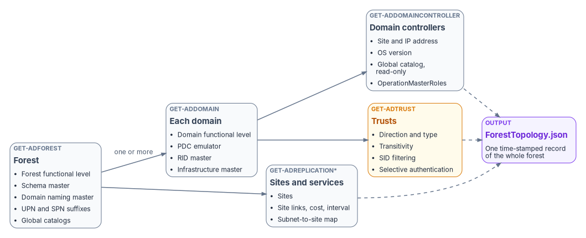
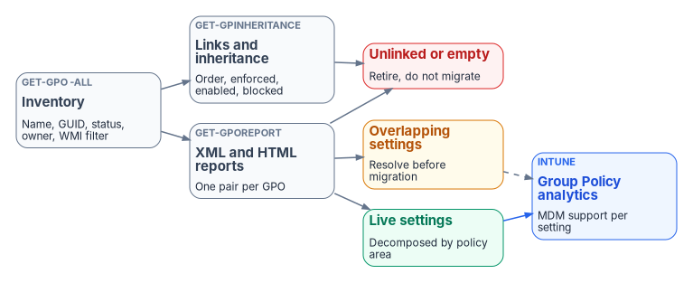
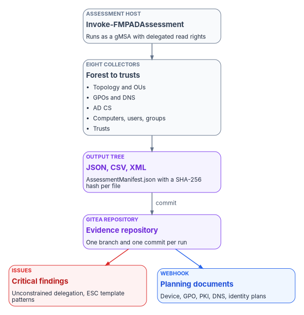

# Chapter 08 — Assessing the Forest

*A migration plan is only as good as the inventory under it, and the inventory is only as good as the evidence that proves when, how and by whom it was taken.*

::: {.callout-note}
## In this chapter
The privileged half of discovery: what the full forest assessment collects, the rights it needs, and how to keep those rights narrow. It walks the eight collection areas (topology, OUs, Group Policy, DNS, AD CS, computers, users and groups, trusts), then the pipeline that turns each run into a hashed, versioned record in a Git repository, with findings raised as issues. It closes with security handling, troubleshooting, the output schema and a quick reference card. The complete module is in [Appendix B](appendix-b-forest-assessment-module.md).
:::

[Chapter 07](07-read-only-discovery.md) ends with a gap analysis: the list of things a read-only account couldn't see. This chapter fills those gaps. The full assessment reads the configuration partition, ACLs on OUs, every GPO's settings, DNS server configuration, the PKI containers and certificate authority (CA) settings, and the delegation flags on every account. Some of that needs rights beyond default read access, so the assessment is run deliberately, by a named account, on a schedule, and every run leaves the same evidence behind.

The program's position is that the assessment is an evidence-producing process, not a set of scripts. Each run does three things:

1. It collects a fixed set of artifacts into a fixed directory layout, so two runs can be compared file by file.
2. It writes a manifest with a SHA-256 hash of every file, so anyone can prove later that an artifact wasn't changed.
3. It commits the run to the program's Git repository (a self-hosted Gitea instance in the reference design), so the history of the forest is the history of the repository.

The downstream planning documents in this book and its companions read those artifacts, not someone's memory of the forest.

## What the assessment covers

| Area | What is captured | Main output |
|---|---|---|
| Forest topology | Domains, functional levels, sites, site links, subnets, global catalogs, the five operations master role holders | `ForestTopology.json` |
| Domain controllers | Host name, site, address, OS version, global catalog and read-only flags, roles held | `DomainControllers.json` |
| OU hierarchy | The full tree with object counts, GPO links, inheritance blocking and non-inherited ACEs | `OUHierarchy.json`, `OUDelegations.json` |
| Group Policy | Every GPO, its XML and HTML report, links, permissions, a native backup, and the unlinked, empty and overlapping sets | `GPOInventory.json`, `GPOSettings\` |
| DNS | Zones, partitions, forwarders, stub zones, DNSSEC, scavenging, stale records, DC locator SRV records | `DNSInventory.json` |
| AD CS | Enterprise CAs, templates, CDP and AIA locations, and template and CA settings that match known escalation patterns | `PKIInventory.json`, `PKISecurityReport.json` |
| Computers | Every computer object, OS classification, staleness, Kerberos delegation | `ComputerInventory.json`, `DelegationReport.csv` |
| Users and groups | Privileged membership, AdminSDHolder-protected accounts, service accounts, empty and circular groups | `UserInventory.json`, `GroupInventory.json` |
| Trusts | Direction, type, transitivity, SID filtering, selective authentication, verification status | `TrustMap.json` |

Out of scope here: Microsoft Entra Connect configuration ([Chapter 09](09-building-the-entra-target.md)), the mapping of GPO settings to Intune policy (the workbook's [GPO sunset program](../../operational-guides/gpo-sunset-program.md)), and Azure services. The assessment runs against on-premises Active Directory and writes to an on-premises repository.

{#fig-ch08-topology-discovery fig-alt="Left to right. A slate card labeled Get-ADForest, Forest, lists forest functional level, schema master, domain naming master, UPN and SPN suffixes, and global catalogs. An arrow labeled one or more leads to a slate card, Get-ADDomain, Each domain, listing domain functional level, PDC emulator, RID master and infrastructure master. A second arrow from the forest leads to a slate card, Get-ADReplication cmdlets, Sites and services, listing sites, site links with cost and interval, and the subnet-to-site map. From each domain, arrows lead to a slate card, Get-ADDomainController, Domain controllers, listing site and IP address, OS version, global catalog and read-only flags, and OperationMasterRoles, and to an amber card, Get-ADTrust, Trusts, listing direction and type, transitivity, SID filtering and selective authentication. Dashed arrows from domain controllers, trusts and sites converge on a violet card, Output, ForestTopology.json, one time-stamped record of the whole forest."}

## Prerequisites

::: {.callout-warning}
## Illustrative code
The PowerShell in this chapter is illustrative. It hasn't been tested against a production forest. Review it, and run it first in a test forest with the narrow rights described below. Complete functions are in [Appendix B](appendix-b-forest-assessment-module.md).
:::

### Platform and modules

The assessment host is a domain-joined Windows Server 2025 or Windows 11 machine with the Remote Server Administration Tools (RSAT). Both report OS build 26100 or later (Windows 11 version 25H2 reports 26200), which is what the prerequisite check tests for.[^c08-builds] On Windows client, RSAT tools are Features on Demand; on Windows Server they are features installed with `Install-WindowsFeature`.[^c08-rsat]

| Module or tool | Used for | Windows client (Feature on Demand) | Windows Server |
|---|---|---|---|
| ActiveDirectory | Forest, domain, object and trust queries | `Rsat.ActiveDirectory.DS-LDS.Tools~~~~0.0.1.0` | `RSAT-AD-PowerShell` |
| GroupPolicy | GPO inventory, reports, links, permissions, backup | `Rsat.GroupPolicy.Management.Tools~~~~0.0.1.0` | `GPMC` |
| DnsServer | Zone, record, DNSSEC and scavenging queries | `Rsat.Dns.Tools~~~~0.0.1.0` | `RSAT-DNS-Server` |
| AD CS tools | CA and template snap-ins, `certutil` against remote CAs | `Rsat.CertificateServices.Tools~~~~0.0.1.0` | AD CS management tools |
| PSPKI (optional) | Convenience cmdlets for CAs and templates | `Install-Module PSPKI -Scope CurrentUser` | Same |

The client capability names are as Microsoft publishes them.[^c08-fod] On Windows Server, run `Get-WindowsFeature -Name RSAT*` and confirm the exact feature names before scripting the install; Microsoft's guidance shows that discovery step and the `RSAT-AD-PowerShell` name.[^c08-rsat][^c08-rbcd-hop]

Two corrections to the source design. First, the `ADCSAdministration` module, which the source listed as required, isn't used by any assessment function; it manages a local CA role and isn't needed on the assessment host. Second, PSPKI is now optional. Its publisher says it no longer actively supports or updates the module, although version 4.4.1 was still published to the PowerShell Gallery in June 2026.[^c08-pspki][^c08-pspki-gallery] The collectors in this chapter read AD CS configuration directly from the directory and from `certutil`, and use PSPKI only where it's installed and approved.

### Rights

Most of the forest is readable by any authenticated user. The parts that aren't are the reason this chapter exists.

| Collector | Minimum rights | Notes |
|---|---|---|
| `Get-FMPForestTopology` | Authenticated user | Forest, domain, site and DC metadata are readable by default |
| `Get-FMPOUHierarchy` | Read on OUs; read permissions on their security descriptors | Some ACLs need explicit read-permissions rights |
| `Get-FMPGPOInventory` | Read on GPOs and SYSVOL; GPO backup rights | Backup needs explicit delegation |
| `Get-FMPDNSAssessment` | Read permission on each DNS server | Delegate read on the server; don't use DnsAdmins (see below) |
| `Get-FMPPKIAssessment` | Read on the Public Key Services containers; read on each CA | `certutil -getreg` against a CA can need CA-level rights |
| `Get-FMPComputerInventory` | Authenticated user | Delegation attributes are readable by default |
| `Get-FMPUserInventory`, `Get-FMPGroupInventory` | Authenticated user | Recursive expansion is slow in large forests |
| `Get-FMPTrustMap` | Authenticated user to enumerate; Domain Admins to verify | `netdom` verification needs administrative credentials |

The source guide recommended adding the assessment account to **DnsAdmins** for DNS read access. Don't. Microsoft treats DnsAdmins as a privileged group, because its members have administrative control over the DNS Server service, and Defender for Identity flags non-privileged members as a risk.[^c08-dnsadmins] Grant read permission on the DNS server object to a dedicated group instead. The same reasoning applies to the source's "Domain Admin for initial discovery." The program's position is that no assessment run uses a standing Domain Admins account; trust verification is the only step that needs those rights, and it runs separately under a just-in-time elevation.

Trust verification needs those credentials because `netdom` requires domain administrator credentials for accurate verification.[^c08-netdom]

### Output layout

Every run writes to the same tree, rooted at the domain's DNS name, so runs compare file by file:

```text
D:\FMP\Assessment\<domain>\
├── AssessmentManifest.json
├── Forest\     ForestTopology.json, ForestInfo.json, Sites.json, SiteLinks.json, Subnets.json, FSMORoles.json
├── Domains\    AllDomains.json, <domain>.json, DomainControllers.json
├── OUs\        OUHierarchy.json, OUFlatList.csv, OUFlatExport.json, OUGPOLinks.json, OUDelegations.json, OUTreeVisual.txt
├── GPOs\       GPOInventory.json, GPOLinks.json, GPOEmpty.json, GPOConflicts.json, GPOPermissions.json,
│               GPOSettingsDecomposed.json
│   ├── GPOSettings\   <GUID>.xml, <GUID>.html
│   └── GPOBackups\
├── DNS\        DNSInventory.json, DNSHealthReport.json, DNSRecordInventory.json
├── PKI\        PKIInventory.json, PKISecurityReport.json, <CA name>.cer
├── Objects\    ComputerInventory.json, ComputersByOS.csv, StaleComputers.csv, DelegationReport.csv,
│               UserInventory.json, PrivilegedUsers.csv, AdminCountReport.csv, ServiceAccounts.csv,
│               GroupInventory.json, CircularGroups.json
├── Trusts\     TrustMap.json
└── ServiceAccounts\   MSAInventory.json, gMSAInventory.json
```

`Test-FMPPrerequisites` in Appendix B checks the OS build, the modules, forest connectivity and the output root, and returns a pass or fail row for each.

## Forest and domain topology

Topology discovery records the shape of the forest before anything inside it. It answers the questions that size every later decision: how many domains, at what functional level, with how many domain controllers in how many sites, and which controllers hold the operations master roles.

### Operations master roles

Active Directory has five operations master (FSMO) roles. Two are forest-wide and exist once per forest: the schema master and the domain naming master. Three are domain-wide and exist once in every domain: the PDC emulator, the RID master and the infrastructure master.[^c08-fsmo] The PDC emulator in the forest root domain is also the authoritative time source for the forest.[^c08-fsmo] A three-domain forest therefore has eleven role holders to record, not five.

`Get-ADForest` returns the two forest-wide holders and `Get-ADDomain` returns the three domain-wide holders. `Get-ADDomainController` also returns an `OperationMasterRoles` property for each controller, which is the simpler way to attribute roles to controllers.[^c08-manage-fsmo]

```powershell
$forest = Get-ADForest
foreach ($domainDns in $forest.Domains) {
    Get-ADDomainController -Filter * -Server $domainDns |
        Select-Object HostName, Domain, Site, IPv4Address,
            OperatingSystem, IsGlobalCatalog, IsReadOnly,
            @{ N = 'Roles'; E = { $_.OperationMasterRoles -join ', ' } }
}
```

### Functional levels

Record the forest mode and every domain mode. The values tell you which domain controller operating systems the forest can accept and which features are available. The ActiveDirectory module's `ADForestMode` values now run up to `Windows2025Forest`.[^c08-forestmode] The Windows Server 2025 functional level (DomainLevel and ForestLevel 10 in answer files) is the first new level since Windows Server 2016; Windows Server 2019 and 2022 didn't add one.[^c08-ws2025] It's required for the optional 32k database page size feature, and only Windows Server 2025 domain controllers can run at it.[^c08-fl]

The assessment should flag two conditions:

- **A functional level below Windows Server 2016.** A Windows Server 2025 domain controller can join only a domain at the Windows Server 2016 functional level or higher, so a lower level blocks the domain controller refresh before any cloud work starts.[^c08-fl-upgrade]
- **Mixed domain levels across the forest.** If every domain controller in the forest runs Windows Server 2025, raising the forest level to Windows Server 2025 raises every domain with it.[^c08-raise-fl]

### Sites, site links and subnets

`Get-ADReplicationSite`, `Get-ADReplicationSiteLink` and `Get-ADReplicationSubnet` capture the replication topology and the subnet-to-site map.[^c08-admodule] The subnet map matters beyond replication: domain controller location for clients depends on it, and an unmapped subnet sends clients to arbitrary domain controllers. Record site link cost and replication interval; they explain authentication latency at remote sites better than any network diagram.

`Get-FMPForestTopology` combines all of this into one `ForestTopology.json` with a timestamp.

## OU hierarchy and delegation

[Chapter 05](05-delegation-without-ous.md) explains why the OU tree is the delegation model in Active Directory, and why Entra ID has none. The assessment's job is to capture what the tree actually encodes, so that the attribute design in [Chapter 09](09-building-the-entra-target.md) reproduces intent rather than structure.

Extract four things for every OU:

1. **Placement and size.** Distinguished name, depth, description, `ManagedBy`, protection from accidental deletion, and direct counts of users, computers and groups. A recursive builder produces a nested `OUHierarchy.json`; a flat CSV goes to spreadsheet review.
2. **GPO links.** Linked GPOs with link order, enforcement and enabled state, and whether the OU blocks inheritance.
3. **Delegated permissions.** The non-inherited access control entries on the OU, excluding well-known built-in principals. These are the delegations someone made by hand, and they become the administrative unit and role assignment candidates in Chapter 05's matrix.
4. **A text rendering** of the tree with object and GPO counts at each node, for human review.

For GPO links, prefer `Get-GPInheritance` to parsing the raw attribute. It returns the GPOs linked directly to a domain or OU, the GPOs that actually apply in precedence order, and whether inheritance is blocked.[^c08-gpinheritance] If you do parse `gPLink`, each link is a GPO path plus a `linkOptions` bitmask: `0x1` means the link is disabled and `0x2` means it's enforced.[^c08-gpscope] Block inheritance is a property of the container, stored in its `gPOptions` attribute; an enforced link still applies through a block.[^c08-gpprocessing] Match GUIDs case-insensitively, because the `cn=` and `CN=` spellings both occur.

```powershell
Get-ADOrganizationalUnit -Filter * | ForEach-Object {
    $som = Get-GPInheritance -Target $_.DistinguishedName
    [pscustomobject]@{
        OU                 = $_.DistinguishedName
        InheritanceBlocked = $som.GpoInheritanceBlocked
        Links              = $som.GpoLinks |
            Select-Object DisplayName, GpoId, Enabled, Enforced, Order
    }
}
```

OU delegation analysis reads ACLs through the `AD:` drive, which the ActiveDirectory module provides. Keep only entries where `IsInherited` is false, and drop `NT AUTHORITY`, `BUILTIN` and well-known SIDs. What remains is usually short, and it's the most valuable list in the OU export.

## Group Policy inventory and analysis

The GPO inventory is the largest and most consequential artifact for modernization. Every live setting either moves to Intune, moves somewhere else, or is retired, and nobody can decide which without the inventory.

{#fig-ch08-gpo-analysis fig-alt="Left to right. A slate card, Get-GPO -All, Inventory, records name, GUID, status, owner and WMI filter. It feeds two slate cards: Get-GPOReport, XML and HTML reports, one pair per GPO; and Get-GPInheritance, Links and inheritance, with order, enforced, enabled and blocked. Both feed a red card, Unlinked or empty, retire, do not migrate. The reports also feed an amber card, Overlapping settings, resolve before migration, and a green card, Live settings, decomposed by policy area. A blue arrow leads from live settings to a blue card, Intune, Group Policy analytics, MDM support per setting. A dashed arrow also runs from overlapping settings to Group Policy analytics."}

### What to collect

| Step | Cmdlet | Output |
|---|---|---|
| Enumerate | `Get-GPO -All` | Name, GUID, `GpoStatus`, created and modified times, owner, WMI filter |
| Report | `Get-GPOReport -Guid <id> -ReportType Xml` and `Html` | One XML and one HTML file per GPO |
| Links | `Get-GPInheritance` per domain and OU, plus site links | `GPOLinks.json` with order, enforced and enabled |
| Permissions | `Get-GPPermission -Guid <id> -All` | Who can edit, apply and read each GPO |
| Backup | `Backup-GPO -All -Path <folder>` | A native backup for rollback |

All five cmdlets are in the GroupPolicy module.[^c08-gpmodule] `Get-GPOReport` produces XML or HTML, and its report includes links, security filtering, WMI filtering, delegation and the computer and user configuration of the GPO.[^c08-gporeport] `Get-GPPermission -All` returns the permission level of every principal that has permissions on the GPO.[^c08-gppermission]

The source link analysis searched only OUs and the domain root. GPOs can also be linked to sites, and a site-linked GPO looks unlinked to an OU-only search. Include the site objects in the configuration partition, or the "unlinked" list will contain GPOs that are in use.

### Classify before you migrate

Decompose each XML report by configuration area: security settings, administrative templates, preferences, scripts, software installation and folder redirection, separately for the computer and user halves. Then sort GPOs into three groups:

- **Unlinked or empty.** No links anywhere, or no settings in either half. These are retirement candidates. An empty GPO is one whose report has no `ExtensionData` under either `Computer` or `User`.
- **Overlapping.** The same setting configured in more than one GPO. Find these before migration, because Intune's migration step refuses conflicting values and asks you to pick one.[^c08-gpa-migrate]
- **Live.** Linked, enabled, non-empty settings that need a decision.

Intune's Group Policy analytics imports GPOs as XML reports, shows which settings have an MDM equivalent, and can build a Settings Catalog policy from the supported settings. Each imported file must be under 4 MB with proper Unicode encoding.[^c08-gpa] The `<GUID>.xml` reports from this collector are the input; check their sizes in the manifest before importing.

The full functions (`Get-FMPGPOInventory`, `Export-FMPGPOSettings`, `Find-GPOConflicts`) are in Appendix B. The handoff to Intune policy design belongs to the workbook's [GPO sunset program](../../operational-guides/gpo-sunset-program.md).

## DNS infrastructure

Active Directory runs on DNS, and many of the hidden dependencies in [Chapter 04](04-the-hidden-migration-surface.md) are DNS records nobody remembers creating. Query every domain controller that runs DNS, not only the global catalogs as the source did; the two sets usually overlap, but they aren't the same thing.

| Check | Cmdlet | What to look for |
|---|---|---|
| Zones | `Get-DnsServerZone` | Type (primary, secondary, stub, forwarder), AD integration and partition (`ForestDnsZones`, `DomainDnsZones`, domain), signed state, dynamic update mode |
| Records | `Get-DnsServerResourceRecord` | Count by type per zone; records with old timestamps |
| Forwarders | `Get-DnsServerForwarder`, forwarder zones | Where unresolved names go, and conditional forwarders to partners |
| DNSSEC | `Get-DnsServerDnsSecZoneSetting` | Denial-of-existence mode, key master, DS record algorithms |
| Scavenging | `Get-DnsServerScavenging` | Whether scavenging is on, and its intervals |
| Locator records | `Resolve-DnsName -Type SRV` | `_ldap._tcp`, `_kerberos._tcp`, `_gc._tcp`, `_kpasswd._tcp` for each domain |

`Get-DnsServerDnsSecZoneSetting` returns, among other fields, `DenialOfExistence`, `IsKeyMasterServer`, `KeyMasterServer` and `DSRecordGenerationAlgorithm`.[^c08-dnssec] `Get-DnsServerScavenging` returns the server's aging and scavenging settings.[^c08-scavenging]

Read stale-record results carefully. A record with a zero or empty timestamp is static and is never scavenged; only dynamically registered records age.[^c08-scavenging] The source's 90-day threshold is a review trigger, not a deletion rule.

One more correction: the source used PowerShell 7's `??` operator to pick a record's data field, but its module declares PowerShell 5.1. Appendix B replaces it with an explicit `switch` on record type. The DNS design that consumes this inventory is in the workbook's [DNS modernization guide](../../operational-guides/dns-modernization.md).

## Certificate Services (AD CS)

AD CS matters twice in a migration. It issues the certificates that devices, domain controllers and smart cards depend on, and its misconfigurations are among the most direct privilege-escalation paths in an Active Directory forest.

### Discovery

Enterprise CAs publish themselves in the directory, so discovery doesn't need a tool on the CA. Under `CN=Public Key Services,CN=Services` in the configuration partition:

- **Enrollment Services** holds a `pKIEnrollmentService` object for each enterprise CA, recording which certificate types it can issue; its permissions control who can enroll.
- **Certificate Templates** holds the templates enterprise CAs issue from.
- **AIA**, **CDP**, **Certification Authorities** and **NTAuthCertificates** hold CA certificates, CRLs, the forest root trust store and the CAs trusted for smart card and domain controller authentication.[^c08-pkicontainers]

`certutil -ADCA` lists the CAs in the directory, `-CAInfo` and `-ping` query a CA, and `-getreg policy\EditFlags` reads the policy module flags.[^c08-certutil] The source used `certutil -config - -ping`; `-config -` asks for a CA interactively, which a scheduled run can't answer. Pass `-config <host>\<CA name>` instead.

The source also called three PSPKI cmdlets that don't exist under those names. The CRL and AIA cmdlets are `Get-CRLDistributionPoint` and `Get-AuthorityInformationAccess`, and there's no `Get-CACertificate`.[^c08-pspki-gallery] Appendix B reads the CA certificate with `certutil -ca.cert` instead.

### Escalation patterns

The ESC naming for AD CS escalation patterns comes from SpecterOps' 2021 research, which defined ESC1 through ESC8; SpecterOps' own tooling now covers patterns through ESC16.[^c08-specterops] Microsoft Defender for Identity now assesses several of them in Secure Score.[^c08-mdi-cert] The assessment checks the ones it can see from the directory and the CA registry:

| Pattern | Condition | Source of truth |
|---|---|---|
| ESC1 | Template lets the enrollee supply the subject, allows an authentication EKU, needs no manager approval or authorized signature, and is enrollable by broad groups | `msPKI-Certificate-Name-Flag`, EKU attributes, `msPKI-Enrollment-Flag`, `msPKI-RA-Signature`, template ACL |
| ESC2 | Template has the Any Purpose EKU or no EKU | EKU attributes |
| ESC4 | Template ACL lets broad groups write to it | Template ACL |
| ESC6 | CA has `EDITF_ATTRIBUTESUBJECTALTNAME2` set, so any requester can add a SAN | `certutil -getreg policy\EditFlags` |
| ESC7 | Broad groups hold Manage CA or Manage Certificates on the CA | CA ACL |

Defender for Identity's definitions are the reference. ESC1 is a template with *Supply in the request* on, an authentication EKU such as Client Authentication, Smart Card Logon, PKINIT client authentication or Any Purpose, and enrollment open to unprivileged groups, unless manager approval or authorized signatures mitigate it.[^c08-mdi-cert] ESC6 is the CA flag that lets every requester specify the SAN for every template; Microsoft's remediation is `certutil -setreg policy\EditFlags -EDITF_ATTRIBUTESUBJECTALTNAME2` and a service restart.[^c08-mdi-cert] ESC4 is a template ACL that gives a broad group rights such as Full Control or Write DACL.[^c08-mdi-cert]

The source's ESC1 check tested for the Digital Signature *key usage*. That's the wrong field: almost every template has it. The check has to test the *extended* key usage for an authentication purpose. In the directory, the enrollee-supplies-subject flag is `0x1` in the name flags and the pend-all-requests (manager approval) flag is `0x2` in the enrollment flags.[^c08-nameflag][^c08-enrollflag] The authentication EKUs are Client Authentication `1.3.6.1.5.5.7.3.2`, Smart Card Logon `1.3.6.1.4.1.311.20.2.2`, PKINIT client authentication `1.3.6.1.5.2.3.4`, and Any Purpose `2.5.29.37.0`.[^c08-scl-oids][^c08-rfc4556][^c08-rfc5280]

```powershell
$config = (Get-ADRootDSE).configurationNamingContext
$authEku = '1.3.6.1.5.5.7.3.2','1.3.6.1.4.1.311.20.2.2','1.3.6.1.5.2.3.4','2.5.29.37.0'
Get-ADObject -SearchBase "CN=Certificate Templates,CN=Public Key Services,CN=Services,$config" `
    -LDAPFilter '(objectClass=pKICertificateTemplate)' `
    -Properties displayName, msPKI-Certificate-Name-Flag, msPKI-Enrollment-Flag,
                msPKI-RA-Signature, pKIExtendedKeyUsage |
    Where-Object {
        ($_.'msPKI-Certificate-Name-Flag' -band 0x1) -and
        -not ($_.'msPKI-Enrollment-Flag' -band 0x2) -and
        ([int]$_.'msPKI-RA-Signature' -eq 0) -and
        ((-not $_.pKIExtendedKeyUsage) -or
         ($_.pKIExtendedKeyUsage | Where-Object { $_ -in $authEku }))
    } |
    Select-Object displayName
```

A template that passes this filter is an ESC1 candidate only if it's also published by a CA and enrollable by a broad group; Appendix B checks both before raising a finding. Report only; don't remediate from the assessment. Remediation belongs to the PKI owner, through the workbook's [PKI modernization guide](../../operational-guides/pki-modernization.md).

For the migration itself, the PKI inventory tells you whether user certificates can move to Microsoft Entra certificate-based authentication, which authenticates X.509 certificates against your PKI directly in Entra ID without federated AD FS.[^c08-cba]

## Computer objects

Every computer object is a migration decision: Entra join, hybrid join, Azure Arc, retirement, or keep in Active Directory. The computer inventory carries name, DNS name, OS and version, enabled state, last logon, password last set, SPNs, encryption types and the delegation attributes.

### Staleness

`LastLogonDate` is a converted `lastLogonTimestamp`, which a domain controller updates only when the stored value is older than the current time minus `msDS-LogonTimeSyncInterval`; the default granularity means it can lag the true last logon by up to two weeks.[^c08-lastlogon] It's accurate enough for a 90-day staleness test and not for a 7-day one. Use it together with `PasswordLastSet`, which a working domain member refreshes on its own, and treat a computer as stale only when both are old. Defender for Identity uses the same 90-day threshold for stale accounts.[^c08-mdi-accounts]

### Kerberos delegation

Classify delegation by what's actually set, in this order:

| Attributes | Classification |
|---|---|
| `TrustedForDelegation` is true | Unconstrained |
| `msDS-AllowedToDelegateTo` set and `TrustedToAuthForDelegation` true | Constrained, with protocol transition |
| `msDS-AllowedToDelegateTo` set | Constrained, Kerberos only |
| `PrincipalsAllowedToDelegateToAccount` set (resource side) | Resource-based constrained |

The source had two errors here. It labeled any account with `TrustedToAuthForDelegation` "protocol transition" even without a target list, and it missed resource-based constrained delegation entirely. Resource-based delegation is configured on the resource, in `msDS-AllowedToActOnBehalfOfOtherIdentity`, which the ActiveDirectory module exposes as `PrincipalsAllowedToDelegateToAccount`.[^c08-kcd][^c08-rbcd-hop]

Unconstrained delegation lets a service impersonate any user who authenticates to it, to any service. Microsoft calls it less secure than CredSSP, and Defender for Identity reports it as unsecure Kerberos delegation on non-domain-controller entities.[^c08-rbcd-hop][^c08-mdi-accounts] Domain controllers are expected to have it, so exclude them from the finding, as Defender for Identity does; every other unconstrained entry becomes a critical issue.

## Users, groups and service accounts

### Privileged users

Expand the membership of the privileged groups recursively: Domain Admins, Enterprise Admins, Schema Admins, Administrators, Account Operators, Server Operators, Backup Operators and Print Operators. Each of these is in Microsoft's list of privileged on-premises groups.[^c08-privlevels] Record enabled state, last logon and password age for each member.

Then cross-check against AdminSDHolder. Every 60 minutes, the SDProp process on the PDC emulator resets the permissions on protected accounts and groups to match the AdminSDHolder object.[^c08-adminsdholder] When an account leaves a protected group, its `adminCount` stays at 1 unless someone clears it, and the account keeps inheritance disabled, so delegated OU permissions no longer reach it.[^c08-reducing] The assessment reports those *orphaned* `adminCount=1` accounts. The check has to use recursive membership; a direct `MemberOf` match, which the source used, misses nested membership and over-reports orphans.

### Service accounts

Service accounts come in four kinds, and the inventory records all of them:

| Kind | How to find it | Migration note |
|---|---|---|
| User account with SPNs | `Get-ADUser` where `ServicePrincipalName` is set | Kerberoastable; highest priority to replace |
| Standalone MSA | `Get-ADServiceAccount` | Single computer; password managed by the computer |
| Group MSA (gMSA) | `Get-ADServiceAccount` | Multiple servers; password managed by the domain |
| Delegated MSA (dMSA) | `Get-ADServiceAccount` | Windows Server 2025 domains only |

A dMSA is the Windows Server 2025 account type that replaces a traditional service account with a machine-bound managed identity and disables the original account's password, which defends against Kerberoasting.[^c08-dmsa] gMSAs remain the default for services that run on more than one server.[^c08-gmsa] Record the raw `ObjectClass` that `Get-ADServiceAccount` returns rather than guessing the type from the name.

The source mapped service accounts to "gMSA or managed identities." Managed identities are an Azure resource feature and outside this program's boundary. For workloads that stay on premises the target is a gMSA or dMSA; for workloads that move to cloud services, the target is a Microsoft Entra workload identity, which [Chapter 09](09-building-the-entra-target.md) covers.

### Groups

The group inventory records category (security or distribution), scope (domain local, global, universal), `ManagedBy`, `adminCount` and direct member count, and flags empty groups and circular nesting. Two limits matter in large forests:

- A domain controller returns at most 5,000 values of a multivalued attribute such as `member` in one LDAP response, so very large group counts need ranged retrieval or a recursive member query to be accurate.[^c08-maxval]
- A security principal can be a member of at most 1,015 groups, because of the access token size limit; accounts near that limit will have authentication problems before and after migration.[^c08-limits]

The group and user inventories feed the identity design in [Chapter 09](09-building-the-entra-target.md) and the access reviews in [Chapter 10](10-migrating-and-governing.md).

## Trust relationships

Each trust is a trusted domain object in the System container of its domain, carrying the partner's DNS name, SID, trust type and transitivity.[^c08-trusts] `Get-ADTrust -Filter *` returns them all.[^c08-getadtrust] Decode `trustAttributes` from the published bit values rather than from memory:

| Bit | Name | Meaning |
|---|---|---|
| `0x1` | Non-transitive | The trust can't be used transitively |
| `0x2` | Uplevel only | Only Windows 2000 and later clients can use it |
| `0x4` | Quarantined domain | SID filtering applies |
| `0x8` | Forest transitive | A cross-forest trust between forest root domains |
| `0x10` | Cross-organization | The partner isn't part of the organization |
| `0x20` | Within forest | The partner is in the same forest |
| `0x40` | Treat as external | A forest trust filtered as if it were external |

The values come from the Active Directory technical specification, which also defines later bits for AES keys, RC4, PIM trusts and TGT delegation control.[^c08-trustattrs] Record the raw value as well as the decoded list, so that bits added later aren't lost.

### Direction and posture

Trust direction is relative, and access flows the opposite way to trust: members of the trusted domain can reach resources in the trusting domain. Seen from one domain, an inbound (incoming) trust lets this domain's users reach resources in the partner, and an outbound (outgoing) trust lets the partner's users reach resources here.[^c08-trustdir] The source's direction analysis had this reversed: it said an inbound trust lets users *of the partner* authenticate here. For each trust, the assessment states plainly which side's users can reach which side's resources, then rates the posture: selective authentication on is hardened, SID filtering on is standard, neither is a finding.

### Verification

The source's verification called `Test-ADTrust`, which isn't a cmdlet in the ActiveDirectory module.[^c08-admodule] Use `netdom trust <trusting domain> /domain:<trusted domain> /verify`, which verifies the secure channel secrets for the trust, or `netdom query trust /verify` to check every outbound trust.[^c08-netdom] Both need administrative credentials for accurate results, so verification runs as its own elevated step, not inside the scheduled collection.

Forest trusts often record partner relationships that will need a cloud equivalent. In Entra ID, the partner relationship is governed by cross-tenant access settings, which control inbound and outbound B2B collaboration and B2B direct connect with other Microsoft Entra organizations.[^c08-crosstenant] A forest trust doesn't convert into a cross-tenant setting; it identifies a partner whose access has to be redesigned.

## The assessment pipeline

{#fig-ch08-assessment-pipeline fig-alt="Top to bottom. A slate card, Assessment host, Invoke-FMPADAssessment, runs as a gMSA with delegated read rights. It leads to a slate card, Eight collectors, Forest to trusts, listing topology and OUs, GPOs and DNS, AD CS, computers, users and groups, and trusts. That leads to a violet card, Output tree, JSON, CSV, XML, with AssessmentManifest.json holding a SHA-256 hash per file. An arrow labeled commit leads to a violet card, Gitea repository, Evidence repository, one branch and one commit per run. From the repository, a red arrow leads to a red card, Issues, Critical findings, such as unconstrained delegation and ESC template patterns, and a blue arrow leads to a blue card, Webhook, Planning documents, for device, GPO, PKI, DNS and identity plans."}

### Orchestration

`Invoke-FMPADAssessment` runs the collectors in a fixed order: topology, OUs, GPOs, DNS, AD CS, computers, users and groups, trusts. It then writes `AssessmentManifest.json`:

| Field | Content |
|---|---|
| `AssessmentId` | A new GUID for the run |
| `Domain`, `ComputerName`, `ExecutedBy` | Where, on what host, and as whom it ran |
| `StartTime`, `EndTime`, `DurationMinutes` | The execution window, in ISO 8601 |
| `StaleThresholdDays` | The threshold the run used |
| `FileCount`, `Files` | Every output file with relative path, size, last write time and SHA-256 hash |

The manifest is what makes a run evidence. Anyone holding the repository can recompute the hashes and show that no artifact changed after collection.

### From artifact to plan

| Artifact | Consumed by | Use |
|---|---|---|
| `GPOInventory.json`, `GPOSettingsDecomposed.json`, `<GUID>.xml` | GPO-to-Intune migration plan | Group Policy analytics import and Settings Catalog design |
| `ComputerInventory.json`, `ComputersByOS.csv` | Device modernization plan | Entra join, hybrid join, Arc or retire, per device |
| `DNSInventory.json` | DNS modernization plan | Zones and forwarders mapped to the target design |
| `PKIInventory.json`, `PKISecurityReport.json` | PKI modernization plan | CBA readiness and ESC remediation |
| `OUHierarchy.json`, `OUDelegations.json` | Attribute and delegation design | OU targeting converted to attributes, dynamic groups and administrative units |
| `TrustMap.json` | Partner access plan | Partners whose access needs a B2B or cross-tenant design |
| `UserInventory.json`, `GroupInventory.json`, `PrivilegedUsers.csv` | Identity design | Group structure, PIM role assignments, access review scopes |
| `ServiceAccounts.csv` | Service account plan | gMSA or dMSA on premises; workload identities in the cloud |

### Drift

Run the assessment on a schedule (the reference design is weekly) and compare each run with the last. `Compare-FMPAssessments` compares the key JSON files by hash and reports which changed. A changed hash says *that* something changed; to say *what*, compare the parsed objects by a stable key (GUID or SID), which Appendix B shows for the computer, user, group and GPO inventories. Exclude timestamps from the comparison, or every file will look changed on every run.

Schedule the run under a gMSA so no password is stored. Group MSAs support Task Scheduler tasks, and Microsoft's own on-demand assessments can run their scheduled task as an sMSA or gMSA; Microsoft recommends caching the account on the collection host with `Install-ADServiceAccount` first, to prove the host can retrieve its password.[^c08-gmsa][^c08-msa-assess]

## Git integration for assessment data

The repository is the system of record for assessment history. The reference design uses Gitea's REST API at `/api/v1`, authenticated with an API token in an `Authorization: token <value>` header.[^c08-gitea-usage] Gitea's API specification marks the older `token` and `access_token` query parameters as deprecated, so don't use them; they also put the secret in URLs and logs.[^c08-gitea-swagger]

| Purpose | Endpoint | Notes |
|---|---|---|
| Create a branch per run | `POST /repos/{owner}/{repo}/branches` | `new_branch_name` plus `old_ref_name`; `old_branch_name` is deprecated |
| Commit a whole run at once | `POST /repos/{owner}/{repo}/contents` | `files` is a list of operations (`create`, `update`, `upload`, `delete`, `rename`), each with base64 content |
| Create or update one file | `POST` or `PUT /repos/{owner}/{repo}/contents/{filepath}` | `PUT` needs the existing blob `sha` to update a file |
| Raise a finding | `POST /repos/{owner}/{repo}/issues` | `labels` is a list of label IDs, not names |
| Start downstream automation | `POST /repos/{owner}/{repo}/hooks` | `type`, `config` with `url` and `content_type`, `events`, `branch_filter` |

All of these are from Gitea's published API specification.[^c08-gitea-swagger] Two corrections to the source code follow from it. First, the source created issues with an empty label list and a comment that IDs "would be resolved here"; resolve label names to IDs with `GET /repos/{owner}/{repo}/labels` first, or the labels are silently dropped. Second, the source committed a run one file per API call, which produces hundreds of commits per run. The multi-file `contents` endpoint commits the whole run, manifest included, as one commit, which is what makes "one run, one commit" true.

The local-clone alternative (`git add`, `git commit`, `git push`) works as well and is simpler on a host that already has Git. Either way, the commit message names the domain and the run timestamp, and the branch is `assessment/<domain>/<timestamp>`.

Raise issues automatically for two classes of finding only: critical PKI patterns and unconstrained delegation on non-domain-controller accounts. Everything else goes to the planning documents, not the issue tracker. Webhook secrets are generated once and stored with the receiving automation, not regenerated on each run.

## Security and least privilege

Assessment data is sensitive. It contains the forest's topology, its privileged account list, its delegation configuration and its PKI weaknesses: a map for an attacker. Treat the output tree and the repository accordingly.

### The assessment account

The program's design is a group managed service account, `svc-fmp-assess$`, with delegated read rights and nothing more:

- Read on the domain naming contexts and the configuration partition (default for authenticated users).
- Read-permissions rights on OUs whose ACLs aren't readable by default.
- Read on GPOs and SYSVOL, and GPO backup rights through Group Policy Management delegation.
- Read on each DNS server, delegated on the server object; not DnsAdmins.[^c08-dnsadmins]
- Read on the Public Key Services containers and each CA.

The source created a user account with a password typed at a prompt, and then scheduled the task under a gMSA of the same name. Use the gMSA throughout. Create it with `New-ADServiceAccount -PrincipalsAllowedToRetrieveManagedPassword <host>$`, after confirming a KDS root key exists with `Get-KdsRootKey`.[^c08-msa-assess] For interactive runs, use `Get-Credential`; never store a password in a script or a text file.

The source also read the Gitea token from a plain text file. Store it in the Windows credential store or a secrets vault the host can reach, scoped to the one repository, and rotate it.

### Network paths

| Protocol | Port | From the assessment host to | Purpose |
|---|---|---|---|
| ADWS | TCP 9389 | Domain controllers | All ActiveDirectory module cmdlets |
| LDAP / LDAPS | TCP 389 / 636 | Domain controllers | Direct LDAP queries and `certutil -ADCA` |
| Global catalog | TCP 3268 / 3269 | Global catalogs | Forest-wide searches |
| Kerberos | TCP/UDP 88 | Domain controllers | Authentication |
| DNS | TCP/UDP 53 | DNS servers | Name resolution and SRV checks |
| SMB | TCP 445 | Domain controllers | SYSVOL reads for GPO reports |
| RPC | TCP 135 plus 49152–65535 | Domain controllers, CAs, DNS servers | GPO, `certutil` and `netdom` operations |
| WinRM | TCP 5985 / 5986 | DNS servers, CAs | PowerShell remoting, HTTP and HTTPS |

The source table left out ADWS, which is the port the ActiveDirectory module actually uses: its cmdlets connect to ADWS on 9389, and ADWS queries the directory on their behalf.[^c08-adws] It also left out SMB. The other ports are as Microsoft lists them for Active Directory and for PowerShell remoting.[^c08-ports][^c08-winrm]

### Handling

The program's design rules for the data:

- Store the output tree on an encrypted volume, and the Gitea data directory likewise.
- Restrict the repository to the assessment team and the plan owners; it's not a general engineering repository.
- Keep runs for at least 12 months, archive older runs, and delete runs older than 36 months unless a legal hold applies.
- Log every run to the Windows Application log under the source `FMPAssessment` and to `D:\FMP\Logs\Assessment.log`.
- Sign the module and run it under an `AllSigned` or `RemoteSigned` policy, rather than the source's `-ExecutionPolicy Bypass`.

## Troubleshooting

| Symptom | Likely cause | Resolution |
|---|---|---|
| `Get-ADForest`: unable to find a default server with Active Directory Web Services running | Host can't reach a DC on TCP 9389, or ADWS is stopped | `Test-NetConnection <DC> -Port 9389`; start ADWS on the DC; target a DC with `-Server`[^c08-adws] |
| `The term 'Get-ADForest' is not recognized` | ActiveDirectory module not installed | Run `Test-FMPPrerequisites`; install the RSAT capability or feature |
| `Get-GPOReport`: access is denied | Account lacks read on the GPO or SYSVOL | Check `\\<domain>\SYSVOL` access; grant read through GPMC delegation |
| `Get-DnsServerZone`: the RPC server is unavailable, or WinRM errors | Remote management blocked to the DNS server | `Test-WSMan <server>`; enable remoting on the server; open the WinRM rule |
| No CA found | No enterprise CA in the forest, or no read on Public Key Services | `certutil -ADCA`; read `CN=Enrollment Services` with `Get-ADObject` |
| Large queries time out or return partial results | Directory limits on page size or value ranges | Scope with `-SearchBase`, set `-ResultPageSize`; don't raise LDAP policy limits |
| Cross-domain failures | Trust not verified, or selective authentication blocks the account | `netdom trust ... /verify`; check the trust's attributes; pass `-Credential` |

Two of the source's resolutions were unsafe and are removed. Setting `TrustedHosts` to a domain wildcard tells the WinRM client to send credentials to hosts it hasn't authenticated; in a domain, Kerberos authentication doesn't need `TrustedHosts` at all.[^c08-trustedhosts] Raising LDAP `MaxPageSize` with `ntdsutil` changes a forest-wide protection whose default is 1,000 records; Microsoft documents raising it only temporarily, for a specific recovery, and restoring it afterwards.[^c08-ldappage]

## Output schema reference

Every JSON file is either a root object with an `AssessmentTimestamp` and named arrays, or an array of objects. Field-level schemas and examples are in [Appendix B](appendix-b-forest-assessment-module.md).

| File | Root | Primary contents |
|---|---|---|
| `ForestTopology.json` | Object | `Forest`, `Domains[]`, `DomainControllers[]`, `Sites[]`, `SiteLinks[]`, `Subnets[]`, `FSMORoles[]` |
| `OUHierarchy.json` | Array of nodes | Name, DN, description, linked GPOs, object counts, `Children[]` |
| `GPOInventory.json` | Array | Display name, ID, `GpoStatus`, times, owner, WMI filter |
| `DNSInventory.json` | Object | `DnsServer`, `Zones[]`, `Scavenging`, `Forwarders` |
| `PKIInventory.json` | Object | `CertificationAuthorities[]`, `CertificateTemplates[]` |
| `PKISecurityReport.json` | Array | Finding, severity, template or CA, description, remediation |
| `ComputerInventory.json` | Array | Name, DNS name, OS, enabled, last logon, SPNs, delegation |
| `UserInventory.json` | Array | sAMAccountName, UPN, enabled, last logon, `adminCount`, `MemberOf` |
| `GroupInventory.json` | Array | sAMAccountName, category, scope, direct member count, empty flag |
| `TrustMap.json` | Object | `Domain`, `TrustCount`, `Trusts[]` |
| `AssessmentManifest.json` | Object | Run identity and window, `Files[]` with SHA-256 hashes |

## Quick reference

| Function | Purpose | Main output |
|---|---|---|
| `Test-FMPPrerequisites` | Check OS, modules, connectivity, output root | Pass or fail table |
| `Get-FMPForestTopology` | Forest, domains, DCs, sites, roles | `ForestTopology.json` |
| `Get-FMPOUHierarchy` | OU tree, links, delegations | `OUHierarchy.json`, `OUFlatList.csv` |
| `Get-FMPGPOInventory` | GPO inventory, reports, links, permissions, backup | `GPOInventory.json`, XML and HTML |
| `Get-FMPDNSAssessment` | Zones, forwarders, DNSSEC, scavenging | `DNSInventory.json` |
| `Get-FMPPKIAssessment` | CAs, templates, escalation patterns | `PKIInventory.json`, `PKISecurityReport.json` |
| `Get-FMPComputerInventory` | Computers, OS, staleness, delegation | `ComputerInventory.json`, CSVs |
| `Get-FMPUserInventory` | Users, privileged accounts, service accounts | `UserInventory.json`, CSVs |
| `Get-FMPGroupInventory` | Groups, empty and circular nesting | `GroupInventory.json` |
| `Get-FMPTrustMap` | Trusts and posture | `TrustMap.json` |
| `Invoke-FMPADAssessment` | Run all collectors and write the manifest | All files plus `AssessmentManifest.json` |
| `Compare-FMPAssessments` | Compare two runs | Drift report |
| `Push-FMPAssessmentToGitea` | Commit a run as one commit on a run branch | API response |
| `New-FMPSecurityIssue`, `Invoke-FMPFindingIssues` | Raise issues for critical findings | Issue URLs |

### Run checklist

1. Run `Test-FMPPrerequisites` and resolve every failure.
2. Confirm the gMSA is installed on the host and holds only the delegated rights above.
3. `Import-Module FMPADAssessment`.
4. `Invoke-FMPADAssessment -Domain <domain> -OutputPath D:\FMP\Assessment -StaleThresholdDays 90`.
5. Open `AssessmentManifest.json`; check the file count and spot-check hashes.
6. Review `PKISecurityReport.json` and `DelegationReport.csv`.
7. Review `StaleComputers.csv` and the stale and orphaned user counts.
8. Run trust verification as a separate elevated step.
9. Commit the run to its branch with `Push-FMPAssessmentToGitea`.
10. Raise issues for critical findings with `Invoke-FMPFindingIssues`.
11. On recurring runs, compare with the previous baseline using `Compare-FMPAssessments`.
12. Archive runs past the retention period.

::: {.callout-tip}
## Continue the book
[← Previous: Chapter 07 — Read-Only Discovery](07-read-only-discovery.md) · [Book index](index.md) · [Next: Chapter 09 — Building the Entra ID Target →](09-building-the-entra-target.md)
:::

[^c08-builds]: Microsoft Learn, "Windows Server release information" and "Windows 11 release information," <https://learn.microsoft.com/windows/release-health/windows-server-release-info> and <https://learn.microsoft.com/windows/release-health/windows11-release-information> (accessed Oct 20, 2026).
[^c08-rsat]: Microsoft Learn, "Install and manage Remote Server Administration Tools in Windows," <https://learn.microsoft.com/windows-server/administration/install-remote-server-administration-tools> (accessed Oct 20, 2026).
[^c08-fod]: Microsoft Learn, "Available Features on Demand," section "Remote server administration tools (RSAT)," <https://learn.microsoft.com/windows-hardware/manufacture/desktop/features-on-demand-non-language-fod> (accessed Oct 20, 2026).
[^c08-rbcd-hop]: Microsoft Learn, "Making the second hop in PowerShell Remoting," <https://learn.microsoft.com/powershell/scripting/security/remoting/ps-remoting-second-hop> (accessed Oct 20, 2026).
[^c08-pspki]: PKI Solutions, "PowerShell PKI (PSPKI) Module," <https://www.pkisolutions.com/tools/pspki/> (accessed Oct 20, 2026).
[^c08-pspki-gallery]: PowerShell Gallery, "PSPKI 4.4.1," <https://www.powershellgallery.com/packages/PSPKI> (accessed Oct 20, 2026).
[^c08-dnsadmins]: Microsoft Learn, "Security assessment: Unsafe permissions on the DnsAdmins group," <https://learn.microsoft.com/defender-for-identity/unsafe-permissions-dns-admins-group> (accessed Oct 20, 2026).
[^c08-netdom]: Microsoft Learn, "netdom trust" and "netdom query," <https://learn.microsoft.com/windows-server/administration/windows-commands/netdom-trust> and <https://learn.microsoft.com/windows-server/administration/windows-commands/netdom-query> (accessed Oct 20, 2026).
[^c08-fsmo]: Microsoft Learn, "Flexible Single Master Operations roles in Active Directory Domain Services," <https://learn.microsoft.com/windows-server/identity/ad-ds/manage/understand-fsmo-roles> (accessed Oct 20, 2026).
[^c08-manage-fsmo]: Microsoft Learn, "Transfer Flexible Single Master Operations roles," section "Find the current role holders," <https://learn.microsoft.com/windows-server/identity/ad-ds/manage/manage-fsmo-roles> (accessed Oct 20, 2026).
[^c08-forestmode]: Microsoft Learn, "Set-ADForestMode," parameter `-ForestMode`, <https://learn.microsoft.com/powershell/module/activedirectory/set-adforestmode?view=windowsserver2025-ps> (accessed Oct 20, 2026).
[^c08-ws2025]: Microsoft Learn, "What's new in Windows Server 2025," section "Forest and domain functional levels," <https://learn.microsoft.com/windows-server/get-started/whats-new-windows-server-2025> (accessed Oct 20, 2026).
[^c08-fl]: Microsoft Learn, "Active Directory Domain Services functional levels," <https://learn.microsoft.com/windows-server/identity/ad-ds/active-directory-functional-levels> (accessed Oct 20, 2026).
[^c08-fl-upgrade]: Microsoft Learn, "Identifying your functional level upgrade," <https://learn.microsoft.com/windows-server/identity/ad-ds/plan/identifying-your-functional-level-upgrade> (accessed Oct 20, 2026).
[^c08-raise-fl]: Microsoft Learn, "Raise domain and forest functional levels in Active Directory Domain Services," <https://learn.microsoft.com/windows-server/identity/ad-ds/plan/raise-domain-forest-functional-levels> (accessed Oct 20, 2026).
[^c08-admodule]: Microsoft Learn, "ActiveDirectory Module," cmdlet index, <https://learn.microsoft.com/powershell/module/activedirectory/?view=windowsserver2025-ps> (accessed Oct 20, 2026).
[^c08-gpinheritance]: Microsoft Learn, "Get-GPInheritance," <https://learn.microsoft.com/powershell/module/grouppolicy/get-gpinheritance?view=windowsserver2025-ps> (accessed Oct 20, 2026).
[^c08-gpscope]: Microsoft Learn, "Group Policy scope," section "GPO scope types," <https://learn.microsoft.com/windows-server/identity/ad-ds/manage/group-policy/group-policy-scope> (accessed Oct 20, 2026).
[^c08-gpprocessing]: Microsoft Learn, "Group Policy processing," sections "Enforced GPOs" and "Block Inheritance," <https://learn.microsoft.com/windows-server/identity/ad-ds/manage/group-policy/group-policy-processing> (accessed Oct 20, 2026).
[^c08-gpmodule]: Microsoft Learn, "GroupPolicy Module," <https://learn.microsoft.com/powershell/module/grouppolicy/?view=windowsserver2025-ps> (accessed Oct 20, 2026).
[^c08-gporeport]: Microsoft Learn, "Get-GPOReport," <https://learn.microsoft.com/powershell/module/grouppolicy/get-gporeport?view=windowsserver2025-ps> (accessed Oct 20, 2026).
[^c08-gppermission]: Microsoft Learn, "Get-GPPermission," <https://learn.microsoft.com/powershell/module/grouppolicy/get-gppermission?view=windowsserver2025-ps> (accessed Oct 20, 2026).
[^c08-gpa-migrate]: Microsoft Learn, "Create a Settings Catalog policy using your imported GPOs in Microsoft Intune," section "Conflicting settings are detected early," <https://learn.microsoft.com/intune/device-configuration/migrate-group-policy> (accessed Oct 20, 2026).
[^c08-gpa]: Microsoft Learn, "Use Microsoft Intune to import and analyze group policies," <https://learn.microsoft.com/intune/device-configuration/import-group-policy-analytics> (accessed Oct 20, 2026).
[^c08-dnssec]: Microsoft Learn, "Get-DnsServerDnsSecZoneSetting," <https://learn.microsoft.com/powershell/module/dnsserver/get-dnsserverdnsseczonesetting?view=windowsserver2025-ps> (accessed Oct 20, 2026).
[^c08-scavenging]: Microsoft Learn, "Configure DNS aging and scavenging," <https://learn.microsoft.com/windows-server/networking/dns/configure-aging-scavenging> (accessed Oct 20, 2026).
[^c08-pkicontainers]: Microsoft Learn, "Monitor AD CS publication health with Enterprise PKI," section "Understand Public Key Services data," <https://learn.microsoft.com/windows-server/identity/ad-cs/monitor-ad-cs-health-enterprise-pki> (accessed Oct 20, 2026).
[^c08-certutil]: Microsoft Learn, "certutil," <https://learn.microsoft.com/windows-server/administration/windows-commands/certutil> (accessed Oct 20, 2026).
[^c08-specterops]: SpecterOps, "Certify: command overview," <https://docs.specterops.io/ghostpack-docs/Certify.wik-mdx/overview> (accessed Oct 20, 2026). The underlying research is Will Schroeder and Lee Christensen, *Certified Pre-Owned: Abusing Active Directory Certificate Services*, SpecterOps, June 2021.
[^c08-mdi-cert]: Microsoft Learn, "Security assessment: Certificates," Microsoft Defender for Identity, <https://learn.microsoft.com/defender-for-identity/security-posture-assessments/certificates> (accessed Oct 20, 2026).
[^c08-nameflag]: Microsoft Learn, "X509CertificateTemplateSubjectNameFlag enumeration (certenroll.h)," <https://learn.microsoft.com/windows/win32/api/certenroll/ne-certenroll-x509certificatetemplatesubjectnameflag> (accessed Oct 20, 2026).
[^c08-enrollflag]: Microsoft Learn, "X509CertificateTemplateEnrollmentFlag enumeration (certenroll.h)," <https://learn.microsoft.com/windows/win32/api/certenroll/ne-certenroll-x509certificatetemplateenrollmentflag> (accessed Oct 20, 2026).
[^c08-scl-oids]: Microsoft Learn, "Guidelines for enabling smart card logon with third-party certification authorities," <https://learn.microsoft.com/troubleshoot/windows-server/certificates-and-public-key-infrastructure-pki/enabling-smart-card-logon-third-party-certification-authorities> (accessed Oct 20, 2026).
[^c08-rfc4556]: Internet Engineering Task Force, RFC 4556, *Public Key Cryptography for Initial Authentication in Kerberos (PKINIT)*, June 2006, <https://www.rfc-editor.org/rfc/rfc4556> (accessed Oct 20, 2026).
[^c08-rfc5280]: Internet Engineering Task Force, RFC 5280, *Internet X.509 Public Key Infrastructure Certificate and Certificate Revocation List (CRL) Profile*, section 4.2.1.12, May 2008, <https://www.rfc-editor.org/rfc/rfc5280> (accessed Oct 20, 2026).
[^c08-cba]: Microsoft Learn, "What is Microsoft Entra certificate-based authentication?," <https://learn.microsoft.com/entra/identity/authentication/concept-certificate-based-authentication> (accessed Oct 20, 2026).
[^c08-lastlogon]: Microsoft Learn, "Last-Logon-Timestamp attribute," <https://learn.microsoft.com/windows/win32/adschema/a-lastlogontimestamp>, and "The lastLogonTimestamp attribute in System Center 2012 Configuration Manager may not be accurate," <https://learn.microsoft.com/troubleshoot/mem/configmgr/discovery/lastlogontimestamp-not-accurate> (accessed Oct 20, 2026).
[^c08-mdi-accounts]: Microsoft Learn, "Accounts security posture assessments," Microsoft Defender for Identity, <https://learn.microsoft.com/defender-for-identity/security-posture-assessments/accounts> (accessed Oct 20, 2026).
[^c08-kcd]: Microsoft Learn, "Kerberos Constrained Delegation Overview," section "Resource-based constrained delegation across domains," <https://learn.microsoft.com/windows-server/security/kerberos/kerberos-constrained-delegation-overview> (accessed Oct 20, 2026).
[^c08-privlevels]: Microsoft Learn, "Privileged access security levels," <https://learn.microsoft.com/security/privileged-access-workstations/privileged-access-security-levels> (accessed Oct 20, 2026).
[^c08-adminsdholder]: Microsoft Learn, "Appendix C: Protected Accounts and Groups in Active Directory," <https://learn.microsoft.com/windows-server/identity/ad-ds/plan/security-best-practices/appendix-c--protected-accounts-and-groups-in-active-directory> (accessed Oct 20, 2026).
[^c08-reducing]: Microsoft Learn, "Reducing the Active Directory Attack Surface," section "Privileged Accounts and Groups in Active Directory," <https://learn.microsoft.com/windows-server/identity/ad-ds/plan/security-best-practices/reducing-the-active-directory-attack-surface> (accessed Oct 20, 2026).
[^c08-dmsa]: Microsoft Learn, "Delegated Managed Service Accounts overview," <https://learn.microsoft.com/windows-server/identity/ad-ds/manage/delegated-managed-service-accounts/delegated-managed-service-accounts-overview> (accessed Oct 20, 2026).
[^c08-gmsa]: Microsoft Learn, "Manage group Managed Service Accounts," <https://learn.microsoft.com/windows-server/identity/ad-ds/manage/group-managed-service-accounts/group-managed-service-accounts/manage-group-managed-service-accounts> (accessed Oct 20, 2026).
[^c08-maxval]: Microsoft Learn, "Windows Server 2008 and newer domain controller returns only 5000 values in an LDAP response," <https://learn.microsoft.com/troubleshoot/windows-server/active-directory/domain-controller-returns-500-values-ldap-response> (accessed Oct 20, 2026).
[^c08-limits]: Microsoft Learn, "Active Directory Domain Services maximum limits and scalability," section "Group Memberships for security principals," <https://learn.microsoft.com/windows-server/identity/ad-ds/plan/active-directory-domain-services-maximum-limits> (accessed Oct 20, 2026).
[^c08-trusts]: Microsoft Learn, "How trust relationships work for forests in Active Directory," section "Trusted domain object," <https://learn.microsoft.com/entra/identity/domain-services/concepts-forest-trust> (accessed Oct 20, 2026).
[^c08-getadtrust]: Microsoft Learn, "Get-ADTrust," <https://learn.microsoft.com/powershell/module/activedirectory/get-adtrust?view=windowsserver2025-ps> (accessed Oct 20, 2026).
[^c08-trustattrs]: Microsoft, [MS-ADTS] *Active Directory Technical Specification*, "trustAttributes," <https://learn.microsoft.com/openspecs/windows_protocols/ms-adts/e9a2d23c-c31e-4a6f-88a0-6646fdb51a3c> (accessed Oct 20, 2026).
[^c08-trustdir]: Microsoft Learn, "Management concepts for user accounts, passwords, and administration in Microsoft Entra Domain Services," section "Forests and trusts," <https://learn.microsoft.com/entra/identity/domain-services/administration-concepts>, and "How trust relationships work for forests in Active Directory," section "Forest trusts," <https://learn.microsoft.com/entra/identity/domain-services/concepts-forest-trust> (accessed Oct 20, 2026).
[^c08-crosstenant]: Microsoft Learn, "Overview: Cross-tenant access with Microsoft Entra External ID," <https://learn.microsoft.com/entra/external-id/cross-tenant-access-overview> (accessed Oct 20, 2026).
[^c08-msa-assess]: Microsoft Learn, "Run assessments with Managed Service Accounts," Microsoft Engage Center, <https://learn.microsoft.com/services-hub/microsoft-engage-center/health/kb/kb-running-assessments-with-msas> (accessed Oct 20, 2026).
[^c08-gitea-usage]: Gitea, "API Usage," <https://docs.gitea.com/development/api-usage> (accessed Oct 20, 2026).
[^c08-gitea-swagger]: Gitea, API specification (OpenAPI 2.0), <https://gitea.com/swagger.v1.json> (accessed Oct 20, 2026). Endpoint names, request fields and the deprecation of query-parameter tokens are as published there; confirm them against `/api/swagger` on your own instance, because fields vary by Gitea version.
[^c08-adws]: Microsoft Learn, "Specify a server name and port number for an Active Directory cmdlet," <https://learn.microsoft.com/troubleshoot/windows-server/active-directory/specify-server-port-active-directory-powershell-cmdlet> (accessed Oct 20, 2026).
[^c08-ports]: Microsoft Learn, "Service overview and network port requirements for Windows," <https://learn.microsoft.com/troubleshoot/windows-server/networking/service-overview-and-network-port-requirements> (accessed Oct 20, 2026).
[^c08-winrm]: Microsoft Learn, "Security Considerations for PowerShell Remoting using WinRM," <https://learn.microsoft.com/powershell/scripting/security/remoting/winrm-security> (accessed Oct 20, 2026).
[^c08-trustedhosts]: Microsoft Learn, "Installation and configuration for Windows Remote Management," section "TrustedHosts," <https://learn.microsoft.com/windows/win32/winrm/installation-and-configuration-for-windows-remote-management> (accessed Oct 20, 2026).
[^c08-ldappage]: Microsoft Learn, "'Size Limit Exceeded - Error Code 0x4' error message during delta import in Microsoft Entra Connect," <https://learn.microsoft.com/troubleshoot/entra/entra-id/user-prov-sync/size-limit-exceeded> (accessed Oct 20, 2026).
