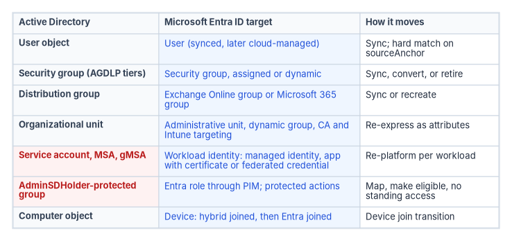
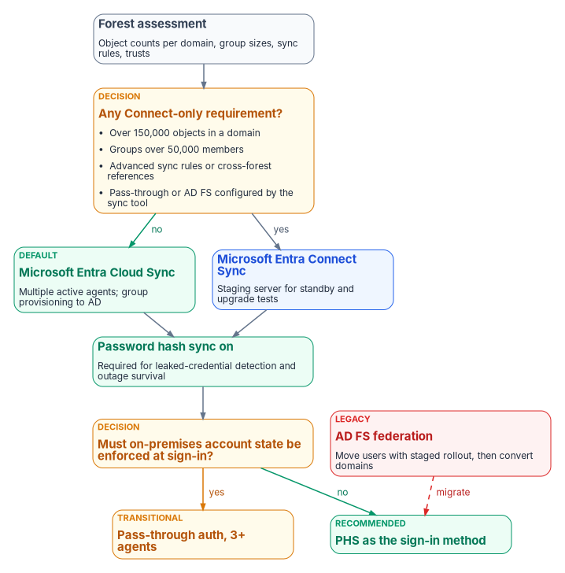

# Chapter 09 — Building the Entra ID Target

*In Active Directory, where an object sits decides what applies to it; in Entra ID, what an object says about itself decides, so the target has to be built from attributes, not copied from containers.*

::: {.callout-note}
## In this chapter
How each Active Directory object class and administrative construct maps to a Microsoft Entra ID construct, and which license tier each governance feature needs. The two decisions that shape the hybrid period: which sync engine to run and how users sign in. How to migrate groups and service accounts, how to rebuild privileged access on Privileged Identity Management (PIM), and the persona-based Conditional Access framework that replaces Group Policy logon restrictions. [Chapter 10](10-migrating-and-governing.md) covers governance, authentication modernization, monitoring, and the migration playbook.
:::

## Purpose and scope

This chapter and the next are the program's technical reference for moving the full identity lifecycle from on-premises Active Directory Domain Services (AD DS) to Microsoft Entra ID. They're written for the architects who plan and run that move. The scope covers every object class and governance construct that makes up an Active Directory identity model:

- User objects: attributes, UPN routing, security identifiers (SIDs), group memberships, OU placement, and lifecycle state.
- Security and distribution groups: scope, nesting patterns, mail enablement, and dynamic membership.
- Service accounts: traditional user-object service accounts, managed service accounts (MSAs), and group managed service accounts (gMSAs).
- Privileged access: AdminSDHolder-protected groups, delegation models, and tiered administration.
- Conditional Access, replacing Group Policy logon restrictions with policy-driven cloud controls.
- Identity governance: access reviews, entitlement management, lifecycle workflows, and compliance attestation.

The environment is the one this workbook assumes throughout: a Microsoft 365 Government Community Cloud (GCC) tenant. GCC uses the worldwide Microsoft Graph and Azure portal endpoints (`https://graph.microsoft.com`), not the separate `graph.microsoft.us` endpoints that GCC High and DoD use.[^c09-graph-clouds] Some features reach GCC later than the commercial service or differ there, so check each feature against the Microsoft 365 Government service descriptions before you plan around it. Azure infrastructure and platform services are out of scope unless the text calls one out and says why.

The chapters assume:

- A GCC tenant with at least Microsoft Entra ID P2, and Microsoft Entra ID Governance for the features that need it (see the licensing table below).
- One or more source forests at Windows Server 2016 forest functional level or later, already inventoried with the read-only tools in [Chapter 07](07-read-only-discovery.md) and [Chapter 08](08-assessing-the-forest.md).
- A Git repository for configuration as code and drift detection. The program's reference build uses Gitea, but any Git host works.
- PowerShell examples written against the Microsoft Graph PowerShell SDK v2 and the `ActiveDirectory` module. The retired MSOnline and AzureAD modules aren't used anywhere; see [Appendix C](appendix-c-identity-assessment-module.md) for the retirement dates.
- Read access in both directories: a delegated read account in Active Directory and Global Reader (at minimum) in the tenant. Write steps name the narrower role they need.

## Decomposing the Active Directory identity landscape

Before any object moves, break the Active Directory identity model into its component object types. Each one has its own migration path, attribute mapping, and Entra ID equivalent. The figure summarizes the decomposition; the sections after it work through each row.

{#fig-ch09-ad-to-entra-objects fig-alt="A three-column table. Column one lists Active Directory object types, column two the Microsoft Entra ID target, column three how each moves. User object becomes a user, synced and later cloud-managed, moved by sync with a hard match on the source anchor. Security group in AGDLP tiers becomes an assigned or dynamic security group, by sync, conversion, or retirement. Distribution group becomes an Exchange Online group or a Microsoft 365 group, by sync or recreation. Organizational unit becomes administrative units, dynamic groups, and Conditional Access and Intune targeting, re-expressed as attributes. Service accounts, MSAs, and gMSAs, shaded red as legacy risk, become workload identities: managed identities or applications with certificates or federated credentials, re-platformed per workload. AdminSDHolder-protected groups, also red, become Entra roles through PIM plus protected actions, mapped and made eligible with no standing access. Computer objects become devices, hybrid joined and then Entra joined, through a device join transition."}

### User objects

User objects are the foundational identity type. Each one carries the attributes that define credentials, organizational placement, group membership, and authorization scope. Five dimensions drive the migration:

- **userPrincipalName (UPN).** The UPN suffix must be a domain verified in the tenant. If it isn't, sync doesn't fail; Entra ID builds a substitute UPN from the mail nickname and the tenant's initial `onmicrosoft.com` domain, which is rarely what anyone wants.[^c09-upn-population] Non-routable suffixes such as `.local` need remediation before sync (see [UPN suffixes and alternate login ID](#upn-suffixes-and-alternate-login-id)).
- **objectSid.** Entra ID doesn't use SIDs for its own authorization. The on-premises SID is carried in `onPremisesSecurityIdentifier`, which must be unique in the tenant; a duplicate raises an `AttributeValueMustBeUnique` error during provisioning.[^c09-existing-tenant]
- **memberOf.** Memberships arrive with group sync. Nested memberships behave differently in Entra ID (see [Nested groups](#nested-groups)).
- **OU placement.** OUs decide which Group Policy Objects apply and who can administer the object. Entra ID has no OU; administrative units take the delegation role, and groups take the policy-targeting role.
- **Attribute richness.** Entra ID maps a subset of AD attributes natively and carries `extensionAttribute1` through `15` in `onPremisesExtensionAttributes`. Custom data beyond that needs directory extensions.

The core user attribute mapping is in the following table. The full reference is in [Appendix C](appendix-c-identity-assessment-module.md#attribute-mapping-reference). The program's assignments for the fifteen extension attributes are the program attribute map in [Book 03, Chapter 06](../b03-hr-identity/06-canonical-attribute-schema.md#program-attribute-map).

| AD attribute | Microsoft Graph user property | Notes |
|---|---|---|
| `sAMAccountName` | `onPremisesSamAccountName` | Read-only in Entra ID for synced users |
| `userPrincipalName` | `userPrincipalName` | Suffix must be a verified domain; the sign-in name |
| `objectSid` | `onPremisesSecurityIdentifier` | Must be unique in the tenant |
| `mail` | `mail` | Primary SMTP address |
| `displayName`, `givenName`, `sn` | `displayName`, `givenName`, `surname` | Direct mapping |
| `department`, `title` | `department`, `jobTitle` | Direct mapping; both usable in dynamic group rules |
| `manager` (DN) | `manager` (relationship) | Resolved as a relationship, not an attribute |
| `memberOf` | `memberOf` (relationship) | Resolved by the sync engine |
| `extensionAttribute1`–`15` | `onPremisesExtensionAttributes` | Program-assigned meanings in the [program attribute map](../b03-hr-identity/06-canonical-attribute-schema.md#program-attribute-map) |
| `userAccountControl` | `accountEnabled` | The disabled bit becomes a Boolean |
| `pwdLastSet` | `lastPasswordChangeDateTime` | Password age |
| `whenCreated` | `createdDateTime` | The date the object reached Entra ID, not the AD creation date |

### Security groups

Active Directory security groups are the authorization backbone. AD classifies them by scope (domain local, global, universal) and by type (security, distribution). The AGDLP pattern (accounts into global groups, global groups into domain local groups, domain local groups onto permissions) and its multi-domain variant AGUDLP define the canonical AD group architecture. Entra ID has no group scope, so each scope maps to the same target with a different migration path.

| AD group scope | Nesting capability | Entra ID equivalent | Migration path |
|---|---|---|---|
| Domain local | Can contain global and universal groups from any domain | Security group (assigned) | Sync or recreate as cloud-only; flatten if nested |
| Global | Can contain users and global groups from the same domain only | Security group (assigned or dynamic) | Sync; evaluate for dynamic membership |
| Universal | Can contain users and groups from any domain in the forest | Security group (assigned) | Sync; the preferred scope for multi-domain forests |

### Distribution groups

Distribution groups route mail. They're either mail-enabled security groups, which do both jobs, or pure distribution groups. In the cloud they become mail-enabled security groups or distribution groups managed through Exchange Online.

- Mail-enabled security groups sync from AD and keep both their security and mail functions in Exchange Online.
- On-premises dynamic distribution groups don't sync. Recreate them in Exchange Online as dynamic distribution groups, which use OPATH filter syntax.
- For each distribution group, decide whether it should become a Microsoft 365 group instead, to gain a shared mailbox, calendar, and file storage.

### Service accounts

Service accounts are a critical identity class that is often under-governed. They come in four forms in Active Directory, each with a different path to Entra ID. The detailed migration matrix is in [Modernizing service accounts](#modernizing-service-accounts).

| AD service account type | Characteristics | Entra ID target | Risk profile |
|---|---|---|---|
| Traditional (user object, often an `svc-` prefix) | Password-based, often "password never expires," often allowed to log on interactively | Application registration with a certificate or federated credential; managed identity where the workload runs in Azure | High: static credentials, often over-privileged |
| Managed service account (MSA) | Automatically managed password, bound to one server | gMSA on-premises; managed identity if the workload moves to Azure | Medium: server-scoped, little governance visibility |
| Group managed service account (gMSA) | Automatically managed password, usable by several servers | Retain for on-premises Kerberos workloads; workload identity federation when the workload moves | Medium: better than traditional, still AD-dependent |
| Delegated managed service account (dMSA) | Windows Server 2025 domains only; supersedes a traditional account, binds authentication to mapped machine identities, and disables the original account's password[^c09-dmsa] | Retain for on-premises Kerberos workloads; same cloud path as a gMSA when the workload moves | Low to medium: resists Kerberoasting, still AD-dependent |

### Computer objects

Computer objects represent domain-joined devices. Their path runs from domain joined, to Microsoft Entra hybrid joined, to Microsoft Entra joined. This chapter covers devices only where they meet identity governance, such as device-based Conditional Access and device compliance as an access signal. The device estate and the services it depends on are in [Chapter 04](04-the-hidden-migration-surface.md).

### Organizational units

OUs serve three governance functions in Active Directory: Group Policy scoping, administrative delegation, and logical organization. Entra ID has no OU construct; each function moves somewhere different.

| AD OU function | Entra ID equivalent | Implementation notes |
|---|---|---|
| Group Policy scoping | Conditional Access policies and Intune configuration profiles | Target by group membership, not container |
| Administrative delegation | Administrative units (AUs) | Creating AUs is free; each AU-scoped administrator needs Entra ID P1. Dynamic AU membership needs P1 for each member.[^c09-au-licensing] |
| Logical organization | Dynamic groups and attributes | Attribute-driven grouping replaces the container hierarchy |

[Chapter 05](05-delegation-without-ous.md) works through the delegation design in detail.

::: {.callout-important}
## Design principle: placement versus attributes
Entra ID inverts the Active Directory governance model. In AD, *placement* determines policy: an object's OU decides which Group Policy Objects apply. In Entra ID, *attributes* determine policy: an object's properties decide its group memberships, and memberships decide which policies apply. This inversion is the most important architectural idea in the migration, and it's why attribute quality ([Chapter 08](08-assessing-the-forest.md)) gates everything that follows.
:::

### AdminSDHolder and protected groups

Active Directory protects members of its most privileged groups with the AdminSDHolder object. Every 60 minutes by default, the Security Descriptor Propagator (SDProp) process on the PDC emulator compares the permissions on each protected account and group with the permissions on the domain's AdminSDHolder object, and resets any that differ.[^c09-adminsdholder] On current Windows Server versions the protected accounts and groups are:[^c09-adminsdholder]

- Account Operators
- Administrator (the built-in account)
- Administrators
- Backup Operators
- Domain Admins
- Domain Controllers
- Enterprise Admins
- Enterprise Key Admins
- Key Admins
- krbtgt
- Print Operators
- Read-only Domain Controllers
- Replicator
- Schema Admins
- Server Operators

Cert Publishers was protected only in Windows 2000 SP4 through Windows Server 2003 and isn't on the current list.[^c09-ad-attack-surface] Any account with direct or transitive membership in a protected group gets `adminCount` set to 1, and the flag stays set after the account leaves the group, so `adminCount` overstates current privilege. Treat it as a lead to investigate, not a finding.

Entra ID has no AdminSDHolder. The nearest controls are Privileged Identity Management, which makes role assignments eligible and time-bound instead of standing, and protected actions, which require a Conditional Access authentication context before specific high-impact permissions can be used.[^c09-protected-actions] Neither copies AdminSDHolder's behavior; together they serve its purpose, which is keeping privileged access from drifting quietly. The mapping from AD privileged groups to Entra roles is in [Privileged access](#privileged-access).

## The Entra ID identity architecture

### The object model

Entra ID is a flat, attribute-driven directory, where Active Directory is hierarchical and container-based. These object types make up the target architecture.

| Object type | Description | AD equivalent | Source of authority |
|---|---|---|---|
| User | Human identity with credentials and profile attributes | User object | Synced from AD, or cloud-only |
| Security group | Authorization group; assigned or dynamic membership | Security group (all scopes) | Synced or cloud-only |
| Microsoft 365 group | Collaboration group with mailbox, calendar, files, Planner, and Teams | None | Cloud-only |
| Mail-enabled security group | Security group with an Exchange Online address | Mail-enabled security group | Synced or cloud-only |
| Distribution group | Mail routing without a security function | Distribution group | Synced or cloud-only |
| Administrative unit | Scope for delegated administration | Organizational unit (delegation function) | Cloud-only |
| Application registration | Application definition: credentials, permissions, redirect URIs | None | Cloud-only |
| Service principal | The application's instance and identity in a tenant | Service account (functional) | Created from an application registration or a gallery app |
| Managed identity | Identity for an Azure resource; Azure manages its credentials | gMSA (functional) | Created with an Azure resource, or as a standalone Azure resource |

Managed identities come in two types. A system-assigned identity is created with an Azure resource, shares that resource's lifecycle, and can't be shared. A user-assigned identity is a standalone Azure resource that can be assigned to several resources and must be deleted explicitly; Microsoft recommends user-assigned identities for most scenarios.[^c09-managed-identity] Either way, a managed identity is a special type of service principal, and it exists only for workloads that run on Azure resources.

### Tenant boundary and forest boundary

The tenant is the security and administrative boundary. It's analogous to an AD forest, not a domain.

- One tenant is one trust boundary. There are no domain trusts inside it.
- Cross-tenant access is governed by B2B collaboration, B2B direct connect, and cross-tenant access settings, which take the place of forest trusts ([Chapter 10](10-migrating-and-governing.md#cross-tenant-and-b2b-collaboration)).
- A tenant has no domain hierarchy. Verified domains are routing suffixes for sign-in names and mail, not security boundaries.
- Several forests can sync into one tenant. Microsoft Entra Connect Sync handles connected forests from one server; Microsoft Entra Cloud Sync also handles disconnected forests, with agents in each.[^c09-cloud-sync-decision]

### Licensing for governance features

Governance features are gated by license tier, and the tiers changed when Microsoft moved most governance capability into Microsoft Entra ID Governance. As of October 2026, access reviews and entitlement management require Entra ID Governance for the member users involved, with only some capabilities still operating under P2.[^c09-governance-licensing] Plan on Governance licensing for every user who requests access packages, reviews access, or is reviewed.

| Feature | Free | P1 | P2 | Entra ID Governance |
|---|---|---|---|---|
| User and group management | Yes | Yes | Yes | Yes |
| Conditional Access | | Yes | Yes | Yes |
| Dynamic membership groups (P1 per unique member)[^c09-dynamic-license] | | Yes | Yes | Yes |
| Administrative units (P1 per AU administrator) | Create only | Yes | Yes | Yes |
| Group provisioning to AD with Cloud Sync | | Yes | Yes | Yes |
| Cross-tenant synchronization of users (same cloud) | | Yes | Yes | Yes |
| Risk-based Conditional Access (ID Protection) | | | Yes | Not included; the Entra Suite adds ID Protection |
| Privileged Identity Management, including PIM for Groups | | | Yes | Yes |
| Access reviews | | | Some capabilities | Yes |
| Entitlement management (access packages) | | | Some capabilities | Yes |
| Lifecycle Workflows | | | | Yes |
| Cross-tenant synchronization of groups | | | | Yes |
| Conditional Access for workload identities | Separate Workload ID Premium license | | | |

The table draws on Microsoft's licensing reference.[^c09-entra-licensing] A few packaging points matter for planning:

- Entra ID P1 is included in Microsoft 365 E3 and E5; P2 is included in E5.[^c09-governance-licensing] Government G3 and G5 plans carry the equivalent service plans.
- Entra ID Governance requires a P1 or P2 prerequisite in the tenant. Government SKUs (Microsoft Entra ID Governance for Government, and a Governance add-on for P2 for Government) are available in GCC.[^c09-governance-licensing]
- The Microsoft Entra Suite bundles Private Access, Internet Access, ID Governance, ID Protection, and Verified ID, for P1 and P2 customers.[^c09-governance-licensing]
- Risk-based Conditional Access policies require P2.[^c09-risk-policies-p2]

::: {.callout-note}
## Licensing assumption
These chapters assume P2 for every user and Entra ID Governance for the populations that use access packages, access reviews, and Lifecycle Workflows. Confirm GCC availability for each feature in the Microsoft 365 Government service description; GCC rollout can lag the commercial service.
:::

### Dynamic group rule syntax

Dynamic groups compute membership from user or device attributes. Rules use operators such as `-eq`, `-ne`, `-startsWith`, `-notStartsWith`, `-contains`, `-notContains`, `-match`, `-notMatch`, `-in`, and `-notIn`, and they can be combined with `-and` and `-or`.[^c09-dynamic-rules] A department group reads the coded organization attribute, not the display name, so a renamed office doesn't change who's in it ([Book 03, Chapter 06](../b03-hr-identity/06-canonical-attribute-schema.md#design-rules)):

```text
(user.extensionAttribute10 -in ["FIN-LED","FIN-AP"]) -and (user.accountEnabled -eq true)
```

Three cautions apply:

- **Membership isn't instant.** When an attribute changes, Entra ID re-evaluates the dynamic group rules in the directory, and membership changes don't appear immediately.[^c09-dynamic-troubleshoot] Plan for that delay where a dynamic group gates access to a critical resource.
- **Attribute write permissions are a security boundary.** A dynamic group is only as trustworthy as the controls on the attributes it reads. Some on-premises attributes can be self-writable; audit write permissions, at the source and in Entra ID, for every attribute used in a security-sensitive rule.[^c09-dynamic-license]
- **Don't build on `memberOf`.** The preview `memberOf` operator lets a dynamic group include members of other groups, but Microsoft is ending the preview: after November 3, 2026, dynamic groups, dynamic administrative units, and access package auto-assignment policies that use it stop updating and freeze in their last state.[^c09-memberof] Replace any `memberOf` rule before then.

## Choosing and configuring the sync engine

### Cloud Sync or Connect Sync

Microsoft offers two engines for hybrid identity sync. Microsoft Entra Connect Sync is the long-standing, full-featured engine that runs on a Windows Server. Microsoft Entra Cloud Sync is a lightweight provisioning agent with its configuration held in the cloud. Microsoft now describes Cloud Sync as its strategic direction: new sync and provisioning features are built primarily on it, and it's the recommended path for most organizations.[^c09-cloud-sync-decision]

The program's comparison draws on Microsoft's decision guide (as of its October 2026 revision):[^c09-cloud-sync-decision]

| Capability | Connect Sync | Cloud Sync |
|---|---|---|
| Deployment | On-premises Windows Server | Lightweight agents; can run on existing domain controllers or standalone servers |
| Connected multi-forest | Yes | Yes |
| Disconnected forests (mergers and acquisitions) | No | Yes |
| High availability | One active server; a staging server as standby | Multiple active agents with automatic failover |
| Scale per AD domain | No stated limit | Up to 150,000 objects |
| Group size | Up to 250,000 members | Up to 50,000 members |
| Password hash sync and password writeback | Yes | Yes |
| Exchange hybrid writeback | Yes | Yes |
| Device sync for hybrid join | Yes | Yes (enabled separately) |
| OU-based filtering | Yes | Yes |
| Attribute-based filtering | Yes | Limited |
| Advanced sync rules | Yes (sync rules editor) | No (expression builder only) |
| Cross-forest references; merging attributes across domains | Yes | No |
| Group provisioning from Entra ID to AD | No | Yes |
| Device writeback | Yes (discontinued in favor of Cloud Kerberos trust) | No |
| Pass-through authentication or AD FS configured by the tool | Yes | No (configured separately; keeps working after migration) |
| On-demand provisioning for testing | No | Yes |
| US Government clouds | Yes | Yes |

Two corrections to older guidance matter here. First, Group Writeback v2 in Connect Sync was a preview that Microsoft discontinued on June 30, 2024; Connect Sync is no longer supported for provisioning cloud security groups to AD. Cloud Sync's group provisioning to AD replaces it, and it can run alongside Connect Sync for that one job. Group Writeback v1 remains only for writing Microsoft 365 groups back to AD.[^c09-gwb-v2] Second, Cloud Sync now handles Exchange hybrid writeback, so Exchange hybrid alone no longer forces Connect Sync.[^c09-cloud-sync-decision]

::: {.callout-tip}
## Recommendation: Cloud Sync unless a Connect-only requirement applies
Use Cloud Sync for new deployments and plan to migrate existing Connect Sync installations to it. Stay on Connect Sync, for now, only where a forest needs something Cloud Sync doesn't do: more than 150,000 objects in a domain, groups over 50,000 members, advanced sync rules, cross-forest references, or attribute merging across domains. Both engines can run in the same forest with mutually exclusive scopes, which lets you move populations in stages.[^c09-hybrid-scenarios]
:::

::: {.callout-important}
## Connect Sync deadline: April 7, 2027
Every server still running Connect Sync must be on version 2.6.84.0 or later and configured for application-based authentication by April 7, 2027. Microsoft is retiring the legacy authentication the sync service uses, and from that date all synchronization services fail on a server that doesn't meet both conditions, until it's upgraded.[^c09-connect-hardening] The upgrade alone isn't enough. Starting with 2.6.84.0, Connect Sync no longer switches an existing server from the legacy directory synchronization account to application-based authentication on its own; run the wizard and choose *Configure application-based authentication to Microsoft Entra ID*.[^c09-connect-versions] Installing or upgrading to 2.6.84.0 over an existing ADSync database can fail, so use 2.6.91.0 or later in that case.[^c09-connect-versions] The date applies whatever the Cloud Sync migration schedule says.
:::

{#fig-ch09-sync-auth-decision fig-alt="A top-to-bottom decision flow. A slate box, forest assessment (object counts per domain, group sizes, sync rules, trusts), leads to an amber decision: any Connect-only requirement, listing over 150,000 objects in a domain, groups over 50,000 members, advanced sync rules or cross-forest references, and pass-through or AD FS configured by the sync tool. A green no branch leads to Microsoft Entra Cloud Sync, labeled default, with multiple active agents and group provisioning to AD. A yes branch leads to Microsoft Entra Connect Sync with a staging server. Both lead to a green box, password hash sync on, required for leaked-credential detection and outage survival. That leads to an amber decision: must on-premises account state be enforced at sign-in. A green no branch leads to PHS as the sign-in method, labeled recommended. An amber yes branch leads to pass-through auth with three or more agents, labeled transitional. A separate red box, AD FS federation, labeled legacy, has a dashed red arrow labeled migrate pointing to PHS as the sign-in method, with the note move users with staged rollout, then convert domains."}

### Filtering

Filtering decides which AD objects reach Entra ID. Connect Sync applies four methods in this order:

1. **Domain-based.** Include or exclude whole domains, such as test or perimeter domains.
2. **OU-based.** The most common method. Exclude OUs that hold service accounts, unneeded computer objects, or staging objects. Both engines support it.
3. **Attribute-based.** Filter individual objects on attribute values with scoping conditions in sync rules; for example, exclude objects where `extensionAttribute15` equals `DoNotSync`. Cloud Sync supports only basic attribute filtering.
4. **Group-based.** Sync only members of a named group. Use it for pilots only; it doesn't scale and it makes sync depend on group membership.

### Attribute flow and transformations

Attribute flow defines how AD attributes become Entra ID attributes. In Connect Sync, custom sync rules take precedence over the default rules by precedence number; Cloud Sync uses an expression builder for attribute mappings. Three transformations the program commonly needs, shown in Connect Sync's declarative provisioning expression language:

| Scenario | Source expression | Target attribute | Purpose |
|---|---|---|---|
| UPN construction | `IIF(IsPresent([userPrincipalName]),IIF(InStr([userPrincipalName],"@contoso.local")>0,Replace([userPrincipalName],"@contoso.local","@contoso.gov"),[userPrincipalName]),Error("UPN required"))` | `userPrincipalName` | Replace a non-routable suffix with a verified domain |
| Display name normalization | `IIF(IsPresent([sn]),Join(", ",[sn],[givenName]),[displayName])` | `displayName` | Enforce "Last, First" |
| Account type classification | `IIF(CBool(InStr(LCase([distinguishedName]),"ou=service accounts")),"Service","Standard")` | `extensionAttribute7` | Classify from OU placement during the transition |

The third rule is a bridge, not an end state. It derives a classification from placement, which is exactly the AD habit the migration retires. Once the classification is written to the source object, drop the rule.

### Staging mode and recovery

Connect Sync's staging mode lets a second server import and synchronize without exporting to Entra ID. It serves three purposes:

- **Recovery.** If the active server fails, disable staging mode on the standby to promote it. Microsoft recommends a staging-mode standby so that password hash sync isn't down for long.[^c09-choose-authn]
- **Upgrade validation.** Test new sync rules or versions on the staging server before cutting over.
- **Configuration verification.** Compare pending export counts between the active and staging servers to detect configuration drift.

Cloud Sync has no staging mode. It gets availability from multiple active agents instead.

::: {.callout-warning}
## One active Connect Sync server per tenant
Never run two Connect Sync servers in active (non-staging) mode against the same tenant. Connect Sync supports one active instance; Cloud Sync is the engine that supports multiple active agents.[^c09-cloud-sync-decision] Two active Connect servers export conflicting changes that are hard to unwind.
:::

### Choosing the sign-in method

The sign-in method decides where passwords are validated. Microsoft's comparison and the program's position:[^c09-choose-authn]

| Criterion | Password hash sync (PHS) | Pass-through authentication (PTA) | Federation (AD FS) |
|---|---|---|---|
| Where validation happens | In the cloud, against a synchronized hash of the password hash | In the cloud, after a check by an on-premises agent against AD | On-premises |
| Extra on-premises infrastructure | None beyond the sync tool | Agent servers; Microsoft recommends at least three in production, treated as Tier 0[^c09-pta-agents] | Two or more AD FS servers and two or more Web Application Proxy servers, load balancing, and certificates |
| Survives an on-premises outage | Yes | No | No |
| Enforces on-premises account state at sign-in | Not immediately; changes arrive with the next sync | Yes (disabled, locked out, expired, logon hours) | Yes |
| Leaked-credential detection | Yes; needs PHS | Only if PHS is also on | Only if PHS is also on |
| Single sign-on from domain-joined devices | Entra joined or hybrid joined devices, or Seamless SSO | Same as PHS | Yes |
| Program position | Preferred | Transitional | Legacy; decommission target |

Microsoft recommends PHS for cloud authentication, and recommends enabling it whichever method you choose: it's the fallback if PTA agents or federation fail, it's required for ID Protection's leaked-credential detection, and organizations that had it on recovered from ransomware outages in hours rather than weeks.[^c09-choose-authn] Failover from PTA to PHS isn't automatic; an administrator switches the sign-in method in the sync tool.[^c09-choose-authn]

::: {.callout-tip}
## Recommendation: PHS everywhere
PHS is the program's sign-in method. Where PTA or federation is still in place, turn PHS on anyway so that the fallback and risk detections exist before they're needed.
:::

### Soft match and hard match

When the sync engine adds an object that might already exist in the cloud, Entra ID looks for a match in this order:[^c09-existing-tenant]

- **Hard match.** The incoming object's `sourceAnchor` (by default the Base64 form of `ms-DS-ConsistencyGuid`, or `objectGUID` in some configurations) is compared with the `onPremisesImmutableId` of existing cloud objects. A match makes AD the source of authority for that object.
- **Soft match.** If there's no hard match, Entra ID compares `userPrincipalName` and the primary SMTP address in `proxyAddresses`. A soft match only works if the cloud object has no `onPremisesImmutableId` yet; afterward, the `sourceAnchor` is written so later matches are hard.

Either match overwrites the cloud object's attributes with the on-premises values, including the password hash under PHS, so clean up AD data first. Microsoft has hardened both paths:

- Tenant settings `BlockSoftMatchEnabled` and `BlockCloudObjectTakeoverThroughHardMatchEnabled` disable each match type. Microsoft advises leaving both blocked except during a planned matching window.[^c09-existing-tenant]
- Since July 1, 2026, Entra ID blocks a hard match when the cloud account already has `onPremisesObjectIdentifier` set, or holds or is eligible for a privileged Entra role. The block is enforced in the cloud, so it applies to both sync engines.[^c09-existing-tenant] Don't plan to take over cloud-only administrator accounts by sync; Microsoft recommends against syncing on-premises accounts onto existing administrative cloud accounts at all.

### UPN suffixes and alternate login ID

Many forests use non-routable UPN suffixes (`contoso.local`) or internal ones (`corp.contoso.com`) that can't be verified in the tenant. The remediation options, in order of preference:

1. **Add a routable UPN suffix to the forest and update user UPNs.** This keeps the sign-in name consistent everywhere and is what Microsoft recommends; it also recommends matching the UPN to the primary SMTP address.[^c09-signin-options]
2. **Transform the UPN during sync** with a sync rule (see [Attribute flow](#attribute-flow-and-transformations)). AD keeps its UPN; Entra ID gets a constructed one. This creates a permanent mismatch that some applications notice.
3. **Use an alternate login ID.** Connect Sync can use another attribute, such as `mail`, as the Entra ID sign-in name. Microsoft notes that alternate ID isn't compatible with all Microsoft 365 workloads.[^c09-signin-options] Separately, "email as an alternate login ID" lets cloud-authenticated users sign in with a proxy address in addition to the UPN; it remains a preview feature as of October 2026.[^c09-email-login]

DNS namespace alignment for new UPN suffixes is covered in the workbook's network and DNS material.

## Migrating groups

### Mapping the AGDLP tiers

The AGDLP model doesn't map one-to-one onto Entra ID, which has no scope-based nesting rules. Each tier has its own target.

| AGDLP tier | AD implementation | Entra ID equivalent | Migration approach |
|---|---|---|---|
| A (account) | User objects | Users | Sync |
| G (global group) | Global security group of users from one domain | Dynamic security group, or assigned security group | Evaluate for dynamic conversion; sync where membership must stay static |
| U (universal group) | Universal group spanning domains | Security group (no scope in Entra ID) | Sync; consider consolidating with G-tier groups |
| DL (domain local group) | Group placed on a resource ACL | Security group assigned to an app role or resource | Sync; may collapse into the resource assignment |
| P (permission) | NTFS, share, or resource ACL entry | App role assignment, SharePoint permission level, or Entra role | Re-express in the cloud permission model |

### The per-group decision

Every AD security group needs one of three decisions: keep it synchronized (hybrid), convert it to cloud-only, or retire it. The group's purpose and dependencies decide which.

| Group characteristic | Decision | Rationale |
|---|---|---|
| Used only for on-premises resource ACLs | Keep in AD; don't sync | A cloud copy adds nothing |
| Used for both on-premises and cloud resources | Synchronize | AD stays the source of authority during the transition |
| Used only for cloud resources | Convert to cloud-only | Removes the AD dependency |
| Membership follows attributes exactly | Convert to dynamic group | Removes manual membership management |
| No members or no resource assignments | Retire | Shrinks the identity surface |

Where a cloud-only group still has to grant access to an AD-integrated (Kerberos) application, provision it back to AD with Cloud Sync's group provisioning, which writes cloud security groups to AD as universal groups.[^c09-gwb-cloud-sync]

### Converting static groups to dynamic groups

Static AD groups whose membership really follows department, location, or role are candidates for dynamic groups. The conversion:

1. **Analyze current membership.** Export the members and find the attributes they share.
2. **Draft the rule** from those attributes (see [Dynamic group rule syntax](#dynamic-group-rule-syntax)).
3. **Validate coverage.** Compare what the rule would return with today's membership. The admin center's rule validation helps here.
4. **Handle exceptions.** Members who don't fit need attribute remediation at the source or an explicit, reviewed exception group.
5. **Create the dynamic group** and watch membership populate.
6. **Move resource assignments** from the synced static group to the dynamic group.
7. **Retire the static group.** Take it out of sync scope and archive its membership export.

### Nested groups

Entra ID security groups can contain other security groups, but nesting works for fewer things than in AD.[^c09-manage-groups] As of October 2026:

- Conditional Access and group-scoped policies follow nested members.[^c09-ca-users]
- Group-based assignment to applications doesn't cascade to nested groups, and group-based licensing doesn't apply to members of nested groups.[^c09-manage-groups]
- Groups can't be nested into groups synced from AD, into Microsoft 365 groups, into mail-enabled security groups, or into role-assignable groups.[^c09-manage-groups]
- Dynamic groups contain only users or only devices, never groups.[^c09-dynamic-license]

So flatten deep AGDLP chains before they become cloud authorization:

- Identify the chains: recursively enumerate membership and find chains deeper than one level.
- Flatten to direct membership or a dynamic rule that produces the same effective membership.
- Record the mapping from the original nesting to the flattened result, for the audit trail.

### Microsoft 365 groups

Microsoft 365 groups add collaboration features that AD groups never had: a shared mailbox, calendar, files, Planner, and Teams.

- Convert to a Microsoft 365 group when the group needs collaboration features, represents a project or working team, or should be owner-managed.
- Don't convert when the group exists only for authorization or needs to contain other groups; Microsoft 365 groups can contain only users.[^c09-manage-groups]
- Govern them with naming conventions (prefixes such as `GRP-`, `PRJ-`, `DEPT-`), an expiration policy, and sensitivity labels.

The expiration policy deletes groups that owners don't renew; groups with user activity renew automatically, owners are notified before expiry, and a deleted group can be restored for 30 days. The lifetime is a preset or a custom value of at least 30 days, and only one policy applies across the tenant.[^c09-group-expiration] The program uses 365 days.

### Self-service group management

Entra ID lets group owners manage membership without IT. The program puts three controls around it:

- Recurring access reviews of sensitive group membership by owners (licensing in [Licensing for governance features](#licensing-for-governance-features)).
- An expiration policy for Microsoft 365 groups, as above.
- A group naming policy to enforce the conventions.

### Exporting AD groups and creating cloud groups

The script exports AD groups with a migration classification, then creates cloud-only security groups for the ones marked as security groups. It reads AD and writes only to Entra ID, and only for groups you select.

::: {.callout-warning}
## Illustrative code
The PowerShell in this chapter is illustrative. It hasn't been tested against a production forest or tenant. Review it, run the export in a lab first, and run the create step only after the group decisions above are recorded.
:::

```powershell
#Requires -Modules ActiveDirectory, Microsoft.Graph.Groups
# Federal Modernization Program: export AD groups and create cloud-only security groups.

# --- Phase 1: export AD groups ---
$exportPath = "C:\FMP\Exports\ADGroups_$(Get-Date -Format 'yyyyMMdd').json"

$adGroups = Get-ADGroup -Filter * -Properties Description, GroupScope, GroupCategory,
        ManagedBy, Members, MemberOf, Mail, extensionAttribute1, extensionAttribute2,
        DistinguishedName, WhenCreated, WhenChanged |
    Select-Object @{N = 'Name';        E = { $_.Name } },
                  @{N = 'Description'; E = { $_.Description } },
                  @{N = 'Scope';       E = { $_.GroupScope.ToString() } },
                  @{N = 'Category';    E = { $_.GroupCategory.ToString() } },
                  @{N = 'ManagedBy';   E = { $_.ManagedBy } },
                  @{N = 'MemberCount'; E = { ($_.Members | Measure-Object).Count } },
                  @{N = 'NestedGroupCount'; E = {
                        ($_.Members | Where-Object {
                            (Get-ADObject $_ -Properties objectClass).objectClass -eq 'group'
                        } | Measure-Object).Count } },
                  @{N = 'Mail';        E = { $_.Mail } },
                  @{N = 'OU';          E = { ($_.DistinguishedName -split ',', 2)[1] } },
                  @{N = 'Created';     E = { $_.WhenCreated } },
                  @{N = 'Modified';    E = { $_.WhenChanged } },
                  @{N = 'MigrationTarget'; E = {
                        if ($_.GroupCategory -eq 'Distribution') { 'DistributionGroup' }
                        elseif (($_.Members | Measure-Object).Count -eq 0) { 'Decommission' }
                        else { 'SecurityGroup' } } }

$adGroups | ConvertTo-Json -Depth 5 | Out-File -FilePath $exportPath -Encoding UTF8
Write-Host "Exported $($adGroups.Count) groups to $exportPath" -ForegroundColor Green

# --- Phase 2: create cloud-only security groups (review the export first) ---
Connect-MgGraph -Scopes 'Group.ReadWrite.All'

foreach ($group in ($adGroups | Where-Object MigrationTarget -eq 'SecurityGroup')) {
    $params = @{
        DisplayName     = $group.Name
        Description     = $group.Description
        MailEnabled     = $false
        MailNickname    = ($group.Name -replace '[^a-zA-Z0-9]', '').ToLower()
        SecurityEnabled = $true
        GroupTypes      = @()
    }
    try {
        $newGroup = New-MgGroup -BodyParameter $params
        Write-Host "Created group: $($newGroup.DisplayName) [$($newGroup.Id)]" -ForegroundColor Green
    }
    catch {
        Write-Warning "Failed to create group $($group.Name): $_"
    }
}

Disconnect-MgGraph
```

`NestedGroupCount` calls `Get-ADObject` once per member, which is slow on large groups; in a big forest, run the export against one OU at a time.

## Modernizing service accounts

### The migration path matrix

Each AD service account maps to an Entra ID construct that depends on where the workload runs. The general rule is to eliminate stored secrets: managed identities for Azure-hosted workloads, workload identity federation for workloads that already have an identity from another trusted issuer, and certificates only where neither applies.

| AD account type | Workload location | Entra ID target | Authentication | Credential management |
|---|---|---|---|---|
| Traditional | Calls Microsoft 365 or other Entra-protected APIs | Application registration and service principal | Certificate, or federated credential where the host has an OIDC issuer | Certificate rotation (program standard: annual), or no stored secret |
| Traditional | Azure resource | Managed identity (user-assigned preferred) | Managed by Azure | None |
| Traditional | On-premises, Kerberos only | gMSA, or a dMSA on a Windows Server 2025 domain | Kerberos | Managed by AD |
| MSA | On-premises | gMSA (upgrade first; an MSA or gMSA can't be migrated to a dMSA)[^c09-dmsa] | Kerberos | Managed by AD |
| dMSA | On-premises | Keep the dMSA | Kerberos | Managed by AD |
| gMSA | Moving to the cloud | Workload identity federation or managed identity | Federated token or managed | No stored secrets |
| gMSA | Hybrid | Keep the gMSA, plus an application registration for cloud calls | Kerberos on-premises; certificate or federated credential to the cloud | Split |
| IIS application pool identity | On-premises IIS | gMSA now; managed identity once moved to Azure | Kerberos, then managed | Progressive |
| Scheduled task identity | On-premises | gMSA now; an Azure Automation runbook with a managed identity once moved | Kerberos, then managed | Progressive |

### Workload identity federation

Workload identity federation removes stored secrets by having Entra ID trust tokens from an external identity provider. The workload presents a token from its own issuer (GitHub Actions, a Kubernetes cluster, Google Cloud, a SPIFFE deployment, another OIDC provider), and Entra ID exchanges it for an access token. A federated identity credential on the application registration, or on a user-assigned managed identity, has three working parts:[^c09-wif-create]

- **Issuer.** The external provider's OIDC issuer URL. It must match the token's `iss` claim, and Entra ID uses it to fetch the signing keys, so the discovery document has to be reachable.
- **Subject.** Must match the token's `sub` claim exactly; for GitHub Actions, for example, `repo:org/repo:ref:refs/heads/main`. Wildcards aren't supported.[^c09-wif-considerations]
- **Audience.** The recommended value is `api://AzureADTokenExchange`.

An application or user-assigned managed identity can hold at most 20 federated identity credentials, and an incorrect subject is accepted at creation and only fails at token exchange, so test each one.[^c09-wif-considerations]

### Conditional Access for workload identities

Conditional Access can target service principals, which lets you block a workload from outside known IP ranges, block it when ID Protection flags it as risky, or combine it with authentication contexts.[^c09-ca-workload] Know the limits before you design around it:[^c09-ca-workload]

- Creating or modifying these policies requires Workload Identities Premium licensing.
- Policies apply only to single-tenant service principals registered in your tenant. Multitenant and third-party SaaS apps, and managed identities, aren't covered; include managed identities in access reviews instead.
- A policy assigned to a group that contains a service principal isn't enforced for it; assign the workload identity to the policy directly.

### Governing service principals

Every application registration and service principal gets the same controls:

- **Ownership.** At least two human owners, never service accounts.
- **Credentials.** Prefer federated credentials and managed identities. Where certificates remain, rotate them on a schedule (program standard: annually) through Key Vault or the CI/CD pipeline. Don't use client secrets for production workloads.
- **Reviews.** Recurring reviews of delegated and application permissions by app owners (program standard: quarterly).
- **Least privilege.** Use application-specific roles and scopes; avoid broad permissions such as `Directory.ReadWrite.All`.

### Discovering service accounts

The discovery function finds likely service accounts in AD, classifies each by type and risk, and suggests a target. It only reads. The function is part of the FMPIdentityAssessment module in [Appendix C](appendix-c-identity-assessment-module.md), where it's maintained.

```powershell
#Requires -Modules ActiveDirectory
function Get-FMPServiceAccountInventory {
    [CmdletBinding()]
    param(
        [string]$SearchBase = (Get-ADDomain).DistinguishedName,
        [string]$ExportPath = "C:\FMP\Exports\ServiceAccounts_$(Get-Date -Format 'yyyyMMdd').json"
    )

    $results = [System.Collections.Generic.List[object]]::new()
    $staleCutoff = (Get-Date).AddDays(-90)

    # --- Traditional service accounts: user objects with service indicators ---
    $svcUsers = Get-ADUser -SearchBase $SearchBase -Filter {
            (ServicePrincipalName -like '*') -or (SamAccountName -like 'svc-*') -or
            (SamAccountName -like 'svc_*') -or (SamAccountName -like 'sa-*') -or
            (Description -like '*service*account*')
        } -Properties UserPrincipalName, DisplayName, Description, ServicePrincipalName,
                      Enabled, PasswordNeverExpires, PasswordLastSet, LastLogonDate,
                      WhenCreated, MemberOf, DistinguishedName

    foreach ($svc in $svcUsers) {
        $spnCount = ($svc.ServicePrincipalName | Measure-Object).Count
        $daysSincePasswordChange = if ($svc.PasswordLastSet) {
            (New-TimeSpan -Start $svc.PasswordLastSet -End (Get-Date)).Days
        } else { -1 }

        $recommendation = switch ($true) {
            (-not $svc.Enabled)                           { 'Disabled: verify and retire'; break }
            ($svc.LastLogonDate -lt $staleCutoff)         { 'Stale: verify use and retire if unused'; break }
            ($svc.PasswordNeverExpires)                   { 'HIGH RISK: move to a workload identity (federated credential, managed identity, or certificate)'; break }
            ($spnCount -gt 0)                             { 'Kerberos service: convert to gMSA, then evaluate workload identity federation'; break }
            default                                       { 'Evaluate the workload; target a managed identity or application registration' }
        }

        $riskLevel = if ($svc.Enabled -and $svc.PasswordNeverExpires) { 'HIGH' }
                     elseif ($daysSincePasswordChange -gt 365)          { 'HIGH' }
                     elseif ($svc.Enabled)                              { 'MEDIUM' }
                     else                                               { 'LOW' }

        $results.Add([PSCustomObject]@{
            Type                    = 'TraditionalServiceAccount'
            SamAccountName          = $svc.SamAccountName
            DisplayName             = $svc.DisplayName
            Description             = $svc.Description
            Enabled                 = $svc.Enabled
            PasswordNeverExpires    = $svc.PasswordNeverExpires
            DaysSincePasswordChange = $daysSincePasswordChange
            SPNCount                = $spnCount
            SPNs                    = ($svc.ServicePrincipalName -join '; ')
            LastLogon               = $svc.LastLogonDate
            GroupMembershipCount    = ($svc.MemberOf | Measure-Object).Count
            OU                      = ($svc.DistinguishedName -split ',', 2)[1]
            RiskLevel               = $riskLevel
            Recommendation          = $recommendation
        })
    }

    # --- Managed service accounts (MSA and gMSA) ---
    $msaAccounts = Get-ADServiceAccount -Filter * -SearchBase $SearchBase -Properties Enabled,
        DistinguishedName, ObjectClass, 'msDS-ManagedPasswordInterval', WhenCreated

    foreach ($msa in $msaAccounts) {
        $isGmsa = ($msa.ObjectClass -eq 'msDS-GroupManagedServiceAccount')
        $results.Add([PSCustomObject]@{
            Type                    = if ($isGmsa) { 'gMSA' } else { 'MSA' }
            SamAccountName          = $msa.SamAccountName
            DisplayName             = $msa.SamAccountName
            Description             = ''
            Enabled                 = $msa.Enabled
            PasswordNeverExpires    = $false
            DaysSincePasswordChange = 0
            SPNCount                = 0
            SPNs                    = ''
            LastLogon               = $null
            GroupMembershipCount    = 0
            OU                      = ($msa.DistinguishedName -split ',', 2)[1]
            RiskLevel               = 'LOW'
            Recommendation          = if ($isGmsa) {
                'Keep for on-premises workloads; plan workload identity federation when the workload moves'
            } else {
                'Upgrade to gMSA first, then evaluate for cloud migration'
            }
        })
    }

    $results | ConvertTo-Json -Depth 5 | Out-File -FilePath $ExportPath -Encoding UTF8

    Write-Host "`n=== Service account discovery summary ===" -ForegroundColor Cyan
    Write-Host "Traditional: $(($results | Where-Object Type -eq 'TraditionalServiceAccount').Count)"
    Write-Host "MSA:         $(($results | Where-Object Type -eq 'MSA').Count)"
    Write-Host "gMSA:        $(($results | Where-Object Type -eq 'gMSA').Count)"
    Write-Host "HIGH risk:   $(($results | Where-Object RiskLevel -eq 'HIGH').Count)" -ForegroundColor Red
    Write-Host "MEDIUM risk: $(($results | Where-Object RiskLevel -eq 'MEDIUM').Count)" -ForegroundColor Yellow
    Write-Host "Export:      $ExportPath" -ForegroundColor Cyan

    return $results
}
```

Compared with the earlier version of this script, the checks for disabled and stale accounts now run before the risk checks, so a disabled account with an SPN is reported as a retirement candidate instead of a gMSA candidate. Treat "stale" as a lead, and confirm it against domain controller and Entra ID sign-in logs before retiring anything.

## Privileged access

### Mapping AD privileged groups to Entra roles

Every AD privileged group maps to an Entra ID role governed by PIM. The core rule: **no standing access to privileged roles.** All privileged assignments are eligible, activated just in time; the only permanent active assignments are the two emergency access accounts. The mapping is the program's design; there's no one-to-one equivalence between AD groups and Entra roles.

| AD privileged group | Entra ID target | PIM assignment | Governance notes |
|---|---|---|---|
| Domain Admins | Global Administrator, held by very few | Eligible, with approval | Microsoft recommends fewer than five Global Administrators;[^c09-privileged-roles] most Domain Admin duties map to narrower roles |
| Enterprise Admins | Privileged Role Administrator | Eligible, with approval | Manages role assignments and PIM settings; separate approval chain |
| Schema Admins | No equivalent | Not applicable | Microsoft manages the directory schema. Directory extensions are added through application registrations (Application Administrator) |
| Account Operators | User Administrator scoped to administrative units | Eligible | Limits blast radius. Conditional Access can't target AU-scoped role assignments, so put these administrators in a group for policy targeting[^c09-ca-users] |
| Server Operators | Intune role-based access, or Azure RBAC for Azure-hosted servers | Eligible | Server administration moves to device management |
| Backup Operators | Service-specific roles (for example, Exchange Administrator for mailbox recovery) | Eligible | No tenant-wide backup role |
| DnsAdmins | No direct equivalent | Not applicable | DNS moves to the Microsoft 365 admin center or the DNS provider |
| Group Policy Creator Owners | Intune Policy and Profile Manager (an Intune role) | Eligible | Group Policy functions move to Intune profiles and Conditional Access |

### PIM configuration standards

PIM role settings are defined per role.[^c09-pim-settings] The program's standards are below; [Book 04, Appendix B](../b04-access/appendix-b-pim-role-settings.md) is the authoritative per-role reference and tightens several values (shorter activations and approval for Tier 1 roles):

- **Eligibility duration.** Eligible assignments expire after at most 12 months and renew through an access review.
- **Activation duration.** Role-specific, from the table below. PIM allows 1 to 24 hours; the program's default is 8.[^c09-pim-settings]
- **Activation requirements.** Justification for every role. Ticket information for Global Administrator, Privileged Role Administrator, and Exchange Administrator; PIM records the ticket number but doesn't check it against a ticketing system.[^c09-pim-settings]
- **Strong authentication at activation.** PIM's "require multifactor authentication" setting can be satisfied by an earlier sign-in in the same session. To force fresh, phishing-resistant authentication at activation, the program uses PIM's Conditional Access authentication context option with an authentication strength.[^c09-pim-settings]
- **Approval.** Required for Global Administrator, Privileged Role Administrator, and Security Administrator, with at least two named approvers who aren't in the requester's own administrative chain. If approval is required and no approvers are configured, PIM defaults to the active Privileged Role and Global Administrators, which can lock the tenant if none are active; configure named approvers and keep the emergency accounts ready.[^c09-pim-settings]
- **Notification.** Activation notices go to the assignee, the Global Administrators, and the security operations mailbox.

| Role | Assignment | Max activation | Approval | Justification | Ticket |
|---|---|---|---|---|---|
| Global Administrator | Eligible | 4 hours | Yes | Yes | Yes |
| Privileged Role Administrator | Eligible | 4 hours | Yes | Yes | Yes |
| Security Administrator | Eligible | 8 hours | Yes | Yes | No |
| Exchange Administrator | Eligible | 8 hours | No | Yes | Yes |
| SharePoint Administrator | Eligible | 8 hours | No | Yes | No |
| User Administrator | Eligible | 8 hours | No | Yes | No |
| Groups Administrator | Eligible | 8 hours | No | Yes | No |
| Conditional Access Administrator | Eligible | 8 hours | No | Yes | No |
| Intune Administrator | Eligible | 8 hours | No | Yes | No |
| Authentication Administrator | Eligible | 8 hours | No | Yes | No |
| Application Administrator | Eligible | 8 hours | No | Yes | No |
| Compliance Administrator | Eligible | 8 hours | No | Yes | No |
| Security Reader | Eligible | 12 hours | No | No | No |
| Global Reader | Eligible | 12 hours | No | No | No |

Every activation in the table requires the phishing-resistant authentication context described above.

### PIM for Groups

PIM for Groups (formerly called privileged access groups) extends just-in-time activation to group membership and ownership. Instead of sitting permanently in a sensitive group, a user activates membership through PIM with the same controls as a role: justification, authentication context, approval.[^c09-pim-groups]

- **Use it for** groups that grant access to sensitive applications, data, or administrative functions.
- **Eligible groups.** Any security group or Microsoft 365 group can be enabled, except dynamic groups and groups synced from AD. Since January 2023 a group doesn't have to be role-assignable to use PIM for Groups.[^c09-pim-groups]
- **Role-assignable groups.** A group must be created role-assignable only if it will hold an Entra role. Role-assignable groups get extra protection (only Global Administrators, Privileged Role Administrators, or the owner can manage them), so Microsoft suggests the setting even for non-role groups that guard sensitive resources. A tenant can have at most 500 role-assignable groups.[^c09-pim-groups]
- **Licensing.** Every user eligible for membership or ownership needs P2 or Entra ID Governance.[^c09-pim-groups-assign]

### Emergency access accounts

Emergency access ("break-glass") accounts restore access when normal administrator sign-in, MFA, or PIM fails. Microsoft's current guidance changed an important detail of older designs: both accounts use phishing-resistant authentication, because Microsoft's mandatory MFA for admin portals applies to them too (Microsoft enforces it in the public Azure cloud, not in Azure Government; see [Book 04, Chapter 04](../b04-access/04-privileged-roles-and-tiers.md)). A password in a safe is no longer enough on its own.[^c09-emergency-access] The program's standard follows that guidance:

- **Quantity.** Two accounts, cloud-only, in the tenant's `onmicrosoft.com` domain, not synced or federated.[^c09-emergency-access]
- **Naming.** Don't use names that mark them as emergency accounts (avoid `emergency`, `breakglass`, `bg-`).
- **Authentication.** A passkey (FIDO2) security key for each account, which is Microsoft's recommended method, or certificate-based authentication where a PKI already exists. Use methods different from those of the normal admin accounts, and store each credential in a separate secure, fireproof location.[^c09-emergency-access]
- **Assignment.** Global Administrator as a permanent active assignment in PIM, not eligible. These are the only permanent Global Administrator assignments.
- **Conditional Access.** Put both accounts in a dedicated exclusion group and exclude it from every policy that blocks or restricts sign-in. Report-only policies don't need the exclusion.[^c09-emergency-access]
- **Monitoring.** Alert on every sign-in and every audit event for these accounts. Any use is an incident until a post-use review says otherwise.
- **Validation.** Test sign-in and an administrative task at least every 90 days, as Microsoft recommends, and record the test in change management.[^c09-emergency-access]

### Protected actions

Protected actions attach a Conditional Access authentication context to specific Entra permissions, so a user must satisfy that policy, typically phishing-resistant MFA, at the moment they use the permission, regardless of which role granted it.[^c09-protected-actions] As of October 2026 they cover:[^c09-protected-actions]

- Conditional Access policy management (create, update, delete)
- Cross-tenant access settings, including tenant restrictions
- Hard deletion of some directory objects from the recycle bin (users, Microsoft 365 groups, cloud security groups, applications)
- Named locations
- Protected action management itself

Protected actions require Entra ID P1 and can be added by a Conditional Access Administrator or Security Administrator.[^c09-protected-actions] Microsoft's privileged roles documentation still describes the feature as preview, so check its status before treating it as a compliance control.[^c09-privileged-roles] The source design's mention of "deleting a tenant" isn't on Microsoft's list and has been dropped.

Protected actions and PIM complement each other. PIM can require an authentication context when a role is activated; protected actions enforce one when a high-impact permission is used, however the user got it. Use both: PIM for activation, protected actions for the operations that would let an attacker disable your controls. Exclude an emergency account from the Conditional Access policy behind each protected action, or a misconfiguration can lock everyone out of the policy that would fix it.

## The Conditional Access framework

### Design approach

Conditional Access replaces the logon restrictions, network access controls, and authentication policies that Active Directory enforced through Group Policy. The program's framework is organized around **personas**, each a population with distinct access needs and risk.

| Persona | Description | Identified by | Risk |
|---|---|---|---|
| Internals | Employees and contractors with standard access | `extensionAttribute11` (worker type code) in {`EMP`, `CTR`} | Standard |
| Admins | Users eligible for or holding privileged roles | `extensionAttribute7` (account type) = `Privileged`, or a group of PIM-eligible users | High |
| Externals | B2B guests from partner organizations | User type Guest, partner tenant | Elevated |
| Guests | Ad hoc external users outside partner organizations | User type Guest, other tenants or identity providers | High |
| Service accounts | Workload identities (single-tenant service principals) | Workload identity assignment | Variable |
| Break-glass | Emergency access accounts | Dedicated exclusion group | Excluded from restrictive policies |

Target the Admins persona with a group rather than by directory role alone: Conditional Access role targeting supports built-in directory roles only, not AU-scoped or custom roles.[^c09-ca-users]

### Named locations

- **Trusted networks.** IP ranges for offices, VPN egress points, and trusted proxies.
- **Trusted countries.** The United States, with others added only with documented justification.
- **Location policy.** Location blocking is set per persona. Internals are blocked outside the United States except for approved travel exceptions (CA008). Admins are held to the stricter rule of trusted networks only (CA005), and workload identities likewise (CA015). Externals and guests aren't location-blocked in this baseline; MFA, terms of use and risk policies govern them. This is a program policy choice, not a property of GCC itself. GCC provides U.S. data residency,[^c09-gov-clouds] but users can sign in from anywhere unless policy blocks it.

### Authentication strengths

Authentication strengths name the method combinations a policy accepts. Entra ID has three built-in strengths:[^c09-auth-strengths]

| Strength | Accepted methods (summary) | Program target |
|---|---|---|
| Phishing-resistant MFA | Windows Hello for Business or platform credential; FIDO2 security key (passkey); certificate-based authentication (multifactor) | Admins; high-risk sign-ins; all users as the end state |
| Passwordless MFA | The phishing-resistant methods, plus Microsoft Authenticator phone sign-in | Interim step for users moving off passwords |
| Multifactor authentication | All of the above, plus password with a second factor, Temporary Access Pass, and federated MFA | Internals and Externals during transition only |

Microsoft Authenticator push and phone sign-in aren't phishing-resistant on their own; Microsoft's M-22-09 guidance pairs Authenticator with managed-device policies to block external phishing.[^c09-memo-2209-ms] Passkeys held in Microsoft Authenticator are device-bound passkeys and count as FIDO2 methods. Custom strengths can narrow a policy further, for example to specific FIDO2 key models by AAGUID. You can't use "require multifactor authentication" and "require authentication strength" in the same policy.[^c09-auth-strengths]

### The policy set

The program's baseline policies. Every policy excludes the break-glass group from policies that block or restrict sign-in; "All users" means all users minus that group.

::: {.callout-note}
## The full library is in Book 04
[Book 04, Chapter 07](../b04-access/07-the-conditional-access-policy-library.md) is the program's authoritative Conditional Access library. It keeps these identifiers, adds CA018–CA038 for the CISA BOD 25-01 Entra ID baseline, and revises three policies here: privileged-access-workstation enforcement moves from CA004's device filter to its own block policy, CA025, because a grant policy scoped by a device filter simply doesn't apply on other devices; CA013 takes a block form in BOD 25-01 tenants; and CA017 requires an app protection policy only, because Microsoft made the "approved client app" grant read-only on June 30, 2026.
:::

| Policy | Persona | Conditions | Grant controls | Session controls |
|---|---|---|---|---|
| CA001-AllUsers-BlockLegacyAuth | All users | Client apps: Exchange ActiveSync, other clients | Block | — |
| CA003-Admins-RequirePhishResistantMFA | Admins | All resources, any location | Authentication strength: phishing-resistant MFA | Sign-in frequency: 4 hours |
| CA004-Admins-RequireCompliantDevice | Admins | All resources | Require compliant device (a privileged access workstation; see Chapter 10) | Persistent browser: never |
| CA005-Admins-BlockUntrustedLocations | Admins | All resources, outside trusted networks | Block | — |
| CA006-Internals-RequireMFA | Internals | All resources | Authentication strength: MFA (phishing-resistant as the end state) | Sign-in frequency: 12 hours |
| CA007-Internals-RequireCompliantOrHybridDevice | Internals | All resources | Compliant device or hybrid joined device | — |
| CA008-Internals-BlockNonUSLocations | Internals | All resources, outside trusted countries | Block | — |
| CA009-Externals-RequireMFA | Externals | All resources | Authentication strength: MFA | Sign-in frequency: 8 hours |
| CA010-Externals-RequireTermsOfUse | Externals | All resources | Terms of use accepted | — |
| CA011-Guests-LimitedAppAccess | Guests | Selected apps only (SharePoint, Teams) | MFA and terms of use | App-enforced restrictions; sign-in frequency: 1 hour |
| CA012-Guests-BlockHighRisk | Guests | Sign-in risk: high | Block | — |
| CA013-AllUsers-HighUserRisk-RequireRemediation | All users | User risk: high | Require risk remediation | Sign-in frequency: every time (applied automatically) |
| CA014-AllUsers-MediumSigninRisk-RequireMFA | All users | Sign-in risk: medium or high | Authentication strength: MFA | Sign-in frequency: every time |
| CA015-ServiceAccounts-LocationRestriction | Service accounts | Workload identities, outside trusted networks | Block | — |
| CA016-AllUsers-RequireCompliantDevice-OfficeApps | All users | Office 365 apps on Windows and macOS | Require compliant device | — |
| CA017-Internals-AppProtection-Mobile | Internals | Office 365 apps on iOS and Android | Require app protection policy | — |

Three changes from the earlier version of this set reflect current Microsoft guidance:

- **CA002 is gone.** The earlier set had a "break-glass, grant with no controls" policy. A Conditional Access policy can't create an exemption; the exemption is the exclusion on every other policy. The number is retired so the others keep their identifiers.
- **CA013 uses risk remediation.** Microsoft now recommends "require risk remediation" for high user risk. It handles both password and passwordless users, applies an authentication strength and sign-in frequency of every time automatically, and takes precedence over the older "require password change" control. It requires P2, and it isn't supported for guests, so guests are handled by CA012.[^c09-risk-policies]
- **CA012 targets sign-in risk.** The earlier version targeted user risk for guests. Risk remediation isn't supported for external and guest users, because Entra ID can't revoke their sessions,[^c09-risk-policies-p2] so the program blocks risky guest sign-ins instead.

Leaked-credential detection itself is available without P2, but its full reporting and the risk-based policies above require P2, and the detection needs PHS.[^c09-risk-detections][^c09-choose-authn]

### Testing and rollout

Conditional Access deployment follows three stages:

1. **Report-only (2 to 4 weeks).** Deploy every policy in report-only mode. Use the Conditional Access insights workbook to find the users and sign-ins each policy would affect, and fix false positives, such as users without MFA registration or non-compliant devices.
2. **Targeted pilot (2 weeks).** Turn policies on for a pilot group, such as the IT department. Watch help desk volume and sign-in failure rates, and adjust conditions.
3. **Phased rollout (4 to 8 weeks).** Expand in waves: IT and security teams, then corporate staff, then field and remote workers, then everyone. Each wave runs one to two weeks behind a monitoring gate.

::: {.callout-important}
## Never enforce untested policies on all users
Never switch a policy that targets all users from off straight to on. A misconfigured policy can lock out the whole organization, administrators included. Before enforcing any policy, confirm the break-glass exclusion group is excluded, and confirm both emergency accounts can still sign in.
:::

::: {.callout-tip}
## Continue the book
[← Previous: Chapter 08 — Assessing the Forest](08-assessing-the-forest.md) · [Book index](index.md) · [Next: Chapter 10 — Migrating and Governing →](10-migrating-and-governing.md)

See the companion guide: [Attribute-Driven Migration from Active Directory to Microsoft Entra ID](../guides/attribute-driven-migration.md), one end-to-end path through this material.
:::

[^c09-graph-clouds]: Microsoft Learn, "Microsoft Graph national cloud deployments," <https://learn.microsoft.com/graph/deployments> (accessed Oct 20, 2026).
[^c09-upn-population]: Microsoft Learn, "Microsoft Entra UserPrincipalName population," <https://learn.microsoft.com/entra/identity/hybrid/connect/plan-connect-userprincipalname> (accessed Oct 20, 2026).
[^c09-existing-tenant]: Microsoft Learn, "Configure Microsoft Entra Connect for an existing tenant," <https://learn.microsoft.com/entra/identity/hybrid/connect/how-to-connect-install-existing-tenant> (accessed Oct 20, 2026).
[^c09-au-licensing]: Microsoft Learn, "Administrative units in Microsoft Entra ID," <https://learn.microsoft.com/entra/identity/role-based-access-control/administrative-units> (accessed Oct 20, 2026).
[^c09-adminsdholder]: Microsoft Learn, "Appendix C: Protected Accounts and Groups in Active Directory," <https://learn.microsoft.com/windows-server/identity/ad-ds/plan/security-best-practices/appendix-c--protected-accounts-and-groups-in-active-directory> (accessed Oct 20, 2026).
[^c09-ad-attack-surface]: Microsoft Learn, "Reducing the Active Directory Attack Surface," <https://learn.microsoft.com/windows-server/identity/ad-ds/plan/security-best-practices/reducing-the-active-directory-attack-surface> (accessed Oct 20, 2026).
[^c09-protected-actions]: Microsoft Learn, "What are protected actions in Microsoft Entra ID?," <https://learn.microsoft.com/entra/identity/role-based-access-control/protected-actions-overview> (accessed Oct 20, 2026).
[^c09-managed-identity]: Microsoft Learn, "What is managed identities for Azure resources?," <https://learn.microsoft.com/entra/identity/managed-identities-azure-resources/overview> (accessed Oct 20, 2026).
[^c09-dmsa]: Microsoft Learn, "Delegated Managed Service Accounts overview," <https://learn.microsoft.com/windows-server/identity/ad-ds/manage/delegated-managed-service-accounts/delegated-managed-service-accounts-overview> (accessed Oct 21, 2026).
[^c09-connect-hardening]: Microsoft Learn, "Hardening update to Microsoft Entra Connect Sync," <https://learn.microsoft.com/entra/identity/hybrid/connect/harden-update-ad-fs-pingfederate> (accessed Oct 21, 2026).
[^c09-connect-versions]: Microsoft Learn, "Microsoft Entra Connect: Version release history," <https://learn.microsoft.com/entra/identity/hybrid/connect/reference-connect-version-history> (accessed Oct 21, 2026).
[^c09-cloud-sync-decision]: Microsoft Learn, "Microsoft Entra Cloud Sync migration decision guide," <https://learn.microsoft.com/entra/identity/hybrid/cloud-sync/connect-to-cloud-sync-decision-guide> (accessed Oct 20, 2026).
[^c09-governance-licensing]: Microsoft Learn, "Microsoft Entra ID Governance licensing fundamentals," <https://learn.microsoft.com/entra/id-governance/licensing-fundamentals> (accessed Oct 20, 2026).
[^c09-dynamic-license]: Microsoft Learn, "Manage rules for dynamic membership groups in Microsoft Entra ID," <https://learn.microsoft.com/entra/identity/users/groups-dynamic-membership> (accessed Oct 20, 2026).
[^c09-entra-licensing]: Microsoft Learn, "Microsoft Entra licensing," <https://learn.microsoft.com/entra/fundamentals/licensing> (accessed Oct 20, 2026).
[^c09-risk-policies-p2]: Microsoft Learn, "Risk-based access policies," <https://learn.microsoft.com/entra/id-protection/concept-identity-protection-policies> (accessed Oct 20, 2026).
[^c09-dynamic-rules]: Microsoft Learn, "Manage rules for dynamic membership groups in Microsoft Entra ID: rule syntax for a single expression," <https://learn.microsoft.com/entra/identity/users/groups-dynamic-membership#rule-syntax-for-a-single-expression> (accessed Oct 20, 2026).
[^c09-memberof]: Microsoft Learn, "Configure dynamic membership groups with the memberOf operator in the Entra Admin Center (preview)," <https://learn.microsoft.com/entra/identity/users/groups-dynamic-rule-member-of> (accessed Oct 20, 2026).
[^c09-gwb-v2]: Microsoft Learn, "Disable group writeback," <https://learn.microsoft.com/entra/identity/hybrid/connect/how-to-connect-group-writeback-disable> (accessed Oct 20, 2026).
[^c09-hybrid-scenarios]: Microsoft Learn, "Hybrid scenarios," <https://learn.microsoft.com/entra/identity/hybrid/common-scenarios> (accessed Oct 20, 2026).
[^c09-choose-authn]: Microsoft Learn, "Choose the right authentication method for your Microsoft Entra hybrid identity solution," <https://learn.microsoft.com/entra/identity/hybrid/connect/choose-ad-authn> (accessed Oct 20, 2026).
[^c09-pta-agents]: Microsoft Learn, "Microsoft Entra pass-through authentication: Quickstart," <https://learn.microsoft.com/entra/identity/hybrid/connect/how-to-connect-pta-quick-start> (accessed Oct 20, 2026).
[^c09-signin-options]: Microsoft Learn, "Microsoft Entra Connect user sign-in options," <https://learn.microsoft.com/entra/identity/hybrid/connect/plan-connect-user-signin> (accessed Oct 20, 2026).
[^c09-email-login]: Microsoft Learn, "Sign-in to Microsoft Entra ID with email as an alternate login ID (Preview)," <https://learn.microsoft.com/entra/identity/authentication/howto-authentication-use-email-signin> (accessed Oct 20, 2026).
[^c09-gwb-cloud-sync]: Microsoft Learn, "Group writeback with Microsoft Entra Cloud Sync," <https://learn.microsoft.com/entra/identity/hybrid/group-writeback-cloud-sync> (accessed Oct 20, 2026).
[^c09-manage-groups]: Microsoft Learn, "Manage Microsoft Entra groups and group membership," <https://learn.microsoft.com/entra/fundamentals/how-to-manage-groups> (accessed Oct 20, 2026).
[^c09-ca-users]: Microsoft Learn, "Conditional Access: Users, groups, agents, and workload identities," <https://learn.microsoft.com/entra/identity/conditional-access/concept-conditional-access-users-groups> (accessed Oct 20, 2026).
[^c09-group-expiration]: Microsoft Learn, "Configure the expiration policy for Microsoft 365 groups," <https://learn.microsoft.com/entra/identity/users/groups-lifecycle> (accessed Oct 20, 2026).
[^c09-wif-create]: Microsoft Learn, "Configure an app to trust an external identity provider," <https://learn.microsoft.com/entra/workload-id/workload-identity-federation-create-trust> (accessed Oct 20, 2026).
[^c09-wif-considerations]: Microsoft Learn, "Important considerations and restrictions for federated identity credentials," <https://learn.microsoft.com/entra/workload-id/workload-identity-federation-considerations> (accessed Oct 20, 2026).
[^c09-ca-workload]: Microsoft Learn, "Conditional Access for workload identities," <https://learn.microsoft.com/entra/identity/conditional-access/workload-identity> (accessed Oct 20, 2026).
[^c09-privileged-roles]: Microsoft Learn, "Privileged roles and permissions in Microsoft Entra ID (preview)," <https://learn.microsoft.com/entra/identity/role-based-access-control/privileged-roles-permissions> (accessed Oct 20, 2026).
[^c09-pim-settings]: Microsoft Learn, "Configure Microsoft Entra role settings in Privileged Identity Management," <https://learn.microsoft.com/entra/id-governance/privileged-identity-management/pim-how-to-change-default-settings> (accessed Oct 20, 2026).
[^c09-pim-groups]: Microsoft Learn, "Privileged Identity Management (PIM) for Groups," <https://learn.microsoft.com/entra/id-governance/privileged-identity-management/concept-pim-for-groups> (accessed Oct 20, 2026).
[^c09-emergency-access]: Microsoft Learn, "Manage emergency access accounts in Microsoft Entra ID," <https://learn.microsoft.com/entra/identity/role-based-access-control/security-emergency-access> (accessed Oct 20, 2026).
[^c09-auth-strengths]: Microsoft Learn, "Conditional Access authentication strengths," <https://learn.microsoft.com/entra/identity/authentication/concept-authentication-strengths> (accessed Oct 20, 2026).
[^c09-memo-2209-ms]: Microsoft Learn, "Meet multifactor authentication requirements of memorandum 22-09," <https://learn.microsoft.com/entra/standards/memo-22-09-multi-factor-authentication> (accessed Oct 20, 2026).
[^c09-risk-policies]: Microsoft Learn, "Configure and enable risk policies," <https://learn.microsoft.com/entra/id-protection/howto-identity-protection-configure-risk-policies> (accessed Oct 20, 2026).
[^c09-risk-detections]: Microsoft Learn, "What are risk detections?," <https://learn.microsoft.com/entra/id-protection/concept-identity-protection-risks> (accessed Oct 20, 2026).
[^c09-dynamic-troubleshoot]: Microsoft Learn, "Troubleshoot dynamic groups," <https://learn.microsoft.com/troubleshoot/entra/entra-id/dir-dmns-obj/troubleshoot-dynamic-groups> (accessed Oct 20, 2026).
[^c09-gov-clouds]: Microsoft Learn, "Understand Microsoft U.S. government cloud environments for Microsoft 365 and Microsoft Copilot," <https://learn.microsoft.com/microsoft-365/copilot/gov-overview> (accessed Oct 20, 2026).
[^c09-pim-groups-assign]: Microsoft Learn, "Assign eligibility for a group in Privileged Identity Management," <https://learn.microsoft.com/entra/id-governance/privileged-identity-management/groups-assign-member-owner> (accessed Oct 20, 2026).
