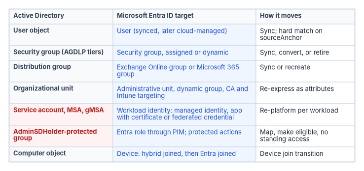
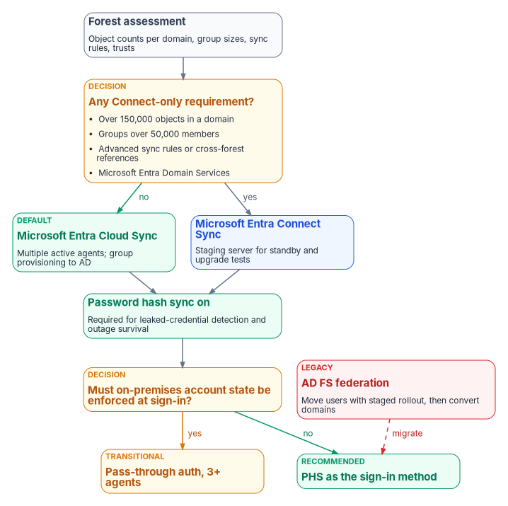

# Chapter 09 — Building the Entra ID Target

*In Active Directory, where an object sits decides what applies to it; in Entra ID, what an object says about itself decides, so the target has to be built from attributes, not copied from containers.*

::: {.callout-note}
## In this chapter
How each Active Directory object class and administrative construct maps to a Microsoft Entra ID construct, and which license tier each governance feature needs. The two decisions that shape the hybrid period: which sync engine to run and how users sign in. How to migrate groups and service accounts, how to rebuild privileged access on Privileged Identity Management (PIM), and the persona-based Conditional Access framework that replaces Group Policy logon restrictions. An operations reference for the Connect Sync servers that stay. [Chapter 10](10-migrating-and-governing.md) covers governance, authentication modernization, monitoring, and the migration playbook.
:::

## Purpose and scope

This chapter and the next are the program's technical reference for moving the full identity lifecycle from on-premises Active Directory Domain Services (AD DS) to Microsoft Entra ID. They're written for the architects who plan and run that move. The scope covers every object class and governance construct that makes up an Active Directory identity model:

- User objects: attributes, UPN routing, security identifiers (SIDs), group memberships, OU placement, and lifecycle state.
- Security and distribution groups: scope, nesting patterns, mail enablement, and dynamic membership.
- Service accounts: traditional user-object service accounts, managed service accounts (MSAs), and group managed service accounts (gMSAs).
- Privileged access: AdminSDHolder-protected groups, delegation models, and tiered administration.
- Conditional Access, replacing Group Policy logon restrictions with policy-driven cloud controls.
- Identity governance: access reviews, entitlement management, lifecycle workflows, and compliance attestation.

The environment is the one this workbook assumes throughout: a Microsoft 365 Government Community Cloud (GCC) tenant. GCC uses the worldwide Microsoft Graph and Azure portal endpoints (`https://graph.microsoft.com`), not the separate `graph.microsoft.us` endpoints that GCC High and DoD use.[^c09-graph-clouds] Some features reach GCC later than the commercial service or differ there, so check each feature against the Microsoft 365 Government service descriptions before you plan around it. Azure infrastructure and platform services are out of scope unless the text calls one out and says why.

The chapters assume:

- A GCC tenant with at least Microsoft Entra ID P2, and Microsoft Entra ID Governance for the features that need it (see the licensing table below).
- One or more source forests at Windows Server 2016 forest functional level or later, already inventoried with the read-only tools in [Chapter 07](07-read-only-discovery.md) and [Chapter 08](08-assessing-the-forest.md).
- A Git repository for configuration as code and drift detection. The program's reference build uses Gitea, but any Git host works.
- PowerShell examples written against the Microsoft Graph PowerShell SDK v2 and the `ActiveDirectory` module. The retired MSOnline and AzureAD modules aren't used anywhere; see [Appendix C](appendix-c-identity-assessment-module.md) for the retirement dates.
- Read access in both directories: a delegated read account in Active Directory and Global Reader (at minimum) in the tenant. Write steps name the narrower role they need.

## Decomposing the Active Directory identity landscape

Before any object moves, break the Active Directory identity model into its component object types. Each one has its own migration path, attribute mapping, and Entra ID equivalent. The figure summarizes the decomposition; the sections after it work through each row.

The rows belong to different [tracks](../guides/attribute-driven-migration.md#four-tracks), each with its own source of truth. User objects, groups and OUs are the directory side of the **HR track**: their attributes come from HR through provisioning ([Book 03](../b03-hr-identity/index.md)). Service accounts, MSAs and gMSAs are the **non-person identity track**: their accountability is an owner and sponsor, not an HR record ([companion guide](../guides/attribute-driven-migration.md#non-person-identity-track)); this chapter covers them in [Service accounts](#service-accounts) and [Modernizing service accounts](#modernizing-service-accounts). Computer objects are the **Intune and Arc tracks**, covered in [Book 05](../b05-devices/index.md).

{#fig-ch09-ad-to-entra-objects fig-alt="A three-column table. Column one lists Active Directory object types, column two the Microsoft Entra ID target, column three how each moves. User object becomes a user, synced and later cloud-managed, moved by sync with a hard match on the source anchor. Security group in AGDLP tiers becomes an assigned or dynamic security group, by sync, conversion, or retirement. Distribution group becomes an Exchange Online group or a Microsoft 365 group, by sync or recreation. Organizational unit becomes administrative units, dynamic groups, and Conditional Access and Intune targeting, re-expressed as attributes. Service accounts, MSAs, and gMSAs, shaded red as legacy risk, become workload identities: managed identities or applications with certificates or federated credentials, re-platformed per workload. AdminSDHolder-protected groups, also red, become Entra roles through PIM plus protected actions, mapped and made eligible with no standing access. Computer objects become devices, hybrid joined and then Entra joined, through a device join transition."}

### User objects

User objects are the foundational identity type. Each one carries the attributes that define credentials, organizational placement, group membership, and authorization scope. Five dimensions drive the migration:

- **userPrincipalName (UPN).** The UPN suffix must be a domain verified in the tenant. If it isn't, sync doesn't fail; Entra ID builds a substitute UPN from the mail nickname and the tenant's initial `onmicrosoft.com` domain, which is rarely what anyone wants.[^c09-upn-population] Non-routable suffixes such as `.local` need remediation before sync (see [UPN suffixes and alternate login ID](#upn-suffixes-and-alternate-login-id)).
- **objectSid.** Entra ID doesn't use SIDs for its own authorization. The on-premises SID is carried in `onPremisesSecurityIdentifier`, which must be unique in the tenant; a duplicate raises an `AttributeValueMustBeUnique` error during provisioning.[^c09-existing-tenant]
- **memberOf.** Memberships arrive with group sync. Nested memberships behave differently in Entra ID (see [Nested groups](#nested-groups)).
- **OU placement.** OUs decide which Group Policy Objects apply and who can administer the object. Entra ID has no OU; administrative units take the delegation role, and groups take the policy-targeting role.
- **Attribute richness.** Entra ID maps a subset of AD attributes natively and carries `extensionAttribute1` through `15` in `onPremisesExtensionAttributes`. Custom data beyond that needs directory extensions.

The core user attribute mapping is in the following table. The full reference is in [Appendix C](appendix-c-identity-assessment-module.md#attribute-mapping-reference), and the full comparison of the two directories' attribute models, with every attribute store, is in the [companion guide](../guides/attribute-driven-migration.md#attributes). The program's assignments for the fifteen extension attributes are the program attribute map in [Book 03, Chapter 06](../b03-hr-identity/06-canonical-attribute-schema.md#program-attribute-map). "Rules" in the notes means dynamic membership rules, which read only the properties Microsoft lists for them.[^c09-dynamic-properties]

| AD attribute | Microsoft Graph user property | Notes |
|---|---|---|
| `sAMAccountName` | `onPremisesSamAccountName` | Read-only in Entra ID for synced users |
| `userPrincipalName` | `userPrincipalName` | Suffix must be a verified domain; the sign-in name |
| `objectSid` | `onPremisesSecurityIdentifier` | Must be unique in the tenant |
| `objectGUID` / `ms-DS-ConsistencyGuid` | `onPremisesImmutableId` | The source anchor. Connect Sync uses `ms-DS-ConsistencyGuid` for users from version 1.1.524.0 and writes `objectGUID` into it when it's empty; Cloud Sync uses `ms-DS-ConsistencyGuid` with a fallback to `objectGUID`, and that can't be changed[^c09-source-anchor][^c09-cloud-sync-faq] |
| `distinguishedName` | `onPremisesDistinguishedName` | Read-only, populated only for synced users.[^c09-user-resource] Rules can read it; the program never uses it for policy, because it's placement |
| `mail` | `mail` | Primary SMTP address |
| `displayName`, `givenName`, `sn` | `displayName`, `givenName`, `surname` | Direct mapping |
| `department`, `title`, `company` | `department`, `jobTitle`, `companyName` | Direct mapping; all usable in rules, but the program's rules read codes, not these display strings |
| `physicalDeliveryOfficeName`, `l`, `st`, `co` | `officeLocation`, `city`, `state`, `country` | Entra ID's `country` corresponds to the AD country name `co`; Connect Sync also syncs the two-letter `c`.[^c09-sync-attributes][^c09-entra-to-ad] Entra ID adds `usageLocation`, a two-letter code used for license assignment |
| `employeeID`, `employeeType` | `employeeId`, `employeeType` | `employeeId` is the HR person key and rules can read it; rules can't read `employeeType`, so the program mirrors worker type in `extensionAttribute11` |
| `manager` (DN) | `manager` (relationship) | Resolved as a relationship, not an attribute. Rules can't read it as a property; only the separate direct-reports rule uses it |
| `memberOf` | `memberOf` (relationship) | Resolved by the sync engine. Don't build rules on it ([Dynamic group rule syntax](#dynamic-group-rule-syntax)) |
| `extensionAttribute1`–`15` | `onPremisesExtensionAttributes` | Up to 1,024 characters each, also known as Exchange custom attributes 1–15. Read-only in Graph for synced users, so edit them in AD or at the HR source; for a cloud-only user that was previously synced and not converted, read-only in Graph but managed through Exchange, while a user whose source of authority was converted to the cloud can have them set directly.[^c09-user-resource] Rules can read them. Program-assigned meanings in the [program attribute map](../b03-hr-identity/06-canonical-attribute-schema.md#program-attribute-map) |
| Custom schema attributes | Directory extensions (`extension_<appId>_<name>`) | Synced from AD through the sync engine; single-valued ones can be read by rules[^c09-dynamic-properties] |
| `userAccountControl` | `accountEnabled` | The disabled bit becomes a Boolean; every access rule should require `accountEnabled -eq true` |
| `pwdLastSet` | `lastPasswordChangeDateTime` (nearest equivalent, not synced) | Connect Sync syncs `pwdLastSet` as a mechanical property that tells Entra ID when to invalidate issued tokens.[^c09-sync-attributes] `lastPasswordChangeDateTime` is the Entra user's own last password change or creation time[^c09-user-resource] |
| `lastLogonTimestamp` | `signInActivity` (nearest equivalent, not synced) | Entra ID's own record of sign-in attempts. Reading its details needs Entra ID P1 or P2 and the `AuditLog.Read.All` permission[^c09-user-resource] |
| `altSecurityIdentities` | `certificateUserIds` | Not synced by default. It reaches `certificateUserIds` only through Connect Sync rules you add, and each synced account should hold no more than 10 values. For synced users, only Connect Sync can write the attribute[^c09-cbu-mapping] ([Book 07](../b07-pki/index.md)) |
| `servicePrincipalName` (Kerberos SPNs) | None | Entra service principals are application objects, not Kerberos SPNs. SPNs stay in AD until their workloads move: the non-person identity track ([Modernizing service accounts](#modernizing-service-accounts)) |
| `adminCount` | None | Privilege comes from Entra roles and PIM ([AdminSDHolder and protected groups](#adminsdholder-and-protected-groups)) |
| `whenCreated` | `createdDateTime` | The date the object reached Entra ID, not the AD creation date |
| None (Entra ID only) | Custom security attributes, `userType`, `employeeHireDate`, `employeeLeaveDateTime`, `signInActivity` | Written in the cloud or by HR provisioning; Lifecycle Workflows key on the two dates ([Chapter 10](10-migrating-and-governing.md#lifecycle-workflows)) |

### Security groups

Active Directory security groups are the authorization backbone. AD classifies them by scope (domain local, global, universal) and by type (security, distribution). The AGDLP pattern (accounts into global groups, global groups into domain local groups, domain local groups onto permissions) and its multi-domain variant AGUDLP define the canonical AD group architecture. Entra ID has no group scope, so each scope maps to the same target with a different migration path.

| AD group scope | Nesting capability | Entra ID equivalent | Migration path |
|---|---|---|---|
| Domain local | Can contain global and universal groups from any domain | Security group (assigned) | Sync or recreate as cloud-only; flatten if nested |
| Global | Can contain users and global groups from the same domain only | Security group (assigned or dynamic) | Sync; evaluate for dynamic membership |
| Universal | Can contain users and groups from any domain in the forest | Security group (assigned) | Sync; the preferred scope for multi-domain forests |

### Distribution groups

Distribution groups route mail. They're either mail-enabled security groups, which do both jobs, or pure distribution groups. In the cloud they become mail-enabled security groups or distribution groups managed through Exchange Online.

- Mail-enabled security groups sync from AD and keep both their security and mail functions in Exchange Online.
- On-premises dynamic distribution groups don't sync.[^c09-sync-groups] Recreate them in Exchange Online as dynamic distribution groups, which use OPATH filter syntax.
- For each distribution group, decide whether it should become a Microsoft 365 group instead, to gain a shared mailbox, calendar, and file storage.

### Service accounts

This section is the **non-person identity track**: a service account's attributes come from the owning application's record, and its accountability is a named owner and sponsor, not an HR record ([companion guide](../guides/attribute-driven-migration.md#non-person-identity-track)). Service accounts are a critical identity class that is often under-governed. They come in four forms in Active Directory, each with a different path to Entra ID. The detailed migration matrix is in [Modernizing service accounts](#modernizing-service-accounts).

| AD service account type | Characteristics | Entra ID target | Risk profile |
|---|---|---|---|
| Traditional (user object, often an `svc-` prefix) | Password-based, often "password never expires," often allowed to log on interactively | Application registration with a certificate or federated credential; managed identity where the workload runs in Azure | High: static credentials, often over-privileged |
| Managed service account (MSA) | Automatically managed password, bound to one server | gMSA on-premises; managed identity if the workload moves to Azure | Medium: server-scoped, little governance visibility |
| Group managed service account (gMSA) | Automatically managed password, usable by several servers | Retain for on-premises Kerberos workloads; workload identity federation when the workload moves | Medium: better than traditional, still AD-dependent |
| Delegated managed service account (dMSA) | Needs at least one Windows Server 2025 domain controller and Windows Server 2025 hosts, not a functional level; supersedes a traditional account, binds authentication to mapped machine identities, and disables the original account's password[^c09-dmsa][^c09-dmsa-faq] | Retain for on-premises Kerberos workloads; same cloud path as a gMSA when the workload moves | Low to medium: resists Kerberoasting, still AD-dependent |

### Computer objects

Computer objects belong to the **Intune track** (workstations and laptops) and the **Arc track** (member servers), both in [Book 05](../b05-devices/index.md); a device rule reads only the device's own attributes, never its owner's. Computer objects represent domain-joined devices. Their path runs from domain joined, to Microsoft Entra hybrid joined, to Microsoft Entra joined. This chapter covers devices only where they meet identity governance, such as device-based Conditional Access and device compliance as an access signal. The device estate and the services it depends on are in [Chapter 04](04-the-hidden-migration-surface.md).

### Organizational units

OUs serve three governance functions in Active Directory: Group Policy scoping, administrative delegation, and logical organization. The [book index](index.md) counts four jobs for the OU tree (delegation, policy scope, accountability and security scope); this table lists three, with accountability and security scope falling under logical organization. Entra ID has no OU construct; each function moves somewhere different.

| AD OU function | Entra ID equivalent | Implementation notes |
|---|---|---|
| Group Policy scoping | Conditional Access policies and Intune configuration profiles | Target by group membership, not container |
| Administrative delegation | Administrative units (AUs) | Creating AUs is free; each AU-scoped administrator needs Entra ID P1. Dynamic AU membership needs P1 for each member.[^c09-au-licensing] |
| Logical organization | Dynamic groups and attributes | Attribute-driven grouping replaces the container hierarchy |

[Chapter 05](05-delegation-without-ous.md) works through the delegation design in detail.

::: {.callout-important}
## Design principle: placement versus attributes
Entra ID inverts the Active Directory governance model. In AD, *placement* determines policy: an object's OU decides which Group Policy Objects apply. In Entra ID, *attributes* determine policy: an object's properties decide its group memberships, and memberships decide which policies apply. This inversion is the most important architectural idea in the migration, and it's why attribute quality gates everything that follows. Proving the attributes is Stage 2 of the [attribute-driven migration guide](../guides/attribute-driven-migration.md#stage-2-prove-the-attributes-are-true-before-anything-depends-on-them), and the program's attribute design is in [Book 03](../b03-hr-identity/06-canonical-attribute-schema.md).
:::

In AD, *where* an object sits does half the work; in Entra ID, *what the object says about itself* has to do all of it. The models differ in these ways (the [companion guide](../guides/attribute-driven-migration.md#attributes) has the full comparison):

| Topic | Active Directory | Entra ID |
|---|---|---|
| Structure | Hierarchy: distinguished name and OU | Flat |
| Schema | Extensible LDAP schema; additions are forest-wide and can't be removed, only made defunct[^c09-ad-schema] | Fixed properties plus extension mechanisms: extension attributes, directory extensions, custom security attributes |
| Access | LDAP or AD PowerShell | Microsoft Graph; some filters need advanced queries[^c09-advanced-queries] |
| Write control | Per-attribute ACLs and OU delegation | Roles scoped by administrative units ([Chapter 05](05-delegation-without-ous.md)); custom security attributes have roles of their own, and Global Administrator can't read or assign them by default[^c09-csa-roles] |
| Groups from attributes | None native; scripts | Dynamic membership rules, over the properties Microsoft lists for them |
| Identity anchor | `objectGUID` / `objectSid` | The Entra object `id`, plus `onPremisesImmutableId` (the source anchor) |
| Mastering | AD | For synced users, AD still masters most attributes, read-only in Entra ID until the source of authority moves |

Three consequences follow. Placement has to become coded data before cut-over. While users are synced, edit attributes in AD or at the HR source, never in Entra ID. And because write access to an attribute decides membership, it's the new security boundary ([Dynamic group rule syntax](#dynamic-group-rule-syntax)).

### AdminSDHolder and protected groups

Active Directory protects members of its most privileged groups with the AdminSDHolder object. Every 60 minutes by default, the Security Descriptor Propagator (SDProp) process on the PDC emulator compares the permissions on each protected account and group with the permissions on the domain's AdminSDHolder object, and resets any that differ.[^c09-adminsdholder] On current Windows Server versions the protected accounts and groups are:[^c09-adminsdholder]

- Account Operators
- Administrator (the built-in account)
- Administrators
- Backup Operators
- Domain Admins
- Domain Controllers
- Enterprise Admins
- Enterprise Key Admins
- Key Admins
- krbtgt
- Print Operators
- Read-only Domain Controllers
- Replicator
- Schema Admins
- Server Operators

Cert Publishers was protected only in Windows 2000 SP4 through Windows Server 2003 and isn't on the current list.[^c09-ad-attack-surface] Any account with direct or transitive membership in a protected group gets `adminCount` set to 1, and the flag stays set after the account leaves the group, so `adminCount` overstates current privilege. Treat it as a lead to investigate, not a finding.

Entra ID has no AdminSDHolder. The nearest controls are Privileged Identity Management, which makes role assignments eligible and time-bound instead of standing, and protected actions, which require a Conditional Access authentication context before specific high-impact permissions can be used.[^c09-protected-actions] Neither copies AdminSDHolder's behavior; together they serve its purpose, which is keeping privileged access from drifting quietly. The mapping from AD privileged groups to Entra roles is in [Privileged access](#privileged-access).

## The Entra ID identity architecture

### The object model

Entra ID is a flat, attribute-driven directory, where Active Directory is hierarchical and container-based. These object types make up the target architecture.

| Object type | Description | AD equivalent | Source of authority |
|---|---|---|---|
| User | Human identity with credentials and profile attributes | User object | Synced from AD, or cloud-only |
| Security group | Authorization group; assigned or dynamic membership | Security group (all scopes) | Synced or cloud-only |
| Microsoft 365 group | Collaboration group with mailbox, calendar, files, Planner, and Teams | None | Cloud-only |
| Mail-enabled security group | Security group with an Exchange Online address | Mail-enabled security group | Synced or cloud-only |
| Distribution group | Mail routing without a security function | Distribution group | Synced or cloud-only |
| Administrative unit | Scope for delegated administration | Organizational unit (delegation function) | Cloud-only |
| Application registration | Application definition: credentials, permissions, redirect URIs | None | Cloud-only |
| Service principal | The application's instance and identity in a tenant | Service account (functional) | Created from an application registration or a gallery app |
| Managed identity | Identity for an Azure resource; Azure manages its credentials | gMSA (functional) | Created with an Azure resource, or as a standalone Azure resource |

Managed identities come in two types. A system-assigned identity is created with an Azure resource, shares that resource's lifecycle, and can't be shared. A user-assigned identity is a standalone Azure resource that can be assigned to several resources and must be deleted explicitly; Microsoft recommends user-assigned identities for most scenarios.[^c09-managed-identity] Either way, a managed identity is a special type of service principal, and it exists only for workloads that run on Azure resources.

### Tenant boundary and forest boundary

The tenant is the security and administrative boundary. It's analogous to an AD forest, not a domain.

- One tenant is one trust boundary. There are no domain trusts inside it.
- Cross-tenant access is governed by B2B collaboration, B2B direct connect, and cross-tenant access settings, which take the place of forest trusts ([Chapter 10](10-migrating-and-governing.md#cross-tenant-and-b2b-collaboration)).
- A tenant has no domain hierarchy. Verified domains are routing suffixes for sign-in names and mail, not security boundaries.
- Several forests can sync into one tenant. Microsoft Entra Connect Sync handles connected forests from one server; Microsoft Entra Cloud Sync also handles disconnected forests, with agents in each.[^c09-cloud-sync-decision][^c09-topologies][^c09-what-cloud-sync]

### Licensing for governance features

Governance features are gated by license tier, and the tiers changed when Microsoft moved most governance capability into Microsoft Entra ID Governance. As of October 2026, access reviews and entitlement management require Entra ID Governance for the member users involved, with only some capabilities still operating under P2.[^c09-governance-licensing] Plan on Governance licensing for every user who requests access packages, reviews access, or is reviewed.

| Feature | Free | P1 | P2 | Entra ID Governance |
|---|---|---|---|---|
| User and group management | Yes | Yes | Yes | Yes |
| Conditional Access | | Yes | Yes | Yes |
| Dynamic membership groups (P1 per unique member)[^c09-dynamic-license] | | Yes | Yes | Yes |
| Administrative units (P1 per AU administrator) | Create only | Yes | Yes | Yes |
| Group provisioning to AD with Cloud Sync | | Yes | Yes | Yes |
| Cross-tenant synchronization of users (same cloud) | | Yes | Yes | Yes |
| Risk-based Conditional Access (ID Protection) | | | Yes | Not included; the Entra Suite adds ID Protection |
| Privileged Identity Management, including PIM for Groups | | | Yes | Yes |
| Access reviews | | | Some capabilities | Yes |
| Entitlement management (access packages) | | | Some capabilities | Yes |
| Lifecycle Workflows | | | | Yes |
| Cross-tenant synchronization of groups | | | | Yes |
| Conditional Access for workload identities | Separate Workload ID Premium license | | | |

The table draws on Microsoft's licensing reference.[^c09-entra-licensing] A few packaging points matter for planning:

- Entra ID P1 is included in Microsoft 365 E3 and E5; P2 is included in E5.[^c09-governance-licensing] Government G3 and G5 plans carry the equivalent service plans.
- Entra ID Governance requires a P1 or P2 prerequisite in the tenant. Government SKUs (Microsoft Entra ID Governance for Government, and a Governance add-on for P2 for Government) are available in GCC.[^c09-governance-licensing]
- The Microsoft Entra Suite bundles Private Access, Internet Access, ID Governance, ID Protection, and Verified ID, for P1 and P2 customers.[^c09-governance-licensing]
- Risk-based Conditional Access policies require P2.[^c09-risk-policies-p2]

::: {.callout-note}
## Licensing assumption
These chapters assume P2 for every user and Entra ID Governance for the populations that use access packages, access reviews, and Lifecycle Workflows. Confirm GCC availability for each feature in the Microsoft 365 Government service description; GCC rollout can lag the commercial service.
:::

### Dynamic group rule syntax

Dynamic groups compute membership from user or device attributes. Rules use operators such as `-eq`, `-ne`, `-startsWith`, `-notStartsWith`, `-contains`, `-notContains`, `-match`, `-notMatch`, `-in`, and `-notIn`, and they can be combined with `-and` and `-or`.[^c09-dynamic-rules] A department group reads the coded organization attribute, not the display name, so a renamed office doesn't change who's in it ([Book 03, Chapter 06](../b03-hr-identity/06-canonical-attribute-schema.md#design-rules)):

```text
(user.extensionAttribute10 -in ["FIN-LED","FIN-AP"]) -and (user.accountEnabled -eq true)
```

Three cautions apply:

- **Membership isn't instant.** When an attribute changes, Entra ID re-evaluates the dynamic group rules in the directory, and membership changes don't appear immediately.[^c09-dynamic-troubleshoot] Plan for that delay where a dynamic group gates access to a critical resource.
- **Attribute write permissions are a security boundary.** A dynamic group is only as trustworthy as the controls on the attributes it reads. Some on-premises attributes can be self-writable; audit write permissions, at the source and in Entra ID, for every attribute used in a security-sensitive rule.[^c09-dynamic-license]
- **Don't build on `memberOf`.** The preview `memberOf` operator lets a dynamic group include members of other groups, but Microsoft ended the preview on November 3, 2026: dynamic groups, dynamic administrative units, and access package auto-assignment policies that use it have stopped updating and are frozen in their last state.[^c09-memberof] Replace any `memberOf` rule now.

## Choosing and configuring the sync engine

### Cloud Sync or Connect Sync

Microsoft offers two engines for hybrid identity sync. Microsoft Entra Connect Sync is the long-standing, full-featured engine that runs on a Windows Server. Microsoft Entra Cloud Sync is a lightweight provisioning agent with its configuration held in the cloud.[^c09-what-cloud-sync] Microsoft now describes Cloud Sync as its strategic direction: new sync and provisioning features are built primarily on it, and it's the recommended path for most organizations.[^c09-cloud-sync-decision]

The program's comparison draws on Microsoft's decision guide (as of its October 2026 revision):[^c09-cloud-sync-decision]

| Capability | Connect Sync | Cloud Sync |
|---|---|---|
| Deployment | On-premises Windows Server | Lightweight agents; can run on existing domain controllers or standalone servers |
| Connected multi-forest | Yes | Yes |
| Disconnected forests (mergers and acquisitions) | No | Yes |
| High availability | One active server; a staging server as standby | Multiple active agents with automatic failover |
| Scale per AD domain | No stated limit | Up to 150,000 objects |
| Group size | Up to 250,000 members | Up to 50,000 members |
| Password hash sync and password writeback | Yes | Yes |
| Exchange hybrid writeback | Yes | Yes |
| Device sync for hybrid join | Yes | Yes (enabled separately)[^c09-device-sync] |
| OU-based filtering | Yes | Yes |
| Attribute-based filtering | Yes | Limited |
| Advanced sync rules | Yes (sync rules editor) | No (expression builder only) |
| Cross-forest references; merging attributes across domains | Yes | No |
| Microsoft Entra Domain Services (synced users' password hashes) | Supported | Not supported |
| Group provisioning from Entra ID to AD | No | Yes |
| Device writeback | Yes (discontinued in favor of Cloud Kerberos trust) | No |
| Pass-through authentication or AD FS configured by the tool | Yes | No (configured separately; keeps working after migration) |
| On-demand provisioning for testing | No | Yes[^c09-on-demand] |
| US Government clouds | Yes | Yes |

Two corrections to older guidance matter here. First, Group Writeback v2 in Connect Sync was a preview that Microsoft discontinued on June 30, 2024; Connect Sync is no longer supported for provisioning cloud security groups to AD. Cloud Sync's group provisioning to AD replaces it, and it can run alongside Connect Sync for that one job. Group Writeback v1 remains only for writing Microsoft 365 groups back to AD.[^c09-gwb-v2][^c09-gwb-migrate] Second, Cloud Sync now handles Exchange hybrid writeback, so Exchange hybrid alone no longer forces Connect Sync.[^c09-cloud-sync-decision][^c09-exchange-hybrid]

::: {.callout-tip}
## Recommendation: Cloud Sync unless a Connect-only requirement applies
Use Cloud Sync for new deployments and plan to migrate existing Connect Sync installations to it.[^c09-migrate-cloud-sync] Stay on Connect Sync, for now, only where a forest needs something Cloud Sync doesn't do: more than 150,000 objects in a domain, groups over 50,000 members, advanced sync rules, cross-forest references, attribute merging across domains, or Microsoft Entra Domain Services, which Cloud Sync doesn't support. Both engines can run in the same forest with mutually exclusive scopes, which lets you move populations in stages.[^c09-hybrid-scenarios][^c09-coexist]
:::

::: {.callout-important}
## Connect Sync deadline: April 7, 2027
Every server still running Connect Sync must be on version 2.6.84.0 or later and configured for application-based authentication by April 7, 2027. Microsoft is retiring the legacy authentication the sync service uses, and from that date all synchronization services fail on a server that doesn't meet both conditions, until it's upgraded.[^c09-connect-hardening] The upgrade alone isn't enough. Starting with 2.6.84.0, Connect Sync no longer switches an existing server from the legacy directory synchronization account to application-based authentication on its own; run the wizard and choose *Configure application-based authentication to Microsoft Entra ID*.[^c09-connect-versions] Installing or upgrading to 2.6.84.0 over an existing ADSync database can fail, so use 2.6.91.0 or later in that case.[^c09-connect-versions] The date applies whatever the Cloud Sync migration schedule says.
:::

{#fig-ch09-sync-auth-decision fig-alt="A top-to-bottom decision flow. A slate box, forest assessment (object counts per domain, group sizes, sync rules, trusts), leads to an amber decision: any Connect-only requirement, listing over 150,000 objects in a domain, groups over 50,000 members, advanced sync rules or cross-forest references, and Microsoft Entra Domain Services. A green no branch leads to Microsoft Entra Cloud Sync, labeled default, with multiple active agents and group provisioning to AD. A yes branch leads to Microsoft Entra Connect Sync with a staging server. Both lead to a green box, password hash sync on, required for leaked-credential detection and outage survival. That leads to an amber decision: must on-premises account state be enforced at sign-in. A green no branch leads to PHS as the sign-in method, labeled recommended. An amber yes branch leads to pass-through auth with three or more agents, labeled transitional. A separate red box, AD FS federation, labeled legacy, has a dashed red arrow labeled migrate pointing to PHS as the sign-in method, with the note move users with staged rollout, then convert domains."}

### Filtering

Filtering decides which AD objects reach Entra ID. Connect Sync applies four methods in this order:

1. **Domain-based.** Include or exclude whole domains, such as test or perimeter domains.
2. **OU-based.** The most common method. Exclude OUs that hold service accounts, unneeded computer objects, or staging objects. Both engines support it.
3. **Attribute-based.** Filter individual objects on attribute values with scoping conditions in sync rules; for example, exclude objects where `extensionAttribute15` equals `DoNotSync`.[^c09-filtering] Cloud Sync supports only basic attribute filtering.
4. **Group-based.** Sync only members of a named group. Use it for pilots only; it doesn't scale and it makes sync depend on group membership.[^c09-filtering]

### Attribute flow and transformations

Attribute flow defines how AD attributes become Entra ID attributes. In Connect Sync, custom sync rules take precedence over the default rules by precedence number;[^c09-sync-rule-precedence] Cloud Sync uses an expression builder for attribute mappings.[^c09-cloud-sync-expressions] Three transformations the program commonly needs, shown in Connect Sync's declarative provisioning expression language:[^c09-declarative-expr]

| Scenario | Source expression | Target attribute | Purpose |
|---|---|---|---|
| UPN construction | `IIF(IsPresent([userPrincipalName]),IIF(InStr([userPrincipalName],"@contoso.local")>0,Replace([userPrincipalName],"@contoso.local","@contoso.gov"),[userPrincipalName]),Error("UPN required"))` | `userPrincipalName` | Replace a non-routable suffix with a verified domain |
| Display name normalization | `IIF(IsPresent([sn]),Join(", ",[sn],[givenName]),[displayName])` | `displayName` | Enforce "Last, First" |
| Account type classification | `IIF(CBool(InStr(LCase([distinguishedName]),"ou=service accounts")),"Service","Standard")` | `extensionAttribute7` | Classify from OU placement during the transition |

The third rule is a bridge, not an end state. It derives a classification from placement, which is exactly the AD habit the migration retires. Once the classification is written to the source object, drop the rule.

### Staging mode and recovery

Connect Sync's staging mode lets a second server import and synchronize without exporting to Entra ID.[^c09-topologies] It serves three purposes:

- **Recovery.** If the active server fails, disable staging mode on the standby to promote it. Microsoft recommends a staging-mode standby so that password hash sync isn't down for long.[^c09-choose-authn]
- **Upgrade validation.** Test new sync rules or versions on the staging server before cutting over.
- **Configuration verification.** Compare pending export counts between the active and staging servers to detect configuration drift.

Cloud Sync has no staging mode. It gets availability from multiple active agents instead.[^c09-what-cloud-sync] The [operations reference](#operations-reference-connect-sync) at the end of this chapter covers running the Connect Sync servers that stay: database, accounts, ports, upgrades, switching the active server, and government clouds.

::: {.callout-warning}
## One active Connect Sync server per tenant
Never run two Connect Sync servers in active (non-staging) mode against the same tenant. Connect Sync supports one active instance; Cloud Sync is the engine that supports multiple active agents.[^c09-cloud-sync-decision][^c09-topologies] Two active Connect servers export conflicting changes that are hard to unwind.
:::

### Choosing the sign-in method

The sign-in method decides where passwords are validated. Microsoft's comparison and the program's position:[^c09-choose-authn]

| Criterion | Password hash sync (PHS) | Pass-through authentication (PTA) | Federation (AD FS) |
|---|---|---|---|
| Where validation happens | In the cloud, against a synchronized hash of the password hash | In the cloud, after a check by an on-premises agent against AD | On-premises |
| Extra on-premises infrastructure | None beyond the sync tool | Agent servers; Microsoft recommends at least three in production, treated as Tier 0[^c09-pta-agents][^c09-pta-security] | Two or more AD FS servers and two or more Web Application Proxy servers, load balancing, and certificates |
| Survives an on-premises outage | Yes | No | No |
| Enforces on-premises account state at sign-in | Not immediately; changes arrive with the next sync | Yes (disabled, locked out, expired, logon hours)[^c09-pta] | Yes |
| Leaked-credential detection | Yes; needs PHS | Only if PHS is also on[^c09-pta-limits] | Only if PHS is also on |
| Single sign-on from domain-joined devices | Entra joined or hybrid joined devices, or Seamless SSO[^c09-seamless-sso] | Same as PHS | Yes |
| Program position | Preferred | Transitional | Legacy; decommission target |

Microsoft recommends PHS for cloud authentication, and recommends enabling it whichever method you choose: it's the fallback if PTA agents or federation fail, it's required for ID Protection's leaked-credential detection, and organizations that had it on recovered from ransomware outages in hours rather than weeks.[^c09-choose-authn] Failover from PTA to PHS isn't automatic; an administrator switches the sign-in method in the sync tool.[^c09-choose-authn][^c09-pta-failover]

::: {.callout-tip}
## Recommendation: PHS everywhere
PHS is the program's sign-in method. Where PTA or federation is still in place, turn PHS on anyway so that the fallback and risk detections exist before they're needed.[^c09-phs-backup]
:::

#### If Seamless SSO stays: its computer account's Kerberos key {#seamless-sso-key}

Seamless SSO works through a computer account, `AZUREADSSOACC`, that Entra Connect creates in each Active Directory forest; its Kerberos decryption key is shared with Microsoft Entra ID.[^c09-sso-how] Two things follow from the 2026 Kerberos changes ([Chapter 03](03-ad-and-entra-side-by-side.md#where-the-old-protocols-stand-in-2026)):

- **Move the account to AES256.** Learn recommends AES256 for it and asks organizations to move it off RC4 as soon as possible. If the account still uses RC4, roll over its Kerberos decryption key first and change the encryption type after, or Seamless SSO breaks.[^c09-sso-how]
- **Roll the key over at least every 30 days.** Use `Update-AzureADSSOForest` from the Entra Connect server, once for each forest, as a domain administrator who isn't in the Protected Users group, with a Hybrid Identity Administrator in the tenant.[^c09-sso-faq]

```powershell
$creds = Get-Credential
Update-AzureADSSOForest -OnPremCredentials $creds
```

Check the account's encryption type before and after:

```powershell
Get-ADComputer -Identity AZUREADSSOACC -Properties msDS-SupportedEncryptionTypes |
    Select-Object Name, msDS-SupportedEncryptionTypes
```

Treat the account as Tier 0: Learn says to keep it in an OU only Domain Admins can manage, with no Kerberos delegation on it.[^c09-sso-how] Where every device is Entra joined or hybrid joined, Seamless SSO adds nothing ([Chapter 10](10-migrating-and-governing.md), Phase 2 step 3).

#### What CISA's hybrid identity guidance adds

CISA's Hybrid Identity Solutions Guidance, written under the SCuBA project, compares the same choices from the federal side and adds a fourth: federation, pass-through authentication, password synchronization, and **cloud primary authentication**, in which users sign in to the cloud identity service with a modern, passwordless authenticator, such as PIV or FIDO2, and on-premises identity services play a shrinking, secondary role.[^c09-hisg] It's vendor-neutral and not prescriptive, but its direction matches the program's:

- **The first three share one weakness.** In federation, pass-through authentication and password synchronization alike, the source of identity is the on-premises directory, so a compromise there can reach the cloud. CISA recommends shifting from all three toward cloud primary authentication over time.[^c09-hisg]
- **CISA's primary recommendation** is to migrate to cloud-based, passwordless authentication, using existing PKI and PIV or CAC investments or FIDO2 and WebAuthn, and to move from on-premises federation to cloud-primary authentication with modern authenticators and open standards.[^c09-hisg] In this program that's PHS now, then the phishing-resistant roadmap and AD FS decommissioning in [Chapter 10](10-migrating-and-governing.md#authentication-modernization).
- **Check the hash.** For password synchronization, CISA warns that mismatched hash functions on-premises and in the cloud could leave a weaker algorithm in use.[^c09-hisg] PHS doesn't send the Active Directory hash: the sync agent salts it per user and runs it through PBKDF2 with 1,000 iterations of HMAC-SHA256, so what Entra ID stores can't be replayed against Active Directory in a pass-the-hash attack.[^c09-phs-hash]
- **Keep privileged accounts cloud-only** whatever the sign-in method, so a compromised on-premises environment reaches only lower-privilege accounts.[^c09-hisg] [Book 04, Chapter 04](../b04-access/04-privileged-roles-and-tiers.md) sets the program's standard.

### Managed authentication or federation: the decision record {#managed-or-federated-decision}

The table above compares the methods; an agency that still federates a domain also has to write down why, what keeps the federation safe while it lasts, and what ends it. Microsoft's Zero Trust guidance for Entra ID lists "Use cloud authentication" as a recommendation, because an on-premises federation server is a central authentication point whose compromise lets an attacker forge tokens that impersonate any user, and it points to the migration to password hash sync as the remediation.[^c09-zt-cloud-authn] The program's position is the same: managed authentication with PHS is the target, and federation is kept only on a dated, signed exception.

**Authority:** Microsoft-recommended (cloud authentication, from "Configure Microsoft Entra for Zero Trust: Protect identities and secrets," read Nov 11, 2026); the program's position (federation only by exception) is risk-based recommended, for the token-forgery risk above.
**Applies:** all tenants with a federated domain. Environment-dependent: federated authentication, cloud authentication, Microsoft Entra Connect sync and cloud sync, and Connect Health are all listed as available in Azure for US Government, the cloud GCC High and DoD tenants use;[^c09-zt-gov-features] GCC tenants use the commercial service.

#### The decision tree

Answer the questions in order for each federated domain. The first answer that leads to "managed" ends the tree.

| # | Question | If yes | If no |
|---|---|---|---|
| 1 | Is password hash sync on for every user in the domain, and has staged rollout to PHS succeeded for a pilot? | Go to 2 | Turn PHS on first; it is the fallback either way ([Recommendation: PHS everywhere](#choosing-the-sign-in-method)) |
| 2 | Does a relying party other than Microsoft 365 still depend on the farm? | Record it; it keeps the *farm*, not the *domain*, federated ([Appendix D](appendix-d-migrating-ad-fs-applications.md#two-migrations-not-one)). Go to 3 | Go to 3 |
| 3 | Does a sign-in requirement for this domain exist that Entra ID can't meet without the farm, named in writing by its owner? | Go to 4 | **Managed.** Plan the conversion in [Chapter 10, Phase 9](10-migrating-and-governing.md#phase-9-federation-decommission-if-applicable) |
| 4 | Can the farm meet every condition in the next table (availability, certificate rollover, compromise recovery, monitoring) from today? | **Federated, on a dated exception** with an exit date no later than the program's AD FS retirement date | **Managed.** A farm that can't be kept safe is a reason to convert, not to keep it |

Requirements that once forced federation mostly no longer do: smart card and PIV sign-in moves to Entra certificate-based authentication ([Book 07, Chapter 06](../b07-pki/06-device-and-user-certificates.md#migrating-from-ad-fs-certificate-authentication)), and immediate enforcement of on-premises account state is what pass-through authentication offers as a transition. A requirement that survives question 3 is rare, and the record names it.

#### What a federated domain has to keep up while it lasts

| Condition | What the program asks | Where it's done |
|---|---|---|
| **Availability** | Two or more AD FS servers and two or more Web Application Proxy servers behind load balancing, as the method table above says, with PHS on so an administrator can switch the domain to managed authentication if the farm fails; the farm's backups taken with the AD FS Rapid Restore Tool and a restore tested | This chapter; [Book 07, Chapter 06](../b07-pki/06-device-and-user-certificates.md#migrating-from-ad-fs-certificate-authentication) for the backup |
| **Certificate rollover** | `AutoCertificateRollover` on and federation metadata reachable from the internet, so Entra ID picks up the new token-signing certificate on its own; Entra ID starts polling the metadata 35 days before the current certificate expires, and emails when it can't get the new one.[^c09-zt-fed-certs] Where certificates are renewed manually, run `Update-MgDomainFederationConfiguration` for every federated domain after each renewal | The check below |
| **Compromise recovery** | A written, tested procedure: emergency rotation of the token-signing certificate, update of Entra ID, revocation of refresh tokens, or conversion of the domain to managed authentication | The procedure below |
| **Monitoring** | Connect Health for AD FS agents on every AD FS and proxy server (Entra ID P1), with its alerts routed to the identity team; AD FS logs in the SIEM; an alert on changes to the domain's federation configuration[^c09-zt-health-adfs] | [Appendix D](appendix-d-migrating-ad-fs-applications.md#keeping-ad-fs-and-web-application-proxy-secure-until-they-retire) for hardening; [Chapter 10](10-migrating-and-governing.md#detection-rules) for detection rules |
| **Exit criteria** | All of Appendix D's [retirement criteria](appendix-d-migrating-ad-fs-applications.md#retirement-criteria), and the domain converted | [Chapter 10, Phase 9](10-migrating-and-governing.md#phase-9-federation-decommission-if-applicable) |

The rollover check, run monthly and before every change window, on the primary AD FS server:

```powershell
# On the primary AD FS server, as an AD FS administrator
Get-AdfsProperties | Format-List AutoCertificateRollover, CertificateGenerationThreshold, CertificatePromotionThreshold
Get-AdfsCertificate -CertificateType Token-Signing | Format-Table IsPrimary, Thumbprint, NotAfter

# Microsoft Entra PowerShell, as a Hybrid Identity Administrator: compare with what Entra ID holds
Connect-Entra -Scopes 'Domain.Read.All'
Get-EntraFederationProperty -DomainName "<federated domain>" | Format-List Source, SigningCertificate
```

The thumbprints should match, and a `NotAfter` under 35 days away with `AutoCertificateRollover` off, or under 15 days with the certificates out of sync, means renew now.[^c09-zt-fed-certs] `<federated domain>` is the domain name, such as `contoso.example`.

#### The compromise recovery procedure

Microsoft's emergency rotation for a token-signing certificate that may be compromised creates *two* new certificates, so that Entra ID releases what it held about the old one; with only one, the old certificate might still authenticate users. The rotation revokes the old certificates at once and can cause an outage until every federation partner has the new ones.[^c09-zt-fed-emergency] The procedure for a farm with `AutoCertificateRollover` on:

```powershell
# 1. On the primary AD FS server, as an administrator: record the current certificate, then replace it twice
Get-AdfsCertificate -CertificateType Token-Signing | Format-Table IsPrimary, Thumbprint, NotAfter
Update-AdfsCertificate -CertificateType Token-Signing -Urgent
Update-AdfsCertificate -CertificateType Token-Signing
Get-AdfsCertificate -CertificateType Token-Signing | Format-Table IsPrimary, Thumbprint, NotAfter

# 2. As a Hybrid Identity Administrator: push the new certificate to Entra ID, for every federated domain
Connect-Entra -Scopes 'Domain.Read.All'
Get-EntraFederationProperty -DomainName "<federated domain>"
Update-MgDomainFederationConfiguration -DomainId "<federated domain>" -InternalDomainFederationId "<internal federation id from the line above>"

# 3. On the primary AD FS server: remove the old certificate so it can't be used
Remove-AdfsCertificate -CertificateType Token-Signing -Thumbprint "<old thumbprint from step 1>"
```

Then revoke refresh tokens for the affected users (`Revoke-EntraUserAllRefreshToken -UserId "<user object id>"` for each), revoke and replace the farm's TLS certificates if the compromise reached them, and send the new token-signing certificate to every relying party that doesn't read federation metadata.[^c09-zt-fed-emergency] Where PHS is on and staged rollout has proved cloud authentication, converting the domain (`Update-MgDomain -DomainId "<federated domain>" -AuthenticationType "Managed"`) takes the farm out of the Microsoft 365 sign-in path altogether, and is the faster containment for that path. Plan the change on Microsoft's two published figures: the migration guide says conversion can take up to 60 minutes per domain,[^c09-zt-fed-migrate] and the AD FS to Entra FAQ allows up to 4 hours for the change to take full effect.[^c09-zt-adfs-faq] The program plans on **4 hours** for full effect, the longer of the two: a settled program decision ([WD-152](../../about/decision-register.md#wd-152)), so the change window, the help desk's watch and any rollback decision allow for the whole period. Relying parties other than Microsoft 365 still trust the farm's certificate after a domain is converted, so the rotation is still needed for them ([Appendix D](appendix-d-migrating-ad-fs-applications.md#two-migrations-not-one)).

*Test it before it's needed.* Run the whole procedure, rotation, Entra update, token revocation and the conversion's rollback (`New-MgDomainFederationConfiguration`), in a test tenant federated to a test farm, at least once a year and after any change to the farm (the yearly test is the program's settled position, [WD-148](../../about/decision-register.md#wd-148)); record the date, the tester, the observed outage and the time each step took. Rotation in production is an incident action, not a test.

#### The decision record

```markdown
**Federation decision record**: <federated domain>
- Decision: Managed | Federated on a dated exception
- Tree answers (1–4): <yes/no and the evidence for each>
- Requirement that needs the farm (question 3): <requirement, its owner, the date it was named>
- Conditions met (availability, rollover, recovery, monitoring): <evidence for each, with dates>
- Recovery procedure last tested: <date, tester, test tenant, observed outage>
- Exit criteria and exit date: <Appendix D criteria still open; date no later than the AD FS retirement date>
- Decided: identity engineering lead <name, date>; consulted: CISO <name, date>, ISSO <name, date>
- Residual risk accepted (federated only): authorizing official <name, date>
- Review: <quarterly while federated>
```

Identity engineering decides the authentication method, with the CISO and ISSO consulted, as [Chapter 06's responsibility matrix](06-who-owns-the-migration.md#the-responsibility-matrix) sets out; keeping a domain federated is a residual risk, so the authorizing official accepts it, and the exception follows Book 11's [closure chain](../b11-zero-trust/10-evidence-not-verdicts.md#the-closure-chain).

**Control states.** <!-- Book 00, Appendix D: Designed, Configured, Enforced, Evidenced, Operated -->

| State | This page | Evidence |
|---|---|---|
| Designed | The decision tree and the signed decision record | Decision record per federated domain |
| Configured | PHS on; staged rollout pilot; rollover settings | Sync configuration export; `Get-AdfsProperties` output |
| Enforced | Domain converted to managed (`Update-MgDomain`), or the exception's conditions in force | `Get-MgDomain` showing `AuthenticationType` Managed, or the exception record |
| Evidenced | The recovery procedure tested in a test tenant | Test record (date, tester, observed outage, step times) |
| Operated | Monthly rollover check; Connect Health alerts; quarterly review of the exception | Check output, alert history, review record |

A finding this page addresses is ready for closure when every applicable state has evidence; the authorizing official or assessor decides.

**Evidence checklist**

- [ ] **Configuration:** `Get-MgDomain` export showing each domain's authentication type; `Get-AdfsProperties` and `Get-EntraFederationProperty` output for any domain still federated, in the identity baseline repository
- [ ] **Operational:** Connect Health for AD FS alert history and the monthly rollover check results, kept for the program's log retention
- [ ] **Test:** the recovery test record from the test tenant (expected and observed outcome, date, tester)
- [ ] **Exception:** the signed decision record for each federated domain, with its exit date and review date
- [ ] **Assessor-ready artifact:** the decision records and test record, cross-referenced from the plan of action entry for a "Use cloud authentication" finding

::: {.callout-note appearance="simple"}
## Assessment mapping
- **Microsoft Zero Trust pillar:** Identity
- **CISA ZTMM pillar:** Identity
- **Depends on:** password hash sync and the sync engine (this chapter); Infrastructure, for the Tier 0 servers the farm runs on; SecOps, for the AD FS logs and alerts ([Book 12](../b12-security-operations/index.md))
- **Attack chain interrupted:** Credential Access and Persistence: forging tokens with a stolen token-signing key to impersonate any user in the tenant
:::

### Soft match and hard match

When the sync engine adds an object that might already exist in the cloud, Entra ID looks for a match in this order:[^c09-existing-tenant]

- **Hard match.** The incoming object's `sourceAnchor` (by default the Base64 form of `ms-DS-ConsistencyGuid`, or `objectGUID` in some configurations) is compared with the `onPremisesImmutableId` of existing cloud objects. A match makes AD the source of authority for that object.
- **Soft match.** If there's no hard match, Entra ID compares `userPrincipalName` and the primary SMTP address in `proxyAddresses`. A soft match only works if the cloud object has no `onPremisesImmutableId` yet; afterward, the `sourceAnchor` is written so later matches are hard.

Either match overwrites the cloud object's attributes with the on-premises values, including the password hash under PHS, so clean up AD data first. Microsoft has hardened both paths:

- Tenant settings `BlockSoftMatchEnabled` and `BlockCloudObjectTakeoverThroughHardMatchEnabled` disable each match type. Microsoft advises leaving both blocked except during a planned matching window.[^c09-existing-tenant][^c09-sync-features]
- Since July 1, 2026, Entra ID blocks a hard match when the cloud account already has `onPremisesObjectIdentifier` set, or holds or is eligible for a privileged Entra role. The block is enforced in the cloud, so it applies to both sync engines.[^c09-existing-tenant] Don't plan to take over cloud-only administrator accounts by sync; Microsoft recommends against syncing on-premises accounts onto existing administrative cloud accounts at all.

### UPN suffixes and alternate login ID

Many forests use non-routable UPN suffixes (`contoso.local`) or internal ones (`corp.contoso.com`) that can't be verified in the tenant. The remediation options, in order of preference:

1. **Add a routable UPN suffix to the forest and update user UPNs.** This keeps the sign-in name consistent everywhere and is what Microsoft recommends; it also recommends matching the UPN to the primary SMTP address.[^c09-signin-options][^c09-upn-changes]
2. **Transform the UPN during sync** with a sync rule (see [Attribute flow](#attribute-flow-and-transformations)). AD keeps its UPN; Entra ID gets a constructed one. This creates a permanent mismatch that some applications notice.
3. **Use an alternate login ID.** Connect Sync can use another attribute, such as `mail`, as the Entra ID sign-in name. Microsoft notes that alternate ID isn't compatible with all Microsoft 365 workloads.[^c09-signin-options][^c09-alt-login-id] Separately, "email as an alternate login ID" lets cloud-authenticated users sign in with a proxy address in addition to the UPN; it remains a preview feature as of October 2026.[^c09-email-login]

DNS namespace alignment for new UPN suffixes is covered in the workbook's network and DNS material.

## Migrating groups

### Mapping the AGDLP tiers

The AGDLP model doesn't map one-to-one onto Entra ID, which has no scope-based nesting rules. Each tier has its own target.

| AGDLP tier | AD implementation | Entra ID equivalent | Migration approach |
|---|---|---|---|
| A (account) | User objects | Users | Sync |
| G (global group) | Global security group of users from one domain | Dynamic security group, or assigned security group | Evaluate for dynamic conversion; sync where membership must stay static |
| U (universal group) | Universal group spanning domains | Security group (no scope in Entra ID) | Sync; consider consolidating with G-tier groups |
| DL (domain local group) | Group placed on a resource ACL | Security group assigned to an app role or resource | Sync; may collapse into the resource assignment |
| P (permission) | NTFS, share, or resource ACL entry | App role assignment, SharePoint permission level, or Entra role | Re-express in the cloud permission model |

### The per-group decision

Every AD security group needs one of three decisions: keep it synchronized (hybrid), convert it to cloud-only, or retire it. The group's purpose and dependencies decide which.

| Group characteristic | Decision | Rationale |
|---|---|---|
| Used only for on-premises resource ACLs | Keep in AD; don't sync | A cloud copy adds nothing |
| Used for both on-premises and cloud resources | Synchronize | AD stays the source of authority during the transition |
| Used only for cloud resources | Convert to cloud-only | Removes the AD dependency |
| Membership follows attributes exactly | Convert to dynamic group | Removes manual membership management |
| No members or no resource assignments | Retire | Shrinks the identity surface |

Where a cloud-only group still has to grant access to an AD-integrated (Kerberos) application, provision it back to AD with Cloud Sync's group provisioning, which writes cloud security groups to AD as universal groups.[^c09-gwb-cloud-sync][^c09-govern-onprem-groups]

### Converting static groups to dynamic groups

Static AD groups whose membership really follows department, location, or role are candidates for dynamic groups. The conversion:

1. **Analyze current membership.** Export the members and find the attributes they share.
2. **Draft the rule** from those attributes (see [Dynamic group rule syntax](#dynamic-group-rule-syntax)).
3. **Validate coverage.** Compare what the rule would return with today's membership. The admin center's rule validation helps here.
4. **Handle exceptions.** Members who don't fit need attribute remediation at the source or an explicit, reviewed exception group.
5. **Create the dynamic group** and watch membership populate.
6. **Move resource assignments** from the synced static group to the dynamic group.
7. **Retire the static group.** Take it out of sync scope and archive its membership export.

### Nested groups

Entra ID security groups can contain other security groups, but nesting works for fewer things than in AD.[^c09-manage-groups] As of October 2026:

- Conditional Access and group-scoped policies follow nested members.[^c09-ca-users]
- Group-based assignment to applications doesn't cascade to nested groups, and group-based licensing doesn't apply to members of nested groups.[^c09-manage-groups]
- Groups can't be nested into groups synced from AD, into Microsoft 365 groups, into mail-enabled security groups, or into role-assignable groups.[^c09-manage-groups]
- Dynamic groups contain only users or only devices, never groups.[^c09-dynamic-license]

So flatten deep AGDLP chains before they become cloud authorization:

- Identify the chains: recursively enumerate membership and find chains deeper than one level.
- Flatten to direct membership or a dynamic rule that produces the same effective membership.
- Record the mapping from the original nesting to the flattened result, for the audit trail.

### Microsoft 365 groups

Microsoft 365 groups add collaboration features that AD groups never had: a shared mailbox, calendar, files, Planner, and Teams.

- Convert to a Microsoft 365 group when the group needs collaboration features, represents a project or working team, or should be owner-managed.
- Don't convert when the group exists only for authorization or needs to contain other groups; Microsoft 365 groups can contain only users.[^c09-manage-groups]
- Govern them with naming conventions (prefixes such as `GRP-`, `PRJ-`, `DEPT-`), an expiration policy, and sensitivity labels.

The expiration policy deletes groups that owners don't renew; groups with user activity renew automatically, owners are notified before expiry, and a deleted group can be restored for 30 days. The lifetime is a preset or a custom value of at least 30 days, and only one policy applies across the tenant.[^c09-group-expiration] The program uses 365 days.

### Self-service group management

Entra ID lets group owners manage membership without IT. The program puts three controls around it:

- Recurring access reviews of sensitive group membership by owners (licensing in [Licensing for governance features](#licensing-for-governance-features)).
- An expiration policy for Microsoft 365 groups, as above.
- A group naming policy to enforce the conventions.

### Exporting AD groups and creating cloud groups

The script exports AD groups with a migration classification, then creates cloud-only security groups for the ones marked as security groups. It reads AD and writes only to Entra ID, and only for groups you select.

::: {.callout-warning}
## Illustrative code
The PowerShell in this chapter is illustrative. It hasn't been tested against a production forest or tenant. Review it, run the export in a lab first, and run the create step only after the group decisions above are recorded.
:::

```powershell
#Requires -Modules ActiveDirectory, Microsoft.Graph.Groups
# Federal Modernization Program: export AD groups and create cloud-only security groups.

# --- Phase 1: export AD groups ---
$exportPath = "C:\FMP\Exports\ADGroups_$(Get-Date -Format 'yyyyMMdd').json"

$adGroups = Get-ADGroup -Filter * -Properties Description, GroupScope, GroupCategory,
        ManagedBy, Members, MemberOf, Mail, extensionAttribute1, extensionAttribute2,
        DistinguishedName, WhenCreated, WhenChanged |
    Select-Object @{N = 'Name';        E = { $_.Name } },
                  @{N = 'Description'; E = { $_.Description } },
                  @{N = 'Scope';       E = { $_.GroupScope.ToString() } },
                  @{N = 'Category';    E = { $_.GroupCategory.ToString() } },
                  @{N = 'ManagedBy';   E = { $_.ManagedBy } },
                  @{N = 'MemberCount'; E = { ($_.Members | Measure-Object).Count } },
                  @{N = 'NestedGroupCount'; E = {
                        ($_.Members | Where-Object {
                            (Get-ADObject $_ -Properties objectClass).objectClass -eq 'group'
                        } | Measure-Object).Count } },
                  @{N = 'Mail';        E = { $_.Mail } },
                  @{N = 'OU';          E = { ($_.DistinguishedName -split ',', 2)[1] } },
                  @{N = 'Created';     E = { $_.WhenCreated } },
                  @{N = 'Modified';    E = { $_.WhenChanged } },
                  @{N = 'MigrationTarget'; E = {
                        if ($_.GroupCategory -eq 'Distribution') { 'DistributionGroup' }
                        elseif (($_.Members | Measure-Object).Count -eq 0) { 'Decommission' }
                        else { 'SecurityGroup' } } }

$adGroups | ConvertTo-Json -Depth 5 | Out-File -FilePath $exportPath -Encoding UTF8
Write-Host "Exported $($adGroups.Count) groups to $exportPath" -ForegroundColor Green

# --- Phase 2: create cloud-only security groups (review the export first) ---
Connect-MgGraph -Scopes 'Group.ReadWrite.All'

foreach ($group in ($adGroups | Where-Object MigrationTarget -eq 'SecurityGroup')) {
    $params = @{
        DisplayName     = $group.Name
        Description     = $group.Description
        MailEnabled     = $false
        MailNickname    = ($group.Name -replace '[^a-zA-Z0-9]', '').ToLower()
        SecurityEnabled = $true
        GroupTypes      = @()
    }
    try {
        $newGroup = New-MgGroup -BodyParameter $params
        Write-Host "Created group: $($newGroup.DisplayName) [$($newGroup.Id)]" -ForegroundColor Green
    }
    catch {
        Write-Warning "Failed to create group $($group.Name): $_"
    }
}

Disconnect-MgGraph
```

`NestedGroupCount` calls `Get-ADObject` once per member, which is slow on large groups; in a big forest, run the export against one OU at a time.

## Modernizing service accounts

### The migration path matrix

This section and the rest of this part are the **non-person identity track** ([companion guide](../guides/attribute-driven-migration.md#non-person-identity-track)); SQL Server service and application principals continue in [Book 06](../b06-data-platform/index.md). Each AD service account maps to an Entra ID construct that depends on where the workload runs. The general rule is to eliminate stored secrets: managed identities for Azure-hosted workloads, workload identity federation for workloads that already have an identity from another trusted issuer, and certificates only where neither applies.

The step-by-step path, with a validation check at each gate, is [Non-Person Identity: An Implementation Guide](../guides/non-person-identity-implementation.md).

| AD account type | Workload location | Entra ID target | Authentication | Credential management |
|---|---|---|---|---|
| Traditional | Calls Microsoft 365 or other Entra-protected APIs | Application registration and service principal | Certificate, or federated credential where the host has an OIDC issuer | Certificate rotation (program standard: annual), or no stored secret |
| Traditional | Azure resource | Managed identity (user-assigned preferred) | Managed by Azure | None |
| Traditional | On-premises, Kerberos only | gMSA, or a dMSA on a Windows Server 2025 domain | Kerberos | Managed by AD |
| MSA | On-premises | gMSA (upgrade first; an MSA or gMSA can't be migrated to a dMSA)[^c09-dmsa] | Kerberos | Managed by AD |
| dMSA | On-premises | Keep the dMSA | Kerberos | Managed by AD |
| gMSA | Moving to the cloud | Workload identity federation or managed identity | Federated token or managed | No stored secrets |
| gMSA | Hybrid | Keep the gMSA, plus an application registration for cloud calls | Kerberos on-premises; certificate or federated credential to the cloud | Split |
| IIS application pool identity | On-premises IIS | gMSA now; managed identity once moved to Azure | Kerberos, then managed | Progressive |
| Scheduled task identity | On-premises | gMSA now; an Azure Automation runbook with a managed identity once moved | Kerberos, then managed | Progressive |

### Workload identity federation

Workload identity federation removes stored secrets by having Entra ID trust tokens from an external identity provider. The workload presents a token from its own issuer (GitHub Actions, a Kubernetes cluster, Google Cloud, a SPIFFE deployment, another OIDC provider), and Entra ID exchanges it for an access token. A federated identity credential on the application registration, or on a user-assigned managed identity, has three working parts:[^c09-wif-create]

- **Issuer.** The external provider's OIDC issuer URL. It must match the token's `iss` claim, and Entra ID uses it to fetch the signing keys, so the discovery document has to be reachable.
- **Subject.** Must match the token's `sub` claim exactly; for GitHub Actions, for example, `repo:org/repo:ref:refs/heads/main`. Wildcards aren't supported.[^c09-wif-considerations]
- **Audience.** The recommended value is `api://AzureADTokenExchange`.

An application or user-assigned managed identity can hold at most 20 federated identity credentials, and an incorrect subject is accepted at creation and only fails at token exchange, so test each one.[^c09-wif-considerations]

### Conditional Access for workload identities

Conditional Access can target service principals, which lets you block a workload from outside known IP ranges, block it when ID Protection flags it as risky, or combine it with authentication contexts.[^c09-ca-workload] Know the limits before you design around it:[^c09-ca-workload]

- Creating or modifying these policies requires Workload Identities Premium licensing.
- Policies apply only to single-tenant service principals registered in your tenant. Multitenant and third-party SaaS apps, and managed identities, aren't covered; include managed identities in access reviews instead.
- A policy assigned to a group that contains a service principal isn't enforced for it; assign the workload identity to the policy directly.

### Governing service principals

Every application registration and service principal gets the same controls:

- **Ownership.** A named registry owner (with a backup where the risk tier requires one) and two technical people on the Entra Owners list, never service accounts ([Book 04, Chapter 05](../b04-access/05-applications-and-workload-identities.md#ownership)).
- **Credentials.** Prefer federated credentials and managed identities. Where certificates remain, rotate them on a schedule (program standard: annually) through Key Vault or the CI/CD pipeline. Don't use client secrets for production workloads.
- **Reviews.** Recurring reviews of delegated and application permissions by app owners, on the application's risk-tier cadence (quarterly for risk tier R1, semi-annually for R2; [Book 04, Chapter 09](../b04-access/09-access-governance.md)), plus the identity governance officer's annual review of every admin consent grant ([Book 04, Chapter 06](../b04-access/06-who-decides-access.md)).
- **Least privilege.** Use application-specific roles and scopes; avoid broad permissions such as `Directory.ReadWrite.All`.

### Discovering service accounts

The discovery function finds likely service accounts in AD, classifies each by type and risk, and suggests a target. It only reads. The function is part of the FMPIdentityAssessment module in [Appendix C](appendix-c-identity-assessment-module.md), where it's maintained.

```powershell
#Requires -Modules ActiveDirectory
function Get-FMPServiceAccountInventory {
    [CmdletBinding()]
    param(
        [string]$SearchBase = (Get-ADDomain).DistinguishedName,
        [string]$ExportPath = "C:\FMP\Exports\ServiceAccounts_$(Get-Date -Format 'yyyyMMdd').json"
    )

    $results = [System.Collections.Generic.List[object]]::new()
    $staleCutoff = (Get-Date).AddDays(-90)

    # --- Traditional service accounts: user objects with service indicators ---
    $svcUsers = Get-ADUser -SearchBase $SearchBase -Filter {
            (ServicePrincipalName -like '*') -or (SamAccountName -like 'svc-*') -or
            (SamAccountName -like 'svc_*') -or (SamAccountName -like 'sa-*') -or
            (Description -like '*service*account*')
        } -Properties UserPrincipalName, DisplayName, Description, ServicePrincipalName,
                      Enabled, PasswordNeverExpires, PasswordLastSet, LastLogonDate,
                      WhenCreated, MemberOf, DistinguishedName

    foreach ($svc in $svcUsers) {
        $spnCount = ($svc.ServicePrincipalName | Measure-Object).Count
        $daysSincePasswordChange = if ($svc.PasswordLastSet) {
            (New-TimeSpan -Start $svc.PasswordLastSet -End (Get-Date)).Days
        } else { -1 }

        $recommendation = switch ($true) {
            (-not $svc.Enabled)                           { 'Disabled: verify and retire'; break }
            ($svc.LastLogonDate -lt $staleCutoff)         { 'Stale: verify use and retire if unused'; break }
            ($svc.PasswordNeverExpires)                   { 'HIGH RISK: move to a workload identity (federated credential, managed identity, or certificate)'; break }
            ($spnCount -gt 0)                             { 'Kerberos service: convert to gMSA, then evaluate workload identity federation'; break }
            default                                       { 'Evaluate the workload; target a managed identity or application registration' }
        }

        $riskLevel = if ($svc.Enabled -and $svc.PasswordNeverExpires) { 'HIGH' }
                     elseif ($daysSincePasswordChange -gt 365)          { 'HIGH' }
                     elseif ($svc.Enabled)                              { 'MEDIUM' }
                     else                                               { 'LOW' }

        $results.Add([PSCustomObject]@{
            Type                    = 'TraditionalServiceAccount'
            SamAccountName          = $svc.SamAccountName
            DisplayName             = $svc.DisplayName
            Description             = $svc.Description
            Enabled                 = $svc.Enabled
            PasswordNeverExpires    = $svc.PasswordNeverExpires
            DaysSincePasswordChange = $daysSincePasswordChange
            SPNCount                = $spnCount
            SPNs                    = ($svc.ServicePrincipalName -join '; ')
            LastLogon               = $svc.LastLogonDate
            GroupMembershipCount    = ($svc.MemberOf | Measure-Object).Count
            OU                      = ($svc.DistinguishedName -split ',', 2)[1]
            RiskLevel               = $riskLevel
            Recommendation          = $recommendation
        })
    }

    # --- Managed service accounts (MSA and gMSA) ---
    $msaAccounts = Get-ADServiceAccount -Filter * -SearchBase $SearchBase -Properties Enabled,
        DistinguishedName, ObjectClass, 'msDS-ManagedPasswordInterval', WhenCreated

    foreach ($msa in $msaAccounts) {
        $isGmsa = ($msa.ObjectClass -eq 'msDS-GroupManagedServiceAccount')
        $results.Add([PSCustomObject]@{
            Type                    = if ($isGmsa) { 'gMSA' } else { 'MSA' }
            SamAccountName          = $msa.SamAccountName
            DisplayName             = $msa.SamAccountName
            Description             = ''
            Enabled                 = $msa.Enabled
            PasswordNeverExpires    = $false
            DaysSincePasswordChange = 0
            SPNCount                = 0
            SPNs                    = ''
            LastLogon               = $null
            GroupMembershipCount    = 0
            OU                      = ($msa.DistinguishedName -split ',', 2)[1]
            RiskLevel               = 'LOW'
            Recommendation          = if ($isGmsa) {
                'Keep for on-premises workloads; plan workload identity federation when the workload moves'
            } else {
                'Upgrade to gMSA first, then evaluate for cloud migration'
            }
        })
    }

    $results | ConvertTo-Json -Depth 5 | Out-File -FilePath $ExportPath -Encoding UTF8

    Write-Host "`n=== Service account discovery summary ===" -ForegroundColor Cyan
    Write-Host "Traditional: $(($results | Where-Object Type -eq 'TraditionalServiceAccount').Count)"
    Write-Host "MSA:         $(($results | Where-Object Type -eq 'MSA').Count)"
    Write-Host "gMSA:        $(($results | Where-Object Type -eq 'gMSA').Count)"
    Write-Host "HIGH risk:   $(($results | Where-Object RiskLevel -eq 'HIGH').Count)" -ForegroundColor Red
    Write-Host "MEDIUM risk: $(($results | Where-Object RiskLevel -eq 'MEDIUM').Count)" -ForegroundColor Yellow
    Write-Host "Export:      $ExportPath" -ForegroundColor Cyan

    return $results
}
```

Compared with the earlier version of this script, the checks for disabled and stale accounts now run before the risk checks, so a disabled account with an SPN is reported as a retirement candidate instead of a gMSA candidate. Treat "stale" as a lead, and confirm it against domain controller and Entra ID sign-in logs before retiring anything.

## Privileged access

### Mapping AD privileged groups to Entra roles

Every AD privileged group maps to an Entra ID role governed by PIM. The core rule: **no standing access to privileged roles.** All privileged assignments are eligible, activated just in time; the only permanent active assignments are the two emergency access accounts. The mapping is the program's design; there's no one-to-one equivalence between AD groups and Entra roles.

| AD privileged group | Entra ID target | PIM assignment | Governance notes |
|---|---|---|---|
| Domain Admins | Global Administrator, held by very few | Eligible, with approval | Microsoft recommends fewer than five Global Administrators;[^c09-privileged-roles] most Domain Admin duties map to narrower roles |
| Enterprise Admins | Privileged Role Administrator | Eligible, with approval | Manages role assignments and PIM settings; separate approval chain |
| Schema Admins | No equivalent | Not applicable | Microsoft manages the directory schema. Directory extensions are added through application registrations (Application Administrator) |
| Account Operators | User Administrator scoped to administrative units | Eligible | Limits blast radius. Conditional Access can't target AU-scoped role assignments, so put these administrators in a group for policy targeting[^c09-ca-users] |
| Server Operators | Azure RBAC on Azure Arc-enabled and Azure-hosted servers | Eligible | Servers aren't Intune platforms; server administration moves to Azure Arc, delegated with Azure RBAC ([Book 05, Chapter 09](../b05-devices/09-servers-under-azure-arc.md)) |
| Backup Operators | Service-specific roles (for example, Exchange Administrator for mailbox recovery) | Eligible | No tenant-wide backup role |
| DnsAdmins | No direct equivalent | Not applicable | DNS moves to the Microsoft 365 admin center or the DNS provider |
| Group Policy Creator Owners | Intune Policy and Profile Manager (an Intune role) | Eligible | Group Policy functions move to Intune profiles and Conditional Access |

### PIM configuration standards

PIM role settings are defined per role.[^c09-pim-settings] The program's standards are below; [Book 04, Appendix B](../b04-access/appendix-b-pim-role-settings.md) is the authoritative per-role reference and tightens several values (shorter activations and approval for Tier 1 roles):

- **Eligibility duration.** Eligible assignments expire after at most 12 months and renew through an access review.
- **Activation duration.** Role-specific, from the table below. PIM allows 1 to 24 hours; the program's default is 8.[^c09-pim-settings]
- **Activation requirements.** Justification for every role. Ticket information for Global Administrator, Privileged Role Administrator, and Exchange Administrator; PIM records the ticket number but doesn't check it against a ticketing system.[^c09-pim-settings]
- **Strong authentication at activation.** PIM's "require multifactor authentication" setting can be satisfied by an earlier sign-in in the same session. To force fresh, phishing-resistant authentication at activation, the program uses PIM's Conditional Access authentication context option with an authentication strength.[^c09-pim-settings]
- **Approval.** Required for Global Administrator, Privileged Role Administrator, and Security Administrator, with at least two named approvers who aren't in the requester's own administrative chain. If approval is required and no approvers are configured, PIM defaults to the active Privileged Role and Global Administrators, which can lock the tenant if none are active; configure named approvers and keep the emergency accounts ready.[^c09-pim-settings]
- **Notification.** Activation notices go to the assignee, the Global Administrators, and the security operations mailbox.

| Role | Assignment | Max activation | Approval | Justification | Ticket |
|---|---|---|---|---|---|
| Global Administrator | Eligible | 4 hours | Yes | Yes | Yes |
| Privileged Role Administrator | Eligible | 4 hours | Yes | Yes | Yes |
| Security Administrator | Eligible | 8 hours | Yes | Yes | No |
| Exchange Administrator | Eligible | 8 hours | No | Yes | Yes |
| SharePoint Administrator | Eligible | 8 hours | No | Yes | No |
| User Administrator | Eligible | 8 hours | No | Yes | No |
| Groups Administrator | Eligible | 8 hours | No | Yes | No |
| Conditional Access Administrator | Eligible | 8 hours | No | Yes | No |
| Intune Administrator | Eligible | 8 hours | No | Yes | No |
| Authentication Administrator | Eligible | 8 hours | No | Yes | No |
| Application Administrator | Eligible | 8 hours | No | Yes | No |
| Compliance Administrator | Eligible | 8 hours | No | Yes | No |
| Security Reader | Eligible | 12 hours | No | No | No |
| Global Reader | Eligible | 12 hours | No | No | No |

Every activation in the table requires the phishing-resistant authentication context described above.

**Authority:** Risk-based recommended: the role values above are the program's position, for the risk of standing privilege. Microsoft-recommended where the text cites Learn (fewer than five Global Administrators, the authentication context for activation, named approvers). License-dependent: PIM needs Entra ID P2 or Entra ID Governance for every eligible user.

**Rollout and evidence.** These standards are rolled out in Phase 5 of the [migration playbook](10-migrating-and-governing.md#phase-5-pim-rollout). The procedure that carries them through the workbook's How template, with rings, rollback, the evidence checklist and the control states, is Book 04's: the per-role settings in [Appendix B](../b04-access/appendix-b-pim-role-settings.md), activation with approval in [Chapter 08](../b04-access/08-pim-self-request-with-approval.md), and the [privileged access implementation guide](../guides/privileged-access-implementation.md)'s gates.

### PIM for Groups

PIM for Groups (formerly called privileged access groups) extends just-in-time activation to group membership and ownership. Instead of sitting permanently in a sensitive group, a user activates membership through PIM with the same controls as a role: justification, authentication context, approval.[^c09-pim-groups]

- **Use it for** groups that grant access to sensitive applications, data, or administrative functions.
- **Eligible groups.** Any security group or Microsoft 365 group can be enabled, except dynamic groups and groups synced from AD. Since January 2023 a group doesn't have to be role-assignable to use PIM for Groups.[^c09-pim-groups]
- **Role-assignable groups.** A group must be created role-assignable only if it will hold an Entra role. Role-assignable groups get extra protection (only Global Administrators, Privileged Role Administrators, or the owner can manage them), so Microsoft suggests the setting even for non-role groups that guard sensitive resources. A tenant can have at most 500 role-assignable groups.[^c09-pim-groups]
- **Licensing.** Every user eligible for membership or ownership needs P2 or Entra ID Governance.[^c09-pim-groups-assign]

### Emergency access accounts

Emergency access ("break-glass") accounts restore access when normal administrator sign-in, MFA, or PIM fails. Microsoft's current guidance changed an important detail of older designs: both accounts use phishing-resistant authentication, because Microsoft's mandatory MFA for admin portals applies to them too (Microsoft enforces it in the public Azure cloud, not in Azure Government; see [Book 04, Chapter 04](../b04-access/04-privileged-roles-and-tiers.md)). A password in a safe is no longer enough on its own.[^c09-emergency-access] The program's standard follows that guidance:

- **Quantity.** Two accounts, cloud-only, in the tenant's `onmicrosoft.com` domain, not synced or federated.[^c09-emergency-access]
- **Naming.** Don't use names that mark them as emergency accounts (avoid `emergency`, `breakglass`, `bg-`).
- **Authentication.** A passkey (FIDO2) security key for each account, which is Microsoft's recommended method, or certificate-based authentication where a PKI already exists. Use methods different from those of the normal admin accounts, and store each credential in a separate secure, fireproof location.[^c09-emergency-access]
- **Assignment.** Global Administrator as a permanent active assignment in PIM, not eligible. These are the only permanent Global Administrator assignments.
- **Conditional Access.** Put both accounts in a dedicated exclusion group and exclude it from every policy that blocks or restricts sign-in. Report-only policies don't need the exclusion.[^c09-emergency-access]
- **Monitoring.** Alert on every sign-in and every audit event for these accounts. Any use is an incident until a post-use review says otherwise.
- **Validation.** Test sign-in and an administrative task at least every 90 days, as Microsoft recommends, and record the test in change management.[^c09-emergency-access]

The reference architecture for these accounts, with its How-template subsections, exclusion register, alert rules, evidence checklist and control states, is [Book 04, Chapter 04](../b04-access/04-privileged-roles-and-tiers.md#emergency-access-reference-architecture); the standard above is its design input.

### Protected actions

Protected actions attach a Conditional Access authentication context to specific Entra permissions, so a user must satisfy that policy, typically phishing-resistant MFA, at the moment they use the permission, regardless of which role granted it.[^c09-protected-actions] As of October 2026 they cover:[^c09-protected-actions]

- Conditional Access policy management (create, update, delete)
- Cross-tenant access settings, including tenant restrictions
- Hard deletion of some directory objects from the recycle bin (users, Microsoft 365 groups, cloud security groups, applications)
- Named locations
- Protected action management itself

Protected actions require Entra ID P1 and can be added by a Conditional Access Administrator or Security Administrator.[^c09-protected-actions] Microsoft's privileged roles documentation still describes the feature as preview, so check its status before treating it as a compliance control.[^c09-privileged-roles] The source design's mention of "deleting a tenant" isn't on Microsoft's list and has been dropped.

Protected actions and PIM complement each other. PIM can require an authentication context when a role is activated; protected actions enforce one when a high-impact permission is used, however the user got it. Use both: PIM for activation, protected actions for the operations that would let an attacker disable your controls. Exclude an emergency account from the Conditional Access policy behind each protected action, or a misconfiguration can lock everyone out of the policy that would fix it.

## The Conditional Access framework

### Design approach

Conditional Access replaces the logon restrictions, network access controls, and authentication policies that Active Directory enforced through Group Policy. The program's framework is organized around **personas**, each a population with distinct access needs and risk.

| Persona | Description | Identified by | Risk |
|---|---|---|---|
| Internals | Employees and contractors with standard access | `extensionAttribute11` (worker type code) in {`EMP`, `CTR`} | Standard |
| Admins | Users eligible for or holding privileged roles | `extensionAttribute7` (account type) = `Privileged`, or a group of PIM-eligible users | High |
| Externals | B2B guests from partner organizations | User type Guest, partner tenant | Elevated |
| Guests | Ad hoc external users outside partner organizations | User type Guest, other tenants or identity providers | High |
| Service accounts | Workload identities (single-tenant service principals) | Workload identity assignment | Variable |
| Break-glass | Emergency access accounts | Dedicated exclusion group | Excluded from restrictive policies |

The Externals persona is the Conditional Access view of the External Partner Person class: partner people are Guest users by default, brought in through an access package with a sponsor, approver and expiry ([Book 03, Chapter 15](../b03-hr-identity/15-external-partner-identity.md#class-worker-type-and-persona); [Book 04, Appendix C](../b04-access/appendix-c-partner-access-profile-entra.md#the-default-route-a-connected-organization-and-an-access-package)).

Target the Admins persona with a group rather than by directory role alone: Conditional Access role targeting supports built-in directory roles only, not AU-scoped or custom roles.[^c09-ca-users]

### Named locations

- **Trusted networks.** IP ranges for offices, VPN egress points, and trusted proxies.
- **Trusted countries.** The United States, with others added only with documented justification.
- **Location policy.** Location blocking is set per persona. Internals are blocked outside the United States except for approved travel exceptions (CA008). Admins are held to the stricter rule of trusted networks only (CA005), and workload identities likewise (CA015). Externals and guests aren't location-blocked in this baseline; MFA, terms of use and risk policies govern them. This is a program policy choice, not a property of GCC itself. GCC provides U.S. data residency,[^c09-gov-clouds] but users can sign in from anywhere unless policy blocks it.

### Authentication strengths

Authentication strengths name the method combinations a policy accepts. Entra ID has three built-in strengths:[^c09-auth-strengths]

| Strength | Accepted methods (summary) | Program target |
|---|---|---|
| Phishing-resistant MFA | Windows Hello for Business or platform credential; FIDO2 security key (passkey); certificate-based authentication (multifactor) | Admins; high-risk sign-ins; all users as the end state |
| Passwordless MFA | The phishing-resistant methods, plus Microsoft Authenticator phone sign-in | Interim step for users moving off passwords |
| Multifactor authentication | All of the above, plus password with a second factor, Temporary Access Pass, and federated MFA | Internals and Externals during transition only |

Microsoft Authenticator push and phone sign-in aren't phishing-resistant on their own; Microsoft's M-22-09 guidance pairs Authenticator with managed-device policies to block external phishing.[^c09-memo-2209-ms] Passkeys held in Microsoft Authenticator are device-bound passkeys and count as FIDO2 methods. Custom strengths can narrow a policy further, for example to specific FIDO2 key models by AAGUID. You can't use "require multifactor authentication" and "require authentication strength" in the same policy.[^c09-auth-strengths]

### The policy set

The program's baseline policies. Every policy excludes the break-glass group from policies that block or restrict sign-in; "All users" means all users minus that group.

::: {.callout-note}
## The full library is in Book 04
[Book 04, Chapter 07](../b04-access/07-the-conditional-access-policy-library.md) is the program's authoritative Conditional Access library. It keeps these identifiers, adds CA018–CA038 for the CISA BOD 25-01 Entra ID baseline, and refines seven policies here: CA003 uses the program's custom phishing-resistant, separate-device authentication strength instead of the built-in one and adds the highly privileged directory roles to its targeting (the CA003 template in [Appendix C](appendix-c-identity-assessment-module.md#module-implementation) uses a placeholder for the phishing-resistant strength ID; substitute the custom strength's ID); CA007 and CA008 each gain one governed exception; CA013 takes a block form in BOD 25-01 tenants; CA015 blocks workload identities calling from anywhere except the named location `NL-WorkloadEgress`, not from anywhere outside trusted networks; CA016 targets Members, not all users; and CA017 requires an app protection policy only, because Microsoft made the "approved client app" grant read-only on June 30, 2026. CA004 carries no device filter in either book. Privileged-access-workstation enforcement is a separate block policy in Book 04, CA025, because a grant policy scoped by a device filter simply doesn't apply on other devices.
:::

| Policy | Persona | Conditions | Grant controls | Session controls |
|---|---|---|---|---|
| CA001-AllUsers-BlockLegacyAuth | All users | Client apps: Exchange ActiveSync, other clients | Block | — |
| CA003-Admins-RequirePhishResistantMFA | Admins | All resources, any location | Authentication strength: phishing-resistant MFA | Sign-in frequency: 4 hours |
| CA004-Admins-RequireCompliantDevice | Admins | All resources | Require compliant device (a privileged access workstation; see Chapter 10) | Persistent browser: never |
| CA005-Admins-BlockUntrustedLocations | Admins | All resources, outside trusted networks | Block | — |
| CA006-Internals-RequireMFA | Internals | All resources | Authentication strength: MFA (phishing-resistant as the end state) | Sign-in frequency: 12 hours |
| CA007-Internals-RequireCompliantOrHybridDevice | Internals | All resources | Compliant device or hybrid joined device | — |
| CA008-Internals-BlockNonUSLocations | Internals | All resources, outside trusted countries | Block | — |
| CA009-Externals-RequireMFA | Externals | All resources | Authentication strength: MFA | Sign-in frequency: 8 hours |
| CA010-Externals-RequireTermsOfUse | Externals | All resources | Terms of use accepted | — |
| CA011-Guests-LimitedAppAccess | Guests | Selected apps only (SharePoint, Teams) | MFA and terms of use | App-enforced restrictions; sign-in frequency: 1 hour |
| CA012-Guests-BlockHighRisk | Guests | Sign-in risk: high | Block | — |
| CA013-AllUsers-HighUserRisk-RequireRemediation | All users | User risk: high | Require risk remediation | Sign-in frequency: every time (applied automatically) |
| CA014-AllUsers-MediumSigninRisk-RequireMFA | All users | Sign-in risk: medium or high | Authentication strength: MFA | Sign-in frequency: every time |
| CA015-ServiceAccounts-LocationRestriction | Service accounts | Workload identities, outside trusted networks | Block | — |
| CA016-AllUsers-RequireCompliantDevice-OfficeApps | All users | Office 365 apps on Windows and macOS | Require compliant device | — |
| CA017-Internals-AppProtection-Mobile | Internals | Office 365 apps on iOS and Android | Require app protection policy | — |

Three changes from the earlier version of this set reflect current Microsoft guidance:

- **CA002 is gone.** The earlier set had a "break-glass, grant with no controls" policy. A Conditional Access policy can't create an exemption; the exemption is the exclusion on every other policy. The number is retired so the others keep their identifiers.
- **CA013 uses risk remediation.** Microsoft now recommends "require risk remediation" for high user risk. It handles both password and passwordless users, applies an authentication strength and sign-in frequency of every time automatically, and takes precedence over the older "require password change" control. It requires P2, and it isn't supported for guests, so guests are handled by CA012.[^c09-risk-policies]
- **CA012 targets sign-in risk.** The earlier version targeted user risk for guests. Risk remediation isn't supported for external and guest users, because Entra ID can't revoke their sessions,[^c09-risk-policies-p2] so the program blocks risky guest sign-ins instead.

Leaked-credential detection itself is available without P2, but its full reporting and the risk-based policies above require P2, and the detection needs PHS.[^c09-risk-detections][^c09-choose-authn]

### Testing and rollout

Conditional Access deployment follows three stages:

1. **Report-only (2 to 4 weeks planned; at least seven days is the gate minimum in [Book 00, Chapter 09](../b00-orientation/09-design-pilot-and-rollout.md)).** Deploy every policy in report-only mode. Use the Conditional Access insights workbook to find the users and sign-ins each policy would affect, and fix false positives, such as users without MFA registration or non-compliant devices.
2. **Targeted pilot (wave 1, about one week).** Turn policies on for a pilot group, such as the IT and security teams. Watch help desk volume and sign-in failure rates, and adjust conditions.
3. **Phased rollout (4 to 6 weeks in all, wave 1 included).** Expand in waves: IT and security teams (the pilot), then corporate staff, then field and remote workers, then everyone remaining. The waves run one, one, one and two weeks behind a monitoring gate, as Phase 6 of [Chapter 10](10-migrating-and-governing.md) sets out.

::: {.callout-important}
## Never enforce untested policies on all users
Never switch a policy that targets all users from off straight to on. A misconfigured policy can lock out the whole organization, administrators included. Before enforcing any policy, confirm the break-glass exclusion group is excluded, and confirm both emergency accounts can still sign in.
:::

**Authority:** Risk-based recommended: the stages and durations are the program's position, for the risk of locking out the organization. Microsoft recommends at least a week in report-only, as a deployment tip rather than a product requirement ([Book 04, Chapter 07](../b04-access/07-the-conditional-access-policy-library.md#rollout-from-report-only-to-enforcement)).

**Change safety, rollback and evidence.** The three stages above are the rings. The per-policy cycle (pre-deployment check, report-only measurement, review and approval, ring-by-ring enforcement with a 48-hour watch), the rollback table that sets each policy back to report-only or off and never deletes it, the policy design matrix, the evidence checklist, the control states and the assessment mapping are kept once, in [Book 04, Chapter 07](../b04-access/07-the-conditional-access-policy-library.md#rollout-from-report-only-to-enforcement). The backout triggers for Phase 6 are in the [playbook](10-migrating-and-governing.md#b02-10-playbook-change-safety).

## Operations reference: the Connect Sync servers that stay {#operations-reference-connect-sync}

Where Connect Sync stays through the migration, because a Connect-only requirement applies or until the move to Cloud Sync is finished, its servers are production Tier 0 systems that need running. This reference collects Microsoft's operating requirements for them: the server, the database, the accounts, the ports, upgrades, staging, configuration export, and government clouds. Cloud Sync agents have their own prerequisites; see [Book 03, Chapter 05](../b03-hr-identity/05-the-provisioning-pipeline.md#landing-in-active-directory).

### The server

- **Operating system.** A domain-joined Windows Server with the full GUI; Server Core isn't supported. Microsoft recommends Windows Server 2025 or 2022.[^c09-connect-prereq] The program's baseline is Windows Server 2019 at minimum, with 2016 gone by January 12, 2027 *(program assumption)*; a Connect server on 2016 moves to a new server by swing migration, below.
- **Treat it as Tier 0.** Microsoft classifies the Connect server as a control-plane asset and lists hardening steps: deny NTLM, use Windows LAPS, require MFA for privileged users, and keep soft matching and hard-match takeover disabled.[^c09-connect-prereq] Anyone who administers the server can change what synced users look like in Entra ID.
- **.NET Framework and TLS.** .NET Framework 4.7.2 and TLS 1.2 are the current minimums; from version 2.0, installation fails if TLS 1.2 isn't enabled.[^c09-connect-prereq][^c09-connect-hardening]
- **Writable domain controllers.** The domain controllers Connect uses must be writable; read-only domain controllers aren't supported.[^c09-connect-prereq]
- **Proxy.** Configure an outbound proxy in `machine.config`, not in `miiserver.exe.config`, which every upgrade overwrites.[^c09-connect-connectivity]

### The database

The default database, SQL Server 2019 Express LocalDB, has a 10 GB limit, enough for about 100,000 objects. From 100,000 objects, use full SQL Server (up to SQL Server 2022; Azure SQL Database and Managed Instance aren't supported), with a case-insensitive collation and one sync engine per SQL instance.[^c09-connect-prereq] Where the SQL team owns the instance, Microsoft's delegated install has the SQL administrator create the `ADSync` database (collation `Latin1_General_CI_AS` recommended) and grant the installer and the service account sign-in and `dbo`; nested group membership for those logins isn't supported.[^c09-connect-sql-delegation]

A LocalDB that fills up stops the sync service (event 6323, or `stopped-database-disk-full`). Microsoft's recovery shrinks the database, clears the run history and shortens its retention; the lasting fix is a new server on full SQL Server, by swing migration, because LocalDB can't be swapped in place.[^c09-connect-localdb]

```powershell
# On the Connect server, as an administrator: keep two days of run history instead of the default
Set-ADSyncScheduler -PurgeRunHistoryInterval 2.00:00:00
Get-ADSyncScheduler | Select-Object PurgeRunHistoryInterval, SyncCycleEnabled, StagingModeEnabled
```

Moving an existing LocalDB database to a remote SQL Server means stopping the sync service, copying `ADSync.mdf` and `ADSync_log.ldf` from `%ProgramFiles%\Microsoft Azure AD Sync\Data`, attaching them on the SQL server, uninstalling Connect, and reinstalling it against the existing database. The reinstalled server comes up in staging mode, and the AD DS connector credentials have to be entered again, because only the earlier instance could decrypt them.[^c09-connect-move-db]

```powershell
# On the Connect server, after the database is attached on the SQL server and Connect has been reinstalled (exit at the Express page)
cd "$env:ProgramFiles\Microsoft Azure AD Connect"
.\AzureADConnect.exe /useexistingdatabase
```

### The accounts

| Account | What it is | Rules |
|---|---|---|
| AD DS connector account | Reads, and for writeback writes, the forest | Express install creates `MSOL_<id>`; a custom install uses an account you create. It must be a normal user account: a virtual service account, managed service account or gMSA isn't supported. Since 1.4.18.0 it can't be an Enterprise or Domain Admin.[^c09-connect-accounts] Lock it down with `Set-ADSyncRestrictedPermissions` and grant only the features in use[^c09-adsyncconfig] |
| ADSync service account | Runs the sync service | A virtual service account by default on a member server; a gMSA is recommended with remote SQL. It can be set only at installation: change its password if you must, never the account.[^c09-adsync-account] |
| Entra ID role for configuration | Runs the wizard | Hybrid Identity Administrator (or Global Administrator), assigned directly rather than through a group[^c09-connect-prereq] |

Current builds handle the ADSync service account's encryption keys themselves when its password changes; the manual "abandon the encryption key" procedure applies only to build 1.1.443.0 and older.[^c09-adsync-password]

### Hardening the synchronization identities {#hardening-the-synchronization-identities}

The accounts above are the most privileged non-person identities in a hybrid tenant: whoever holds them can create accounts, change attributes and write passwords on both sides of the sync. Microsoft's Zero Trust guidance for Entra ID carries two checks for them: Entra Connect Sync should authenticate with service principal (certificate) credentials rather than a user account with a password, with the legacy Directory Synchronization Accounts removed; and a directory sync account should be locked down to specific named locations by Conditional Access.[^c09-zt-protect-identities] This section is the procedure for both, plus rotation and alerting, for every sync identity the tenant has.

**Authority:** Microsoft-recommended (application-based authentication, removal of the legacy account, and named-location restriction, from "Configure Microsoft Entra for Zero Trust: Protect identities and secrets" and "Authenticate to Microsoft Entra ID by using application identity," both read Nov 11, 2026). The alerting rules are risk-based recommended, for the risk of a stolen sync credential used from elsewhere.
**Applies:** every tenant with Connect Sync or Cloud Sync. License-dependent: a location policy on the Connect Sync application needs Workload ID Premium; a policy on the legacy user account needs Entra ID P1. Environment-dependent: Connect Sync, Cloud Sync and Conditional Access are listed as available in Azure for US Government, and Workload ID Premium is available there through the account manager;[^c09-zt-gov-features] application-based authentication isn't distinguished by cloud on its Learn page, so its government-cloud availability is not yet specified.

#### The sync identities to inventory

| Identity | Where it lives | How it authenticates | Least privilege | Rotation |
|---|---|---|---|---|
| Connect Sync application (application-based authentication) | Entra ID: a single-tenant application and service principal | Certificate, OAuth 2.0 client credentials; a 90-day certificate by default, private key in the TPM where there is one, otherwise non-exportable in software[^c09-zt-appid] | Only the Microsoft Entra AD Synchronization Service app role (and the three password writeback roles, if writeback is on) | Automatic when Connect manages the certificate and the scheduler is running; warning event 1011 at 70% of lifetime, error 1012 when expired[^c09-zt-appid] |
| Legacy Microsoft Entra Connector account (`Sync_<server>_<id>`) | Entra ID: a user holding the Directory Synchronization Accounts role; one per server, up to 20 per tenant[^c09-connect-accounts] | Password that doesn't expire | The role can be granted only by the Connect wizard | Remove after moving to application-based authentication; until then, reset with `Add-ADSyncAADServiceAccount`[^c09-zt-connector-reset] |
| AD DS connector account | Active Directory | Password | `Set-ADSyncRestrictedPermissions`, only the features in use; never Enterprise or Domain Admin (the table above) | Annually and when an administrator who knew it leaves *(program cadence)*: `Add-ADSyncADDSConnectorAccount -Name "<AD connector name>" -EACredential (Get-Credential)` resets it in AD and in the sync engine; a password changed only in AD stops imports and exports with event 6000[^c09-zt-addsacct] |
| ADSync service account | The Connect server | Virtual service account or gMSA | Local to the sync service | Managed by Windows for a VSA or gMSA |
| Cloud Sync agent gMSA (`provAgentgMSA$` or a custom gMSA) | Active Directory | gMSA password, rotated by AD | `Set-AADCloudSyncRestrictedPermissions`, then only the permission types the configuration uses[^c09-zt-cloudsync-gmsa] | Automatic (gMSA) |

The Cloud Sync agent registers with Entra ID through the Hybrid Identity Administrator who installs it, and Learn doesn't document a user account or app registration in the tenant for it that Conditional Access can target, so the Entra-side controls below apply to Connect Sync.

#### Prerequisites

- Connect Sync 2.5.76.0 or later for automatic onboarding to application-based authentication, or 2.5.3.0 for manual; the April 7, 2027 deadline above requires 2.6.84.0 or later and application-based authentication on every server anyway.[^c09-zt-appid][^c09-connect-hardening]
- A TPM 2.0 on each Connect server (on Hyper-V, a generation 2 VM with the TPM enabled), which Microsoft highly recommends for the certificate's private key.[^c09-zt-appid]
- Hybrid Identity Administrator to configure, Conditional Access Administrator for the policies, and a named location, `NL-SyncServerEgress`, holding the public egress addresses of every Connect server, active and staging.
- Entra ID P1 for a policy on the legacy user account; Workload ID Premium for a policy on the Connect Sync service principal ([Book 04, Chapter 05](../b04-access/05-applications-and-workload-identities.md#conditional-access-for-workload-identities)).

#### Pilot

Start with the staging server: switch it to application-based authentication, run a full import and synchronization, and read its pending exports as in [Switching the active server](#switching-the-active-server). Success is a clean sync cycle with `ConnectorIdentityType` reporting `Application`. Then do the active server in a change window.

```powershell
# On each Connect server, as an administrator: which identity does it use now?
Import-Module ADSync
Get-ADSyncEntraConnectorCredential
Get-ADSyncScheduler | Select-Object SyncCycleEnabled, StagingModeEnabled
Get-Tpm | Select-Object TpmPresent, TpmReady
```

Move each server with the wizard: **Additional tasks** > **Configure application-based authentication to Microsoft Entra ID**.[^c09-zt-appid] Then confirm `Get-ADSyncEntraConnectorCredential` returns `Application`, and in **View or export current configuration**, that the key storage provider is `Microsoft Platform Crypto Provider` (TPM), not `Microsoft Software Key Storage Provider`.

#### Report-only phase

Create the location policies in report-only mode and read them for two weeks before enforcing. Both are numbered in Book 04's library as **CA039**, the synchronization-account location restriction: its user form for the legacy account and its workload form for the service principal ([Book 04, Chapter 07](../b04-access/07-the-conditional-access-policy-library.md#wave-4-risk-and-workload-identities); template in [Book 04, Appendix A](../b04-access/appendix-a-conditional-access-templates.md#wave-4-risk-and-workload-identities); a program decision, [WD-151](../../about/decision-register.md#wd-151)).

- **Legacy user account, while it exists** (CA039, user form, `CA039-SyncAccounts-LocationRestriction`). A Conditional Access policy that includes the **Directory Synchronization Accounts** directory role, targets all resources, includes any location and excludes `NL-SyncServerEgress`, and grants **Block**. Microsoft's location policy pattern is in "Block access by location";[^c09-zt-ca-location] the sync accounts are the users it names for exclusion from *other* policies, which is why this one targets them on their own.
- **Connect Sync service principal** (CA039, workload form, `CA039-SyncSP-LocationRestriction`). A policy for workload identities that selects the Connect Sync service principal directly (not through a group), targets all resources, includes any location and excludes `NL-SyncServerEgress`, and grants **Block**: the location pattern Microsoft documents for workload identities, and the shape of [Book 04's CA015](../b04-access/07-the-conditional-access-policy-library.md#wave-4-risk-and-workload-identities).[^c09-zt-ca-wid]

Read the results in the sign-in logs: user sign-ins for the legacy account, **Service principal sign-ins** for the application, each on its **Report-only** tab. Every sign-in should come from `NL-SyncServerEgress`; any other address is either a missing egress address or an incident.

```powershell
# Microsoft Graph PowerShell, as a Reports Reader: sign-ins by the Connect Sync service principal in the last 14 days
Connect-MgGraph -Scopes 'AuditLog.Read.All' -NoWelcome
$appId = '<Connect Sync application (client) ID from Get-ADSyncEntraConnectorCredential>'
$since = (Get-Date).ToUniversalTime().AddDays(-14).ToString('yyyy-MM-ddTHH:mm:ssZ')
Get-MgBetaAuditLogSignIn -Filter "appId eq '$appId' and createdDateTime ge $since and signInEventTypes/any(t: t eq 'servicePrincipal')" -All |
    Group-Object IPAddress | Select-Object Name, Count
```

#### Enforcement

| Ring | Scope | Exit criteria |
|---|---|---|
| 0 | Staging server on application-based authentication | Clean full sync; pending exports match the active server |
| 1 | Active server on application-based authentication; location policies in report-only | Two weeks of report-only results with every sign-in from `NL-SyncServerEgress` |
| 2 | Legacy account removed; service principal policy **On** | Three clean delta cycles; password hash sync and writeback working |
| 3 | Alerts live and tested | Both alert tests below raised an alert |

Remove the legacy account only after the server is synchronizing on application-based authentication, with `Remove-ADSyncAADServiceAccount -AADCredential $HACredential -Name <Sync_server_id>`; where a custom account can't be removed, take the role away from it.[^c09-zt-appid] Then list what's left; nothing should remain in the role:

```powershell
# Microsoft Graph PowerShell: any members left in Directory Synchronization Accounts?
Connect-MgGraph -Scopes 'RoleManagement.Read.Directory' -NoWelcome
$role = Get-MgDirectoryRole -Filter "displayName eq 'Directory Synchronization Accounts'"
Get-MgDirectoryRoleMember -DirectoryRoleId $role.Id | Select-Object Id, @{n='UPN';e={$_.AdditionalProperties.userPrincipalName}}
```

#### Rollback

Microsoft documents the way back from application-based authentication: disable the scheduler, re-create the legacy account with `Add-ADSyncAADServiceAccount`, confirm `ConnectorIdentityType` is `ServiceAccount`, and re-enable the scheduler; the re-created account can take up to 15 minutes to work.[^c09-zt-appid] A location policy is rolled back by setting it to report-only. The identity engineer on the change runs either, in under 30 minutes.

#### Exclusions

Emergency access accounts aren't in scope of either policy, which target only the sync identities. The location policies have no exclusions; a new Connect server's egress address is added to `NL-SyncServerEgress` before the server is built, by change request.

#### Telemetry

- Sign-in logs: user sign-ins for the legacy account; service principal sign-ins for the Connect Sync application.
- Audit logs: **Update application – Certificates and secrets management** on the Connect Sync application (a credential added or removed), and **Add member to role** for Directory Synchronization Accounts.
- The Connect server's Application event log: 1011 and 1012 for the certificate's age, and the error event Connect writes when it fails to remove an old certificate credential after rotation.[^c09-zt-appid]
- Microsoft Entra recommendations, in preview, that read the sync accounts: **Rotate password for Microsoft Entra Connect AD DS Connector account**, **Replace Enterprise or Domain Admin account for Microsoft Entra Connect AD DS Connector** and **Remove unsafe permissions on sensitive Microsoft Entra Connect accounts**.[^c09-zt-recommendations]

The two alert rules, in the program's Log Analytics workspace ([Chapter 10](10-migrating-and-governing.md#detection-rules) has the others):

```kusto
// Sync identity signed in from outside the sync servers' egress addresses
let syncEgress = dynamic(["<egress IP 1>", "<egress IP 2>"]);
union
  (AADServicePrincipalSignInLogs | where AppId == "<Connect Sync application (client) ID>"),
  (SigninLogs | where UserPrincipalName startswith "Sync_")
| where IPAddress !in (syncEgress)
| project TimeGenerated, Identity = coalesce(ServicePrincipalName, UserPrincipalName), IPAddress, ResultType

// A credential was added to, or removed from, the Connect Sync application
AuditLogs
| where OperationName == "Update application – Certificates and secrets management"
| mv-expand TargetResources
| where tostring(TargetResources.id) == "<Connect Sync application object ID>"
| project TimeGenerated, InitiatedBy = tostring(InitiatedBy.user.userPrincipalName), Result
```

*Alert test.* Rotate the certificate on demand (wizard: **Additional tasks** > **Rotate application certificate**[^c09-zt-appid]) in a change window: the credential alert must fire, and the rotation itself is the rotation evidence. The location alert is tested by running the first query with an egress address temporarily removed from `syncEgress` in a copy of the rule.

#### Evidence

**Control states.** <!-- Book 00, Appendix D: Designed, Configured, Enforced, Evidenced, Operated -->

| State | This page | Evidence |
|---|---|---|
| Designed | The inventory table and this procedure | The sync identity inventory, with owner |
| Configured | Application-based authentication; restricted AD permissions; policies in report-only | `Get-ADSyncEntraConnectorCredential` output; policy exports |
| Enforced | Legacy account removed; service principal policy **On** | Empty Directory Synchronization Accounts role; policy export in the enforcing state |
| Evidenced | Both alert tests | Test records and the alerts they raised |
| Operated | Certificate events watched; recommendations reviewed monthly | Alert history; the monthly review record |

A finding this page addresses is ready for closure when every applicable state has evidence; the authorizing official or assessor decides.

**Evidence checklist**

- [ ] **Configuration:** the inventory of sync identities with owners; `Get-ADSyncEntraConnectorCredential` output per server; both policy exports, in the identity baseline repository
- [ ] **Operational:** sign-in and audit log extracts for the sync identities, kept for the program's log retention; event 1011 and 1012 history
- [ ] **Test:** the two alert test records (expected and observed outcome, date, tester), and the on-demand rotation that served as one of them
- [ ] **Exception:** any custom legacy account that couldn't be removed, with its role removal recorded; any policy exclusion (there should be none)
- [ ] **Assessor-ready artifact:** the package entry for the "Entra Connect Sync is configured with Service Principal Credentials" and "Directory sync account is locked down to specific named location" checks, traceable to the four above

#### Day-two ownership

Identity engineering (sync) owns the sync identities, as [Chapter 06](06-who-owns-the-migration.md#entra-roles-for-each-team) assigns. It reviews the inventory and the role membership monthly, keeps `NL-SyncServerEgress` current through change control, and treats a certificate event 1012, an unexpected credential change or a sign-in from outside the location as a security incident routed to security operations. Drift looks like a member reappearing in Directory Synchronization Accounts, the scheduler suspended (which stops automatic rotation), or the provider changing from TPM to software after a rebuild.

::: {.callout-note appearance="simple"}
## Assessment mapping
- **Microsoft Zero Trust pillar:** Identity
- **CISA ZTMM pillar:** Identity
- **Depends on:** Infrastructure, for the Tier 0 Connect servers and their TPMs; Networks, for stable egress addresses; SecOps, for the alert rules ([Book 12](../b12-security-operations/index.md))
- **Attack chain interrupted:** Credential Access and Persistence: a stolen sync credential used from attacker infrastructure to create or change accounts in the tenant
:::

### The ports

| From the Connect server to | Protocol and port | Purpose |
|---|---|---|
| Domain controllers | DNS 53 TCP/UDP; Kerberos 88 TCP/UDP | Name lookups and authentication to the forest |
| Domain controllers | MS-RPC 135 TCP and RPC 49152–65535 TCP | The wizard's initial bind, and password hash sync |
| Domain controllers | LDAP 389 TCP/UDP (or LDAPS 636) | Importing from AD; LDAP traffic is signed and sealed with Kerberos |
| Domain controllers | SMB 445 TCP; Global Catalog 3268 TCP | Seamless SSO's computer account and password writeback; Seamless SSO |
| Entra ID | HTTPS 443 TCP; HTTP 80 TCP | Synchronization; certificate revocation list downloads |

: Source: Microsoft Learn's required ports for hybrid identity.[^c09-connect-ports] {.striped .hover}

Test the connection to Entra ID from the server: a 403 response means the URL isn't open on the proxy, and a 407 means the proxy wants authentication.[^c09-connect-connectivity]

```powershell
Invoke-WebRequest -Uri https://adminwebservice.microsoftonline.com/ProvisioningService.svc
```

### Upgrades

All Connect Sync 1.x versions are unsupported and no longer synchronize; each 2.x version retires 12 months after a newer one is released.[^c09-connect-versions] On top of that, the April 7, 2027 deadline in [Choosing and configuring the sync engine](#choosing-and-configuring-the-sync-engine) requires 2.6.84.0 or later and application-based authentication. Two upgrade methods:[^c09-connect-upgrade]

- **In-place**, for a single server with fewer than about 100,000 objects. If it fails, it can't be rolled back.
- **Swing migration**, Microsoft's safest method and the program's default: upgrade the staging server (or build a new one), import the configuration, run a full import and full synchronization, verify the pending exports, put the active server into staging mode, take the new server out of staging, then upgrade or retire the old one. It's also how the server's operating system changes. Retire old servers completely: a forgotten server that comes back out of staging mode can overwrite Entra ID.

Automatic upgrade applies only to Express installs (LocalDB, the default `MSOL_` account, fewer than 100,000 metaverse objects). Check its state on every server:[^c09-connect-autoupgrade]

```powershell
Get-ADSyncAutoUpgrade -Detail
```

### Switching the active server

Connect Sync can't run active-active. To switch, put the active server into staging mode first (the wizard's **Configure staging mode**), confirm it, then take the other server out of staging mode and start a cycle; two active servers at once break password writeback.[^c09-connect-staging] Before switching, read the pending exports on the server you're promoting:[^c09-connect-staging]

```powershell
# On the staging server: export and summarize what it would send to Entra ID
cd "$env:ProgramFiles\Microsoft Azure AD Sync\bin"
.\csexport.exe "<Entra ID connector name>" "$env:TEMP\export.xml" /f:x
.\CSExportAnalyzer.exe "$env:TEMP\export.xml" > "$env:TEMP\export.csv"
# After switching: confirm which server is active
Import-Module ADSync
Get-ADSyncScheduler | Select-Object StagingModeEnabled, SyncCycleEnabled
Start-ADSyncSyncCycle -PolicyType Delta
```

When staging mode is turned off, password hash sync catches up from its watermark, which can take hours; don't restart the sync service during the catch-up.[^c09-connect-staging]

### Exporting and importing the configuration

Every change made through the wizard is exported automatically to `%ProgramData%\AADConnect\Applied-SynchronizationPolicy-*.JSON`. Changes made with PowerShell, the Synchronization Service Manager or the Synchronization Rules Editor have to be exported on demand from the wizard's **View or export current configuration** task. On a new server, **Import synchronization settings** applies the JSON; the server starts in staging mode, and the SQL and service account choices aren't imported. Custom rule precedence must be between 0 and 99, and device writeback, object-type and attribute filters and custom run profiles don't carry over.[^c09-connect-import-export] Commit each export to the program's identity baseline repository with the drift scans in [Chapter 10](10-migrating-and-governing.md#git-based-drift-detection).

### Uninstalling

When Connect Sync is retired (Cloud Sync has taken over, or the forest is gone), uninstall it from **Control Panel** > **Uninstall a program** > **Microsoft Entra Connect**, choose **Remove**, and refresh.[^c09-connect-uninstall] Then remove the server, its database and its accounts, so it can't come back as a rogue server.

### Government clouds

Connect Sync supports Azure Government (the cloud that GCC High and DoD tenants use) from build 1.1.180. It detects an Azure Government tenant automatically when `*.windows.net` is reachable; a server without internet access needs the registry value `HKLM\SOFTWARE\Microsoft\Azure AD Connect\AzureInstance` set to `4` before setup continues, and a custom installation.[^c09-connect-instances] The proxy has to allow the Azure Government endpoints (`*.microsoftonline.us`, `*.gov.us.microsoftonline.com`, `*.windows.net`, and the certificate revocation lists); password hash sync through a firewall needs 1.1.644.0 or later and `*.msappproxy.us` on 443.[^c09-connect-instances][^c09-connect-gov] GCC tenants use the commercial cloud and its endpoints. Learn doesn't distinguish GCC High from DoD for Connect Sync; that difference is not yet specified.

```powershell
# Only on a server that can't reach *.windows.net, before continuing setup (custom install path)
New-Item -Path 'HKLM:\SOFTWARE\Microsoft\Azure AD Connect' -Force | Out-Null
Set-ItemProperty -Path 'HKLM:\SOFTWARE\Microsoft\Azure AD Connect' -Name AzureInstance -Value 4 -Type DWord
```

::: {.callout-tip}
## Continue the book
[← Previous: Chapter 08 — Assessing the Forest](08-assessing-the-forest.md) · [Book index](index.md) · [Next: Chapter 10 — Migrating and Governing →](10-migrating-and-governing.md)

See the companion guide: [Attribute-Driven Migration from Active Directory to Microsoft Entra ID](../guides/attribute-driven-migration.md), one end-to-end path through this material.
:::

[^c09-graph-clouds]: Microsoft Learn, "Microsoft Graph national cloud deployments," <https://learn.microsoft.com/graph/deployments> (accessed Oct 20, 2026).
[^c09-upn-population]: Microsoft Learn, "Microsoft Entra UserPrincipalName population," <https://learn.microsoft.com/entra/identity/hybrid/connect/plan-connect-userprincipalname> (accessed Oct 20, 2026).
[^c09-existing-tenant]: Microsoft Learn, "Configure Microsoft Entra Connect for an existing tenant," <https://learn.microsoft.com/entra/identity/hybrid/connect/how-to-connect-install-existing-tenant> (accessed Oct 20, 2026).
[^c09-hisg]: Cybersecurity and Infrastructure Security Agency, *Hybrid Identity Solutions Guidance*, §1.4 (primary recommendation), §3.1.1–3.1.5 (federation, pass-through authentication, password synchronization, cloud primary authentication, comparison), <https://www.cisa.gov/resources-tools/services/hybrid-identity-solutions-guidance-hisg> (accessed Oct 31, 2026).
[^c09-phs-hash]: Microsoft Learn, "Implement password hash synchronization with Microsoft Entra Connect Sync" (how password hash synchronization works; security considerations), <https://learn.microsoft.com/entra/identity/hybrid/connect/how-to-connect-password-hash-synchronization> (accessed Oct 31, 2026).
[^c09-au-licensing]: Microsoft Learn, "Administrative units in Microsoft Entra ID," <https://learn.microsoft.com/entra/identity/role-based-access-control/administrative-units> (accessed Oct 20, 2026).
[^c09-adminsdholder]: Microsoft Learn, "Appendix C: Protected Accounts and Groups in Active Directory," <https://learn.microsoft.com/windows-server/identity/ad-ds/plan/security-best-practices/appendix-c--protected-accounts-and-groups-in-active-directory> (accessed Oct 20, 2026).
[^c09-ad-attack-surface]: Microsoft Learn, "Reducing the Active Directory Attack Surface," <https://learn.microsoft.com/windows-server/identity/ad-ds/plan/security-best-practices/reducing-the-active-directory-attack-surface> (accessed Oct 20, 2026).
[^c09-protected-actions]: Microsoft Learn, "What are protected actions in Microsoft Entra ID?," <https://learn.microsoft.com/entra/identity/role-based-access-control/protected-actions-overview> (accessed Oct 20, 2026).
[^c09-managed-identity]: Microsoft Learn, "What is managed identities for Azure resources?," <https://learn.microsoft.com/entra/identity/managed-identities-azure-resources/overview> (accessed Oct 20, 2026).
[^c09-dmsa]: Microsoft Learn, "Delegated Managed Service Accounts overview," <https://learn.microsoft.com/windows-server/identity/ad-ds/manage/delegated-managed-service-accounts/delegated-managed-service-accounts-overview> (accessed Oct 21, 2026).
[^c09-dmsa-faq]: Microsoft Learn, "Delegated Managed Service Accounts frequently asked questions" (at least one Windows Server 2025 domain controller, discoverable by the client or member server), <https://learn.microsoft.com/windows-server/identity/ad-ds/manage/delegated-managed-service-accounts/delegated-managed-service-accounts-faq> (accessed Nov 13, 2026).
[^c09-sso-how]: Microsoft Learn, "Microsoft Entra Connect: Seamless single sign-on: How it works" (the `AZUREADSSOACC` computer account; AES256 recommended; roll over the key before changing from RC4; protect the account), <https://learn.microsoft.com/entra/identity/hybrid/connect/how-to-connect-sso-how-it-works> (accessed Nov 13, 2026).
[^c09-sso-faq]: Microsoft Learn, "Microsoft Entra seamless single sign-on: Frequently asked questions" (roll over the Kerberos decryption key at least every 30 days with `Update-AzureADSSOForest`), <https://learn.microsoft.com/entra/identity/hybrid/connect/how-to-connect-sso-faq> (accessed Nov 13, 2026).
[^c09-connect-hardening]: Microsoft Learn, "Hardening update to Microsoft Entra Connect Sync," <https://learn.microsoft.com/entra/identity/hybrid/connect/harden-update-ad-fs-pingfederate> (accessed Oct 21, 2026).
[^c09-connect-versions]: Microsoft Learn, "Microsoft Entra Connect: Version release history," <https://learn.microsoft.com/entra/identity/hybrid/connect/reference-connect-version-history> (accessed Oct 21, 2026).
[^c09-cloud-sync-decision]: Microsoft Learn, "Microsoft Entra Cloud Sync migration decision guide," <https://learn.microsoft.com/entra/identity/hybrid/cloud-sync/connect-to-cloud-sync-decision-guide> (accessed Oct 20, 2026).
[^c09-governance-licensing]: Microsoft Learn, "Microsoft Entra ID Governance licensing fundamentals," <https://learn.microsoft.com/entra/id-governance/licensing-fundamentals> (accessed Oct 20, 2026).
[^c09-dynamic-license]: Microsoft Learn, "Manage rules for dynamic membership groups in Microsoft Entra ID," <https://learn.microsoft.com/entra/identity/users/groups-dynamic-membership> (accessed Oct 20, 2026).
[^c09-entra-licensing]: Microsoft Learn, "Microsoft Entra licensing," <https://learn.microsoft.com/entra/fundamentals/licensing> (accessed Oct 20, 2026).
[^c09-risk-policies-p2]: Microsoft Learn, "Risk-based access policies," <https://learn.microsoft.com/entra/id-protection/concept-identity-protection-policies> (accessed Oct 20, 2026).
[^c09-dynamic-rules]: Microsoft Learn, "Manage rules for dynamic membership groups in Microsoft Entra ID: rule syntax for a single expression," <https://learn.microsoft.com/entra/identity/users/groups-dynamic-membership#rule-syntax-for-a-single-expression> (accessed Oct 20, 2026).
[^c09-memberof]: Microsoft Learn, "Configure dynamic membership groups with the memberOf operator in the Entra Admin Center (preview)," <https://learn.microsoft.com/entra/identity/users/groups-dynamic-rule-member-of> (accessed Oct 20, 2026).
[^c09-gwb-v2]: Microsoft Learn, "Disable group writeback," <https://learn.microsoft.com/entra/identity/hybrid/connect/how-to-connect-group-writeback-disable> (accessed Oct 20, 2026).
[^c09-hybrid-scenarios]: Microsoft Learn, "Hybrid scenarios," <https://learn.microsoft.com/entra/identity/hybrid/common-scenarios> (accessed Oct 20, 2026).
[^c09-choose-authn]: Microsoft Learn, "Choose the right authentication method for your Microsoft Entra hybrid identity solution," <https://learn.microsoft.com/entra/identity/hybrid/connect/choose-ad-authn> (accessed Oct 20, 2026).
[^c09-pta-agents]: Microsoft Learn, "Microsoft Entra pass-through authentication: Quickstart," <https://learn.microsoft.com/entra/identity/hybrid/connect/how-to-connect-pta-quick-start> (accessed Oct 20, 2026).
[^c09-signin-options]: Microsoft Learn, "Microsoft Entra Connect user sign-in options," <https://learn.microsoft.com/entra/identity/hybrid/connect/plan-connect-user-signin> (accessed Oct 20, 2026).
[^c09-email-login]: Microsoft Learn, "Sign-in to Microsoft Entra ID with email as an alternate login ID (Preview)," <https://learn.microsoft.com/entra/identity/authentication/howto-authentication-use-email-signin> (accessed Oct 20, 2026).
[^c09-gwb-cloud-sync]: Microsoft Learn, "Group writeback with Microsoft Entra Cloud Sync," <https://learn.microsoft.com/entra/identity/hybrid/group-writeback-cloud-sync> (accessed Oct 20, 2026).
[^c09-manage-groups]: Microsoft Learn, "Manage Microsoft Entra groups and group membership," <https://learn.microsoft.com/entra/fundamentals/how-to-manage-groups> (accessed Oct 20, 2026).
[^c09-ca-users]: Microsoft Learn, "Conditional Access: Users, groups, agents, and workload identities," <https://learn.microsoft.com/entra/identity/conditional-access/concept-conditional-access-users-groups> (accessed Oct 20, 2026).
[^c09-group-expiration]: Microsoft Learn, "Configure the expiration policy for Microsoft 365 groups," <https://learn.microsoft.com/entra/identity/users/groups-lifecycle> (accessed Oct 20, 2026).
[^c09-wif-create]: Microsoft Learn, "Configure an app to trust an external identity provider," <https://learn.microsoft.com/entra/workload-id/workload-identity-federation-create-trust> (accessed Oct 20, 2026).
[^c09-wif-considerations]: Microsoft Learn, "Important considerations and restrictions for federated identity credentials," <https://learn.microsoft.com/entra/workload-id/workload-identity-federation-considerations> (accessed Oct 20, 2026).
[^c09-ca-workload]: Microsoft Learn, "Conditional Access for workload identities," <https://learn.microsoft.com/entra/identity/conditional-access/workload-identity> (accessed Oct 20, 2026).
[^c09-privileged-roles]: Microsoft Learn, "Privileged roles and permissions in Microsoft Entra ID (preview)," <https://learn.microsoft.com/entra/identity/role-based-access-control/privileged-roles-permissions> (accessed Oct 20, 2026).
[^c09-pim-settings]: Microsoft Learn, "Configure Microsoft Entra role settings in Privileged Identity Management," <https://learn.microsoft.com/entra/id-governance/privileged-identity-management/pim-how-to-change-default-settings> (accessed Oct 20, 2026).
[^c09-pim-groups]: Microsoft Learn, "Privileged Identity Management (PIM) for Groups," <https://learn.microsoft.com/entra/id-governance/privileged-identity-management/concept-pim-for-groups> (accessed Oct 20, 2026).
[^c09-emergency-access]: Microsoft Learn, "Manage emergency access accounts in Microsoft Entra ID," <https://learn.microsoft.com/entra/identity/role-based-access-control/security-emergency-access> (accessed Oct 20, 2026).
[^c09-auth-strengths]: Microsoft Learn, "Conditional Access authentication strengths," <https://learn.microsoft.com/entra/identity/authentication/concept-authentication-strengths> (accessed Oct 20, 2026).
[^c09-memo-2209-ms]: Microsoft Learn, "Meet multifactor authentication requirements of memorandum 22-09," <https://learn.microsoft.com/entra/standards/memo-22-09-multi-factor-authentication> (accessed Oct 20, 2026).
[^c09-risk-policies]: Microsoft Learn, "Configure and enable risk policies," <https://learn.microsoft.com/entra/id-protection/howto-identity-protection-configure-risk-policies> (accessed Oct 20, 2026).
[^c09-risk-detections]: Microsoft Learn, "What are risk detections?," <https://learn.microsoft.com/entra/id-protection/concept-identity-protection-risks> (accessed Oct 20, 2026).
[^c09-dynamic-troubleshoot]: Microsoft Learn, "Troubleshoot dynamic groups," <https://learn.microsoft.com/troubleshoot/entra/entra-id/dir-dmns-obj/troubleshoot-dynamic-groups> (accessed Oct 20, 2026).
[^c09-gov-clouds]: Microsoft Learn, "Understand Microsoft U.S. government cloud environments for Microsoft 365 and Microsoft Copilot," <https://learn.microsoft.com/microsoft-365/copilot/gov-overview> (accessed Oct 20, 2026).
[^c09-pim-groups-assign]: Microsoft Learn, "Assign eligibility for a group in Privileged Identity Management," <https://learn.microsoft.com/entra/id-governance/privileged-identity-management/groups-assign-member-owner> (accessed Oct 20, 2026).
[^c09-dynamic-properties]: Microsoft Learn, "Manage rules for dynamic membership groups in Microsoft Entra ID," sections "Supported properties," "Extension attributes and custom extension properties" and "Create a rule for direct reports," <https://learn.microsoft.com/entra/identity/users/groups-dynamic-membership> (accessed Oct 29, 2026).
[^c09-user-resource]: Microsoft Learn, "user resource type," Properties (`onPremisesDistinguishedName`, `onPremisesExtensionAttributes`, `lastPasswordChangeDateTime`, `signInActivity`), <https://learn.microsoft.com/graph/api/resources/user?view=graph-rest-1.0> (accessed Oct 29, 2026).
[^c09-sync-attributes]: Microsoft Learn, "Microsoft Entra Connect Sync: Attributes synchronized to Microsoft Entra ID" (`c` and `co` synced; `pwdLastSet` a mechanical property "used to know when to invalidate already issued tokens"), <https://learn.microsoft.com/entra/identity/hybrid/connect/reference-connect-sync-attributes-synchronized> (accessed Oct 29, 2026).
[^c09-entra-to-ad]: Microsoft Learn, "Configure Microsoft Entra ID to Active Directory provisioning (preview)," section "User attribute mappings" (AD `co` mapped from Entra `country`), <https://learn.microsoft.com/entra/identity/hybrid/cloud-sync/how-to-configure-entra-to-active-directory> (accessed Oct 29, 2026).
[^c09-source-anchor]: Microsoft Learn, "Microsoft Entra Connect: Design concepts," section "Using ms-DS-ConsistencyGuid as sourceAnchor," <https://learn.microsoft.com/entra/identity/hybrid/connect/plan-connect-design-concepts#using-ms-ds-consistencyguid-as-sourceanchor> (accessed Oct 29, 2026).
[^c09-cloud-sync-faq]: Microsoft Learn, "Microsoft Entra Cloud Sync FAQ," "Can I change the source anchor for cloud sync?," <https://learn.microsoft.com/entra/identity/hybrid/cloud-sync/reference-cloud-sync-faq> (accessed Oct 29, 2026).
[^c09-cbu-mapping]: Microsoft Learn, "Mapping to the certificateUserIds attribute in Microsoft Entra ID," sections "Roles to update certificateUserIds," "Update certificateUserIds using Microsoft Entra Connect" and "Synchronize altSecurityIdentities attribute from Active Directory to Microsoft Entra certificateUserIds," <https://learn.microsoft.com/entra/identity/authentication/concept-certificate-based-authentication-certificateuserids> (accessed Oct 29, 2026).
[^c09-ad-schema]: Microsoft Learn, "Impact of Schema Changes" (schema changes are global to the forest; additions can't be removed, only disabled), <https://learn.microsoft.com/windows/win32/ad/impact-of-schema-changes> (accessed Oct 29, 2026).
[^c09-advanced-queries]: Microsoft Learn, "Advanced query capabilities on Microsoft Entra ID objects," section "User properties," <https://learn.microsoft.com/graph/aad-advanced-queries> (accessed Oct 29, 2026).
[^c09-csa-roles]: Microsoft Learn, "What are custom security attributes in Microsoft Entra ID?," section "Custom security attribute roles," <https://learn.microsoft.com/entra/fundamentals/custom-security-attributes-overview> (accessed Oct 29, 2026).
[^c09-topologies]: Microsoft Learn, "Microsoft Entra Connect: Supported topologies," sections "Multiple forests, single Microsoft Entra tenant," "Multiple forests, multiple sync servers to one Microsoft Entra tenant" and "Staging server," <https://learn.microsoft.com/entra/identity/hybrid/connect/plan-connect-topologies> (accessed Nov 9, 2026).
[^c09-what-cloud-sync]: Microsoft Learn, "What is Microsoft Entra Cloud Sync?," sections "Core architecture and components" and "Key capabilities," <https://learn.microsoft.com/entra/identity/hybrid/cloud-sync/what-is-cloud-sync> (accessed Nov 9, 2026).
[^c09-device-sync]: Microsoft Learn, "Configure device sync with Microsoft Entra Cloud Sync" (device sync is disabled by default and enabled per configuration), <https://learn.microsoft.com/entra/identity/hybrid/cloud-sync/device-sync> (accessed Nov 9, 2026).
[^c09-on-demand]: Microsoft Learn, "On-demand provisioning using cloud sync" (available only in Cloud Sync, not Connect Sync), <https://learn.microsoft.com/entra/identity/hybrid/on-demand-provision>, and "On-demand provisioning in Microsoft Entra Cloud Sync," <https://learn.microsoft.com/entra/identity/hybrid/cloud-sync/how-to-on-demand-provision> (accessed Nov 9, 2026).
[^c09-gwb-migrate]: Microsoft Learn, "Migrate Microsoft Entra Connect Sync Group Writeback v2 to Microsoft Entra Cloud Sync" (Cloud Sync can run side by side only to provision cloud security groups; Group Writeback v1 remains for Microsoft 365 groups), <https://learn.microsoft.com/entra/identity/hybrid/cloud-sync/migrate-group-writeback> (accessed Nov 9, 2026).
[^c09-exchange-hybrid]: Microsoft Learn, "Exchange hybrid writeback with cloud sync," <https://learn.microsoft.com/entra/identity/hybrid/cloud-sync/exchange-hybrid>, and "Exchange hybrid writeback with sync," <https://learn.microsoft.com/entra/identity/hybrid/exchange-hybrid-writeback> (accessed Nov 9, 2026).
[^c09-migrate-cloud-sync]: Microsoft Learn, "Migrate to Microsoft Entra Cloud Sync," <https://learn.microsoft.com/entra/identity/hybrid/cloud-sync/migrate-azure-ad-connect-to-cloud-sync> (accessed Nov 9, 2026).
[^c09-coexist]: Microsoft Learn, "Tutorial - Migrate to Microsoft Entra Cloud Sync for a Synced Active Directory Forest," <https://learn.microsoft.com/entra/identity/hybrid/cloud-sync/tutorial-pilot-aadc-aadccp>, and "Microsoft Entra Cloud Sync supported topologies and scenarios," section "Piloting Microsoft Entra Cloud Sync in an existing hybrid AD forest," <https://learn.microsoft.com/entra/identity/hybrid/cloud-sync/plan-cloud-sync-topologies> (accessed Nov 9, 2026).
[^c09-filtering]: Microsoft Learn, "Microsoft Entra Connect Sync: Configure filtering," sections "Filtering options," "Attribute-based filtering" (the `extensionAttribute15` example) and "Group-based filtering" (intended for a pilot), <https://learn.microsoft.com/entra/identity/hybrid/connect/how-to-connect-sync-configure-filtering> (accessed Nov 9, 2026).
[^c09-sync-rule-precedence]: Microsoft Learn, "How to customize a synchronization rule in Microsoft Entra Connect," <https://learn.microsoft.com/entra/identity/hybrid/connect/how-to-connect-create-custom-sync-rule>; "Microsoft Entra Connect Sync: Understanding the default configuration" (a lower precedence value wins an attribute flow conflict), <https://learn.microsoft.com/entra/identity/hybrid/connect/concept-azure-ad-connect-sync-default-configuration>; and "Microsoft Entra Connect Sync: Make a change to the default configuration," <https://learn.microsoft.com/entra/identity/hybrid/connect/how-to-connect-sync-change-the-configuration> (accessed Nov 9, 2026).
[^c09-cloud-sync-expressions]: Microsoft Learn, "Use the expression builder with Microsoft Entra Cloud Sync," <https://learn.microsoft.com/entra/identity/hybrid/cloud-sync/how-to-expression-builder>; "Attribute mapping in Microsoft Entra Cloud Sync," <https://learn.microsoft.com/entra/identity/hybrid/cloud-sync/how-to-attribute-mapping>; and "Microsoft Entra Cloud Sync expressions and function reference," <https://learn.microsoft.com/entra/identity/hybrid/cloud-sync/reference-expressions> (accessed Nov 9, 2026).
[^c09-declarative-expr]: Microsoft Learn, "Microsoft Entra Connect: Declarative Provisioning Expressions," <https://learn.microsoft.com/entra/identity/hybrid/connect/concept-azure-ad-connect-sync-declarative-provisioning-expressions>, and "Microsoft Entra Connect Sync: Functions Reference," <https://learn.microsoft.com/entra/identity/hybrid/connect/reference-connect-sync-functions-reference> (accessed Nov 9, 2026).
[^c09-pta-security]: Microsoft Learn, "Microsoft Entra pass-through authentication security deep dive," section "Pass-through authentication key security capabilities" (treat servers running authentication agents as Tier 0), <https://learn.microsoft.com/entra/identity/hybrid/connect/how-to-connect-pta-security-deep-dive> (accessed Nov 9, 2026).
[^c09-pta]: Microsoft Learn, "Microsoft Entra Connect: Pass-through Authentication" (validates passwords against on-premises Active Directory, for organizations that want to enforce on-premises security and password policies), <https://learn.microsoft.com/entra/identity/hybrid/connect/how-to-connect-pta> (accessed Nov 9, 2026).
[^c09-pta-limits]: Microsoft Learn, "Microsoft Entra Connect: Pass-through Authentication - Current limitations," section "Unsupported scenarios" (leaked-credential detection), <https://learn.microsoft.com/entra/identity/hybrid/connect/how-to-connect-pta-current-limitations> (accessed Nov 9, 2026).
[^c09-seamless-sso]: Microsoft Learn, "Microsoft Entra Connect: Seamless single sign-on," sections "What is Microsoft Entra seamless single sign-on?" and "SSO via primary refresh token vs. Seamless SSO," <https://learn.microsoft.com/entra/identity/hybrid/connect/how-to-connect-sso> (accessed Nov 9, 2026).
[^c09-pta-failover]: Microsoft Learn, "Microsoft Entra pass-through authentication: Frequently asked questions," "Does password hash synchronization act as a fallback to Pass-through Authentication?," <https://learn.microsoft.com/entra/identity/hybrid/connect/how-to-connect-pta-faq> (accessed Nov 9, 2026).
[^c09-phs-backup]: Microsoft Learn, "What is password hash synchronization with Microsoft Entra ID?," <https://learn.microsoft.com/entra/identity/hybrid/connect/whatis-phs>, and "Tutorial: Set up password hash sync as backup for AD FS in Microsoft Entra Connect," <https://learn.microsoft.com/entra/identity/hybrid/connect/tutorial-phs-backup> (accessed Nov 9, 2026).
[^c09-sync-features]: Microsoft Learn, "Microsoft Entra Connect Sync service features and configuration," section "BlockSoftMatch," <https://learn.microsoft.com/entra/identity/hybrid/connect/how-to-connect-syncservice-features> (accessed Nov 9, 2026).
[^c09-upn-changes]: Microsoft Learn, "Plan and troubleshoot User Principal Name changes in Microsoft Entra ID," section "UPN prefix and suffix changes" (keep emails and UPNs identical; add and verify a matching domain when the AD suffix changes), <https://learn.microsoft.com/entra/identity/hybrid/connect/howto-troubleshoot-upn-changes> (accessed Nov 9, 2026).
[^c09-alt-login-id]: Microsoft Learn, "Configuring Alternate Login ID," <https://learn.microsoft.com/windows-server/identity/ad-fs/operations/configuring-alternate-login-id> (accessed Nov 9, 2026).
[^c09-govern-onprem-groups]: Microsoft Learn, "Govern on-premises Active Directory Domain Services (Kerberos) application access with groups from the cloud," section "Supported groups" (written back with universal scope), <https://learn.microsoft.com/entra/identity/hybrid/cloud-sync/govern-on-premises-groups>, and "Govern on-premises Active Directory based apps (Kerberos) with Microsoft Entra Cloud Sync," <https://learn.microsoft.com/entra/id-governance/scenarios/provision-entra-to-active-directory-groups> (accessed Nov 9, 2026).
[^c09-sync-groups]: Microsoft Learn, "Microsoft Entra Connect Sync: Understanding Users, Groups, and Contacts," section "Groups" (dynamic distribution group memberships aren't synchronized), <https://learn.microsoft.com/entra/identity/hybrid/connect/concept-azure-ad-connect-sync-user-and-contacts> (accessed Nov 9, 2026).
[^c09-connect-prereq]: Microsoft Learn, "Prerequisites for Microsoft Entra Connect" (installation prerequisites, SQL Server, hardware, accounts, Tier 0 hardening), <https://learn.microsoft.com/entra/identity/hybrid/connect/how-to-connect-install-prerequisites> (accessed Nov 9, 2026).
[^c09-connect-connectivity]: Microsoft Learn, "Troubleshoot Microsoft Entra Connect connectivity issues," <https://learn.microsoft.com/entra/identity/hybrid/connect/tshoot-connect-connectivity> (accessed Nov 9, 2026).
[^c09-connect-sql-delegation]: Microsoft Learn, "Install Microsoft Entra Connect using SQL delegated administrator permissions," <https://learn.microsoft.com/entra/identity/hybrid/connect/how-to-connect-install-sql-delegation> (accessed Nov 9, 2026).
[^c09-connect-localdb]: Microsoft Learn, "Microsoft Entra Connect: How to recover from LocalDB 10-GB limit," <https://learn.microsoft.com/entra/identity/hybrid/connect/tshoot-connect-recover-from-localdb-10gb-limit> (accessed Nov 9, 2026).
[^c09-connect-move-db]: Microsoft Learn, "Move Microsoft Entra Connect database from SQL Server Express to remote SQL Server," <https://learn.microsoft.com/entra/identity/hybrid/connect/how-to-connect-install-move-db> (accessed Nov 9, 2026).
[^c09-connect-accounts]: Microsoft Learn, "Microsoft Entra Connect: Accounts and permissions," <https://learn.microsoft.com/entra/identity/hybrid/connect/reference-connect-accounts-permissions>, and "Custom installation of Microsoft Entra Connect" (Enterprise and Domain Admin accounts not allowed as the connector account since 1.4.18.0), <https://learn.microsoft.com/entra/identity/hybrid/connect/how-to-connect-install-custom> (accessed Nov 9, 2026).
[^c09-adsyncconfig]: Microsoft Learn, "Microsoft Entra Connect: ADSyncConfig PowerShell Reference," <https://learn.microsoft.com/entra/identity/hybrid/connect/reference-connect-adsyncconfig> (accessed Nov 9, 2026).
[^c09-adsync-account]: Microsoft Learn, "ADSync service account," <https://learn.microsoft.com/entra/identity/hybrid/connect/concept-adsync-service-account> (accessed Nov 9, 2026).
[^c09-adsync-password]: Microsoft Learn, "Changing the ADSync service account password," <https://learn.microsoft.com/entra/identity/hybrid/connect/how-to-connect-sync-change-serviceacct-pass> (accessed Nov 9, 2026).
[^c09-connect-ports]: Microsoft Learn, "Hybrid Identity Required Ports and Protocols," <https://learn.microsoft.com/entra/identity/hybrid/connect/reference-connect-ports> (accessed Nov 9, 2026).
[^c09-connect-upgrade]: Microsoft Learn, "Microsoft Entra Connect: Upgrade from a previous version to the latest," <https://learn.microsoft.com/entra/identity/hybrid/connect/how-to-upgrade-previous-version> (accessed Nov 9, 2026).
[^c09-connect-autoupgrade]: Microsoft Learn, "Microsoft Entra Connect: Automatic upgrade," <https://learn.microsoft.com/entra/identity/hybrid/connect/how-to-connect-install-automatic-upgrade> (accessed Nov 9, 2026).
[^c09-connect-staging]: Microsoft Learn, "Microsoft Entra Connect: Staging server and disaster recovery," <https://learn.microsoft.com/entra/identity/hybrid/connect/how-to-connect-sync-staging-server> (accessed Nov 9, 2026).
[^c09-connect-import-export]: Microsoft Learn, "Import and export Microsoft Entra Connect configuration settings," <https://learn.microsoft.com/entra/identity/hybrid/connect/how-to-connect-import-export-config> (accessed Nov 9, 2026).
[^c09-connect-uninstall]: Microsoft Learn, "Uninstall Microsoft Entra Connect," <https://learn.microsoft.com/entra/identity/hybrid/connect/how-to-connect-uninstall> (accessed Nov 9, 2026).
[^c09-connect-instances]: Microsoft Learn, "Microsoft Entra Connect: Special considerations for instances," section "Microsoft Azure Government," <https://learn.microsoft.com/entra/identity/hybrid/connect/reference-connect-instances> (accessed Nov 9, 2026).
[^c09-connect-gov]: Microsoft Learn, "Hybrid identity considerations for the Azure Government cloud," <https://learn.microsoft.com/entra/identity/hybrid/connect/reference-connect-government-cloud> (accessed Nov 9, 2026).
[^c09-zt-cloud-authn]: Microsoft Learn, "Configure Microsoft Entra for Zero Trust: Protect identities and secrets," recommendation "Use cloud authentication" (an on-premises federation server is a central authentication point; attackers who compromise it can forge security tokens to impersonate any user; remediation: migrate from federation to cloud authentication such as PHS), <https://learn.microsoft.com/entra/fundamentals/zero-trust-protect-identities> (accessed Nov 11, 2026).
[^c09-zt-gov-features]: Microsoft Learn, "Microsoft Entra feature availability" (Azure for US Government: cloud authentication, federated authentication, certificate-based authentication, Conditional Access, Microsoft Entra Connect sync and cloud sync, and Connect Health reporting available; Workload Identities Premium available in Azure for US Government), <https://learn.microsoft.com/entra/identity/authentication/feature-availability> (accessed Nov 11, 2026).
[^c09-zt-fed-certs]: Microsoft Learn, "Renew federation certificates for Microsoft 365 and Microsoft Entra ID" (token-signing certificates self-signed and good for one year by default; AutoCertificateRollover; Entra ID polls federation metadata 35 days before expiry and emails if it can't get the new certificate; action table for 35 and 15 days; `Update-MgDomainFederationConfiguration` after manual renewal, for every federated domain), <https://learn.microsoft.com/entra/identity/hybrid/connect/how-to-connect-fed-o365-certs> (accessed Nov 11, 2026).
[^c09-zt-health-adfs]: Microsoft Learn, "Microsoft Entra Connect Health agents for AD FS" (agents on every AD FS and Web Application Proxy server; Entra ID P1 or P2; Azure Government endpoints listed), <https://learn.microsoft.com/entra/identity/hybrid/connect/how-to-connect-health-adfs>, and "Microsoft Entra Connect Health Alert Catalog," section "Alerts for Active Directory Federation Services," <https://learn.microsoft.com/entra/identity/hybrid/connect/how-to-connect-health-alert-catalog> (both accessed Nov 11, 2026).
[^c09-zt-fed-emergency]: Microsoft Learn, "Emergency rotation of the AD FS certificates" (rotation revokes the old certificates immediately and may cause an outage; create two token-signing certificates, `-Urgent` first, so Entra ID releases the old one; `Update-MgDomainFederationConfiguration`; `Remove-ADFSCertificate`; replace TLS certificates after a compromise; update partners that don't read metadata; revoke refresh tokens), <https://learn.microsoft.com/entra/identity/hybrid/connect/how-to-connect-emergency-ad-fs-certificate-rotation> (accessed Nov 11, 2026).
[^c09-zt-fed-migrate]: Microsoft Learn, "Migrate from federation to cloud authentication" (plan the maintenance window: conversion may take up to 60 minutes; rollback with `New-MgDomainFederationConfiguration`), <https://learn.microsoft.com/entra/identity/hybrid/connect/migrate-from-federation-to-cloud-authentication> (accessed Nov 11, 2026).
[^c09-zt-adfs-faq]: Microsoft Learn, "AD FS to Microsoft Entra FAQ," entry "When switching a domain from federated to managed how long does it take for the change to take place?" (up to 4 hours to fully cut over), <https://learn.microsoft.com/windows-server/identity/ad-fs/decommission/ad-fs-to-azure-ad-faq> (accessed Nov 11, 2026).
[^c09-zt-protect-identities]: Microsoft Learn, "Configure Microsoft Entra for Zero Trust: Protect identities and secrets," recommendations "Entra Connect Sync is configured with Service Principal Credentials" and "Directory sync account is locked down to specific named location," <https://learn.microsoft.com/entra/fundamentals/zero-trust-protect-identities> (accessed Nov 11, 2026).
[^c09-zt-appid]: Microsoft Learn, "Authenticate to Microsoft Entra ID by using application identity" (single-tenant application with certificate credentials; managed, BYOC and BYOA options; 90-day default certificate, TPM recommended, otherwise non-exportable software key; versions 2.5.3.0 manual and 2.5.76.0 automatic onboarding; `Get-ADSyncEntraConnectorCredential`; wizard tasks to configure and to rotate; removing the legacy account with `Remove-ADSyncAADServiceAccount`; rollback with `Add-ADSyncAADServiceAccount`, up to 15 minutes; events 1011 at 70% of lifetime and 1012 when expired; Application Administrator can add credentials to the Connect Sync application), <https://learn.microsoft.com/entra/identity/hybrid/connect/authenticate-application-id> (accessed Nov 11, 2026).
[^c09-zt-connector-reset]: Microsoft Learn, "Change the Microsoft Entra Connector account password" (`Add-ADSyncAADServiceAccount` resets the password in Entra ID and the sync engine), <https://learn.microsoft.com/entra/identity/hybrid/connect/how-to-connect-azureadaccount> (accessed Nov 11, 2026).
[^c09-zt-addsacct]: Microsoft Learn, "Changing the AD DS connector account password" (a password changed only in AD fails imports and exports with event 6000 until the sync service is updated), <https://learn.microsoft.com/entra/identity/hybrid/connect/how-to-connect-sync-change-addsacct-pass>, and "Microsoft Entra Connect: ADSync PowerShell Reference," `Add-ADSyncADDSConnectorAccount`, <https://learn.microsoft.com/entra/identity/hybrid/connect/reference-connect-adsync> (both accessed Nov 11, 2026).
[^c09-zt-cloudsync-gmsa]: Microsoft Learn, "Microsoft Entra provisioning agent gMSA PowerShell cmdlets" (`Set-AADCloudSyncRestrictedPermissions` disables inheritance and removes default permissions on the agent's account; `Set-AADCloudSyncPermissions` grants permission types), <https://learn.microsoft.com/entra/identity/hybrid/cloud-sync/how-to-gmsa-cmdlets>, and "Accounts for integrating with Active Directory," <https://learn.microsoft.com/entra/identity/hybrid/accounts> (both accessed Nov 11, 2026).
[^c09-zt-ca-location]: Microsoft Learn, "Block access by location" (named location, Block, report-only first; service accounts such as the Microsoft Entra Connect Sync account named among recommended exclusions from user policies), <https://learn.microsoft.com/entra/identity/conditional-access/policy-block-by-location> (accessed Nov 11, 2026).
[^c09-zt-ca-wid]: Microsoft Learn, "Conditional Access for workload identities," section "Create a location-based Conditional Access policy" (select service principals directly; any location, exclude allowed locations; Block; report-only available; Workload Identities Premium required), <https://learn.microsoft.com/entra/identity/conditional-access/workload-identity> (accessed Nov 11, 2026).
[^c09-zt-recommendations]: Microsoft Learn, "What are Microsoft Entra recommendations?," recommendations overview table (the three Microsoft Entra Connect account recommendations, preview), <https://learn.microsoft.com/entra/identity/monitoring-health/overview-recommendations> (accessed Nov 11, 2026).
