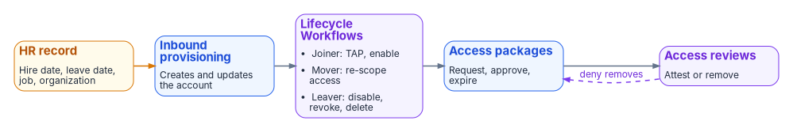
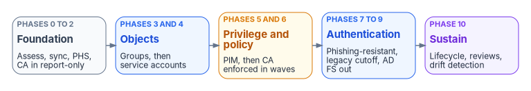

# Chapter 10 — Migrating and Governing

*The migration ends when governance runs on its own: when joiners, movers, and leavers flow from the HR record without a ticket, every privileged session starts with a phishing-resistant credential, and drift shows up in a diff instead of an incident.*

::: {.callout-note}
## In this chapter
The governance machinery of the target: access reviews, access packages, and Lifecycle Workflows. Cross-tenant collaboration and how it replaces forest trusts. Authentication modernization toward phishing-resistant MFA, checked against OMB M-22-09 and NIST SP 800-53 Rev. 5. Monitoring and the compliance evidence it produces, the eleven-phase migration playbook, Git-based drift detection, and a troubleshooting reference. It builds on the target designed in [Chapter 09](09-building-the-entra-target.md).
:::

## Identity governance and lifecycle

Governance in Active Directory was mostly a ticket queue: someone asked for group membership, someone else added it, and nobody took it away. The target replaces that with three Entra ID Governance capabilities that work as a loop. HR-driven provisioning creates and updates the account; Lifecycle Workflows run the joiner, mover, and leaver tasks; access packages grant access with an expiry; and access reviews remove what's no longer justified.

{#fig-ch10-joiner-mover-leaver-loop fig-alt="Five boxes left to right. An amber box, HR record (hire date, leave date, job, organization), feeds a blue box, inbound provisioning, which creates and updates the account. That feeds a violet box, Lifecycle Workflows, listing joiner: TAP, enable; mover: re-scope access; leaver: disable, revoke, delete. That feeds a blue box, access packages: request, approve, expire. That feeds a violet box, access reviews: attest or remove. A dashed violet arrow labeled deny removes runs from access reviews back to access packages."}

The licensing for all three is covered in [Chapter 09](09-building-the-entra-target.md#licensing-for-governance-features): Lifecycle Workflows need Entra ID Governance, and access reviews and entitlement management need it for the member users involved.

### Access reviews

Access reviews are periodic attestation that people still need the access they hold. The program's schedule (the full access-governance design is in Book 04, Chapter 09):

| Review target | Frequency | Reviewers | Apply results automatically | If reviewers don't respond |
|---|---|---|---|---|
| PIM-eligible role assignments | Quarterly | The security team (Microsoft's self-review option leaves role-assignable groups out of the review, so it can't be the only reviewer) | Yes; remove if denied | Remove access |
| Sensitive security group memberships | Quarterly | Group owners | Yes; remove if denied | Remove access |
| Application assignments (Tier 1 apps) | Semi-annually | Application owners | Yes; remove if denied | No change; escalate |
| Guest access | Quarterly | Sponsors | Yes; disable if denied | Disable the guest account |
| Microsoft 365 group memberships | Semi-annually | Group owners | No (recommendations only) | No change |

The quarterly review of privileged roles is also the program's evidence for NIST SP 800-53 AC-6(7) (see [The compliance amendment](#the-compliance-amendment-phishing-resistant-authenticators-and-privileged-access)). Reviews of PIM for Groups membership, and reviews scoped to inactive users, require Entra ID Governance.[^c10-governance-licensing]

### Entitlement management and access packages

Access packages bundle resources (group memberships, application assignments, SharePoint site access) into units that people request, approvers approve, and policies expire. They replace "submit a ticket for group membership" with a governed, self-service workflow. The program uses four categories:

- **Onboarding packages.** Baseline access for new hires: email, Teams, the intranet site, company-wide groups. Assigned by a Lifecycle Workflow on the hire date, or by an automatic assignment policy.
- **Department packages.** Department resources (SharePoint sites, Teams channels, line-of-business applications), assigned from the department attribute through an automatic assignment policy.
- **Project packages.** Time-bound access for a project, approved by the project lead and set to expire at the project end date.
- **Cross-tenant packages.** Resources shared with partner organizations through B2B collaboration, with terms of use acceptance and sponsor approval.

Expiration of assignments and separation-of-duties checks work with P2; automatic assignment policies, custom extensions, and Verified ID checks need Entra ID Governance.[^c10-entra-licensing] Avoid the preview `memberOf` operator in automatic assignment rules; Microsoft is ending that preview on November 3, 2026, after which those policies stop updating.[^c10-memberof] Where an access package must grant access to an AD-integrated (Kerberos) application, include a cloud security group that Cloud Sync provisions to AD.[^c10-gwb-cloud-sync]

### Lifecycle Workflows

Lifecycle Workflows automate joiner, mover, and leaver tasks. They act on accounts that already exist; HR-driven inbound provisioning creates and updates the account. A workflow runs when a user meets its execution conditions, a trigger plus a scope. The triggers available as of October 2026 are a time-based attribute, an attribute change, a group membership change, sign-in inactivity, and on-demand.[^c10-lcw-execution] Time-based joiner and leaver workflows key on the native `employeeHireDate` and `employeeLeaveDateTime` attributes (or `createdDateTime` for joiners); the offset can be 0 to 180 days before or after the date, and a preview "V2" trigger extends that to 365 days with relative comparisons.[^c10-lcw-execution] Custom attribute triggers are in preview.

For users synced from Active Directory, those date attributes must be synced to Entra ID before the workflow can use them, and attribute-change and group triggers fire only after the sync cycle delivers the change.[^c10-lcw-onprem] The canonical HR-driven design, including where the dates come from, is in [HR-Driven Identity, Chapter 6](../b03-hr-identity/08-joiner-mover-leaver.md). Scope rules can filter on standard attributes such as `department` and `jobTitle` and on `extensionAttribute1` through `15`.[^c10-lcw-scope] A tenant can have up to 50 workflows and 100 custom task extensions.[^c10-governance-licensing]

The workflows below use Microsoft's built-in tasks where they exist.[^c10-lcw-tasks] Steps that have no built-in task, marked "custom," run through a custom task extension, which calls an Azure Logic App, or through a separate service.

#### Pre-hire workflow

Trigger: `employeeHireDate`, 7 days before. Based on Microsoft's "Onboard pre-hire employee" template.[^c10-lcw-templates]

1. Confirm the account exists, disabled. Inbound provisioning created it and set the HR attributes; Lifecycle Workflows don't create accounts.
2. Request the baseline onboarding access package ("Request user access package assignment").
3. Generate a Temporary Access Pass and email it to the user's manager ("Generate TAP and send email"). The new hire uses it to register a phishing-resistant credential on day one.
4. Send the hiring manager the onboarding checklist (custom, or the TAP email's custom text).

#### Joiner workflow

Trigger: `employeeHireDate`, on the day. Based on the "Onboard new hire employee" template.

1. Enable the user account ("Enable user account"; for synced users the task has an option to enable the on-premises account).[^c10-lcw-task-args]
2. Assign licenses through group-based licensing, or with the "Assign licenses to user" task, which is in preview.
3. Let dynamic group membership take effect (department, region, and role groups).
4. Send the welcome email with self-service portal links ("Send welcome email").
5. Request the department access package.

Prompting the user to register Authenticator or a passkey isn't a workflow task. It's a registration campaign in the Authentication methods policy (see [Authentication methods policy](#authentication-methods-policy)).

#### Mover workflow

Trigger: an attribute change on department, division, or role. The program carries these in `department`, `extensionAttribute3`, and `extensionAttribute4`; confirm the attribute you choose is supported as a trigger attribute before relying on it. Based on the "Employee job profile change" template.[^c10-lcw-templates]

1. Remove the previous department's access package assignment ("Remove access package assignment for user").
2. Request the new department's access package.
3. Let dynamic group membership adjust to the new attributes.
4. Start an access review of the user's remaining non-baseline assignments (custom; or rely on the next scheduled review).
5. Let a dynamic administrative unit rule move the user to the new division's AU, if the division changed.
6. Notify the previous and new managers ("Send email to notify manager of user move" covers the new manager; the previous manager is custom).
7. Commit the attribute change record to the Git audit trail (custom).

#### Leaver workflow

Trigger: `employeeLeaveDateTime`, on the day, followed by a post-offboarding workflow. Based on the "Offboard an employee" and "Post-Offboarding of an employee" templates.[^c10-lcw-templates]

1. Disable the user account ("Disable user account").
2. Revoke all refresh and browser session tokens ("Revoke all refresh tokens for user"; the Graph equivalent is `Revoke-MgUserSignInSession`).
3. Remove all access package assignments and cancel pending requests.
4. Remove all licenses ("Remove all licenses for user"), after the mailbox step below.
5. Convert the mailbox to a shared mailbox, retained per policy (typically 90 days), and grant the manager access (custom; an Exchange Online operation, not a Lifecycle Workflows task).
6. Move the user to the "Departed users" administrative unit, most simply with a dynamic AU rule on `accountEnabled`.
7. At T+30 days, remove all group and Teams memberships ("Remove user from all groups," "Remove user from all Teams").
8. At T+90 days, delete the account ("Delete user").
9. Notify the manager, HR, and security operations ("Send email on user's last day," plus custom recipients).

Two cautions. The "Delete user" task doesn't support users with Entra role assignments or with membership or ownership of role-assignable groups, so remove privileged access first.[^c10-lcw-tasks] And a synced user deleted only in the cloud comes back on the next sync; for synced users, delete the account in Active Directory, using the on-premises options Microsoft documents for synced users.[^c10-lcw-onprem]

### Terms of use

Terms of use record compliance attestation and are enforced through Conditional Access; the feature needs Entra ID P1.[^c10-entra-licensing] The program uses three:

- **Employee terms of use.** Re-accepted annually: acceptable use, data handling, security responsibilities.
- **Guest and external terms of use.** Accepted on first access and quarterly after: data sharing terms and compliance boundaries.
- **Privileged access terms of use.** Accepted before activating Global Administrator, acknowledging the extra monitoring. Enforce it through the authentication context that PIM requires at activation.

## Cross-tenant and B2B collaboration

### B2B collaboration

B2B collaboration lets external users access resources in your tenant as guest users. The guest lifecycle has five steps:

- **Invitation.** Sent by an authorized internal sponsor, or generated when a partner user's access package request is approved.
- **Redemption.** The guest redeems the invitation with home tenant credentials or another supported identity provider.
- **Access.** Governed by group memberships, application assignments, and Conditional Access, like any other user.
- **Review.** Quarterly review by the sponsor (see the access review schedule above).
- **Offboarding.** Disabled or removed when collaboration ends. Guests added through entitlement management are removed automatically when their last assignment expires.[^c10-governance-overview]

The program's invitation policies:

- Only users with the Guest Inviter role or higher can invite guests.
- Invitations are limited to an allowlist of partner domains. This is a program setting; B2B collaboration supports allowlists and blocklists.[^c10-b2b-faq]
- Self-service sign-up stays off, except for approved applications and identity providers.
- Invitations across Microsoft clouds (for example, from a GCC High tenant into a commercial or GCC tenant) must use the user's UPN, not an email address.[^c10-b2b-faq]

### Cross-tenant access settings

Cross-tenant access settings govern the relationship between your tenant and other Microsoft Entra tenants. By default, B2B collaboration with all other Entra organizations is allowed and B2B direct connect is blocked; organization-specific settings override the defaults.[^c10-cross-tenant]

| Setting | Inbound (external users into your tenant) | Outbound (your users into other tenants) |
|---|---|---|
| B2B collaboration | Allowed for all by default; the program restricts it to an allowlist of partners | Allow your users to be guests in specific external tenants |
| B2B direct connect | Blocked by default; enable per partner for Teams shared channels | Allow your users into a partner's shared channels |
| Trust settings | Trust MFA, compliant device, and hybrid joined device claims from the partner tenant | Not applicable |
| Automatic redemption | Suppress the consent prompt for a trusted partner | Same, in the other direction |

Trusting a partner's MFA claims means your Conditional Access MFA requirements are still enforced, but a user who already completed MFA at home isn't prompted again.[^c10-cross-tenant] For organizations that run several tenants of their own, cross-tenant synchronization creates and maintains B2B users across them automatically; syncing users within the same cloud needs P1, and syncing groups or syncing across clouds needs Entra ID Governance.[^c10-entra-licensing]

### B2B direct connect and B2B collaboration compared

| Criterion | B2B collaboration | B2B direct connect |
|---|---|---|
| Guest object in your tenant | Yes | No; the user signs in with home credentials and has no directory object |
| Scope | Any application your Conditional Access governs | Microsoft Teams shared channels only[^c10-b2b-direct] |
| Setup | Your tenant's settings | Both tenants must enable it mutually[^c10-b2b-direct] |
| Governance visibility | Full: directory object, access reviews, sign-in logs | Limited: managed in the application by channel owners |
| Conditional Access | Applies fully | Applies, but needs inbound MFA trust if your policies require MFA[^c10-b2b-direct] |
| Program position | Preferred for sharing resources and applications | Acceptable for Teams-only collaboration with trusted partners |

### External identity providers

For guests from organizations that don't use Entra ID, B2B collaboration supports:[^c10-identity-providers]

- **Microsoft accounts**, built in.
- **Google federation**, for Google Workspace users.
- **SAML/WS-Fed identity provider federation**, for partners with a non-Microsoft enterprise identity provider.
- **Email one-time passcode**, the fallback for guests who can't use any of the above. It's on by default in new tenants. Conditional Access authentication strengths can't be applied to these guests; use the "require MFA" grant control instead.[^c10-email-otp]

### Mapping AD trusts to cross-tenant access

Forest and external trusts don't migrate; each becomes a cross-tenant or federation configuration. The trust inventory itself comes from [Chapter 08](08-assessing-the-forest.md). The equivalences are the program's design:

| AD trust type | Entra ID equivalent | Migration approach |
|---|---|---|
| Two-way forest trust | Cross-tenant access settings, inbound and outbound | Configure both tenants; trust MFA |
| One-way forest trust (incoming) | Inbound cross-tenant access for the partner tenant | Configure inbound B2B collaboration |
| External trust (domain-level) | Organization-specific cross-tenant settings | Configure per-organization settings |
| Realm trust (Kerberos) | SAML/WS-Fed federation with the external identity provider | Establish federation |

## Authentication modernization

### Password hash sync as the foundation

Whatever the sign-in method, password hash sync (PHS) stays on. It gives three things the other methods don't:

- **Leaked-credential detection.** ID Protection checks synced credentials against leaked credential lists. The detection itself isn't a premium feature, but its full reporting and risk-based Conditional Access require P2.[^c10-risk-detections][^c10-choose-authn]
- **A fallback.** If pass-through agents or AD FS fail, an administrator can switch the sign-in method to PHS. The switch is manual.[^c10-choose-authn]
- **Cloud smart lockout**, which protects against password spray in the cloud without locking the on-premises account.

### The phishing-resistant authentication roadmap

OMB M-22-09 requires phishing-resistant MFA for agency staff, contractors, and partners, and requires that it be an option for public users. For routine self-service access, agencies must stop supporting methods that fail to resist phishing, including SMS or voice codes, one-time codes, and push notifications. It names PIV (including derived PIV) as the simplest route and allows FIDO2 and WebAuthn authenticators where PIV isn't practical, and it notes that OMB M-19-17 makes PIV the primary means of authentication to federal systems.[^c10-m2209] The memo set its targets for the end of fiscal year 2024, so as of October 2026 these are requirements to meet, not goals to plan toward.[^c10-m2209]

That changes the order of the program's roadmap. The earlier version treated certificate-based authentication for smart cards as the last phase, for "high-security users." For a federal workforce that already carries PIV or CAC cards, Microsoft Entra certificate-based authentication (CBA) is the fastest path to phishing-resistant MFA, because the credential is already issued. CBA supports PIV, CAC, and derived PIV credentials directly against Entra ID, without a federation server.[^c10-memo-2209-ms]

| Phase | Population | Method | Prerequisites | Duration (program estimate) |
|---|---|---|---|---|
| 1 | Privileged accounts (PIM-eligible users) | FIDO2 security keys (passkeys), plus PIV/CAC through CBA where the admin holds a card | Keys procured; passkey profile with attestation enforced; CBA trusted certificate authorities configured | 4–6 weeks |
| 2 | PIV and CAC holders | Microsoft Entra certificate-based authentication | Certificate authorities and revocation checking configured; username bindings validated; workbook PKI material | 8–12 weeks |
| 3 | Managed Windows devices | Windows Hello for Business | Intune enrollment; Windows Hello for Business policy; TPM 2.0 | 8–12 weeks |
| 4 | Remaining users, including mobile | Passkeys in Microsoft Authenticator | Android 14 or iOS 17 or later; a passkey profile targeting the Authenticator AAGUIDs; registration campaign[^c10-authenticator-passkey] | 8–12 weeks |

All four methods meet the built-in phishing-resistant MFA authentication strength (passkeys in Authenticator count as FIDO2 passkeys).[^c10-auth-strengths] Passkey profiles let you set different rules for different groups; for example, device-bound passkeys with attestation enforced for administrators, and synced passkeys allowed for lower-risk populations.[^c10-passkeys]

### Authentication methods policy

The Authentication methods policy decides which methods are available to which users. The program's configuration:

- **Passkeys (FIDO2).** Enabled for the Admins group in phase 1, then all users. Use passkey profiles: device-bound with attestation enforced for privileged users. Users must have completed MFA within the past five minutes before they can register a passkey.[^c10-passkeys]
- **Certificate-based authentication.** Enabled for PIV and CAC holders in phase 2, configured as multifactor so that it meets the phishing-resistant strength.
- **Microsoft Authenticator.** Enabled for all users during the transition. Number matching is always on for Authenticator push notifications and users can't opt out.[^c10-number-match] Turn on the additional context (application name and sign-in location). Authenticator push doesn't satisfy M-22-09 for staff on its own; Microsoft's guidance pairs it with managed-device Conditional Access during the transition.[^c10-memo-2209-ms]
- **Windows Hello for Business.** Enabled for all users on managed devices.
- **Temporary Access Pass (TAP).** Enabled for onboarding and credential replacement, issued by the help desk and by the pre-hire workflow. Microsoft's defaults are a 1-hour default lifetime (configurable from 10 minutes to 30 days) and multi-use allowed; the program sets one-time use and a 1-hour lifetime. With a one-time TAP, the user has 10 minutes after sign-in to finish registering the new credential.[^c10-tap]
- **SMS and voice.** Disabled for staff. M-22-09 requires discontinuing them for routine access.[^c10-m2209]
- **Email one-time passcode.** Guests only.
- **Registration campaigns.** On, to prompt users without a strong method to register one at sign-in. The program allows three snoozes.

### Blocking legacy authentication

Legacy protocols that send a username and password with each request can't do MFA and are a common path for password spray and credential stuffing. Exchange Online has already removed Basic authentication for Exchange ActiveSync, POP, IMAP, Remote PowerShell, Exchange Web Services, the Offline Address Book, Autodiscover, and Outlook for Windows and Mac, and has disabled SMTP AUTH in tenants that weren't using it.[^c10-basic-auth] SMTP AUTH with Basic authentication is the remaining case; Microsoft has announced its retirement and updated the timeline, so check the current Exchange announcement before planning around a date.[^c10-basic-auth]

The remediation sequence:

1. **Discover** remaining legacy sign-ins with the sign-in logs, using the queries below or the "Sign-ins using legacy authentication" workbook.
2. **Remediate** applications and devices onto modern authentication (OAuth 2.0), the Microsoft Graph mail APIs, or a supported relay.
3. **Block** with policy CA001 from [Chapter 09](09-building-the-entra-target.md#the-policy-set).
4. **Monitor** for 30 days after enforcement and confirm zero successful legacy sign-ins.

::: {.callout-warning}
## Illustrative code
The KQL and PowerShell in this chapter are illustrative. They haven't been tested against a production tenant. Review them, check table and column names against your own Log Analytics workspace, and run them first against a test tenant with read-only permissions.
:::

This query runs in a Log Analytics workspace that receives the Entra sign-in logs:

```kusto
// Legacy authentication sign-in discovery, last 30 days, successful sign-ins only
SigninLogs
| where TimeGenerated > ago(30d)
| where ClientAppUsed in (
    "Exchange ActiveSync", "Authenticated SMTP", "POP3", "IMAP4", "AutoDiscover",
    "Exchange Online PowerShell", "Exchange Web Services", "MAPI Over HTTP",
    "Offline Address Book", "Other clients", "Outlook Anywhere (RPC over HTTP)",
    "Reporting Web Services")
| where ResultType == 0
| summarize SignInCount = count(), LastSignIn = max(TimeGenerated)
    by ClientAppUsed, AppDisplayName, UserPrincipalName
| order by SignInCount desc
```

Without a workspace, the same question can be asked through Microsoft Graph PowerShell. The `Get-FMPLegacyAuthReport` function in [Appendix C](appendix-c-identity-assessment-module.md) wraps this pattern and adds a suggested remediation per client type.

```powershell
#Requires -Modules Microsoft.Graph.Reports
Connect-MgGraph -Scopes 'AuditLog.Read.All'

$legacyClients = @('Exchange ActiveSync', 'Authenticated SMTP', 'POP3', 'IMAP4', 'Other clients')
$startDate = (Get-Date).ToUniversalTime().AddDays(-30).ToString('yyyy-MM-ddTHH:mm:ssZ')
$filter = "createdDateTime ge $startDate and status/errorCode eq 0"

$signIns = Get-MgAuditLogSignIn -Filter $filter -All |
    Where-Object { $_.ClientAppUsed -in $legacyClients }

$signIns |
    Group-Object -Property UserPrincipalName, ClientAppUsed |
    Select-Object @{N = 'User';       E = { ($_.Name -split ', ')[0] } },
                  @{N = 'ClientApp';  E = { ($_.Name -split ', ')[1] } },
                  @{N = 'Count';      E = { $_.Count } },
                  @{N = 'LastSignIn'; E = { ($_.Group | Sort-Object CreatedDateTime -Descending |
                                              Select-Object -First 1).CreatedDateTime } } |
    Sort-Object Count -Descending |
    Format-Table -AutoSize

Disconnect-MgGraph
```

The Graph sign-ins API covers interactive sign-ins; legacy clients usually appear there, but the workspace query sees more. In a large tenant, narrow the date range rather than pulling 30 days at once.

## The compliance amendment: phishing-resistant authenticators and privileged access

This section maps the authenticators and privileged-access controls above to the federal requirements they answer. Control text is from NIST SP 800-53 Rev. 5 as published in FedRAMP's catalog (release 5.2.0).[^c10-fedramp-ia]

### Multifactor authentication and separate devices (IA-2)

- **IA-2(1) and IA-2(2)** require MFA for access to privileged and non-privileged accounts. FedRAMP's guidance adds that the MFA must be phishing-resistant, per current CISA guidance.[^c10-fedramp-ia]
- **IA-2(6), Access to Accounts — Separate Device,** requires MFA for local, network, or remote access to privileged or non-privileged accounts such that one factor is provided by a device separate from the system gaining access, and the device meets organization-defined strength-of-mechanism requirements. FedRAMP sets the parameters to local, network, and remote access for both privileged and non-privileged accounts, and its guidance treats a PIV card as the separate device.[^c10-fedramp-ia]

The earlier version of this section described IA-2(6) as "access to privileged accounts using a hardware-based authenticator." That isn't the control's wording; the requirement is a *separate device* meeting a stated strength of mechanism. The program maps authenticators as follows:

- **PIV and CAC smart cards** through Entra certificate-based authentication are separate devices and the federal standard credential. They're the program's primary answer to IA-2(6) for staff who hold them.
- **FIDO2 security keys** are roaming authenticators separate from the computer gaining access. They're the primary method for cloud administrators and for staff without a card. Microsoft notes that hardware security keys carrying certificates also meet the requirement for MFA on a separate device.[^c10-cba-ios]
- **Windows Hello for Business and platform passkeys** are phishing-resistant, but the key lives in the device that's gaining access. The program doesn't count them toward IA-2(6) for privileged accounts; it uses them for non-privileged access, where the organization's assessor accepts that.
- **Passwords, SMS, and voice** aren't allowed for privileged roles.

The FedRAMP 20x Key Security Indicator for this area, KSI-IAM-APM (Adopting Passwordless Methods), states the same direction: passwordless methods where feasible, otherwise strong passwords with phishing-resistant MFA.[^c10-ksi-iam]

### Reviewing privileged access (AC-6(7))

The earlier version of this section mapped AC-6(7) to privileged access workstations. That was wrong. AC-6(7), Review of User Privileges, requires the organization to review, at a defined frequency, the privileges assigned to defined roles and classes of users to validate the need for them, and to reassign or remove privileges as necessary.[^c10-fedramp-ac] The program meets it with the quarterly PIM access reviews in the [access review schedule](#access-reviews), which remove privileges that reviewers deny, and with the 12-month expiry on eligible assignments from [Chapter 09](09-building-the-entra-target.md#pim-configuration-standards). The review results and the PIM audit log are the evidence.

### Privileged access workstations

Privileged access workstations (PAWs) are still part of the design; they just answer different requirements. A PAW is a hardened, separately managed device with no general productivity or browsing surface, used only for administration. Microsoft's guidance builds them with Intune and Windows Autopilot, identifies them with a dynamic device group, and enforces their use with Conditional Access device filters and compliance requirements.[^c10-paw] The program's standard:

- Administration of privileged roles happens only from a PAW.
- PAWs are Intune-managed from first boot, provisioned through Autopilot, and identified by a dynamic device group.
- Conditional Access policy CA004 requires a compliant device for the Admins persona, and block policy CA025 in Book 04, Chapter 07 restricts administrator sign-in to the PAW group; protected actions require the same authentication context.
- Administrative sign-ins from any other device are blocked.

## Monitoring, audit, and compliance

### The Entra ID logs

Entra ID's activity logs are kept for a short time in the service itself. As of October 2026:[^c10-retention]

| Log | Content | Retention in Entra ID | Program retention in Log Analytics |
|---|---|---|---|
| Sign-in logs | Interactive, non-interactive, service principal, and managed identity sign-ins | 7 days (Free); 30 days (P1, P2) | 365 days |
| Audit logs | Directory changes: users, groups, roles, policies, application registrations | 7 days (Free); 30 days (P1, P2) | 365 days |
| Provisioning logs | Provisioning to and from applications and directories | See Microsoft's retention reference | 180 days |
| Risky sign-ins | ID Protection risk detections on sign-ins | 7 days (Free); 30 days (P1); 90 days (P2) | 365 days |
| Risky users | Users at risk | Kept until the risk is remediated | 365 days |
| Microsoft Graph activity logs | API calls to Microsoft Graph | Not retained; P1 or P2, export only | 180 days |

Upgrading licenses doesn't recover older data: after moving from Free to P1, only the last seven days are available.[^c10-retention] Route the logs to a workspace before you need them.

### Log Analytics integration

All Entra ID logs go to a Log Analytics workspace for retention, correlation, and detection:

1. Create a Log Analytics workspace in an Azure subscription. This is an Azure resource and the documented exception to the program's Microsoft 365 boundary.
2. In Entra ID diagnostic settings, stream every log category to the workspace. You need at least Security Administrator in the tenant and access to the workspace.[^c10-azure-monitor]
3. Set workspace retention to 365 days, or longer if the authorization requires it.
4. Create scheduled query rules for the detections below.

Integrating the logs with Azure Monitor also enables the Microsoft Entra data connector for Microsoft Sentinel, if the program uses it.[^c10-azure-monitor]

### Detection rules

| Detection | Description | Query pattern | Severity | Response |
|---|---|---|---|---|
| Stale accounts | No sign-in for more than 90 days | Graph `signInActivity/lastSignInDateTime` (needs P1 and `AuditLog.Read.All`);[^c10-user-resource] sign-in logs alone miss users who never signed in during retention | Medium | Flag for access review; disable if confirmed unused |
| PIM activation outside business hours | Role activated between 22:00 and 06:00 local time, or at a weekend | `AuditLogs \| where OperationName == "Add member to role completed (PIM activation)" \| extend Hour = hourofday(TimeGenerated)` (convert from UTC to local time first) | High | Investigate; review the justification |
| Sign-ins with no Conditional Access applied | Interactive sign-ins that no policy covered | `SigninLogs \| where ConditionalAccessStatus == "notApplied"`, or the Conditional Access gap analyzer workbook | Medium | Close the coverage gap |
| Expiring application credentials | Secrets or certificates expiring within 30 days | Microsoft Graph list of applications, filtered client-side on `passwordCredentials` and `keyCredentials` end dates | High | Notify owners; rotate or replace with federated credentials |
| Emergency account sign-in | Any sign-in by an emergency access account | `SigninLogs \| where UserPrincipalName in ("<ea1>@<tenant>.onmicrosoft.com", "<ea2>@<tenant>.onmicrosoft.com")` | Critical | Immediate incident response |
| Mass group membership change | More than 50 members added or removed from one group in an hour | `AuditLogs \| where OperationName in ("Add member to group", "Remove member from group") \| summarize count() by bin(TimeGenerated, 1h), <group>` (check which `TargetResources` entry holds the group in your logs) | High | Confirm the change was authorized |

The PIM activation operation name comes from Microsoft's audit activity reference, which lists "Add member to role completed (PIM activation)" under the RoleManagement category.[^c10-audit-activities] Microsoft's security operations guide recommends alerting on every elevation that falls outside a user's normal pattern.[^c10-secops-privileged]

### Workbooks

Microsoft Entra workbooks need the Log Analytics integration above. The program uses these public templates:[^c10-workbooks]

- **Conditional Access insights and reporting:** policy impact, report-only analysis, failure reasons by policy.
- **Conditional Access gap analyzer:** sign-ins, applications, and locations that no policy covered.
- **Sign-ins using legacy authentication.**
- **Multifactor authentication gaps** and **Authentication prompts analysis.**
- **Sensitive operations report:** privileged role changes, policy changes, and credential changes on applications.
- **Risk analysis** and **Cross-tenant access activity.**

### Compliance Manager and the FedRAMP 20x indicators

Microsoft Purview Compliance Manager has regulation templates for NIST SP 800-53 Rev. 5, FedRAMP Moderate, and CMMC; GCC tenants get CMMC included alongside the default data protection baseline, and the others are premium templates.[^c10-compliance-manager] The identity controls in this book map to these families:

- **AC-2 (Account Management):** Lifecycle Workflows and access reviews.
- **AC-6 (Least Privilege):** PIM and attribute-based group access ([Chapter 09](09-building-the-entra-target.md)); AC-6(7) through privileged access reviews.
- **IA-2 (Identification and Authentication):** Conditional Access, authentication strengths, and the phishing-resistant roadmap.
- **IA-5 (Authenticator Management):** the Authentication methods policy and service principal credential rotation.
- **AU-2 (Event Logging):** Log Analytics integration and the detection rules.

Under FedRAMP 20x, the Consolidated Rules for 2026 (launched June 24, 2026) express these as Key Security Indicators, which are what a 20x package evidences.[^c10-ksi-iam] Compliance Manager's templates follow the Rev. 5 control structure and don't produce indicator evidence, so use them as a readiness check, not the deliverable.

| Controls | FedRAMP 20x indicator | Where in this book |
|---|---|---|
| AC-2 | `KSI-IAM-AAM`, Automating Account Management | Lifecycle Workflows; access reviews |
| AC-6 | `KSI-IAM-ELP`, Ensuring Least Privilege; `KSI-IAM-JIT`, Authorizing Just-in-Time | Chapter 09 groups and PIM |
| IA-2, IA-5 | `KSI-IAM-APM`, Adopting Passwordless Methods | Authentication strengths; the roadmap; the Authentication methods policy |
| IA-5 (non-user) | `KSI-IAM-SNU`, Securing Non-User Authentication | Chapter 09 service account modernization |
| AU-2 | `KSI-MLA-LET`, Logging Event Types; `KSI-MLA-RVL`, Reviewing Logs | Log Analytics integration; detection rules |

The indicator IDs and titles are from FedRAMP's published indicator pages.[^c10-ksi-iam][^c10-ksi-mla] The control-to-indicator mapping is the program's.

## The migration execution playbook

The migration runs in eleven phases, grouped into five waves. Each phase has prerequisites, steps, validation criteria, a rollback procedure, and a duration estimate. Phases run in order: a phase's validation criteria must be met before the next begins. The durations are the program's planning estimates, not measured results; the total runs 40 to 70 weeks.

{#fig-ch10-migration-waves fig-alt="Five boxes in a left-to-right chain. Phases 0 to 2, foundation, in slate: assess, sync, PHS, Conditional Access in report-only. Phases 3 and 4, objects, in blue: groups, then service accounts. Phases 5 and 6, privilege and policy, in amber: PIM, then Conditional Access enforced in waves. Phases 7 to 9, authentication, in blue: phishing-resistant methods, legacy cutoff, AD FS out. Phase 10, sustain, in violet: lifecycle, reviews, drift detection."}

### Phase 0: Assessment

| Element | Detail |
|---|---|
| Prerequisites | Read access to the forest; the Git repository provisioned; the program's PowerShell modules installed |
| Steps | 1. Run `Invoke-FMPADAssessment` ([Chapter 07](07-read-only-discovery.md) and [Chapter 08](08-assessing-the-forest.md)) to inventory the forest. 2. Run `Export-FMPIdentityBaseline` ([Appendix C](appendix-c-identity-assessment-module.md)) for user, group, and service account inventories. 3. Find UPN suffix mismatches and non-routable suffixes. 4. Map the OU structure to proposed administrative units. 5. Document every trust for cross-tenant planning. 6. Commit the assessment output (JSON) to Git. |
| Validation | Complete inventory in Git; UPN remediation plan documented; a recorded decision for every group; service account risk classification complete |
| Rollback | Not applicable; assessment is read-only |
| Duration | 2–4 weeks |

### Phase 1: Sync deployment and initial sync

| Element | Detail |
|---|---|
| Prerequisites | Phase 0 complete; the sync engine chosen ([Chapter 09](09-building-the-entra-target.md#cloud-sync-or-connect-sync)); servers built to the workbook's server standards; OU scoping finalized; UPN remediation complete; soft and hard match blocks reviewed |
| Steps | 1. Deploy Cloud Sync agents (at least two), or install Connect Sync where a Connect-only requirement applies. 2. Configure OU scoping. 3. Configure attribute mappings. 4. Enable PHS, even if PTA or federation is primary. 5. For Connect Sync, run the initial sync in staging mode and check object counts and attribute mapping; for Cloud Sync, test with on-demand provisioning. 6. Enable export after validation. 7. For Connect Sync, build the staging-mode standby server. 8. Commit the sync configuration export to Git. |
| Validation | Object counts in Entra ID match the expected count (±1%); no sync errors; attribute spot-check (10 users, 5 groups) correct; standby verified |
| Rollback | Stop sync; remove the synced objects from scope (they're soft-deleted and recoverable for 30 days); reconfigure from a clean state. Don't hard-delete during rollback. |
| Duration | 2–3 weeks |

### Phase 2: Sign-in method and Conditional Access in report-only

| Element | Detail |
|---|---|
| Prerequisites | Phase 1 complete; emergency access accounts created with passkeys; Conditional Access policies drafted |
| Steps | 1. Confirm PHS is active. 2. If PTA is kept for now, deploy at least three agents. 3. Configure Seamless SSO only for devices that are domain joined but not hybrid joined or Entra joined; Entra joined and hybrid joined devices already get single sign-on.[^c10-choose-authn] 4. Deploy every Conditional Access policy in report-only mode. 5. Create the break-glass exclusion group and confirm it's excluded from every policy. 6. Watch the Conditional Access insights workbook for 2–4 weeks. 7. Fix users and devices the policies would block. |
| Validation | PHS verified (a test password change propagates); PTA agents healthy; every policy shows the expected impact in report-only; an emergency account sign-in tested and logged |
| Rollback | Remove PTA agents; return to PHS; set the policies off |
| Duration | 3–4 weeks |

### Phase 3: Group migration and dynamic group conversion

| Element | Detail |
|---|---|
| Prerequisites | Phase 2 complete; group decisions final ([Chapter 09](09-building-the-entra-target.md#the-per-group-decision)); extension attributes populated at the source |
| Steps | 1. Create dynamic groups. 2. Validate dynamic membership against the expected populations. 3. Create cloud-only security groups for the groups marked cloud-only. 4. Move resource assignments from synced groups to cloud groups, in phases. 5. Apply Microsoft 365 group governance (naming, expiration, labels). 6. Configure self-service group management. 7. Configure Cloud Sync group provisioning to AD for cloud groups that still guard Kerberos applications. 8. Retire AD groups that are fully migrated. |
| Validation | Dynamic groups contain the expected members (±2%); resource access unchanged after migration; no help desk tickets attributable to group changes |
| Rollback | Reassign resources to the original synced groups; delete the cloud groups; restore AD groups from the recycle bin or backup |
| Duration | 4–6 weeks |

### Phase 4: Service account modernization

| Element | Detail |
|---|---|
| Prerequisites | Phase 3 complete; service account inventory classified ([Chapter 09](09-building-the-entra-target.md#discovering-service-accounts)); application owners identified |
| Steps | 1. Convert HIGH-risk accounts first (password never expires, over-privileged). 2. Create workload identities: managed identities for Azure-hosted workloads, federated credentials for pipelines and other OIDC-capable hosts, certificates only where neither applies. 3. Configure Conditional Access for workload identities (single-tenant service principals). 4. Set credential rotation schedules and two human owners per application. 5. Run old and new credentials in parallel for 30 days, then disable the legacy accounts. |
| Validation | Every HIGH-risk account converted or retired; new identities authenticate without stored secrets where possible; no service disruption during the parallel run; workload identity policies enforced |
| Rollback | Re-enable the legacy accounts; revert application configuration |
| Duration | 6–8 weeks |

### Phase 5: PIM rollout

| Element | Detail |
|---|---|
| Prerequisites | Phase 4 complete; role mapping final ([Chapter 09](09-building-the-entra-target.md#privileged-access)); every administrator registered for a phishing-resistant method |
| Steps | 1. Configure PIM role settings per the standards. 2. Convert every permanent active assignment to eligible, except the emergency accounts. 3. Configure PIM for Groups for resource-level just-in-time access. 4. Create quarterly access reviews for all eligible assignments. 5. Add protected actions for Conditional Access, cross-tenant settings, named locations, and hard deletion. 6. Train administrators on activation. 7. Watch the PIM audit log for the first two weeks. |
| Validation | Zero permanent active assignments except the emergency accounts; every administrator can activate; the first review cycle started; protected actions enforced |
| Rollback | Convert eligible assignments back to active, using an emergency account if activation fails |
| Duration | 2–3 weeks |

### Phase 6: Conditional Access enforcement

| Element | Detail |
|---|---|
| Prerequisites | Phase 5 complete; report-only analysis complete; MFA registration above 95% for each targeted population |
| Steps | 1. Turn policies on for wave 1 (IT and security teams). 2. Watch for a week; work the help desk tickets. 3. Wave 2 (corporate staff), one week. 4. Wave 3 (field and remote workers), one week. 5. Wave 4 (everyone remaining), two weeks. 6. Turn on the risk policies (CA013, CA014) once the baseline is stable. 7. Final check: every policy enforcing, no unintended blocks. |
| Validation | Every policy on; help desk volume back to baseline within a week of each wave; no reports of legitimate access blocked for more than an hour |
| Rollback | Set the affected policies back to report-only; fix; re-enable |
| Duration | 4–6 weeks |

### Phase 7: Phishing-resistant authentication

| Element | Detail |
|---|---|
| Prerequisites | Phase 6 complete; FIDO2 keys procured; CBA configured; Windows Hello for Business policy in Intune; Authenticator deployed |
| Steps | 1. FIDO2 keys and CBA for privileged accounts (roadmap phase 1). 2. CBA for PIV and CAC holders (phase 2). 3. Windows Hello for Business on managed Windows devices (phase 3). 4. Authenticator passkey registration campaign (phase 4). 5. Track registration in the authentication methods reports. 6. Raise Conditional Access authentication strengths to phishing-resistant as each population crosses its threshold. |
| Validation | 100% of privileged accounts on FIDO2 or CBA; more than 80% of managed-device users on Windows Hello for Business; more than 70% of all users on a phishing-resistant method; the remainder on a dated plan |
| Rollback | Lower the authentication strength to MFA for the affected population; keep the existing methods |
| Duration | 8–16 weeks |

### Phase 8: Legacy authentication cutoff

| Element | Detail |
|---|---|
| Prerequisites | Phase 7 complete or running in parallel; legacy discovery complete; every dependency remediated |
| Steps | 1. Confirm zero successful legacy sign-ins for 30 consecutive days. 2. Enforce CA001 if it isn't already. 3. Confirm Basic authentication is off for every Exchange Online protocol; Microsoft has already removed it for most. 4. Disable SMTP AUTH on every mailbox except documented, approved exceptions, and move those to OAuth or a relay before Microsoft's retirement date. 5. Monitor for 30 days. |
| Validation | Zero legacy sign-ins for 30 days after enforcement; no disruption; every exception documented and approved |
| Rollback | Re-enable SMTP AUTH for a specific mailbox if a critical dependency appears; file an exception and a remediation plan |
| Duration | 2–4 weeks |

### Phase 9: Federation decommission (if applicable)

| Element | Detail |
|---|---|
| Prerequisites | Phase 8 complete; PHS verified; every federated domain identified; staged rollout tested |
| Steps | 1. Use staged rollout to move users from federation to PHS in waves; staged rollout tests cloud authentication but doesn't convert domains.[^c10-staged-rollout] 2. Wave 1: the IT team, one week. 3. Wave 2: a pilot group, two weeks. 4. Wave 3: everyone else. 5. Document and back up the federation settings (`Get-MgDomainFederationConfiguration`). 6. Convert each domain with `Update-MgDomain -DomainId <domain> -AuthenticationType "Managed"`; conversion can take up to 60 minutes per domain.[^c10-federation-migration] The retired `Convert-MsolDomainToStandard` cmdlet must not be used. 7. Decommission AD FS (servers, Web Application Proxy, certificates). 8. Remove the AD FS DNS records. 9. Update documentation and the Git records. |
| Validation | Every domain managed; every user authenticating through PHS; AD FS decommissioned; no authentication failures from the cutover |
| Rollback | Re-federate the domain with `New-MgDomainFederationConfiguration`, which needs the AD FS infrastructure, so keep it recoverable for 90 days after decommission[^c10-federation-migration] |
| Duration | 4–8 weeks |

### Phase 10: Steady-state governance

| Element | Detail |
|---|---|
| Prerequisites | All earlier phases complete |
| Steps | 1. Turn on the joiner, mover, and leaver workflows. 2. Configure the access packages. 3. Turn on every scheduled access review. 4. Deploy identity drift detection through Git. 5. Hold a weekly identity governance review. 6. Write and approve the steady-state operations runbook. |
| Validation | Every governance workflow running; access reviews producing results; drift alerts working; the runbook approved and committed to Git |
| Rollback | Not applicable; handle workflow problems individually |
| Duration | Ongoing; initial setup 2–4 weeks |

## Git-based drift detection

### The assessment pipeline

The identity assessment produces structured JSON inventories that go into Git, where version control turns them into a drift record. The program's reference build uses Gitea; any Git host with an issues API works the same way.

1. **Run the assessment.** `Invoke-FMPIdentityAssessment` produces JSON for users, groups, service accounts, privileged access, and legacy authentication.
2. **Commit.** The output goes to the `identity-baseline` branch of the program's configuration repository.
3. **Compare.** Each later run is compared with the committed baseline. New objects, removed objects, and attribute changes are drift.
4. **Raise issues.** Drift above a threshold opens an issue with the diff, a severity, and a recommended action.

The design rule is the same as in [HR-Driven Identity, Chapter 9](../b03-hr-identity/11-drift-metrics-and-evidence.md): close each finding at the source (fix the record or the rule), never by editing the copy.

### Scheduled tasks

| Task | Schedule (Eastern time) | Command | Output | Status |
|---|---|---|---|---|
| Identity drift scan | Weekly, Sunday 02:00 | `Invoke-FMPIdentityAssessment -Compare -PreviousBaselinePath <path> -CommitToGitea` | Drift report JSON; an issue if drift is found | In the Appendix C module |
| PIM activation audit | Daily, 06:00 | `Get-FMPPrivilegedAccessReport -Last24Hours` | Privileged access report; review of off-hours activations | In the Appendix C module |
| Conditional Access policy export | Weekly, Sunday 03:00 | `Export-FMPConditionalAccessPolicy` | Policy JSON and a diff against the previous export | Planned; the export pattern is in Appendix C |
| Application credential audit | Weekly, Monday 06:00 | `Get-FMPServicePrincipalCredentialReport -ExpiringWithin 30` | Expiring credentials; an issue per application | Planned |
| Stale account report | Monthly, 1st, 06:00 | `Get-FMPStaleAccountReport -InactiveDays 90` | Stale account list; access review trigger | Planned |

The planned functions aren't in the module yet. Until they are, run the equivalent steps by hand and commit the output; don't schedule a command that doesn't exist.

### Raising drift issues through the Git host's API

`Invoke-FMPIdentityAssessment -CommitToGitea` calls `New-FMPGiteaDriftIssue`, which opens an issue through the Gitea REST API. Gitea's API lives under `/api/v1/`, takes an API token in an `Authorization: token <value>` header, and accepts label IDs (integers) when creating an issue.[^c10-gitea-api][^c10-gitea-swagger] The function, and the small helper that looks up label IDs by name, are in the module in [Appendix C](appendix-c-identity-assessment-module.md#module-implementation). The token comes from an environment variable on the scheduled-task host; keep it in a secret store, scope it to the one repository, and never commit it.

## Troubleshooting reference

| Symptom | Likely cause | Resolution | Prevention |
|---|---|---|---|
| Sync error `InvalidSoftMatch` | A soft match on UPN or primary SMTP address found a cloud object that already has a different `onPremisesImmutableId`, usually because it was synced from another AD object, or two AD objects share a UPN or proxy address[^c10-sync-errors] | Find the duplicate. If it's the same person being re-provisioned, set the AD object's `mS-DS-ConsistencyGuid` to the value matching the cloud object's ImmutableId so a hard match succeeds[^c10-existing-tenant] | Clean duplicate UPNs and proxy addresses in Phase 0; keep soft and hard match blocked outside planned matching windows |
| Sync error `InvalidHardMatch` | Since July 1, 2026, Entra ID blocks a hard match to a cloud account that already has `onPremisesObjectIdentifier` set or holds or is eligible for a privileged role, or the tenant blocks hard-match takeover[^c10-sync-errors] | Don't take over privileged cloud accounts by sync. For a legitimate remap, clear `onPremisesObjectIdentifier` through Microsoft's documented Graph recovery call, then retry[^c10-existing-tenant] | Keep administrators cloud-only; don't sync AD accounts onto existing admin accounts |
| "Unable to update userPrincipalName" | The suffix isn't a verified domain, or another object already uses the UPN | Verify the domain in the admin center; resolve the duplicate in AD or Entra ID | Verify every UPN suffix as a custom domain before sync; audit UPNs in Phase 0 |
| Cloud group not appearing in AD | Cloud Sync group provisioning isn't configured for the group or target OU, or the group isn't a cloud security group | Check the provisioning logs for the group; confirm the scoping and target OU | Configure group provisioning to AD before moving Kerberos applications onto cloud groups. (Connect Sync Group Writeback v2 is discontinued; don't troubleshoot it, migrate off it.) |
| PIM activation fails: "user does not meet activation requirements" | The user hasn't registered a method that satisfies the activation authentication context, or Conditional Access blocks the request | Register a phishing-resistant method; check the sign-in logs for the blocking policy | Require registration before granting eligibility; test activation in the pilot |
| Conditional Access blocks legitimate access | The user doesn't meet a grant control (device compliance, location, MFA) | Find the blocking policy in the sign-in log's Conditional Access tab; fix the specific condition | Report-only first; keep a documented exception process |
| Password writeback fails | Writeback not enabled, or the AD DS connector account lacks permissions | Enable writeback; grant Reset password, Change password, Write `lockoutTime`, and Write `pwdLastSet` on descendant user objects, and Unexpire Password on each domain root; `Set-ADSyncPasswordWritebackPermissions` sets the core set for Connect Sync[^c10-sspr-writeback][^c10-adsync-permissions] | Set permissions during installation; test with a reset |
| Dynamic group not populating | Rule syntax error, or the attribute is empty for the expected users | Use rule validation in the admin center; check the attribute: `Get-MgUser -UserId <id> -Property onPremisesExtensionAttributes \| Select-Object -ExpandProperty OnPremisesExtensionAttributes` | Validate rules before deployment; populate attributes at the source before sync |
| Service principal blocked by workload identity policy | The workload authenticates from an IP outside the trusted named location | Add the service's egress IP to the named location, or exclude that service principal with a documented exception | Record every workload's egress IPs before enforcing CA015 |
| B2B guest can't reach shared resources | Invitation not redeemed, terms of use not accepted, or blocked by a guest policy | Check redemption; check Conditional Access evaluation in the sign-in log | Trust partner MFA in cross-tenant settings; make the terms of use reachable |
| Lifecycle workflow doesn't fire for a new hire | `employeeHireDate` isn't populated in Entra ID (not mapped through provisioning or sync), or the sync cycle hasn't delivered it | Check the attribute on the user; check the workflow's run history in the admin center | Map the hire date from HR through provisioning; validate the format at the source |
| No leaked-credential detections | PHS not active for the affected users, or no P2 licensing for the reports and risk policies | Confirm PHS is active (not only in staged rollout); confirm licensing; check ID Protection risk detections | Enable PHS before deploying risk policies |
| Connect Sync staging server shows different counts | Configuration drift between active and staging servers | Export both configurations with `Get-ADSyncServerConfiguration -Path <folder>` and compare | After any change on the active server, apply it to staging; commit both exports to Git |

::: {.callout-tip}
## Continue the book
[← Previous: Chapter 09 — Building the Entra ID Target](09-building-the-entra-target.md) · [Book index](index.md) · [Next: Chapter 11 — Reference Deployment →](11-reference-deployment.md)
:::

[^c10-governance-licensing]: Microsoft Learn, "Microsoft Entra ID Governance licensing fundamentals," <https://learn.microsoft.com/entra/id-governance/licensing-fundamentals> (accessed Oct 20, 2026).
[^c10-entra-licensing]: Microsoft Learn, "Microsoft Entra licensing," <https://learn.microsoft.com/entra/fundamentals/licensing> (accessed Oct 20, 2026).
[^c10-memberof]: Microsoft Learn, "Configure dynamic membership groups with the memberOf operator in the Entra Admin Center (preview)," <https://learn.microsoft.com/entra/identity/users/groups-dynamic-rule-member-of> (accessed Oct 20, 2026).
[^c10-gwb-cloud-sync]: Microsoft Learn, "Group writeback with Microsoft Entra Cloud Sync," <https://learn.microsoft.com/entra/identity/hybrid/group-writeback-cloud-sync> (accessed Oct 20, 2026).
[^c10-lcw-execution]: Microsoft Learn, "Lifecycle workflows execution conditions and scheduling," <https://learn.microsoft.com/entra/id-governance/lifecycle-workflow-execution-conditions> (accessed Oct 20, 2026).
[^c10-lcw-onprem]: Microsoft Learn, "Managing users synchronized from Active Directory Domain Services to Microsoft Entra ID with Lifecycle workflows," <https://learn.microsoft.com/entra/id-governance/lifecycle-workflow-on-premises> (accessed Oct 20, 2026).
[^c10-lcw-scope]: Microsoft Learn, "ruleBasedSubjectSet resource type," <https://learn.microsoft.com/graph/api/resources/identitygovernance-rulebasedsubjectset?view=graph-rest-1.0> (accessed Oct 20, 2026).
[^c10-lcw-tasks]: Microsoft Learn, "Lifecycle Workflow built-in tasks," <https://learn.microsoft.com/entra/id-governance/lifecycle-workflow-tasks> (accessed Oct 20, 2026).
[^c10-lcw-templates]: Microsoft Learn, "Lifecycle Workflows templates and categories," <https://learn.microsoft.com/entra/id-governance/lifecycle-workflow-templates> (accessed Oct 20, 2026).
[^c10-lcw-task-args]: Microsoft Learn, "Configure the arguments for built-in Lifecycle Workflows tasks," <https://learn.microsoft.com/graph/identitygovernance-lifecycleworkflows-task-arguments> (accessed Oct 20, 2026).
[^c10-governance-overview]: Microsoft Learn, "What is Microsoft Entra ID Governance?," <https://learn.microsoft.com/entra/id-governance/identity-governance-overview> (accessed Oct 20, 2026).
[^c10-b2b-faq]: Microsoft Learn, "Microsoft Entra B2B collaboration FAQs," <https://learn.microsoft.com/entra/external-id/faq> (accessed Oct 20, 2026).
[^c10-cross-tenant]: Microsoft Learn, "Overview: Cross-tenant access with Microsoft Entra External ID," <https://learn.microsoft.com/entra/external-id/cross-tenant-access-overview> (accessed Oct 20, 2026).
[^c10-b2b-direct]: Microsoft Learn, "B2B direct connect overview," <https://learn.microsoft.com/entra/external-id/b2b-direct-connect-overview> (accessed Oct 20, 2026).
[^c10-identity-providers]: Microsoft Learn, "Identity providers for External ID in workforce tenants," <https://learn.microsoft.com/entra/external-id/identity-providers> (accessed Oct 20, 2026).
[^c10-email-otp]: Microsoft Learn, "Email one-time passcode authentication for B2B guest users," <https://learn.microsoft.com/entra/external-id/one-time-passcode> (accessed Oct 20, 2026).
[^c10-risk-detections]: Microsoft Learn, "What are risk detections?," <https://learn.microsoft.com/entra/id-protection/concept-identity-protection-risks> (accessed Oct 20, 2026).
[^c10-choose-authn]: Microsoft Learn, "Choose the right authentication method for your Microsoft Entra hybrid identity solution," <https://learn.microsoft.com/entra/identity/hybrid/connect/choose-ad-authn> (accessed Oct 20, 2026).
[^c10-m2209]: Office of Management and Budget, M-22-09, *Moving the U.S. Government Toward Zero Trust Cybersecurity Principles*, January 26, 2022, <https://bidenwhitehouse.archives.gov/wp-content/uploads/2022/01/M-22-09.pdf> (accessed Oct 20, 2026).
[^c10-memo-2209-ms]: Microsoft Learn, "Meet multifactor authentication requirements of memorandum 22-09," <https://learn.microsoft.com/entra/standards/memo-22-09-multi-factor-authentication> (accessed Oct 20, 2026).
[^c10-authenticator-passkey]: Microsoft Learn, "Enable passkeys in Authenticator," <https://learn.microsoft.com/entra/identity/authentication/how-to-enable-authenticator-passkey> (accessed Oct 20, 2026).
[^c10-auth-strengths]: Microsoft Learn, "Conditional Access authentication strengths," <https://learn.microsoft.com/entra/identity/authentication/concept-authentication-strengths> (accessed Oct 20, 2026).
[^c10-passkeys]: Microsoft Learn, "How to enable passkeys (FIDO2) in Microsoft Entra ID," <https://learn.microsoft.com/entra/identity/authentication/how-to-authentication-passkeys-fido2> (accessed Oct 20, 2026).
[^c10-number-match]: Microsoft Learn, "How number matching works in MFA push notifications for Authenticator," <https://learn.microsoft.com/entra/identity/authentication/how-to-mfa-number-match> (accessed Oct 20, 2026).
[^c10-tap]: Microsoft Learn, "Configure Temporary Access Pass to register passwordless authentication methods," <https://learn.microsoft.com/entra/identity/authentication/howto-authentication-temporary-access-pass> (accessed Oct 20, 2026).
[^c10-basic-auth]: Microsoft Learn, "Deprecation of Basic authentication in Exchange Online," <https://learn.microsoft.com/exchange/clients-and-mobile-in-exchange-online/deprecation-of-basic-authentication-exchange-online> (accessed Oct 20, 2026).
[^c10-fedramp-ia]: FedRAMP, "Identification and Authentication" (NIST SP 800-53 Rev. 5 controls, catalog release 5.2.0), <https://fedramp.gov/2026/reference/controls/identification-and-authentication/> (accessed Oct 20, 2026).
[^c10-cba-ios]: Microsoft Learn, "Microsoft Entra certificate-based authentication on iOS and macOS," <https://learn.microsoft.com/entra/identity/authentication/concept-certificate-based-authentication-mobile-ios> (accessed Oct 20, 2026).
[^c10-ksi-iam]: FedRAMP, "Identity and Access Management" (FedRAMP 20x Key Security Indicators, Consolidated Rules for 2026), <https://fedramp.gov/2026/providers/20x/key-security-indicators/identity-and-access-management/> (accessed Oct 20, 2026).
[^c10-fedramp-ac]: FedRAMP, "Access Control" (NIST SP 800-53 Rev. 5 controls, catalog release 5.2.0), <https://fedramp.gov/2026/reference/controls/access-control/> (accessed Oct 20, 2026).
[^c10-paw]: Microsoft Learn, "Phase 2: Configure and secure privileged workstations," <https://learn.microsoft.com/security/zero-trust/adopt/implement-privileged-access-devices> (accessed Oct 20, 2026).
[^c10-retention]: Microsoft Learn, "Microsoft Entra data retention," <https://learn.microsoft.com/entra/identity/monitoring-health/reference-reports-data-retention> (accessed Oct 20, 2026).
[^c10-azure-monitor]: Microsoft Learn, "Integrate Microsoft Entra logs with Azure Monitor logs," <https://learn.microsoft.com/entra/identity/monitoring-health/howto-integrate-activity-logs-with-azure-monitor-logs> (accessed Oct 20, 2026).
[^c10-user-resource]: Microsoft Learn, "user resource type," <https://learn.microsoft.com/graph/api/resources/user?view=graph-rest-1.0> (accessed Oct 20, 2026).
[^c10-audit-activities]: Microsoft Learn, "Microsoft Entra audit log categories and activities," <https://learn.microsoft.com/entra/identity/monitoring-health/reference-audit-activities> (accessed Oct 20, 2026).
[^c10-secops-privileged]: Microsoft Learn, "Security operations for privileged accounts in Microsoft Entra ID," <https://learn.microsoft.com/entra/architecture/security-operations-privileged-accounts> (accessed Oct 20, 2026).
[^c10-workbooks]: Microsoft Learn, "What are Microsoft Entra workbooks?," <https://learn.microsoft.com/entra/identity/monitoring-health/overview-workbooks> (accessed Oct 20, 2026).
[^c10-compliance-manager]: Microsoft Learn, "Compliance Manager regulations list," <https://learn.microsoft.com/purview/compliance-manager-regulations-list> (accessed Oct 20, 2026).
[^c10-ksi-mla]: FedRAMP, "Monitoring, Logging, and Auditing" (FedRAMP 20x Key Security Indicators), <https://fedramp.gov/2026/providers/20x/key-security-indicators/monitoring-logging-and-auditing/> (accessed Oct 20, 2026).
[^c10-staged-rollout]: Microsoft Learn, "Migrate to cloud authentication using Staged Rollout," <https://learn.microsoft.com/entra/identity/hybrid/connect/how-to-connect-staged-rollout> (accessed Oct 20, 2026).
[^c10-federation-migration]: Microsoft Learn, "Migrate from federation to cloud authentication," <https://learn.microsoft.com/entra/identity/hybrid/connect/migrate-from-federation-to-cloud-authentication> (accessed Oct 20, 2026).
[^c10-gitea-api]: Gitea, "API Usage," <https://docs.gitea.com/development/api-usage> (accessed Oct 20, 2026).
[^c10-gitea-swagger]: Gitea, API specification (`CreateIssueOption`), <https://gitea.com/swagger.v1.json> (accessed Oct 20, 2026).
[^c10-sync-errors]: Microsoft Learn, "Understanding errors during Microsoft Entra synchronization," <https://learn.microsoft.com/entra/identity/hybrid/connect/tshoot-connect-sync-errors> (accessed Oct 20, 2026).
[^c10-existing-tenant]: Microsoft Learn, "Configure Microsoft Entra Connect for an existing tenant," <https://learn.microsoft.com/entra/identity/hybrid/connect/how-to-connect-install-existing-tenant> (accessed Oct 20, 2026).
[^c10-sspr-writeback]: Microsoft Learn, "Tutorial: Enable Microsoft Entra self-service password reset writeback to an on-premises environment," <https://learn.microsoft.com/entra/identity/authentication/tutorial-enable-sspr-writeback> (accessed Oct 20, 2026).
[^c10-adsync-permissions]: Microsoft Learn, "Microsoft Entra Connect: Configure AD DS Connector Account Permissions," <https://learn.microsoft.com/entra/identity/hybrid/connect/how-to-connect-configure-ad-ds-connector-account> (accessed Oct 20, 2026).
