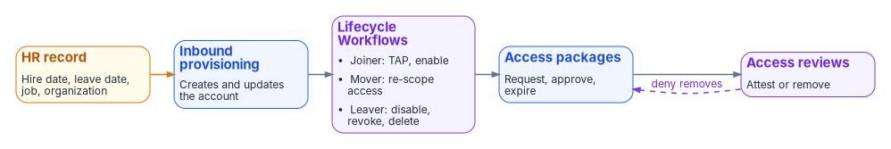
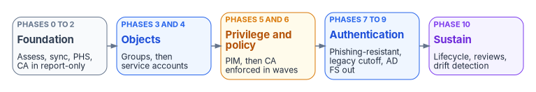

# Chapter 10 — Migrating and Governing

*The migration ends when governance runs on its own: when joiners, movers, and leavers flow from the HR record without a ticket, every privileged session starts with a phishing-resistant credential, and drift shows up in a diff instead of an incident.*

::: {.callout-note}
## In this chapter
The governance machinery of the target: access reviews, access packages, and Lifecycle Workflows. Cross-tenant collaboration and how it replaces forest trusts. Authentication modernization toward phishing-resistant MFA, checked against OMB M-22-09 and NIST SP 800-53 Rev. 5, with banned-password protection, Microsoft's mandatory MFA for the admin portals, and the applications still on AD FS. Monitoring and the compliance evidence it produces, the eleven-phase migration playbook, Git-based drift detection, and a troubleshooting reference. It builds on the target designed in [Chapter 09](09-building-the-entra-target.md).
:::

## Identity governance and lifecycle

Governance in Active Directory was mostly a ticket queue: someone asked for group membership, someone else added it, and nobody took it away. The target replaces that with three Entra ID Governance capabilities that work as a loop. HR-driven provisioning creates and updates the account; Lifecycle Workflows run the joiner, mover, and leaver tasks; access packages grant access with an expiry; and access reviews remove what's no longer justified.

{#fig-ch10-joiner-mover-leaver-loop fig-alt="Five boxes left to right. An amber box, HR record (hire date, leave date, job, organization), feeds a blue box, inbound provisioning, which creates and updates the account. That feeds a violet box, Lifecycle Workflows, listing joiner: TAP, enable; mover: re-scope access; leaver: disable, revoke, delete. That feeds a blue box, access packages: request, approve, expire. That feeds a violet box, access reviews: attest or remove. A dashed violet arrow labeled deny removes runs from access reviews back to access packages."}

The licensing for all three is covered in [Chapter 09](09-building-the-entra-target.md#licensing-for-governance-features): Lifecycle Workflows need Entra ID Governance, and access reviews and entitlement management need it for the member users involved.

### Access reviews

Access reviews are periodic attestation that people still need the access they hold. The program's schedule (the full access-governance design is in [Book 04, Chapter 09](../b04-access/09-access-governance.md)):

| Review target | Frequency | Reviewers | Apply results automatically | If reviewers don't respond |
|---|---|---|---|---|
| PIM-eligible role assignments | Monthly for privilege Tier 0 (T0) roles, quarterly for all other privileged roles ([Chapter 05](05-delegation-without-ous.md#delegation-principles)) | The security team, never the assignees alone: with Microsoft's **Members (self)** option, role-assignable groups aren't part of the review[^c10-pim-review] | Yes; remove if denied | Remove access |
| Sensitive security group memberships | Quarterly | Group owners | Yes; remove if denied | Remove access |
| Application assignments (application risk tier R1) | Quarterly | Two stages: the manager, then the application owner | Yes; remove if denied | No change; escalate |
| Application assignments (application risk tier R2) | Semi-annually | Application owners | Yes; remove if denied | No change; escalate |
| Guest access | Quarterly | Sponsors | Yes; denied guests are blocked from sign-in, then removed from the tenant after 30 days | Remove access |
| Microsoft 365 group memberships | Semi-annually | Group owners | No (recommendations only) | No change |

The monthly and quarterly reviews of privileged roles are also the program's evidence for NIST SP 800-53 AC-6(7) (see [The compliance amendment](#the-compliance-amendment-phishing-resistant-authenticators-and-privileged-access)). Reviews of PIM for Groups membership, and reviews scoped to inactive users, require Entra ID Governance.[^c10-governance-licensing]

### Entitlement management and access packages

Access packages bundle resources (group memberships, application assignments, SharePoint site access) into units that people request, approvers approve, and policies expire. They replace "submit a ticket for group membership" with a governed, self-service workflow. The program uses four categories:

- **Onboarding packages.** Baseline access for new hires: email, Teams, the intranet site, company-wide groups. Assigned by a Lifecycle Workflow on the hire date, or by an automatic assignment policy.
- **Department packages.** Department resources (SharePoint sites, Teams channels, line-of-business applications), assigned from the organization code in `extensionAttribute10` ([program attribute map](../b03-hr-identity/06-canonical-attribute-schema.md#program-attribute-map)) through an automatic assignment policy.
- **Project packages.** Time-bound access for a project, approved by the project lead and set to expire at the project end date.
- **Cross-tenant packages.** Resources shared with partner organizations through B2B collaboration, with terms of use acceptance and sponsor approval.

Expiration of assignments and separation-of-duties checks work with P2; automatic assignment policies, custom extensions, and Verified ID checks need Entra ID Governance.[^c10-entra-licensing][^c10-verified-id] Don't use the preview `memberOf` operator in automatic assignment rules. Microsoft ended that preview on November 3, 2026, and rules that still use the operator stopped updating; replace them now.[^c10-memberof] Where an access package must grant access to an AD-integrated (Kerberos) application, include a cloud security group that Cloud Sync provisions to AD.[^c10-gwb-cloud-sync][^c10-gov-kerberos]

### Lifecycle Workflows

Lifecycle Workflows automate joiner, mover, and leaver tasks. They act on accounts that already exist; HR-driven inbound provisioning creates and updates the account. A workflow runs when a user meets its execution conditions, a trigger plus a scope. The triggers available as of October 2026 are a time-based attribute, an attribute change, a group membership change, sign-in inactivity, and on-demand.[^c10-lcw-execution] Time-based joiner and leaver workflows key on the native `employeeHireDate` and `employeeLeaveDateTime` attributes (or `createdDateTime` for joiners); the offset can be 0 to 180 days before or after the date, and a preview "V2" trigger extends that to 365 days with relative comparisons.[^c10-lcw-execution] Custom attribute triggers are in preview.

For users synced from Active Directory, those date attributes must be synced to Entra ID before the workflow can use them, and attribute-change and group triggers fire only after the sync cycle delivers the change.[^c10-lcw-onprem] The canonical HR-driven design, including where the dates come from, is in [Book 03, Chapter 08](../b03-hr-identity/08-joiner-mover-leaver.md). Scope rules can filter on standard attributes such as `department` and `jobTitle` and on `extensionAttribute1` through `15`.[^c10-lcw-scope] The service limits, the guardrails, and how the design stays inside them at scale are in [Limits, guardrails and design at scale](#limits-guardrails-and-design-at-scale) below.

The workflows below use Microsoft's built-in tasks where they exist.[^c10-lcw-tasks] Steps that have no built-in task, marked "custom," run through a custom task extension, which calls an Azure Logic App, or through a separate service.

#### Pre-hire workflow

Trigger: `employeeHireDate`, 7 days before. Based on Microsoft's "Onboard pre-hire employee" template.[^c10-lcw-templates]

1. Confirm the account exists, disabled. Inbound provisioning created it and set the HR attributes; Lifecycle Workflows don't create accounts.
2. Request the baseline onboarding access package ("Request user access package assignment").
3. Generate a Temporary Access Pass and email it to the user's manager ("Generate TAP and send email"). The new hire uses it to register a phishing-resistant credential on day one.
4. Send the hiring manager the onboarding checklist (custom, or the TAP email's custom text).

#### Joiner workflow

Trigger: `employeeHireDate`, on the day. Based on the "Onboard new hire employee" template.

1. Enable the user account ("Enable user account"; for synced users the task has an option to enable the on-premises account).[^c10-lcw-task-args]
2. Assign licenses through group-based licensing, or with the "Assign licenses to user" task, which is in preview.
3. Let dynamic group membership take effect (department, region, and role groups).
4. Send the welcome email with self-service portal links ("Send welcome email").
5. Request the department access package.

Prompting the user to register Authenticator or a passkey isn't a workflow task. It's a registration campaign in the Authentication methods policy (see [Authentication methods policy](#authentication-methods-policy)).

#### Mover workflow

Trigger: an attribute change on department, division, or role. The program carries these in `department`, `extensionAttribute6` (division code), and `extensionAttribute12` (position category), per the [program attribute map](../b03-hr-identity/06-canonical-attribute-schema.md#program-attribute-map); confirm the attribute you choose is supported as a trigger attribute before relying on it. Based on the "Employee job profile change" template.[^c10-lcw-templates]

1. Remove the previous department's access package assignment ("Remove access package assignment for user").
2. Request the new department's access package.
3. Let dynamic group membership adjust to the new attributes.
4. Start an access review of the user's remaining non-baseline assignments (custom; or rely on the next scheduled review).
5. Let a dynamic administrative unit rule move the user to the new division's AU, if the division changed.
6. Notify the previous and new managers ("Send email to notify manager of user move" covers the new manager; the previous manager is custom).
7. Commit the attribute change record to the Git audit trail (custom).

#### Leaver workflow

Trigger: `employeeLeaveDateTime`, on the day, followed by a post-offboarding workflow. Based on the "Offboard an employee" and "Post-Offboarding of an employee" templates.[^c10-lcw-templates]

1. Disable the user account ("Disable user account").
2. Revoke all refresh and browser session tokens ("Revoke all refresh tokens for user"; the Graph equivalent is `Revoke-MgUserSignInSession`).
3. Remove all access package assignments and cancel pending requests.
4. Remove all licenses ("Remove all licenses for user"), after the mailbox step below.
5. Convert the mailbox to a shared mailbox, retained per policy (typically 90 days), and grant the manager access (custom; an Exchange Online operation, not a Lifecycle Workflows task).
6. Move the user to the "Departed users" administrative unit, most simply with a dynamic AU rule on `accountEnabled`.
7. At T+30 days, remove all group and Teams memberships ("Remove user from all groups," "Remove user from all Teams").
8. At T+90 days, delete the account ("Delete user").
9. Notify the manager, HR, and security operations ("Send email on user's last day," plus custom recipients).

Two cautions. The "Delete user" task doesn't support users with Entra role assignments or with membership or ownership of role-assignable groups, so remove privileged access first.[^c10-lcw-tasks] And a synced user deleted only in the cloud comes back on the next sync; for synced users, delete the account in Active Directory, using the on-premises options Microsoft documents for synced users.[^c10-lcw-onprem]

#### Limits, guardrails and design at scale

Lifecycle Workflows has these limits as of October 29, 2026:[^c10-lcw-limits][^c10-lcw-deployment]

| Limit | Value |
|---|---|
| Workflows | 100 per tenant on the service limits page; the licensing page says up to 50, and the program budgets to 50 until Microsoft reconciles the two (see [Book 03, Chapter 08](../b03-hr-identity/08-joiner-mover-leaver.md) and [Book 04, Chapter 09](../b04-access/09-access-governance.md#lifecycle-workflows-at-the-access-level)) |
| Tasks | 25 per workflow |
| Custom task extensions | 100 per tenant |
| Trigger offset (`offsetInDays`) | -180 to +180 days (negative is before the date, positive after) |
| Schedule interval | 1 to 24 hours, tenant-wide; the default is every 3 hours |
| On-demand run | At most 10 users |
| Administrative scopes | 5 per workflow |
| Custom task extension timeout | Microsoft's pages disagree: the service limits page gives 30 minutes to 3 hours for `durationBeforeTimeout`, and the deployment plan gives a callback timeout of 3 minutes to 5 hours. Test the value you need before relying on it |

Five behaviors matter as much as the numbers:

- **Scheduling is per workflow.** A new workflow is enabled but not scheduled; scheduling must be switched on, after which the tenant evaluates it on the interval. Real-time leaver and mover workflows can't be scheduled, by design.[^c10-lcw-understanding][^c10-lcw-deployment]
- **On-demand runs ignore the execution conditions.** The tasks apply to whoever is selected, whether or not they meet the trigger and scope.[^c10-lcw-understanding] On-demand runs also aren't subject to execution limits, so they bypass quarantine.[^c10-lcw-exec-limits]
- **Execution limits quarantine a runaway scheduled run.** A tenant-wide or per-workflow threshold, set as a percentage of users, a number of users, or both (either one exceeded counts), quarantines a scheduled run that would exceed it and notifies the Lifecycle Workflows administrators. A quarantined workflow doesn't run until an administrator approves it, and quarantine can't be cleared automatically.[^c10-lcw-exec-limits]
- **Late data has a three-day catch-up.** If the trigger or scope attributes are set after the intended processing time, for example because HR entered a hire late, the standard time-based trigger still processes the user if the setup is completed within three days of that time. The preview "Time based attribute V2" trigger doesn't do this catch-up.[^c10-lcw-understanding]
- **Changes are new versions, not edits.** Changing an existing workflow's tasks or execution conditions creates a new version; only basic properties such as the name, description and the enabled and scheduling switches change in place.[^c10-lcw-versioning][^c10-lcw-manage-versions] Updating a workflow's execution limits also creates a new version.[^c10-lcw-exec-limits]

The program's design response *(design guidance)*, with the full risk table in the [companion guide](../guides/attribute-driven-migration.md#lifecycle-workflows-at-scale):

- **A small set of general workflows.** Pre-hire, joiner, mover, leaver, rehire and conversion, each branching on coded attributes through its scope rule. Never one workflow per organization, tree or worker type: twelve trees times joiner, mover and leaver times three worker types is already 108 workflows. Keep a workflow budget in change control, held to 50.
- **Parameterized extensions.** One Logic App per integration (card management, Intune retire, ticketing, HR write-back), taking the component or code as input, and an extension count kept per tenant, test and production.
- **Long leavers split.** Group steps inside one Logic App, or chain a leaver and a post-leaver workflow, to stay under 25 tasks.
- **On-demand treated as a change.** Lifecycle Workflows Administrator is a PIM-eligible role with approval; an on-demand run gets a second-person check and a log entry, because it bypasses both the scope and the quarantine.
- **Execution limits set from normal volume.** Size the tenant-wide and per-workflow thresholds to ordinary weekly volume, plan reorganizations as change events with a pre-agreed release of the quarantine, and rehearse in the test tenant.
- **Urgent terminations off the schedule.** For a hostile or urgent separation, use the real-time leaver and also disable the account and revoke sessions out of band; don't wait for the schedule, sync and dynamic-group processing.
- **Late HR data monitored.** Report users whose trigger date is in the past and who were never processed, and run catch-up deliberately when HR is more than three days late.
- **Workflow versions under change control.** Test each new version in the test tenant, pilot it on a scoped population, and keep the version history as evidence.

### Terms of use

Terms of use record compliance attestation and are enforced through Conditional Access; the feature needs Entra ID P1.[^c10-entra-licensing] The program uses three:

- **Employee terms of use.** Re-accepted annually: acceptable use, data handling, security responsibilities.
- **Guest and external terms of use.** Accepted on first access and quarterly after: data sharing terms and compliance boundaries.
- **Privileged access terms of use.** Accepted before activating Global Administrator, acknowledging the extra monitoring. Enforce it through the authentication context that PIM requires at activation.

## Cross-tenant and B2B collaboration

### B2B collaboration

B2B collaboration lets external users access resources in your tenant as guest users.[^c10-b2b-plan] The guest lifecycle has five steps:

- **Invitation.** Sent by an authorized internal sponsor, or generated when a partner user's access package request is approved.[^c10-b2b-add-users]
- **Redemption.** The guest redeems the invitation with home tenant credentials or another supported identity provider.[^c10-b2b-redemption]
- **Access.** Governed by group memberships, application assignments, and Conditional Access, like any other user.[^c10-external-groups][^c10-external-ca]
- **Review.** Quarterly review by the sponsor (see the access review schedule above).
- **Offboarding.** Disabled or removed when collaboration ends. Guests added through entitlement management are removed automatically when their last assignment expires.[^c10-governance-overview]

The program's invitation policies:

- Only users with the Guest Inviter role or higher can invite guests.[^c10-guest-quickstart][^c10-b2b-best-practices]
- Invitations are limited to an allowlist of partner domains. This is a program setting; B2B collaboration supports allowlists and blocklists.[^c10-b2b-faq]
- Self-service sign-up stays off, except for approved applications and identity providers.
- Invitations across Microsoft clouds (for example, from a GCC High tenant into a commercial or GCC tenant) must use the user's UPN, not an email address.[^c10-b2b-faq]

People from partner organizations are the External Partner Person class, defined in [Book 03, Chapter 15](../b03-hr-identity/15-external-partner-identity.md#the-route-into-the-tenant); [Book 04, Appendix C](../b04-access/appendix-c-partner-access-profile-entra.md#the-default-route-a-connected-organization-and-an-access-package) is their Entra profile. The default route is entitlement management plus B2B guests: an access package with a sponsor, an approver and an expiry. The account's user type is Guest, and Member needs an exception record. Cross-tenant synchronization is the exception, with a recorded reason. The partner tenant list, which the partner Conditional Access policies and the cross-tenant access settings share, is owned by the identity governance officer (IGO) ([Book 04, Chapter 06](../b04-access/06-who-decides-access.md#the-responsibility-matrix)).

### Cross-tenant access settings

Cross-tenant access settings govern the relationship between your tenant and other Microsoft Entra tenants. By default, B2B collaboration with all other Entra organizations is allowed and B2B direct connect is blocked; organization-specific settings override the defaults.[^c10-cross-tenant][^c10-b2b-direct-setup]

| Setting | Inbound (external users into your tenant) | Outbound (your users into other tenants) |
|---|---|---|
| B2B collaboration | Allowed for all by default; the program restricts it to an allowlist of partners | Allow your users to be guests in specific external tenants |
| B2B direct connect | Blocked by default; enable per partner for Teams shared channels | Allow your users into a partner's shared channels |
| Trust settings | Trust MFA, compliant device, and hybrid joined device claims from the partner tenant | Not applicable |
| Automatic redemption | Suppress the consent prompt for a trusted partner | Same, in the other direction |

Trusting a partner's MFA claims means your Conditional Access MFA requirements are still enforced, but a user who already completed MFA at home isn't prompted again.[^c10-cross-tenant] For organizations that run several tenants of their own, cross-tenant synchronization creates and maintains B2B users across them automatically;[^c10-cts-topology] syncing users within the same cloud needs P1, and syncing groups or syncing across clouds needs Entra ID Governance.[^c10-entra-licensing]

### B2B direct connect and B2B collaboration compared

| Criterion | B2B collaboration | B2B direct connect |
|---|---|---|
| Guest object in your tenant | Yes | No; the user signs in with home credentials and has no directory object |
| Scope | Any application your Conditional Access governs | Microsoft Teams shared channels only[^c10-b2b-direct] |
| Setup | Your tenant's settings | Both tenants must enable it mutually[^c10-b2b-direct] |
| Governance visibility | Full: directory object, access reviews, sign-in logs | Limited: managed in the application by channel owners |
| Conditional Access | Applies fully | Applies, but needs inbound MFA trust if your policies require MFA[^c10-b2b-direct] |
| Program position | Preferred for sharing resources and applications | Acceptable for Teams-only collaboration with trusted partners |

### External identity providers

For guests from organizations that don't use Entra ID, B2B collaboration supports:[^c10-identity-providers]

- **Microsoft accounts**, built in.[^c10-msa]
- **Google federation**, for Google Workspace users.
- **SAML/WS-Fed identity provider federation**, for partners with a non-Microsoft enterprise identity provider.
- **Email one-time passcode**, the fallback for guests who can't use any of the above. It's on by default in new tenants. Conditional Access authentication strengths can't be applied to these guests; use the "require MFA" grant control instead.[^c10-email-otp]

### Mapping AD trusts to cross-tenant access

Forest and external trusts don't migrate; each becomes a cross-tenant or federation configuration. The trust inventory itself comes from [Chapter 08](08-assessing-the-forest.md). The equivalences are the program's design:

| AD trust type | Entra ID equivalent | Migration approach |
|---|---|---|
| Two-way forest trust | Cross-tenant access settings, inbound and outbound | Configure both tenants; trust MFA |
| One-way forest trust (incoming) | Inbound cross-tenant access for the partner tenant | Configure inbound B2B collaboration |
| External trust (domain-level) | Organization-specific cross-tenant settings | Configure per-organization settings |
| Realm trust (Kerberos) | SAML/WS-Fed federation with the external identity provider | Establish federation |

## Authentication modernization

### Password hash sync as the foundation

Whatever the sign-in method, password hash sync (PHS) stays on.[^c10-road-establish] It gives three things the other methods don't:

- **Leaked-credential detection.** ID Protection checks synced credentials against leaked credential lists. The detection itself isn't a premium feature, but its full reporting and risk-based Conditional Access require P2.[^c10-risk-detections][^c10-choose-authn]
- **A fallback.** If pass-through agents or AD FS fail, an administrator can switch the sign-in method to PHS. The switch is manual.[^c10-choose-authn]
- **Cloud smart lockout**, which protects against password spray in the cloud without locking the on-premises account.

### The phishing-resistant authentication roadmap

OMB M-22-09 requires phishing-resistant MFA for agency staff, contractors, and partners, and requires that it be an option for public users. For routine self-service access, agencies must stop supporting methods that fail to resist phishing, including SMS or voice codes, one-time codes, and push notifications. It names PIV (including derived PIV) as the simplest route and allows FIDO2 and WebAuthn authenticators where PIV isn't practical, and it notes that OMB M-19-17 makes PIV the primary means of authentication to federal systems.[^c10-m2209] The memo set its targets for the end of fiscal year 2024, so as of October 2026 these are requirements to meet, not goals to plan toward.[^c10-m2209]

That changes the order of the program's roadmap. The earlier version treated certificate-based authentication for smart cards as the last phase, for "high-security users." For a federal workforce that already carries PIV or CAC cards, Microsoft Entra certificate-based authentication (CBA) is the fastest path to phishing-resistant MFA, because the credential is already issued. CBA supports PIV, CAC, and derived PIV credentials directly against Entra ID, without a federation server.[^c10-memo-2209-ms]

| Phase | Population | Method | Prerequisites | Duration (program estimate) |
|---|---|---|---|---|
| 1 | Privileged accounts (PIM-eligible users) | FIDO2 security keys (passkeys), plus PIV/CAC through CBA where the admin holds a card[^c10-admin-personas] | Keys procured; passkey profile with attestation enforced[^c10-fido2-attestation]; CBA trusted certificate authorities configured | 4–6 weeks |
| 2 | PIV and CAC holders | Microsoft Entra certificate-based authentication | Certificate authorities and revocation checking configured; username bindings validated; workbook PKI material | 8–12 weeks |
| 3 | Managed Windows devices | Windows Hello for Business | Intune enrollment; Windows Hello for Business policy; TPM 2.0 | 8–12 weeks |
| 4 | Remaining users, including mobile | Passkeys in Microsoft Authenticator | Android 14 or iOS 17 or later; a passkey profile targeting the Authenticator AAGUIDs; registration campaign[^c10-authenticator-passkey][^c10-authenticator-passkey-register] | 8–12 weeks |

Phase 1 runs first, so administrators are protected before anyone else. Phases 2 to 4 reach different populations with different methods and run in parallel once phase 1 is done, so the roadmap takes 12 to 18 weeks end to end, not the 28 to 42 weeks its rows would add up to in sequence. In the playbook below, Phase 5 carries roadmap phase 1, so administrators hold a phishing-resistant method before PIM and Conditional Access enforcement, and Phase 7 carries phases 2 to 4 (8–12 weeks).

All four methods meet the built-in phishing-resistant MFA authentication strength (passkeys in Authenticator count as FIDO2 passkeys).[^c10-auth-strengths] Passkey profiles let you set different rules for different groups; for example, device-bound passkeys with attestation enforced for administrators, and synced passkeys allowed for lower-risk populations.[^c10-passkeys][^c10-synced-passkeys]

That split follows CISA's Hybrid Identity Solutions Guidance. CISA recommends that agencies support passkeys, synced or device-bound, in public-facing applications, and weigh synced passkeys for employees and contractors case by case: syncing puts the key material at more risk, but it also survives a lost device and can replace a password or another phishable method. CISA advises against synced authenticators for Authenticator Assurance Level 3 (AAL3) scenarios, which it notes require resident keys.[^c10-hisg] So the program's privileged population, and any system the agency rates at AAL3, uses device-bound passkeys or PIV, never synced passkeys.

**Authority:** Mandated for agency staff, contractors and partners: phishing-resistant MFA, and an end to phishable methods for routine self-service access (OMB M-22-09, above). The order of the phases and the method for each population are risk-based recommended: the program's position, for the risk that an administrator is phished before anyone else is protected.
**Applies:** all tenants. License-dependent: enforcing a phishing-resistant authentication strength through Conditional Access needs Entra ID P1. Environment-dependent: Book 04 keeps the [government-cloud table](../b04-access/appendix-d-phishing-resistant-authentication-runbooks.md#b04-appd-government-cloud-availability) for each method, read Nov 11, 2026; passkey profiles and synced passkeys are not yet specified there for GCC, GCC High or DoD.

**Running the roadmap.** [Book 04, Appendix D](../b04-access/appendix-d-phishing-resistant-authentication-runbooks.md) turns each phase of this roadmap into runbooks for the phishing-resistant methods: bootstrap with a Temporary Access Pass, recovery from a lost authenticator, the [report-only readiness gate](../b04-access/appendix-d-phishing-resistant-authentication-runbooks.md#b04-appd-report-only-and-the-readiness-gate) a population passes before CA022 and CA003 enforce a phishing-resistant strength for it, the registration-coverage metrics, and the control states, evidence checklist and day-two ownership of the rollout. This chapter sets the order and the methods; Appendix D is where each population is moved and where its evidence is kept.

### Authentication methods policy

The Authentication methods policy decides which methods are available to which users.[^c10-auth-methods-manage] The program's configuration:

- **Passkeys (FIDO2).** Enabled for the Admins group in phase 1, then all users. Use passkey profiles: device-bound with attestation enforced for privileged users. Users must have completed MFA within the past five minutes before they can register a passkey.[^c10-passkeys]
- **Certificate-based authentication.** Enabled for PIV and CAC holders in phase 2, configured as multifactor so that it meets the phishing-resistant strength.
- **Microsoft Authenticator.** Enabled for all users during the transition. Number matching is always on for Authenticator push notifications and users can't opt out.[^c10-number-match] Turn on the additional context (application name and sign-in location).[^c10-additional-context] Authenticator push doesn't satisfy M-22-09 for staff on its own; Microsoft's guidance pairs it with managed-device Conditional Access during the transition.[^c10-memo-2209-ms]
- **Windows Hello for Business.** Enabled for all users on managed devices.
- **Temporary Access Pass (TAP).** Enabled for onboarding and credential replacement, issued by the help desk and by the pre-hire workflow. Microsoft's defaults are a 1-hour default lifetime (configurable from 10 minutes to 30 days) and multi-use allowed; the program sets one-time use and a 1-hour lifetime for passes the help desk issues, and a lifetime of up to 24 hours from the hire date for the new-hire pass the pre-hire workflow generates, which Learn recommends as the maximum for new hires ([Book 03, Chapter 08](../b03-hr-identity/08-joiner-mover-leaver.md#built-in-tasks-by-stage)). With a one-time TAP, the user has 10 minutes after sign-in to finish registering the new credential.[^c10-tap]
- **SMS and voice.** Disabled for staff. M-22-09 requires discontinuing them for routine access.[^c10-m2209]
- **Email one-time passcode.** Guests only.
- **Registration campaigns.** On, to prompt users without a strong method to register one at sign-in. The program allows three snoozes.[^c10-registration-campaign]

#### Turning a method off {#b02-10-turning-a-method-off}

Turning a method on is low risk; turning one off is an enforcement step, because a user whose only registered method is the one switched off can no longer complete MFA. SMS and voice for staff are the usual case. Each method in the policy is enabled for included groups and can exclude others,[^c10-auth-methods-manage] so a method is turned off population by population, never for the whole tenant in one change. The methods policy has no report-only mode; the read below is its equivalent, run before each ring.

**Authority:** Mandated for staff on routine self-service access (OMB M-22-09, above). The rings and backout triggers are risk-based recommended, for the risk of locking people out of their accounts.
**Applies:** all tenants.

```powershell
# Read-only, as a Reports Reader: users whose only registered methods are phone methods
Connect-MgGraph -Scopes 'AuditLog.Read.All' -NoWelcome
$PhoneOnly = 'mobilePhone', 'alternateMobilePhone', 'officePhone'   # confirm the values against your own output
Get-MgReportAuthenticationMethodUserRegistrationDetail -All |
    Where-Object { $_.MethodsRegistered.Count -gt 0 -and
                   @($_.MethodsRegistered | Where-Object { $_ -notin $PhoneOnly }).Count -eq 0 } |
    Select-Object UserPrincipalName, @{ n = 'Methods'; e = { $_.MethodsRegistered -join ';' } } |
    Export-Csv -Path '.\evidence\auth\phone-only-users.csv' -NoTypeInformation   # CONFIGURE the evidence folder
```

The report lists each user's registered methods in `methodsRegistered`, with values such as `mobilePhone`, `email` and `passKeyDeviceBound`.[^c10-registration-details] Everyone on the list gets a registration campaign prompt and, where needed, a Temporary Access Pass from the help desk before their ring.

**Change safety**

| Ring | Scope | Exit criteria |
|---|---|---|
| 0 | The identity team | Nobody on the phone-only list; every member signs in with another method |
| 1 | IT and security staff | Phone-only list empty for the ring; help desk volume at baseline for a week |
| 2 | One division at a time, in the order of Book 04's readiness gate | Phone-only list empty for the division before the change |
| 3 | Every remaining staff population | Phone-only list empty; the method's included groups hold no staff |

- **Emergency access:** the emergency accounts use a passkey or certificate-based authentication ([Chapter 09](09-building-the-entra-target.md#emergency-access-accounts)), so turning SMS or voice off doesn't reach them; confirm both still sign in after each ring.
- **Change window:** each ring is a scheduled change approved by the identity engineering lead, with the help desk told and staffed for the day after.
- **Backout triggers, set before the change:** help desk calls from the ring for "can't complete MFA" above twice the baseline, or any user in the ring found with no usable method. The way back is adding the affected group back to the method's included groups, which an Authentication Policy Administrator does in minutes.
- **Post-change validation:** the read above, re-run for the ring, returns nobody; a ring member signs in with each remaining method.

Control states, evidence and day-two ownership for the methods are Book 04's, in [Appendix D](../b04-access/appendix-d-phishing-resistant-authentication-runbooks.md#b04-appd-evidence); each ring's phone-only list and change record are added to that evidence.

### Banned passwords in the cloud and on the domain controllers

Smart lockout slows an attacker down; Microsoft Entra Password Protection stops users from choosing the passwords attackers try first. It replaces the third-party or home-grown password filters some forests run, and it matters for as long as AD passwords exist, because during the hybrid period a weak AD password is also the cloud password through PHS.

- **The global banned password list** applies to every tenant automatically and can't be turned off. Microsoft builds it from Entra ID telemetry and doesn't publish it.[^c10-pwd-protection]
- **The custom banned password list** holds up to 1,000 terms of 4 to 16 characters, set under **Entra ID** > **Authentication methods** > **Password protection** by an Authentication Policy Administrator; changes can take several hours to apply.[^c10-pwd-custom] Put the organization's name, its abbreviations, and its building and program names in it. Passwords are normalized (lowercase, and common substitutions such as `0` for `o` and `@` for `a`) and fuzzy-matched before they're scored, so the list doesn't need every variant.[^c10-pwd-protection]
- **Licensing.** For cloud-only users the global list is free and the custom list needs P1 or P2; for users synced from AD, both lists need P1 or P2.[^c10-pwd-protection]

On premises, the same lists reach the domain controllers through two components: a **proxy service** on a domain-joined member server, which fetches the policy from Entra ID, and a **DC agent** (a password filter DLL and a service) on every writable domain controller, which checks each password change or reset against a cached copy of the policy. The domain controllers never talk to the internet, no new ports open on them, no schema change is needed, and the policy is stored in SYSVOL; the DC agent reaches the proxy over RPC (the endpoint mapper, TCP 135, and the RPC port).[^c10-pwd-onprem][^c10-pwd-deploy] Microsoft's requirements and practice:[^c10-pwd-deploy]

- The DC agent runs on Windows Server 2012 R2 or later, needs .NET Framework 4.7.2, and requires SYSVOL replicated by DFSR, not FRS. Installing or upgrading it always needs a reboot. Don't install it on read-only domain controllers.
- The proxy runs on Windows Server 2012 R2 or later with .NET Framework 4.7.2 and outbound TLS 1.2. It's required even if the domain controllers have internet access. Two proxies per forest is usually enough. Don't install it on a server that runs the Application Proxy connector. In the program, both proxies are Tier 0 member servers, and the Windows Server baseline (2019 minimum) applies to them *(program assumption)*.
- Start in **audit mode**: rejected passwords are logged but accepted. Test at least one domain controller promotion and one demotion while in audit mode, then switch to **enforced**. Existing passwords are checked only at their next change, and accounts set to "password never expires" aren't checked at all.

Install and register in this order. Run the first `Register-` cmdlet on each proxy and the second once per forest; the forest registration also needs Enterprise Admin rights in the forest.[^c10-pwd-deploy]

```powershell
# On each proxy server, as a local administrator
.\AzureADPasswordProtectionProxySetup.exe /quiet
Import-Module AzureADPasswordProtection
Get-Service AzureADPasswordProtectionProxy | Format-List
Register-AzureADPasswordProtectionProxy -AccountUpn '<admin>@<tenant>.onmicrosoft.com'
# Once per forest, from a proxy server, as a Domain Admin of the forest root domain
Register-AzureADPasswordProtectionForest -AccountUpn '<admin>@<tenant>.onmicrosoft.com'
Test-AzureADPasswordProtectionProxyHealth -TestAll
```

```powershell
# On each writable domain controller (a reboot is required; schedule it)
msiexec.exe /i AzureADPasswordProtectionDCAgentSetup.msi /quiet /qn /norestart
# Afterwards, from a proxy server: confirm every agent reports in, and read the results
Get-AzureADPasswordProtectionDCAgent
Get-AzureADPasswordProtectionSummaryReport
```

On a Server Core proxy, add `-AuthenticateUsingDeviceCode` to both `Register-` commands; interactive sign-in doesn't work there.[^c10-pwd-deploy] Turn on-premises enforcement on under **Entra ID** > **Authentication methods** > **Password protection** > "Enable password protection on Windows Server Active Directory," in audit mode first.[^c10-pwd-enable] The DC agent writes to `Applications and Services Logs\Microsoft\AzureADPasswordProtection\DCAgent\Admin`: events 10014 and 10015 are accepted changes and sets, 10016 and 10017 are rejections, and 10024 and 10025 are passwords accepted in audit mode that enforced mode would reject.[^c10-pwd-monitor] The audit-mode count of 10024 and 10025 is the number to bring down before enforcing.

**Government clouds.** On-premises Password Protection is supported in Azure Government as well as the commercial cloud, and Microsoft's feature-availability page lists the global and custom banned password lists as available in Azure Government; GCC tenants use the commercial service.[^c10-pwd-faq][^c10-feature-avail] The deployment page lists only the commercial endpoints the proxy needs (`login.microsoftonline.com`, `enterpriseregistration.windows.net`, `autoupdate.msappproxy.net`); the Azure Government equivalents are not yet specified there, so confirm them for a GCC High or DoD forest before opening the proxy's firewall rules.[^c10-pwd-deploy]

#### Rolling out Password Protection safely {#b02-10-password-protection-rollout}

**Authority:** Microsoft-recommended: deploying on-premises Password Protection, starting in audit mode, and testing a domain controller promotion and demotion during the audit period ("Plan and deploy on-premises Microsoft Entra Password Protection," read Nov 11, 2026). The custom list's contents and the length of the audit period are risk-based recommended, for the risk of password spray against AD passwords that password hash sync also makes the cloud password.
**Applies:** every forest whose users sync to Entra ID. License-dependent: Entra ID P1 or P2 for synced users (above). Environment-dependent: supported in Azure Government; the proxy's Azure Government endpoints are not yet specified (above).

The table fills in what the steps above leave open, against the workbook's How template.

| Subsection | For Password Protection |
|---|---|
| Prerequisites | The requirements above: proxies on Tier 0 member servers, DC agents on every writable domain controller, DFSR-replicated SYSVOL, and a reboot window for each domain controller |
| Pilot | The proxies and DC agents in a test forest first, registered to a test tenant; then production in audit mode, with one domain controller promotion and one demotion during the audit period, as Microsoft recommends[^c10-pwd-deploy] |
| Report-only or audit phase | Audit mode, the default: passwords that would be rejected are accepted and logged as events 10024 and 10025. The program runs it for at least 30 days and one full password-expiry cycle, until the weekly count is stable and its sources are understood *(program position)* |
| Enforcement | Set **Mode** to **Enforced**. The mode is a single setting on the tenant's password protection page, so it can't be ringed by population; the rings below are the agent deployment, and the switch to Enforced is one change in a window[^c10-pwd-enable] |
| Rollback | Set **Mode** back to **Audit**. Setting **Enable password protection on Windows Server Active Directory** to **No** puts every DC agent in a quiescent mode that accepts all passwords and logs nothing.[^c10-pwd-enable] A DC agent picks up the change at its next policy download; restarting the DC agent service forces one, logged as event 30006.[^c10-pwd-faq] Full removal follows Microsoft's ordered procedure: proxies first, then DC agents (a reboot each), then the service connection points, the forest configuration container and the SYSVOL folder[^c10-pwd-remove] |
| Exclusions | None per user: the policy applies to every password change and reset the DC agent sees. Accounts set to "password never expires" aren't checked until their password changes. Emergency access accounts are cloud-only and outside the forest; in Entra ID itself the policy is always enforced, because audit mode exists only on premises[^c10-pwd-faq] |
| Telemetry | The DC agent Admin log (events 10014 to 10017, 10024 and 10025, and 30006 for each policy download); `Get-AzureADPasswordProtectionSummaryReport`; and `Get-AzureADPasswordProtectionDCAgent`, whose `HeartbeatUTC` goes stale when an agent stops, is uninstalled or its server is demoted[^c10-pwd-monitor] |
| Evidence | The checklist below |
| Day-two ownership | Identity engineering (directory) owns the proxies, the agents and the custom list. Monthly: agent heartbeats, the summary report and the rejection count. Annually: the custom list's terms. The DC agent doesn't upgrade itself; event 30034 says a newer version exists, and an upgrade is a change with a reboot[^c10-pwd-monitor] |

**Change safety**

| Ring | Scope | Exit criteria |
|---|---|---|
| 0 | Test forest, audit mode | `Test-AzureADPasswordProtectionProxyHealth -TestAll` passes; policy downloaded (event 30006) |
| 1 | Production proxies and every writable domain controller, audit mode | Every agent listed by `Get-AzureADPasswordProtectionDCAgent`; one promotion and one demotion completed |
| 2 | The audit period | 30 days and one expiry cycle; weekly 10024 and 10025 counts stable; help desk briefed on the rejection message |
| 3 | **Mode: Enforced** | First week's 10016 and 10017 rejections reviewed; no failed automation |

- **Emergency access:** the cloud emergency accounts are out of scope. The forest's own recovery credentials are not: Directory Services Restore Mode passwords and the local Administrator password set at demotion are validated too, so they are set to passwords the policy accepts before Ring 3.[^c10-pwd-remove]
- **Change window:** Ring 1 needs a reboot per domain controller, scheduled site by site; Ring 3 is a single change in business hours with the help desk staffed.
- **Backout triggers, set before the change:** an account-provisioning or service automation failing on a rejected password, a domain controller promotion or demotion blocked, or password help desk calls above twice the audit-period baseline in the first week. The response is the first Rollback step.
- **Post-change validation:** on a test account, a password containing a banned term is rejected and logs event 10016 or 10017; an acceptable one succeeds and logs 10014 or 10015.

**Control states.** <!-- Book 00, Appendix D: Designed, Configured, Enforced, Evidenced, Operated -->

| State | This page | Evidence |
|---|---|---|
| Designed | This section and the custom list | The approved custom list and rollout plan |
| Configured | Rings 0 to 2, audit mode | Agent and proxy inventory; the password protection settings showing Audit |
| Enforced | Ring 3 | The settings showing Enforced; every writable domain controller listed by `Get-AzureADPasswordProtectionDCAgent` |
| Evidenced | Post-change validation | The test record and the 10016 or 10017 event it produced |
| Operated | Day-two ownership | The monthly heartbeat and summary report review |

A finding this page addresses is ready for closure when every applicable state has evidence; the authorizing official or assessor decides.

**Evidence checklist**

- [ ] **Configuration:** a record of the password protection settings (mode, custom list on) and the agent and proxy inventory, in the identity baseline repository
- [ ] **Operational:** the monthly `Get-AzureADPasswordProtectionSummaryReport` output and the audit period's 10024 and 10025 trend, kept for the program's log retention
- [ ] **Test:** the post-change validation record (expected and observed outcome, date, tester) and its events
- [ ] **Exception:** any writable domain controller without the agent, with its reason and removal date
- [ ] **Assessor-ready artifact:** the package entry for IA-5(1), password-based authentication, traceable to the four above

::: {.callout-note appearance="simple"}
## Assessment mapping {#b02-10-password-protection-mapping}
- **Microsoft Zero Trust pillar:** Identity
- **CISA ZTMM pillar:** Identity
- **Depends on:** Infrastructure, for the Tier 0 proxies and the domain controllers; Identity, for password hash sync, which carries the AD password to the cloud
- **Attack chain interrupted:** Credential Access: password spray and guessing with the common and organization-specific passwords attackers try first
:::

### Mandatory MFA for Azure and the admin portals

Microsoft now requires MFA, outside any tenant policy, for user sign-ins to Azure and its admin portals. Phase 1 (from October 2024) covers the Azure portal, the Microsoft Entra admin center and the Intune admin center, and from February 2025 the Microsoft 365 admin center. Phase 2 (from October 1, 2025) covers create, update and delete operations through Azure CLI, Azure PowerShell, the Azure mobile app, infrastructure-as-code tools and the Azure Resource Manager REST API; read operations don't require MFA. The latest a tenant could postpone Phase 2 to was July 1, 2026, and there's no opt-out.[^c10-mandatory-mfa] As of November 2026, then, both phases apply to every tenant in the public Azure cloud, which includes the commercial Entra ID that GCC tenants use.

Three consequences for this program:

- **Emergency access accounts are in scope.** Microsoft's guidance is a passkey (FIDO2) or certificate-based authentication for them, which is already the program's standard ([Chapter 09](09-building-the-entra-target.md#emergency-access-accounts)).[^c10-mandatory-mfa]
- **User accounts used as service accounts are in scope; workload identities aren't.** A script that signs in to Azure as a user fails on its next write. Phase 4 below moves those scripts to managed identities or service principals.[^c10-mandatory-mfa]
- **Federated sign-in needs an MFA claim Entra ID accepts.** While a domain is still federated, the identity provider must send the `multipleauthn` claim, or Entra ID has to perform MFA itself; setting `federatedIdpMfaBehavior` to `rejectMfaByFederatedIdp` ([Appendix D](appendix-d-migrating-ad-fs-applications.md#keeping-ad-fs-and-web-application-proxy-secure-until-they-retire)) does the latter.[^c10-mandatory-mfa][^c10-federated-mfa-claims]

To prepare, find the users who sign in to these portals and tools without MFA (the sign-in logs, filtered by the portal and tool application IDs Microsoft lists), and put a Conditional Access policy requiring MFA on the "Microsoft Admin Portals" and "Windows Azure Service Management API" resources, in report-only mode first; use Azure CLI 2.76 or later and Azure PowerShell 14.3 or later.[^c10-mandatory-mfa][^c10-mandatory-mfa-howto] The program's CA003 (phishing-resistant MFA for administrators) goes further than Microsoft's requirement for the roles it targets.

**Government clouds.** Microsoft enforces mandatory MFA only in the public Azure cloud; it doesn't currently enforce it in Azure for US Government or other sovereign clouds, so GCC High and DoD tenants aren't subject to it.[^c10-mandatory-mfa] That isn't an exemption from MFA: the program's own policies require it for those portals in every cloud ([Book 04, Chapter 04](../b04-access/04-privileged-roles-and-tiers.md)).

### Applications that still sign in through AD FS

Converting the federated domains in [Phase 9](#phase-9-federation-decommission-if-applicable) moves Microsoft 365 off AD FS, but not the other relying parties: SaaS and line-of-business applications that trust the farm's signing certificate keep using it until each one is moved. [Appendix D](appendix-d-migrating-ad-fs-applications.md) is that migration: the relying-party and claim-rule inventory, how to read a claim rule and what it becomes in Entra ID, Microsoft's AD FS application migration tool and plan, how each kind of relying party moves, claims and signing certificates in Entra ID, the AD FS audit events that measure what's left, and how to keep AD FS and Web Application Proxy secure until the last application is gone.[^c10-adfs-app-migration]

### Blocking legacy authentication

Legacy protocols that send a username and password with each request can't do MFA and are a common path for password spray and credential stuffing. Exchange Online has already removed Basic authentication for Exchange ActiveSync, POP, IMAP, Remote PowerShell, Exchange Web Services, the Offline Address Book, Autodiscover, and Outlook for Windows and Mac, and has disabled SMTP AUTH in tenants that weren't using it.[^c10-basic-auth] SMTP AUTH with Basic authentication is the remaining case; Microsoft has announced its retirement and updated the timeline, so check the current Exchange announcement before planning around a date.[^c10-basic-auth]

The remediation sequence:

1. **Discover** remaining legacy sign-ins with the sign-in logs, using the queries below or the "Sign-ins using legacy authentication" workbook.
2. **Remediate** applications and devices onto modern authentication (OAuth 2.0), the Microsoft Graph mail APIs, or a supported relay.
3. **Block** with policy CA001 from [Chapter 09](09-building-the-entra-target.md#the-policy-set).
4. **Monitor** for 30 days after enforcement and confirm zero successful legacy sign-ins.[^c10-secops-users]

**Authority:** Mandated where BOD 25-01 applies: CISA lists MS.AAD.1.1v1, "Legacy authentication SHALL be blocked," as a required configuration.[^c10-bod-configs] Disabling SMTP AUTH except for the mailboxes that need it is Microsoft-recommended.[^c10-smtp-auth]
**Applies:** all tenants. License-dependent: CA001 needs Entra ID P1.

The block is CA001, and its report-only period, rings, rollback, evidence checklist and control states are Book 04's ([Chapter 07](../b04-access/07-the-conditional-access-policy-library.md#rollout-from-report-only-to-enforcement)); Phase 8 below schedules it. What Book 04 doesn't cover is Exchange Online's own switch. Turn SMTP AUTH off for the organization and back on only for the mailboxes on the approved exception list, each with an expiry. The **SMTP AUTH Clients** report in the Exchange admin center shows who still submits mail with Basic authentication (`TlsAuthLogin`) and who with OAuth (`XOAUTH2`), over up to 90 days.[^c10-smtp-auth][^c10-smtp-report]

```powershell
# Exchange Online PowerShell: off for the organization, then on for each approved exception
Set-TransportConfig -SmtpClientAuthenticationDisabled $true
Set-CASMailbox -Identity '<mailbox on the exception list>' -SmtpClientAuthenticationDisabled $false
# Read back: the organization setting, and every mailbox that overrides it
Get-TransportConfig | Format-List SmtpClientAuthenticationDisabled
Get-CASMailbox -ResultSize Unlimited | Where-Object { $_.SmtpClientAuthenticationDisabled -eq $false } |
    Select-Object PrimarySmtpAddress, SmtpClientAuthenticationDisabled
```

**Evidence checklist**

- [ ] **Configuration:** the CA001 export (Book 04) and the `Get-TransportConfig` and `Get-CASMailbox` read-back above
- [ ] **Operational:** 30 days of the legacy sign-in query showing no successful legacy sign-ins, and the SMTP AUTH Clients report for the same period
- [ ] **Test:** a legacy-protocol sign-in attempt by a test account, blocked by CA001 and logged
- [ ] **Exception:** the SMTP AUTH exception list, each mailbox with its owner, approver, expiry and planned move to OAuth or a relay
- [ ] **Assessor-ready artifact:** the package entry for MS.AAD.1.1v1, traceable to the four above

::: {.callout-note appearance="simple"}
## Assessment mapping {#b02-10-legacy-auth-mapping}
- **Microsoft Zero Trust pillar:** Identity
- **CISA ZTMM pillar:** Identity
- **Depends on:** Apps, for the clients and devices moved to modern authentication; SecOps, for the legacy sign-in query ([Book 12](../b12-security-operations/index.md))
- **Attack chain interrupted:** Initial Access and Credential Access: password spray and credential stuffing over protocols that can't do MFA
:::

### Passwords that remain: SSO first, then a password manager

Some applications won't reach single sign-on or passwordless sign-in soon: unmanaged vendor portals, appliances, applications with a local form login. CISA's guidance puts SSO and passwordless first and treats password managers as the bridge for what's left, with SSO preferred where both would work.[^c10-hisg] In order:

1. **Federate the application** through Entra ID with SAML or OpenID Connect where it supports either.
2. **Use Entra ID's password-based SSO** for a web application with an HTML sign-in form. Entra ID stores the credentials encrypted in the directory and fills them in through the My Apps Secure Sign-in Extension. The user authenticates to Entra ID first, so the application gets Entra ID's pre-authentication, and an on-premises application can be published the same way through Application Proxy.[^c10-pwd-sso] Shared accounts work the same way: the group gets the application, Entra ID holds the password, and no one needs to know it.[^c10-shared-accounts]
3. **Use an enterprise password manager** for the rest. CISA's selection points are end-to-end encryption, a zero-knowledge design in which the vendor can't read a vault, MFA on the vault (phishing-resistant, by this program's standard), role-based permissions, policy enforcement and SSO integration, and, for any product not hosted on premises, data stored on servers in the United States.[^c10-hisg] A vault is a single point of failure, both for a breach and for an outage, so pick a product with encryption at rest and a cached vault on the device.

Treat every password in a vault or in password-based SSO as debt. Each one is a candidate for federation the next time its application is upgraded or re-procured.

::: {.callout-warning}
## Illustrative code
The KQL and PowerShell in this chapter are illustrative. They haven't been tested against a production tenant. Review them, check table and column names against your own Log Analytics workspace, and run them first against a test tenant with read-only permissions.
:::

This query runs in a Log Analytics workspace that receives the Entra sign-in logs:

```kusto
// Legacy authentication sign-in discovery, last 30 days, successful sign-ins only
SigninLogs
| where TimeGenerated > ago(30d)
| where ClientAppUsed in (
    "Exchange ActiveSync", "Authenticated SMTP", "POP3", "IMAP4", "AutoDiscover",
    "Exchange Online PowerShell", "Exchange Web Services", "MAPI Over HTTP",
    "Offline Address Book", "Other clients", "Outlook Anywhere (RPC over HTTP)",
    "Reporting Web Services")
| where ResultType == 0
| summarize SignInCount = count(), LastSignIn = max(TimeGenerated)
    by ClientAppUsed, AppDisplayName, UserPrincipalName
| order by SignInCount desc
```

Without a workspace, the same question can be asked through Microsoft Graph PowerShell. The `Get-FMPLegacyAuthReport` function in [Appendix C](appendix-c-identity-assessment-module.md) wraps this pattern and adds a suggested remediation per client type.

```powershell
#Requires -Modules Microsoft.Graph.Reports
Connect-MgGraph -Scopes 'AuditLog.Read.All'

$legacyClients = @('Exchange ActiveSync', 'Authenticated SMTP', 'POP3', 'IMAP4', 'Other clients')
$startDate = (Get-Date).ToUniversalTime().AddDays(-30).ToString('yyyy-MM-ddTHH:mm:ssZ')
$filter = "createdDateTime ge $startDate and status/errorCode eq 0"

$signIns = Get-MgAuditLogSignIn -Filter $filter -All |
    Where-Object { $_.ClientAppUsed -in $legacyClients }

$signIns |
    Group-Object -Property UserPrincipalName, ClientAppUsed |
    Select-Object @{N = 'User';       E = { ($_.Name -split ', ')[0] } },
                  @{N = 'ClientApp';  E = { ($_.Name -split ', ')[1] } },
                  @{N = 'Count';      E = { $_.Count } },
                  @{N = 'LastSignIn'; E = { ($_.Group | Sort-Object CreatedDateTime -Descending |
                                              Select-Object -First 1).CreatedDateTime } } |
    Sort-Object Count -Descending |
    Format-Table -AutoSize

Disconnect-MgGraph
```

The Graph sign-ins API covers interactive sign-ins; legacy clients usually appear there, but the workspace query sees more. In a large tenant, narrow the date range rather than pulling 30 days at once.

## The compliance amendment: phishing-resistant authenticators and privileged access

This section maps the authenticators and privileged-access controls above to the federal requirements they answer. Control text is from NIST SP 800-53 Rev. 5 as published in FedRAMP's catalog (release 5.2.0).[^c10-fedramp-ia]

### Multifactor authentication and separate devices (IA-2)

- **IA-2(1) and IA-2(2)** require MFA for access to privileged and non-privileged accounts. FedRAMP's guidance adds that the MFA must be phishing-resistant, per current CISA guidance.[^c10-fedramp-ia]
- **IA-2(6), Access to Accounts — Separate Device,** requires MFA for local, network, or remote access to privileged or non-privileged accounts such that one factor is provided by a device separate from the system gaining access, and the device meets organization-defined strength-of-mechanism requirements. FedRAMP sets the parameters to local, network, and remote access for both privileged and non-privileged accounts, and its guidance treats a PIV card as the separate device.[^c10-fedramp-ia] <!-- claims-ok: the control's own text -->

The earlier version of this section described IA-2(6) as "access to privileged accounts using a hardware-based authenticator." That isn't the control's wording; the requirement is a *separate device* meeting a stated strength of mechanism. The program maps authenticators as follows: <!-- claims-ok: the control's own text -->

- **PIV and CAC smart cards** through Entra certificate-based authentication are separate devices and the federal standard credential. They're the program's primary answer to IA-2(6) for staff who hold them.
- **FIDO2 security keys** are roaming authenticators separate from the computer gaining access. They're the primary method for cloud administrators and for staff without a card. Microsoft notes that hardware security keys carrying certificates also meet the requirement for MFA on a separate device.[^c10-cba-ios] <!-- claims-ok: the vendor's statement, attributed -->
- **Windows Hello for Business and platform passkeys** are phishing-resistant, but the key lives in the device that's gaining access.[^c10-whfb][^c10-entra-passkey-windows] The program doesn't count them toward IA-2(6) for privileged accounts; it uses them for non-privileged access, where the organization's assessor accepts that.
- **Passwords, SMS, and voice** aren't allowed for privileged roles.

The FedRAMP 20x Key Security Indicator for this area, KSI-IAM-APM (Adopting Passwordless Methods), states the same direction: passwordless methods where feasible, otherwise strong passwords with phishing-resistant MFA.[^c10-ksi-iam]

### Reviewing privileged access (AC-6(7))

AC-6(7), Review of User Privileges, is a review control, not a workstation control: it requires the organization to review, at a defined frequency, the privileges assigned to defined roles and classes of users to validate the need for them, and to reassign or remove privileges as necessary.[^c10-fedramp-ac] The frequency is the organization's to define; the program meets it with monthly PIM access reviews for Tier 0 roles and quarterly reviews for the rest, in the [access review schedule](#access-reviews), which remove privileges that reviewers deny, and with the 12-month expiry on eligible assignments from [Chapter 09](09-building-the-entra-target.md#pim-configuration-standards). The review results and the PIM audit log are the evidence.

### Privileged access workstations

Privileged access workstations (PAWs) are still part of the design; they just answer different requirements. A PAW is a hardened, separately managed device with no general productivity or browsing surface, used only for administration. Microsoft's guidance builds them with Intune and Windows Autopilot, identifies them with a dynamic device group, and enforces their use with Conditional Access device filters and compliance requirements.[^c10-paw] The program's standard:

- Administration of privileged roles happens only from a PAW.
- PAWs are Intune-managed from first boot, provisioned through Autopilot, and identified by a dynamic device group.
- Conditional Access policy CA004 requires a compliant device for the Admins persona, and block policy CA025 in [Book 04, Chapter 07](../b04-access/07-the-conditional-access-policy-library.md) restricts administrator sign-in to the PAW group; protected actions require the same authentication context.
- Administrative sign-ins from any other device are blocked.

## Monitoring, audit, and compliance

### The Entra ID logs

Entra ID's activity logs are kept for a short time in the service itself. As of October 2026:[^c10-retention]

| Log | Content | Retention in Entra ID | Program retention in Log Analytics |
|---|---|---|---|
| Sign-in logs | Interactive, non-interactive, service principal, and managed identity sign-ins | 7 days (Free); 30 days (P1, P2) | 365 days |
| Audit logs | Directory changes: users, groups, roles, policies, application registrations | 7 days (Free); 30 days (P1, P2) | 365 days |
| Provisioning logs | Provisioning to and from applications and directories | See Microsoft's retention reference | 180 days |
| Risky sign-ins | ID Protection risk detections on sign-ins | 7 days (Free); 30 days (P1); 90 days (P2) | 365 days |
| Risky users | Users at risk | Kept until the risk is remediated | 365 days |
| Microsoft Graph activity logs | API calls to Microsoft Graph | Not retained; P1 or P2, export only | 180 days |

Upgrading licenses doesn't recover older data: after moving from Free to P1, only the last seven days are available.[^c10-retention] Route the logs to a workspace before you need them.

### Log Analytics integration

All Entra ID logs go to a Log Analytics workspace for retention, correlation, and detection:[^c10-secops-guide]

1. Create a Log Analytics workspace in an Azure subscription. This is an Azure resource and the documented exception to the program's Microsoft 365 boundary.
2. In Entra ID diagnostic settings, stream every log category to the workspace. You need at least Security Administrator in the tenant and access to the workspace.[^c10-azure-monitor]
3. Set workspace retention to 365 days, or longer if the authorization requires it.
4. Create scheduled query rules for the detections below.

Integrating the logs with Azure Monitor also enables the Microsoft Entra data connector for Microsoft Sentinel, if the program uses it.[^c10-azure-monitor]

### Detection rules

| Detection | Description | Query pattern | Severity | Response |
|---|---|---|---|---|
| Stale accounts | No sign-in for more than 90 days | Graph `signInActivity/lastSignInDateTime` (needs P1 and `AuditLog.Read.All`);[^c10-user-resource] sign-in logs alone miss users who never signed in during retention | Medium | Flag for access review; disable if confirmed unused |
| PIM activation outside business hours | Role activated between 22:00 and 06:00 local time, or at a weekend | `AuditLogs \| where OperationName == "Add member to role completed (PIM activation)" \| extend Hour = hourofday(TimeGenerated)` (convert from UTC to local time first) | High | Investigate; review the justification |
| Sign-ins with no Conditional Access applied | Interactive sign-ins that no policy covered | `SigninLogs \| where ConditionalAccessStatus == "notApplied"`, or the Conditional Access gap analyzer workbook | Medium | Close the coverage gap |
| Expiring application credentials | Secrets or certificates expiring within 30 days | Microsoft Graph list of applications, filtered client-side on `passwordCredentials` and `keyCredentials` end dates | High | Notify owners; rotate or replace with federated credentials |
| Emergency account sign-in | Any sign-in by an emergency access account | `SigninLogs \| where UserPrincipalName in ("<ea1>@<tenant>.onmicrosoft.com", "<ea2>@<tenant>.onmicrosoft.com")` | Critical | Immediate incident response |
| Mass group membership change | More than 50 members added or removed from one group in an hour | `AuditLogs \| where OperationName in ("Add member to group", "Remove member from group") \| summarize count() by bin(TimeGenerated, 1h), <group>` (check which `TargetResources` entry holds the group in your logs) | High | Confirm the change was authorized |

The PIM activation operation name comes from Microsoft's audit activity reference, which lists "Add member to role completed (PIM activation)" under the RoleManagement category.[^c10-audit-activities] Microsoft's security operations guide recommends alerting on every elevation that falls outside a user's normal pattern.[^c10-secops-privileged]

### Workbooks

Microsoft Entra workbooks need the Log Analytics integration above. The program uses these public templates:[^c10-workbooks]

- **Conditional Access insights and reporting:** policy impact, report-only analysis, failure reasons by policy.
- **Conditional Access gap analyzer:** sign-ins, applications, and locations that no policy covered.
- **Sign-ins using legacy authentication.**
- **Multifactor authentication gaps** and **Authentication prompts analysis.**
- **Sensitive operations report:** privileged role changes, policy changes, and credential changes on applications.
- **Risk analysis** and **Cross-tenant access activity.**

### Compliance Manager and the FedRAMP 20x indicators

Microsoft Purview Compliance Manager has regulation templates for NIST SP 800-53 Rev. 5, FedRAMP Moderate, and CMMC; GCC tenants get CMMC included alongside the default data protection baseline, and the others are premium templates.[^c10-compliance-manager] The identity controls in this book map to these families:

- **AC-2 (Account Management):** Lifecycle Workflows and access reviews.
- **AC-6 (Least Privilege):** PIM and attribute-based group access ([Chapter 09](09-building-the-entra-target.md)); AC-6(7) through privileged access reviews.
- **IA-2 (Identification and Authentication):** Conditional Access, authentication strengths, and the phishing-resistant roadmap.
- **IA-5 (Authenticator Management):** the Authentication methods policy and service principal credential rotation.
- **AU-2 (Event Logging):** Log Analytics integration and the detection rules.

Under FedRAMP 20x, the Consolidated Rules for 2026 (launched June 25, 2026)[^c10-fedramp-launch] express these as Key Security Indicators, which are what a 20x package evidences.[^c10-ksi-iam] Compliance Manager's templates follow the Rev. 5 control structure and don't produce indicator evidence, so use them as a readiness check, not the deliverable.

| Controls | FedRAMP 20x indicator | Where in this book |
|---|---|---|
| AC-2 | `KSI-IAM-AAM`, Automating Account Management | Lifecycle Workflows; access reviews |
| AC-6 | `KSI-IAM-ELP`, Ensuring Least Privilege; `KSI-IAM-JIT`, Authorizing Just-in-Time | Chapter 09 groups and PIM |
| IA-2, IA-5 | `KSI-IAM-APM`, Adopting Passwordless Methods | Authentication strengths; the roadmap; the Authentication methods policy |
| IA-5 (non-user) | `KSI-IAM-SNU`, Securing Non-User Authentication | Chapter 09 service account modernization |
| AU-2 | `KSI-MLA-LET`, Logging Event Types; `KSI-MLA-RVL`, Reviewing Logs | Log Analytics integration; detection rules |

The indicator IDs and titles are from FedRAMP's published indicator pages.[^c10-ksi-iam][^c10-ksi-mla] The control-to-indicator mapping is the program's.

## The migration execution playbook

The migration runs in eleven phases, grouped into five stages. Each phase has prerequisites, steps, validation criteria, a rollback procedure, and a duration estimate. Phases run in order, and as the program's rule *(risk-based recommended)*, a phase's validation criteria are met before the next begins. The one exception is Phase 8, which can run in parallel with Phase 7. The durations are the program's planning estimates, not measured results; the phase estimates add up to 43 to 68 weeks, counting Phase 10's initial setup.

Every rollback below assumes Active Directory itself is healthy: each one returns the tenant to a forest that still works. If the forest is lost (every domain controller compromised or unusable), no phase rollback applies; recover the forest first, pausing synchronization to Entra ID while you do, with [Book 14, Appendix H](../b14-compliance/appendix-h-ad-forest-recovery.md), the runbook for recovering Active Directory during the hybrid period. Rehearse it before Phase 1, because the hybrid period is when a forest failure also reaches the cloud.

{#fig-ch10-migration-waves fig-alt="Five boxes in a left-to-right chain. Phases 0 to 2, foundation, in slate: assess, sync, PHS, Conditional Access in report-only. Phases 3 and 4, objects, in blue: groups, then service accounts. Phases 5 and 6, privilege and policy, in amber: PIM, then Conditional Access enforced in waves. Phases 7 to 9, authentication, in blue: phishing-resistant methods, legacy cutoff, AD FS out. Phase 10, sustain, in violet: lifecycle, reviews, drift detection."}

### Change safety and control states across the playbook {#b02-10-playbook-change-safety}

Each phase table is the workbook's How template in short form ([Book 00, Appendix D](../b00-orientation/appendix-d-control-states-and-evidence.md#how-section-template)): prerequisites, steps that pilot and observe before they enforce, validation, and rollback. Three things the tables leave implicit apply to every phase that turns something on:

- **Change window.** The enforcing step of a phase (Phase 1's export, Phase 6's policies **On**, Phase 8's CA001, Phase 9's domain conversion) is a scheduled change approved through the agency's change control, with the identity engineer and the help desk lead on hand.
- **Emergency access.** The break-glass group created in Phase 2 is excluded from every blocking policy, and both emergency accounts sign in successfully before and after every enforcing step.
- **Backout triggers, set before the change.** Each phase's validation line is its post-change check, and the condition that sends it to its rollback is written into the change record before the change: object counts outside the ±1% tolerance in Phase 1, help desk volume above twice baseline or a legitimate block lasting more than an hour in Phase 6, a critical dependency surfacing in Phase 8, authentication failures from the cutover in Phase 9.

How far each phase takes its controls, and where the detailed procedure and its evidence checklist live:

| Phase | Control | State the phase reaches | Procedure and evidence |
|---|---|---|---|
| 0 | Inventory and decisions | Designed | The assessment output in Git |
| 1–2 | Sync, sign-in method and the sync identities | Configured, then Enforced | [Chapter 09](09-building-the-entra-target.md#hardening-the-synchronization-identities) |
| 2, 6 | Conditional Access baseline | Configured (report-only) in Phase 2; Enforced in Phase 6 | [Book 04, Chapter 07](../b04-access/07-the-conditional-access-policy-library.md#rollout-from-report-only-to-enforcement) |
| 4 | Workload identities | Enforced | [Service account migration guide](../guides/service-account-migration.md) |
| 5 | PIM and emergency access | Enforced | [Book 04, Chapter 04](../b04-access/04-privileged-roles-and-tiers.md#emergency-access-reference-architecture) and [Appendix B](../b04-access/appendix-b-pim-role-settings.md) |
| 5, 7 | Phishing-resistant methods | Enforced, population by population | [Book 04, Appendix D](../b04-access/appendix-d-phishing-resistant-authentication-runbooks.md) and [Turning a method off](#b02-10-turning-a-method-off) |
| 8 | Legacy authentication | Enforced | [Blocking legacy authentication](#blocking-legacy-authentication) |
| 9 | Federation retired | Enforced (every domain managed) | [Appendix D](appendix-d-migrating-ad-fs-applications.md#b02-appd-rollout-safety-and-evidence) |
| 10 | Lifecycle workflows and reviews | Operated | [Book 03, Chapter 08](../b03-hr-identity/08-joiner-mover-leaver.md#b03-08-rollout-and-evidence) |

A phase reaches Evidenced only when its validation result is committed to Git with the date and the person who ran it, and Operated only when Phase 10's runbook names the control's owner and cadence. A finding a phase addresses is ready for closure when every applicable state has evidence; the authorizing official or assessor decides.

### Phase 0: Assessment

| Element | Detail |
|---|---|
| Prerequisites | Read access to the forest; the Git repository provisioned; the program's PowerShell modules installed |
| Steps | 1. Run `Invoke-FMPADAssessment` ([Chapter 07](07-read-only-discovery.md) and [Chapter 08](08-assessing-the-forest.md)) to inventory the forest. 2. Run `Export-FMPIdentityBaseline` ([Appendix C](appendix-c-identity-assessment-module.md)) for user, group, and service account inventories. 3. Find UPN suffix mismatches and non-routable suffixes. 4. Map the OU structure to proposed administrative units. 5. Document every trust for cross-tenant planning. 6. Commit the assessment output (JSON) to Git. |
| Validation | Complete inventory in Git; UPN remediation plan documented; a recorded decision for every group; service account risk classification complete |
| Rollback | Not applicable; assessment is read-only |
| Duration | 2–4 weeks |

### Phase 1: Sync deployment and initial sync

| Element | Detail |
|---|---|
| Prerequisites | Phase 0 complete; the sync engine chosen ([Chapter 09](09-building-the-entra-target.md#cloud-sync-or-connect-sync)); any Connect Sync server on version 2.6.84.0 or later with application-based authentication, which Microsoft requires by April 7, 2027;[^c10-connect-hardening] servers built to the workbook's server standards; OU scoping finalized; UPN remediation complete; soft and hard match blocks reviewed |
| Steps | 1. Deploy Cloud Sync agents (at least two), or install Connect Sync where a Connect-only requirement applies. 2. Configure OU scoping. 3. Configure attribute mappings. 4. Enable PHS, even if PTA or federation is primary. 5. For Connect Sync, run the initial sync in staging mode and check object counts and attribute mapping; for Cloud Sync, test with on-demand provisioning. 6. Enable export after validation. 7. For Connect Sync, build the staging-mode standby server. 8. Commit the sync configuration export to Git. |
| Validation | Object counts in Entra ID match the expected count (±1%); no sync errors; attribute spot-check (10 users, 5 groups) correct; standby verified |
| Rollback | Stop sync; remove the synced objects from scope (they're soft-deleted and recoverable for 30 days); reconfigure from a clean state. Don't hard-delete during rollback. |
| Duration | 2–3 weeks |

### Phase 2: Sign-in method and Conditional Access in report-only

| Element | Detail |
|---|---|
| Prerequisites | Phase 1 complete; emergency access accounts created with passkeys; Conditional Access policies drafted |
| Steps | 1. Confirm PHS is active. 2. If PTA is kept for now, deploy at least three agents. 3. Configure Seamless SSO only for devices that are domain joined but not hybrid joined or Entra joined; Entra joined and hybrid joined devices already get single sign-on.[^c10-choose-authn][^c10-adfs-faq] 4. Deploy every Conditional Access policy in report-only mode. 5. Create the break-glass exclusion group and confirm it's excluded from every policy. 6. Watch the Conditional Access insights workbook for 2–4 weeks. 7. Fix users and devices the policies would block. |
| Validation | PHS verified (a test password change propagates); PTA agents healthy; every policy shows the expected impact in report-only; an emergency account sign-in tested and logged |
| Rollback | Remove PTA agents; return to PHS; set the policies off |
| Duration | 3–4 weeks |

### Phase 3: Group migration and dynamic group conversion

| Element | Detail |
|---|---|
| Prerequisites | Phase 2 complete; group decisions final ([Chapter 09](09-building-the-entra-target.md#the-per-group-decision)); extension attributes populated at the source |
| Steps | 1. Create dynamic groups. 2. Validate dynamic membership against the expected populations. 3. Create cloud-only security groups for the groups marked cloud-only. 4. Move resource assignments from synced groups to cloud groups, in phases. 5. Apply Microsoft 365 group governance (naming, expiration, labels). 6. Configure self-service group management. 7. Configure Cloud Sync group provisioning to AD for cloud groups that still guard Kerberos applications. 8. Retire AD groups that are fully migrated. |
| Validation | Dynamic groups contain the expected members (±2%); resource access unchanged after migration; no help desk tickets attributable to group changes |
| Rollback | Reassign resources to the original synced groups; delete the cloud groups; restore AD groups from the recycle bin or backup |
| Duration | 4–6 weeks |

### Phase 4: Service account modernization

Phase 4 is the **non-person identity track**: its inventory, owners and targets come from the owning applications' records, not from HR ([companion guide](../guides/attribute-driven-migration.md#non-person-identity-track)). The design is in [Chapter 09](09-building-the-entra-target.md#modernizing-service-accounts). The parallel run in step 5 is worked out in the non-person guide's [Step 5](../guides/non-person-identity-implementation.md#step-5-convert-with-a-parallel-run), and the [Non-Person Identity Modernization plan](../../project-plans/non-person-identity.md) schedules the phase.

| Element | Detail |
|---|---|
| Prerequisites | Phase 3 complete; service account inventory classified ([Chapter 09](09-building-the-entra-target.md#discovering-service-accounts)); application owners identified |
| Steps | 1. Convert HIGH-risk accounts first (password never expires, over-privileged). 2. Create workload identities: managed identities for Azure-hosted workloads, federated credentials for pipelines and other OIDC-capable hosts, certificates only where neither applies. 3. Configure Conditional Access for workload identities (single-tenant service principals). 4. Set credential rotation schedules and two human owners per application. 5. Run old and new credentials in parallel for 30 days, then disable the legacy accounts. |
| Validation | Every HIGH-risk account converted or retired; new identities authenticate without stored secrets where possible; no service disruption during the parallel run; workload identity policies enforced |
| Rollback | Re-enable the legacy accounts; revert application configuration |
| Duration | 6–8 weeks |

### Phase 5: PIM rollout

| Element | Detail |
|---|---|
| Prerequisites | Phase 4 complete; role mapping final ([Chapter 09](09-building-the-entra-target.md#privileged-access)); FIDO2 keys procured; CBA trusted certificate authorities configured |
| Steps | 1. Issue FIDO2 keys and CBA to privileged accounts (roadmap phase 1) and register every administrator for a phishing-resistant method.[^c10-admin-coverage] 2. Configure PIM role settings per the standards. 3. Convert every permanent active assignment to eligible, except the emergency accounts. 4. Configure PIM for Groups for resource-level just-in-time access. 5. Create recurring access reviews for all eligible assignments: monthly for Tier 0 roles, quarterly for the rest. 6. Add protected actions for Conditional Access, cross-tenant settings, named locations, and hard deletion. 7. Train administrators on activation. 8. Watch the PIM audit log for the first two weeks. |
| Validation | 100% of privileged accounts on FIDO2 or CBA; zero permanent active assignments except the emergency accounts; every administrator can activate; the first review cycle started; protected actions enforced |
| Rollback | Convert eligible assignments back to active, using an emergency account if activation fails |
| Duration | 6–9 weeks (4–6 weeks of roadmap phase 1, then 2–3 weeks of PIM) |

### Phase 6: Conditional Access enforcement

| Element | Detail |
|---|---|
| Prerequisites | Phase 5 complete; report-only analysis complete; MFA registration above 95% for each targeted population |
| Steps | 1. Turn policies on for wave 1 (IT and security teams), every policy except CA001, which stays in report-only until Phase 8. 2. Watch for a week; work the help desk tickets. 3. Wave 2 (corporate staff), one week. 4. Wave 3 (field and remote workers), one week. 5. Wave 4 (everyone remaining), two weeks. 6. Turn on the risk policies (CA013, CA014) once the baseline is stable. 7. Final check: every policy except CA001 enforcing, no unintended blocks. |
| Validation | Every policy except CA001 on; help desk volume back to baseline within a week of each wave; no reports of legitimate access blocked for more than an hour |
| Rollback | Set the affected policies back to report-only; fix; re-enable |
| Duration | 4–6 weeks |

### Phase 7: Phishing-resistant authentication

| Element | Detail |
|---|---|
| Prerequisites | Phase 6 complete; privileged accounts on FIDO2 or CBA (roadmap phase 1, done in Phase 5); CBA configured for PIV and CAC holders; Windows Hello for Business policy in Intune; Authenticator deployed |
| Steps | 1. CBA for PIV and CAC holders (roadmap phase 2). 2. Windows Hello for Business on managed Windows devices (phase 3). 3. Authenticator passkey registration campaign (phase 4). 4. Track registration in the authentication methods reports. 5. Raise Conditional Access authentication strengths to phishing-resistant as each population crosses its threshold. |
| Validation | Privileged accounts still 100% on FIDO2 or CBA; more than 80% of managed-device users on Windows Hello for Business; more than 70% of all users on a phishing-resistant method; the remainder on a dated plan |
| Rollback | Lower the authentication strength to MFA for the affected population; keep the existing methods |
| Duration | 8–12 weeks (roadmap phases 2–4 in parallel) |

### Phase 8: Legacy authentication cutoff

| Element | Detail |
|---|---|
| Prerequisites | Phase 7 complete or running in parallel; legacy discovery complete; every dependency remediated |
| Steps | 1. Confirm zero successful legacy sign-ins for 30 consecutive days. 2. Enforce CA001, which has run in report-only since Phase 2. 3. Confirm Basic authentication is off for every Exchange Online protocol; Microsoft has already removed it for most. 4. Disable SMTP AUTH on every mailbox except documented, approved exceptions, and move those to OAuth or a relay before Microsoft's retirement date. 5. Monitor for 30 days. |
| Validation | Zero legacy sign-ins for 30 days after enforcement; no disruption; every exception documented and approved |
| Rollback | Re-enable SMTP AUTH for a specific mailbox if a critical dependency appears; file an exception and a remediation plan |
| Duration | 2–4 weeks |

### Phase 9: Federation decommission (if applicable)

| Element | Detail |
|---|---|
| Prerequisites | Phase 8 complete; PHS verified; every federated domain identified; staged rollout tested; every relying party other than Microsoft 365 migrated, retired or on a dated exception ([Appendix D](appendix-d-migrating-ad-fs-applications.md#retirement-criteria)) |
| Steps | 1. Use staged rollout to move users from federation to PHS in waves; staged rollout tests cloud authentication but doesn't convert domains.[^c10-staged-rollout][^c10-adfs-faq] 2. Wave 1: the IT team, one week. 3. Wave 2: a pilot group, two weeks. 4. Wave 3: everyone else. 5. Document and back up the federation settings (`Get-MgDomainFederationConfiguration`). 6. Convert each domain with `Update-MgDomain -DomainId <domain> -AuthenticationType "Managed"`; conversion can take up to 60 minutes per domain,[^c10-federation-migration] and up to 4 hours to take full effect;[^c10-adfs-faq] the program plans the change window on **4 hours** (a program decision, [WD-152](../../about/decision-register.md#wd-152)). Don't use `Convert-MsolDomainToStandard`: the MSOnline module it belongs to is retired. 7. Decommission AD FS (servers, Web Application Proxy, certificates) once Appendix D's retirement criteria are all true, including 30 days with no token issuance (event 1200) on any server in the farm. 8. Remove the AD FS DNS records. 9. Update documentation and the Git records. |
| Validation | Every domain managed; every user authenticating through PHS; AD FS decommissioned; no authentication failures from the cutover |
| Rollback | Re-federate the domain with `New-MgDomainFederationConfiguration`, which needs the AD FS infrastructure, so keep it recoverable for 90 days after decommission[^c10-federation-migration] |
| Duration | 4–8 weeks |

### Phase 10: Steady-state governance

| Element | Detail |
|---|---|
| Prerequisites | All earlier phases complete |
| Steps | 1. Turn on the joiner, mover, and leaver workflows. 2. Configure the access packages. 3. Turn on every scheduled access review. 4. Deploy identity drift detection through Git. 5. Hold a weekly identity governance review. 6. Write and approve the steady-state operations runbook. |
| Validation | Every governance workflow running; access reviews producing results; drift alerts working; the runbook approved and committed to Git |
| Rollback | Not applicable; handle workflow problems individually |
| Duration | Ongoing; initial setup 2–4 weeks |

### What still needs AD after Phase 10

Phase 10 ends with the target governed, not with AD retired. Hybrid lasts: retiring AD means clearing a list of named dependencies, not reaching a date.[^c10-road-intro] [Chapter 04](04-the-hidden-migration-surface.md) owns the infrastructure dependencies and the sync engine's retirement criteria. The playbook above leaves these open, each with the program's response *(design guidance)*:

| Still needs AD | Why | Response |
|---|---|---|
| Synced users' attributes | While users are synced, HR provisioning writes to AD and AD masters most attributes ([Book 03, Chapter 05](../b03-hr-identity/05-the-provisioning-pipeline.md#two-landing-zones)) | Move the source of authority as a gated step per population, not all at once ([Chapter 04](04-the-hidden-migration-surface.md#sync-engine-microsoft-entra-connect-dm_050-high-finishes-last)) |
| Kerberos applications | Phase 3 writes cloud groups back to AD as universal groups for them | Inventory them. Move each application to SAML or OpenID Connect where it can; treat every written-back group as a dependency to retire, with an owner |
| DNS, DHCP and Kerberos-bound legacy applications | They block AD retirement on their own | Track them in [Chapter 04](04-the-hidden-migration-surface.md#ipam-dns-dhcp-and-ip-management-dm_010-high) and [Book 08](../b08-ddi/10-migration-sequence.md) |
| SQL Server Windows logins | Windows-authenticated SQL logins keep AD in the authentication path and bypass Conditional Access | Report them as an IA-2 gap and track them to closure in [Book 06](../b06-data-platform/11-three-principal-types.md) ([its requirements mapping](../b06-data-platform/appendix-a-requirements-mapping.md)) |
| Domain GPOs that hybrid-joined devices still apply | A hybrid-joined device keeps taking computer policy from the domain | Move the policy to Intune first, disable links population by population with rollback tested, and keep the domain baselines until the last hybrid device is gone ([Book 05, Chapter 07](../b05-devices/07-the-gpo-sunset-program.md)) |
| Moving the source of authority itself | A population can leave AD only when nothing it uses still needs AD | Make these the entry checks for each population: HR provisions it directly to Entra ID, and it has no on-premises Exchange mailbox, no AD FS dependency and no password-based application. The validation kit evaluates them; the populations that pass move first |
| Source-of-authority transfer in GCC | The program hasn't confirmed its availability in GCC | Treat it as open and confirm with Microsoft. Until then, plan the AD-mastered path as the default; Book 03 supports both. Give the question an owner and a decide-by date |

## Git-based drift detection

### The assessment pipeline

The identity assessment produces structured JSON inventories that go into Git, where version control turns them into a drift record. The program's reference build uses Gitea; any Git host with an issues API works the same way.

1. **Run the assessment.** `Invoke-FMPIdentityAssessment` produces JSON for users, groups, service accounts, privileged access, and legacy authentication.
2. **Commit.** The output goes to the `identity-baseline` branch of the program's identity baseline repository, named `fmp-identity-baseline` by default in the [Appendix C](appendix-c-identity-assessment-module.md#module-implementation) module.
3. **Compare.** Each later run is compared with the committed baseline. The module reports user additions and removals as drift; attribute-level and group membership drift are planned (see [Scheduled tasks](#scheduled-tasks)), and until then those exports are compared in Git directly.
4. **Raise issues.** Drift above a threshold opens an issue with the diff, a severity, and a recommended action.

The design rule is the same as in [Book 03, Chapter 11](../b03-hr-identity/11-drift-metrics-and-evidence.md): close each finding at the source (fix the record or the rule), never by editing the copy.

### Scheduled tasks

| Task | Schedule (Eastern time) | Command | Output | Status |
|---|---|---|---|---|
| Identity drift scan | Weekly, Sunday 02:00 | `Invoke-FMPIdentityAssessment -Compare -PreviousBaselinePath <path> -CommitToGitea` | Drift report JSON; an issue if drift is found | In the Appendix C module |
| PIM activation audit | Daily, 06:00 | `Get-FMPPrivilegedAccessReport -Last24Hours` | Privileged access report; review of off-hours activations | In the Appendix C module |
| Conditional Access policy export | Weekly, Sunday 03:00 | `Export-FMPConditionalAccessPolicy` | Policy JSON and a diff against the previous export | Planned; the export pattern is in Appendix C |
| Application credential audit | Weekly, Monday 06:00 | `Get-FMPServicePrincipalCredentialReport -ExpiringWithin 30` | Expiring credentials; an issue per application | Planned |
| Stale account report | Monthly, 1st, 06:00 | `Get-FMPStaleAccountReport -InactiveDays 90` | Stale account list; access review trigger | Planned |

The planned functions aren't in the module yet. Until they are, run the equivalent steps by hand and commit the output; don't schedule a command that doesn't exist. For the application credential audit, the read-only [validation kit](../../../downloads/validation-kit.zip) already has a check, VK-NPI-02 (secrets and certificates expiring within N days).

### Raising drift issues through the Git host's API

`Invoke-FMPIdentityAssessment -CommitToGitea` calls `New-FMPGiteaDriftIssue`, which opens an issue through the Gitea REST API. Gitea's API lives under `/api/v1/`, takes an API token in an `Authorization: token <value>` header, and accepts label IDs (integers) when creating an issue.[^c10-gitea-api][^c10-gitea-swagger] The function, and the small helper that looks up label IDs by name, are in the module in [Appendix C](appendix-c-identity-assessment-module.md#module-implementation). The token comes from an environment variable on the scheduled-task host; keep it in a secret store, scope it to the one repository, and never commit it.

## Troubleshooting reference

| Symptom | Likely cause | Resolution | Prevention |
|---|---|---|---|
| Sync error `InvalidSoftMatch` | A soft match on UPN or primary SMTP address found a cloud object that already has a different `onPremisesImmutableId`, usually because it was synced from another AD object, or two AD objects share a UPN or proxy address[^c10-sync-errors] | Find the duplicate. If it's the same person being re-provisioned, set the AD object's `mS-DS-ConsistencyGuid` to the value matching the cloud object's ImmutableId so a hard match succeeds[^c10-existing-tenant] | Clean duplicate UPNs and proxy addresses in Phase 0; keep soft and hard match blocked outside planned matching windows |
| Sync error `InvalidHardMatch` | Since July 1, 2026, Entra ID blocks a hard match to a cloud account that already has `onPremisesObjectIdentifier` set or holds or is eligible for a privileged role, or the tenant blocks hard-match takeover[^c10-sync-errors] | Don't take over privileged cloud accounts by sync. For a legitimate remap, clear `onPremisesObjectIdentifier` through Microsoft's documented Graph recovery call, then retry[^c10-existing-tenant] | Keep administrators cloud-only; don't sync AD accounts onto existing admin accounts |
| "Unable to update userPrincipalName" | The suffix isn't a verified domain, or another object already uses the UPN | Verify the domain in the admin center;[^c10-custom-domain] resolve the duplicate in AD or Entra ID | Verify every UPN suffix as a custom domain before sync; audit UPNs in Phase 0 |
| Cloud group not appearing in AD | Cloud Sync group provisioning isn't configured for the group or target OU, or the group isn't a cloud security group | Check the provisioning logs for the group; confirm the scoping and target OU | Configure group provisioning to AD before moving Kerberos applications onto cloud groups. (Connect Sync Group Writeback v2 is discontinued; don't troubleshoot it, migrate off it.) |
| PIM activation fails: "user does not meet activation requirements" | The user hasn't registered a method that satisfies the activation authentication context, or Conditional Access blocks the request | Register a phishing-resistant method; check the sign-in logs for the blocking policy | Require registration before granting eligibility; test activation in the pilot |
| Conditional Access blocks legitimate access | The user doesn't meet a grant control (device compliance, location, MFA) | Find the blocking policy in the sign-in log's Conditional Access tab; fix the specific condition | Report-only first; keep a documented exception process |
| Password writeback fails | Writeback not enabled, or the AD DS connector account lacks permissions[^c10-sspr-writeback-tshoot] | Enable writeback; grant Reset password, Change password, Write `lockoutTime`, and Write `pwdLastSet` on descendant user objects, and Unexpire Password on each domain root; `Set-ADSyncPasswordWritebackPermissions` sets the core set for Connect Sync[^c10-sspr-writeback][^c10-adsync-permissions][^c10-cloud-sync-writeback] | Set permissions during installation; test with a reset |
| Dynamic group not populating | Rule syntax error, or the attribute is empty for the expected users | Use rule validation in the admin center; check the attribute: `Get-MgUser -UserId <id> -Property onPremisesExtensionAttributes \| Select-Object -ExpandProperty OnPremisesExtensionAttributes` | Validate rules before deployment; populate attributes at the source before sync |
| Service principal blocked by workload identity policy | The workload authenticates from an IP outside the trusted named location | Add the service's egress IP to the named location, or exclude that service principal with a documented exception | Record every workload's egress IPs before enforcing CA015 |
| B2B guest can't reach shared resources | Invitation not redeemed, terms of use not accepted, or blocked by a guest policy | Check redemption; check Conditional Access evaluation in the sign-in log[^c10-b2b-troubleshoot] | Trust partner MFA in cross-tenant settings; make the terms of use reachable |
| Lifecycle workflow doesn't fire for a new hire | `employeeHireDate` isn't populated in Entra ID (not mapped through provisioning or sync), or the sync cycle hasn't delivered it[^c10-lcw-prepare-users] | Check the attribute on the user; check the workflow's run history in the admin center | Map the hire date from HR through provisioning; validate the format at the source |
| No leaked-credential detections | PHS not active for the affected users, or no P2 licensing for the reports and risk policies | Confirm PHS is active (not only in staged rollout); confirm licensing; check ID Protection risk detections | Enable PHS before deploying risk policies |
| Connect Sync staging server shows different counts | Configuration drift between active and staging servers | Export both configurations with `Get-ADSyncServerConfiguration -Path <folder>` and compare | After any change on the active server, apply it to staging; commit both exports to Git |

::: {.callout-tip}
## Continue the book
[← Previous: Chapter 09 — Building the Entra ID Target](09-building-the-entra-target.md) · [Book index](index.md) · [Next: Chapter 11 — Reference Deployment →](11-reference-deployment.md)

See the companion guide: [Attribute-Driven Migration from Active Directory to Microsoft Entra ID](../guides/attribute-driven-migration.md), one end-to-end path through this material.
:::

[^c10-connect-hardening]: Microsoft Learn, "Hardening update to Microsoft Entra Connect Sync," <https://learn.microsoft.com/entra/identity/hybrid/connect/harden-update-ad-fs-pingfederate> (accessed Oct 21, 2026).
[^c10-governance-licensing]: Microsoft Learn, "Microsoft Entra ID Governance licensing fundamentals," <https://learn.microsoft.com/entra/id-governance/licensing-fundamentals> (accessed Oct 20, 2026).
[^c10-entra-licensing]: Microsoft Learn, "Microsoft Entra licensing," <https://learn.microsoft.com/entra/fundamentals/licensing> (accessed Oct 20, 2026).
[^c10-memberof]: Microsoft Learn, "Configure dynamic membership groups with the memberOf operator in the Entra Admin Center (preview)," <https://learn.microsoft.com/entra/identity/users/groups-dynamic-rule-member-of> (accessed Oct 20, 2026).
[^c10-gwb-cloud-sync]: Microsoft Learn, "Group writeback with Microsoft Entra Cloud Sync," <https://learn.microsoft.com/entra/identity/hybrid/group-writeback-cloud-sync> (accessed Oct 20, 2026).
[^c10-lcw-execution]: Microsoft Learn, "Lifecycle workflows execution conditions and scheduling," <https://learn.microsoft.com/entra/id-governance/lifecycle-workflow-execution-conditions> (accessed Oct 20, 2026).
[^c10-lcw-limits]: Microsoft Learn, "Microsoft Entra ID Governance service limits," "Lifecycle Workflows" (100 workflows and 100 custom task extensions per tenant; 25 tasks per workflow; `offsetInDays` -180 to 180 through the API; schedule interval 1-24 hours; 10 users per on-demand selection; custom task extension `durationBeforeTimeout` 30 minutes-3 hours; 5 administrative scopes per workflow), <https://learn.microsoft.com/entra/id-governance/governance-service-limits#lifecycle-workflows> (accessed Oct 29, 2026). "What are lifecycle workflows?" also gives 100 workflows; "Microsoft Entra ID Governance licensing fundamentals" still said 50 on that date.
[^c10-lcw-onprem]: Microsoft Learn, "Managing users synchronized from Active Directory Domain Services to Microsoft Entra ID with Lifecycle workflows," <https://learn.microsoft.com/entra/id-governance/lifecycle-workflow-on-premises> (accessed Oct 20, 2026).
[^c10-lcw-scope]: Microsoft Learn, "ruleBasedSubjectSet resource type," <https://learn.microsoft.com/graph/api/resources/identitygovernance-rulebasedsubjectset?view=graph-rest-1.0> (accessed Oct 20, 2026).
[^c10-lcw-tasks]: Microsoft Learn, "Lifecycle Workflow built-in tasks," <https://learn.microsoft.com/entra/id-governance/lifecycle-workflow-tasks> (accessed Oct 20, 2026).
[^c10-lcw-templates]: Microsoft Learn, "Lifecycle Workflows templates and categories," <https://learn.microsoft.com/entra/id-governance/lifecycle-workflow-templates> (accessed Oct 20, 2026).
[^c10-lcw-task-args]: Microsoft Learn, "Configure the arguments for built-in Lifecycle Workflows tasks," <https://learn.microsoft.com/graph/identitygovernance-lifecycleworkflows-task-arguments> (accessed Oct 20, 2026).
[^c10-governance-overview]: Microsoft Learn, "What is Microsoft Entra ID Governance?," <https://learn.microsoft.com/entra/id-governance/identity-governance-overview> (accessed Oct 20, 2026).
[^c10-b2b-faq]: Microsoft Learn, "Microsoft Entra B2B collaboration FAQs," <https://learn.microsoft.com/entra/external-id/faq> (accessed Oct 20, 2026).
[^c10-cross-tenant]: Microsoft Learn, "Overview: Cross-tenant access with Microsoft Entra External ID," <https://learn.microsoft.com/entra/external-id/cross-tenant-access-overview> (accessed Oct 20, 2026).
[^c10-b2b-direct]: Microsoft Learn, "B2B direct connect overview," <https://learn.microsoft.com/entra/external-id/b2b-direct-connect-overview> (accessed Oct 20, 2026).
[^c10-identity-providers]: Microsoft Learn, "Identity providers for External ID in workforce tenants," <https://learn.microsoft.com/entra/external-id/identity-providers> (accessed Oct 20, 2026).
[^c10-email-otp]: Microsoft Learn, "Email one-time passcode authentication for B2B guest users," <https://learn.microsoft.com/entra/external-id/one-time-passcode> (accessed Oct 20, 2026).
[^c10-risk-detections]: Microsoft Learn, "What are risk detections?," <https://learn.microsoft.com/entra/id-protection/concept-identity-protection-risks> (accessed Oct 20, 2026).
[^c10-choose-authn]: Microsoft Learn, "Choose the right authentication method for your Microsoft Entra hybrid identity solution," <https://learn.microsoft.com/entra/identity/hybrid/connect/choose-ad-authn> (accessed Oct 20, 2026).
[^c10-m2209]: Office of Management and Budget, M-22-09, *Moving the U.S. Government Toward Zero Trust Cybersecurity Principles*, January 26, 2022, <https://bidenwhitehouse.archives.gov/wp-content/uploads/2022/01/M-22-09.pdf> (accessed Oct 20, 2026).
[^c10-memo-2209-ms]: Microsoft Learn, "Meet multifactor authentication requirements of memorandum 22-09," <https://learn.microsoft.com/entra/standards/memo-22-09-multi-factor-authentication> (accessed Oct 20, 2026).
[^c10-authenticator-passkey]: Microsoft Learn, "Enable passkeys in Authenticator," <https://learn.microsoft.com/entra/identity/authentication/how-to-enable-authenticator-passkey> (accessed Oct 20, 2026).
[^c10-auth-strengths]: Microsoft Learn, "Conditional Access authentication strengths," <https://learn.microsoft.com/entra/identity/authentication/concept-authentication-strengths> (accessed Oct 20, 2026).
[^c10-passkeys]: Microsoft Learn, "How to enable passkeys (FIDO2) in Microsoft Entra ID," <https://learn.microsoft.com/entra/identity/authentication/how-to-authentication-passkeys-fido2> (accessed Oct 20, 2026).
[^c10-hisg]: Cybersecurity and Infrastructure Security Agency, *Hybrid Identity Solutions Guidance*, §3.4 (passkeys: support in public-facing applications; synced authenticators weighed case by case and not used for AAL3) and §3.5 (password managers), <https://www.cisa.gov/resources-tools/services/hybrid-identity-solutions-guidance-hisg> (accessed Oct 31, 2026).
[^c10-pwd-sso]: Microsoft Learn, "Password-based authentication with Microsoft Entra ID," <https://learn.microsoft.com/entra/architecture/auth-password-based-sso>, and "Add password-based single sign-on to an application," <https://learn.microsoft.com/entra/identity/enterprise-apps/configure-password-single-sign-on-non-gallery-applications> (accessed Oct 31, 2026).
[^c10-shared-accounts]: Microsoft Learn, "Share accounts with Microsoft Entra ID," <https://learn.microsoft.com/entra/identity/users/users-sharing-accounts> (accessed Oct 31, 2026).
[^c10-number-match]: Microsoft Learn, "How number matching works in MFA push notifications for Authenticator," <https://learn.microsoft.com/entra/identity/authentication/how-to-mfa-number-match> (accessed Oct 20, 2026).
[^c10-tap]: Microsoft Learn, "Configure Temporary Access Pass to register passwordless authentication methods," <https://learn.microsoft.com/entra/identity/authentication/howto-authentication-temporary-access-pass> (accessed Oct 20, 2026).
[^c10-basic-auth]: Microsoft Learn, "Deprecation of Basic authentication in Exchange Online," <https://learn.microsoft.com/exchange/clients-and-mobile-in-exchange-online/deprecation-of-basic-authentication-exchange-online> (accessed Oct 20, 2026).
[^c10-fedramp-ia]: FedRAMP, "Identification and Authentication" (NIST SP 800-53 Rev. 5 controls, catalog release 5.2.0), <https://fedramp.gov/2026/reference/controls/identification-and-authentication/> (accessed Oct 20, 2026).
[^c10-cba-ios]: Microsoft Learn, "Microsoft Entra certificate-based authentication on iOS and macOS," <https://learn.microsoft.com/entra/identity/authentication/concept-certificate-based-authentication-mobile-ios> (accessed Oct 20, 2026).
[^c10-fedramp-launch]: FedRAMP, "Propelling Change: FedRAMP Launches Consolidated Rules for 2026," June 25, 2026, <https://www.fedramp.gov/2026-06-25-propelling-change-fedramp-launches-consolidated-rules-for-2026/> (accessed Oct 21, 2026).
[^c10-ksi-iam]: FedRAMP, "Identity and Access Management" (FedRAMP 20x Key Security Indicators, Consolidated Rules for 2026), <https://fedramp.gov/2026/providers/20x/key-security-indicators/identity-and-access-management/> (accessed Oct 20, 2026).
[^c10-fedramp-ac]: FedRAMP, "Access Control" (NIST SP 800-53 Rev. 5 controls, catalog release 5.2.0), <https://fedramp.gov/2026/reference/controls/access-control/> (accessed Oct 21, 2026).
[^c10-pim-review]: Microsoft Learn, "Create an access review of Azure resource and Microsoft Entra roles in PIM," section "Create access reviews," <https://learn.microsoft.com/entra/id-governance/privileged-identity-management/pim-create-roles-and-resource-roles-review#create-access-reviews> (accessed Oct 21, 2026).
[^c10-paw]: Microsoft Learn, "Phase 2: Configure and secure privileged workstations," <https://learn.microsoft.com/security/zero-trust/adopt/implement-privileged-access-devices> (accessed Oct 20, 2026).
[^c10-retention]: Microsoft Learn, "Microsoft Entra data retention," <https://learn.microsoft.com/entra/identity/monitoring-health/reference-reports-data-retention> (accessed Oct 20, 2026).
[^c10-azure-monitor]: Microsoft Learn, "Integrate Microsoft Entra logs with Azure Monitor logs," <https://learn.microsoft.com/entra/identity/monitoring-health/howto-integrate-activity-logs-with-azure-monitor-logs> (accessed Oct 20, 2026).
[^c10-user-resource]: Microsoft Learn, "user resource type," <https://learn.microsoft.com/graph/api/resources/user?view=graph-rest-1.0> (accessed Oct 20, 2026).
[^c10-audit-activities]: Microsoft Learn, "Microsoft Entra audit log categories and activities," <https://learn.microsoft.com/entra/identity/monitoring-health/reference-audit-activities> (accessed Oct 20, 2026).
[^c10-secops-privileged]: Microsoft Learn, "Security operations for privileged accounts in Microsoft Entra ID," <https://learn.microsoft.com/entra/architecture/security-operations-privileged-accounts> (accessed Oct 20, 2026).
[^c10-workbooks]: Microsoft Learn, "What are Microsoft Entra workbooks?," <https://learn.microsoft.com/entra/identity/monitoring-health/overview-workbooks> (accessed Oct 20, 2026).
[^c10-compliance-manager]: Microsoft Learn, "Compliance Manager regulations list," <https://learn.microsoft.com/purview/compliance-manager-regulations-list> (accessed Oct 20, 2026).
[^c10-ksi-mla]: FedRAMP, "Monitoring, Logging, and Auditing" (FedRAMP 20x Key Security Indicators), <https://fedramp.gov/2026/providers/20x/key-security-indicators/monitoring-logging-and-auditing/> (accessed Oct 20, 2026).
[^c10-staged-rollout]: Microsoft Learn, "Migrate to cloud authentication using Staged Rollout," <https://learn.microsoft.com/entra/identity/hybrid/connect/how-to-connect-staged-rollout> (accessed Oct 20, 2026).
[^c10-federation-migration]: Microsoft Learn, "Migrate from federation to cloud authentication," <https://learn.microsoft.com/entra/identity/hybrid/connect/migrate-from-federation-to-cloud-authentication> (accessed Oct 20, 2026).
[^c10-gitea-api]: Gitea, "API Usage," <https://docs.gitea.com/development/api-usage> (accessed Oct 20, 2026).
[^c10-gitea-swagger]: Gitea, API specification (`CreateIssueOption`), <https://gitea.com/swagger.v1.json> (accessed Oct 20, 2026).
[^c10-sync-errors]: Microsoft Learn, "Understanding errors during Microsoft Entra synchronization," <https://learn.microsoft.com/entra/identity/hybrid/connect/tshoot-connect-sync-errors> (accessed Oct 20, 2026).
[^c10-existing-tenant]: Microsoft Learn, "Configure Microsoft Entra Connect for an existing tenant," <https://learn.microsoft.com/entra/identity/hybrid/connect/how-to-connect-install-existing-tenant> (accessed Oct 20, 2026).
[^c10-sspr-writeback]: Microsoft Learn, "Tutorial: Enable Microsoft Entra self-service password reset writeback to an on-premises environment," <https://learn.microsoft.com/entra/identity/authentication/tutorial-enable-sspr-writeback> (accessed Oct 20, 2026).
[^c10-adsync-permissions]: Microsoft Learn, "Microsoft Entra Connect: Configure AD DS Connector Account Permissions," <https://learn.microsoft.com/entra/identity/hybrid/connect/how-to-connect-configure-ad-ds-connector-account> (accessed Oct 20, 2026).
[^c10-lcw-deployment]: Microsoft Learn, "Plan a Lifecycle Workflow deployment," section "Limitations and constraints" (schedule default every 3 hours, 1 to 24 hours; extensibility callback timeout 3 minutes to 5 hours; real-time leaver and mover can't be scheduled), <https://learn.microsoft.com/entra/id-governance/lifecycle-workflows-deployment> (accessed Oct 29, 2026).
[^c10-lcw-understanding]: Microsoft Learn, "Understanding lifecycle workflows," sections "Scheduling" and "On-demand scheduling," <https://learn.microsoft.com/entra/id-governance/understanding-lifecycle-workflows> (accessed Oct 29, 2026).
[^c10-lcw-exec-limits]: Microsoft Learn, "Configure execution limits and quarantine for Lifecycle Workflows," <https://learn.microsoft.com/entra/id-governance/lifecycle-workflow-execution-limits> (accessed Oct 29, 2026).
[^c10-lcw-versioning]: Microsoft Learn, "Lifecycle Workflows Versioning," section "Workflow properties and versions," <https://learn.microsoft.com/entra/id-governance/lifecycle-workflow-versioning> (accessed Oct 29, 2026).
[^c10-pwd-protection]: Microsoft Learn, "Eliminate bad passwords using Microsoft Entra Password Protection," sections "Global banned password list," "Custom banned password list," "How are passwords evaluated" and "License requirements," <https://learn.microsoft.com/entra/identity/authentication/concept-password-ban-bad> (accessed Nov 9, 2026).
[^c10-pwd-custom]: Microsoft Learn, "Tutorial: Configure custom banned passwords for Microsoft Entra password protection," <https://learn.microsoft.com/entra/identity/authentication/tutorial-configure-custom-password-protection> (accessed Nov 9, 2026).
[^c10-pwd-onprem]: Microsoft Learn, "Enforce on-premises Microsoft Entra Password Protection for Active Directory Domain Services," <https://learn.microsoft.com/entra/identity/authentication/concept-password-ban-bad-on-premises> (accessed Nov 9, 2026).
[^c10-pwd-deploy]: Microsoft Learn, "Plan and deploy on-premises Microsoft Entra Password Protection," sections on deployment strategy, requirements, the proxy service and the DC agent, <https://learn.microsoft.com/entra/identity/authentication/howto-password-ban-bad-on-premises-deploy> (accessed Nov 9, 2026).
[^c10-pwd-enable]: Microsoft Learn, "Enable on-premises Microsoft Entra Password Protection," <https://learn.microsoft.com/entra/identity/authentication/howto-password-ban-bad-on-premises-operations> (accessed Nov 9, 2026).
[^c10-pwd-monitor]: Microsoft Learn, "Monitor and review logs for on-premises Microsoft Entra Password Protection environments," <https://learn.microsoft.com/entra/identity/authentication/howto-password-ban-bad-on-premises-monitor> (accessed Nov 9, 2026).
[^c10-pwd-faq]: Microsoft Learn, "On-premises Microsoft Entra Password Protection FAQ" (supported in both Azure Global and Azure Government clouds), <https://learn.microsoft.com/entra/identity/authentication/howto-password-ban-bad-on-premises-faq> (accessed Nov 9, 2026).
[^c10-pwd-remove]: Microsoft Learn, "Troubleshoot: On-premises Microsoft Entra Password Protection," sections "Removal" (proxies, then DC agents with a reboot, then the service connection points, the forest configuration container and the SYSVOL state, in that order), "Ntdsutil.exe fails to set a weak DSRM password" and "Domain controller demotion fails due to a weak local Administrator password," <https://learn.microsoft.com/entra/identity/authentication/howto-password-ban-bad-on-premises-troubleshoot> (accessed Nov 11, 2026).
[^c10-registration-details]: Microsoft Learn, "userRegistrationDetails resource type" (Microsoft Graph v1.0; `methodsRegistered`, for example `mobilePhone`, `email`, `passKeyDeviceBound`), <https://learn.microsoft.com/graph/api/resources/userregistrationdetails?view=graph-rest-1.0> (accessed Nov 11, 2026).
[^c10-bod-configs]: Cybersecurity and Infrastructure Security Agency, "BOD 25-01: Implementing Secure Practices for Cloud Services Required Configurations," Microsoft Entra ID policy MS.AAD.1.1v1 ("Legacy authentication SHALL be blocked"), <https://www.cisa.gov/resources-tools/services/bod-25-01-implementing-secure-practices-cloud-services-required-configurations> (accessed Nov 11, 2026).
[^c10-smtp-auth]: Microsoft Learn, "Enable or disable authenticated client SMTP submission (SMTP AUTH) in Exchange Online" (Microsoft highly recommends disabling SMTP AUTH for the organization and enabling it only for the mailboxes that still need it; organization-wide and per-mailbox settings), <https://learn.microsoft.com/exchange/clients-and-mobile-in-exchange-online/authenticated-client-smtp-submission> (accessed Nov 11, 2026).
[^c10-smtp-report]: Microsoft Learn, "SMTP AUTH Clients report in the new Exchange admin center in Exchange Online" (authentication protocol TlsAuthLogin for Basic and XOAUTH2 for Modern; a date range of up to 90 days), <https://learn.microsoft.com/exchange/monitoring/mail-flow-reports/mfr-smtp-auth-clients-report> (accessed Nov 11, 2026).
[^c10-feature-avail]: Microsoft Learn, "Microsoft Entra feature availability" (Azure Government), <https://learn.microsoft.com/entra/identity/authentication/feature-availability> (accessed Nov 9, 2026).
[^c10-mandatory-mfa]: Microsoft Learn, "Mandatory multifactor authentication for Azure and admin portals" (phases, accounts in scope, federated identity providers, postponement, sovereign clouds), <https://learn.microsoft.com/entra/identity/authentication/concept-mandatory-multifactor-authentication> (accessed Nov 9, 2026).
[^c10-mandatory-mfa-howto]: Microsoft Learn, "Verify that users are set up for mandatory MFA," <https://learn.microsoft.com/entra/identity/authentication/how-to-mandatory-multifactor-authentication> (accessed Nov 9, 2026).
[^c10-adfs-app-migration]: Microsoft Learn, "Plan application migration to Microsoft Entra ID," <https://learn.microsoft.com/entra/identity/enterprise-apps/migrate-adfs-apps-phases-overview> (accessed Nov 9, 2026).
[^c10-verified-id]: Microsoft Learn, "Configure Verified ID settings for an access package in entitlement management," <https://learn.microsoft.com/entra/id-governance/entitlement-management-verified-id-settings> (accessed Nov 9, 2026).
[^c10-gov-kerberos]: Microsoft Learn, "Govern on-premises Active Directory based apps (Kerberos) with Microsoft Entra Cloud Sync," <https://learn.microsoft.com/entra/id-governance/scenarios/provision-entra-to-active-directory-groups> (accessed Nov 9, 2026).
[^c10-lcw-manage-versions]: Microsoft Learn, "Manage workflow versions," <https://learn.microsoft.com/entra/id-governance/manage-workflow-tasks> (accessed Nov 9, 2026).
[^c10-b2b-plan]: Microsoft Learn, "Plan a Microsoft Entra B2B collaboration deployment," <https://learn.microsoft.com/entra/architecture/secure-external-access-resources> (accessed Nov 9, 2026).
[^c10-b2b-add-users]: Microsoft Learn, "Add and manage B2B collaboration users in the Microsoft Entra admin center," <https://learn.microsoft.com/entra/external-id/add-users-administrator> (accessed Nov 9, 2026).
[^c10-b2b-redemption]: Microsoft Learn, "Microsoft Entra B2B collaboration invitation redemption," <https://learn.microsoft.com/entra/external-id/redemption-experience> (accessed Nov 9, 2026).
[^c10-external-groups]: Microsoft Learn, "Secure external access with groups in Microsoft Entra ID and Microsoft 365," <https://learn.microsoft.com/entra/architecture/4-secure-access-groups> (accessed Nov 9, 2026).
[^c10-external-ca]: Microsoft Learn, "Manage external access to resources with Conditional Access," <https://learn.microsoft.com/entra/architecture/7-secure-access-conditional-access> (accessed Nov 9, 2026).
[^c10-guest-quickstart]: Microsoft Learn, "Quickstart: Add a guest user and send an invitation," <https://learn.microsoft.com/entra/external-id/b2b-quickstart-add-guest-users-portal> (accessed Nov 9, 2026).
[^c10-b2b-best-practices]: Microsoft Learn, "Microsoft Entra B2B best practices and recommendations," <https://learn.microsoft.com/entra/external-id/b2b-fundamentals> (accessed Nov 9, 2026).
[^c10-b2b-direct-setup]: Microsoft Learn, "Set up B2B direct connect," <https://learn.microsoft.com/entra/external-id/cross-tenant-access-settings-b2b-direct-connect> (accessed Nov 9, 2026).
[^c10-cts-topology]: Microsoft Learn, "Topologies for cross-tenant synchronization," <https://learn.microsoft.com/entra/identity/multi-tenant-organizations/cross-tenant-synchronization-topology> (accessed Nov 9, 2026).
[^c10-msa]: Microsoft Learn, "Use Microsoft Accounts," <https://learn.microsoft.com/entra/external-id/microsoft-account> (accessed Nov 9, 2026).
[^c10-road-establish]: Microsoft Learn, "Road to the cloud - Establish a footprint for moving identity and access management from Active Directory to Microsoft Entra ID," <https://learn.microsoft.com/entra/architecture/road-to-the-cloud-establish> (accessed Nov 9, 2026).
[^c10-admin-personas]: Microsoft Learn, "Considerations for specific personas in a phishing-resistant passwordless authentication deployment in Microsoft Entra ID," section "Deployment for Admins and Highly regulated users," <https://learn.microsoft.com/entra/identity/authentication/how-to-plan-persona-phishing-resistant-passwordless-authentication> (accessed Nov 9, 2026).
[^c10-fido2-attestation]: Microsoft Learn, "Microsoft Entra ID attestation for FIDO2 security key vendors," <https://learn.microsoft.com/entra/identity/authentication/concept-fido2-hardware-vendor> (accessed Nov 9, 2026).
[^c10-authenticator-passkey-register]: Microsoft Learn, "Register passkeys in Authenticator on Android and iOS devices," <https://learn.microsoft.com/entra/identity/authentication/how-to-register-passkey-authenticator> (accessed Nov 9, 2026).
[^c10-synced-passkeys]: Microsoft Learn, "Enable synced passkeys in Microsoft Entra ID," <https://learn.microsoft.com/entra/identity/authentication/how-to-synced-passkeys> (accessed Nov 9, 2026).
[^c10-auth-methods-manage]: Microsoft Learn, "Manage authentication methods," <https://learn.microsoft.com/entra/identity/authentication/concept-authentication-methods-manage> (accessed Nov 9, 2026).
[^c10-additional-context]: Microsoft Learn, "Use additional context in Authenticator notifications," <https://learn.microsoft.com/entra/identity/authentication/how-to-mfa-additional-context> (accessed Nov 9, 2026).
[^c10-registration-campaign]: Microsoft Learn, "Run a Registration Campaign to Set Up a Passkey or Microsoft Authenticator," section "Snooze experience," <https://learn.microsoft.com/entra/identity/authentication/how-to-mfa-registration-campaign> (accessed Nov 9, 2026).
[^c10-federated-mfa-claims]: Microsoft Learn, "Satisfy Microsoft Entra ID multifactor authentication (MFA) controls with MFA claims from a federated IdP," <https://learn.microsoft.com/entra/identity/authentication/how-to-mfa-expected-inbound-assertions> (accessed Nov 9, 2026).
[^c10-secops-users]: Microsoft Learn, "Microsoft Entra security operations for user accounts," section "Unusual sign-ins" (successful authentication after legacy authentication is disabled), <https://learn.microsoft.com/entra/architecture/security-operations-user-accounts> (accessed Nov 9, 2026).
[^c10-whfb]: Microsoft Learn, "Windows Hello for Business authentication method in Microsoft Entra ID," <https://learn.microsoft.com/entra/identity/authentication/concept-authentication-windows-hello> (accessed Nov 9, 2026).
[^c10-entra-passkey-windows]: Microsoft Learn, "Enable Microsoft Entra passkey on Windows," <https://learn.microsoft.com/entra/identity/authentication/how-to-authentication-entra-passkeys-on-windows> (accessed Nov 9, 2026).
[^c10-secops-guide]: Microsoft Learn, "Microsoft Entra security operations guide," section "Data sources," <https://learn.microsoft.com/entra/architecture/security-operations-introduction> (accessed Nov 9, 2026).
[^c10-adfs-faq]: Microsoft Learn, "AD FS to Microsoft Entra FAQ," <https://learn.microsoft.com/windows-server/identity/ad-fs/decommission/ad-fs-to-azure-ad-faq> (accessed Nov 9, 2026).
[^c10-admin-coverage]: Microsoft Learn, "Find and address gaps in strong authentication coverage for your administrators in Microsoft Entra ID," <https://learn.microsoft.com/entra/identity/authentication/how-to-authentication-find-coverage-gaps> (accessed Nov 9, 2026).
[^c10-road-intro]: Microsoft Learn, "Road to the cloud - Introduction to moving identity and access management from AD to Microsoft Entra ID," <https://learn.microsoft.com/entra/architecture/road-to-the-cloud-introduction> (accessed Nov 9, 2026).
[^c10-custom-domain]: Microsoft Learn, "Add your custom domain," <https://learn.microsoft.com/entra/fundamentals/add-custom-domain> (accessed Nov 9, 2026).
[^c10-sspr-writeback-tshoot]: Microsoft Learn, "Troubleshoot self-service password reset writeback," <https://learn.microsoft.com/entra/identity/authentication/troubleshoot-sspr-writeback> (accessed Nov 9, 2026).
[^c10-cloud-sync-writeback]: Microsoft Learn, "Enable Microsoft Entra Connect cloud sync password writeback," section "Troubleshooting" (Reset password, `lockoutTime`, `pwdLastSet` and Unexpire Password for the cloud sync gMSA), <https://learn.microsoft.com/entra/identity/authentication/tutorial-enable-cloud-sync-sspr-writeback> (accessed Nov 9, 2026).
[^c10-b2b-troubleshoot]: Microsoft Learn, "Troubleshoot B2B issues," <https://learn.microsoft.com/entra/external-id/troubleshoot> (accessed Nov 9, 2026).
[^c10-lcw-prepare-users]: Microsoft Learn, "Tutorial: Preparing user accounts for Lifecycle workflows," <https://learn.microsoft.com/entra/id-governance/tutorial-prepare-user-accounts> (accessed Nov 9, 2026).
