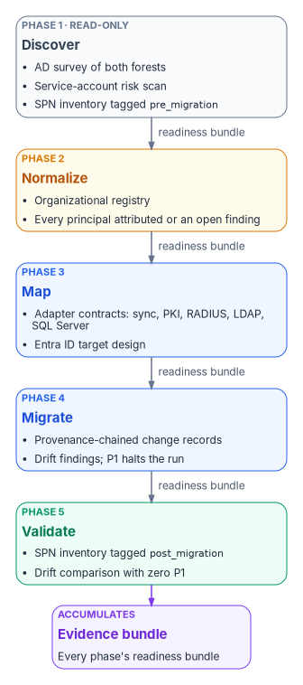
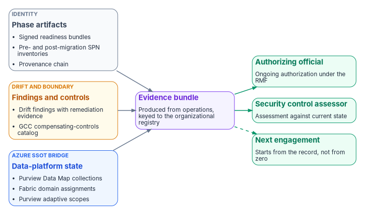

# Chapter 11 — Reference Deployment

*Run the migration as a governed sequence and the authorization evidence becomes a byproduct of the work, not a separate project afterward.*

::: {.callout-note}
## In this chapter
This chapter puts the How chapters together on one representative estate: two Active Directory forests, a SQL Server estate of about ninety instances, and a Microsoft 365 Government Community Cloud (GCC) destination. It walks the five phases (Discover, Normalize, Map, Migrate, Validate), shows what each phase hands to the next, describes the bridge to the agency's data platform, and lists the evidence bundle an assessor consumes and what the agency keeps when the contract ends.
:::

::: {.callout-important}
## A framing pattern, not a real engagement
This chapter describes a *pattern*: how the Federal Modernization Program's approach behaves against a typical federal civilian estate. It is not a report on a deployed and attested engagement. The agency is a composite, the counts are illustrative orders of magnitude, and there are no agency names, contractor names or calendar dates. When real engagement material can be released, measured results replace the illustrative figures.
:::

## The archetype

The agency has about fifty thousand users in two Active Directory forests. One belongs to the agency itself. The other came from a component organization absorbed in an earlier reorganization. A forest trust joins them; nobody fully documented it and nobody owns it now. Between them the forests hold about seventy thousand computer accounts, twelve thousand groups and several thousand service accounts whose original owners have moved on. The SQL Server estate has about ninety instances across regional offices and the headquarters data center, plus a few workloads already connected to Azure Arc.

Federal policy pushes from several directions. OMB M-22-09 directs agencies to consolidate identity systems so that protections and monitoring apply consistently, and to give staff enterprise-managed accounts that resist phishing.[^c11-m2209] OMB M-26-14, which rescinded M-21-31 and its EL0–EL3 event-logging tiers, requires logs that can determine the identity used for each operation and changes to privilege levels, kept searchable for six months and retrievable for a year and readily available to the agency's top-level security operations center, and measures agencies against a five-level logging maturity model.[^c11-m2614] CISA BOD 25-01 requires agencies to inventory their in-scope cloud tenants, run CISA's SCuBA assessment tools, and put the mandatory Secure Cloud Business Applications (SCuBA) baselines in place for Microsoft 365.[^c11-bod2501] The source page called BOD 25-01 a logging directive. That was wrong: logging belongs to M-26-14, and BOD 25-01 covers cloud configuration baselines. Meanwhile FedRAMP 20x is moving cloud service providers toward Key Security Indicators that are validated continuously rather than assessed once a year.[^c11-fedramp20x]

The agency has picked Microsoft 365 GCC (often called GCC-Moderate) as its identity and collaboration destination. In GCC, Microsoft 365 is paired with Microsoft Entra ID in the Azure commercial cloud, not Azure Government. That pairing matters for every service the bridge in this chapter depends on.[^c11-gcc-entra] The agency also wants its data estate to converge on Microsoft Purview for governance, with Microsoft Fabric and OneLake for analytics where the government cloud supports them.

Its compliance posture is familiar. A systems integrator who is no longer on contract assembled the last authorization package after the fact, over most of a year. The service principal name (SPN) inventory lives in spreadsheets that are two years old. The SQL Server estate's ownership is recorded in component binders that disagree with each other. The agency owns the right tools (Entra ID, Intune, Defender, Purview), but no shared, authoritative record tells those tools how the agency is organized. [Chapter 02](02-the-structural-problem.md) describes that structural problem, and [Chapter 06](06-who-owns-the-migration.md) covers who has to own fixing it.

{#fig-ch11-five-phases fig-alt="Five phase cards in sequence. Discover, read-only, produces the AD survey, the service-account risk scan and the pre-migration SPN inventory. Normalize produces the organizational registry, with every principal attributed or carrying an open finding. Map produces the adapter contracts for PKI, RADIUS, LDAP and SQL Server, plus the Entra target design. Migrate produces provenance-chained change records and drift findings, and P1 findings halt the run. Validate produces the post-migration SPN inventory and a drift comparison with zero P1 findings. Each phase ends with a signed readiness bundle that is the next phase's entry condition, and every bundle flows into the evidence bundle."}

The rest of the chapter walks those phases in order. Each phase ends with a *readiness bundle*: a signed record of what the phase produced and which program documents it was produced against. The next phase starts only from that bundle, never from someone's memory of what the last phase did. That gating is a program design choice, and it is what makes the evidence bundle at the end possible.

## Phase 1 — Discover

The first job is an honest picture of the current state. The read-only discovery approach in [Chapter 07](07-read-only-discovery.md) reads both forests without writing to either. It enumerates the object classes that [Chapter 04](04-the-hidden-migration-surface.md) catalogs as the hidden migration surface: users, computers, service accounts, security groups, Group Policy objects, DNS and DHCP records, PKI artifacts, RADIUS configuration, LDAP-dependent applications, Kerberos SPNs and the trust between the two forests. The survey uses the same tooling on every engagement. It is not a script written for this agency.

The service-account scan runs in the same pass. For each account it records the delegation configuration, `adminCount` status and a risk score. Two conditions are flagged as critical before migration starts. The first is an SPN that depends on Active Directory Certificate Services (ADCS). The second is unconstrained Kerberos delegation, which Windows Credential Guard already blocks on current Windows versions, and which Microsoft directs customers to replace with constrained delegation.[^c11-unconstrained] In the archetype, about four hundred service accounts carry at least one SPN. The scan rates about sixty critical and another hundred high risk. [Chapter 08](08-assessing-the-forest.md) and [Appendix B](appendix-b-forest-assessment-module.md) cover how to read and rank those findings.

The SPN inventory is the artifact the SQL Server work depends on most. Every `MSSQLSvc/*` registration is captured with a `pre_migration` phase tag, a discovery timestamp and an organizational attribution. The attribution comes from the service account that owns the SPN where possible, and from the hosting computer otherwise. SQL Server needs that registration to use Kerberos at all. An SPN maps to the Windows account that runs the instance, and if it's missing or wrong the connection silently falls back to NTLM.[^c11-sql-spn] About eighty of the ninety instances resolve cleanly. The other ten raise identity findings because their service accounts predate any organizational attribution the agency can defend. They're recorded as high-severity (P2) conditions, and someone has to explicitly reassign an owner before those instances can migrate.

Discovery ends with its readiness bundle, which records the survey output, the scan, the phase-tagged SPN inventory and the program documents the run used.

## Phase 2 — Normalize

Discovery output is not yet authoritative. Both forests have a top-level "Operations" OU, but they hold different populations, and a merged tenant can't tolerate that ambiguity. The agency builds an organizational registry from the discovery output and refines it against its organizational chart of record. From then on, the registry is the source of truth for where each principal sits in the organization. The collision gets resolved in the registry, not by renaming groups. [Chapter 05](05-delegation-without-ous.md) explains why OU placement can't carry that meaning in Entra ID.

Normalization raises an identity finding for every principal the registry can't attribute. On the first pass in the archetype, that's about two thousand users and several hundred service accounts. Each finding comes with a suggested attribution drawn from OU placement, the manager chain or the hosting computer. The program doesn't assign attributions automatically, because every later policy decision depends on them: Conditional Access targeting, administrative-unit scope, Purview policy scope and access reviews. The agency's governance team resolves the findings through its change-request workflow before Phase 3 begins. Where the agency's HR system can supply the attribution directly, that's the better source, and it's the subject of the [HR-driven identity series](../b03-hr-identity/index.md).

## Phase 3 — Map

Mapping translates the governance model encoded in Active Directory (OU hierarchy, group nesting, delegated ACLs) into the attribute-driven model Entra ID requires. [Chapter 09](09-building-the-entra-target.md) designs that target. This chapter adds the per-surface contracts a two-forest estate needs. Each AD-adjacent surface gets an adapter with an explicit contract: what it reads, what it may change, its mission class and whether its target sits inside the GCC boundary. The surfaces are IP address management, PKI, RADIUS, LDAP proxy, the sync engine, device management, time service, DFS and the SQL Server workload.

Four of them carry most of the risk in this archetype:

- **Synchronization.** Two forests with a trust and about 130,000 directory objects push the choice of sync engine into the design. Microsoft Entra Cloud Sync is the platform Microsoft is now developing, and Microsoft says it will replace Connect Sync once it reaches functional parity.[^c11-connectsync] Today Cloud Sync supports up to 150,000 objects per domain and doesn't support cross-forest references (for example, a manager in the other forest), while Connect Sync does.[^c11-cloudsync] [Chapter 09](09-building-the-entra-target.md) works through that decision. The archetype's cross-forest manager chains are the deciding input.
- **PKI.** The ADCS hierarchy issues dozens of templates through auto-enrollment. Intune can deliver certificates to managed devices with SCEP profiles. Against an ADCS issuing CA, that requires NDES and the Certificate Connector for Microsoft Intune.[^c11-intune-scep] Microsoft Cloud PKI can replace the on-premises CA, NDES and connector for Intune-managed devices, but confirm it's available in your cloud environment before you plan around it.[^c11-cloudpki] Either way, sequence the cutover so no certificate expires in the middle of it.
- **RADIUS.** Network access in this archetype uses 802.1X EAP-TLS, which depends on the same ADCS hierarchy. The RADIUS adapter moves in lockstep with the PKI adapter.
- **SQL Server.** The ninety instances need their SPNs re-registered in step with the service-account migration. Each instance also needs a path to Microsoft Entra authentication. That path requires SQL Server 2022 or later and is usually configured through Azure Arc.[^c11-sql-entra-arc] Microsoft also documents a configuration without Arc for SQL Server 2022 and later.[^c11-sql-entra-noarc] Entra authentication isn't supported on failover cluster instances, so any clustered instance in the estate needs its own plan.[^c11-sql-entra-remarks] About forty LDAP-bound internal applications go through the LDAP-proxy adapter.

This chapter doesn't repeat the SQL Server procedure. The [SQL Server Identity Transformation narrative](../b06-data-platform/index.md) explains the sequence and why it runs in that order: estate consolidation, authentication audit, the identity bridge, login migration, NTLM elimination and the certificate-authority dependency. The [Implementation Companion](../b06-data-platform/index.md) has the runbooks for each step. This chapter's job is to place that work inside the forest migration, so that SQL Server SPNs and service accounts move under the same gates as everything else.

## Phase 4 — Migrate

The migration runs as a sequence of provenance-chained events. Each adapter operation leaves a record that can't be altered afterward. The record names the principal that requested the change, the authority for it, the version of the program documents it was made against and a hash of the resulting state. Two contract rules apply throughout. First, adapters read from and write against the authoritative record, but never replace it. Second, every operation is signed with an identity certificate. These are program design rules. The execution mechanics (staged cutover, coexistence, rollback) are in [Chapter 10](10-migrating-and-governing.md).

Drift findings appear during the migration as it runs. The program classifies them with the five-class drift taxonomy described in the workbook's [Drift Engine](https://github.com/WhalerMike/modernization-workbook/blob/main/docs/architecture/drift-engine.md) page:

| Drift class | Example in this archetype |
|---|---|
| `DRIFT-SCHEMA` | A newly migrated computer object carries an attribute encoding that doesn't match the current schema version. |
| `DRIFT-SEMANTIC` | An organizational attribute value slips back into a deprecated geographic OU naming pattern. |
| `DRIFT-PROVENANCE` | A state change appears with no provenance event in the chain. This is critical (P1): the run halts until someone investigates. |
| `DRIFT-AUTHZ` | A Conditional Access policy contradicts the authentication assurance level recorded for that principal. |
| `DRIFT-IDENTITY` | A principal exists in the migrated tenant with no counterpart in the registry, an orphaned migration artifact. |

Assurance levels follow NIST SP 800-63-4, which superseded SP 800-63-3 in July 2025.[^c11-sp80063] Be honest about maturity. On the Drift Engine page, schema and provenance detection are shipped, semantic detection is partial, and authorization and identity detection are still design-only. In a real engagement today, the last two classes are found by the assessment modules and by people reviewing them, not by a runtime engine.

The archetype produces about three hundred drift findings across the migration window. Most are medium or low severity (P3 or P4) and are remediated automatically under the drift standard. A representative cycle has one P1. A finance service account's post-migration role assignment exceeds what the assurance level recorded for it allows, so the dependent SQL Server instance's migration stops until someone reduces the role assignment.

## Phase 5 — Validate

After migration, the SPN inventory is captured again with a `post_migration` tag, and the two inventories are compared. The program checks four conditions. Severity follows the Drift Engine's severity model, which derives it from the drift class and whether the claim is in active use; provenance drift on a live SPN is P1, as in Phase 4.

| Condition | Drift class | Severity | How it's detected |
|---|---|---|---|
| SPN present before migration, absent after | `DRIFT-IDENTITY` | P1 | Set difference between the two phase-tagged inventories |
| SPN host or port changed with no provenance record | `DRIFT-PROVENANCE` | P1 | Same service class and principal, different host or port |
| SPN owner changed with no recorded migration event | `DRIFT-AUTHZ` | P1 | Same SPN, different principal, no transition record |
| SPN still in AD but no decided authentication path for the instance | `DRIFT-IDENTITY` | P2: nothing in use has broken yet; a decision is missing | The instance has neither a configured Entra authentication path nor a recorded decision to keep Kerberos |

The fourth row is restated from the source page, which described it as a cross-check against "Entra Kerberos delegation" and workload-identity federation. Entra ID doesn't take over Kerberos delegation for on-premises SQL Server SPNs. Those SPNs stay in Active Directory until the instance stops using Windows authentication. What gets validated is whether every instance has a decided path.

The third row is common, and it's easy to miss. When a SQL Server service account changes, for example to a group managed service account, the SPNs registered on the old account stay there until someone moves or removes them. Microsoft's guidance is that each `MSSQLSvc` SPN should have exactly one owner: the account that now runs the service.[^c11-gmsa-spn] The checks below show how to confirm that on one instance.

::: {.callout-warning}
## Illustrative commands
These commands are illustrative and haven't been tested against a production forest. Review them, and substitute your own host, port and account names, before you run them.
:::

```powershell
# List the SPNs registered on the account that now runs the instance
# (a gMSA needs the trailing $).
setspn -L CONTOSO\SQLgMSA$

# Find which account owns a given SQL Server SPN. Exactly one should.
setspn -Q MSSQLSvc/sql01.contoso.com:1433

# Clear cached tickets on the test client before reconnecting.
klist purge
```

```sql
-- From a remote Windows-authenticated session: KERBEROS is expected,
-- NTLM means the SPN is still missing or misplaced.
SELECT auth_scheme
FROM sys.dm_exec_connections
WHERE session_id = @@SPID;
```

In the archetype, about three SPNs come back as P1 identity findings. These are SPNs whose re-registration step was skipped during the SQL Server sequence. Under the severity model, they halt the run and raise an alert. The operations team re-registers the SPNs against the migrated principals and recaptures the post-migration inventory, and repeats until no P1 findings remain. The SQL Server series covers the same check from the database side, in its NTLM-elimination book.

## The Azure SSOT bridge

When the identity migration is complete, the agency's data platform joins the same single source of truth. The organizational registry from Phase 2 becomes the scope for data governance as well as identity.

On the Microsoft 365 side, Purview adaptive scopes target policies by Entra ID attributes, so they follow the registry without hand-maintained groups. Adaptive scopes apply to retention policies, retention label policies, auto-labeling policies and communication compliance policies.[^c11-adaptive-scopes] The source page also listed DLP and eDiscovery custodian queries as adaptive-scope targets. Microsoft doesn't list those, so this chapter doesn't claim them.

On the data side, the SQL Server instances are registered in the Purview Data Map under collections that follow the organizational structure. Purview supports registering and scanning SQL Server instances enabled by Azure Arc, with a self-hosted integration runtime, for SQL Server 2012 and later.[^c11-purview-arc-sql] Fabric domains mirror the same hierarchy. Each workspace is assigned to the domain of the segment that owns it, and every item in the workspace inherits that association.[^c11-fabric-domains] The instances that migrated cleanly can then be mirrored into OneLake. Fabric mirroring supports on-premises SQL Server 2016 through 2025, and SQL Server 2025 mirroring requires an Arc connection.[^c11-fabric-mirroring] The instances still remediating drift wait until their drift cycle closes.

That last step depends on the cloud. Fabric's feature set in the US government clouds is narrower than in the commercial cloud. In GCC High, for example, Azure SQL Database is the only supported mirroring source.[^c11-fabric-gcch] Fabric (F SKU) capacities aren't supported in GCC; only EM and P SKUs are.[^c11-powerbi-gov] Treat OneLake mirroring as conditional, and confirm it against Microsoft's current availability pages for your environment before you commit it to a schedule.

The GCC boundary has a structural limit: the agency can't independently verify some of the service-side telemetry that sensitivity-label decisions rely on. The program doesn't claim to remediate that. It records the compensating controls the agency has put in place and verifies them on a schedule. Those records go into the evidence bundle.

## The evidence bundle the assessor consumes

From Phase 2 on, the agency can produce an evidence bundle at any time from the artifacts the phases have accumulated:

- the signed readiness bundle from each phase
- both phase-tagged SPN inventories, with the results of comparing them
- the provenance chain for every adapter operation
- every drift finding, with its severity, drift class and remediation evidence
- the GCC boundary finding, with the agency's catalog of compensating controls and when each was last verified
- the Purview Data Map registration state, with an owner attributed for each asset
- the Fabric domain assignment state, with an owner attributed for each workspace

{#fig-ch11-evidence-bundle fig-alt="Three groups of inputs on the left. Identity artifacts are the phase readiness bundles, the pre- and post-migration SPN inventories and the provenance chain. Drift and boundary artifacts are the drift findings with remediation evidence and the GCC compensating-controls catalog. The Azure SSOT bridge contributes Purview Data Map collections, Fabric domain assignments and adaptive scopes, all keyed to the organizational registry. All three flow into the evidence bundle in the center. The bundle flows to the authorizing official, for ongoing authorization; to the security control assessor, for assessment; and to the next engagement, which starts from it instead of rediscovering the estate."}

The source page said a FedRAMP 3PAO would consume this bundle in the agency's next FedRAMP cycle. That needs correcting. FedRAMP authorizes cloud service offerings, and 3PAOs assess cloud service providers. FedRAMP 20x is likewise aimed mainly at providers, with agencies as consumers of what it produces.[^c11-fedramp20x] The agency's own systems are authorized by the agency's authorizing official under the NIST Risk Management Framework (SP 800-37 Rev. 2), which supports ongoing authorization driven by continuous monitoring.[^c11-sp80037] So the bundle goes to the agency's security control assessor and authorizing official. It also shows how the agency's side of the shared-responsibility model holds up on top of its providers' FedRAMP packages.

The difference from the archetype's last authorization is timing. The bundle comes out of operations as they happen; nobody assembles it over most of a year afterward. The authorizing official sees current state, not a snapshot that's out of date by the time it's signed.

## What survives the engagement

The registry, the schemas, the drift findings and the evidence bundle don't belong to the systems integrator who delivered the migration. They belong to the agency. The next authorization cycle uses the existing record instead of rebuilding it. The next engagement, whether another consolidation, a data-governance expansion or the HR-driven identity work, starts from the current state, not from zero. That's the cost shift the [Federal SSOT Alignment whitepaper](02-the-structural-problem.md) argues for: later engagements consume the record instead of rediscovering it.

A real engagement would measure the things this pattern is built to report:

- time to produce evidence, compared with the prior baseline of most of a year
- drift-finding rate over the migration window, by class and severity
- SPN drift per ten SQL Server instances migrated
- how often the GCC compensating controls are verified, and their false-positive rate
- the number of Purview policy decisions whose scope rests on continuously verified identity state

When engagement data can be released, those measurements replace the illustrative figures in this chapter.

## Where to go next

This book ends with identity moved and governed. It doesn't answer where attribution should come from in the first place. In this chapter, Phase 2 resolved two thousand unattributed users by hand, because the HR system of record wasn't connected to identity. The [HR-driven identity series](../b03-hr-identity/index.md) picks up at that point. It covers making the HR system the source of authority for workforce attributes, joiner-mover-leaver automation with Lifecycle Workflows, and an illustrative reference deployment of its own. For the SQL Server estate, continue with the [narrative series](../b06-data-platform/index.md) and its [Implementation Companion](../b06-data-platform/index.md).

::: {.callout-tip}
## Continue the book
[← Previous: Chapter 10 — Migrating and Governing](10-migrating-and-governing.md) · [Book index](index.md) · [Next: Appendix A — Federal Requirements Crosswalk →](appendix-a-federal-requirements-crosswalk.md)
:::

[^c11-m2209]: Office of Management and Budget, M-22-09, *Moving the U.S. Government Toward Zero Trust Cybersecurity Principles*, January 26, 2022, <https://www.whitehouse.gov/wp-content/uploads/2022/01/M-22-09.pdf> (accessed Oct 20, 2026).
[^c11-m2614]: Office of Management and Budget, M-26-14, *Ensuring Effective and Efficient Agency Logging and Network Visibility to Defend Against Evolving Cyber Threats*, May 22, 2026, rescission of M-21-31, "Measuring Maturity," Appendix B (Minimum Logging Baseline Requirements, items 1, 2 and 5) and Appendix C (Logging Maturity Model), <https://www.whitehouse.gov/wp-content/uploads/2026/05/M-26-14-Ensuring-Effective-and-Efficient-Agency-Logging-and-Network-Visibility-to-Defend-Against-Evolving-Cyber-Threats.pdf> (accessed Oct 21, 2026).
[^c11-bod2501]: Cybersecurity and Infrastructure Security Agency, "BOD 25-01: Implementation Guidance for Implementing Secure Practices for Cloud Services," <https://www.cisa.gov/news-events/directives/bod-25-01-implementation-guidance-implementing-secure-practices-cloud-services> (accessed Oct 20, 2026).
[^c11-fedramp20x]: FedRAMP, "FedRAMP 20x," <https://www.fedramp.gov/20x/> (accessed Oct 20, 2026).
[^c11-gcc-entra]: Microsoft Learn, "Cloud feature availability for US Government customers," <https://learn.microsoft.com/azure/security/fundamentals/feature-availability#microsoft-365-integration> (accessed Oct 20, 2026).
[^c11-unconstrained]: Microsoft Learn, "You can't use Kerberos unconstrained delegation in certain versions of Windows," <https://learn.microsoft.com/troubleshoot/sql/database-engine/connect/windows-prevents-unconstrained-delegation> (accessed Oct 20, 2026).
[^c11-sql-spn]: Microsoft Learn, "Register a Service Principal Name for Kerberos connections," <https://learn.microsoft.com/sql/database-engine/configure-windows/register-a-service-principal-name-for-kerberos-connections> (accessed Oct 20, 2026).
[^c11-connectsync]: Microsoft Learn, "Microsoft Entra Connect Sync: Understand and customize synchronization," <https://learn.microsoft.com/entra/identity/hybrid/connect/how-to-connect-sync-whatis> (accessed Oct 20, 2026).
[^c11-cloudsync]: Microsoft Learn, "Migrate from Microsoft Entra Connect to Cloud Sync: Decision Guide," <https://learn.microsoft.com/entra/identity/hybrid/cloud-sync/connect-to-cloud-sync-decision-guide> (accessed Oct 20, 2026).
[^c11-intune-scep]: Microsoft Learn, "Configure infrastructure to support SCEP with Intune," <https://learn.microsoft.com/intune/fundamentals/certificates/scep-infrastructure> (accessed Oct 20, 2026).
[^c11-cloudpki]: Microsoft Learn, "Overview of Microsoft Cloud PKI for Microsoft Intune," <https://learn.microsoft.com/intune/cloud-pki/> (accessed Oct 20, 2026).
[^c11-sql-entra-arc]: Microsoft Learn, "SQL Server enabled by Azure Arc," <https://learn.microsoft.com/sql/sql-server/azure-arc/overview> (accessed Oct 20, 2026).
[^c11-sql-entra-noarc]: Microsoft Learn, "Tutorial: Enable Microsoft Entra authentication for SQL Server on Windows without Azure Arc," <https://learn.microsoft.com/sql/relational-databases/security/authentication-access/microsoft-entra-authentication-sql-server-enable-without-arc> (accessed Oct 20, 2026).
[^c11-sql-entra-remarks]: Microsoft Learn, "Microsoft Entra authentication for SQL Server," <https://learn.microsoft.com/sql/relational-databases/security/authentication-access/azure-ad-authentication-sql-server-overview> (accessed Oct 20, 2026).
[^c11-sp80063]: National Institute of Standards and Technology, SP 800-63-4, *Digital Identity Guidelines*, July 2025, <https://csrc.nist.gov/pubs/sp/800/63/4/final> (accessed Oct 20, 2026).
[^c11-gmsa-spn]: Microsoft Learn, "Troubleshoot SQL Server Kerberos and authentication failures with gMSAs," <https://learn.microsoft.com/troubleshoot/sql/database-engine/startup-shutdown/gmsa-kerberos-authentication-failures> (accessed Oct 20, 2026).
[^c11-adaptive-scopes]: Microsoft Learn, "Adaptive scopes," <https://learn.microsoft.com/purview/purview-adaptive-scopes> (accessed Oct 20, 2026).
[^c11-purview-arc-sql]: Microsoft Learn, "Connect to and manage Azure Arc-enabled SQL Server in Microsoft Purview," <https://learn.microsoft.com/purview/register-scan-azure-arc-enabled-sql-server> (accessed Oct 20, 2026).
[^c11-fabric-domains]: Microsoft Learn, "Fabric domains," <https://learn.microsoft.com/fabric/governance/domains> (accessed Oct 20, 2026).
[^c11-fabric-mirroring]: Microsoft Learn, "Mirroring SQL Server," <https://learn.microsoft.com/fabric/mirroring/sql-server> (accessed Oct 20, 2026).
[^c11-fabric-gcch]: Microsoft Learn, "Microsoft Fabric for US Government GCC High customers," <https://learn.microsoft.com/fabric/enterprise/us-government-community-cloud-high> (accessed Oct 20, 2026).
[^c11-powerbi-gov]: Microsoft Learn, "Power BI for US government customers," <https://learn.microsoft.com/fabric/enterprise/powerbi/service-government-us-overview> (accessed Oct 20, 2026).
[^c11-sp80037]: National Institute of Standards and Technology, SP 800-37 Rev. 2, *Risk Management Framework for Information Systems and Organizations: A System Life Cycle Approach for Security and Privacy*, December 2018, <https://csrc.nist.gov/pubs/sp/800/37/r2/final> (accessed Oct 20, 2026).
