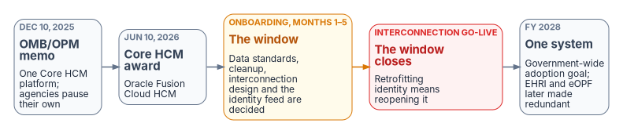

# Chapter 03 — Federal HR 2.0 and the Core HCM Platform

*Federal HR 2.0 is not the project. It is the opening: the HR side is rebuilt anyway, and the identity side is left to the agency.*

::: {.callout-note}
## In this chapter
What OPM HRIT is and who OPM is in this story. Five decades of federal HR consolidation. The Federal HR 2.0 program facts and the wave clock, as of October 2026. Why Federal HR 2.0 is the opportunity to start HR-driven identity, and when the window closes. What OPM requires of the identity leg, and what it leaves to the agency.
:::

## OPM HRIT and Federal HR 2.0

In this book, OPM HRIT means the Office of Personnel Management's government-wide human resources information technology — the systems and data services through which OPM supports HR across the federal government: personnel action processing (the SF-50 pipeline), the electronic Official Personnel Folder (eOPF), and the government-wide HR data backbone, Enterprise Human Resources Integration (EHRI).[^c03-ehri] Since December 2025 it has a directing instrument: the joint OMB/OPM memorandum *Creating "Federal HR 2.0" by Consolidating Core Human Capital Management Across the Federal Government* (December 10, 2025). The memo moves the government's "more than 100 unique Core HCM software systems" onto one government-wide platform and — significant for integration planning — says that the single Core HCM system will eventually make eOPF and EHRI **redundant**, "and allow for their decommissioning and elimination."[^c03-memo] Anything built against the EHRI/eOPF feed shapes is building against systems the program already expects to retire; the durable integration surface is the Core HCM platform's own (federation, SCIM provisioning, extracts and event feeds).

### Who OPM is in this story

Not just a policy shop. OMB M-19-16 (*Centralized Mission Support Capabilities for the Federal Government*, April 2019) set up Quality Services Management Offices (QSMOs): government-wide owners of standards and a marketplace of solutions for a mission-support function. Once a QSMO is designated for a function, agencies may not issue new solicitations for new or modernized technology for that function without a business case approved by the QSMO and OMB.[^c03-m1916] The human resources role first went to GSA; in 2022 OMB moved it to OPM, which now serves as the **HR Quality Services Management Office (HR QSMO)** — the standards owner and storefront for HR IT.[^c03-qsmo-2022][^c03-qsmo] The policy direction is explicit: agencies buy HR technology against the QSMO's standards and marketplace rather than building bespoke systems.

## Fifty years of consolidation

Every milestone in the program's history moves the same direction: fewer systems, more authoritative data, shared delivery. The modernization approach in this workbook is not a novel invention — it is the landing point that five decades of federal HR consolidation policy have been driving toward.

| Year | Milestone | What changed |
|---|---|---|
| 1972 | **CPDF** | The Central Personnel Data File — OPM's government-wide personnel statistics database[^c03-cpdf] |
| 2002–2009 | **e-Gov era** | e-Payroll consolidates 26 executive branch payroll providers to 4, a migration completed in 2009; eOPF begins replacing the paper personnel folder[^c03-epay][^c03-epay-done] |
| 2004 | **HR Line of Business** | OPM-led inter-agency program; the federal HR business reference model; agency HR moves toward shared service centers[^c03-hrlob] |
| 2000s | **EHRI** | Enterprise Human Resources Integration, an OPM e-Gov initiative, becomes the government-wide HR data source and steward of eOPF; CPDF is its precursor[^c03-ehri][^c03-cpdf-data] |
| 2019 | **QSMO framework** | OMB M-19-16 establishes Quality Services Management Offices for mission-support functions[^c03-m1916] |
| 2022 | **HR QSMO** | OMB designates OPM the HR Quality Services Management Office, taking the role over from GSA[^c03-qsmo-2022] |
| 2024 | **HR Marketplace** | OPM's HR QSMO opens its HR Marketplace; agencies steered to standards-aligned shared solutions[^c03-marketplace] |
| 2025 | **Federal HR 2.0** | The joint OMB/OPM memorandum (December 10, 2025) directs one government-wide Core HCM platform; agencies pause their own Core HCM procurement and modernization[^c03-memo] |
| 2026 | **Core HCM award** | OPM awards the Federal HRIT Modernization Core HCM contract to Oracle (June 10, 2026; announced by Oracle June 11) — **Oracle Fusion Cloud HCM**, SaaS, the workforce platform this workbook uses for its principal implementation example[^c03-award][^c03-oracle][^c03-fnn] |
| 2027 | **Wave transitions** | First agencies onboard as FY 2027 begins; Wave 2 transitions during FY 2027; the sample onboarding timeline runs about 8 months with interconnections around month 5 (a planning assumption: confirm each agency's milestones with the HR 2.0 program office)[^c03-memo][^c03-mt] |
| 2028 | **One system** | Government-wide adoption goal (FY 2028); eOPF and EHRI are eventually made redundant and decommissioned[^c03-memo] |

: The OPM HRIT timeline — five decades of consolidation {.striped .hover}

## The program facts

These are the program facts as of October 20, 2026. They change; verify them at engagement time.

| Fact | Value | Source |
|---|---|---|
| Directing instrument | OMB/OPM memo, *Creating "Federal HR 2.0" by Consolidating Core Human Capital Management Across the Federal Government*, signed by the OMB and OPM Directors | Dec 10, 2025[^c03-memo] |
| Platform | **Oracle Fusion Cloud HCM** (SaaS), under the Federal HRIT Modernization Core HCM contract | Awarded Jun 10, 2026; announced Jun 11, 2026[^c03-award][^c03-oracle] |
| Wave 1 | Agencies that volunteered for the initial wave (~900K FTE); planned to start in FY 2026 and conclude in FY 2027. Membership is listed in the memo's Appendix A | Memo, Appendix A[^c03-memo] |
| Wave 2 | All remaining agencies (~1.1M FTE), transitioning fully in FY 2027 | Memo, Appendix A[^c03-memo] |
| First onboarding and go-lives | First agencies start moving onto the platform as FY 2027 begins; initial deployments reported as slated to go live between January and March 2027. The original July 2027 launch target was expected to slip after the award was delayed by bid protests | OPM Director, Aug 31, 2026, as reported[^c03-mt]; award reporting[^c03-fnn] |
| Agency onboarding shape | ~8 months; **interconnection(s) go-live and production setup complete ≈ month 5**, alongside data migration for obfuscation; user acceptance testing in shadow mode in months 6–8; data migration and cutover at month 8, then legacy systems replaced by Core HCM are discontinued | Memo, Appendix B (sample timeline)[^c03-memo][^c03-memo-appb] |
| Government-wide adoption goal | FY 2028 | Memo[^c03-memo] |
| Standing systems | OPM continues to transition agencies onto eOPF and EHRI; the Core HCM system will eventually make them **redundant** and allow their decommissioning | Memo, §I[^c03-memo] |
| Agency obligation now | **Pause own Core HCM procurement, development and related modernization** (exceptions only from the OMB and OPM Directors); execute the Appendix C preparation actions | Memo, §II and Appendix C[^c03-memo] |
| Interface requirement (procurement) | PWS Appendix A, Functional Requirements Matrix, Req. 5: **SCIM 2.0 automated user provisioning from the Government's identity provider into the contractor's system**, synchronized in near real time or within a defined SLA (for example, 15 minutes) | Solicitation 24322626R0007, Amendment 4, p. 59[^c03-pws][^c03-pws-req5] |
| Platform identity (procurement) | PWS §5.1.1(3): "Integrate and implement OPM approved identity management solution using OPM MS Entra-based solution" — OPM's solution for the platform's own sign-in and users, not the agency's directory | Solicitation 24322626R0007, Amendment 4, p. 26[^c03-pws-core] |
| Agency-specific integrations (procurement) | Reviewed and approved by the Core HCM Steering Committee; Appendix B's sample large-agency interconnections include an "Identity Management Solution" fed by Core HCM as the authoritative source for user identity data | Solicitation 24322626R0007, Amendment 4, PWS Appendix B, pp. 88 and 95[^c03-pws-appb] |

: Federal HR 2.0 program facts, as of October 20, 2026 {.striped .hover}

Wave membership is set by the memo's Appendix A and may change; this book doesn't list it. Check the memo and OPM's Core HCM page for an agency's wave and dates.[^c03-memo][^c03-corehcm]

## Why this is the opportunity, not the project

An agency doesn't choose whether to implement Federal HR 2.0; the memo and the waves decide that. What the agency does choose is whether identity rides along. Four facts make HR 2.0 the cheapest moment it will get to start HR-driven identity:

| HR 2.0 rebuilds anyway | What it gives identity |
|---|---|
| New interconnections with the agency, designed during onboarding (Appendix C asks agencies to define integration points, identify interfacing systems and document data flows) | An HR-driven identity feed can be designed in, not bolted on later |
| HR data reviewed and migrated for the move | Worker type, organization, duty station and supervisor fixed once, at the source |
| One platform with one interface for every agency | One standards-based crosswalk instead of one per HR provider |
| A solicitation that already ties the platform to federal identity: SAML single sign-on through OPM's identity provider, and SCIM 2.0 provisioning of the platform's own users from the Government's identity provider | Identity is already at the integration table. The reverse direction — Core HCM feeding the agency's identity system — appears in the solicitation only as a sample: an "Identity Management Solution" interconnection, with Core HCM as the authoritative source for user identity data and no protocol, product or directory named.[^c03-pws-appb] Microsoft documents that direction for Oracle Fusion Cloud HCM through API-driven inbound provisioning, which accepts SCIM-formatted payloads built from HCM Extracts or Atom feeds[^c03-pws][^c03-ms-oracle] |

: What Federal HR 2.0 rebuilds anyway, and what that gives identity {.striped .hover}

One limit applies to all four: Federal HR 2.0 is a program for **federal employees**. Contractors and vendors are not in it. Their source is a separate decision (Chapter 06), and the HR 2.0 onboarding is the right time to make it, because the contingent-worker capability of the same platform is one of the options. Where agencies can share HR 2.0 implementation work, and what the platform's FedRAMP status means for data crossing to an agency's systems, is in the research page [Federal HR 2.0 Across Agencies and Boundaries](../explainers/hr2-shared-governance-fedramp-boundary.md).

The agency's own move from Active Directory to Entra ID is the second half of the opening (Chapter 05): the directory that HR will drive is being redesigned at the same time.

{#fig-ch03-hr20-window fig-alt="Five boxes left to right. Dec 10 2025, OMB/OPM memo: one Core HCM platform, agencies pause their own. Jun 10 2026, Core HCM award, Oracle Fusion Cloud HCM. Amber: onboarding months 1 to 5, the window; data standards, cleanup, interconnection design and the identity feed are decided. Red: interconnection go-live, the window closes; retrofitting identity means reopening it. FY 2028: one system, the government-wide adoption goal; EHRI and eOPF later made redundant."}

Two consequences follow:

1. **The window closes at the interconnection.** The first agencies were expected to begin onboarding as FY 2027 began, with initial deployments reported for January to March 2027. The memo's sample timeline puts interconnection go-live around month 5 of onboarding; treat that as a planning assumption, and confirm each agency's milestones with the HR 2.0 program office. An HR-driven identity feed designed into that onboarding costs a fraction of one retrofitted after it. The same timeline shows data migration for obfuscation at month 5 and the platform's user acceptance testing in shadow mode in months 6–8, before cutover at month 8.[^c03-memo-appb] Two planning consequences follow from the timeline, not from any program rule: test data before cutover is obfuscated, so correlation testing against real person numbers may have to wait for cutover unless the numbers survive obfuscation; and the platform's shadow-mode testing is the natural window for the identity pipeline's own shadow run (Chapter 12, Phase 3).
2. **EHRI-shaped thinking has an expiry date.** Anything that treats the EHRI/eOPF feeds as the durable HR data interface is building against systems the memo expects the Core HCM platform to make redundant. The durable interface is the Core HCM platform's own surface — HCM Extracts, Atom feeds, REST and SCIM APIs — carrying OPM's standard data elements.[^c03-ms-oracle]

## What OPM requires, and what it leaves to the agency

No OPM document mandates or specifies how the platform integrates with the agency's own directory — which is exactly why the agency has to propose it. The solicitation does name Entra for OPM's side: the platform's implementation integrates an "OPM approved identity management solution using OPM MS Entra-based solution."[^c03-pws-core] The program fixes the HR side — the platform, the waves, the interface requirements in the solicitation — and leaves the identity side to each agency. The solicitation's identity requirements point *into* the platform: its users sign in through OPM's identity provider and are provisioned into it by SCIM from the Government's identity provider.[^c03-pws] The other direction appears only as a sample: Appendix B's *Sample Interconnection for Large Department/Agency* lists an "Identity Management Solution" to "Provision identity attributes using Core HCM is the authoritative source for user identity data," without naming a protocol, product or directory, and the Core HCM Steering Committee reviews and approves any agency-specific integration requirements.[^c03-pws-appb] This book's recommendation, as design guidance: in Phase 0 (Chapter 12), take the HR-to-identity feed to the Steering Committee as an agency-specific integration, so it is approved before the interconnection goes live. The Entra-specific design in Chapters 05–10 is an agency implementation decision built on Microsoft's own Oracle HCM integration guidance.[^c03-ms-oracle] Until mid-2026 the HR side of this architecture had to be planned agnostically, because the government-wide vendor was undecided. The award removed that uncertainty without changing the architecture: the identity model is source-independent while each source contract remains explicit, so if the program changes again the source contract and boundary transformation change while the governed identity model and downstream lifecycle services remain stable.

::: {.callout-tip}
## Continue the book
[← Previous: Chapter 02 — Why HR Is the Source of Authority](02-why-hr-is-the-source-of-authority.md) · [Book index](index.md) · [Next: Chapter 04 — Attribute Authority →](04-attribute-authority.md)
:::

[^c03-memo]: Office of Management and Budget and Office of Personnel Management, *Creating "Federal HR 2.0" by Consolidating Core Human Capital Management Across the Federal Government*, December 10, 2025, <https://www.opm.gov/chcoc/latest-memos/creating-federal-hr-20-by-consolidating-core-human-capital-management-across-the-federal-government.pdf> (accessed Oct 20, 2026). System count and FY 2028 goal (p. 1); waves, eOPF and EHRI (§I); pause on Core HCM procurement (§II); wave membership (Appendix A); sample onboarding timeline (Appendix B); preparation actions (Appendix C).
[^c03-ehri]: Office of Personnel Management, "Enterprise Human Resources Integration," <https://www.opm.gov/policy-data-oversight/data-analysis-documentation/enterprise-human-resources-integration> (accessed Oct 20, 2026). Describes EHRI as one of five OPM-led e-Government initiatives, responsible for the integrity of eOPF and for government-wide HR data.
[^c03-m1916]: Office of Management and Budget, M-19-16, *Centralized Mission Support Capabilities for the Federal Government*, April 26, 2019, <https://www.whitehouse.gov/wp-content/uploads/2019/04/M-19-16.pdf> (accessed Oct 20, 2026).
[^c03-qsmo-2022]: FedScoop (trade press), "OPM was quietly redesignated the point office for HR shared services," April 28, 2022, <https://fedscoop.com/opm-hr-shared-services-qsmo/> (accessed Oct 20, 2026). Reports that OMB redesignated OPM as the HR QSMO on March 30, 2022, a role first given to GSA.
[^c03-qsmo]: Office of Personnel Management, "HR Quality Services Management Office," <https://www.opm.gov/agency-services/hr-governance/hr-quality-services-management-office/> (accessed Oct 20, 2026).
[^c03-cpdf]: National Partnership for Reinventing Government (archived), OPM announcement on the Central Personnel Data File, July 16, 1998 ("The CPDF started in 1972"), <https://govinfo.library.unt.edu/npr/library/announc/cpdf.htm> (accessed Oct 20, 2026).
[^c03-cpdf-data]: Office of Personnel Management, "Central Personnel Data File (CPDF)," Data.gov catalog ("Precursor to the Enterprise Human Resources Integration-Statistical Data Mart"), <https://catalog.data.gov/dataset/central-personnel-data-file-cpdf> (accessed Oct 20, 2026).
[^c03-epay]: Office of Management and Budget, E-Government initiatives (archived), "e-Payroll" (consolidating 26 executive branch payroll providers to four, with OPM leading), <https://georgewbush-whitehouse.archives.gov/omb/egov/c-4-5-ePay.html> (accessed Oct 20, 2026).
[^c03-epay-done]: Nextgov (trade press), "OPM claims victory in huge e-payroll system consolidation," October 21, 2009 (the migration from 26 payroll systems to four shared-service centers took seven years), <https://www.nextgov.com/digital-government/2009/10/opm-claims-victory-in-huge-e-payroll-system-consolidation/45086/> (accessed Oct 20, 2026).
[^c03-hrlob]: Office of Management and Budget, E-Government press release (archived), Human Resources Line of Business, January 31, 2005 (OPM formed and led an inter-agency task force of 22 agencies; government-wide shared service centers), <https://georgewbush-whitehouse.archives.gov/omb/egov/press_releases/lines_business/050131_OPM_hr_lines_bus.html> (accessed Oct 20, 2026).
[^c03-marketplace]: FedScoop (trade press), "OPM's new HR Marketplace aims to be 'community center' for federal services," May 1, 2024, <https://fedscoop.com/opm-launches-hr-marketplace/> (accessed Oct 20, 2026).
[^c03-award]: Office of Personnel Management, "OPM Awards Contract for First Ever Governmentwide HR Platform," <https://www.opm.gov/news/news-releases/opm-awards-contract-for-first-ever-governmentwide-hr-platform/> (accessed Oct 20, 2026).
[^c03-oracle]: Oracle, "U.S. Office of Personnel Management Selects Oracle to Power Federal Workforce Modernization," June 11, 2026 (Oracle Fusion Cloud Human Capital Management; $395.8 million Federal HRIT Modernization Core HCM contract), <https://www.prnewswire.com/news-releases/us-office-of-personnel-management-selects-oracle-to-power-federal-workforce-modernization-302798451.html> (accessed Oct 20, 2026).
[^c03-fnn]: Federal News Network (trade press), "OPM awards major HR IT modernization contract to Oracle," June 10, 2026 (initial July 2027 launch target likely to slip by at least six months; first wave expected to onboard early in FY 2027), <https://federalnewsnetwork.com/contracting/2026/06/opm-awards-major-hr-it-modernization-contract-to-oracle/> (accessed Oct 20, 2026).
[^c03-mt]: MeriTalk (trade press), "OPM Eyes $40M Annual Cost for Governmentwide HR Platform," September 1, 2026, <https://www.meritalk.com/articles/opm-eyes-40m-annual-cost-for-governmentwide-hr-platform/> (accessed Oct 20, 2026). Reports OPM Director Scott Kupor's August 31 remarks that the first agencies would start moving onto the platform as the new fiscal year began; the January-to-March go-live window is the reporter's summary.
[^c03-pws]: Office of Personnel Management, Solicitation 24322626R0007, *Federal HRIT Modernization*, Amendment 4, Performance Work Statement Appendix A, Functional Requirements Matrix, Req. 5 (p. 59), and clauses 1752.224-70 and 1752.224-71 (pp. 99–100), SAM.gov, <https://sam.gov/workspace/contract/opp/8cfe1844758c4fb2b10f5ef192b62f89/view> (accessed Oct 20, 2026).
[^c03-corehcm]: Office of Personnel Management, "Core HCM," <https://www.opm.gov/services-for-agencies/talent-systems/core-hcm/> (accessed Oct 20, 2026).
[^c03-ms-oracle]: Microsoft Learn, "Configure Oracle Human Capital Management (HCM) for automatic user provisioning," <https://learn.microsoft.com/en-us/entra/identity/saas-apps/oracle-hcm-provisioning-tutorial> (accessed Oct 20, 2026). Covers CSV and HCM Extracts, Atom feed delta syncs, SCIM payloads sent to the inbound provisioning API, and writeback through the Oracle HCM SCIM APIs.
[^c03-memo-appb]: Office of Management and Budget and Office of Personnel Management, *Creating "Federal HR 2.0" by Consolidating Core Human Capital Management Across the Federal Government*, December 10, 2025, Appendix B, sample timeline (month 5: "Interconnection(s) go-live and production setup complete" and "Data Migration for obfuscation"; months 6–8: "UAT Testing (Shadow Mode)"; month 8: data migration and cutover), <https://www.opm.gov/chcoc/latest-memos/creating-federal-hr-20-by-consolidating-core-human-capital-management-across-the-federal-government.pdf> (accessed Oct 25, 2026).
[^c03-pws-req5]: Office of Personnel Management, Solicitation 24322626R0007, *Federal HRIT Modernization*, Amendment 4 (December 11, 2025), Performance Work Statement Appendix A, Functional Requirements Matrix, Req. 5 (p. 59: SCIM 2.0 provisioning from the Government's identity provider to the contractor's system; near real time or within a defined SLA, for example within 15 minutes; logging of provisioning events), SAM.gov, <https://sam.gov/workspace/contract/opp/8cfe1844758c4fb2b10f5ef192b62f89/view> (accessed Oct 25, 2026).
[^c03-pws-core]: Office of Personnel Management, Solicitation 24322626R0007, *Federal HRIT Modernization*, Amendment 4 (December 11, 2025), Performance Work Statement §5.1.1, Core HCM Platform Readiness, item 3 (p. 26: "Integrate and implement OPM approved identity management solution using OPM MS Entra-based solution"), SAM.gov, <https://sam.gov/workspace/contract/opp/8cfe1844758c4fb2b10f5ef192b62f89/view> (accessed Oct 25, 2026).
[^c03-pws-appb]: Office of Personnel Management, Solicitation 24322626R0007, *Federal HRIT Modernization*, Amendment 4 (December 11, 2025), Performance Work Statement Appendix B, *Required Data Migration and System Integrations* (p. 88: "The Core HCM Steering Committee will review and approve any agency-specific integrations requirements necessary for implementation"; p. 95: *Sample Interconnection for Large Department/Agency*, "Identity Management Solution — Provision identity attributes using Core HCM is the authoritative source for user identity data"), SAM.gov, <https://sam.gov/workspace/contract/opp/8cfe1844758c4fb2b10f5ef192b62f89/view> (accessed Oct 25, 2026).
