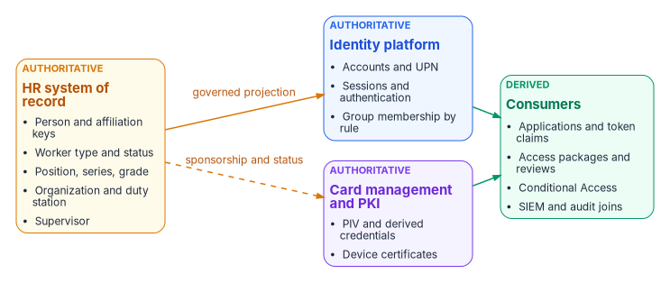
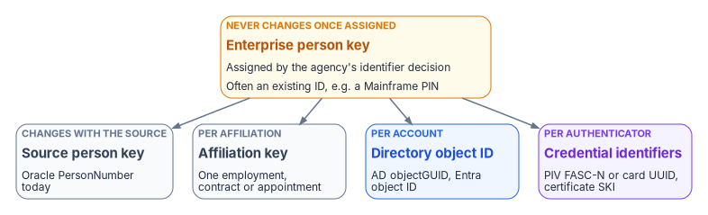

# Chapter 04 — Attribute Authority

*Every attribute has exactly one master. The rest of the series depends on writing that down.*

::: {.callout-note}
## In this chapter
The four record families only the HR system can originate. The split between system of record and identity provider. Why effective dating makes proactive automation possible. The attribute authority map. The identifier layers and the identifier decision. Worker type as the attribute policy hangs from. Privacy: the disclosure basis for identity's use of personnel records. The operating rules.
:::

## What a human capital system actually owns

The human capital system of record — Oracle Fusion Cloud HCM for agencies on Federal HR 2.0, delivered as SaaS under the provider's own FedRAMP authorization[^c04-opm-award][^c04-fedramp-fusion] — isn't "the payroll system." It is the system where four categories of fact are *created* rather than copied:

| Record | What It Asserts | Why It Cannot Originate Anywhere Else |
|---|---|---|
| **Worker record** | A person exists as a worker: identifier, legal name, worker type (employee, contractor, intern), employment status | Hiring is an HR business act; the record is created *by* the act, not in response to it |
| **Position** | A seat exists in the organization with a title, grade, and organizational placement — independent of any incumbent[^c04-oracle-positions] | Positions are established and abolished by organizational authority; a vacancy is a real, recorded state |
| **Assignment** | A worker holds a position, in an organization, at a location, under a supervisor, effective on a date[^c04-oracle-atom] | The assignment *is* the employment relationship; every downstream access decision is a projection of it |
| **Supervisory hierarchy** | Who reports to whom — the reporting line from any worker to the head of the agency | Reporting relationships are established by the same business acts that create assignments; the directory's `manager` field is at best a copy |

: The four record families the system of record owns {.striped .hover}

## System of record versus identity provider

Naming the HCM as the source of authority for identity invites a predictable misreading — that it competes with the identity platform. It does not, and the boundary between them is worth stating precisely, because each is authoritative for a different category of fact:

| Function | System of Record (HCM) | Identity Platform (Entra ID) |
|---|---|---|
| Who a worker *is* — existence, status, type | **Authoritative** | Derived: account state follows the record |
| Where a worker *sits* — position, org, supervisor | **Authoritative** | Derived: attributes stamped, memberships computed |
| How identity is *proven* — credentials, MFA, device binding | — | **Authoritative**  |
| Whether a request is *permitted now* — conditional access, sessions | — | **Authoritative** (policy enforcement) |
| Token issuance and claims format | — | **Authoritative**; claim *values* trace upstream |

: The division of labor between the system of record and the identity platform {.striped .hover}

## Effective dating: truth with a timeline

The property that separates a system of record from a directory is **effective dating**. An HCM record does not say "Jane is in the Program Integrity division"; it says "Jane's assignment to Program Integrity is effective 2026-08-03, superseding her prior assignment, which ended 2026-08-02." Future-dated hires, transfers, and separations exist in the system *before they are true*, with the date on which they become true. Oracle defines its date-effective objects the same way: each record has effective start and end dates, one record is current, and future changes can be entered ahead of time.[^c04-oracle-dates]

This is not a bookkeeping nicety — it is what makes proactive automation possible. Day-one readiness (account, licenses, and group memberships waiting when a new hire badges in) requires knowing the hire *before* the start date. Same-day revocation requires knowing the separation *on* its effective date, not when the paperwork finishes circulating. A directory records state; the system of record records **state transitions with timestamps**, which is exactly the shape an event-driven lifecycle consumes.

## Authoritative versus derived attributes

The discipline that makes the source of authority operable is a written, governed answer to one question per attribute: *which system owns this?* An attribute is **authoritative** where it is created by a business act, and **derived** everywhere else. Derived attributes are computed, stamped, and read — never edited in place.

{fig-alt="Three authoritative boxes on the left: HR system of record (person and affiliation keys, worker type and status, position, series and grade, organization and duty station, supervisor); identity platform (accounts and UPN, sessions and authentication, group membership by rule); card management and PKI (PIV and derived credentials, device certificates). HR feeds the identity platform as a governed projection and card management through sponsorship and status. The identity platform and card management feed a green consumers box: applications and token claims, access packages and reviews, Conditional Access, SIEM and audit joins."}

| Attribute | Authoritative system | Derived consumers |
|---|---|---|
| Person and affiliation identifiers (enterprise person key; source person number, projected to `employeeId`) | HR system of record for the source keys; the agency's identifier decision for the enterprise person key | Directory correlation key, audit joins, per-system account linkage |
| Legal name, worker type, employment status | HR system of record | Display name, account enable/disable state, guest-versus-member classification |
| Position, title, grade | HR system of record | Role-eligible access packages, approval routing |
| Organizational placement (department, org code, cost center) | HR system of record | Dynamic group membership, ABAC attributes, chargeback |
| Supervisor / reporting line | HR system of record | `manager` attribute, access-package approval routing, attestation campaigns |
| Duty location | HR system of record | Population scoping, expected-location analysis, physical-access integration, E911 records, and exception routing; current sign-in signals remain the enforcement input for network-location policy |
| User principal name, mail, group memberships | Identity platform — *derived* from HR attributes by rule | Applications, token claims |
| Device identity and certificates | Device management and PKI (Chapter 09) | Network admission, workload identity, TLS |
| Credential strength, token claims format | Identity platform | Conditional Access, applications |

: The attribute authority map — which system owns which fact {.striped .hover}

The map has one rule with no exceptions: **corrections flow upstream.** When a token carries a wrong department, the fix is a correction to the HR record (or to the derivation rule) — never a hand-edit of the directory attribute, because a hand-edited projection is a new fragment (Chapter 02).

## One person, layered identifiers

IA-4 requires managing identifiers by receiving authorization to assign them, selecting and assigning them to the intended entity, and **preventing their reuse** for a defined period.[^c04-nist-80053] The enterprise discipline this architecture implements is stricter and simpler: **one governed person record, explicit affiliation records, and stable correlation keys appropriate to each lifecycle.**

That takes more than one identifier, because each layer has its own lifecycle:

{fig-alt="An amber box at the top, enterprise person key, never changes once assigned, assigned by the agency's identifier decision, often an existing enterprise ID such as a Mainframe PIN. Four boxes below it: source person key (changes with the source; Oracle PersonNumber today), affiliation key (per affiliation), directory object ID (per account), credential identifiers (per authenticator; PIV FASC-N or card UUID, certificate SKI)."}

| Key | Identifies | Assigned by | Changes when |
|---|---|---|---|
| Enterprise person key | The person, across every affiliation | The agency's identifier decision (below) | Never, once assigned |
| Source person key (Oracle `PersonNumber` today) | The person in one HR source | The HR system | The source system changes |
| Affiliation or assignment key | One employment, contract or appointment | The HR system | A new affiliation begins |
| Directory object ID | One account in one directory | The directory | The account is recreated |
| Credential identifiers (PIV FASC-N and card UUID, certificate SKI) | One authenticator | The credentialing system or CA | The credential is reissued[^c04-fips201] |

: The identifier layers {.striped .hover}

FIPS 201-3 also allows an optional cardholder UUID on the PIV card: a persistent identifier of the cardholder rather than the card.[^c04-fips201] Where an agency populates it, map it to the enterprise person key like any other credential key. It can't replace the enterprise key, because only people who hold a PIV card have one.

**The identifier decision.** Before Phase 1 closes (Chapter 12), the agency decides which key is the enterprise person key and how it is projected into the directory. The implementation in this series projects the source person number into `employeeId` as the source correlation key (Chapter 06). That works while there is one source and the source never reassigns numbers. If the source changes — Core HCM cutover is the obvious case — or contractors come from a separate source, the enterprise person key has to be one the agency controls, with the source keys mapped to it. Many agencies already have one. A long-standing enterprise identifier, for example a "Mainframe PIN" that already serves as both the person ID and the employee ID, is the natural candidate: confirm it as the enterprise person key, carry it in `employeeId` in both directories, and map Core HCM's `PersonNumber` and every directory and credential key to it. Whatever key is chosen has to fit its carrier: Entra ID's `employeeId` holds at most 16 characters.[^c04-graph-user] Then the move to Core HCM changes only the source key, and nothing downstream has to. Where that key is already issued to contractors too, for example alongside their PIV credential, contractors are keyed exactly like employees, and a contractor who converts to federal employment keeps the same key. Either way, the enterprise key doesn't change with name, position, region, or worker type; every account that belongs to the person can be linked to it; and when the person returns after a break in service, the rehire event re-links the *same* person rather than minting a fresh identity. This is only possible where the *person* — not the account — is the tracked entity. A directory cannot do it: directories track accounts, and an account deleted at separation takes its history with it. The worker record persists across affiliations, which is why identifier non-reuse and rehire correlation are properties of the HR system, projected downward.

The enterprise person key is what makes audit joins possible at all: the token event in the SIEM, the database login, the badge swipe, and the personnel action resolve to one person only because one key threads them.

## The worker-type boundary

One authoritative attribute deserves special notice because entire policy families hang from it: **worker type.** Employee, contractor, intern, volunteer — the classification determines member-versus-guest treatment in the tenant, license assignment, access ceilings, and which conditional-access baseline applies. When worker type is a directory field someone sets at account creation, it is wrong exactly as often as staffing paperwork is ambiguous, and the errors are invisible because nothing reconciles them. When it is derived from the worker record, the contractor whose engagement ends loses access on the engagement's end date (a leaver event for a non-employee), and the conversion seam — contractor on Friday, employee on Monday — is a re-derivation on the same identifier rather than a second identity with a second, forgotten first account. Core HCM supports the conversion directly: its Change Worker Type process converts a contingent worker to an employee in one guided transaction, instead of terminating one work relationship and keying a new one by hand.[^c04-oracle-cwt] IA-4(4)'s status characterization (identifying each individual by status, for example as a contractor)[^c04-nist-80053] falls out of the same attribute for free: the characteristic is asserted by the system that classifies workers as a business act, not annotated by an administrator who heard about it.

## Privacy: the disclosure basis for identity

The HR system is a Privacy Act system of records, and moving its data into a directory needs a disclosure basis like any other use of it. Which basis applies depends on where the records go. Inside the agency that maintains them, the Privacy Act permits disclosure to the agency's own officers and employees who need the record in the performance of their duties;[^c04-privacy-act] an identity platform the agency runs for its own access decisions normally rests on that need-to-know provision. A routine use is a different thing: a disclosure *outside* the agency maintaining the system of records, for a purpose compatible with the one the records were collected for, published in the system-of-records notice.[^c04-a108] It applies when the records leave the agency, for example to a shared-service provider or another agency. For general personnel records the governing notice is OPM/GOVT-1, plus the agency's own.[^c04-sorn] The privacy office makes the determination for each flow, not the identity team. Whatever the basis, the flow also needs an updated privacy impact assessment and minimization — only the attributes an identity decision actually reads, as codes rather than narrative. The SSN is not a join key; the layered identifiers above exist so that it never has to be. Appendix B sets out the full data-flow assessment.

## Operating rules

- **One master per attribute.** An attribute is authoritative in exactly one system. Writeback, if used, carries only identity-platform-mastered values (username, work email, work phone) to HR for display; it never touches an HR-mastered fact, and no attribute is writable in both directions.
- **No manual edits to HR-derived attributes.** Any IT-originated write to an attribute the HR feed owns is a drift event (Chapter 11).
- **Corrections flow upstream.** A wrong value is fixed in the HR record or in the mapping rule, never in the directory.
- **Every event produces a provenance record.** No record, no verifiable outcome.

::: {.callout-tip}
## Continue the book
[← Previous: Chapter 03 — Federal HR 2.0 and the Core HCM Platform](03-federal-hr-2-0.md) · [Book index](index.md) · [Next: Chapter 05 — Provisioning Services →](05-the-provisioning-pipeline.md)
:::

[^c04-opm-award]: U.S. Office of Personnel Management, "OPM Awards Contract for First-Ever Governmentwide HR Platform" (Federal HRIT Modernization Core HCM contract awarded to Oracle; a FedRAMP-certified, cloud-based SaaS platform), <https://www.opm.gov/news/news-releases/opm-awards-contract-for-first-ever-governmentwide-hr-platform/> (accessed Oct 20, 2026).
[^c04-fedramp-fusion]: General Services Administration, FedRAMP Marketplace data, product F1603257882, "Oracle — Fusion Cloud" (FedRAMP Authorized, Moderate; the SaaS suite includes Human Capital Management), <https://raw.githubusercontent.com/GSA/marketplace-fedramp-gov-data/main/data.json> (accessed Oct 20, 2026).
[^c04-oracle-positions]: Oracle, *Oracle Fusion Cloud HCM*, "Considerations for Using Jobs and Positions" (positions are "independent of the person performing the job"), <https://docs.oracle.com/en/cloud/saas/human-resources/faucf/considerations-for-using-jobs-and-positions.html> (accessed Oct 20, 2026).
[^c04-oracle-atom]: Oracle, *REST API for Oracle Fusion Cloud HCM*, "Employee Feeds" (the `empassignment` feed fires when assignment, salary or manager information changes; feeds cover employee, contingent worker and pending worker types), <https://docs.oracle.com/en/cloud/saas/human-resources/farws/Employee_Atom_Feeds.html> (accessed Oct 20, 2026).
[^c04-oracle-dates]: Oracle, *Oracle Fusion Cloud HCM*, "Date Effectivity," <https://docs.oracle.com/en/cloud/saas/human-resources/faucf/date-effectivity.html> (accessed Oct 20, 2026).
[^c04-nist-80053]: National Institute of Standards and Technology, SP 800-53 Rev. 5, *Security and Privacy Controls for Information Systems and Organizations*, September 2020 (Release 5.2.0, August 2025), controls IA-4 and IA-4(4) and its discussion, <https://csrc.nist.gov/pubs/sp/800/53/r5/upd1/final> (accessed Oct 20, 2026).
[^c04-fips201]: National Institute of Standards and Technology, FIPS 201-3, *Personal Identity Verification (PIV) of Federal Employees and Contractors*, January 2022 (reissuance generates a new FASC-N and card UUID; the optional cardholder UUID is a persistent cardholder identifier), <https://nvlpubs.nist.gov/nistpubs/FIPS/NIST.FIPS.201-3.pdf> (accessed Oct 20, 2026).
[^c04-graph-user]: Microsoft Learn, "user resource type" (Microsoft Graph v1.0; `employeeId` maximum length 16 characters), <https://learn.microsoft.com/en-us/graph/api/resources/user> (accessed Oct 20, 2026).
[^c04-oracle-cwt]: Oracle, *Oracle Fusion Cloud Human Resources 26B What's New*, "New Redwood Process to Change Worker Type," <https://docs.oracle.com/en/cloud/saas/readiness/hcm/26b/hure-26b/26B-hr-wn-f43513.htm> (accessed Oct 20, 2026).
[^c04-privacy-act]: Privacy Act of 1974, 5 U.S.C. § 552a(b)(1) (disclosure to officers and employees of the maintaining agency who need the record in the performance of their duties) and § 552a(b)(3) (routine use), <https://www.law.cornell.edu/uscode/text/5/552a> (accessed Oct 20, 2026).
[^c04-a108]: Office of Management and Budget, Circular A-108, *Federal Agency Responsibilities for Review, Reporting, and Publication under the Privacy Act*, December 2016, "Routine Uses," <https://www.whitehouse.gov/wp-content/uploads/legacy_drupal_files/omb/circulars/A108/omb_circular_a_108_12_12_16.pdf> (accessed Oct 20, 2026).
[^c04-sorn]: Office of Personnel Management, "Privacy Act of 1974; System of Records" (notice of a modified system of records, OPM/GOVT-1 General Personnel Records), *Federal Register* 88, no. 158, August 17, 2023, <https://www.govinfo.gov/content/pkg/FR-2023-08-17/html/2023-17651.htm> (accessed Oct 20, 2026).
