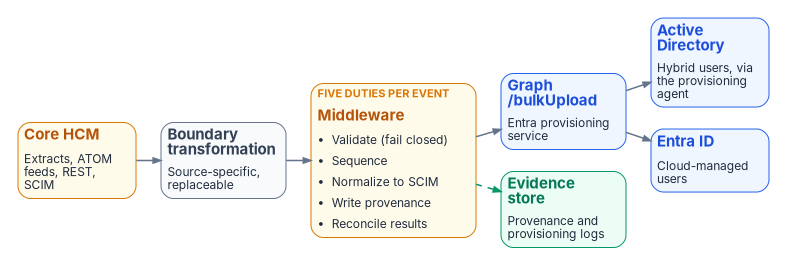

# Chapter 05 — Provisioning Services

*One door into the directory, so there is exactly one door to instrument.*

::: {.callout-note}
## In this chapter
The logical architecture and its Microsoft realization: where provisioning sits between the governed identity model and the directories, and why API-driven inbound provisioning is the Microsoft implementation. The Oracle HCM source surfaces. What the middleware must do for every event, including reconciliation. The `bulkUpload` contract and its limits. The two landing zones and what each one does with structure. Native connectors and writeback.
:::

## Logical architecture and Microsoft realization

**The logical architecture is stable:**

> **Authoritative workforce source → boundary transformation → governed workforce identity model → provisioning service → target services**

The governed workforce identity model (Chapter 06) is the stable center: everything to its left is source-specific, everything to its right is delivery.

**The Microsoft realization is replaceable:**

> **Oracle Core HCM → integration middleware (Azure Functions or Logic Apps) → Microsoft Graph `/bulkUpload` → Entra provisioning service → Entra ID or on-premises Active Directory**

{fig-alt="Left to right: Core HCM (extracts, ATOM feeds, REST, SCIM); boundary transformation (source-specific, replaceable); an amber middleware box with five duties: validate (fail closed), sequence, normalize to SCIM, write provenance, reconcile results; Graph /bulkUpload (Entra provisioning service), which writes to Active Directory (hybrid users, via the provisioning agent) and Entra ID (cloud-managed users). A dashed green line from the middleware goes to an evidence store (provenance and provisioning logs)."}

The API client reads identity data from the authoritative source and posts it to the provisioning app's `/bulkUpload` endpoint as a SCIM bulk request. It doesn't compare source and target values to decide whether to create, update, enable or disable; the provisioning service does that, applies the attribute mappings the administrator configured, and writes the user to on-premises AD (hybrid users) or to Entra ID (cloud-only users). The endpoint answers `202 Accepted` and processes asynchronously; the client reads the provisioning logs API for the per-record result and applies bounded, idempotent retry for transient failures. Permanent failures become reconciled exceptions with an owner and alternate completion path.[^c05-api-concepts]

## Why API-driven inbound provisioning

- **Oracle Fusion Cloud HCM has no native Entra connector.** Entra's prebuilt HR connectors are for Workday and SAP SuccessFactors.[^c05-plan-hr] Microsoft's own Oracle HCM integration guidance *is* the API-driven pattern: CSV extracts for the initial load, ATOM feeds or HCM Extracts for deltas (or Oracle Integration Cloud where the agency subscribes to it), and optional writeback through Oracle's SCIM APIs.[^c05-oracle-tutorial]
- **The governed identity model is source-independent; each deployed source has an explicit contract and transformation.** The middleware normalizes any HR export into the same SCIM payload, so the `/bulkUpload` call is identical whatever the source. If the source changes, the source contract and boundary transformation change; the governed identity model and downstream lifecycle policy remain stable.
- **One entry point gives one provenance stream.** All inbound identity writes pass through a single provisioning surface, which is what makes lineage and drift detection tractable (Chapter 11).
- **The procurement points the same way.** As Chapter 03 records from the solicitation, the Core HCM requirements checklist asks for SCIM 2.0 near-real-time provisioning, the protocol this pattern uses.

If Microsoft later ships a native Oracle HCM connector, it becomes an optimization inside this architecture, not a replacement for it.

## The source: Oracle Fusion Cloud HCM

| Sync | Mechanism | Notes |
|---|---|---|
| Initial / full | HCM Extracts (or BI Publisher) to CSV[^c05-hcm-extracts] | Full worker population, scoped by the filter rules of Chapter 12, Phase 1 |
| Delta | ATOM feeds: `newhire`, `empassignment`, `empupdate`, `termination`, `cancelworkrelship`, `workrelshipupdate`[^c05-atom] | Turn on immediately after the initial sync; a gap loses changes[^c05-oracle-tutorial] |
| Delta (alternative) | Periodic HCM Extract deltas | Simpler; latency equals the extract cadence |
| Enrichment | `workers` REST resource | When a feed event doesn't carry an attribute the payload needs. Microsoft's guide also names the `employees` (`emps`) resource, but Oracle marks it for future deprecation and advises the `workers` resource for new integrations[^c05-oracle-emps] |

: Oracle HCM source surfaces {.striped .hover}

**Source correlation key:** Oracle `PersonNumber` to `employeeId` in Entra ID and AD, subject to the enterprise identifier decision in Chapter 04. The employee ID must be populated on existing accounts **before** the first full sync; matching is what prevents duplicate identities at go-live.

## The middleware: five duties per event

Azure Functions or Logic Apps, inside the agency's authorization boundary, doing five things for every event:

1. **Validate.** Required attributes present; unknown worker types refused. Fail closed.
2. **Sequence and retry.** Apply feed events in order and handle failures explicitly. An out-of-order mover/leaver pair is a correctness bug and a dropped event is a silent drift source. A failed transform retries and is recorded, never skipped.
3. **Normalize to SCIM.** Build the bulk request (`urn:ietf:params:scim:api:messages:2.0:BulkRequest`) with the core and enterprise user schemas, plus a schema extension for any attribute the core schemas don't carry.[^c05-api-concepts][^c05-scim-rfc] The canonical payload is defined in Chapter 06.
4. **Write provenance.** One record per event (source event ID, payload hash, derivation inputs, outcome) to the agency's evidence store, before the Graph call returns. No record, no verifiable outcome.
5. **Reconcile.** Read the provisioning logs for each submitted record and match the result to the source event. Transient failures retry with bounded, idempotent backoff; permanent failures become exceptions with an owner and an alternate completion path, and stay open until the directory reflects the source. A scheduled comparison of the HR population with the directories catches anything the per-event check missed (Chapter 11).

The middleware never writes back to the HR system's HR-mastered facts. Send the complete user record in every request, for full and delta syncs alike: if clearing attribute values (a preview feature) is enabled, an omitted or null mapped attribute can clear the target value.[^c05-api-concepts]

## The `/bulkUpload` contract

| Property | Value |
|---|---|
| Endpoint | Microsoft Graph, worldwide endpoint `graph.microsoft.com` (Microsoft 365 GCC tenants use the worldwide endpoints)[^c05-graph-deployments] |
| Payload | SCIM bulk request; up to 50 operations per call |
| Throttling | 40 calls in any 5-second window, HTTP 429 beyond it, per the Entra concepts page; the Graph API reference states 40 requests per second.[^c05-bulkupload-api] The two Microsoft pages disagree, so pace the client to the stricter figure and handle 429 responses |
| Tenant daily cap | 2,000 calls per 24 hours with Entra ID P1/P2; 6,000 with Entra ID Governance |
| Graph permissions for the client | `SynchronizationData-User.Upload` (Microsoft's standard setup) or the least-privileged `SynchronizationData-User.Upload.OwnedBy`, which limits uploads to provisioning apps the client's identity owns;[^c05-bulkupload-api][^c05-grant-access] `ProvisioningLog.Read.All` for the component that reads per-record results |
| Licensing floor | Entra ID P1; Entra ID Governance for Lifecycle Workflows |

: The `/bulkUpload` envelope[^c05-api-concepts] {.striped .hover}

Each endpoint belongs to one provisioning app, and an agency with several sources (HR for employees, a contractor system, a badging system that only updates attributes) creates one app per source.[^c05-api-concepts][^c05-api-faqs]

## Two landing zones

The same HR feed can land in two places, separately or at the same time — and which one a population uses changes as the agency moves from Active Directory to Entra ID:

{fig-alt="Two framed rows. Top, while AD holds the object SOA (which directory masters the account): HR (Core HCM) to Active Directory (provisioning agent writes the user) to Entra ID (synced from AD). Bottom, after the object SOA moves to the cloud: HR (Core HCM) to Entra ID (cloud-managed users), with a dashed arrow to Active Directory (only where apps still need it, provisioned from Entra ID)."}

- **API-driven inbound provisioning to Microsoft Entra ID** creates cloud-only users directly.
- **API-driven inbound provisioning to on-premises Active Directory** delivers the same payloads through the Microsoft Entra provisioning agent, which writes to AD DS from inside the agency network; Entra Connect Sync or Cloud Sync then projects the user to the cloud.[^c05-api-concepts][^c05-oracle-tutorial]

### Landing in Active Directory

- **The OU is computed, not hand-picked.** An expression mapping on `parentDistinguishedName` derives the destination domain and OU from HR attributes.[^c05-plan-hr]
- **The reporting line becomes a reference.** The provisioning service writes AD's `manager` attribute as a DN reference to the already-provisioned supervisor; for managers in another domain, Microsoft's topologies either enable referral chasing on the provisioning agent (one app for the forest) or add a separate app that updates only `manager` (one app per domain).[^c05-plan-hr]
- **High availability.** Deploy at least two provisioning agents, on servers with line of sight to the domain controllers;[^c05-plan-hr] Microsoft's Cloud Sync prerequisites now recommend three active agents, on servers hardened as Tier 0 (control plane) assets.[^c05-agent-prereq] The agent service runs as a group managed service account (gMSA); Domain or Enterprise Administrator credentials are needed once, to create it, not to run the agent.[^c05-agent-prereq] Delegate the gMSA rights to the target OUs only.
- **Termination reaches the domain controller.** The SCIM `active` value maps to AD's `accountDisabled`, so an HR termination disables the AD account, and the sync client carries that state to the cloud.[^c05-oracle-tutorial][^c05-plan-hr]

The caveat: **AD stores structure as place.** An OU is a container, and Group Policy that reads OU position inherits every reorganization. HR-driven provisioning keeps AD *correct*; it can't make AD attribute-native.

### Landing in Entra ID

Entra ID has no OUs. The worker record lands as attributes, and structure becomes data: `manager` (a directory relationship that drives the org chart in Teams and Outlook[^c05-org-explorer] and approval routing), `department`, `jobTitle`, `employeeId`, `employeeType`, `employeeHireDate`, `employeeLeaveDateTime`, and `employeeOrgData` (`division`, `costCenter`).[^c05-graph-user] Chapter 06 fixes which of these the agency uses and for what; Chapter 10 shows how they become access.

| Dimension | Active Directory | Entra ID |
|---|---|---|
| Structural container | OU tree: structure as place, which GPO reads | None: structure as attributes, which policy reads through groups |
| Reporting line | `manager` DN reference | `manager` relationship |
| Org placement | OU computed at provisioning (`parentDistinguishedName`) | `department`, `employeeOrgData`, stamped |
| Membership | Static groups, manual or scripted | Rules for dynamic membership, evaluated by the service |
| Delegated admin | OU ACL delegation | Administrative units (flat; they can't be nested)[^c05-admin-units] |
| Reorganization cost | OU restructure and GPO re-link: a project | Attribute re-stamp and rule re-evaluation: a data change |

: How each directory absorbs organizational structure {.striped .hover}

During coexistence, provision both zones, read structure from attributes, and retire OU-bound policy deliberately (Chapter 12, Phase 5).

### Over the Entra ID migration

Microsoft's path to the cloud moves users' **object SOA** (Microsoft's *Source of Authority*: which directory masters the account; see [Chapter 04](04-attribute-authority.md#system-of-record-versus-identity-provider)) from Active Directory to Entra ID, after which the user lifecycle is governed in the cloud with Entra ID Governance; for users who still need on-premises access, provisioning from Entra ID to Active Directory maintains the AD account while Entra ID keeps the object SOA.[^c05-soa] Microsoft's migration guidance makes the same split for HR: new employees who use only Entra-integrated applications can be provisioned as cloud-only accounts, and hybrid accounts are provisioned only where applications still depend on AD.[^c05-road] HR-driven provisioning and the directory migration therefore converge on one design, population by population: HR is the source of authority for the person, Entra ID holds the object SOA for the account and is the identity platform HR drives, and Active Directory becomes a downstream target that shrinks as applications move.

## Native connectors

Where an HR source has a native connector (Workday, SAP SuccessFactors), it's an acceptable accelerator. The API-driven pattern stays the reference implementation because it works for any source and because its middleware is where validation, provenance and reconciliation happen before the identity platform sees the record. A native connector bypasses that middleware, so those duties have to be supplied another way.

## Writeback: optional and one-way per attribute

Once inbound provisioning is proven, an optional outbound job can write identity-platform-mastered attributes the HR system wants to display (username, work email, work phone) back to Oracle HCM through its SCIM APIs.[^c05-oracle-tutorial][^c05-oracle-scim] Microsoft's guide builds that job on the Oracle Fusion ERP gallery connector, limited to the Update action, with every attribute the agency doesn't intend to write back removed from the mapping.[^c05-oracle-tutorial] Two rules keep it safe: no attribute is writable in both directions (Chapter 04), and nothing in the plan depends on writeback.

::: {.callout-tip}
## Continue the book
[← Previous: Chapter 04 — Attribute Authority](04-attribute-authority.md) · [Book index](index.md) · [Next: Chapter 06 — The Canonical Workforce Identity Model →](06-canonical-attribute-schema.md)
:::

[^c05-soa]: Microsoft Learn, "Transfer user Source of Authority (SOA) to Microsoft Entra ID," <https://learn.microsoft.com/en-us/entra/identity/hybrid/user-source-of-authority-overview> (accessed Oct 21, 2026).
[^c05-road]: Microsoft Learn, "Transition to the cloud" (Move to cloud HR provisioning), <https://learn.microsoft.com/en-us/entra/architecture/road-to-the-cloud-migrate> (accessed Oct 20, 2026).
[^c05-api-concepts]: Microsoft Learn, "API-driven inbound provisioning concepts," <https://learn.microsoft.com/en-us/entra/identity/app-provisioning/inbound-provisioning-api-concepts> (accessed Oct 20, 2026).
[^c05-bulkupload-api]: Microsoft Learn, "Perform bulkUpload" (Microsoft Graph v1.0 API reference: rate limit and permissions), <https://learn.microsoft.com/en-us/graph/api/synchronization-synchronizationjob-post-bulkupload> (accessed Oct 20, 2026).
[^c05-grant-access]: Microsoft Learn, "Grant access to the inbound provisioning API," <https://learn.microsoft.com/en-us/entra/identity/app-provisioning/inbound-provisioning-api-grant-access> (accessed Oct 20, 2026).
[^c05-oracle-tutorial]: Microsoft Learn, "Configure Oracle Human Capital Management (HCM) for automatic user provisioning," <https://learn.microsoft.com/en-us/entra/identity/saas-apps/oracle-hcm-provisioning-tutorial> (accessed Oct 20, 2026).
[^c05-graph-deployments]: Microsoft Learn, "National cloud deployments" (Microsoft Graph): "If you're working in a Microsoft 365 GCC environment, continue using the worldwide endpoints," <https://learn.microsoft.com/en-us/graph/deployments> (accessed Oct 20, 2026).
[^c05-api-faqs]: Microsoft Learn, "Frequently asked questions about API-driven inbound provisioning," <https://learn.microsoft.com/en-us/entra/identity/app-provisioning/inbound-provisioning-api-faqs> (accessed Oct 20, 2026).
[^c05-agent-prereq]: Microsoft Learn, "Prerequisites for Microsoft Entra Cloud Sync" (gMSA requirements; three active agents recommended; Tier 0 hardening), <https://learn.microsoft.com/en-us/entra/identity/hybrid/cloud-sync/how-to-prerequisites> (accessed Oct 20, 2026).
[^c05-plan-hr]: Microsoft Learn, "Plan cloud HR application to Microsoft Entra user provisioning," <https://learn.microsoft.com/en-us/entra/identity/app-provisioning/plan-cloud-hr-provision> (accessed Oct 20, 2026).
[^c05-hcm-extracts]: Oracle, *Oracle Fusion Cloud HCM: HCM Extracts*, "Introduction to HCM Extracts" (the main way to retrieve data in bulk; CSV among the output formats), <https://docs.oracle.com/en/cloud/saas/human-resources/fahex/introduction-to-hcm-extracts.html> (accessed Oct 20, 2026).
[^c05-atom]: Oracle, *REST API for Oracle Fusion Cloud HCM*, "Employee Feeds," <https://docs.oracle.com/en/cloud/saas/human-resources/farws/Employee_Atom_Feeds.html> (accessed Oct 20, 2026).
[^c05-oracle-emps]: Oracle, *REST API for Oracle Fusion Cloud HCM*, "Employees REST Endpoints" (deprecation notice) and "Workers REST Endpoints" (employee, contingent worker and pending worker types), <https://docs.oracle.com/en/cloud/saas/human-resources/farws/api-employees.html> and <https://docs.oracle.com/en/cloud/saas/human-resources/farws/api-workers.html> (accessed Oct 20, 2026).
[^c05-scim-rfc]: Internet Engineering Task Force, RFC 7644, *System for Cross-domain Identity Management: Protocol*, September 2015, §3.7 (bulk operations), <https://www.rfc-editor.org/rfc/rfc7644>; and RFC 7643, *SCIM: Core Schema*, September 2015, §4.3 (enterprise user extension), <https://www.rfc-editor.org/rfc/rfc7643> (accessed Oct 20, 2026).
[^c05-org-explorer]: Microsoft Learn, "Introducing Org Explorer" (available in Teams and Outlook; org information comes from Microsoft Entra ID and needs the manager relationship), <https://learn.microsoft.com/en-us/viva/people-in-viva/introducing-org-explorer> (accessed Oct 20, 2026).
[^c05-graph-user]: Microsoft Learn, "user resource type" (Microsoft Graph v1.0: `employeeType`, `employeeHireDate`, `employeeLeaveDateTime`, `employeeOrgData`), <https://learn.microsoft.com/en-us/graph/api/resources/user> (accessed Oct 20, 2026).
[^c05-admin-units]: Microsoft Learn, "Administrative units in Microsoft Entra ID," <https://learn.microsoft.com/en-us/entra/identity/role-based-access-control/administrative-units> (accessed Oct 20, 2026).
[^c05-oracle-scim]: Oracle, *REST API for Common Features in Oracle Fusion Cloud Applications*, "Get all users" (`/hcmRestApi/scim/Users`), <https://docs.oracle.com/en/cloud/saas/applications-common/25d/farca/op-hcmrestapi-scim-users-get.html> (accessed Oct 20, 2026).
