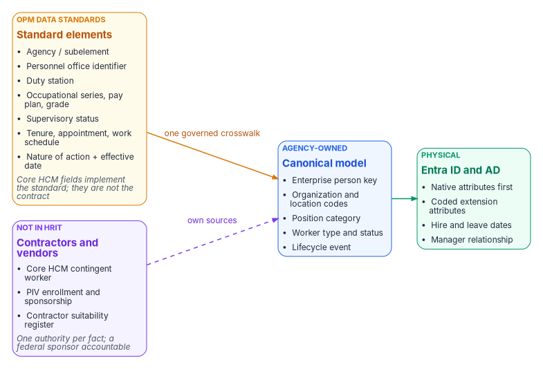

# Chapter 06 — The Canonical Workforce Identity Model

*OPM's standard attributes are the contract. Native attributes first. A small, coded set of extension attributes for access. Nothing hand-edited.*

::: {.callout-note}
## In this chapter
The standard-attribute layer: why OPM's data standards, not vendor fields, are the contract for federal employees. Contractors and vendors, whom HRIT doesn't cover: where to source them, and how to split authority among those sources. The design rules behind the schema. The implementation crosswalk, which every other page on this site links to instead of repeating. Why three extension attributes, and why they hold codes. The program attribute map: the one assignment of all fifteen extension attributes, which every book uses. How the hire and leave dates reach Entra ID from each landing zone. Who is allowed to write any of it.
:::

**This chapter is the HR track** of the companion guide's [four tracks](../guides/attribute-driven-migration.md#four-tracks): the attributes of people, sourced from HR and the contractor source. The device slots near the end of the chapter are the device half of the same map. Their values come from device provisioning, not HR ([Book 05, Chapter 08](../b05-devices/08-gpo-to-intune-policy-migration.md#the-device-attribute-schema)).

## The standard-attribute layer

The schema below names Oracle fields because Oracle Fusion Cloud HCM is the Core HCM platform. But the durable contract is one level up: **OPM's standard personnel data.** Every agency on the platform records the same data elements with the same codes and meanings, defined by OPM's data standards (formerly published as the *Guide to Data Standards*, now maintained in OPM's online metadata repository),[^c06-opm-gds][^c06-ehri] and every personnel action carries a nature-of-action code from the same standards (Chapter 08).[^c06-gppa] For federal employees, mapping identity to the standard rather than to vendor fields means one crosswalk serves every employee population, survives the next vendor change, and can be reused by any agency on the platform. The standard stops at federal employees, though; contractors and vendors are covered in the next section.

{fig-alt="Three boxes left to right. Amber, OPM data standards, standard elements: agency or subelement; personnel office identifier; duty station; occupational series, pay plan, grade; supervisory status; tenure, appointment, work schedule; nature of action plus effective date; a footnote says Core HCM fields implement the standard and are not the contract. Arrow labelled one governed crosswalk to a blue canonical model box: enterprise person key; organization and location codes; position category; worker type and status; lifecycle event. Arrow to a green Entra ID and AD box: native attributes first; coded extension attributes; hire and leave dates; manager relationship. Below the standard elements, a violet box, not in HRIT: contractors and vendors, from three sources: the Core HCM contingent worker, PIV enrollment and sponsorship, and the contractor suitability register; a footnote says one authority per fact, with a federal sponsor accountable. It joins the canonical model by a dashed arrow labelled own sources."}

| OPM standard data element | Identity use | Lands as (crosswalk below) |
|---|---|---|
| Agency / subelement | Legal employer and component scope | `companyName`; organization code |
| Personnel office identifier | Servicing HR office; delegated administration scope | Administrative-unit rule input |
| Duty station | Location of record; location-based scoping; physical-access integration | Location code; `usageLocation` source |
| Occupational series, pay plan, grade | Position category for role-eligible access packages | Position category code |
| Supervisory status | Approver and reviewer eligibility; manager-chain integrity | Supervisor group; `manager` checks |
| Tenure, type of appointment, work schedule | Worker type and its lifecycle profile (pre-hire window, license, retention) | `employeeType`; worker-type code |
| Nature of action + effective date | Lifecycle trigger: joiner, mover, conversion, leave, return, leaver, correction | Hire and leave dates; account state |

: OPM standard data elements and what identity does with them {.striped .hover}

Confirm each element's current name, values and how Core HCM exposes it against OPM's current standards at engagement time (Chapter 12, verification register). OPM requires that the coded blocks of the SF-50 use only codes listed in the EHRI Data Standards,[^c06-gppa] which is what makes them dependable as access inputs. Where an access decision needs a code that a standard element supplies, the code is the standard's — not a locally invented list.

## Contractors and vendors: the population HRIT doesn't cover

OPM's data standards and nature-of-action codes describe **federal employees**. Federal HR 2.0 moves federal employees. Contractors and vendors — often a large share of an agency's accounts, and the share most likely to be orphaned — are in neither. In most agencies they are tracked today in contracting officer's representative (COR) spreadsheets: a sponsor, a contract or task order, a start date and an end date that nobody is obliged to keep current. A spreadsheet can't be a source of authority, so these workers need one, mapped into the same canonical model as employees.

| Option | What it gives | What it lacks |
|---|---|---|
| **Core HCM Contingent Worker** (best fit) | Oracle Fusion Cloud HCM treats contractors as a full worker type, the contingent worker: a person record, an assignment, a place in the organization and a lifecycle much like an employee's, with add, renew and convert actions and the same interfaces[^c06-cwk][^c06-cwk-renew][^c06-cwt] | No vendor-management system and no non-employee governance layer: sponsorship, contract linkage and end-date attestation still need an owner and a process. Confirm that the agency's Core HCM configuration will record contingent workers |
| **PIV credential and sponsorship system** | Sponsorship, adjudication, the sponsoring office and an expiry already exist for every badged contractor: FIPS 201-3 requires a background investigation and favorable adjudication before issuance, and caps a PIV card's validity at six years[^c06-fips201] | Covers only people who get a PIV credential; vendors and short-term workers without one need another path |
| **Contractor suitability register** | Many agencies already keep one, under personnel security or contracting: each contractor tied to the agency contract they work on, with the suitability determination and its date. It is often the only existing record that links a person to a contract under agency authority | Often records the vetting decision, not the end of the engagement. Owner, interface and update timing vary, and a register keyed by hand from COR spreadsheets inherits their lag |
| **A non-employee lifecycle service** (complement) | Sponsor workflows, contract and vendor records, periodic attestation | A third source to integrate and govern; usually layered on one of the two options above rather than replacing them |

: Where contractors and vendors can be sourced from {.striped .hover}

The research page [Contractors as Oracle Contingent Workers](../../research/oracle-contingent-worker-contractor-source.md) tests the contingent worker option against Federal HR 2.0's scope, licensing and privacy, compares it with the alternatives, and recommends a phased path.

Whichever source the agency chooses, the rules are the same:

- **One model.** Contractors map into the same canonical model, with worker type set to contractor and their own enterprise person key (Chapter 04). In the proposed canonical model, conversion between contractor and employee creates a new affiliation for the same person, joining the two sources on that key, so a converting person never gets a second identity.
- **Different triggers.** Contractors have no SF-50. Their joiner and leaver events are the contract or sponsorship start and end dates, and a sponsor's withdrawal is a leaver event (Chapter 08).
- **Map what applies.** Organization code, duty station and sponsor (as `manager`) carry over; employee-only elements such as pay plan and grade don't. Add a contract or task-order reference so access can be scoped to the contract and reviewed with it.
- **Expiry is enforced, not trusted.** An end date that passes without renewal ends access on that date, whatever the spreadsheet says.

### One fact, one authority

No single option is complete. The contingent worker record has no contract or vetting data, the PIV system manages a card rather than an identity, and a suitability register may not know when an engagement ends. So don't pick one: give each fact identity needs one authoritative source, and hang the whole record on an accountable federal sponsor.

| Fact identity needs | Authority |
|---|---|
| Existence and contract link | The contractor suitability register, or the Core HCM contingent worker record once it is configured |
| End of engagement | The contract record. Confirm the register carries end dates; if it doesn't, the sponsor attests them |
| Suitability | The contractor suitability register |
| Identity proofing and credential status | The PIV enrollment and card management system, whose identity proofing and registration FIPS 201-3 sets at IAL3[^c06-fips201] |
| Accountable sponsor | The COR or another federal employee, mastered in HR |
| Organization placement | Derived from the sponsor, so it follows accountability; an explicit override needs a justification |
| Person key | The enterprise person key (Chapter 04). Where the agency already issues it to contractors with their PIV credential, as an agency-wide "Mainframe PIN" often is, contractors are keyed exactly like employees |

: One authority per contractor fact {.striped .hover}

A contractor's access ends at the **earliest** of: the contract end date passing; suitability withdrawn; the PIV credential revoked; the sponsor leaving with no one taking over within a short grace period (for example 14 days); or the sponsor missing a periodic recertification (for example every 180 days). The last two close the gap that free-text sponsor fields leave open, because the sponsor is a live reference into HR, not a name on a form. Reconcile in both directions: a badge with no contractor record, and a contractor record with no badge, are both drift findings (Chapter 11).

### Before a register becomes an authority

Settle six things with the register's owner first. The first two decide whether it can be the leaver signal at all.

- **Owner.** Contracting or personnel security? The owner has to accept identity as a named consumer, just as HR does.
- **Content.** Does it hold contract end dates and departures, or only the suitability decision? A register with only the decision is a vetting source, not a lifecycle source.
- **Freshness.** How fast is a departure recorded?
- **Privacy basis.** Which system-of-records notice covers the register, and what is the basis for disclosing it to identity systems? Within the agency that maintains it, that is normally the Privacy Act's need-to-know provision; a routine use is needed only if the records leave the agency, for example to a shared-service provider (Chapter 04, Appendix B). The privacy office decides.
- **Join key.** Does it record the enterprise person key? If it does, the register, PIV enrollment and the directories join on one key. If not, the first job is a crosswalk to it.
- **Coverage.** Who isn't in it: short-term, remote or vendor-support staff without a PIV credential? They still need a sponsor-only path.

### Sequence: start with what already exists

1. **Read only.** Reconcile the register and PIV enrollment against the contractor accounts in AD and Entra ID, joined on the enterprise person key. Report orphans and expired engagements, and write nothing to any directory. This measures the problem before anyone is asked to change a process.
2. **Before Core HCM.** The register plus sponsor attestation become the contractor source. Ship the leaver trigger first, then the joiner.
3. **At Core HCM go-live.** Decide whether to configure the contingent worker type. If the agency adopts it, it holds the person and the assignment, and the register stays the authority for the contract and suitability. Either way the identity pipeline doesn't change: it reads one canonical record, whatever the source.

## Design rules

1. **Use a native Entra attribute wherever one exists.** `employeeId`, `department`, `jobTitle`, `companyName`, `manager`, `employeeType`, `employeeHireDate`, `employeeLeaveDateTime` and `employeeOrgData` already mean what the HR record means. Other Microsoft features (the org chart, Lifecycle Workflows, access-package approvals) read them directly.
2. **Add an extension attribute only where access needs a value a rule can't read natively.** Rules for dynamic membership support a fixed list of user properties. That list includes `department`, `companyName`, `jobTitle`, `employeeId`, `employeeHireDate` (preview), `userType` and `accountEnabled`, plus `extensionAttribute1`–`15` and directory extension properties. It doesn't include `employeeType`, `employeeOrgData` or `manager` (direct-reports groups use a separate rule form).[^c06-dyn-rules] Three attributes cover the access-targeting gap; the [program attribute map](#program-attribute-map) adds the few operational slots that other books need.
3. **Put codes in access attributes, never display strings.** An organization code changes only when the business fact changes; a display name changes whenever someone retypes it.
4. **Use the same carrier in both landing zones.** `extensionAttribute1`–`15` exist in on-premises AD and in Entra ID. For synced users, AD is the source and the Entra values are read-only; for cloud-only users they can be set when the user is created or updated.[^c06-onprem-ext] A rule written against `user.extensionAttribute10` works the same for a hybrid user and a cloud-mastered one, which matters during the years of coexistence.
5. **Don't build an organizational hierarchy into attributes.** The reporting line is the `manager` relationship; organizational placement is `department`, `employeeOrgData` and one organization code. There's no encoded path, tree or composite key to maintain. Where a rule needs division or cost center, the program attribute map gives each one a flat code that mirrors its `employeeOrgData` value, not a path.

### The attribute stores

Entra ID gives a value five places to live, and they differ in who can write them and what can read them. The order below is the order to reach for them.

| Store | What it is | Can a dynamic membership rule read it? |
|---|---|---|
| **Native properties** | `department`, `jobTitle`, `companyName`, `employeeId`, `employeeType`, `employeeHireDate`, `employeeOrgData`, `manager`, `accountEnabled` and the rest of the user object | Many, but not `employeeType`, `employeeOrgData` or `manager`[^c06-dyn-rules] |
| **`extensionAttribute1`–`15`** | Fifteen string slots on users and devices, up to 1,024 characters each, also known as Exchange custom attributes 1–15. AD-mastered and read-only in Entra ID for synced users[^c06-ext-1024] | Yes[^c06-dyn-rules] |
| **Directory extensions** | `extension_<appId>_<name>` properties registered on an application, synced from custom AD attributes or created through Graph. An object can hold up to 100 values, and a synced string is cut at 256 characters[^c06-dirext] | Single-valued ones, yes; multi-value ones, no[^c06-dyn-rules] |
| **Custom security attributes** | Typed attributes in attribute sets, on users and service principals, readable and writable only through their own roles[^c06-csa] | No[^c06-csa-dyn] |
| **Device properties** | The Entra device object's own properties and its own fifteen extension slots, set in Entra ID through Graph[^c06-ext-1024] | Yes, by device rules, which read only the device's own properties, never its owner's |

: Where an attribute can live in Entra ID {.striped .hover}

That is why the program mirrors values into extension slots. `employeeType` and `employeeOrgData` already hold the worker type, division and cost center, but no rule can read them, so the program attribute map copies each one as a code into a slot a rule can read (slots 5, 6 and 11 below). The program prefers extension attributes to directory extensions for the reason in design rule 4: the same slot exists in AD and in Entra ID, so one rule works in both landing zones. Custom security attributes are for sensitive values no rule needs, because anyone who can read a user can read its extension attributes.[^c06-csa] The guide's [attributes section](../guides/attribute-driven-migration.md#attributes) compares each store with Active Directory, attribute by attribute.

## The schema

| Canonical field | Oracle HCM source | SCIM attribute | On-premises AD | Entra ID | Rule can read it | Used for |
|---|---|---|---|---|---|---|
| Person number | `workers.PersonNumber` | `externalId` | `employeeID` | `employeeId` | Yes | **Source correlation key**, subject to the enterprise identifier decision in Chapter 04 (where the agency already has an enterprise ID, such as a Mainframe PIN, `employeeId` carries that instead and `PersonNumber` maps to it) |
| Employment active | Assignment status | `active` | `accountDisabled` | `accountEnabled` | Yes | Joiner and leaver state |
| Given name / surname | `workers.names` | `name.givenName` / `name.familyName` | `givenName` / `sn` | `givenName` / `surname` | Yes | Display, UPN rules |
| Display name | `workers.DisplayName` | `displayName` | `cn` | `displayName` | Yes | Display only, never access |
| Department | Department name | enterprise `department` | `department` | `department` | Yes | Display, address book, coarse scoping |
| Division | Business unit | enterprise `division` | `division` | `employeeOrgData.division` | No | Reporting, profile card |
| Cost center | Cost center | enterprise `costCenter` | — | `employeeOrgData.costCenter` | No | Chargeback, reporting |
| Legal employer | Legal employer | enterprise `organization` | `company` | `companyName` | Yes | Agency or component |
| Manager | Manager's person number | enterprise `manager` | `manager` (DN) | `manager` | Direct-reports rule only | Supervisory chain, approvals, reviewers |
| Job title | `JobName` | `title` | `title` | `jobTitle` | Yes | Display; not an access input |
| Worker type | Worker type / person type | custom extension `workerType` | `employeeType` | `employeeType` | No | Employee, contractor, intern, volunteer |
| Hire date | Effective start date | custom extension `HireDate` | `extensionAttribute2` | `employeeHireDate` | Yes (preview) | Joiner workflow trigger |
| Leave date | Termination effective date | custom extension `TermDate` | `extensionAttribute3` | `employeeLeaveDateTime` | No | Leaver workflow trigger |
| Work country | Work address country | `addresses[type eq "work"].country` | `co` | `country` | Yes | Address; source for the `usageLocation` expression that licensing needs |
| **Organization code** | Department ID (code) | custom extension `orgCode` | `extensionAttribute10` | `extensionAttribute10` | Yes | **Access targeting** |
| **Worker type code** | Worker type (code) | custom extension `workerTypeCode` | `extensionAttribute11` | `extensionAttribute11` | Yes | **Access targeting**; mirrors `employeeType` |
| **Position category** | Job family or position category (code) | custom extension `positionCategory` | `extensionAttribute12` | `extensionAttribute12` | Yes | **Access targeting** |

: The target crosswalk for the governed workforce identity model {.striped .hover}

Notes on the table:

- The SCIM mappings for both landing zones follow the example worksheets in Microsoft's Oracle HCM integration guide, which also maps a custom `JobCode` to `extensionAttribute1` in both AD and Entra ID. Custom attributes are added to the provisioning app's schema as SCIM schema extensions and then mapped.[^c06-oracle-tutorial][^c06-custom-attrs] For attributes with no AD equivalent, the same guide says to use `extensionAttribute1`–`15` or extend the AD schema.[^c06-oracle-tutorial]
- **Neither date has a native AD attribute.** For AD-landed users, Microsoft's Oracle HCM worksheet writes `HireDate` and `TermDate` to `extensionAttribute2` and `extensionAttribute3`;[^c06-oracle-tutorial] a sync rule then maps each one to `employeeHireDate` or `employeeLeaveDateTime` in Entra ID. The AD attribute must be a string, and the value must be converted to the format Entra expects, usually with a date-format expression. Inbound provisioning, Entra Connect cloud sync and Entra Connect Sync all support both target attributes.[^c06-lcw-sync]
- **The choice of `extensionAttribute10`–`12` for access codes is this workbook's proposed implementation choice**, not a Microsoft default. Before Phase 1 closes, confirm that each one is in the provisioning app's target attribute list and isn't already used. Exchange calls `extensionAttribute1`–`15` custom attributes 1–15.[^c06-onprem-ext]
- Rules can't use multi-value extension properties.[^c06-dyn-rules] All three access attributes hold one code.

## Program attribute map

The schema above names the HR-sourced carriers. The other books need more slots: region, cost center and division for groups and administrative units, account type and clearance for personas and restricted access packages, and a flag that keeps an object out of sync. The table below is the one assignment of `extensionAttribute1`–`15` on **user** objects for the whole site. Every page that names a slot uses these meanings or links here. Slots 1–3 follow Microsoft's Oracle HCM worksheet;[^c06-oracle-tutorial] the others are this workbook's proposed choices, to confirm before Phase 1 closes like slots 10–12.

| Slot | Meaning | Source (writer) | Native property, and why a slot is still needed | Used in |
|---|---|---|---|---|
| `extensionAttribute1` | Job code (`JobCode`) | Core HCM, through inbound provisioning | None; Microsoft's worksheet maps it here | Book 03 Ch 06 |
| `extensionAttribute2` | Hire date, AD-side carrier | Core HCM `HireDate` | `employeeHireDate`. AD has no hire-date attribute, so AD-landed users carry it here and a sync rule maps it | Book 02 Ch 10, App C; Book 03 Ch 06 |
| `extensionAttribute3` | Leave date, AD-side carrier | Core HCM `TermDate` | `employeeLeaveDateTime`, mapped the same way | Book 02 Ch 10, App C; Book 03 Ch 06 |
| `extensionAttribute4` | Region code | Core HCM duty station, through the crosswalk | None that fits: rules can read `city`, `state` and `country`, but none of them is the agency's region | Book 01 Ch 11; Book 02 Ch 10, App C |
| `extensionAttribute5` | Cost center code | Core HCM cost center | `employeeOrgData.costCenter` holds the value, but rules can't read it, so license assignment groups use this mirror | Book 02 App C |
| `extensionAttribute6` | Division code | Core HCM business unit | `employeeOrgData.division` holds the value, but rules can't read it, so administrative-unit rules and the mover trigger use this mirror | Book 02 Ch 10, App C |
| `extensionAttribute7` | Account type: `Standard`, `Service`, `Privileged` | Identity team; during the transition, a sync rule derives it from OU placement | None (`userType` is only `Member` or `Guest`) | Book 02 Ch 09, App C; Book 04 Ch 03, Ch 07 (Admins persona) |
| `extensionAttribute8` | Reserved | — | — | — |
| `extensionAttribute9` | Clearance level | Personnel security system | None | Book 02 App C (restricted access packages) |
| `extensionAttribute10` | Organization code | Core HCM department ID | `department` holds the name for display; the code is the access input | Book 01 Ch 04; Book 02 App C; Book 03 Ch 07, Ch 10; Book 06 Ch 17 |
| `extensionAttribute11` | Worker type code, such as `EMP` or `CTR` | Core HCM worker type | `employeeType` holds the value, but rules can't read it | Book 02 Ch 09, App C; Book 03 Ch 10; Book 04 Ch 03, Ch 07 (Internals persona) |
| `extensionAttribute12` | Position category; also the "role" that Book 02's mover trigger and auto-assignment read | Core HCM job family or position category | None | Book 01 Ch 04; Book 02 Ch 10, App C; Book 03 Ch 10; Book 06 Ch 17 |
| `extensionAttribute13`–`14` | Reserved | — | — | — |
| `extensionAttribute15` | `DoNotSync`: excludes the object from sync | Identity operations, in AD | None; read by a sync-rule scoping filter, not by access rules | Book 02 Ch 09 |

: The program attribute map for user objects {.striped .hover}

Earlier drafts of Book 02 gave department code, classification and role slots of their own. They are the organization code, the worker type code and the position category, so they use slots 10, 11 and 12, and the hire and end dates use the worksheet's slots 2 and 3.

Device objects have their own fifteen extension attributes. They are mastered in Entra ID and set through Microsoft Graph, so they never collide with the user slots.[^c06-onprem-ext] They are the device half of the map, the Intune track: device provisioning writes them, not HR, and [Book 05, Chapter 08](../b05-devices/08-gpo-to-intune-policy-migration.md#the-device-attribute-schema) owns their values. The program assigns them as follows:

| Device slot | Meaning | Values | Used in |
|---|---|---|---|
| `extensionAttribute1` | Region | `EAST`, `WEST`, `CENTRAL` | Book 05 Ch 08 |
| `extensionAttribute3` | Department or function | `Governance`, `Engineering`, `Finance` | Book 05 Ch 08 |
| `extensionAttribute11` | Security tier | `Tier0`, `Tier1`, `Tier2` | Book 05 Ch 08, Ch 10 |
| `extensionAttribute12` | Device role | `PAW`, `Kiosk`, `SharedDevice`, `Dedicated` | Book 04 Ch 03, Ch 07, App A; Book 05 Ch 08 |
| `extensionAttribute13` | Environment | `Production`, `Staging`, `Dev` | Book 05 Ch 08 |

: The program attribute map for device objects {.striped .hover}

A privileged access workstation carries `PAW` in slot 12 and `Tier0` in slot 11.

## Writers

A dynamic membership rule moves the access decision to whoever can write the attribute it reads. Microsoft's guidance is to check write permissions for every attribute a rule uses, in Entra ID and in any source directory, and to restrict self-service write access to attributes used in security-sensitive groups.[^c06-dyn-rules] For this schema that means:

- The **only writer** of every field in the schema is the provisioning service: the API-driven inbound app for cloud-mastered users, the provisioning agent plus Entra Connect for AD-mastered ones.
- Slots 7, 9 and 15 in the program attribute map aren't HR fields. Their writers are the ones the map names, and the same rule holds: one writer per slot.
- Remove help-desk, self-service and Exchange-admin write paths to every slot in the program attribute map, starting with `extensionAttribute10`–`12` and the two date carriers. In AD, review the ACLs on the target OUs; in Exchange, the custom-attribute cmdlets are a write path.
- Any write by another principal is a drift event (Chapter 11).

## How other pages use this schema

The [SQL Server Identity Transformation series, Book 07](../b06-data-platform/17-dynamic-membership-delegation-and-privilege.md) applies the same attribute-to-access discipline to SQL Server logins and database roles. [Book 02, Chapter 09 — Building the Entra ID Target](../b02-identity/09-building-the-entra-target.md) and the Conditional Access library link here rather than carrying their own attribute map; the device groups in [Book 05, Chapter 08](../b05-devices/08-gpo-to-intune-policy-migration.md) use the device map above.

::: {.callout-tip}
## Continue the book
[← Previous: Chapter 05 — Provisioning Services](05-the-provisioning-pipeline.md) · [Book index](index.md) · [Next: Chapter 07 — Who Owns Workforce Identity →](07-who-owns-workforce-identity.md)
:::

[^c06-opm-gds]: U.S. Office of Personnel Management, "Data Policy & Guidance" (data standards and the metadata repository that replaced the PDF *Guide to Data Standards*), <https://www.opm.gov/policy-data-oversight/data-analysis-documentation/data-policy-guidance/> (accessed Oct 20, 2026).
[^c06-gppa]: U.S. Office of Personnel Management, *Guide to Processing Personnel Actions*, October 2026 edition, <https://www.opm.gov/policy-data-oversight/data-analysis-documentation/personnel-documentation/processing-personnel-actions/guide_to_processing_personnel_actions.pdf> (accessed Oct 20, 2026).
[^c06-cwk]: Oracle, *REST API for Oracle Fusion Cloud HCM*, "Create a worker work relationship" (`WorkerType` values Employee (E), Contingent Worker (C), Pending Worker (P), Nonworker (N)), <https://docs.oracle.com/en/cloud/saas/human-resources/farws/op-workers-workersuniqid-child-workrelationships-post.html> (accessed Oct 20, 2026).
[^c06-cwk-renew]: Oracle, *Oracle Fusion Cloud HCM*, "How You Convert Pending Workers" (Add Contingent Worker, Add Contingent Work Relationship and Renew Contingent Worker actions), <https://docs.oracle.com/en/cloud/saas/human-resources/fawhr/how-you-convert-pending-workers.html> (accessed Oct 20, 2026).
[^c06-dyn-rules]: Microsoft Learn, "Manage rules for dynamic membership groups in Microsoft Entra ID" (supported properties; extension attributes and custom extension properties; security consideration on attribute write permissions), <https://learn.microsoft.com/en-us/entra/identity/users/groups-dynamic-membership> (accessed Oct 20, 2026).
[^c06-onprem-ext]: Microsoft Graph, "onPremisesExtensionAttributes resource type," <https://learn.microsoft.com/en-us/graph/api/resources/onpremisesextensionattributes> (accessed Oct 20, 2026).
[^c06-oracle-tutorial]: Microsoft Learn, "Configure Oracle Human Capital Management (HCM) for automatic user provisioning," <https://learn.microsoft.com/en-us/entra/identity/saas-apps/oracle-hcm-provisioning-tutorial> (accessed Oct 20, 2026).
[^c06-custom-attrs]: Microsoft Learn, "Extend API-driven provisioning to sync custom attributes," <https://learn.microsoft.com/en-us/entra/identity/app-provisioning/inbound-provisioning-api-custom-attributes> (accessed Oct 20, 2026).
[^c06-lcw-sync]: Microsoft Learn, "How to synchronize attributes for Lifecycle Workflows," <https://learn.microsoft.com/en-us/entra/id-governance/how-to-lifecycle-workflow-sync-attributes> (accessed Oct 20, 2026).
[^c06-ehri]: U.S. Office of Personnel Management, Federal Workforce Data, "EHRI Data Standards," <https://data.opm.gov/data-standards/ehri-data-standards> (accessed Oct 20, 2026).
[^c06-cwt]: Oracle, *Oracle Fusion Cloud Human Resources 26B What's New*, "New Redwood Process to Change Worker Type" (contingent worker to employee in one transaction), <https://docs.oracle.com/en/cloud/saas/readiness/hcm/26b/hure-26b/26B-hr-wn-f43513.htm> (accessed Oct 20, 2026).
[^c06-fips201]: National Institute of Standards and Technology, FIPS 201-3, *Personal Identity Verification (PIV) of Federal Employees and Contractors*, January 2022 (background investigation and adjudication before issuance; identity proofing and registration meet IAL3; card validity of no more than six years), <https://nvlpubs.nist.gov/nistpubs/FIPS/NIST.FIPS.201-3.pdf> (accessed Oct 20, 2026).
[^c06-ext-1024]: Microsoft Graph, "onPremisesExtensionAttributes resource type" (each attribute stores up to 1,024 characters; read-only for synced users; device extensionAttributes managed only in Entra ID; "also known as Exchange custom attributes 1-15"), <https://learn.microsoft.com/graph/api/resources/onpremisesextensionattributes?view=graph-rest-1.0> (accessed Oct 29, 2026).
[^c06-dirext]: Microsoft Learn, "Microsoft Entra Connect Sync: Directory extensions," section "Important considerations when using Directory Extensions" (up to 100 directory extension values per object; string values over 256 characters are truncated), <https://learn.microsoft.com/entra/identity/hybrid/connect/how-to-connect-sync-feature-directory-extensions> (accessed Oct 29, 2026).
[^c06-csa]: Microsoft Learn, "What are custom security attributes in Microsoft Entra ID?," sections "Objects that support custom security attributes" and "How do custom security attributes compare with extensions?" (users and service principals; restricted read and write access; anyone who can read the object can read extension data), <https://learn.microsoft.com/entra/fundamentals/custom-security-attributes-overview> (accessed Oct 29, 2026).
[^c06-csa-dyn]: Microsoft Learn, "Assign, update, list, or remove custom security attributes for a user," section "Frequently asked questions" (custom security attributes aren't supported in rules for dynamic membership groups), <https://learn.microsoft.com/entra/identity/users/users-custom-security-attributes> (accessed Oct 29, 2026).
