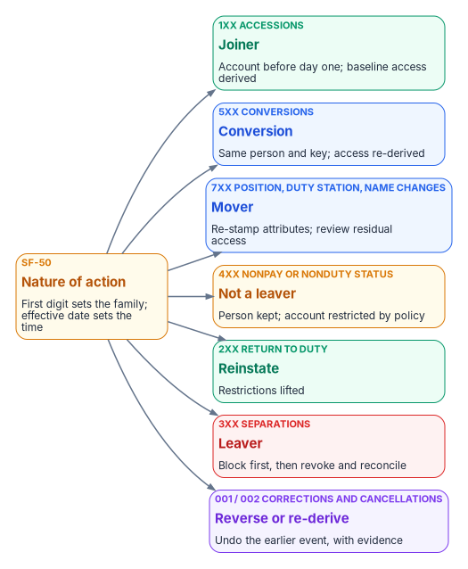
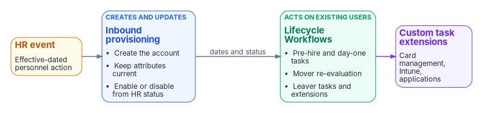

# Chapter 08 — Joiner, Mover, Leaver

*Nobody requests an account for a new hire. The hire causes it.*

::: {.callout-note}
## In this chapter
The five events a worker record goes through and what each one causes in the directory. The personnel-action codes that trigger them. The division of labor between inbound provisioning and Lifecycle Workflows. Triggers, schedules and built-in tasks. The guardrails for running workflows at agency scale: execution limits, on-demand runs and reorganizations. Emergency termination, how one leaver event reaches all four tracks, rehire, conversion and deletion. The leaver sequence itself, including credentials, is in Chapter 09.
:::

**This chapter is the HR track** of the companion guide's [four tracks](../guides/attribute-driven-migration.md#four-tracks): the HR record drives the lifecycle. A leaver still has to reach the other three tracks, which is the subject of *One leaver reaches four tracks* below.

## The lifecycle is an event stream

Joiner, mover and leaver, plus the two transitions estates forget until they hurt, **rehire** and **conversion** (contractor to employee), are the five state changes a worker record goes through. Each is recorded in the HR system as an effective-dated event, and each maps to a fixed set of identity actions:

| HR event | Recorded fact | Identity actions derived from it |
|---|---|---|
| **Joiner** | Future-dated hire: worker record and assignment created | Account created ahead of the start date by provisioning, provided the pipeline receives the hire early (see *Joiner*); licenses and baseline access derived from attributes; credential enrollment queued for day one (Chapter 09) |
| **Mover** | Assignment change: new position, organization, location or supervisor | Attributes re-stamped; dynamic memberships re-evaluated, so the old organization's access leaves as the new one's arrives[^c08-jml-govern]; access review on what remains (PS-5); approvals follow the new supervisor of record |
| **Leaver** | Effective-dated separation | The leaver sequence of Chapter 09: immediately block logical access, then reconcile credentials, devices, entitlements, application access, and later disposition — one workflow, one evidence trail (PS-4) |
| **Rehire** | Returning worker matched to the prior worker record | Prior identifier re-linked; the person resumes an identity rather than getting a second one (IA-4) |
| **Conversion** | Worker type changes; same person and key, new affiliation | Same identifier, access re-derived from the new worker type; no duplicate identity |

: The five lifecycle events and the identity actions they cause {.striped .hover}

The property that matters is the direction of causation. Nobody *remembers* to disable a leaver; the separation record causes the disablement, on the effective date. Tickets survive only for exceptions, and every exception is visible as a deviation from a computed baseline.

The controls in the table are NIST SP 800-53's. PS-4 requires, on termination, disabling system access within an organization-defined period and terminating or revoking the person's authenticators and credentials. PS-5 requires reviewing and confirming the need for existing logical and physical access when a person is reassigned or transferred, and modifying it to match. IA-4 requires preventing the reuse of identifiers for an organization-defined period.[^c08-sp80053]

## Personnel actions are the triggers

For federal employees, every HR event above is recorded as a personnel action, and every personnel action carries a **nature-of-action (NOA) code**. The first digit of the code sets the family (1 for appointments, 3 for separations, 5 for conversions, 7 for position and miscellaneous changes, and so on); OPM's *Guide to Processing Personnel Actions* organizes its chapters around those codes.[^c08-gppa] That gives HR-driven identity a standard, government-wide trigger vocabulary instead of a locally invented one. Every accession, conversion and separation, and every correction or cancellation of one, must be documented on an SF-50, the Notification of Personnel Action. A few action types don't need an SF-50; realignment is one of them, so a mover feed can't assume one.[^c08-gppa]

{fig-alt="An amber box on the left, SF-50 nature of action: first digit sets the family; effective date sets the time. Seven arrows fan out to: 1xx accessions, joiner; 5xx conversions, conversion; 7xx position, duty station and name changes, mover; 4xx nonpay or nonduty status, not a leaver; 2xx return to duty, reinstate; 3xx separations, leaver, block first; 001 and 002 corrections and cancellations, reverse or re-derive with evidence."}

| NOA family (GPPA chapters) | Examples | Identity event |
|---|---|---|
| Accessions — 1xx (Ch 9–11, 13) | 100, 101, 130, 140, 141, 170, 171 | **Joiner** |
| Conversions — 5xx (Ch 9–11, 13) | 500, 501, 540, 570, 571 | **Conversion**: same person and key; access re-derived |
| Position changes — 7xx (Ch 14) | 702 promotion, 713 change to lower grade, 721 reassignment | **Mover** |
| Other 7xx changes (Ch 20, 21, 23, 24) | 780 name change, 790 realignment, 792 duty station change, 781/782 work schedule | **Mover** (attribute re-stamp; UPN kept on a name change) |
| Nonpay or nonduty status — 4xx (Ch 15) | 430, 450–452, 460, 471, 473, 480 | **Not a leaver**: the person is kept; policy restricts the account |
| Return to duty — 2xx (Ch 16) | 280, 292 | **Reinstate**: restrictions lifted |
| Separations — 3xx (Ch 30–31) | 300–304, 307, 308 retirements; 312, 317, 330, 350–357, 385, 390 | **Leaver**: block first (Chapter 09) |
| Corrections and cancellations (Ch 32) | 002 correction, 001 cancellation | **Reverse or re-derive** from the corrected record, with evidence |
| Pay and data-element changes — 8xx (Ch 17, 26, 28) | 880 tenure change; 800, 803 data element change | Usually none; re-derive the worker profile when tenure or a mapped element changes |

: Proposed identity interpretation of OPM nature-of-action families[^c08-gppa] {.striped .hover}

The table is a proposed interpretation, not an OPM rule. HR, security, labor-relations, privacy, and personnel-policy owners validate the mappings, exceptions, precedence rules, and actions before automation.

Contractors and vendors have no SF-50 and no nature-of-action codes. Their joiner and leaver events are the contract or sponsorship start and end dates in their own source, and a sponsor's withdrawal is a leaver event (Chapter 06). The PIV card follows the same two events *(design guidance)*: the contractor joiner sends the sponsorship request, and a termination or expiry reported by the card management system is a contractor leaver input, while a reissue isn't ([Chapter 09](09-credentials-and-certificates.md#the-contractor-piv-path)).

**Pending proof.** The contractor PIV path is the program's design and hasn't yet been validated in practice; the criteria for Proved are in the evaluation's [Status and review](../../evaluations/oracle-contingent-worker-contractor-source.md#status-and-review).

Three rules follow, and Appendix A sets out the rest:

- **Leave is not a leaver.** Furlough, leave without pay and suspension (the 4xx family) keep the person; deprovisioning them as leavers locks out people who are still employed.
- **Precedence is a rule.** When two actions for one person land in one cycle, a separation wins, and a conversion is applied before a mover is evaluated.
- **Cancellations are first-class events.** A cancelled separation (001/002) re-enables what the separation disabled, from the corrected record, with evidence.

## Who does what: provisioning and Lifecycle Workflows

Two Microsoft services share the work, and the boundary between them is easy to blur:

- **Inbound provisioning creates and updates accounts.** It creates the user, keeps attributes current, and enables or disables the account from the HR status (Chapter 05).[^c08-lcw-tasks][^c08-automate] With API-driven inbound provisioning, the SCIM `active` value sets the account status by default, and the `/bulkUpload` endpoint doesn't delete users; Microsoft points to the Lifecycle Workflows *Delete user* task for that.[^c08-inbound-faq]
- **Lifecycle Workflows act on users who already exist.** Microsoft describes them as automating the routine processes *around* HR-driven provisioning: while HR provisioning manages creation and attribute updates, workflows run additional tasks.[^c08-lcw-tasks] A workflow is a set of tasks plus execution conditions: a scope (who) and a trigger (when).[^c08-lcw-overview]

A workflow never creates the account. A page that says "Lifecycle Workflows provision the new hire" has the boundary wrong.

Account state is where the two can collide. The inbound app maps SCIM `active` to the account's enabled or disabled state, and Lifecycle Workflows' Enable, Disable and Delete user tasks can now write that same state for synchronized Active Directory accounts, through the Microsoft Entra provisioning agent.[^c08-lcw-tasks2][^c08-lcw-onprem][^c08-lcw-onprem-manage] A pipeline that keeps sending `active` as true until the effective time can undo a workflow's earlier disable. This book's rule, as design guidance: **one writer per state transition, recorded** in the attribute authority map (Chapter 04). In this book's design the pipeline owns enable and disable, and sends `active` as false no later than the leaver workflow's first run; the workflow's disable task is the backstop, not a competing writer; the post-separation workflow owns deletion.

The two also license differently. API-driven inbound provisioning is included from Microsoft Entra ID P1; Lifecycle Workflows need Microsoft Entra ID Governance or Microsoft Entra Suite.[^c08-licensing][^c08-lcw-overview] Microsoft Entra ID Governance is available in GCC.[^c08-licensing]

{fig-alt="Left to right: an amber HR event box (effective-dated personnel action); a blue inbound provisioning box (create the account, keep attributes current, enable or disable from HR status); an arrow labelled dates and status to a green Lifecycle Workflows box (pre-hire and day-one tasks, mover re-evaluation, leaver tasks and extensions); and a violet custom task extensions box (card management, Intune, applications)."}

### Triggers and schedule

Lifecycle Workflows support four scheduled trigger types — time-based attribute, attribute change, group membership change, and sign-in inactivity — plus on-demand only.[^c08-lcw-conditions] The time-based trigger reads `employeeHireDate`, `employeeLeaveDateTime` or `createdDateTime`, with an offset of 0 to 180 days before or after the date; a relative time-based trigger, in preview, extends the offset to 365 days, but it has no three-day catch-up window, so on a workflow built on it a late HR entry always needs the on-demand path.[^c08-lcw-conditions][^c08-lcw-exec] Scheduling has to be turned on for each workflow, and scheduled workflows are evaluated every 3 hours by default; the interval can be set from 1 to 24 hours, and it's a single tenant-wide setting that every workflow follows.[^c08-lcw-conditions][^c08-lcw-schedule][^c08-lcw-properties] Just before processing, the engine re-evaluates each user and skips anyone who no longer meets the conditions.[^c08-lcw-conditions]

That schedule matters for evidence. A workflow never runs earlier than the time in the trigger attribute, but the tenant schedule can delay it,[^c08-lcw-sync] so a leaver workflow keyed to `employeeLeaveDateTime` runs at the first scheduled pass after the date, and both the separation-to-block interval and the separation-to-revocation interval (Chapter 11) include the schedule interval. Set the tenant interval with the leaver workflow in mind. There's also a three-day catch-up window: a user whose trigger date passed no more than three days before the engine sees them is still processed, but a later one isn't.[^c08-lcw-conditions] A separation recorded more than three days after its effective date has to go through the on-demand path (see *Emergency termination*). So HR timeliness is an operational control, not only a data-quality wish *(design guidance)*: monitor how late HR enters hires and separations, report every user whose trigger date is in the past and who was never processed, and run the catch-up deliberately rather than waiting for someone to notice.[^c08-lcw-scope-check]

### Built-in tasks by stage

| Stage | Built-in tasks (selection) |
|---|---|
| Joiner | Send welcome email; generate a Temporary Access Pass and send it to the manager; request an access package assignment; assign licenses; add to groups and Teams; enable the account (the recorded backstop; the pipeline is the enable writer) |
| Mover | Notify the manager of the move; request or remove access package assignments; add to or remove from selected groups; update user attributes[^c08-lcw-update-attrs] |
| Leaver | Disable the account; remove from all groups and all Teams; remove all access package assignments and cancel pending requests; remove licenses; **revoke all refresh tokens**; delete the user |
| Any stage | Run a custom task extension (a call out to an Azure Logic App) |

: Lifecycle Workflows built-in tasks by stage[^c08-lcw-tasks][^c08-lcw-deploy] {.striped .hover}

The pass the joiner task generates is a new-hire pass: its lifetime runs up to 24 hours from the hire date, the maximum Microsoft Learn recommends for a new hire. A pass the help desk issues for credential replacement is separate and lasts 1 hour ([Book 02, Chapter 10](../b02-identity/10-migrating-and-governing.md)).

No built-in task revokes a certificate or a PIV credential, or retires a device. Those steps go through a custom task extension or a separate process (Chapter 09).[^c08-lcw-faq] For contractors the same custom task also sends the PIV office its termination notice on the end date, so the card's termination clock starts on that date ([Chapter 09](09-credentials-and-certificates.md#the-contractor-piv-path)).

### Guardrails at agency scale

A workflow that is wrong is wrong for everyone in scope at once. Three Microsoft behaviors decide how big that mistake can get.

- **Execution limits and quarantine.** A tenant-wide or per-workflow threshold can be set as a percentage of users, a number of users, or both; with both, exceeding either one counts. When a scheduled run would exceed it, the workflow is quarantined and Lifecycle Workflows administrators are notified. It doesn't run again until an administrator approves it; quarantine can't be cleared automatically. Changing a workflow's limits creates a new workflow version.[^c08-lcw-quarantine]
- **On-demand runs bypass the guardrails.** An on-demand run takes at most 10 users at a time.[^c08-lcw-limits] It ignores the workflow's execution conditions: the tasks apply to whoever is selected, whether or not they qualify.[^c08-lcw-ondemand] And execution limits apply only to scheduled runs, so an on-demand run isn't checked against them, even on a quarantined workflow.[^c08-lcw-quarantine] An administrator who runs the leaver workflow on the wrong 10 people disables them.
- **Tenant ceilings.** Microsoft Learn gives two figures for workflows per tenant: the service limits page says at most 100, with 100 custom task extensions and 25 tasks per workflow,[^c08-lcw-limits] and the licensing page says up to 50.[^c08-licensing] The program budgets to 50 until Microsoft reconciles the two *(design guidance)*.

The program's responses *(design guidance)*:

- **Few workflows, coded scope.** A small set of general workflows (pre-hire, joiner, mover, leaver, rehire, conversion) that branch on the coded attributes of Chapter 06 through their scope rules, never one workflow per organization or per tree. Keep a workflow budget in change control, held to 50, and build one parameterized Logic App per integration, not one per component.
- **On-demand is a change.** Put the Lifecycle Workflows Administrator role behind Privileged Identity Management with approval, require a second person to check the selection, and log every on-demand run as a change.
- **Size the thresholds.** Set tenant-wide and per-workflow execution limits a little above normal weekly volume for each workflow, so an anomaly quarantines and a normal week doesn't.
- **Plan reorganizations as mass-mover events.** A reorganization that recodes thousands of organization codes fires the mover workflow for all of them at the next run, and a well-sized threshold quarantines it. That is the point. Treat the reorganization as a change event: rehearse it in a test tenant, agree in advance who approves the release of the quarantine, and release it once the recoded attributes have been checked against HR. Don't reach for on-demand runs to push it through; ten users at a time is no tool for a reorganization. A failed HR batch is fixed the same way: correct the data at the source and let the scheduled run process it.

The companion guide's [Lifecycle Workflows at scale](../guides/attribute-driven-migration.md#lifecycle-workflows-at-scale) sets these limits against an estate of one forest with 12 trees.

### Rolling out the workflows {#b03-08-rollout-and-evidence}

A scheduled workflow acts on every user in its scope, so turning one on is an enforcement step, and the leaver workflow is the one whose evidence an assessor reads. This is the workbook's How template for the workflows ([Book 00, Appendix D](../b00-orientation/appendix-d-control-states-and-evidence.md#how-section-template)); the pipeline's own cutover is [Appendix C](appendix-c-acceptance-and-cutover.md#b03-c-rollout-safety).

**Authority:** Microsoft-recommended: pilot a workflow and test it on demand on a small set of users before it runs on a schedule (Learn's deployment checklist and "Run a workflow on-demand," read Nov 11, 2026).[^c08-lcw-deploy][^c08-lcw-ondemand] The rings, thresholds and the leaver-first order are risk-based recommended. The leaver workflow supports AC-2 and PS-4 in the agency's adopted NIST SP 800-53 baseline (Chapter 11); it doesn't satisfy them alone.
**Applies:** License-dependent: Lifecycle Workflows need Microsoft Entra ID Governance, Microsoft Entra Suite or, in Learn's licensing table read Nov 11, 2026, Microsoft 365 E7.[^c08-licensing] Environment-dependent: Microsoft Entra ID Governance is available in GCC.[^c08-licensing]

| Subsection | For the lifecycle workflows |
|---|---|
| Prerequisites | The licenses above; the pipeline writing `employeeHireDate` and `employeeLeaveDateTime` (Chapter 05); the Lifecycle Workflows Administrator role behind PIM; execution limits sized ([Guardrails](#guardrails-at-agency-scale)) |
| Pilot | Each workflow built and run end to end in a test tenant (Chapter 12, Phase 2), then in production with a scope rule narrowed to the pilot cohort's organization code |
| Report-only or audit phase | Not available as a mode: Lifecycle Workflows has no report-only setting. The equivalents are the workflow's execution user scope, the list of users it would process at its next run, read before scheduling,[^c08-lcw-scope] and on-demand runs on up to 10 test users, which ignore the execution conditions[^c08-lcw-ondemand] |
| Enforcement | Turn scheduling on for one workflow at a time, leaver first (Chapter 12, Phase 4), and widen its scope rule ring by ring |
| Rollback | Turn scheduling off for the workflow; cancel a run that is queued or in progress, which stops its remaining tasks but doesn't reverse completed ones;[^c08-lcw-cancel] re-enable any wrongly disabled account from the HR record through the pipeline; restore a wrongly deleted user within 30 days (Deletion, below) |
| Exclusions | Emergency access and other cloud-only administrative accounts carry no worker-type code, so the coded scope rules never reach them; the disable and delete tasks don't support users with Microsoft Entra role assignments, so privileged leavers follow their own verified block path ([Chapter 09](09-credentials-and-certificates.md#running-it-from-lifecycle-workflows); Appendix A) |
| Telemetry | Workflow history (runs, users and tasks) and the audit log;[^c08-lcw-history][^c08-lcw-audits] quarantine notifications to Lifecycle Workflows administrators |
| Evidence | The checklist below |
| Day-two ownership | The CIO's identity team owns the workflows and their thresholds ([Chapter 07](07-who-owns-workforce-identity.md)); it reviews workflow history weekly, every quarantine at the time, and the workflow budget in change control |

Scheduling is a property of each workflow; turning it on or off is one call, made as a change by a Lifecycle Workflows Administrator:[^c08-lcw-update]

```powershell
# Microsoft Graph PowerShell: read the workflows, then turn scheduling on (or off, to roll back) for one
Connect-MgGraph -Scopes 'LifecycleWorkflows.ReadWrite.All' -NoWelcome
Get-MgIdentityGovernanceLifecycleWorkflow -All | Select-Object Id, DisplayName, Category, IsEnabled, IsSchedulingEnabled
Update-MgIdentityGovernanceLifecycleWorkflow -WorkflowId '<workflow id>' -BodyParameter @{ isSchedulingEnabled = $true }
```

**Change safety**

| Ring | Scope | Exit criteria |
|---|---|---|
| 0 | Test tenant, canned payloads | Each workflow completes for a test joiner, mover and leaver, with a provenance record (Chapter 12, Phase 2) |
| 1 | Production, on demand on test users, scheduling off | Every task succeeds; the execution user scope lists only the expected users |
| 2 | Leaver workflow scheduled for the pilot cohort | A full pay-period cycle with zero missed leavers; separation-to-block within the approved threshold (Chapter 11) |
| 3 | Scope widened population by population, then the joiner and mover workflows the same way | Each population's cutover in Appendix C passed |

- **Emergency access:** outside every workflow's scope, as above; confirm with the execution user scope before each ring.
- **Change window:** scheduling changes and scope changes are made in business hours, with the identity team and the help desk on hand for the next scheduled run.
- **Backout triggers, set before the change:** a quarantine, any active person disabled, any separated person not disabled at the next run, or a custom task extension failing for more than one run. The response is turning scheduling off and cancelling the open run.
- **Post-change validation:** the next scheduled run's history shows only the expected users, each task completed, and the leaver's account read back as disabled.

**Control states.** <!-- Book 00, Appendix D: Designed, Configured, Enforced, Evidenced, Operated -->

| State | This page | Evidence |
|---|---|---|
| Designed | This chapter and Appendix A's rules | The approved workflow set, scope rules and thresholds |
| Configured | Rings 0 and 1: workflows built, scheduling off | Workflow exports with `isSchedulingEnabled` false |
| Enforced | Rings 2 and 3: scheduling on | Workflow exports with scheduling on and their scope rules |
| Evidenced | Post-change validation and the lifecycle metrics | Run history for the test and pilot leavers; the separation-to-block interval (Chapter 11) |
| Operated | Day-two ownership | Weekly history review, quarantine records, the workflow budget |

A finding this page addresses is ready for closure when every applicable state has evidence; the authorizing official or assessor decides.

**Evidence checklist**

- [ ] **Configuration:** each workflow exported as JSON at every version, with its scope rule and execution limits, in the identity baseline repository
- [ ] **Operational:** workflow run history and the audit log entries for each run, exported before Entra ID's retention ends (Chapter 11)
- [ ] **Test:** the Ring 0 and Ring 1 run records (expected and observed outcome, date, tester)
- [ ] **Exception:** every quarantine release, on-demand run and emergency termination, each with its approver and change record
- [ ] **Assessor-ready artifact:** the separation-to-block and separation-to-revocation intervals for the period, traceable to the four above

::: {.callout-note appearance="simple"}
## Assessment mapping {#b03-08-assessment-mapping}
- **Microsoft Zero Trust pillar:** Identity
- **CISA ZTMM pillar:** Identity
- **Depends on:** the HR source and the pipeline (Chapter 05); Devices, for the Intune retire and wipe the leaver's custom task calls ([Book 05](../b05-devices/index.md))
- **Attack chain interrupted:** Initial Access and Persistence: a separated person's account, sessions or credentials still usable after their separation
:::

## Joiner

Provisioning creates the account ahead of the start date from the future-dated hire — if the hire reaches the pipeline early. Oracle's Atom feeds don't surface a future-dated hire or separation before its effective date by default; it appears early only when the middleware reads the feed by published date and holds the effective date itself (Chapter 05).[^c08-ora-dated] A pipeline that reads by effective date delivers the hire on the start date, and because Lifecycle Workflows catch up only three days past a trigger date,[^c08-lcw-exec] a pre-hire workflow set further ahead never runs. Read by published date, as Chapter 05 recommends, so pre-hire and pre-separation steps run before the date. A pre-hire workflow runs a set number of days before `employeeHireDate` (for example, generate a Temporary Access Pass and send it to the manager),[^c08-lcw-onboard-tut] and a day-one workflow runs on the date (assign licenses, request the onboarding access package that carries baseline access rather than adding groups directly, and run its enable task as the recorded backstop, because the pipeline is the enable writer). Microsoft recommends a 24-hour maximum lifetime for a Temporary Access Pass sent to a new hire, so that it hasn't expired in another time zone, and recommends setting the time portion of `employeeHireDate` early enough that the tenant schedule doesn't push the day-one run past the start of work.[^c08-lcw-sync] Day-one readiness (account, licenses and baseline access in place at start of day) is a metric, not a hope (Chapter 11).

## Mover

The mover event re-stamps attributes through provisioning; dynamic memberships re-evaluate on their own (Chapter 10). An attribute-change workflow scoped to `department` or the organization code can notify the manager and start a review of what's left.[^c08-lcw-mover-tut][^c08-lcw-custom-triggers] Old access that came from a dynamic group goes away when the rule stops matching; old access that came from an access package or a direct assignment doesn't, which is why the review on the residual is a control, not a courtesy.

## Leaver

The separation record sets `employeeLeaveDateTime` through provisioning, and the leaver workflows run against it: a pre-separation workflow (notify the manager), a last-day workflow, and a post-separation workflow that deletes the user after the retention period.[^c08-lcw-leaver-tut] The order of the steps, and the credential and device steps that the built-in tasks don't cover, are Chapter 09's subject.

### Emergency termination

Some separations can't wait for the schedule. Microsoft's **Real-time employee termination** template is an on-demand workflow; its tutorial removes the user from all groups and all Teams and deletes the account.[^c08-lcw-offboard-portal] For an agency, use the template as the starting point for an on-demand workflow that runs the *same* sequence as the scheduled leaver workflow (Chapter 09), not a shorter one. The trigger is human; the execution and the evidence are identical.[^c08-lcw-history][^c08-lcw-audits]

Don't rely on any workflow alone for a hostile or urgent termination. A scheduled leaver waits for the tenant schedule, by default every 3 hours, plus sync and dynamic-group processing. In the program's design the help desk's emergency path also blocks the person out of band, at once. For a synced user, Microsoft's steps are to disable the account in Active Directory and reset its password twice, then disable the account in Entra ID, revoke its refresh tokens and disable the user's registered devices.[^c08-revoke] Revoking sessions doesn't end every session at once: applications that use access tokens keep access until the token expires (one hour by default), and an application's own session lasts until that application revokes it. Continuous access evaluation shortens that for applications that support it.[^c08-revoke] The real-time workflow then runs the rest of the sequence, and the out-of-band actions go into the same evidence trail.

### One leaver reaches four tracks

The separation record is an HR fact, but the person it describes touches all four tracks. Natively, Lifecycle Workflows complete only the account side. Everything else goes through a custom task extension, a step that calls an Azure Logic App, either launching it and continuing or waiting for its response within a set time; a third-party system can send that response.[^c08-lcw-ext]

| Track | What the leaver must reach | How |
|---|---|---|
| **HR (the account)** | Disable; remove groups, Teams, access packages and licenses; revoke refresh tokens | Built-in tasks (above) |
| **HR (the credential)** | Revoke the PIV certificate and remove its `certificateUserIds` binding | A custom task extension to the card management system (Chapter 09) |
| **Intune** | Retire or wipe the person's devices | A custom task extension to Intune |
| **Azure Arc** | Remove the person's access to servers | A custom task extension, or the privileged-access process, that removes role assignments and local access |
| **Non-person identities** | Hand over every service account, application and agent the person sponsored, so none is orphaned | For agent identities, a built-in task transfers sponsorships to the leaver's manager, with a Microsoft Agent 365 license; confirm it in the tenant's cloud.[^c08-lcw-agent-sponsor] For other workloads, a custom task extension that reassigns owners from the system inventory |

: One leaver event, four tracks {.striped .hover}

Until those extensions exist, the program's fallback is a leaver checklist with a named owner per row, and the separation-to-revocation interval (Chapter 11) measures how long it takes. The task ceiling bites here: a four-track leaver can run long, so group steps inside one Logic App, or chain a leaver and a post-separation workflow *(design guidance)*. The companion guide's [four tracks](../guides/attribute-driven-migration.md#four-tracks) set out who owns each track.

## Rehire and conversion

- **Rehire.** The returning worker is matched to the prior worker record by the enterprise person key, and the provisioning match on `employeeId` re-links the existing account if it still exists; Microsoft's HR-driven provisioning can reactivate or reprovision a rehire's old account.[^c08-automate][^c08-inbound-faq] If the account was deleted, the new account carries the same `employeeId`; the identifier history lives in the HR record, not the directory.
- **Conversion.** A contractor-to-employee change is an attribute change on the same person, not a leaver plus a joiner. `employeeType` and the worker-type code change; access re-derives; the identifier stays.

## Deletion

Disable on the separation date; delete or anonymize only under the approved account-disposition rule; retain each category of HR record, authorization record, audit evidence, and security log under its applicable schedule and legal-hold requirements, from a post-separation workflow. A deleted Entra user can be restored for 30 days, after which it is permanently deleted;[^c08-deleted-users] retention for audit and records purposes has to be met by the logs and the HR record, not by keeping the account. For a synchronized user, the disposition happens in Active Directory: Entra ID doesn't hold the object SOA for that account, and a user deleted only in Entra ID can be restored by the next sync cycle.[^c08-deleted-users] Lifecycle Workflows can now carry that disposition to Active Directory: the Delete user task, with the `deleteOnPremisesAccount` argument, acts through the provisioning agent (version 1.1.1586.0 or later, installed with the HR-driven provisioning extension), with permissions on the user objects granted to the agent's gMSA and the AD Recycle Bin enabled for deletes.[^c08-lcw-tasks2][^c08-lcw-onprem]


::: {.callout-tip}
## Continue the book
[← Previous: Chapter 07 — Who Owns Workforce Identity](07-who-owns-workforce-identity.md) · [Book index](index.md) · [Next: Chapter 09 — Credentials and Certificates Across Joiner, Mover, Leaver →](09-credentials-and-certificates.md)
:::

[^c08-sp80053]: NIST, SP 800-53 Rev. 5, *Security and Privacy Controls for Information Systems and Organizations*, September 2020 (updated December 10, 2020), controls IA-4, PS-4 and PS-5, <https://csrc.nist.gov/pubs/sp/800/53/r5/upd1/final> (accessed Oct 20, 2026).
[^c08-gppa]: U.S. Office of Personnel Management, *The Guide to Processing Personnel Actions*, November 2026 edition (chapter list with nature-of-action codes per chapter; Chapter 1 §4, nature of action, and the SF-50 documentation requirement; Chapter 4 job aid for blocks 5-A and 6-A), <https://www.opm.gov/policy-data-oversight/data-analysis-documentation/personnel-documentation/processing-personnel-actions/guide_to_processing_personnel_actions.pdf> (accessed Nov 9, 2026).
[^c08-lcw-tasks]: Microsoft Learn, "Lifecycle Workflow built-in tasks," <https://learn.microsoft.com/en-us/entra/id-governance/lifecycle-workflow-tasks> (accessed Oct 20, 2026).
[^c08-automate]: Microsoft Learn, "Automate identity lifecycle management with Microsoft Entra ID Governance" (enabled HR scenarios), <https://learn.microsoft.com/en-us/entra/id-governance/scenarios/automate-identity-lifecycle> (accessed Oct 20, 2026).
[^c08-inbound-faq]: Microsoft Learn, "Frequently asked questions about API-driven inbound provisioning," <https://learn.microsoft.com/en-us/entra/identity/app-provisioning/inbound-provisioning-api-faqs> (accessed Oct 20, 2026).
[^c08-lcw-overview]: Microsoft Learn, "What are lifecycle workflows?," <https://learn.microsoft.com/en-us/entra/id-governance/what-are-lifecycle-workflows> (accessed Oct 20, 2026).
[^c08-licensing]: Microsoft Learn, "Microsoft Entra ID Governance licensing fundamentals," <https://learn.microsoft.com/en-us/entra/id-governance/licensing-fundamentals> (accessed Oct 20, 2026).
[^c08-lcw-conditions]: Microsoft Learn, "Lifecycle workflows execution conditions and scheduling," <https://learn.microsoft.com/en-us/entra/id-governance/lifecycle-workflow-execution-conditions> (accessed Oct 20, 2026).
[^c08-lcw-schedule]: Microsoft Learn, "Customize the schedule of workflows," <https://learn.microsoft.com/en-us/entra/id-governance/customize-workflow-schedule> (accessed Oct 20, 2026).
[^c08-lcw-sync]: Microsoft Learn, "How to synchronize attributes for Lifecycle workflows" (Importance of time), <https://learn.microsoft.com/en-us/entra/id-governance/how-to-lifecycle-workflow-sync-attributes> (accessed Oct 20, 2026).
[^c08-lcw-offboard-portal]: Microsoft Learn, "Execute employee termination tasks by using lifecycle workflows" (the Real-time employee termination template), <https://learn.microsoft.com/en-us/entra/id-governance/tutorial-offboard-custom-workflow-portal> (accessed Oct 20, 2026).
[^c08-deleted-users]: Microsoft Learn, "Restore or remove a recently deleted user," <https://learn.microsoft.com/en-us/entra/fundamentals/users-restore> (accessed Oct 20, 2026).
[^c08-lcw-exec]: Microsoft Learn, "Lifecycle workflow execution conditions and scheduling" (three-day catch-up window; the Time based attribute V2 trigger, in preview, extends the offset to 365 days and doesn't have a three-day catch-up window), <https://learn.microsoft.com/en-us/entra/id-governance/lifecycle-workflow-execution-conditions> (accessed Oct 25, 2026).
[^c08-lcw-tasks2]: Microsoft Learn, "Lifecycle Workflows tasks and definitions" (Enable, Disable and Delete user tasks with the `enableOnPremisesAccount`, `disableOnPremisesAccount` and `deleteOnPremisesAccount` arguments), <https://learn.microsoft.com/en-us/entra/id-governance/lifecycle-workflow-tasks> (accessed Oct 25, 2026).
[^c08-lcw-onprem]: Microsoft Learn, "Managing Users synchronized from Active Directory Domain Services to Microsoft Entra ID with Lifecycle Workflows" (the Microsoft Entra provisioning agent, at least 1.1.1586.0, with the HR-driven provisioning extension; gMSA permissions; AD Recycle Bin for deletes), <https://learn.microsoft.com/en-us/entra/id-governance/lifecycle-workflow-on-premises> (accessed Oct 25, 2026).
[^c08-ora-dated]: Oracle, *REST API for Oracle Fusion Cloud HCM*, "Manage Date Effective Entries" (future-dated events carry the effective start date as their `updated` date; by default no entries with an `updated` date past the current date are returned), <https://docs.oracle.com/en/cloud/saas/human-resources/farws/Handling_Date_Effective_Entry.html>; and "Read a Feed" (`published-min`, `published-max`), <https://docs.oracle.com/en/cloud/saas/human-resources/farws/Reading_a_Feed.html> (accessed Oct 25, 2026).
[^c08-lcw-quarantine]: Microsoft Learn, "Configure execution limits and quarantine for Lifecycle Workflows" (tenant-wide and workflow-specific limits; OR logic; quarantine and notification; approval required; limits apply only to scheduled runs; on-demand runs bypass them; changing limits creates a new workflow version), <https://learn.microsoft.com/entra/id-governance/lifecycle-workflow-execution-limits> (accessed Oct 29, 2026).
[^c08-lcw-limits]: Microsoft Learn, "Microsoft Entra ID Governance service limits," section "Lifecycle Workflows" (100 workflows and 100 custom task extensions per tenant; 25 tasks per workflow; 10 users per on-demand selection), <https://learn.microsoft.com/entra/id-governance/governance-service-limits#lifecycle-workflows> (accessed Oct 29, 2026).
[^c08-lcw-ondemand]: Microsoft Learn, "Understanding lifecycle workflows," section "On-demand scheduling" (an on-demand run doesn't take into account whether the user meets the execution conditions), <https://learn.microsoft.com/entra/id-governance/understanding-lifecycle-workflows>; and "Run a workflow on-demand" (up to 10 users at a time), <https://learn.microsoft.com/entra/id-governance/on-demand-workflow> (both accessed Oct 29, 2026).
[^c08-lcw-ext]: Microsoft Learn, "Lifecycle Workflows custom task extension" (Azure Logic Apps; launch and continue, launch and wait; a third-party system can respond), <https://learn.microsoft.com/entra/id-governance/lifecycle-workflow-extensibility> (accessed Oct 29, 2026).
[^c08-lcw-agent-sponsor]: Microsoft Learn, "Agent identity sponsor tasks in Lifecycle Workflows" (Transfer agent identity sponsorships to manager; mover and leaver tasks; license requirements), <https://learn.microsoft.com/entra/id-governance/agent-sponsor-tasks> (accessed Oct 29, 2026).
[^c08-revoke]: Microsoft Learn, "Revoke user access in Microsoft Entra ID" (hybrid steps: disable in AD, reset the password twice, disable in Entra ID, revoke refresh tokens, disable registered devices; when access is revoked; access tokens last one hour by default; continuous access evaluation), <https://learn.microsoft.com/entra/identity/users/users-revoke-access> (accessed Oct 29, 2026).
[^c08-jml-govern]: Microsoft Learn, "Govern the employee and guest lifecycle with Microsoft Entra ID Governance" (join, move and leave; a mover from Sales to Marketing loses the rights from the old organization and gains those of the new one), <https://learn.microsoft.com/entra/id-governance/scenarios/govern-the-employee-lifecycle> (accessed Nov 9, 2026).
[^c08-lcw-onprem-manage]: Microsoft Learn, "Manage users synchronized from Active Directory Domain Services with workflows" (workflow tasks can enable, disable and delete synchronized users), <https://learn.microsoft.com/entra/id-governance/manage-workflow-on-premises> (accessed Nov 9, 2026).
[^c08-lcw-properties]: Microsoft Learn, "Manage workflow properties" (whether the workflow schedule is enabled is a property of each workflow), <https://learn.microsoft.com/entra/id-governance/manage-workflow-properties> (accessed Nov 9, 2026).
[^c08-lcw-scope-check]: Microsoft Learn, "Check execution user scope of a workflow" (lists the users who currently meet a workflow's execution scope, whether or not they've already been processed; the catch-up window), <https://learn.microsoft.com/entra/id-governance/check-workflow-execution-scope> (accessed Nov 9, 2026).
[^c08-lcw-update-attrs]: Microsoft Learn, "Update user attributes with Lifecycle Workflows" (the Update user attributes task sets or clears attribute values on joiner, mover and leaver events), <https://learn.microsoft.com/entra/id-governance/how-to-lifecycle-workflow-update-user-attributes> (accessed Nov 9, 2026).
[^c08-lcw-deploy]: Microsoft Learn, "Microsoft Entra ID Governance deployment guide for employee lifecycle automation," section "Supported tasks and workflows" (built-in tasks listed by joiner, mover and leaver category), <https://learn.microsoft.com/entra/architecture/governance-deployment-employee-lifecycle> (accessed Nov 9, 2026).
[^c08-lcw-faq]: Microsoft Learn, "Lifecycle workflows - FAQs" (no new tasks outside the built-in task templates; set up a Logic App and call it from a custom task extension instead), <https://learn.microsoft.com/entra/id-governance/workflows-faqs> (accessed Nov 9, 2026).
[^c08-lcw-onboard-tut]: Microsoft Learn, "Automate employee onboarding tasks before their first day of work with the Microsoft Entra admin center" (the Onboard pre-hire employee template runs a set number of days before `employeeHireDate`, generates a Temporary Access Pass and emails it to the manager), <https://learn.microsoft.com/entra/id-governance/tutorial-onboard-custom-workflow-portal> (accessed Nov 9, 2026).
[^c08-lcw-mover-tut]: Microsoft Learn, "Automate employee mover tasks when they change jobs using the Microsoft Entra admin center" (an Attribute changes trigger on `department`; the workflow emails the manager about the move), <https://learn.microsoft.com/entra/id-governance/tutorial-mover-custom-workflow-portal> (accessed Nov 9, 2026).
[^c08-lcw-custom-triggers]: Microsoft Learn, "Use custom attribute triggers in lifecycle workflows" (attribute-change triggers on custom security attributes, directory extensions, on-premises extension attributes 1-15 and `employeeOrgData`; changes detected only for scheduled workflows), <https://learn.microsoft.com/entra/id-governance/workflow-custom-triggers> (accessed Nov 9, 2026).
[^c08-lcw-leaver-tut]: Microsoft Learn, "Automate employee offboarding tasks after their last day of work with the Microsoft Entra admin center" (the Post-offboarding of an employee template runs a set number of days after the leave date and deletes the user account), <https://learn.microsoft.com/entra/id-governance/tutorial-scheduled-leaver-portal> (accessed Nov 9, 2026).
[^c08-lcw-history]: Microsoft Learn, "Check the status of a workflow" (run and user processing history for users processed both by schedule and on demand), <https://learn.microsoft.com/entra/id-governance/check-status-workflow> (accessed Nov 9, 2026).
[^c08-lcw-audits]: Microsoft Learn, "Auditing Lifecycle Workflows" (every workflow processing event is logged in the audit logs, kept for up to 30 days), <https://learn.microsoft.com/entra/id-governance/lifecycle-workflow-audits> (accessed Nov 9, 2026).
[^c08-lcw-scope]: Microsoft Learn, "Lifecycle workflows execution conditions and scheduling," section "Execution user scope" (the users who meet the execution conditions and would be processed at the next run), <https://learn.microsoft.com/entra/id-governance/lifecycle-workflow-execution-conditions> (accessed Nov 11, 2026).
[^c08-lcw-cancel]: Microsoft Learn, "Cancel workflow runs using Lifecycle Workflows" (in-progress and queued runs can be cancelled; completed changes aren't reversed; one run at a time), <https://learn.microsoft.com/entra/id-governance/cancel-workflow-runs> (accessed Nov 11, 2026).
[^c08-lcw-update]: Microsoft Learn, "Update-MgIdentityGovernanceLifecycleWorkflow" (Microsoft Graph PowerShell; `isEnabled` and `isSchedulingEnabled`; LifecycleWorkflows.ReadWrite.All), <https://learn.microsoft.com/powershell/module/microsoft.graph.identity.governance/update-mgidentitygovernancelifecycleworkflow?view=graph-powershell-1.0> (accessed Nov 11, 2026).
