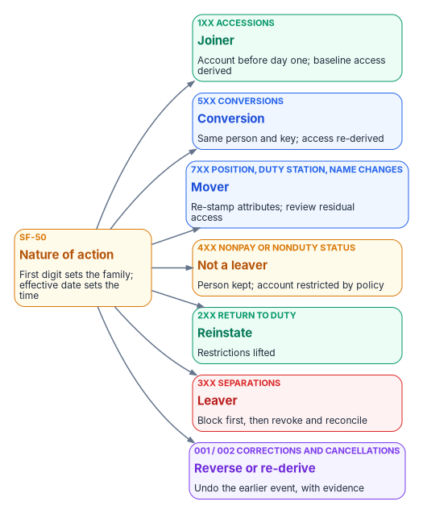
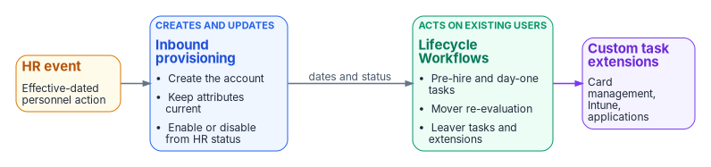

# Chapter 08 — Joiner, Mover, Leaver

*Nobody requests an account for a new hire. The hire causes it.*

::: {.callout-note}
## In this chapter
The five events a worker record goes through and what each one causes in the directory. The personnel-action codes that trigger them. The division of labor between inbound provisioning and Lifecycle Workflows. Triggers, schedules and built-in tasks. Emergency termination, rehire, conversion and deletion. The leaver sequence itself, including credentials, is in Chapter 09.
:::

## The lifecycle is an event stream

Joiner, mover and leaver, plus the two transitions estates forget until they hurt, **rehire** and **conversion** (contractor to employee), are the five state changes a worker record goes through. Each is recorded in the HR system as an effective-dated event, and each maps to a fixed set of identity actions:

| HR event | Recorded fact | Identity actions derived from it |
|---|---|---|
| **Joiner** | Future-dated hire: worker record and assignment created | Account created ahead of the start date by provisioning; licenses and baseline access derived from attributes; credential enrollment queued for day one (Chapter 09) |
| **Mover** | Assignment change: new position, organization, location or supervisor | Attributes re-stamped; dynamic memberships re-evaluated, so the old organization's access leaves as the new one's arrives; access review on what remains (PS-5); approvals follow the new supervisor of record |
| **Leaver** | Effective-dated separation | The leaver sequence of Chapter 09: immediately block logical access, then reconcile credentials, devices, entitlements, application access, and later disposition — one workflow, one evidence trail (PS-4) |
| **Rehire** | Returning worker matched to the prior worker record | Prior identifier re-linked; the person resumes an identity rather than getting a second one (IA-4) |
| **Conversion** | Worker type changes; affiliation continuous | Same identifier, access re-derived from the new worker type; no duplicate identity |

: The five lifecycle events and the identity actions they cause {.striped .hover}

The property that matters is the direction of causation. Nobody *remembers* to disable a leaver; the separation record causes the disablement, on the effective date. Tickets survive only for exceptions, and every exception is visible as a deviation from a computed baseline.

The controls in the table are NIST SP 800-53's. PS-4 requires, on termination, disabling system access within an organization-defined period and terminating or revoking the person's authenticators and credentials. PS-5 requires reviewing and confirming the need for existing logical and physical access when a person is reassigned or transferred, and modifying it to match. IA-4 requires preventing the reuse of identifiers for an organization-defined period.[^c08-sp80053]

## Personnel actions are the triggers

For federal employees, every HR event above is recorded as a personnel action, and every personnel action carries a **nature-of-action (NOA) code**. The first digit of the code sets the family (1 for appointments, 3 for separations, 5 for conversions, 7 for position and miscellaneous changes, and so on); OPM's *Guide to Processing Personnel Actions* organizes its chapters around those codes.[^c08-gppa] That gives HR-driven identity a standard, government-wide trigger vocabulary instead of a locally invented one. Every accession, conversion and separation, and every correction or cancellation of one, must be documented on an SF-50, the Notification of Personnel Action. A few action types don't need an SF-50; realignment is one of them, so a mover feed can't assume one.[^c08-gppa]

{fig-alt="An amber box on the left, SF-50 nature of action: first digit sets the family; effective date sets the time. Seven arrows fan out to: 1xx accessions, joiner; 5xx conversions, conversion; 7xx position, duty station and name changes, mover; 4xx nonpay or nonduty status, not a leaver; 2xx return to duty, reinstate; 3xx separations, leaver, block first; 001 and 002 corrections and cancellations, reverse or re-derive with evidence."}

| NOA family (GPPA chapters) | Examples | Identity event |
|---|---|---|
| Accessions — 1xx (Ch 9–11, 13) | 100, 101, 130, 140, 141, 170, 171 | **Joiner** |
| Conversions — 5xx (Ch 9–11, 13) | 500, 501, 540, 570, 571 | **Conversion**: same person and key; access re-derived |
| Position changes — 7xx (Ch 14) | 702 promotion, 713 change to lower grade, 721 reassignment | **Mover** |
| Other 7xx changes (Ch 20, 21, 23, 24) | 780 name change, 790 realignment, 792 duty station change, 781/782 work schedule | **Mover** (attribute re-stamp; UPN kept on a name change) |
| Nonpay or nonduty status — 4xx (Ch 15) | 430, 450–452, 460, 471, 473, 480 | **Not a leaver**: the person is kept; policy restricts the account |
| Return to duty — 2xx (Ch 16) | 280, 292 | **Reinstate**: restrictions lifted |
| Separations — 3xx (Ch 30–31) | 300–304, 307, 308 retirements; 312, 317, 330, 350–357, 385, 390 | **Leaver**: block first (Chapter 09) |
| Corrections and cancellations (Ch 32) | 002 correction, 001 cancellation | **Reverse or re-derive** from the corrected record, with evidence |
| Pay and data-element changes — 8xx (Ch 17, 26, 28) | 880 tenure change; 800, 803 data element change | Usually none; re-derive the worker profile when tenure or a mapped element changes |

: Proposed identity interpretation of OPM nature-of-action families[^c08-gppa] {.striped .hover}

The table is a proposed interpretation, not an OPM rule. HR, security, labor-relations, privacy, and personnel-policy owners validate the mappings, exceptions, precedence rules, and actions before automation.

Contractors and vendors have no SF-50 and no nature-of-action codes. Their joiner and leaver events are the contract or sponsorship start and end dates in their own source, and a sponsor's withdrawal is a leaver event (Chapter 06).

Three rules follow, and Appendix A sets out the rest:

- **Leave is not a leaver.** Furlough, leave without pay and suspension (the 4xx family) keep the person; deprovisioning them as leavers locks out people who are still employed.
- **Precedence is a rule.** When two actions for one person land in one cycle, a separation wins, and a conversion is applied before a mover is evaluated.
- **Cancellations are first-class events.** A cancelled separation (001/002) re-enables what the separation disabled, from the corrected record, with evidence.

## Who does what: provisioning and Lifecycle Workflows

Two Microsoft services share the work, and the boundary between them is easy to blur:

- **Inbound provisioning creates and updates accounts.** It creates the user, keeps attributes current, and enables or disables the account from the HR status (Chapter 05).[^c08-lcw-tasks][^c08-automate] With API-driven inbound provisioning, the SCIM `active` value sets the account status by default, and the `/bulkUpload` endpoint doesn't delete users; Microsoft points to the Lifecycle Workflows *Delete user* task for that.[^c08-inbound-faq]
- **Lifecycle Workflows act on users who already exist.** Microsoft describes them as automating the routine processes *around* HR-driven provisioning: while HR provisioning manages creation and attribute updates, workflows run additional tasks.[^c08-lcw-tasks] A workflow is a set of tasks plus execution conditions: a scope (who) and a trigger (when).[^c08-lcw-overview]

A workflow never creates the account. A page that says "Lifecycle Workflows provision the new hire" has the boundary wrong.

The two also license differently. API-driven inbound provisioning is included from Microsoft Entra ID P1; Lifecycle Workflows need Microsoft Entra ID Governance or Microsoft Entra Suite.[^c08-licensing][^c08-lcw-overview] Microsoft Entra ID Governance is available in GCC, GCC High and DoD.[^c08-licensing]

{fig-alt="Left to right: an amber HR event box (effective-dated personnel action); a blue inbound provisioning box (create the account, keep attributes current, enable or disable from HR status); an arrow labelled dates and status to a green Lifecycle Workflows box (pre-hire and day-one tasks, mover re-evaluation, leaver tasks and extensions); and a violet custom task extensions box (card management, Intune, applications)."}

### Triggers and schedule

Lifecycle Workflows support four scheduled trigger types — time-based attribute, attribute change, group membership change, and sign-in inactivity — plus on-demand only.[^c08-lcw-conditions] The time-based trigger reads `employeeHireDate`, `employeeLeaveDateTime` or `createdDateTime`, with an offset of 0 to 180 days before or after the date; a relative time-based trigger, in preview, extends the offset to 365 days.[^c08-lcw-conditions] Scheduling has to be turned on for each workflow, and scheduled workflows are evaluated every 3 hours by default; the interval can be set from 1 to 24 hours, and it's a single tenant-wide setting that every workflow follows.[^c08-lcw-conditions][^c08-lcw-schedule] Just before processing, the engine re-evaluates each user and skips anyone who no longer meets the conditions.[^c08-lcw-conditions]

That schedule matters for evidence. A workflow never runs earlier than the time in the trigger attribute, but the tenant schedule can delay it,[^c08-lcw-sync] so a leaver workflow keyed to `employeeLeaveDateTime` runs at the first scheduled pass after the date, and the separation-to-revocation interval (Chapter 11) includes the schedule interval. Set the tenant interval with the leaver workflow in mind. There's also a three-day catch-up window: a user whose trigger date passed no more than three days before the engine sees them is still processed, but a later one isn't.[^c08-lcw-conditions] A separation recorded more than three days after its effective date has to go through the on-demand path (see *Emergency termination*).

### Built-in tasks by stage

| Stage | Built-in tasks (selection) |
|---|---|
| Joiner | Send welcome email; generate a Temporary Access Pass and send it to the manager; request an access package assignment; assign licenses; add to groups and Teams; enable the account |
| Mover | Notify the manager of the move; request or remove access package assignments; add to or remove from selected groups; update user attributes |
| Leaver | Disable the account; remove from all groups and all Teams; remove all access package assignments and cancel pending requests; remove licenses; **revoke all refresh tokens**; delete the user |
| Any stage | Run a custom task extension (a call out to an Azure Logic App) |

: Lifecycle Workflows built-in tasks by stage[^c08-lcw-tasks] {.striped .hover}

No built-in task revokes a certificate or a PIV credential, or retires a device. Those steps go through a custom task extension or a separate process (Chapter 09).

## Joiner

Provisioning creates the account ahead of the start date from the future-dated hire. A pre-hire workflow runs a set number of days before `employeeHireDate` (for example, generate a Temporary Access Pass and send it to the manager), and a day-one workflow runs on the date (enable the account, assign licenses, add baseline groups). Microsoft recommends a 24-hour maximum lifetime for a Temporary Access Pass sent to a new hire, so that it hasn't expired in another time zone, and recommends setting the time portion of `employeeHireDate` early enough that the tenant schedule doesn't push the day-one run past the start of work.[^c08-lcw-sync] Day-one readiness (account, licenses and baseline access in place at start of day) is a metric, not a hope (Chapter 11).

## Mover

The mover event re-stamps attributes through provisioning; dynamic memberships re-evaluate on their own (Chapter 10). An attribute-change workflow scoped to `department` or the organization code can notify the manager and start a review of what's left. Old access that came from a dynamic group goes away when the rule stops matching; old access that came from an access package or a direct assignment doesn't, which is why the review on the residual is a control, not a courtesy.

## Leaver

The separation record sets `employeeLeaveDateTime` through provisioning, and the leaver workflows run against it: a pre-separation workflow (notify the manager), a last-day workflow, and a post-separation workflow that deletes the user after the retention period. The order of the steps, and the credential and device steps that the built-in tasks don't cover, are Chapter 09's subject.

### Emergency termination

Some separations can't wait for the schedule. Microsoft's **Real-time employee termination** template is an on-demand workflow; its tutorial removes the user from all groups and all Teams and deletes the account.[^c08-lcw-offboard-portal] For an agency, use the template as the starting point for an on-demand workflow that runs the *same* sequence as the scheduled leaver workflow (Chapter 09), not a shorter one. The trigger is human; the execution and the evidence are identical.

## Rehire and conversion

- **Rehire.** The returning worker is matched to the prior worker record by person number, and the provisioning match on `employeeId` re-links the existing account if it still exists; Microsoft's HR-driven provisioning can reactivate or reprovision a rehire's old account.[^c08-automate][^c08-inbound-faq] If the account was deleted, the new account carries the same `employeeId`; the identifier history lives in the HR record, not the directory.
- **Conversion.** A contractor-to-employee change is an attribute change on the same person, not a leaver plus a joiner. `employeeType` and the worker-type code change; access re-derives; the identifier stays.

## Deletion

Disable on the separation date; delete or anonymize only under the approved account-disposition rule; retain each category of HR record, authorization record, audit evidence, and security log under its applicable schedule and legal-hold requirements, from a post-separation workflow. A deleted Entra user can be restored for 30 days, after which it is permanently deleted;[^c08-deleted-users] retention for audit and records purposes has to be met by the logs and the HR record, not by keeping the account. For a synchronized user, the disposition happens in Active Directory: Entra ID doesn't hold the object SOA for that account, and a user deleted only in Entra ID can be restored by the next sync cycle.[^c08-deleted-users]

::: {.callout-tip}
## Continue the book
[← Previous: Chapter 07 — Who Owns Workforce Identity](07-who-owns-workforce-identity.md) · [Book index](index.md) · [Next: Chapter 09 — Credentials and Certificates Across Joiner, Mover, Leaver →](09-credentials-and-certificates.md)
:::

[^c08-sp80053]: NIST, SP 800-53 Rev. 5, *Security and Privacy Controls for Information Systems and Organizations*, September 2020 (updated December 10, 2020), controls IA-4, PS-4 and PS-5, <https://csrc.nist.gov/pubs/sp/800/53/r5/upd1/final> (accessed Oct 20, 2026).
[^c08-gppa]: U.S. Office of Personnel Management, *The Guide to Processing Personnel Actions*, October 2026 edition (chapter list with nature-of-action codes per chapter; Chapter 1 §4, nature of action, and the SF-50 documentation requirement; Chapter 4 job aid for blocks 5-A and 6-A), <https://www.opm.gov/policy-data-oversight/data-analysis-documentation/personnel-documentation/processing-personnel-actions/guide_to_processing_personnel_actions.pdf> (accessed Oct 20, 2026).
[^c08-lcw-tasks]: Microsoft Learn, "Lifecycle Workflow built-in tasks," <https://learn.microsoft.com/en-us/entra/id-governance/lifecycle-workflow-tasks> (accessed Oct 20, 2026).
[^c08-automate]: Microsoft Learn, "Automate identity lifecycle management with Microsoft Entra ID Governance" (enabled HR scenarios), <https://learn.microsoft.com/en-us/entra/id-governance/scenarios/automate-identity-lifecycle> (accessed Oct 20, 2026).
[^c08-inbound-faq]: Microsoft Learn, "Frequently asked questions about API-driven inbound provisioning," <https://learn.microsoft.com/en-us/entra/identity/app-provisioning/inbound-provisioning-api-faqs> (accessed Oct 20, 2026).
[^c08-lcw-overview]: Microsoft Learn, "What are lifecycle workflows?," <https://learn.microsoft.com/en-us/entra/id-governance/what-are-lifecycle-workflows> (accessed Oct 20, 2026).
[^c08-licensing]: Microsoft Learn, "Microsoft Entra ID Governance licensing fundamentals," <https://learn.microsoft.com/en-us/entra/id-governance/licensing-fundamentals> (accessed Oct 20, 2026).
[^c08-lcw-conditions]: Microsoft Learn, "Lifecycle workflows execution conditions and scheduling," <https://learn.microsoft.com/en-us/entra/id-governance/lifecycle-workflow-execution-conditions> (accessed Oct 20, 2026).
[^c08-lcw-schedule]: Microsoft Learn, "Customize the schedule of workflows," <https://learn.microsoft.com/en-us/entra/id-governance/customize-workflow-schedule> (accessed Oct 20, 2026).
[^c08-lcw-sync]: Microsoft Learn, "How to synchronize attributes for Lifecycle workflows" (Importance of time), <https://learn.microsoft.com/en-us/entra/id-governance/how-to-lifecycle-workflow-sync-attributes> (accessed Oct 20, 2026).
[^c08-lcw-offboard-portal]: Microsoft Learn, "Execute employee termination tasks by using lifecycle workflows" (the Real-time employee termination template), <https://learn.microsoft.com/en-us/entra/id-governance/tutorial-offboard-custom-workflow-portal> (accessed Oct 20, 2026).
[^c08-deleted-users]: Microsoft Learn, "Restore or remove a recently deleted user," <https://learn.microsoft.com/en-us/entra/fundamentals/users-restore> (accessed Oct 20, 2026).
