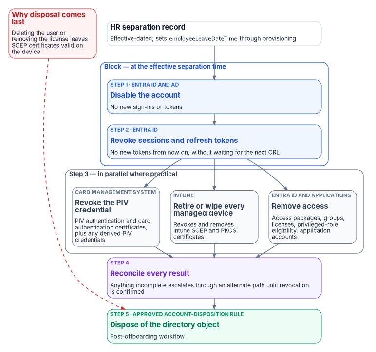
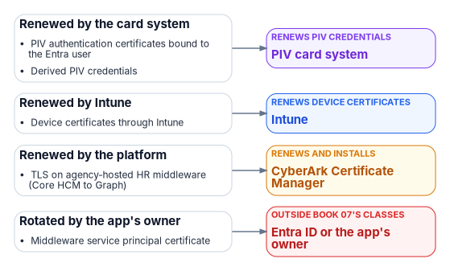

# Chapter 09 — Credentials and Certificates Across Joiner, Mover, Leaver

*Disabling an account doesn't revoke a certificate. Deleting a user doesn't either.*

::: {.callout-note}
## In this chapter
Where certificates sit in an HR-driven identity lifecycle. How a PIV credential comes into being and how Entra ID binds it to a user. What revocation checking does and doesn't do. Derived PIV credentials. Device certificates from Intune and Microsoft Cloud PKI, and the actions that do and don't revoke them. The canonical leaver sequence, and how to run it from Lifecycle Workflows.
:::

## Why certificates need their own chapter

Chapters 05–08 make the account a consequence of the HR record. Certificates don't automatically follow. A PIV authentication certificate is issued through the agency's card management system (CMS) by a certification authority that operates under the Federal PKI Common Policy,[^c09-fips201] and it stays valid until it expires or is revoked; an Intune-delivered device certificate stays on the device until Intune revokes or removes it. Neither is touched by disabling or deleting an Entra user. An HR-driven lifecycle that stops at the account leaves the credentials of a former worker live in every relying party that trusts them: Entra ID, physical access control, on-premises smart card logon, signing and encryption, and other agencies.

Federal guidance treats the person, not the authenticator, as the thing being managed. The GSA/FICAM Identity Lifecycle Management Playbook tells agencies to designate HR systems as the authoritative source for identity creation and termination, and to build a **Master User Record** that links each user's attributes, entitlements and authenticators, both PIV cards and alternative FIDO2 credentials, into one view.[^c09-ilm] The playbook is best practice, not policy.[^c09-ilm] In this book the HR record and Entra ID together play the Master User Record's role for the Microsoft estate, and the CMS remains the system of record for the PIV card.

## Joiner: proofing, issuance, binding

{fig-alt="Left to right: HR joiner event (sponsorship and position sensitivity); identity proofing (PIV process; proofing level recorded); card management (PIV and derived credentials issued); binding (certificateUserIds on the account); phishing-resistant sign-in (certificate-based authentication; assurance recorded)."}

### Proofing and issuance

The ILM Playbook's creation stage starts with identity proofing at IAL3 as described in NIST SP 800-63A-4, which meets the requirements for PIV eligibility. After proofing, the user's information is added to the Master User Record, the identity is bound to one or more phishing-resistant authenticators such as a PIV card or a FIDO2 token, and accounts are created for the systems the user's roles require.[^c09-ilm] The PIV card itself is governed by FIPS 201-3, which establishes the PIV system for federal employees and contractors under HSPD-12.[^c09-fips201] NIST SP 800-63-4 (July 2025, superseding SP 800-63-3) is the current revision of the Digital Identity Guidelines covering proofing, authentication and federation.[^c09-sp80063]

The playbook's point about binding is the one that matters here: without the binding between the card's certificate and the digital identity, a PIV card is just a physical badge. The same binding process applies to PKI and non-PKI derived PIV authenticators.[^c09-ilm]

The gap between account creation and card issuance is normal: provisioning creates the account ahead of day one (Chapter 08), and the card follows proofing and adjudication. Bridge it with a Temporary Access Pass sent through the joiner workflow (Chapter 08), not with a password.

### Binding the PIV certificate to the Entra user

Entra certificate-based authentication (CBA) validates the certificate the user presents against the trusted CAs configured in the tenant, checks the CRL, and then maps a field of the certificate to a user attribute through the tenant's **username bindings**.[^c09-cba-deep] By default the SAN Principal Name maps to `userPrincipalName`.[^c09-cba-deep] The stronger option is the `certificateUserIds` attribute, which holds explicit certificate identifiers:

| Binding (certificate field) | Example value in `certificateUserIds` | Affinity |
|---|---|---|
| PrincipalName | `X509:<PN>bob@woodgrove.com` | Low |
| RFC822Name | `X509:<RFC822>user@woodgrove.com` | Low |
| Subject | `X509:<S>DC=com,DC=contoso,OU=UserAccounts,CN=mfatest` | Low |
| IssuerAndSubject | `X509:<I>…<S>…` | Low |
| SKI (Subject Key Identifier) | `X509:<SKI>…` | High |
| SHA1PublicKey | `X509:<SHA1-PUKEY>…` | High |
| IssuerAndSerialNumber | `X509:<I>…<SR>…` | High |

: CBA username bindings and their affinity[^c09-cba-deep] {.striped .hover}

High-affinity bindings use identifiers that can't be reused, which gives higher assurance that only one certificate can authenticate the user; bindings based on usernames and email addresses are low-affinity.[^c09-cba-deep] If the tenant requires high-affinity binding, Entra drops the low-affinity bindings from evaluation.[^c09-cba-deep] The tenant defaults are low affinity and single-factor; both are settings an administrator changes.[^c09-cba-how] For PIV in a federal tenant, prefer a high-affinity binding.

The consequence for lifecycle is direct: **a high-affinity value identifies one certificate.** A card reissue produces new keys and certificates, so new SKI, SHA1PublicKey and serial-number values, and FIPS 201-3 requires the old card to be revoked when the new one is issued.[^c09-fips201] Even a renewal on the same key changes the serial number and the SHA1PublicKey value, which is the certificate's thumbprint.[^c09-cba-deep] So the binding must be rewritten as part of the CMS's issuance event, and the old value removed; Microsoft's guidance for synchronized values is the same: populate only values for current valid certificates, and remove a value when its certificate expires or is revoked.[^c09-cuid] The binding is lifecycle data, and it needs a writer.

How the value gets written depends on where the user is mastered:

- **Cloud-only users:** the Entra admin center or Microsoft Graph, by at least a Privileged Authentication Administrator.[^c09-cuid][^c09-cba-how] The attribute holds up to 10 values of up to 1,024 characters each, and each value can belong to only one user in the tenant; the admin center accepts up to four values of 120 characters.[^c09-cuid] The Microsoft Entra PowerShell module's `Get-EntraUserCertificateUserIdsFromCertificate` cmdlet computes the correct `certificateUserIds` values from a certificate.[^c09-cuid]
- **Synced users:** only Microsoft Entra Connect can update `certificateUserIds`. Populate `altSecurityIdentities` in on-premises AD and sync it to `certificateUserIds`, either with Connect rules or by syncing the AltSecId value; updating it requires at least the Hybrid Identity Administrator role.[^c09-cuid][^c09-cba-how][^c09-cba-deep]

Microsoft's warning about synced users belongs in the security plan: **Active Directory administrators can change the `certificateUserIds` value in Entra ID for any synchronized account**, and that includes anyone with delegated administrative rights over synchronized users or administrative rights over the Entra Connect servers.[^c09-cuid] Whoever can write `altSecurityIdentities` can decide which certificate signs in as which user. Treat that write path as you treat the access attributes of Chapter 06: one automated writer (the CMS integration), no help-desk or self-service path, and any other write is drift (Chapter 11).

### Revocation checking

Entra ID checks the CRL of the issuing CA, and of the other CAs in the chain up to the root, during CBA sign-in.[^c09-crl] Three properties shape how fast a PIV revocation takes effect in Entra:

- **No CRL, no revocation.** If a trusted CA has no CRL configured, Entra doesn't check revocation and revoked certificates still authenticate.[^c09-cba-how] Turn on **Require CRL validation**, which makes CBA fail for certificates from a CA without a CRL; exempt a CA only while its CRL is being fixed.[^c09-crl]
- **Caching.** Entra caches the CRL. A newly revoked certificate isn't detected until the cache refreshes with a newer CRL; delta CRLs carry those updates, and without them revocation waits on the base CRL's validity period. Entra doesn't support OCSP.[^c09-crl] Microsoft advises revoking tokens manually when immediate revocation is critical.[^c09-crl]
- **Size limits.** In Azure Global, which includes GCC, the CRL download limits are 20 MB for interactive sign-in and 65 MB for the service; in Azure Government (GCC High and DoD) they are 45 MB and 150 MB.[^c09-crl] Check the issuing CAs' CRL sizes against those limits during Phase 1. If Entra can't reach a configured CRL endpoint, CBA fails.[^c09-crl]

So the PIV revocation in the leaver sequence closes CBA *eventually*, on the CA's CRL schedule. The account disable and token revocation steps close Entra *now*. Both are needed: the first protects every other relying party, the second protects the tenant.

### Derived PIV credentials

Derived PIV credentials let a person who holds a valid PIV card carry an equivalent credential on a device that can't use the card. FIPS 201-3 requires PIV card termination procedures to invalidate every derived PIV credential bound to the PIV identity account, and requires the derived PIV authentication certificate to be revoked when its private key can't be securely zeroized or destroyed.[^c09-fips201] NIST SP 800-157 (December 2014) is the current final guideline; SP 800-157 Revision 1 is still a final public draft (November 2024) that widens derived PIV credentials to include non-PKI authenticators verified by the home agency.[^c09-sp800157][^c09-sp800157r1] Plan for both forms in the Master User Record: a derived credential is an authenticator to revoke, and the leaver sequence has to find it.

### Assurance as data

Record each person's identity proofing level and authenticator assurance as governed attributes, not as tribal knowledge. OMB M-22-09 requires phishing-resistant MFA for agency staff, contractors and partners, and a PIV-bound account is how most federal workforce users meet it.[^c09-m2209] Two rules make assurance usable as data: the joiner workflow records the proofing outcome from the credentialing process, and an account whose proofing evidence is missing is itself a finding (Chapter 11), not a default. HR sponsors and triggers proofing; under FIPS 201 the PIV process performs it.

## Mover: usually nothing, sometimes a reissue

Most moves don't touch credentials: the person, the identifier and the PIV identity account stay the same (Chapter 04). Two exceptions:

- **A change that reissues the card** (a legal name change, a contractor whose engagement changes) produces new certificates, and the high-affinity binding must be rewritten. FIPS 201-3 lists an employee status or attribute change among the reasons for reissuance.[^c09-fips201]
- **A change that ends eligibility.** FIPS 201-3 requires termination of the card when, for example, a contractor changes positions and no longer needs access to federal buildings or systems.[^c09-fips201] That is a mover in HR and a leaver for the credential.

## Device certificates: Intune and Microsoft Cloud PKI

Devices get their own certificates, for Wi-Fi, VPN and other authentication, through Intune SCEP or PKCS certificate profiles; Microsoft Cloud PKI can be the issuing CA for SCEP. Cloud PKI is licensed as a subscription on top of Intune Plan 1 or Plan 2; it is available in GCC High but not in DoD environments. Intune hosts each Cloud PKI CA's CRL, which is valid for seven days, republished every 3.5 days, and updated with every revocation.[^c09-cpki] The [SQL Server series, Book 10](../b06-data-platform/22-where-sql-server-touches-adcs.md) covers the move from AD CS to Cloud PKI; this section covers only what the leaver sequence needs.

For Windows devices, Intune documents when a SCEP certificate is revoked and removed:[^c09-intune-remove]

| Action | SCEP certificate |
|---|---|
| User unenrolls the device | Revoked and removed |
| Administrator runs **wipe** | Revoked and removed |
| Administrator runs **retire** | Revoked and removed |
| Device removed from an Entra group | Revoked and removed |
| Certificate profile removed from the group assignment | Revoked and removed |
| User loses, or administrator withdraws, the Intune license | **Stays on the device; not revoked** |
| Administrator **removes the user or group from Entra ID** | **Stays on the device; not revoked** |

: When Intune revokes a SCEP certificate on a Windows device[^c09-intune-remove] {.striped .hover}

The same article lists the behavior for the other platforms; check the platforms the agency manages (on macOS, for example, retire revokes and removes SCEP certificates, and the article notes that using wipe to factory-reset a macOS device isn't supported). Two more caveats from the same source: SCEP certificates from a third-party CA are removed but not revoked, and PKCS certificates are revoked and removed on unenroll, wipe or retire.[^c09-intune-remove]

**The rule that follows: retire or wipe the leaver's devices before deleting the user.** Microsoft gives the same order for a user being removed from Active Directory or Entra ID: wipe or retire the device first, then remove the user.[^c09-intune-remove] Deleting the user first leaves valid device certificates on hardware the agency may not get back.

Manual revocation has a trap of its own. If you revoke a Cloud PKI certificate by hand for a user or device that still has an active SCEP profile assignment, the device requests a new certificate at the next check-in and gets one. To stop reissue, remove all SCEP policy assignments first.[^c09-cpki-monitor]

## The canonical leaver sequence

**Block logical access first.** At the effective separation time, disable sign-in and revoke sessions. Every other revocation — credentials, devices, entitlements, application access — runs after the block, in parallel where practical, and is reconciled to completion. None of them may delay the block.

{fig-alt="A vertical flow. The HR separation record, which sets employeeLeaveDateTime through provisioning, starts the sequence. Step 1, Entra ID and AD: disable the account, so no new sign-ins or tokens. Step 2, Entra ID: revoke sessions and refresh tokens, so no new tokens are issued from then on, without waiting for the next CRL. These two steps form the block. Step 3 fans out into three parallel actions: the card management system revokes the PIV credential and any derived PIV credentials; Intune retires or wipes every managed device, which revokes and removes SCEP and PKCS certificates; and entitlements, access packages, groups, licenses, privileged-role eligibility and application access are removed. All three feed step 4: reconcile every result and escalate anything incomplete through an alternate path. Step 5: dispose of the directory object under the approved account-disposition rule. A red note, 'Why disposal comes last', points at step 5: deleting the user or removing the license leaves SCEP certificates valid on the device."}

1. **Disable the account** in Entra ID, and in AD for synced users. For a hybrid user, Microsoft's procedure disables the account in AD and resets its password twice.[^c09-revoke-access]
2. **Revoke sessions and refresh tokens.** Microsoft's revocation procedure disables the user and then revokes refresh tokens, so the user can't get a new token for any application tied to Entra ID. Access tokens already issued stay valid until they expire (one hour by default) unless the application supports continuous access evaluation, and applications that keep their own session tokens have to end those sessions themselves.[^c09-revoke-access] This is also the step that closes CBA immediately rather than at the next CRL refresh.[^c09-crl]
3. **Revoke credentials, devices and access, in parallel where practical:**
    - **PIV, through the CMS.** Collect and destroy the card where possible; otherwise inform the CA and revoke the PIV authentication and card authentication certificates, and the signature and key management certificates if present. Update the Central Verification System (or its successor), the issuer's records of the card's FASC-N and UUID, and the CMS, and invalidate all derived PIV credentials. For a card that can't be collected, FIPS 201-3 requires the normal termination procedures to be completed within 18 hours of notification, and calls for emergency procedures where 18 hours is too long.[^c09-fips201]
    - **Devices, through Intune.** Retire or wipe every managed device assigned to the leaver. This revokes and removes Intune SCEP and PKCS certificates.[^c09-intune-remove] Wipe needs the device online.[^c09-revoke-access] Remove the leaver from SCEP profile assignments so a manually revoked certificate isn't reissued.[^c09-cpki-monitor]
    - **Access.** Remove privileged-role eligibility and standing privileged access, access packages, groups, Teams, licenses, and application-specific accounts and credentials.
4. **Reconcile every result.** Each action in step 3 reports completion or failure; anything incomplete escalates through an alternate path until revocation is confirmed.
5. **Dispose of the directory object under the approved account-disposition rule** (Chapter 08) — last, because deleting the user leaves device certificates valid on hardware that hasn't been retired.

Steps 1 and 2 run back to back. Disabling first, then revoking, follows Microsoft's documented order;[^c09-revoke-access] revoking first would leave a window in which a still-enabled account could get a new token. Disabling the account doesn't stop the step 3 actions: Intune retire and wipe act on the device, and CMS revocation acts on the credential, not on the user's sign-in.

### Running it from Lifecycle Workflows

The built-in leaver tasks cover groups, Teams, access packages, licenses, disabling the account, revoking refresh tokens and deleting the user, but none of them revokes a PIV credential or retires a device.[^c09-lcw-tasks] Microsoft's real-time termination tutorial, for example, removes the user from all groups and Teams and deletes the account.[^c09-lcw-offboard-portal] The missing steps go through a **custom task extension**, which calls an Azure Logic App (consumption plan).[^c09-lcw-ext]

- Use **Launch and wait**: the next task waits for the Logic App's response, and if no response arrives within the configured duration the task is considered failed.[^c09-lcw-ext] A third-party system such as the CMS integration can send the response if the Logic App only acts as an intermediary.[^c09-lcw-ext]
- Authorize the response with the Logic App's system-assigned managed identity, the default.[^c09-lcw-ext]
- Order the workflow as the sequence above. Tasks run in their execution sequence, and each task's `continueOnError` setting decides whether its failure stops the tasks after it.[^c09-lcw-tasks] Put *Disable user account* and *Revoke all refresh tokens for user* first; then the custom task (one Logic App that starts the Intune retire or wipe and the CMS revocation in parallel and reports both results); then the group, Teams, access package and license removals. Put *Delete user* in a separate post-offboarding workflow keyed to the account-disposition rule. That task doesn't support users with Microsoft Entra role assignments or with membership or ownership of role-assignable groups, so the privileged-access removals have to finish first.[^c09-lcw-tasks]

Custom tasks must be idempotent and use bounded retry with backoff for transient failures. Exhausted retries, validation failures, or permanent errors create a high-priority exception, notify the responsible security and operations teams, and remain open until revocation is confirmed through an alternate path. The exception counts against the separation metrics in Chapter 11.

## What the evidence must show

For each leaver: the HR effective date; the disable and token-revocation timestamps; the device actions and their completion; the CMS revocation record and the CRL that published it; the access removals; any exceptions and how they closed; and the disposition date. Two intervals come out of it: HR effective date to the block (steps 1–2), and HR effective date to the last confirmed revocation. They are what an assessor asks for under PS-4, which requires disabling system access within an organization-defined period and revoking the person's authenticators and credentials (Chapter 11).[^c09-sp80053]

## Certificates in this book and the CLM platform {#certificates-and-the-clm-platform}

[Book 07](../b07-pki/index.md) gives each class of certificate one issuer and one renewal engine, and makes CyberArk Certificate Manager, Self-Hosted the system of record for every certificate that Intune and the PIV system don't manage ([Chapter 04](../b07-pki/04-the-target-pki.md), [Chapter 05](../b07-pki/05-who-owns-the-certificate-estate.md)). The certificates this book's systems depend on map to it as follows; [Book 07, Appendix C](../b07-pki/appendix-c-anatomy-of-the-clm-platform.md) describes the platform itself.

| Certificate | Book 07 class | Issued by | Renewed by | What the CLM platform does |
|---|---|---|---|---|
| PIV authentication certificates bound to the Entra user | PIV | Federal PKI shared service provider | PIV card system | Nothing: the card management system issues and renews |
| Derived PIV credentials | PIV | Federal PKI | PIV card system | Nothing |
| Device certificates through Intune | Device and user auth (Intune) | Cloud PKI or AD CS through the connector | Intune | Nothing: Intune renews and revokes them |
| TLS on agency-hosted HR middleware (Core HCM to Graph) | Internal server TLS | Retained AD CS | CyberArk Certificate Manager | Renews it on the host, if the middleware is agency-hosted (inference) |
| Middleware service principal certificate | Not a Book 07 class | The app's owner | The app's owner or Key Vault | Nothing: an Entra credential |

{fig-alt="PIV authentication certificates bound to the Entra user, Derived PIV credentials go to PIV card system (renews piv credentials); Device certificates through Intune go to Intune (renews device certificates); TLS on agency-hosted HR middleware (Core HCM to Graph) go to CyberArk Certificate Manager (renews and installs); Middleware service principal certificate go to the app's owner or Key Vault (outside book 07's classes)."}

The leaver sequence's certificate steps touch PIV and Intune only; the CLM platform holds none of a worker's personal certificates. Book 07 owns the issuer and renewal decisions for every class above ([Chapter 04](../b07-pki/04-the-target-pki.md), [Chapter 05](../b07-pki/05-who-owns-the-certificate-estate.md)). The research explainer [Certificates, Tokens and Keys Across the Hybrid Estate](../../research/hybrid-credentials.md) follows the PIV card from AD to Entra, including who writes `certificateUserIds` once Entra Connect no longer syncs it.

::: {.callout-tip}
## Continue the book
[← Previous: Chapter 08 — Joiner, Mover, Leaver](08-joiner-mover-leaver.md) · [Book index](index.md) · [Next: Chapter 10 — From Attributes to Access →](10-from-attributes-to-access.md)
:::

[^c09-m2209]: Office of Management and Budget, M-22-09, *Moving the U.S. Government Toward Zero Trust Cybersecurity Principles*, January 26, 2022, <https://www.whitehouse.gov/wp-content/uploads/2022/01/M-22-09.pdf> (accessed Oct 20, 2026).
[^c09-ilm]: GSA / Federal CISO Council ICAM Subcommittee, *Identity Lifecycle Management Playbook* (Executive Summary; Stage 1, Creation; PIV Alternative Authenticators; Disclaimer), <https://www.idmanagement.gov/playbooks/ilm/> (accessed Oct 20, 2026).
[^c09-fips201]: NIST, FIPS 201-3, *Personal Identity Verification (PIV) of Federal Employees and Contractors*, January 2022, §2.9.1 "PIV Card Reissuance Requirements," §2.9.4 "PIV Card Termination Requirements," §2.10.2 "Derived PIV Credential Invalidation Requirements," and §5.1–5.2 (PKI architecture and certificates), <https://csrc.nist.gov/pubs/fips/201-3/final> (accessed Oct 20, 2026).
[^c09-sp80063]: NIST, SP 800-63-4, *Digital Identity Guidelines*, July 2025, <https://csrc.nist.gov/pubs/sp/800/63/4/final> (accessed Oct 20, 2026).
[^c09-sp800157]: NIST, SP 800-157, *Guidelines for Derived Personal Identity Verification (PIV) Credentials*, December 2014, <https://csrc.nist.gov/pubs/sp/800/157/final> (accessed Oct 20, 2026).
[^c09-sp800157r1]: NIST, SP 800-157 Rev. 1 (Final Public Draft), *Guidelines for Derived Personal Identity Verification (PIV) Credentials*, November 14, 2024, <https://csrc.nist.gov/pubs/sp/800/157/r1/fpd> (accessed Oct 20, 2026).
[^c09-sp80053]: NIST, SP 800-53 Rev. 5, *Security and Privacy Controls for Information Systems and Organizations*, September 2020 (updated December 10, 2020), control PS-4, <https://csrc.nist.gov/pubs/sp/800/53/r5/upd1/final> (accessed Oct 20, 2026).
[^c09-cba-deep]: Microsoft Learn, "Microsoft Entra certificate-based authentication technical concepts," <https://learn.microsoft.com/en-us/entra/identity/authentication/concept-certificate-based-authentication-technical-deep-dive> (accessed Oct 20, 2026).
[^c09-cba-how]: Microsoft Learn, "Set up Microsoft Entra certificate-based authentication," <https://learn.microsoft.com/en-us/entra/identity/authentication/how-to-certificate-based-authentication> (accessed Oct 20, 2026).
[^c09-cuid]: Microsoft Learn, "Mapping to the certificateUserIds attribute in Microsoft Entra ID," <https://learn.microsoft.com/en-us/entra/identity/authentication/concept-certificate-based-authentication-certificateuserids> (accessed Oct 20, 2026).
[^c09-crl]: Microsoft Learn, "Microsoft Entra certificate-based authentication Certificate Revocation List (CRL)," <https://learn.microsoft.com/en-us/entra/identity/authentication/concept-certificate-based-authentication-certificate-revocation-list> (accessed Oct 20, 2026).
[^c09-cpki]: Microsoft Learn, "Overview of Microsoft Cloud PKI for Microsoft Intune" (prerequisites; overview of features), <https://learn.microsoft.com/en-us/intune/cloud-pki/> (accessed Oct 20, 2026).
[^c09-intune-remove]: Microsoft Learn, "Remove SCEP and PKCS certificates in Microsoft Intune," <https://learn.microsoft.com/en-us/intune/device-configuration/certificates/remove-profiles> (accessed Oct 20, 2026).
[^c09-cpki-monitor]: Microsoft Learn, "Monitoring for Microsoft Cloud PKI," <https://learn.microsoft.com/en-us/intune/cloud-pki/monitor-certificates> (accessed Oct 20, 2026).
[^c09-revoke-access]: Microsoft Learn, "Revoke user access in Microsoft Entra ID," <https://learn.microsoft.com/en-us/entra/identity/users/users-revoke-access> (accessed Oct 20, 2026).
[^c09-lcw-tasks]: Microsoft Learn, "Lifecycle Workflow built-in tasks," <https://learn.microsoft.com/en-us/entra/id-governance/lifecycle-workflow-tasks> (accessed Oct 20, 2026).
[^c09-lcw-offboard-portal]: Microsoft Learn, "Execute employee termination tasks by using lifecycle workflows," <https://learn.microsoft.com/en-us/entra/id-governance/tutorial-offboard-custom-workflow-portal> (accessed Oct 20, 2026).
[^c09-lcw-ext]: Microsoft Learn, "Lifecycle Workflows custom task extension," <https://learn.microsoft.com/en-us/entra/id-governance/lifecycle-workflow-extensibility> (accessed Oct 20, 2026).
