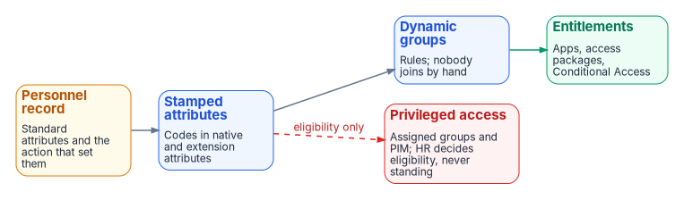

# Chapter 10 — From Attributes to Access

*In a dynamic group, whoever writes the attribute controls access.*

::: {.callout-note}
## In this chapter
The derivation chain. Valid rule patterns against the canonical schema, with Microsoft's limits. Administrative units. Access packages and access reviews that route to the supervisor of record, and the licenses they need. Emergency calling: which Teams policies HR attributes can drive, and why the caller's location never comes from HR. Where dynamic membership stops: privileged roles, PIM and break-glass.
:::

## The derivation chain

The chain runs in one direction: worker record, then stamped attributes, then dynamic groups, then entitlements.

{#fig-ch10-derivation-chain fig-alt="Left to right: an amber personnel record box (standard attributes and the action that set them), stamped attributes (codes in native and extension attributes), dynamic groups (rules; nobody joins by hand), and a green entitlements box (apps, access packages, Conditional Access). A dashed red arrow labelled eligibility only goes from stamped attributes to a privileged access box (assigned groups and PIM; HR decides eligibility, never standing)."}

Rules for dynamic membership evaluate HR-derived attributes, so nobody joins these groups by hand and nobody forgets to leave one: Entra ID adds and removes members as attributes change, and a member can't be added or removed manually.[^c10-dyn-rules] Access packages bundle entitlements behind eligibility rules and approvals that route to the supervisor of record. Conditional Access and application roles consume the same groups; a Conditional Access policy can include or exclude any user group, dynamic or assigned.[^c10-ca-users] Three properties follow:

- **Membership is computed.** There's no group owner to lobby, no ticket to lose, no offboarding step to forget. A mover's access converges on the new assignment within the provisioning and rule-processing cycle.
- **Every entitlement has a *because*.** Access exists because an attribute satisfied a rule; the attribute exists because an HR record asserted it; the record has an author, a date and a business act behind it. That chain can contribute to the authorization and account-management evidence associated with AC-2, which asks the organization to specify group and role membership and to authorize access on a valid authorization and organization-defined attributes,[^c10-nist-80053] and it can be queried end to end.
- **Roles and attributes stop competing.** Roles define what a position may touch; attributes prove which position the person holds. Both resolve against the same upstream record.

Under Zero Trust, delivered through SASE, this chain is the access decision itself: Conditional Access evaluates its policies, including their group assignments, before it grants access,[^c10-ca-users] so an attribute error is an access error (Chapter 02). The chain is only as good as its weakest writer. Microsoft's guidance is to review write permissions for every attribute a rule uses, in Entra ID and in any source directory, before using it in a security-sensitive group.[^c10-dyn-rules] Chapter 06 sets the only writer of the access attributes: the provisioning service.

## Rule patterns

Write rules against the canonical schema of Chapter 06: native attributes where a rule can read them, and the three coded access attributes otherwise. Every rule that grants access excludes disabled accounts and guests explicitly.

| Pattern | Rule | Use |
|---|---|---|
| Organization | `(user.accountEnabled -eq true) -and (user.userType -eq "Member") -and (user.extensionAttribute10 -eq "FIN-LED")` | Organization-scoped access |
| Several organizations | `(user.accountEnabled -eq true) -and (user.userType -eq "Member") -and (user.extensionAttribute10 -in ["FIN-LED","FIN-AP"])` | Roll-up without chains of `-or` |
| Organization and worker type | `(user.accountEnabled -eq true) -and (user.userType -eq "Member") -and (user.extensionAttribute10 -eq "FIN-LED") -and (user.extensionAttribute11 -eq "EMP")` | Employees only |
| Exclusion | `(user.accountEnabled -eq true) -and (user.userType -eq "Member") -and (user.extensionAttribute10 -eq "FIN-LED") -and (user.extensionAttribute11 -ne "CTR")` | Everyone but contractors |
| Position category | `(user.accountEnabled -eq true) -and (user.userType -eq "Member") -and (user.extensionAttribute12 -eq "ANALYST")` | Role-like access across organizations |
| Legal employer | `(user.accountEnabled -eq true) -and (user.companyName -eq "Example Bureau")` | Component-wide baseline |
| Direct reports | `Direct Reports for "<manager object ID>"` | A supervisor's team, maintained from `manager` |
| Device class | `(device.deviceOSType -eq "Windows") -and (device.deviceOwnership -eq "Company")` | Device policy |

: Rule patterns against the canonical schema[^c10-dyn-rules] {.striped .hover}

The codes (`FIN-LED`, `EMP`, `CTR`, `ANALYST`) are placeholders for the agency's own code lists. Extension attributes 1–15 are supported as string properties in rules.[^c10-dyn-rules] The `-in` operator takes a bracketed list.[^c10-dyn-rules] The direct-reports rule uses the manager's object ID; the manager is also added to the group, the rule covers direct reports only (not their reports), and it can't be combined with any other rule.[^c10-dyn-rules] `employeeType`, `employeeOrgData` and `manager` aren't on the list of user properties a rule can read, which is why worker type and organization have coded carriers.[^c10-dyn-rules]

An agent's user account is a kind of user in Entra ID, and user rules evaluate it like any other user unless the rule excludes it.[^c10-dyn-rules] Add that exclusion to every rule that grants workforce access.

### Limits and efficiency

- A rule body can't exceed 3,072 characters, and a tenant can have at most 15,000 dynamic membership groups.[^c10-dyn-rules] Dynamic administrative units count against the same 15,000.[^c10-au-faq]
- Prefer `-eq`, then `-startsWith` or `-endsWith`, over `-match` and `-contains`; replace chains of `-or` on one property with `-in`.[^c10-dyn-efficient]
- Dynamic membership needs an Entra ID P1 license count covering each unique user who is a member of one or more dynamic groups; the licenses don't have to be assigned to those users, and device members need none.[^c10-dyn-rules]

### Governance of the rules themselves

- Code lists are controlled vocabularies owned by HR. A value that isn't on the list is a drift event (Chapter 11).
- Every rule that grants access is validated, run in shadow against the group it replaces, and gated on a verified pilot cohort before it's attached to a resource.
- A group's membership must be explainable from attributes alone. A manual addition to a dynamic group isn't possible;[^c10-dyn-rules] a manual change to an attribute is drift.

## Administrative units

Administrative units scope delegated administration (for example, a help desk that may reset passwords only for one component) without making policy read a container path.[^c10-au-overview] They can't be nested, so a component's divisions are sibling units, not children.[^c10-au-overview] [Book 02, Chapter 05](../b02-identity/05-delegation-without-ous.md) covers the delegation model in full; this section covers only what the derivation chain needs.

An administrative unit's user membership can itself be a dynamic rule, using the same canonical attributes. A dynamic unit holds users or devices, not both, and dynamic rules for groups aren't supported.[^c10-au-dynamic] A dynamic unit needs Entra ID P1 for each administrator and each member (an assigned unit needs P1 only for its administrators).[^c10-au-overview] Dynamic units are available in the global Azure cloud, not in specialized clouds such as Azure Government.[^c10-au-dynamic] GCC tenants use Microsoft Entra ID in the global cloud, while GCC High and DoD tenants use Azure Government,[^c10-gov-identity] so an agency in GCC High or DoD has to maintain unit membership another way.

Restricted management administrative units protect sensitive objects from tenant-level administrators. The setting must be applied when the unit is created and can't be changed afterward.[^c10-au-restricted] It also removes the unit's users and groups from the rest of this chapter: Privileged Identity Management, entitlement management, Lifecycle Workflows and access reviews can't manage users or groups in a restricted management unit.[^c10-au-restricted] Use restriction for a small, deliberately chosen population, never for the governed workforce as a whole; Book 02 Chapter 05 sets the per-unit decision.

## Access packages and access reviews

- **Access packages** carry the entitlements that a rule can't decide alone. An approval policy for users in the directory can name **Manager as approver**,[^c10-ap-approval] which resolves to the `manager` attribute in the user's profile, the relationship the HR feed maintains. Configure a fallback approver: entitlement management sends the request to the fallback when it can't find the requester's manager.[^c10-ap-approval]
- **Access reviews** verify what remains. Reviews can be assigned to **Managers of users**, with a fallback reviewer for users who have no manager in the directory,[^c10-ar-create] and the review population can be scoped to exceptions — access outside the derivation baseline — instead of four hundred rows a reviewer will approve in bulk. A rejected entitlement is removed by fixing the attribute, the rule or the exception that produced it, so the same wrong answer can't regrow.
- **Separation-of-duties checks** read the same rails: whether two roles are held by the same *person* (the `employeeId` anchor) and whether an approver reports to the requester (the `manager` chain). Entitlement management has a built-in separation-of-duties capability for incompatible access packages and groups;[^c10-gov-licensing] the person-level and reporting-chain checks are this program's design and run in the drift engine (Chapter 11).

### Licensing

Entitlement management and access reviews are Microsoft Entra ID Governance features for the organization's member users, including everyone who reviews access or has access reviewed; the capabilities that were generally available in Entra ID P2, including managers as access package approvers, also operate under P2, but Microsoft is adding no new governance features to P2.[^c10-gov-licensing] Several things this book relies on need ID Governance (or the Entra Suite) rather than P2: Lifecycle Workflows, automatic assignment policies, managers requesting access on behalf of their employees, and PIM for Groups eligibility delivered through an access package.[^c10-gov-licensing] An ID Governance subscription also needs a prerequisite product with the P1 or P2 service plan in the tenant, and ID Governance for Government is offered in GCC, GCC High and DoD.[^c10-gov-licensing]

## Emergency calling: what HR attributes supply and what they don't

When Teams Phone replaces a PBX, every Teams-enabled laptop and phone becomes a way to call 911. The FCC reads "multi-line telephone system" to cover cloud systems and over-the-top applications, and the record it relied on named softphone clients and mobile devices.[^c10-fcc1976] The HR record already holds a duty station, so it is tempting to stamp that as everyone's emergency address. Don't. The duty station says where a person is assigned; the 911 rules ask where the caller is when they call. [Book 15, Chapter 05](../b15-day2-operations/05-the-service-catalogs.md) covers the rules and the Teams configuration as operator tasks. This section draws the line between what the identity pipeline can supply and what it must leave to the network and the device.

### The rules ask where the caller is

A dispatchable location is the validated street address of the calling party plus the suite, floor or similar detail needed to find them.[^c10-cfr93] For a device the user can move, which the FCC defines as one the user can move from one endpoint to another without help,[^c10-fcc1976] the rule is tiered. On the premises, the system must send an automated dispatchable location when technically feasible, and otherwise one based on the user's manual update or alternative location information. Off the premises, it must send an automatic dispatchable location if technically feasible, and otherwise one based on the user's manual update or the best available location obtainable at reasonable cost, which may be coordinates.[^c10-cfr916] The FCC allowed systems to rely on the user to provide or confirm a location in response to a prompt, and it noted the risk that manually entered locations go stale.[^c10-fcc1976]

Two things follow for an identity program. A softphone is a non-fixed device, so a location keyed to the person rather than to the network or the device answers the wrong question. And the FCC clarified that the companies that manage and operate these systems may rely on their enterprise customers to acquire, maintain and update location information.[^c10-fcc1976] The location data is the agency's to keep, whoever carries the calls.

::: {.callout-note}
## Interpretation: does the rule bind a federal agency?
The statutory definition of a multi-line telephone system includes systems owned or leased by governmental agencies.[^c10-usc1471] The obligations, though, fall on "a person engaged in the business of" installing, managing or operating one,[^c10-usc623] and the Communications Act defines "person" to include an individual, partnership, association, joint-stock company, trust or corporation, with no mention of government.[^c10-usc153] The FCC's order implementing Kari's Law and Section 506 of RAY BAUM'S Act doesn't discuss federal agencies as operators.[^c10-fcc1976] So the text leaves open whether the FCC could enforce these rules against an agency that runs its own system; the carriers and Microsoft are covered either way. This book's position is to configure the system as if the agency is bound, because the system plainly is one the rules describe. The agency's counsel makes the compliance determination.
:::

### How Teams chooses the location it sends

When a user dials an emergency number, Teams uses the first location available in this order:[^c10-remote-loc]

1. An address the Location Information Service returns for the network element the client is connected to.
2. An address the user confirmed or edited for the network the client is on.
3. An address the operating system suggests.
4. An address the user typed without it being resolved by the address service.
5. An address an administrator assigned statically to the user's phone number.

The tier decides the routing. In the United States, a dynamically acquired address, an operating-system address the user confirmed, and an address picked from the address suggestions go straight to the 911 call center. A statically assigned user address, an unconfirmed operating-system address, a typed address and no address at all are screened by a national call center first, which then transfers the call.[^c10-remote-loc] For Calling Plan users, a call that doesn't get a dynamic address is screened, and if the caller can't give the screening center a location, it is transferred to the 911 call center serving the registered address.[^c10-cp-e911]

{#fig-ch10-emergency-location-precedence fig-alt="Five stacked boxes from top to bottom. One, green: network location from the Location Information Service, matched by access point, switch port, switch or subnet; routed directly to the 911 call center. Two, green: an address the user confirmed or edited for this network; direct. Three, amber: an address the operating system suggests; direct if the user confirms it, screened if not. Four, amber: an address the user typed; direct only if picked from the address suggestions, otherwise screened. Five, red: an address an administrator assigned to the phone number; screened by a national call center, which falls back to it only if the caller can't give a location. A violet box on the side, HR duty station, points with a dashed arrow to box five, labelled fallback only."}

An address written from the HR duty station onto the user's number is the fifth tier. It has a job, as the registered address the screening center falls back on, and for Calling Plan users in the United States an emergency location has to exist when the number is assigned.[^c10-cp-e911] But it is never what a softphone user's 911 call should depend on.

### What HR attributes drive

The identity pipeline's contribution is to put each person under the right emergency *policies*. Teams applies the emergency calling policy, which sets security desk notification and the remote-location experience, to all four ways of connecting to the phone network, and lets it be assigned to users or to network sites; a site assignment wins when the user is at that site.[^c10-dynamic]

| HR-sourced input (Chapter 06) | Teams setting it drives | Why it is safe to drive from HR |
|---|---|---|
| Work country, through the `usageLocation` expression | The emergency numbers a Calling Plan, Operator Connect or Teams Phone Mobile user can dial[^c10-dynamic] | It selects a country's numbers, not a location |
| Organization or region code (`extensionAttribute10`, `extensionAttribute4`), through a dynamic group | The emergency calling policy that names the security desk to notify and how: a chat message, or conferenced in muted or unmuted[^c10-ecp] | It decides who hears about a call. When the user is on a mapped network site, the site's policy overrides it[^c10-ecp] |
| Worker type and position category (`extensionAttribute11`, `extensionAttribute12`): the population licensed for Teams Phone, through a dynamic group | An emergency calling policy with external location lookup turned on, so users off the corporate network can confirm or enter their address, and with an emergency service disclaimer reminding them to[^c10-ecp] | It turns on the prompt; the address comes from the device and the user |
| Duty station, through the facilities inventory | The registered address on the user's number | It is the fallback for screening, the fifth tier, never the answer |
| Separation and reassignment actions (Chapter 08) | Group membership, and with it the policies, removed or re-scoped | The policies follow the person without a ticket |

Give every softphone user the remote-location policy, not only those with a telework agreement. Occasional teleworkers, travelers and people working from another office all leave the mapped network. On the premises the network location is the first tier and wins anyway.[^c10-remote-loc] The schema in Chapter 06 carries no telework attribute, and this design doesn't need one; where the HR system records telework agreements, they are a good trigger for training and reminders, not for the policy.

Assign the policies to groups, with these Teams rules in mind:

- **Group assignment works for the emergency calling policy.** `Grant-CsTeamsEmergencyCallingPolicy` takes a group, with a rank among the groups that hold the same policy type.[^c10-ecp-grant]
- **A direct assignment beats every group.** A policy assigned directly to a user takes precedence over any group assignment, so a one-off assignment silently takes that user out of the HR-driven design.[^c10-gpa] Count each direct assignment against derivation purity, the share of assignments computed by rule ([Chapter 11](11-drift-metrics-and-evidence.md#the-measured-lifecycle)).
- **Keep the groups flat.** Assignments reach only direct members, not members of nested groups; a policy type can be assigned to at most 64 groups; and for large groups a membership change can take 24 hours or more to reach every member.[^c10-gpa] Allow for that lag before treating a mover's old notification policy as drift.
- **Route Direct Routing calls by site.** Microsoft's pages disagree on whether the emergency call routing policy can be assigned to groups: the cmdlet reference shows a group parameter, while the group-assignment reference lists that policy type as excluded.[^c10-ecrp-grant][^c10-gpa] Assigning it to network sites, which Microsoft supports and which follows the caller's actual location, avoids the question.[^c10-dynamic]

### Where the location data comes from

The Location Information Service needs network identifiers, each linked to a validated emergency address with geocodes: subnets, wireless access points by BSSID, switches and switch ports.[^c10-dynamic] None of that is HR data. Validated addresses and floors come from the facilities inventory, subnets from the address-management system ([Book 08, Chapter 07](../b08-ddi/07-cloud-private-endpoints-and-ipam.md)), access points from the wireless controllers, and switch ports from the network access control inventory ([Book 09, Chapter 07](../b09-network/07-network-access-control.md)). Their owners keep them current; the identity team doesn't.

Four network behaviors look like identity failures and aren't. The identity team should know them so it doesn't chase them in the provisioning logs.

- **Subnet lookups depend on trusted IP addresses.** Teams tries a subnet-based location only when the client's public IP address is on the tenant's trusted list; access point and switch lookups happen regardless.[^c10-dynamic]
- **A cloud proxy that rewrites source addresses breaks the lookup.** Microsoft states that cloud proxy deployments that change the source IP addresses of Teams clients don't support network setting lookups,[^c10-dynamic] which matters wherever SASE carries Teams traffic ([Book 09, Chapter 05](../b09-network/05-sd-wan-sase-and-governed-transport.md)).
- **A full-tunnel VPN can hand a home worker the office's address.** This is an inference from the trusted-address rule, not a Microsoft statement: the VPN's exit address is trusted, so if the VPN address pool is mapped to a location, a remote user gets that location. Leave VPN pools unmapped and keep Teams media out of the tunnel.
- **IPv6 can match the site but not the location.** Windows can report a stateful DHCPv6 address with a /128 prefix; the client then matches its network site and gets that site's policies while failing the subnet location match. Microsoft's fix is an IPv4 subnet, switch or access point entry, and its Locations and Networks report shows which requests matched.[^c10-dynamic][^c10-loc-report]

On the device, the remote-location experience runs in Teams on Windows and Mac; Teams mobile detects location automatically but doesn't take a typed address, and Teams phones don't support it.[^c10-remote-loc] Teams asks users for consent to use location unless the operating system's location setting is managed; Windows devices can be managed that way, while macOS doesn't allow full control of Location Services.[^c10-consent] The device-management baseline, not the identity pipeline, sets that switch ([Book 05](../b05-devices/index.md)).

## Where dynamic membership stops

- **Privileged roles use assigned groups.** Role-assignable groups require assigned membership, which Microsoft notes already removes the attribute-write risk.[^c10-dyn-rules] A tenant can have at most 500 role-assignable groups.[^c10-pim-groups]
- **PIM for Groups doesn't take dynamic groups.** Any security group or Microsoft 365 group can be enabled for PIM for Groups except dynamic membership groups and groups synchronized from on-premises.[^c10-pim-groups] Privileged access is assigned, cloud-only and time-bound; HR attributes decide *eligibility* (through an access package), not standing membership.
- **Position decides eligibility, not standing access.** HR attributes — position category and supervisory status — decide who may *request* a privileged role through an access package; the role itself is activated just in time through PIM. For groups that elevate into Entra roles, Microsoft recommends requiring approval for eligible member assignments.[^c10-pim-groups]
- **The same key joins the evidence.** The enterprise person key (Chapter 04) is the join key for the SIEM, database logins and badge events, and any authentication by a person whose HR record shows a separation is an alert, not a log line.
- **Break-glass accounts depend on none of this.** Emergency access accounts are cloud-only accounts on the `*.onmicrosoft.com` domain, not federated or synchronized from on-premises, not associated with any individual, excluded from Conditional Access policies that block or restrict sign-in, and monitored with an alert on every sign-in.[^c10-emergency] In this program they're also excluded from HR-driven rules and lifecycle workflows.

The [SQL Server Identity Transformation workbook, Book 07](../b06-data-platform/17-dynamic-membership-delegation-and-privilege.md) applies this chapter to SQL Server logins and database roles, including naming, shadow testing and rollout gates.

::: {.callout-tip}
## Continue the book
[← Previous: Chapter 09 — Credentials and Certificates Across Joiner, Mover, Leaver](09-credentials-and-certificates.md) · [Book index](index.md) · [Next: Chapter 11 — Drift, Metrics and Evidence →](11-drift-metrics-and-evidence.md)

See the companion guide: [Attribute-Driven Migration from Active Directory to Microsoft Entra ID](../guides/attribute-driven-migration.md), one end-to-end path through this material.
:::

[^c10-dyn-rules]: Microsoft Learn, "Manage rules for dynamic membership groups in Microsoft Entra ID," <https://learn.microsoft.com/en-us/entra/identity/users/groups-dynamic-membership> (accessed Oct 20, 2026).
[^c10-dyn-efficient]: Microsoft Learn, "Create simpler, more efficient rules for dynamic membership groups in Microsoft Entra ID," <https://learn.microsoft.com/en-us/entra/identity/users/groups-dynamic-rule-more-efficient> (accessed Oct 20, 2026).
[^c10-ca-users]: Microsoft Learn, "Conditional Access: Users, groups, agents, and workload identities," <https://learn.microsoft.com/en-us/entra/identity/conditional-access/concept-conditional-access-users-groups> (accessed Oct 20, 2026).
[^c10-nist-80053]: National Institute of Standards and Technology, SP 800-53 Rev. 5, *Security and Privacy Controls for Information Systems and Organizations*, September 2020 (updated December 10, 2020; Release 5.2.0, August 27, 2025), control AC-2, <https://csrc.nist.gov/pubs/sp/800/53/r5/upd1/final> (accessed Oct 20, 2026).
[^c10-au-overview]: Microsoft Learn, "Administrative units in Microsoft Entra ID," <https://learn.microsoft.com/en-us/entra/identity/role-based-access-control/administrative-units> (accessed Oct 20, 2026).
[^c10-au-dynamic]: Microsoft Learn, "Manage users or devices for an administrative unit with rules for dynamic membership groups," <https://learn.microsoft.com/en-us/entra/identity/role-based-access-control/admin-units-members-dynamic> (accessed Oct 20, 2026).
[^c10-au-faq]: Microsoft Learn, "Microsoft Entra administrative units: Troubleshooting and FAQ," <https://learn.microsoft.com/entra/identity/role-based-access-control/admin-units-faq-troubleshoot> (accessed Oct 20, 2026).
[^c10-gov-identity]: Microsoft Learn, "Planning identity for Azure Government applications" (FAQ: "Why does Office 365 GCC use Microsoft Entra Public?"), <https://learn.microsoft.com/en-us/azure/azure-government/documentation-government-plan-identity> (accessed Oct 20, 2026).
[^c10-au-restricted]: Microsoft Learn, "Restricted management administrative units in Microsoft Entra ID," <https://learn.microsoft.com/en-us/entra/identity/role-based-access-control/admin-units-restricted-management> (accessed Oct 20, 2026).
[^c10-ap-approval]: Microsoft Learn, "Change approval settings for an access package in entitlement management," <https://learn.microsoft.com/en-us/entra/id-governance/entitlement-management-access-package-approval-policy> (accessed Oct 20, 2026).
[^c10-ar-create]: Microsoft Learn, "Create an access review of groups and applications," <https://learn.microsoft.com/en-us/entra/id-governance/create-access-review> (accessed Oct 20, 2026).
[^c10-gov-licensing]: Microsoft Learn, "Microsoft Entra ID Governance licensing fundamentals," <https://learn.microsoft.com/en-us/entra/id-governance/licensing-fundamentals> (accessed Oct 20, 2026).
[^c10-pim-groups]: Microsoft Learn, "Privileged Identity Management (PIM) for Groups," <https://learn.microsoft.com/en-us/entra/id-governance/privileged-identity-management/concept-pim-for-groups> (accessed Oct 20, 2026).
[^c10-emergency]: Microsoft Learn, "Manage emergency access admin accounts," <https://learn.microsoft.com/en-us/entra/identity/role-based-access-control/security-emergency-access> (accessed Oct 20, 2026).
[^c10-fcc1976]: Federal Communications Commission, FCC 19-76, *Report and Order, Implementing Kari's Law and Section 506 of RAY BAUM'S Act; Inquiry Concerning 911 Access, Routing, and Location in Enterprise Communications Systems*, PS Docket Nos. 18-261 and 17-239, adopted August 1, 2019, paras. 48 (scope of MLTS), 153–154 (user-provided or confirmed location), 164 (reliance on enterprise customers) and note 402 (fixed and non-fixed devices), <https://docs.fcc.gov/public/attachments/FCC-19-76A1.pdf> (accessed Oct 30, 2026).
[^c10-cfr93]: Electronic Code of Federal Regulations, 47 CFR § 9.3, definitions of "Dispatchable location," "Alternative location information" and "Multi-line telephone system or MLTS," <https://www.ecfr.gov/current/title-47/chapter-I/subchapter-A/part-9/subpart-A/section-9.3> (accessed Oct 30, 2026).
[^c10-cfr916]: Electronic Code of Federal Regulations, 47 CFR § 9.16(b)(3)(ii)–(iii), dispatchable location for on-premises non-fixed and off-premises devices, <https://www.ecfr.gov/current/title-47/chapter-I/subchapter-A/part-9/subpart-F/section-9.16> (accessed Oct 30, 2026).
[^c10-usc1471]: 47 U.S.C. § 1471(2), definition of "multi-line telephone system," <https://www.govinfo.gov/link/uscode/47/1471?link-type=html> (accessed Oct 30, 2026).
[^c10-usc623]: 47 U.S.C. § 623(b)–(c), configuration of multi-line telephone systems for direct dialing of 9-1-1 (Kari's Law), <https://www.govinfo.gov/link/uscode/47/623?link-type=html> (accessed Oct 30, 2026).
[^c10-usc153]: 47 U.S.C. § 153(39), definition of "person," <https://www.govinfo.gov/link/uscode/47/153?link-type=html> (accessed Oct 30, 2026).
[^c10-remote-loc]: Microsoft Learn, "Emergency addresses for remote locations," sections Location precedence, Emergency address classification and routing, and Notes and restrictions, <https://learn.microsoft.com/microsoftteams/emergency-calling-dispatchable-location> (accessed Oct 30, 2026).
[^c10-cp-e911]: Microsoft Learn, "Emergency calling considerations for Microsoft Calling Plans," sections Emergency call enablement, Dynamic emergency calling and Emergency call routing (United States), <https://learn.microsoft.com/microsoftteams/considerations-calling-plan> (accessed Oct 30, 2026).
[^c10-dynamic]: Microsoft Learn, "Plan and configure dynamic emergency calling," sections Configure network settings, Configure Location Information Service, IPv6 subnet matching and Configure emergency policies, <https://learn.microsoft.com/microsoftteams/configure-dynamic-emergency-calling> (accessed Oct 30, 2026).
[^c10-ecp]: Microsoft Learn, "Manage emergency calling policies in Microsoft Teams," including Create a custom emergency calling policy, <https://learn.microsoft.com/microsoftteams/manage-emergency-calling-policies> (accessed Oct 30, 2026).
[^c10-ecp-grant]: Microsoft Learn, "Grant-CsTeamsEmergencyCallingPolicy," GrantToGroup parameter set, <https://learn.microsoft.com/powershell/module/microsoftteams/grant-csteamsemergencycallingpolicy> (accessed Oct 30, 2026).
[^c10-ecrp-grant]: Microsoft Learn, "Grant-CsTeamsEmergencyCallRoutingPolicy," GrantToGroup parameter set, <https://learn.microsoft.com/powershell/module/microsoftteams/grant-csteamsemergencycallroutingpolicy> (accessed Oct 30, 2026).
[^c10-gpa]: Microsoft Learn, "New-CsGroupPolicyAssignment," description and notes (excluded policy types, rank, direct-assignment precedence, nested groups, 64-group limit, propagation time), <https://learn.microsoft.com/powershell/module/microsoftteams/new-csgrouppolicyassignment> (accessed Oct 30, 2026).
[^c10-loc-report]: Microsoft Learn, "Microsoft Teams Locations and Networks report," <https://learn.microsoft.com/microsoftteams/teams-analytics-and-reports/locations-networks> (accessed Oct 30, 2026).
[^c10-consent]: Microsoft Learn, "User location consent experience in Microsoft Teams," <https://learn.microsoft.com/microsoftteams/privacy/user-location-data> (accessed Oct 30, 2026).
