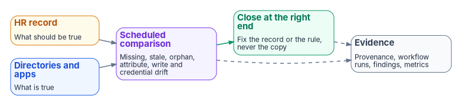

# Chapter 11 — Drift, Metrics and Evidence

*An architecture that can't measure its own revocation latency is asserting PS-4 on faith.*

::: {.callout-note}
## In this chapter
Six lifecycle metrics. The drift classes between the HR record and the directory, and the signal for each. What evidence each event leaves, and how long Entra ID keeps it. The control-support mapping for AC-2, PS-4, PS-5, IA-4 and SI-12, and the monitoring and audit controls that consume it.
:::

## The measured lifecycle

An event-driven lifecycle is also a measured one: every interval from event to action is a number.

| Metric | Definition | What it evidences |
|---|---|---|
| Separation-to-block interval | HR effective date and time → account disabled and sessions revoked (Chapter 09, steps 1–2) | PS-4a: system access disabled within the organization-defined period, continuously |
| Separation-to-revocation interval | HR effective date and time → last confirmed revocation in the leaver sequence (Chapter 09, step 4) | PS-4b: authenticators and credentials terminated or revoked, with exceptions and how they closed |
| Transfer-to-review interval | Transfer effective date → completion of the review on residual access | PS-5: ongoing need for access reviewed and transfer actions initiated within the organization-defined period |
| Joiner readiness rate | Share of new hires whose account, licenses and baseline access exist at start of day one | AC-2 automation working in the creation direction |
| Correlation coverage | Share of enabled accounts that resolve to a current worker record by the correlation key (Chapter 04) | The orphan population, as a query instead of a hunt |
| Derivation purity | Share of access-granting memberships computed by rule rather than assigned by hand | How much of the estate still runs on fragments |

: Lifecycle metrics[^c11-nist-80053] {.striped .hover}

None of these numbers exists in a ticket-driven estate, because the events they measure aren't recorded as events. Two inputs shape the first metric and belong in its definition: the Lifecycle Workflows schedule interval (Chapter 08), which is three hours by default and can be set from 1 to 24 hours,[^c11-lcw-schedule] and the CRL publication interval of the PIV issuing CA (Chapter 09).

These metrics are also what CA-7 asks for. Continuous monitoring requires the organization to establish system-level metrics, the frequencies for monitoring them and for assessing control effectiveness, and the response actions and reporting that follow.[^c11-nist-80053] The six metrics above are candidates for those system-level metrics; choosing them, and their thresholds, is the agency's decision.

## Drift between HR and the directory

Drift is any difference between what the HR record says and what the directory holds. Each class has a detection signal and a default severity:

{#fig-ch11-drift-evidence-loop fig-alt="An amber HR record box (what should be true) and a blue directories and apps box (what is true) both feed a violet scheduled comparison box (missing, stale, orphan, attribute, write and credential drift). It feeds a green close-at-the-right-end box (fix the record or the rule, never the copy). Dashed lines from both go to a grey evidence box (provenance, workflow runs, findings, metrics)."}

| Drift class | Example | Detection signal | Severity |
|---|---|---|---|
| Missing identity | A worker record with no account after a provisioning cycle | Set difference: active HR records without a matching `employeeId` | High |
| Stale access | An enabled account for a separated worker | Same `employeeId`: terminated in HR, enabled in Entra or AD | High |
| Orphan account | An enabled account that matches no worker record | Enabled accounts with no or unknown `employeeId` | High |
| Attribute drift | A department, code or manager value that differs from HR | Field-by-field comparison of the canonical schema (Chapter 06) | Medium |
| Unauthorized write | A write to an HR-mastered attribute by a principal other than the provisioning service | Entra audit log and AD change auditing, filtered on the attributes of Chapter 06 and `certificateUserIds` / `altSecurityIdentities` | High |
| Credential drift | A valid PIV binding, derived credential or device certificate for a separated worker | CMS status and Intune certificate reports joined on the worker | High |
| Schema drift | A record that fails validation in the middleware | The middleware's validation output (Chapter 05) | Medium |

: Drift classes and how to detect them {.striped .hover}

The severities are this program's defaults, not an external standard. The provisioning logs are the first source for most of these: the API client already reads them for each record's result (Chapter 05). The rest are joins between the HR extract, the directory and the CMS, on the one identifier they share. Microsoft Entra ID Governance also offers Account Discovery, which finds existing accounts in a target application and identifies which have matching Entra accounts and which are orphans;[^c11-gov-licensing] it extends the orphan class past the directory.

In the first month of a new pipeline, expect a burst of high-severity findings: leavers the manual process hadn't caught up with, and orphan accounts that years of ticket-driven account creation left behind and the HR-driven pipeline can now see. That burst is the measurement working, not the pipeline failing.

## The evidence each event leaves

| Event | Evidence | Kept in Entra ID |
|---|---|---|
| Any HR event | The middleware's provenance record: source event ID, payload hash, derivation inputs, outcome (Chapter 05) | Not in Entra ID; the middleware writes it to the agency's log store |
| Provisioning | The provisioning log entry for the record | 30 days with a premium edition, 7 days with Free[^c11-prov-logs] |
| Joiner, mover, leaver | Lifecycle Workflows run history, per task | Viewable for up to 30 days; download it as a report to keep it longer[^c11-lcw-history][^c11-lcw-download] |
| Leaver credentials | Intune device action records; the CMS revocation record and the CRL that published it (Chapter 09) | Outside Entra ID |
| Access | Group membership changes and the rule that produced them; access-review decisions | Audit log: 30 days with P1 or P2, 7 days with Free;[^c11-retention] access-review history reports stay downloadable for 30 days after they're created[^c11-ar-history] |

: Evidence by event {.striped .hover}

Keep the evidence outside the directory, in the agency's log store, for the retention period the records schedule sets: the account itself is disposed of under the account-disposition rule (Chapter 08), and the evidence has to outlive it. Entra ID's own retention is far shorter than any federal records schedule, and it isn't retroactive: data that expired before it was exported can't be recovered.[^c11-retention] Route the audit, sign-in and provisioning logs to Azure Monitor, a storage account or the agency's SIEM from the first day of the pilot,[^c11-retention][^c11-prov-logs] and export entitlement-management audit events the same way.[^c11-em-logs]

That retention is AU-11, which requires audit records to be kept for an organization-defined period to support after-the-fact investigations and records requirements; the unauthorized-write signal in the drift table supports the review of audit records for inappropriate or unusual activity that AU-6 requires.[^c11-nist-80053]

## Control support: NIST SP 800-53 Rev. 5

The architecture implements mechanisms and produces evidence for these controls. It doesn't satisfy any of them on its own: each also needs agency policy, organization-defined parameters, procedures, and assessment. The last column is what the agency still has to supply. Control text is from SP 800-53 Rev. 5, Release 5.2.0.[^c11-nist-80053]

| Control | Architecture contribution | Evidence produced | Residual requirements |
|---|---|---|---|
| **AC-2** Account Management | Every account traces to a worker record; creation, change and disablement follow hire, transfer and separation events, which aligns account management with personnel termination and transfer (AC-2l); authorizations resolve to attribute, rule and record | Provenance records, provisioning logs, rule definitions, access-review decisions | Account types and conditions of membership; account managers; the organization-defined periods; accounts outside the HR population (non-person, emergency, shared) |
| **AC-2(1)** Automated System Account Management | Provisioning and Lifecycle Workflows run the account lifecycle from effective-dated HR events | Workflow run history, per task; provisioning logs | Automation for applications not integrated with enterprise identity services |
| **PS-4** Personnel Termination | The separation record starts the leaver sequence on the effective date; the block and the revocations are timestamped and reconciled | Separation-to-block and separation-to-revocation intervals; CMS and Intune records; exceptions | The organization-defined time period; exit interviews, retrieval of security-related property, and retained access to information the individual controlled (PS-4c–e); separations HR records late |
| **PS-5** Personnel Transfer | The mover event re-derives access and starts a review of residual access | Transfer-to-review interval; review decisions | Review of logical and physical access needs; the organization-defined actions and time period; notification of the organization-defined personnel (PS-5d) |
| **IA-4** Identifier Management | One enterprise person key with mapped source, affiliation and directory keys, preserved across rehire and conversion (Chapter 04); worker type available as the IA-4(4) status characteristic (contractor, foreign national, non-organizational user) | Correlation coverage; identifier mapping records | The identifier decision; authorization to assign identifiers; the reuse-prevention period; identifiers for non-person entities |
| **SI-12** Information Management and Retention | Lineage for governed identity facts, from the HR record through middleware provenance to each consumer | Provenance records retained in the agency's log store | Records schedules, legal holds, and disposition for each category of record; privacy requirements for workforce data |

: What the architecture contributes to account-management and personnel-security controls {.striped .hover}

The agency's full requirements mapping should separate binding authorities (OMB M-19-17,[^c11-m1917] FIPS 201-3,[^c11-fips201] the agency's own policy) from implementation guidance (the FICAM Identity Lifecycle Management Playbook, which describes itself as best practice rather than policy,[^c11-ilm] and CISA's Zero Trust Maturity Model[^c11-ztmm]), and record for each control the organization-defined parameters, inherited controls, residual procedures, evidence, and validation status. The compliance treatment of the same controls is in [Federal Compliance Vol I Book 04](../../compliance/Vol_I_Book_04_HRIT_Identity_Org_SSOT.md).

::: {.callout-tip}
## Continue the book
[← Previous: Chapter 10 — From Attributes to Access](10-from-attributes-to-access.md) · [Book index](index.md) · [Next: Chapter 12 — Execution Plan →](12-execution-plan.md)
:::

[^c11-nist-80053]: National Institute of Standards and Technology, SP 800-53 Rev. 5, *Security and Privacy Controls for Information Systems and Organizations*, September 2020 (updated December 10, 2020; Release 5.2.0, August 27, 2025), controls AC-2, AC-2(1), AU-6, AU-11, CA-7, IA-4, IA-4(4), PS-4, PS-5 and SI-12, <https://csrc.nist.gov/pubs/sp/800/53/r5/upd1/final> (accessed Oct 20, 2026); control text checked against NIST's OSCAL catalog, Release 5.2.0, <https://raw.githubusercontent.com/usnistgov/oscal-content/main/nist.gov/SP800-53/rev5/json/NIST_SP-800-53_rev5_catalog.json> (accessed Oct 20, 2026).
[^c11-lcw-schedule]: Microsoft Learn, "Customize a workflow schedule," <https://learn.microsoft.com/en-us/entra/id-governance/customize-workflow-schedule> (accessed Oct 20, 2026).
[^c11-gov-licensing]: Microsoft Learn, "Microsoft Entra ID Governance licensing fundamentals" (section "Account Discovery"), <https://learn.microsoft.com/en-us/entra/id-governance/licensing-fundamentals> (accessed Oct 20, 2026).
[^c11-prov-logs]: Microsoft Learn, "How to download and analyze the Microsoft Entra provisioning logs" (section "What you should know"), <https://learn.microsoft.com/en-us/entra/identity/monitoring-health/howto-analyze-provisioning-logs> (accessed Oct 20, 2026).
[^c11-lcw-history]: Microsoft Learn, "Lifecycle Workflows history," <https://learn.microsoft.com/en-us/entra/id-governance/lifecycle-workflow-history> (accessed Oct 20, 2026).
[^c11-lcw-download]: Microsoft Learn, "Download workflow history reports," <https://learn.microsoft.com/en-us/entra/id-governance/download-workflow-history> (accessed Oct 20, 2026).
[^c11-retention]: Microsoft Learn, "Microsoft Entra data retention," <https://learn.microsoft.com/en-us/entra/identity/monitoring-health/reference-reports-data-retention> (accessed Oct 20, 2026).
[^c11-ar-history]: Microsoft Learn, "Create and manage downloadable access review history report in Microsoft Entra access reviews," <https://learn.microsoft.com/en-us/entra/id-governance/access-reviews-downloadable-review-history> (accessed Oct 20, 2026).
[^c11-em-logs]: Microsoft Learn, "Archive logs and reporting on entitlement management in Azure Monitor," <https://learn.microsoft.com/en-us/entra/id-governance/entitlement-management-logs-and-reporting> (accessed Oct 20, 2026).
[^c11-m1917]: Office of Management and Budget, M-19-17, *Enabling Mission Delivery through Improved Identity, Credential, and Access Management*, May 21, 2019, <https://www.whitehouse.gov/wp-content/uploads/2019/05/M-19-17.pdf> (accessed Oct 20, 2026).
[^c11-fips201]: National Institute of Standards and Technology, FIPS 201-3, *Personal Identity Verification (PIV) of Federal Employees and Contractors*, January 2022, <https://csrc.nist.gov/pubs/fips/201-3/final> (accessed Oct 20, 2026).
[^c11-ilm]: GSA / Federal CISO Council ICAM Subcommittee, *Identity Lifecycle Management Playbook* (Disclaimer), <https://www.idmanagement.gov/playbooks/ilm/> (accessed Oct 20, 2026).
[^c11-ztmm]: Cybersecurity and Infrastructure Security Agency, *Zero Trust Maturity Model*, Version 2.0, April 2023, <https://www.cisa.gov/sites/default/files/2023-04/CISA_Zero_Trust_Maturity_Model_Version_2_508c.pdf> (accessed Oct 20, 2026).
