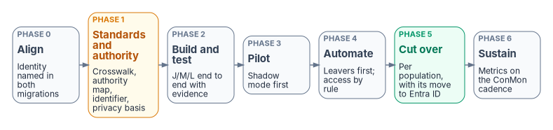

# Chapter 12 — Execution Plan

*Designate the source, prove the pipe, automate the lifecycle, then derive access.*

::: {.callout-note}
## In this chapter
The one phase model this site uses, 0 to 6, with each phase's work and exit gate. The program at a glance. Roles. The open verification register.
:::

## Sequencing principle

Each phase's gate is the next phase's precondition. The order isn't optional: deriving access from attributes nobody has agreed to trust is how fragmented truth gets rebuilt with better tooling. One caveat governs the whole program: the source must be *correct*, not just *designated*. A drifted HR feed produces drifted access faster than any ticket queue could, so data quality at the source is Phase 1 work, not a later clean-up. A phase that can't pass its gate stops the plan, not the standard.

**About the numbers in the gates.** Thresholds such as 99% correlation or "zero missed leavers across a pay-period cycle" are *proposed starting criteria*, not federal requirements. The agency approves or replaces each one through its risk governance, and a risk-tiered threshold — tighter for privileged and high-impact populations — is usually more useful than one enterprise-wide number. Where a gate says "risk-approved", the agency sets the value.

{fig-alt="Seven boxes left to right. Phase 0, align: identity named in both migrations. Phase 1 in amber, standards and authority: crosswalk, authority map, identifier, privacy basis. Phase 2, build and test: joiner, mover, leaver end to end with evidence. Phase 3, pilot: shadow mode first. Phase 4, automate: leavers first; access by rule. Phase 5 in green, cut over: per population, with its move to Entra ID. Phase 6, sustain: metrics on the ConMon cadence."}

## Phase 0 — Program alignment

*Directed by the Federal HR 2.0 memo's preparation actions: executing it is compliance, not overhead (Chapter 03).*[^c12-hr20memo]

- Name the agency's integrated project team point of contact (for CFO Act agencies, a full-time project manager) and the working-group points of contact.
- Inventory integration points, interfacing systems and data flows, and **name the HR-driven identity feed as one of them** — a new interconnection consumer, not an afterthought.
- In the agency's Entra ID migration plan, name HR as the source for each population that moves, so the two migrations share one cutover schedule.
- Identify legacy identity-relevant data to retain, and define how to preserve what doesn't migrate.
- Confirm the pause on any competing Core HCM modernization; the memo allows exceptions only from the OMB and OPM Directors.

**Gate:** the integration-point inventory is signed by the ISSO and submitted to the agency's HR 2.0 team, which sends the agency's responses to OMB and OPM as the memo directs.

## Phase 1 — Attribute authority and schema

- Record the enterprise identifier decision (Chapter 04): which key is the enterprise person key, and how source keys map to it.
- Build the standard-attribute crosswalk (Chapter 06): each OPM standard element an identity decision reads, mapped to the canonical model; and the nature-of-action trigger table (Chapter 08).
- Establish the privacy basis: routine use under the governing SORNs, the updated PIA, and the minimized attribute set (Appendix B).
- Decide the contractor and vendor source (Chapter 06): Core HCM contingent workers, the PIV sponsorship system, the agency's contractor suitability register, or a combination with one authority per fact. Retire the COR spreadsheets as a source of truth.
- Decide the contractor PIV path (Chapter 09): the contractor joiner as the sponsorship trigger, the card management system's termination, revocation and expiry events into the middleware with their latency, and the end-date notice to the PIV office. The PIV office owns the interface; identity engineering and security are consulted. **Pending proof.** The contractor PIV path is the program's design and hasn't yet been validated in practice; the criteria for Proved are in the research page's [Status and review](../../evaluations/oracle-contingent-worker-contractor-source.md#status-and-review).
- Sign the attribute authority map (Chapter 04): every attribute any access decision reads, its authoritative system, its derivation rule if derived, and its data-quality owner.
- Finalize the canonical schema (Chapter 06) against Oracle HCM field names, and validate the crosswalk against a sandbox extract. Confirm the extension-attribute carriers are free and in the provisioning apps' target lists.
- Define the worker-type taxonomy (employee, contractor, intern, volunteer, vendor, external), each mapped to license, access ceiling and retention, and the code lists for the three access attributes.
- Define UPN and `samAccountName` generation rules, OU placement rules for AD-landed users, and scoping filters: which HR records provision at all, including leave of absence, secondment and historical records.
- Baseline HR data against reality for worker type, organization, supervisor and status, and fix errors at the source. Populate `employeeId` on existing accounts; flag every unmatched enabled account as an orphan candidate with an owner.
- Inventory the PIV issuing CAs' CRL distribution points and sizes against Entra's limits (Chapter 09).

**Gate:** the identifier decision, authority map and schema are signed; correlation-key population meets the approved threshold on the pilot cohort (proposed starting point: at least 99%); every enabled account is correlated to a worker record or on a dated exception list.

## Phase 2 — Pipeline build and test

- Build the workforce identity service: source-boundary transformation, validation, sequencing, bounded retry, reconciliation, and provenance, hosted in-boundary (Chapter 05).
- Configure the API-driven provisioning apps and grant the client only the upload and provisioning-log permissions it needs, using the least-privileged option that fits the deployment (Chapter 05).
- Define the joiner, mover and leaver workflows and their triggers (Chapter 08), including the custom task extensions for device retirement and CMS revocation (Chapter 09). Lifecycle Workflows needs Entra ID Governance or Entra Suite licenses, and a custom task extension hands a step to a Logic App that calls the external system.[^c12-lcw-overview][^c12-lcw-tasks]
- Prove the chain end to end in a test tenant with canned feed payloads and a sandbox extract.
- Size the throttling envelope: batches of up to 50 operations per call, pacing to the stricter published rate limit, and the daily call budget against the tenant cap — 2,000 calls per 24 hours with Entra ID P1 or P2, 6,000 with Entra ID Governance, which at 50 operations a call is 300,000 records a day (Chapter 05).[^c12-api-limits]

**Gate:** joiner, mover and leaver each run end to end in the test tenant with a provenance record and a workflow run; the leaver run includes a device retire and a test-CA certificate revocation.

## Phase 3 — Hybrid go-live (pilot)

- Deploy at least two provisioning agents under a gMSA with OU-scoped rights (Chapter 05) and map SCIM to AD attributes.
- Run the initial full sync with scoping filters; reconcile mismatches **before** enabling deltas. Enable delta feeds immediately after the initial sync, with monitoring and alerting.
- Run the pilot cohort in **shadow mode** first: the pipeline computes what it would do, and the output is compared with the directory's actual state. Then let it act.

**Gate:** the risk-approved observation period in which every pipeline-versus-directory difference is explained and fixed at the right end; a full joiner/mover/leaver cycle on the pilot cohort closes with evidence; zero unmatched-record creations.

## Phase 4 — Lifecycle automation and attribute-derived access

- Turn causation on for covered populations, **leaver first**, because revocation is where the risk and the evidence value are. Measure the separation-to-block and separation-to-revocation intervals from day one (Chapter 11).
- Route exceptions (emergency terminations, litigation holds) through defined manual entries into the same workflows and the same evidence.
- Validate rehire and conversion matching against history before it acts.
- Convert hand-maintained groups to rules for dynamic membership, group by group, with a shadow comparison before each cutover (Chapter 10). Re-base access packages so approvals route to the supervisor of record: entitlement management's "Manager as approver" reads the user's `manager` attribute, so the HR-written supervisor link becomes the approval route, with a fallback approver for users who have none.[^c12-ap-approval]
- Inventory OU-bound policy for retirement in Phase 5.

**Gate (proposed starting criteria):** zero missed leavers across a full pay-period cycle; separation-to-block within the approved threshold and separation-to-revocation measured in hours; day-one readiness demonstrated; the account-creation ticket queue retired for covered populations; for covered applications, every entitlement resolves to a rule, an attribute and a worker record; a test reorganization in HR propagates to groups and approvals with zero manual directory changes.

## Phase 5 — Cutover, population by population

Each population cuts over to HR-driven identity as it moves to Entra ID, and the ticket path for account creation closes for it (Appendix C).

- Align the cutover with the agency's Core HCM onboarding: the provisioning feed must be ready when the agency's interconnections go live (Chapter 03).
- As populations become cloud-mastered, retarget their provisioning from the AD app to the Entra app — a configuration change per population, evidence-gated — with the AD leg dormant but intact until nothing remains synced.
- Retire OU-bound policy deliberately, and retire EHRI- and eOPF-shaped integrations as the program decommissions those systems, not before.

**Gate:** cloud-mastered populations run the full lifecycle cloud-native with evidence; no AD writes for migrated populations; the rollback path tested once.

## Phase 6 — Sustained posture

- Drift detection runs continuously (Chapter 11); the six lifecycle metrics are reported on the ConMon cadence.
- Code lists, rules and workflows change only through change control, with the same shadow-then-act discipline.
- Annual re-validation of the authority map, the schema and the verification register.

**Gate (recurring):** metrics within thresholds for each reporting period; every high-severity drift finding closed or on a dated plan.

## The program at a glance

| Phase | Output | Gate |
|---|---|---|
| 0 — Program alignment | Integration-point inventory; named points of contact | Inventory signed and submitted |
| 1 — Attribute authority and schema | Signed authority map and schema; source data fixed; correlation baseline | Identifier decision recorded; risk-approved correlation threshold met on pilot; every enabled account correlated or excepted |
| 2 — Pipeline build and test | Middleware, apps, workflows, extensions in a test tenant | End-to-end J/M/L with evidence, including device and certificate steps |
| 3 — Hybrid go-live (pilot) | Agents, initial sync, deltas, shadow mode | Risk-approved observation period with explained differences; zero unmatched creations |
| 4 — Lifecycle automation and derived access | Leaver-first automation; dynamic groups; re-based access packages | Proposed: zero missed leavers; block within threshold; test reorganization with zero manual changes |
| 5 — Cutover to cloud-mastered | Per-population retarget; OU policy retired | Cloud-native lifecycle with evidence; rollback tested |
| 6 — Sustained posture | Continuous drift detection and metrics | Recurring thresholds met |

: The phase model {.striped .hover}

Phases 1 and 2 produce no visible change for end users, which is exactly why estates skip them, automate against unverified data in month one, and spend year two explaining to an assessor why the automation deprovisioned a regional director.

## Roles

| Role | Owns |
|---|---|
| Agency HR 2.0 integrated project team point of contact | Phase 0 actions, the interface inventory, the onboarding schedule |
| Identity engineering | Middleware, provisioning apps, agents, mappings, workflows, extensions |
| Oracle HCM administrator | Extracts, feed enablement, REST access, sandbox data |
| PIV / credentialing office | The CMS, issuance and revocation, the CMS side of the leaver extension |
| Endpoint management | Intune device actions and certificate profiles |
| ISSO | Phase gates, evidence review, the security assessment (Appendix B) |
| Service desk | Exceptions and failed-task follow-up |

: Roles {.striped .hover}

## Open verification register

| Item | Why it matters | Status |
|---|---|---|
| Post-award interface requirements for Core HCM | May constrain or enrich the feed contract | Open; check at engagement time |
| eOPF and EHRI decommission schedule | Times the retirement of EHRI-shaped integrations | Open; the memo says only that the Core HCM system will "eventually" make them redundant[^c12-hr20memo] |
| Native Oracle HCM connector for Entra | Would become an optimization inside the architecture | Watch |
| Agency onboarding schedule movement | The interconnection go-live is the deadline | Watch program communications |
| OPM standard data elements and codes used by the crosswalk | The crosswalk's contract (Chapter 06) | Confirm against OPM's current data standards and how Core HCM exposes them |
| Whether the agency's Core HCM configuration records contingent workers | The contractor and vendor source decision (Chapter 06) | Confirm with the HR 2.0 program |
| Whether the card management system can publish termination, revocation and expiry events keyed on the enterprise person key, and how fast | Whether the card system can be a contractor leaver input (Chapter 09) | Confirm with the PIV office and the card management system's operator |
| Whether the contractor suitability register records engagement end dates and the enterprise person key | Whether it can be the contractor leaver signal and join on one key (Chapter 06) | Confirm with the register's owner |
| Nature-of-action families and codes | The lifecycle trigger table (Chapter 08) | Checked against the GPPA, October 2026 edition;[^c12-gppa] re-check at engagement time |
| Routine use under the governing SORNs; PIA update | The privacy basis for the feed (Appendix B) | Confirm with the agency privacy office |
| User source-of-authority transfer and Entra-to-AD provisioning in the tenant | The target landing pattern (Chapter 05) | Confirm availability and prerequisites in GCC |
| Extension-attribute carriers free and mappable | Phase 1 gate | Check per tenant |
| PIV issuing CA CRL sizes and delta CRLs | Revocation latency and CBA availability (Chapter 09) | Check per issuing CA |
| ~~GCC availability of API-driven provisioning and Lifecycle Workflows~~ | Licensing and the Phase 2 gate | **Closed.** Microsoft Entra ID Governance for Government is available in GCC, GCC High and DoD;[^c12-lf] Microsoft lists API-driven inbound provisioning as available to US Government tenants;[^c12-feature-avail] GCC tenants run in Azure Global, the worldwide Entra service.[^c12-crl-gcc] Confirm licenses in-tenant as usual |

: Open verification register {.striped .hover}

::: {.callout-tip}
## Continue the book
[← Previous: Chapter 11 — Drift, Metrics and Evidence](11-drift-metrics-and-evidence.md) · [Book index](index.md) · [Next: Chapter 13 — Reference Deployment (Illustrative) →](13-reference-deployment.md)
:::

[^c12-hr20memo]: Office of Management and Budget and Office of Personnel Management, *Creating "Federal HR 2.0" by Consolidating Core Human Capital Management Across the Federal Government*, December 10, 2025 (§I on eOPF and EHRI; §II, Immediate Agency Actions; Appendix C, What Agencies Should Do Now), <https://www.opm.gov/chcoc/latest-memos/creating-federal-hr-20-by-consolidating-core-human-capital-management-across-the-federal-government.pdf> (accessed Oct 20, 2026).
[^c12-api-limits]: Microsoft Learn, "API-driven inbound provisioning concepts" (throttling limits: 40 calls in any 5-second window; 2,000 calls per 24 hours under Entra ID P1/P2 and 6,000 under Entra ID Governance; up to 50 operations per call), <https://learn.microsoft.com/en-us/entra/identity/app-provisioning/inbound-provisioning-api-concepts> (accessed Oct 20, 2026).
[^c12-lcw-overview]: Microsoft Learn, "What are lifecycle workflows?" (license requirements; workflow history and auditing), <https://learn.microsoft.com/en-us/entra/id-governance/what-are-lifecycle-workflows> (accessed Oct 20, 2026).
[^c12-lcw-tasks]: Microsoft Learn, "Lifecycle Workflow built-in tasks" (Run a Custom Task Extension), <https://learn.microsoft.com/en-us/entra/id-governance/lifecycle-workflow-tasks> (accessed Oct 20, 2026).
[^c12-ap-approval]: Microsoft Learn, "Change approval and requestor information settings for an access package in entitlement management" (Manager as approver; fallback approvers; the manager is found from the user's Manager attribute), <https://learn.microsoft.com/en-us/entra/id-governance/entitlement-management-access-package-approval-policy> (accessed Oct 20, 2026).
[^c12-gppa]: U.S. Office of Personnel Management, *Guide to Processing Personnel Actions*, October 2026 edition, <https://www.opm.gov/policy-data-oversight/data-analysis-documentation/personnel-documentation/processing-personnel-actions/guide_to_processing_personnel_actions.pdf> (accessed Oct 20, 2026).
[^c12-lf]: Microsoft Learn, "Microsoft Entra ID Governance licensing fundamentals," <https://learn.microsoft.com/en-us/entra/id-governance/licensing-fundamentals> (accessed Oct 20, 2026).
[^c12-feature-avail]: Microsoft Learn, "Microsoft Entra feature availability" (HR provisioning apps: API-driven inbound provisioning), <https://learn.microsoft.com/en-us/entra/identity/authentication/feature-availability> (accessed Oct 20, 2026).
[^c12-crl-gcc]: Microsoft Learn, "Microsoft Entra certificate-based authentication Certificate Revocation List (CRL)" (FAQ: CRL size limits for "Azure Global includes GCC"), <https://learn.microsoft.com/en-us/entra/identity/authentication/concept-certificate-based-authentication-certificate-revocation-list> (accessed Oct 20, 2026).
