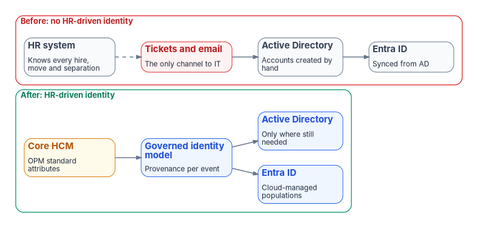

# Chapter 13 — Reference Deployment (Illustrative)

*What the book looks like when one agency runs it end to end.*

::: {.callout-note}
## In this chapter
The agency archetype and its starting estate. What each phase of Chapter 12 does and typically finds. The evidence package. What survives the engagement.
:::

::: {.callout-important}
## Illustrative, not an engagement record
This chapter is a pattern. The agency, the numbers and the findings are representative, not drawn from a specific engagement, and there are no agency identifiers, contractor names or dates in it. Replace the prose with measured values when real, releasable engagement material exists.
:::

## The agency

A federal civilian agency of about fifty thousand employees and several thousand active contractors, in Federal HR 2.0 Wave 2 — the agencies that transition to the Core HCM platform in FY 2027[^c13-hr20memo] — with a Microsoft 365 GCC tenant, which Microsoft documents as meeting FedRAMP Moderate and pairs with Entra ID in Azure's commercial cloud.[^c13-gcc-plan][^c13-gcc-pairing]

Its HR data exchange today is typical:

- The HR system of record is run by a legacy HR shared service provider, under that provider's interconnection agreements. The agency is the data steward but doesn't own the exchange contract. That system is scheduled to be replaced by the Core HCM platform during the agency's wave (Chapter 03).
- USA Staffing, OPM's talent acquisition and onboarding system, is the upstream hire trigger; new-hire data flows from USA Staffing to the HR system of record.[^c13-usas-pia]
- PIV cards are issued through a shared-service PIV issuer and its card management system.
- Several thousand contractors are tracked in COR spreadsheets: a sponsor, a contract number and an end date per person, kept current by hand.
- There is no HR-driven provisioning. Accounts are created, changed and disabled from tickets and email; organizational assignments are handled by hand; there's no drift detection between HR and the directories and no provisioning evidence.
- The agency is planning its move from Active Directory to Entra ID at the same time as its Core HCM onboarding.
- About two-thirds of users are still mastered in on-premises AD.

{fig-alt="Two framed rows. Top, in red, before: no HR-driven identity. An HR system that knows every hire, move and separation connects by a dashed line to tickets and email, the only channel to IT, which feed Active Directory (accounts created by hand), which syncs to Entra ID. Bottom, in green, after: HR-driven identity. Core HCM (OPM standard attributes) feeds a governed identity model (provenance per event), which feeds Entra ID (cloud-managed populations) and Active Directory (only where still needed)."}

## Phase by phase

**Phase 0 — Program alignment.** The integrated project team inventories integration points. The identity provisioning feed is listed alongside payroll and benefits, with the Core HCM interconnection go-live as its deadline.

**Phase 1 — Attribute authority and schema.** The authority map and the canonical schema (Chapter 06) are signed. Code lists for organization, worker type and position category are agreed with HR. The correlation baseline finds the usual problems: a few percent of enabled accounts with no `employeeId`, duplicate identities from contractor-to-employee conversions, and service accounts sitting in user OUs. Each gets an owner and a date.

**Phase 2 — Pipeline build and test.** The middleware is built against extracts from the current HR system *and* sandbox extracts from Core HCM, because the source will change mid-program. Only the source contract and boundary transformation differ; the governed identity model and downstream lifecycle policy remain stable. The leaver workflow's custom task extensions retire a test device and revoke a test certificate in the test tenant.

**Phase 3 — Hybrid go-live (pilot).** Two provisioning agents go in. Thirty days of shadow mode surface the differences between what HR says and what AD holds: stale departments, managers who left years ago, and accounts created by ticket for hires HR had already cancelled. Once every difference is explained, the ticket path for account creation closes for the pilot population (Appendix C).

**Phase 4 — Lifecycle automation and derived access.** Leaver automation goes first. In the first month the drift report shows a burst of high-severity findings: separated workers whose accounts the manual process hadn't reached, and orphan accounts left by years of ticket-driven account creation that the HR-driven pipeline can now see (Chapter 11). Each high-severity finding blocks the dependent provisioning action until it's resolved. Dynamic groups replace hand-maintained ones application by application; a test reorganization in HR moves a division's access with no directory edits.

**Phase 5 — Cutover to cloud-mastered.** As the agency's Core HCM interconnection goes live, the source contract and boundary transformation switch source. New hires land cloud-mastered in Entra ID directly; existing AD-mastered populations follow per population as their dependencies on AD retire.

**Phase 6 — Sustained posture.** The six lifecycle metrics go into the monthly ConMon report. The separation-to-revocation interval, measured for the first time, becomes a number the agency can defend.

## The evidence package

At any point after Phase 2, the agency can hand an assessor:

- the signed attribute authority map, canonical schema and code lists;
- the source-contract, transformation, and workforce identity service configuration, under change control;
- the provenance records and provisioning logs for every HR event in the period;
- Lifecycle Workflows run history, including the device and CMS steps for every leaver;[^c13-lcw-overview]
- drift findings with severity, class and remediation;
- the six lifecycle metrics for the period.

It's produced by operating the pipeline, not assembled before the assessment.

## What survives the engagement

The schema, the code lists, the workflows, the rules and the evidence belong to the agency, not to whichever integrator delivered the work. The next assessment reads the same records; the Core HCM cutover connects a new source contract to the same governed identity model; the next reorganization is a set of mover events against the same pipeline.

## Companion

[Book 02 — Identity & Directory](../b02-identity/index.md), and in particular [Chapter 09 — Building the Entra ID Target](../b02-identity/09-building-the-entra-target.md), covers directory migration, the companion dimension to inbound provisioning. An agency usually runs both programs at once.

::: {.callout-tip}
## Continue the book
[← Previous: Chapter 12 — Execution Plan](12-execution-plan.md) · [Book index](index.md) · [Next: Appendix A — Lifecycle Rules →](appendix-a-lifecycle-rules.md)
:::

[^c13-hr20memo]: Office of Management and Budget and Office of Personnel Management, *Creating "Federal HR 2.0" by Consolidating Core Human Capital Management Across the Federal Government*, December 10, 2025 (§I and Appendix A, Agency Transitions: Wave 2 is all remaining agencies, transitioning fully in FY 2027; wave membership is listed in the memo's Appendix A), <https://www.opm.gov/chcoc/latest-memos/creating-federal-hr-20-by-consolidating-core-human-capital-management-across-the-federal-government.pdf> (accessed Oct 20, 2026).
[^c13-gcc-plan]: Microsoft Learn, "Plan for Microsoft 365 Government - GCC deployments" ("provides compliance with US government requirements for cloud services, including FedRAMP Moderate"), <https://learn.microsoft.com/en-us/microsoftteams/plan-for-government-gcc> (accessed Oct 20, 2026).
[^c13-gcc-pairing]: Microsoft Learn, "Cloud feature availability for US Government customers" (Microsoft 365 integration: "Office 365 and Office 365 GCC are paired with Microsoft Entra ID in Azure"), <https://learn.microsoft.com/en-us/azure/security/fundamentals/feature-availability> (accessed Oct 20, 2026).
[^c13-usas-pia]: U.S. Office of Personnel Management, *Privacy Impact Assessment for USA Staffing* (OPM Form 5003), August 12, 2026 (Abstract; §6.1, sharing with subscribing agencies during hiring and onboarding), <https://www.opm.gov/information-management/privacy-policy/privacy-policy/usas-pia/> (accessed Oct 20, 2026).
[^c13-lcw-overview]: Microsoft Learn, "What are lifecycle workflows?" (workflow history and auditing), <https://learn.microsoft.com/en-us/entra/id-governance/what-are-lifecycle-workflows> (accessed Oct 20, 2026).
