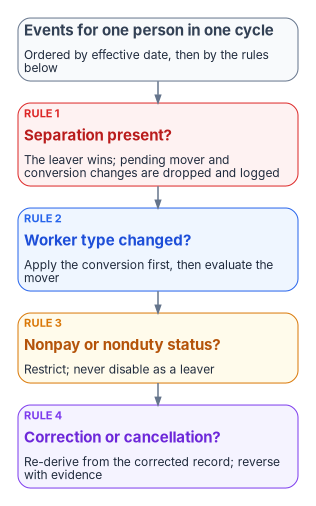

# Appendix A — Lifecycle Rules

*Automation is only as safe as the rules for the cases nobody planned for.*

::: {.callout-note}
## In this appendix
Which records are in scope. Why leave is not a leaver. What wins when two events land together. Rescinded offers, cancellations and partial leavers. The quarantine contract. Manager links, rehire and conversion.
:::

## Scope

A scope filter decides which HR records provision at all. Write it down, version it, and treat a change to it as a change to access policy:

- **Included:** covered worker types in an active, pre-hire or leave status, within a lookahead limit for future-dated hires.
- **Excluded:** test and training records, historical records, populations without an approved lifecycle owner, and named individuals on a governed exclusion list with a reason and an expiry.
- **Every exclusion leaves evidence:** the record, the rule that excluded it, and the version of the filter in force. A record that silently fails to provision is a missing identity (Chapter 11).
- **The directory-side filter matches the middleware filter.** The API-driven provisioning app applies its own scoping filter rules to every record it receives,[^aA-api-faqs] so if Entra provisioning scoping and the middleware disagree, the difference is drift.

## Leave is not a leaver

Furlough, leave without pay, suspension and similar nonpay or nonduty statuses (the 4xx nature-of-action family, Chapter 08 — for example 450 Suspension, 460 LWOP, 471 and 472 Furlough) keep the person.[^aA-gppa] The account stays, a status is stamped, and policy — Conditional Access, access packages — restricts what it can do. Return to duty (the 2xx family) lifts the restrictions.[^aA-gppa] Details and secondments are movers, not leavers. Treating any of these as a separation locks out people who are still employed and destroys their access history.

## Precedence

When two personnel actions for one person land in the same processing cycle, order them by effective date and then apply these rules:

{fig-alt="A vertical sequence of five boxes. Events for one person in one cycle, ordered by effective date, then by the rules below. Rule 1, red: separation present? The leaver wins; pending mover and conversion changes are dropped and logged. Rule 2, blue: worker type changed? Apply the conversion first, then evaluate the mover. Rule 3, amber: nonpay or nonduty status? Restrict; never disable as a leaver. Rule 4, violet: correction or cancellation? Re-derive from the corrected record; reverse with evidence."}

## Rescinded offers and cancellations

- **A rescinded offer cleans up.** An account created before day one for a hire that never happens is disabled and disposed of on a short retention, with the cancellation recorded as its reason.
- **A cancelled action reverses with evidence.** A cancellation or correction (nature-of-action 001 Cancellation, 002 Correction)[^aA-gppa] re-derives the person's state from the corrected record. A cancelled separation re-enables what the separation disabled; it does not restore manually granted access without review.

## Partial leavers

A leaver whose sign-in is disabled but whose sessions were not revoked — or whose PIV revocation failed — is a security incident, not a backlog item. The leaver run records every step; a rerun resumes from the first incomplete step; and the block steps (disable, revoke sessions) are verified by reading the account back, not assumed from a successful call (Chapter 09). Lifecycle Workflows has built-in tasks for both, "Disable user account" and "Revoke all refresh tokens for user", but the disable task doesn't support users who hold Microsoft Entra role assignments or belong to or own role-assignable groups, so privileged leavers need their own verified block path.[^aA-lcw-tasks]

## The quarantine contract

Records that fail validation, or actions that fail permanently, go to a quarantine with a defined contract:

- every entry carries a failure reason, an unchanged copy of the HR record, and the attempted payload;
- nothing in quarantine resolves itself — a person decides, and the decision is recorded;
- each failure class has a service level and an escalation path, with separation-related failures at the top;
- a resolved entry is re-injected through the normal path, never applied by hand to the directory;
- "won't fix" is an audited decision with an owner and a reason.

## Manager links

The `manager` relationship carries approvals, reviews and org charts (Chapter 10) — entitlement management, for example, finds a requestor's approving manager from it[^aA-ap-approval] — so its integrity rules are explicit:

- an unresolved manager reference never blocks a joiner — the account is created and the link is resolved when the supervisor's record arrives;
- a manager reference that points at a separated person is a finding;
- when a supervisor separates, their direct reports are handed back to HR for reassignment. HR, not IT, writes the new supervisor.

## Rehire and conversion

- **Rehire** re-links the returning person to their prior identity through the enterprise person key (Chapter 04). The provisioning service matches incoming records to existing users on a configured attribute pair (by default `externalId` to `employeeId`), so the key the feed sends decides whether a rehire re-links or creates a duplicate.[^aA-api-faqs] Manually granted access is not restored; it is requested again and reviewed.
- **Conversion** keeps the person and the key and re-derives every attribute from the new worker type. Manually assigned access tied to the old worker type is removed, privileged roles are reviewed, and a conversion from employee to contractor is treated as a risk case with a mandatory review.

::: {.callout-tip}
## Continue the book
[← Previous: Chapter 13 — Reference Deployment (Illustrative)](13-reference-deployment.md) · [Book index](index.md) · [Next: Appendix B — Security and Privacy Assessment →](appendix-b-security-and-privacy.md)
:::

[^aA-api-faqs]: Microsoft Learn, "Frequently asked questions about API-driven inbound provisioning" (scoping filters; matching attribute pair, by default `externalId` to `employeeId`), <https://learn.microsoft.com/en-us/entra/identity/app-provisioning/inbound-provisioning-api-faqs> (accessed Oct 20, 2026).
[^aA-gppa]: U.S. Office of Personnel Management, *Guide to Processing Personnel Actions*, October 2026 edition (Chapter 1, nature-of-action series; Chapter 15, Placement in Nonpay or Nonduty Status; Chapter 16, Return to Duty from Nonpay Status; Chapter 32, Corrections and Cancellations), <https://www.opm.gov/policy-data-oversight/data-analysis-documentation/personnel-documentation/processing-personnel-actions/guide_to_processing_personnel_actions.pdf> (accessed Oct 20, 2026).
[^aA-lcw-tasks]: Microsoft Learn, "Lifecycle Workflow built-in tasks" (Disable user account; Revoke all refresh tokens for user), <https://learn.microsoft.com/en-us/entra/id-governance/lifecycle-workflow-tasks> (accessed Oct 20, 2026).
[^aA-ap-approval]: Microsoft Learn, "Change approval and requestor information settings for an access package in entitlement management" (the manager is found from the user's Manager attribute), <https://learn.microsoft.com/en-us/entra/id-governance/entitlement-management-access-package-approval-policy> (accessed Oct 20, 2026).
