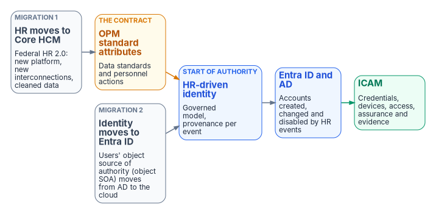

# Book 03 — HR-Driven Identity: An Enterprise Data Architecture Case Study {.unnumbered}

::: {.callout-important appearance="default"}
## Status — draft book
This book is the former HR-Driven Identity series, which had already consolidated nine separate pages. It now reads Why / What / Who / How, with a new chapter on who owns workforce identity. Every external claim was checked against a primary source on October 20, 2026 and carries a footnote. The previous pages are kept in the repository's [`archive/b03-hr-identity/`](https://github.com/WhalerMike/modernization-workbook/tree/main/archive/b03-hr-identity) folder, and their old addresses forward here. Federal HR 2.0 program facts change; check them at engagement time.
:::

::: {.callout-tip}
## Download and present
**[b03-hr-identity-bundle.docx](../../../downloads/b03-hr-identity-bundle.docx)**: the whole book as one Word document, regenerated on every site deploy. The old `hr-driven-iam-*.docx` file names still work.

One chapter at a time: [01](../../../downloads/b03-hr-identity-01.docx) · [02](../../../downloads/b03-hr-identity-02.docx) · [03](../../../downloads/b03-hr-identity-03.docx) · [04](../../../downloads/b03-hr-identity-04.docx) · [05](../../../downloads/b03-hr-identity-05.docx) · [06](../../../downloads/b03-hr-identity-06.docx) · [07](../../../downloads/b03-hr-identity-07.docx) · [08](../../../downloads/b03-hr-identity-08.docx) · [09](../../../downloads/b03-hr-identity-09.docx) · [10](../../../downloads/b03-hr-identity-10.docx) · [11](../../../downloads/b03-hr-identity-11.docx) · [12](../../../downloads/b03-hr-identity-12.docx) · [13](../../../downloads/b03-hr-identity-13.docx)

**15-minute presentation**: the Why / What / Who / How deck and its narrated version are in [`presentations/b03-hr-identity/`](https://github.com/WhalerMike/modernization-workbook/tree/main/presentations/b03-hr-identity). The earlier interview edition is in [`presentations/hr-driven-identity-interview/`](https://github.com/WhalerMike/modernization-workbook/tree/main/presentations/hr-driven-identity-interview).
:::

An agency's identity platform can prove, cryptographically and at every hop, that a claim was signed by the party allowed to sign it. It can't tell you whether the claim is *true*: whether the person behind the credential still works for the agency, still holds the position the access was granted for, still reports to the supervisor who approved it. Those are workforce facts. They originate in workforce business processes and are recorded in the human capital system of record; identity services consume governed projections of them and remain authoritative for credentials, authentication, sessions, directory objects, and policy enforcement.

This book is a proposal: use Federal HR 2.0 and the move from Active Directory to Entra ID together to **start HR-driven identity**, so that accounts, credentials, access and their removal become timely, explainable *consequences* of personnel records rather than tickets. It is not a plan to implement HRIT; HRIT is happening regardless. It is a plan to use it. It's written for a federal civilian agency in the commercial Microsoft cloud at GCC-Moderate / FedRAMP Moderate, receiving its HR data from the government-wide Federal HR 2.0 platform (Oracle Fusion Cloud HCM). For federal employees its contract is OPM's standard personnel data — the government-wide data standards and nature-of-action codes — mapped once into a governed workforce identity model; vendor field names are replaceable boundary logic. HRIT does not cover contractors and vendors, so they need their own authoritative source mapped into the same model (Chapter 06).

{fig-alt="Two grey boxes, HR moves to Core HCM and Identity moves to Entra ID, feed an amber box for OPM standard attributes and a blue box for HR-driven identity, which drives Entra ID and AD and then ICAM."}

## Modernization outcomes

- **Day-one readiness:** required accounts and approved baseline access are available when an affiliation begins.
- **Separation-to-block latency:** logical access is blocked at the effective separation time, or within the agency-approved threshold.
- **Revocation completion:** PIV and derived credentials, device certificates, sessions, and application-specific credentials are reconciled to completion.
- **Mover convergence:** access derived from the prior assignment is removed, the new baseline applied, and residual exceptions reviewed.
- **Correlation coverage:** governed workforce identities reconcile with enabled enterprise accounts.
- **Orphan reduction:** enabled accounts without a current, approved authority record are found and resolved.
- **Explainable access:** covered entitlements trace to a rule, an approved exception, an authoritative attribute, or a privileged-access decision.
- **Continuous evidence:** provenance, provisioning results, workflow outcomes, exceptions, and drift findings come out of normal operation.

The canonical model and provisioning services exist to produce these outcomes; Chapter 01 sets out the scope, authority boundaries, and principles behind them.

## Why, what, who, how

| | Question | Chapters |
|---|---|---|
| **Why** | Why should HR, not IT, decide who exists, and why now? | [01](01-overview-and-applicability.md), [02](02-why-hr-is-the-source-of-authority.md), [03](03-federal-hr-2-0.md) |
| **What** | What data, owned by whom, flowing how? | [04](04-attribute-authority.md), [05](05-the-provisioning-pipeline.md), [06](06-canonical-attribute-schema.md) |
| **Who** | Who owns, uses and guards workforce identity data | [07](07-who-owns-workforce-identity.md) |
| **How** | Lifecycle, credentials, access, evidence, the plan and a reference deployment | [08](08-joiner-mover-leaver.md), [09](09-credentials-and-certificates.md), [10](10-from-attributes-to-access.md), [11](11-drift-metrics-and-evidence.md), [12](12-execution-plan.md), [13](13-reference-deployment.md) |

Appendices: [A — Lifecycle rules](appendix-a-lifecycle-rules.md) · [B — Security and privacy assessment](appendix-b-security-and-privacy.md) · [C — Acceptance and cutover](appendix-c-acceptance-and-cutover.md)

## Chapters

::: {#chapters}
:::

## Where this book sits in the workbook

- **[SQL Server Identity Transformation, Book 07](../b06-data-platform/16-groups-roles-and-membership.md)** applies the attribute-to-access chain of Chapter 10 to SQL Server logins and database roles.
- **[SQL Server Identity Transformation, Book 10](../b06-data-platform/22-where-sql-server-touches-adcs.md)** covers the move from AD CS to Microsoft Cloud PKI; Chapter 09 covers only the certificate steps of the leaver sequence.
- **[Federal Compliance Vol I Book 04](../../compliance/Vol_I_Book_04_HRIT_Identity_Org_SSOT.md)** carries the compliance treatment of the same controls (AC-2, IA-4, PS-4, PS-5, SI-12). The architecture contributes mechanisms and evidence to them; it doesn't satisfy them on its own.
- **[Client-Server to Hybrid-Cloud, Chapter 04](../../client-server-to-hybrid-cloud/04-identity-transformation.md)** covers the move from the OU tree to attribute-driven structure.
- **[Book 02 — Identity & Directory](../b02-identity/index.md)** covers the directory migration this book builds on; [Chapter 09 there](../b02-identity/09-building-the-entra-target.md) designs the Entra ID target that inbound provisioning feeds.
- **[Identity Lifecycle & Provisioning project](../../projects/identity-lifecycle-charter.md)** ([plan](../../projects/identity-lifecycle-plan.md)) is the project charter that delivers this book's execution plan.
