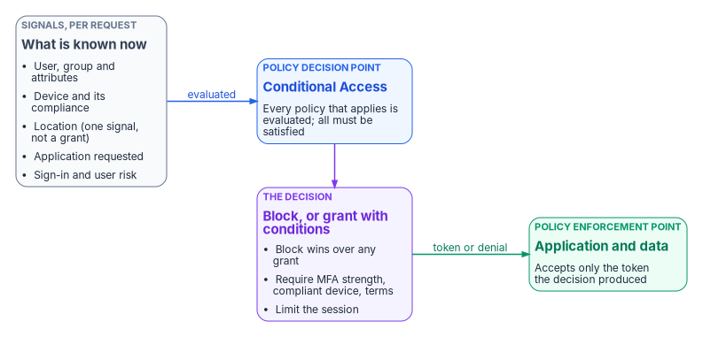
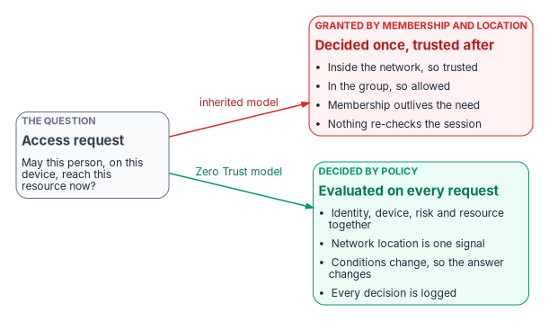

# Chapter 01 — Access Is a Policy Decision

*Being on the network and being in the group used to be the answer; under Zero Trust they are only two of the questions.*

::: {.callout-note}
## In this chapter
What federal Zero Trust policy says about how access is decided, and the policy decision point and policy enforcement point that NIST SP 800-207 describes. How Conditional Access fills the decision-point role in Microsoft Entra ID, and the rules it follows when several policies apply. What goes wrong when access is still granted by group membership and network location. The argument in brief, for the book's opening presentation.
:::

## Every request is a decision

In the directory era, access was settled in advance. An administrator put a person in a group, the group was on an access list, and the person's workstation sat inside the network perimeter. From then on, every request that person made was approved by default. Nobody asked again whether the device was healthy, whether the sign-in looked normal, or whether the person still needed the access. The decision had been made once, at the time the group membership was granted, and the network carried it forward.

Federal policy no longer accepts that model. OMB M-22-09, the federal Zero Trust strategy, states that federal applications can't rely on network perimeter protections to guard against unauthorized access, and that users should log into applications rather than networks.[^c01-m2209] On authorization it is direct: in a Zero Trust architecture every request for access should be evaluated to determine whether it is appropriate, which requires the ability to evaluate an active session continuously. When undue risk appears, the response can be re-authentication, limited access, or denial.[^c01-m2209] The memo also asks agencies to move beyond static role-based models toward more granular, dynamically defined permissions of the kind attribute-based access control provides, and to include at least one device-level signal alongside identity when regulating access to enterprise resources.[^c01-m2209]

NIST SP 800-207 gives the architecture behind that requirement. Three of its seven tenets carry this book:[^c01-sp800207]

- **Network location alone does not imply trust** (tenet 2). A request from inside the legacy perimeter must meet the same requirements as one from any other network.
- **Access is granted per session, with least privilege** (tenet 3). Authenticating to one resource doesn't automatically grant access to another.
- **Access is determined by dynamic policy** (tenet 4), using the observable state of the client identity, the application or service, and the requesting asset, and possibly other behavioral and environmental attributes.

CISA's Zero Trust Maturity Model puts the same expectation in operational terms. Its identity pillar asks agencies to give users and entities access to the right resources at the right time for the right purpose without granting excessive access, and to grant tailored, context-based authorization.[^c01-ztmm] [Book 02, Chapter 01](../b02-identity/01-why-identity-matters.md) explains how this moved the access decision from the network to the identity provider. This book is about what that decision is made of: policy.

## The decision point and the enforcement point

SP 800-207 separates the act of deciding from the act of enforcing. The **policy decision point** is made of two logical parts: a policy engine, which makes and logs the decision to grant, deny or revoke access using enterprise policy and outside inputs such as threat intelligence and device diagnostics, and a policy administrator, which carries the decision out by setting up or shutting down the path between subject and resource and by generating the session's authentication token or credential. The **policy enforcement point** enables, monitors and terminates the connection between subject and resource.[^c01-sp800207]

The separation matters because it fixes where policy lives. If a hundred applications each decide for themselves who may enter, the agency has a hundred policies, written in a hundred ways, and no single view of any of them. If one decision point decides and each application enforces the result, the agency has one policy it can read, test, change and prove.

{#fig-ch01-policy-decision fig-alt="Left to right. A grey box, signals per request: user, group and attributes; device and its compliance; location, labelled one signal and not a grant; the application requested; sign-in and user risk. An arrow labelled evaluated leads to a blue box, the policy decision point, Conditional Access, where every policy that applies is evaluated and all must be satisfied. It leads to a violet box, the decision: block wins over any grant; require an MFA strength, a compliant device or terms of use; limit the session. An arrow labelled token or denial leads to a green box, the policy enforcement point, the application and data, which accepts only the token the decision produced."}

## Conditional Access as the policy engine

In Microsoft Entra ID, the decision point is Conditional Access. Microsoft describes it as its Zero Trust policy engine: it brings signals together, makes a decision, and enforces organizational policy.[^c01-ca-overview] A policy is an if-then statement. If a user wants to reach a resource under certain conditions, then they must satisfy certain controls. The signals include the user, group or agent; IP location; the device, its platform and its compliance state; the application; and real-time and calculated risk from Microsoft Entra ID Protection. The decisions run from block, the most restrictive, to grant, with or without requirements such as multifactor authentication, an authentication strength, a compliant or hybrid-joined device, an app protection policy, or acceptance of terms of use. (The older "approved client app" grant became read-only in June 2026; Chapter 07 covers the replacement.)[^c01-ca-overview]

In SP 800-207's terms, the program reads the mapping this way. Conditional Access is the policy engine. Entra ID's token issuance plays the policy administrator: it either issues the token the decision allows or refuses. The applications and services that accept only Entra-issued tokens, together with gateways in front of older applications, are the enforcement points. This is the program's interpretation of the architecture, not a mapping Microsoft or NIST publishes, but it explains why the rest of the book treats a Conditional Access policy as the unit of access control.

Two facts about where Conditional Access sits keep the claim honest. First, policies are enforced after first-factor authentication completes. Conditional Access is not a front-line defense against, for example, denial-of-service attacks, though it can use signals from them.[^c01-ca-overview] Second, a decision made at sign-in isn't the end of the story. Continuous Access Evaluation re-evaluates access during an active session when critical events occur, such as an account being disabled, a password reset or token revocation, and when Conditional Access conditions such as network location change, so that policy changes take effect in near real time instead of waiting for the token to expire.[^c01-rbac-best] That is the product's answer to M-22-09's requirement to evaluate active sessions.

### How the decision is computed

Conditional Access doesn't work like Group Policy, and administrators who carry Group Policy habits into it make predictable mistakes. Its evaluation follows a small set of rules:

1. **Every policy that applies is evaluated, and all of them must be satisfied.** There is no priority order. If one policy requires multifactor authentication and another requires a compliant device, the user must do both.[^c01-ca-policies]
2. **Block wins.** Enforcement collects the session details first. If any applicable policy is configured to block, enforcement stops there and the user is blocked, whatever other policies would have granted.[^c01-ca-policies]
3. **Controls inside a policy combine as configured.** A policy can require all of its selected controls or one of them. With "require one of the selected controls," the user is prompted in a defined order until one is satisfied.[^c01-ca-policies]
4. **Assignments inside a policy combine with AND.** A policy applies only when all of its assignments match.[^c01-ca-policies]
5. **Exclusions are absolute.** When a user or group is both included and excluded, the exclusion wins.[^c01-ca-users]

The last rule is the one that causes damage. Because an exclusion overrides everything, each one is a standing hole in policy, and exclusions accumulate the way Group Policy exceptions did. The only exclusion the program treats as permanent by design is the emergency access group described in [Chapter 02](02-why-standing-privilege-fails.md). Every other exclusion needs an owner, a reason and an expiry. [Chapter 03](03-the-conditional-access-model.md) covers the model in depth, including session controls, authentication strengths and authentication context.

### Deploy as a decision, not a switch

The same logic shapes how policies reach production. A policy that targets all users can lock out the whole organization, administrators included. Policies are evaluated in report-only mode as well as when enabled, so the program deploys every new policy in report-only first, measures its effect in the sign-in logs and the policy impact views, and promotes it to enforcement as a separate, reviewed change.[^c01-ca-policies][^c01-report-only] The emergency access exclusion is confirmed before any blocking or restricting policy is enforced. [Book 02, Chapter 09](../b02-identity/09-building-the-entra-target.md#testing-and-rollout) gives the staged rollout the program uses, and [Chapter 07](07-the-conditional-access-policy-library.md) the full policy library.

## What goes wrong when membership and location decide

Most estates still grant access the old way, even after they move to Entra ID. Two habits survive the migration: treating the network as proof of trust, and treating group membership as a permanent grant.

{#fig-ch01-membership-vs-policy fig-alt="A grey box on the left, the access request: may this person, on this device, reach this resource now? Two arrows leave it. The upper arrow, labelled inherited model, leads to a red box, granted by membership and location, decided once and trusted after: inside the network, so trusted; in the group, so allowed; membership outlives the need; nothing re-checks the session. The lower arrow, labelled Zero Trust model, leads to a green box, decided by policy, evaluated on every request: identity, device, risk and resource together; network location is one signal; conditions change, so the answer changes; every decision is logged."}

| Granted by | What goes wrong | What policy does instead |
|---|---|---|
| Network location ("inside means trusted") | A compromised device or stolen session inside the perimeter inherits the trust of the building. SP 800-207 rejects this outright: location alone doesn't imply trust.[^c01-sp800207] | Location is one signal among several. A trusted network can reduce friction, but never replaces identity, device and risk checks, and it never applies to privileged roles |
| Static group membership | Membership is decided once and outlives the need. People who change jobs keep what they had, and nobody can say why a given person has a given access. M-22-09 notes that many federal models rely on static, predefined roles and asks for more granular, dynamic permissions.[^c01-m2209] | Membership is computed from authoritative attributes and reviewed, and it is one condition of a policy, not the grant itself |
| A decision made at sign-in | Nothing re-checks a session after a device falls out of compliance, an account is disabled, or the risk level changes | Conditional Access with Continuous Access Evaluation re-evaluates on critical events and on condition changes[^c01-rbac-best] |
| Per-application rules | Each application has its own idea of who may enter; there's no single policy to test, change or show an assessor | One decision point and many enforcement points; the policy set is the control, and its logs are the evidence |
| Exceptions | Exclusions, legacy protocols and service accounts that bypass the decision point quietly become the real access policy | Exclusions are owned, time-bound and reviewed; legacy authentication is blocked; workload identities get their own policies ([Chapter 05](05-applications-and-workload-identities.md)) |

### Attribute-driven targeting has its own failure mode

Replacing membership-by-hand with policy doesn't remove the dependency on directory data; it raises the stakes. The program targets Conditional Access policies at dynamic groups built from organizational attributes, as Group Policy was once targeted at organizational units. That makes the attributes part of the access decision, and it brings two cautions.

- **Unpopulated attributes mean policy bypass.** A user or device whose attribute is empty falls outside the dynamic group, and therefore outside every policy that includes only that group. Attributes must be populated and verified before policies that depend on them are enforced, and the baseline policies should include all users and exclude narrowly, rather than include narrowly.
- **Dynamic membership isn't instant.** Microsoft states that dynamic membership changes are typically processed within a few hours and can take more than 24 hours, depending on tenant size, the number of changes, and the rule's operators.[^c01-dynamic-processing] A mover's access changes when the group catches up, not when HR records the move. Policy design has to tolerate that lag, and urgent removals (a leaver, a compromised account) use account disablement and session revocation, not group recalculation.

Where those attributes come from, and how they stay correct through joiners, movers and leavers, is the subject of [Book 03](../b03-hr-identity/index.md).

## From Group Policy to Conditional Access

Agencies arriving from Active Directory often ask for "the Conditional Access version" of each Group Policy setting. There usually isn't one. The access-related parts of Group Policy move to policy decisions; the configuration parts move to device management. The table shows where the access-related functions go. It's illustrative, not a migration mapping.

| Directory-era mechanism | Where the decision moves | What changes |
|---|---|---|
| Logon restrictions on workstations and servers | Conditional Access device conditions and grant controls, including filters for devices | The check happens at each sign-in to a resource, not once at the console |
| Security filtering by group membership | User and group assignments, built on attribute-driven dynamic groups | Membership follows authoritative attributes, with the processing delay noted above |
| Account lockout thresholds | Risk-based Conditional Access with Microsoft Entra ID Protection | Decisions use sign-in and user risk, not only failed-attempt counts. Risk-based policies require Entra ID P2[^c01-ca-overview] |
| Password policy | Authentication methods policy and authentication strengths | The goal is phishing-resistant, passwordless authentication ([Book 02, Chapter 10](../b02-identity/10-migrating-and-governing.md)) |
| Software restriction for applications | App protection policies and Conditional Access app controls | Enforced per application and session |

Drive mappings, printer deployment and other configuration settings aren't access decisions; they move to device management and are covered in Book 05.

## The argument in brief

1. Federal Zero Trust policy requires that every access request be evaluated, that network location confer no trust, and that access be decided per session by dynamic policy.[^c01-m2209][^c01-sp800207]
2. That requires a policy decision point separate from the places where access is enforced. In Microsoft Entra ID the decision point is Conditional Access, Microsoft's Zero Trust policy engine.[^c01-ca-overview]
3. Conditional Access decides by rule: all applicable policies must be satisfied, block wins, and exclusions override everything. Each exclusion is therefore a standing hole that needs an owner.
4. Access granted by network location or static group membership is decided once and trusted afterward. It survives migrations unless it is deliberately replaced by policy.
5. Policy is only as good as the data it reads. Attribute-driven targeting moves the access decision onto directory attributes, so those attributes must be complete and governed.
6. The most dangerous access of all is privileged access that no policy ever re-decides. [Chapter 02](02-why-standing-privilege-fails.md) takes that up.

For depth on the architecture, see [Book 11, Chapter 03 — What CISA's Maturity Model and M-22-09 Actually Require](../b11-zero-trust/03-what-the-mandates-require.md).

::: {.callout-tip}
## Continue the book
[Book index](index.md) · [Next: Chapter 02 — Why Standing Privilege Fails →](02-why-standing-privilege-fails.md)
:::

[^c01-m2209]: Office of Management and Budget, M-22-09, *Moving the U.S. Government Toward Zero Trust Cybersecurity Principles*, January 26, 2022, <https://www.whitehouse.gov/wp-content/uploads/2022/01/M-22-09.pdf> (accessed Oct 20, 2026).
[^c01-sp800207]: National Institute of Standards and Technology, SP 800-207, *Zero Trust Architecture*, August 2020, section 2.1 (tenets) and section 3 (logical components), <https://nvlpubs.nist.gov/nistpubs/SpecialPublications/NIST.SP.800-207.pdf> (accessed Oct 20, 2026).
[^c01-ztmm]: Cybersecurity and Infrastructure Security Agency, *Zero Trust Maturity Model*, Version 2.0, April 2023, section 5.1 (Identity), <https://www.cisa.gov/sites/default/files/2023-04/CISA_Zero_Trust_Maturity_Model_Version_2_508c.pdf> (accessed Oct 20, 2026).
[^c01-ca-overview]: Microsoft Learn, "What is Conditional Access?," <https://learn.microsoft.com/en-us/entra/identity/conditional-access/overview> (accessed Oct 20, 2026).
[^c01-rbac-best]: Microsoft Learn, "Best practices for Microsoft Entra roles" (section 10, layered controls: Continuous Access Evaluation), <https://learn.microsoft.com/en-us/entra/identity/role-based-access-control/best-practices> (accessed Oct 20, 2026).
[^c01-ca-policies]: Microsoft Learn, "Build a Conditional Access policy," <https://learn.microsoft.com/entra/identity/conditional-access/concept-conditional-access-policies> (accessed Oct 20, 2026).
[^c01-ca-users]: Microsoft Learn, "Conditional Access: Users, groups, agents, and workload identities" (Exclude users), <https://learn.microsoft.com/entra/identity/conditional-access/concept-conditional-access-users-groups> (accessed Oct 20, 2026).
[^c01-report-only]: Microsoft Learn, "Analyze Conditional Access policy impact" (report-only mode), <https://learn.microsoft.com/entra/identity/conditional-access/concept-conditional-access-report-only> (accessed Oct 20, 2026).
[^c01-dynamic-processing]: Microsoft Learn, "Understand and manage dynamic group processing in Microsoft Entra ID," <https://learn.microsoft.com/entra/identity/users/manage-dynamic-group> (accessed Oct 20, 2026).
