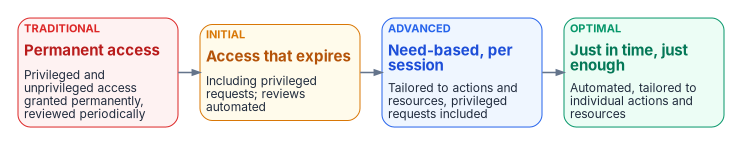
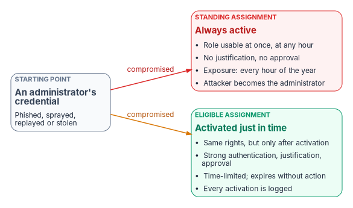

# Chapter 02 — Why Standing Privilege Fails

*An administrator who is always an administrator gives an attacker the same deal: steal the credential once and the role comes with it, at any hour.*

::: {.callout-note}
## In this chapter
Why standing administrative rights are the shortest path from a compromised credential to control of the tenant, and why stronger authentication alone doesn't close it. What least privilege requires, from NIST SP 800-53 AC-6 and its enhancements to CISA's maturity model. How just-in-time and just-enough administration replace standing rights, and why break-glass accounts are the one governed exception. The goals and phases of the privileged-access project.
:::

## Administrative identity is the root of the root

[Chapter 01](01-access-is-a-policy-decision.md) argued that every access request should be decided against policy. Privileged access is where that argument matters most and where it is most often abandoned. A Global Administrator can change the Conditional Access policies that make every other decision. A Privileged Role Administrator can grant any role to any account. If those rights are always on, the policy engine is protecting everything except the accounts that control it.

That is what "standing" means. The role assignment persists indefinitely and is always active. The holder doesn't activate it, doesn't give a reason, doesn't need anyone's approval, and faces no time limit. A Global Administrator holds tenant-wide control around the clock: 8,760 hours a year, nearly all of them hours in which no administrative work is being done but in which a stolen session or credential would still carry the full role.

In practice, standing privilege turns ordinary attacks into tenant compromise:

- A stolen token or session cookie for a standing Global Administrator grants Global Administrator scope immediately, with no further step.
- A successful MFA fatigue or help desk social engineering attack against a standing Privileged Role Administrator grants the ability to promote any account to any role.
- A hijacked browser session of a standing Security Administrator grants the ability to change the Conditional Access policies that protect the whole tenant.

NSA and CISA red and blue teams list "improper separation of user/administrator privilege" second in their October 2023 top ten misconfigurations of large organizations. The advisory describes excessive account privileges that creep beyond what users need, service accounts with elevated permissions that make them attractive targets, and the everyday use of elevated accounts for non-administrative work, which increases their exposure. Among its mitigations it recommends time-based access for privileged accounts, such as just-in-time access.[^c02-aa23278a]

Standing privilege isn't only a human problem. In the attack Microsoft disclosed in January 2024, the actor Midnight Blizzard used a password spray to compromise a legacy, non-production test tenant account that didn't have multifactor authentication. It then found and took over a legacy test OAuth application that had elevated access to Microsoft's corporate environment, and used it to grant the Exchange Online `full_access_as_app` role, which allows access to mailboxes.[^c02-midnight] The application's privilege was standing, its purpose was forgotten, and it was reachable from a test account nobody watched. That is the pattern this chapter is about.

## Strong authentication doesn't reduce scope

Agencies that complete the move to Entra ID often treat the credential migration as the security outcome. Administrators now sign in with phishing-resistant MFA through Conditional Access, and the old NTLM and password paths are closing. That is necessary, but it answers only one question: is this really the person the account belongs to? It doesn't answer the second: what can that verified identity do, and for how long?

An administrator who held standing Domain Admin and standing Global Administrator before the migration, and who now signs in with a FIDO2 key, still holds standing Global Administrator. Authentication got stronger; authorization scope didn't change. A strongly authenticated identity with standing tenant-wide scope isn't a Zero Trust architecture. It is a strongly authenticated standing target, and the session it produces is as valuable to steal as before.

Microsoft frames least privilege for administrators in three dimensions: a specific set of permissions, over a specific scope, for a specific period of time.[^c02-rbac-best] Authentication controls none of them. Reducing them takes different mechanisms, and that is the work of this book.

## What least privilege requires

### NIST SP 800-53 AC-6 and its enhancements

The control baseline is explicit. AC-6, Least Privilege, requires the organization to employ the principle of least privilege, allowing only the authorized accesses for users, or processes acting on their behalf, that are necessary to accomplish assigned organizational tasks.[^c02-sp80053] Its enhancements turn the principle into testable requirements. The ones that bear directly on administrative access:

| Control | What it requires | What it means for administrators |
|---|---|---|
| AC-6(1) Authorize Access to Security Functions | Authorize access to defined security functions and security-relevant information only for defined individuals or roles | Changing Conditional Access, role assignments or audit settings is a named, authorized function, not a side effect of a broad role |
| AC-6(2) Non-privileged Access for Nonsecurity Functions | Users with privileged accounts or roles use non-privileged accounts or roles for nonsecurity functions | Separate administrative identities; email and browsing never happen as an administrator |
| AC-6(5) Privileged Accounts | Restrict privileged accounts to defined personnel or roles | A short, owned list of who may hold each privileged role |
| AC-6(7) Review of User Privileges | Review privileges at a defined frequency, and reassign or remove them as needed | Recurring access reviews of privileged role eligibility ([Book 02, Chapter 10](../b02-identity/10-migrating-and-governing.md#reviewing-privileged-access-ac-67)) |
| AC-6(9) Log Use of Privileged Functions | Log the execution of privileged functions | Every activation and every administrative change produces a record |
| AC-6(10) Prohibit Non-privileged Users from Executing Privileged Functions | Prevent non-privileged users from executing privileged functions | The technical boundary that makes the rest enforceable |

Source: NIST SP 800-53 Rev. 5.[^c02-sp80053] All six of these enhancements are in the NIST moderate baseline, along with AC-5, Separation of Duties, and AC-2(2), which requires temporary and emergency accounts to be removed or disabled automatically after a defined period.[^c02-sp80053b] AC-5 requires the organization to identify and document the duties that must be separated and to define access authorizations that support that separation.[^c02-sp80053]

None of these enhancements says "just in time" in so many words. AC-6 is satisfied by any mechanism that keeps privilege at what the task requires. The program's position is that for cloud administrative roles, time is the dimension most estates have never limited, and just-in-time activation is the practical way to limit it while also producing the review and logging evidence AC-6(7) and AC-6(9) ask for.

### What federal Zero Trust policy says, precisely

The federal strategy documents support that position but are often quoted beyond what they say. OMB M-22-09 doesn't mandate time-bound privilege. It asks agencies to evaluate every access request and to move beyond static, predefined roles toward more granular, dynamically defined permissions.[^c02-m2209] It also cautions that privileged access management tools that issue ephemeral single-factor credentials shouldn't substitute for multifactor authentication, though they remain an important tool for high-privilege systems that are hard to modernize.[^c02-m2209] NIST SP 800-207, an architecture publication rather than a mandate, states in tenet 3 that access to each resource is granted per session, with the least privileges needed to complete the task.[^c02-sp800207]

CISA's Zero Trust Maturity Model is the most specific. Version 2.0 added an Access Management function to the identity pillar and describes four stages.[^c02-ztmm]

{#fig-ch02-privilege-maturity fig-alt="Four boxes left to right joined by arrows. Red, traditional: permanent access; privileged and unprivileged access granted permanently and reviewed periodically. Amber, initial: access that expires, including privileged requests, with automated review. Blue, advanced: need-based and session-based access tailored to actions and resources, privileged requests included. Green, optimal: just-in-time, just-enough access, automated and tailored to individual actions and resources."}

At the traditional stage an agency authorizes permanent access with periodic review for privileged and unprivileged accounts alike. At the initial stage access, including privileged access, expires and is reviewed automatically. At the advanced stage access is need-based and session-based, tailored to actions and resources. At the optimal stage automation authorizes just-in-time and just-enough access tailored to individual actions and individual resource needs.[^c02-ztmm] Most estates that still have standing administrators are at the traditional stage for privileged access, whatever their maturity elsewhere.

## Just in time and just enough

Two ideas replace standing privilege. Microsoft's privileged access strategy names them together as the way to apply least privilege to administrators: just-enough access, which grants only the permissions a specific task needs, and just-in-time access, which provides elevated access only when needed, often with approval.[^c02-pa-strategy]

- **Just-enough administration limits what and where.** Use the narrowest built-in role that covers the task, scope it to an administrative unit or resource where possible, and keep tenant-wide roles for the few people who need them. Microsoft recommends assigning Global Administrator to fewer than five people and keeping privileged role assignments to fewer than ten.[^c02-rbac-best] [Book 02, Chapter 05](../b02-identity/05-delegation-without-ous.md) covers scoping with administrative units, and [Chapter 04](04-privileged-roles-and-tiers.md) the role and tier model.
- **Just-in-time limits when.** The administrator is *eligible* for the role and activates it only for the time the task needs. In Microsoft Entra ID this is Privileged Identity Management (PIM), which provides just-in-time access, time-bound assignments, approval to activate, multifactor authentication at activation, justification, notifications, access reviews and audit history.[^c02-pim]

{#fig-ch02-standing-vs-eligible fig-alt="A grey box on the left, an administrator's credential: phished, sprayed, replayed or stolen. Two arrows labelled compromised leave it. The red one leads to a red box, standing assignment, always active: role usable at once and at any hour; no justification and no approval; exposure every hour of the year; the attacker becomes the administrator. The amber one leads to a green box, eligible assignment, activated just in time: the same rights, but only after activation; strong authentication, justification and approval; time-limited and expires without action; every activation is logged."}

The difference between eligible and active isn't the rights. Microsoft's PIM documentation is plain about it: there's no difference in the access given to someone with a permanent assignment versus an eligible one, only that the eligible holder doesn't have it all the time.[^c02-pim] What changes is exposure. A compromised session for an eligible administrator gives an attacker the administrator's ordinary user scope, not the role, until someone completes an activation that the attacker must also defeat. When the window ends, the role deactivates on its own; there's no manual removal step to forget.

Three details decide whether the activation is a real control:

- **Strong authentication at the moment of activation.** PIM's built-in MFA requirement asks the user to authenticate once per session, so an earlier sign-in can satisfy it.[^c02-pim-activate] To force fresh, phishing-resistant authentication at activation, the program requires a Conditional Access authentication context with an authentication strength, as [Book 02, Chapter 09](../b02-identity/09-building-the-entra-target.md#pim-configuration-standards) sets out.
- **Approval that isn't self-approval.** Approvers can't approve their own activation requests, and an approver has 24 hours to act; the window isn't configurable, so a stale request must be resubmitted.[^c02-pim-approval] That enforces AC-5 separation between requester and approver for the roles that require approval.
- **Durations that match tasks.** PIM lets each role set its own maximum activation time. The program's per-role durations, approvals and ticket requirements are in [Book 02, Chapter 09](../b02-identity/09-building-the-entra-target.md#pim-configuration-standards) and [Appendix B](appendix-b-pim-role-settings.md); [Chapter 08](08-pim-self-request-with-approval.md) gives the request-and-approval procedure.

PIM requires Microsoft Entra ID P2 or Microsoft Entra ID Governance licensing.[^c02-rbac-best]

Just-in-time isn't only for directory roles. Server local administrator rights, Azure subscription Owner and Contributor, and membership in groups that guard sensitive applications are all standing privilege in most estates. PIM covers Azure resource roles and, through PIM for Groups, group membership and ownership.[^c02-pim] The Federal Compliance book [Vol III Book 01, Privileged Access Management](../../compliance/Vol_III_Book_01_Privileged_Access_Management.md) carries the detailed design for server access, privileged access workstations and session controls, and [Chapter 05](05-applications-and-workload-identities.md) takes up the non-human identities, like the application in the Midnight Blizzard case, that hold privilege without a person behind them.

## Break-glass: the one governed exception

Every control that blocks an administrative path also creates a way to lock the agency out of its own tenant. If federation is down, if every administrator's MFA device is unavailable, if all privileged roles are eligible and no approver can act, or if a Conditional Access policy is misconfigured, normal administration stops. Microsoft lists exactly these cases, including the one where all Global Administrator and Privileged Role Administrator assignments are eligible, activation requires approval, and no approvers are available, which leaves tenant administration effectively locked.[^c02-emergency]

Emergency access ("break-glass") accounts are the answer, and they are the only standing privilege the program accepts by design. Microsoft's current guidance changes several details of older designs, including the ones in this workbook's earlier pages:[^c02-emergency]

| Earlier practice | Current guidance |
|---|---|
| Long, unique passwords kept in a safe | Two or more cloud-only accounts in the `onmicrosoft.com` domain, using passwordless, phishing-resistant authentication (a FIDO2 passkey, recommended, or certificate-based authentication), because mandatory MFA applies to them too |
| Exclude the break-glass group from every Conditional Access policy | Exclude a dedicated group from every policy that blocks or restricts sign-in; report-only policies don't need the exclusion |
| Global Administrator assignment, type unstated | Global Administrator as a permanent active assignment in PIM, not eligible, because PIM may be what has failed |
| Test periodically | Validate sign-in and an administrative task at least every 90 days, and after staff changes |
| Alert on use | Alert on every sign-in and audit event, and review every use afterward as planned drill, real emergency, or misuse |

The program adds three rules of its own. Break-glass accounts don't share authentication methods with normal administrator accounts, as Microsoft also advises.[^c02-emergency] Their names don't announce their purpose. And because NIST's AC-2(2) expects emergency accounts to be disabled automatically after a defined period,[^c02-sp80053] the system security plan records the permanent break-glass accounts as a documented deviation with compensating controls (monitoring, post-use review, and the 90-day validation) rather than leaving the conflict unstated. [Book 02, Chapter 09](../b02-identity/09-building-the-entra-target.md#emergency-access-accounts) gives the configuration standard; the procedure for storage, alerting and quarterly tests is in [Vol III Book 01](../../compliance/Vol_III_Book_01_Privileged_Access_Management.md).

An undocumented, untested or shared break-glass account is the worst standing privilege of all: full tenant control, excluded from policy, owned by nobody. Governing it is the first thing the privileged-access project does.

## The privileged-access project

The program runs this work as the [Privileged Access and Administrative Identity project](../../projects/privileged-access-charter.md). Its premise is the chapter's argument: administrative identity is the root of the root and needs controls of its own.

### The problem it addresses

In most estates administrative access is still standing. Privileged roles are granted permanently, service accounts and application registrations hold broad permissions, and break-glass accounts are undocumented. The consequences:

- A compromised administrative identity grants persistent access.
- Nobody can reliably answer "who elevated, for what, and for how long?"
- Separation of duties is procedural rather than enforced.
- Non-human privileged identities have no owners and no lifecycle.

### Goals

1. Inventory standing administrative privilege and classify it by blast radius.
2. Introduce just-in-time elevation for at least one high-risk role class.
3. Reduce standing privilege for that class, and document the residual standing privilege with its rationale.
4. Govern break-glass accounts: identify them, exclude them from standard policy, and test them.
5. Give every non-human privileged identity a human owner and a lifecycle.
6. Enforce separation of duties for high-risk changes, so the requester is never the approver.
7. Emit evidence for every privileged elevation and administrative change.

The initial phase deliberately doesn't try to eliminate all standing privilege, extend privileged access management to every application tier, or cover physical and facilities access.

### Principles

- **Just in time, not standing.** Elevated rights exist only for the duration and scope of a governed change.
- **Break-glass is governed.** It's identified, excluded and tested, not an unwritten exception.
- **Separation of duties is enforced.** Requester and approver are distinct for high-risk changes.
- **Non-human identities have owners.** Every privileged service account or application registration resolves to a human owner.
- **No elevation without evidence.** Every privileged action produces a provenance record.

### Phases

| Phase | Work | Done when |
|---|---|---|
| 0. Charter and alignment | Confirm scope, the first role class, and evidence expectations | Sponsor, lead and domain leads named |
| 1. Inventory | Catalog standing administrative privilege by blast radius; inventory non-human privileged identities and break-glass accounts | Every privileged assignment and identity has a row and a classification |
| 2. Just-in-time elevation | Introduce eligible assignments and activation for one high-risk role class; document and test break-glass | The role class is used through activation, and break-glass has passed a test |
| 3. Reduction and ownership | Remove standing privilege for the class where safe; assign owners to non-human identities; enforce separation of duties for one high-risk change class | Residual standing privilege documented; owners named; requester-approver rule enforced |
| 4. Evidence | Emit provenance for elevations and high-risk changes; transfer ownership of residual risk | Evidence is available for every elevation in the pilot |

### Risks to plan for

- Operational resistance to just-in-time elevation for critical roles. Durations and approvals that are too strict push administrators toward workarounds; [Chapter 06](06-who-decides-access.md) assigns who decides these settings.
- Legacy systems that need standing service accounts and can't be converted at once. These go into the residual register, with owners and compensating controls.
- Break-glass accounts that are unknown or shared.
- Separation of duties that conflicts with small-team operations, where there may be no second qualified approver.

The project assumes that an elevation mechanism such as PIM is available or can be introduced, and that stakeholders accept standing administrative privilege as a residual risk to reduce, not a permanent design.

## The argument in brief

1. Standing administrative rights are always on, so any stolen credential or session that reaches them yields the full role at any hour. NSA and CISA rank poor separation of user and administrator privilege among the most common misconfigurations they find.[^c02-aa23278a]
2. Stronger authentication doesn't change scope. Least privilege needs limits on what, where and when, and authentication controls none of them.
3. NIST SP 800-53 AC-6 and its enhancements require least privilege, restricted privileged accounts, recurring privilege reviews and logged privileged functions; CISA's maturity model defines the path from permanent access to just-in-time, just-enough access.[^c02-sp80053][^c02-ztmm]
4. Just-enough administration narrows the role and scope; just-in-time activation through PIM narrows the time, adds approval by someone other than the requester, and leaves a log.
5. Break-glass accounts are the one standing exception, and they are safe only when they are governed: phishing-resistant, monitored, tested every 90 days, and documented.
6. The privileged-access project makes this concrete for one high-risk role class first, and records every elevation as evidence. The What chapters, starting with [Chapter 03](03-the-conditional-access-model.md), describe the mechanisms in detail.

::: {.callout-tip}
## Continue the book
[← Previous: Chapter 01 — Access Is a Policy Decision](01-access-is-a-policy-decision.md) · [Book index](index.md) · [Next: Chapter 03 — The Conditional Access Model →](03-the-conditional-access-model.md)
:::

[^c02-aa23278a]: National Security Agency and Cybersecurity and Infrastructure Security Agency, AA23-278A, "NSA and CISA Red and Blue Teams Share Top Ten Cybersecurity Misconfigurations," October 5, 2023, <https://www.cisa.gov/news-events/cybersecurity-advisories/aa23-278a> (accessed Oct 20, 2026).
[^c02-midnight]: Microsoft Security Blog, "Midnight Blizzard: Guidance for responders on nation-state attack," January 25, 2024, <https://www.microsoft.com/en-us/security/blog/2024/01/25/midnight-blizzard-guidance-for-responders-on-nation-state-attack/> (accessed Oct 20, 2026).
[^c02-rbac-best]: Microsoft Learn, "Best practices for Microsoft Entra roles," <https://learn.microsoft.com/en-us/entra/identity/role-based-access-control/best-practices> (accessed Oct 20, 2026).
[^c02-sp80053]: National Institute of Standards and Technology, SP 800-53 Rev. 5, *Security and Privacy Controls for Information Systems and Organizations*, September 2020 (updated December 10, 2020), controls AC-2, AC-5 and AC-6, <https://csrc.nist.gov/pubs/sp/800/53/r5/upd1/final> (accessed Oct 20, 2026).
[^c02-sp80053b]: National Institute of Standards and Technology, SP 800-53B moderate baseline in OSCAL form, `NIST_SP-800-53_rev5_MODERATE-baseline_profile.json`, <https://raw.githubusercontent.com/usnistgov/oscal-content/main/nist.gov/SP800-53/rev5/json/NIST_SP-800-53_rev5_MODERATE-baseline_profile.json> (accessed Oct 20, 2026).
[^c02-m2209]: Office of Management and Budget, M-22-09, *Moving the U.S. Government Toward Zero Trust Cybersecurity Principles*, January 26, 2022, <https://www.whitehouse.gov/wp-content/uploads/2022/01/M-22-09.pdf> (accessed Oct 20, 2026).
[^c02-sp800207]: National Institute of Standards and Technology, SP 800-207, *Zero Trust Architecture*, August 2020, section 2.1 (tenets), <https://nvlpubs.nist.gov/nistpubs/SpecialPublications/NIST.SP.800-207.pdf> (accessed Oct 20, 2026).
[^c02-ztmm]: Cybersecurity and Infrastructure Security Agency, *Zero Trust Maturity Model*, Version 2.0, April 2023, section 5.1, Table 2 (Identity pillar, Access Management function), <https://www.cisa.gov/sites/default/files/2023-04/CISA_Zero_Trust_Maturity_Model_Version_2_508c.pdf> (accessed Oct 20, 2026).
[^c02-pa-strategy]: Microsoft Learn, "Establish a privileged access strategy" (strategic goals), <https://learn.microsoft.com/security/zero-trust/security-adoption-discipline-identity-access-privileged-strategy> (accessed Oct 20, 2026).
[^c02-pim]: Microsoft Learn, "What is Microsoft Entra Privileged Identity Management?," <https://learn.microsoft.com/en-us/entra/id-governance/privileged-identity-management/pim-configure> (accessed Oct 20, 2026).
[^c02-pim-activate]: Microsoft Learn, "Activate a Microsoft Entra role in PIM," <https://learn.microsoft.com/entra/id-governance/privileged-identity-management/pim-how-to-activate-role> (accessed Oct 20, 2026).
[^c02-pim-approval]: Microsoft Learn, "Approve or deny requests for Microsoft Entra roles in Privileged Identity Management," <https://learn.microsoft.com/entra/id-governance/privileged-identity-management/pim-approval-workflow> (accessed Oct 20, 2026).
[^c02-emergency]: Microsoft Learn, "Manage emergency access accounts in Microsoft Entra ID," <https://learn.microsoft.com/en-us/entra/identity/role-based-access-control/security-emergency-access> (accessed Oct 20, 2026).
