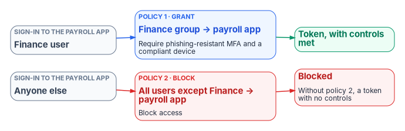

# Chapter 03 — The Conditional Access Model

*Conditional Access has no rule order to lean on: every policy that matches a sign-in applies at once, so a policy set is only as good as the way its policies combine.*

::: {.callout-note}
## In this chapter
What a Conditional Access policy is made of, and how Microsoft Entra ID evaluates the policies that match a sign-in. The signals a policy can test, the grant and session controls it can require, and how authentication strengths, report-only mode and exclusions behave. Then the program's baseline principles, its policy naming convention and the persona model that every policy in [Chapter 07](07-the-conditional-access-policy-library.md) is built on. [Chapter 01](01-access-is-a-policy-decision.md) makes the argument for policy-based access; this chapter is the mechanism.
:::

A Conditional Access policy is an if-then statement. The "if" is a set of **assignments**: who is signing in, what they're signing in to, from where, and under what conditions. The "then" is a set of **access controls**: block, grant with requirements, or limit the session.[^c03-policies] Everything else in this chapter follows from three properties of that statement. Policies apply in parallel, not in sequence. A block anywhere wins. And a sign-in that no policy's conditions match gets a token by default.[^c03-plan]

The figure shows the path a sign-in takes through the policies that could apply to it.

{#fig-ch03-evaluation-flow fig-alt="A top-to-bottom flow. First-factor authentication, in slate, noting that Conditional Access runs after this step and isn't a front-line defense. Phase 1, in blue: collect session details such as network location and device identity, for enabled and report-only policies. Applicability, in blue: all assignments in a policy must match, and an exclusion removes the policy. A dashed violet branch for report-only policies leads to a violet box: result logged, nothing enforced. A red branch for enabled policies leads to a red box: does any applicable policy block? If yes, the sign-in is blocked. If no, an amber box: prompt for unmet grant controls in order, MFA or authentication strength, compliant device, hybrid join, app protection, password change, terms of use, until every applicable policy is satisfied. Then a blue box applies session controls, and a green box issues the token, which Continuous Access Evaluation can still revoke on critical events."}

## What a policy is made of

A policy that can be enforced needs at least a name, a user or workload identity assignment, a target resource, and a grant or block control.[^c03-policies] Conditional Access requires Microsoft Entra ID P1. Policies that use sign-in risk or user risk need Microsoft Entra ID P2, and policies that target workload identities need Workload ID Premium. When a license lapses, existing policies keep enforcing but can't be edited.[^c03-overview][^c03-workload]

Two facts about where Conditional Access sits matter for design. It runs **after first-factor authentication**, so it isn't a front-line defense against password spray or denial of service, though it can act on the signals those attacks produce.[^c03-network] And it evaluates **token requests**, not sessions in progress: a policy is checked when a user signs in and when an application uses a refresh token to get a new access token, which for modern clients happens about once an hour.[^c03-network] Continuous Access Evaluation (CAE) closes part of that gap. Services that support it, initially Exchange Online, SharePoint Online and Teams, subscribe to critical events (account disabled or deleted, password changed or reset, MFA enabled, refresh tokens revoked, high user risk) and enforce them in near real time, typically within 15 minutes, and enforce IP-location policy changes immediately.[^c03-cae]

## Assignments: the signals a policy tests

### Users, groups, roles and workload identities

A policy includes and excludes identities. The options are all users (which includes B2B guests), specific users and groups, built-in directory roles, and six types of guest or external user that can be scoped to specific partner tenants.[^c03-users] Four behaviors shape targeting:

- **Exclusion overrides inclusion.** A user who is both included and excluded is excluded.[^c03-users]
- **Role targeting covers built-in roles only.** Roles scoped to an administrative unit and custom roles aren't supported, which is why the program targets administrators with a group rather than by role alone ([Book 02, Chapter 09](../b02-identity/09-building-the-entra-target.md#the-conditional-access-framework)).[^c03-users]
- **Group and role targeting is evaluated at token issuance.** A user added to a targeted group isn't subject to the policy until they get a new token. Microsoft's recommendation for privileged roles is to trigger evaluation at activation, using PIM's authentication context setting ([Chapter 08](08-pim-self-request-with-approval.md)).[^c03-policies]
- **Groups are the unit of scale.** Policies apply to nested members, and any group type works, including dynamic groups. Policies have a limit on directly listed users, and a user in more than 2,048 groups, directly or through nesting, may be blocked.[^c03-users]

Workload identities are a separate assignment. Policies can target single-tenant service principals registered in the tenant; Microsoft and third-party multitenant applications and managed identities aren't covered. A service principal must be assigned to the policy directly, because a policy assigned to a group that contains a service principal isn't enforced for it. The only grant available is **Block**, on location, service principal risk, or with authentication contexts.[^c03-workload] [Chapter 05](05-applications-and-workload-identities.md) covers the identities themselves.

Policies can also target agent identities and agents acting as users. The Microsoft Entra Agent ID platform became generally available in April 2026, but agent targeting in Conditional Access is still labeled preview, and the controls are narrower: agent identities support only Block, with agent risk (preview) as their only condition. Agents' user accounts can also be granted access on condition of a compliant device, which today means an Intune-managed Windows 365 Cloud PC for Agents. These policies need Microsoft 365 E7, or an Agent 365 license with Microsoft Entra ID P1 or Microsoft 365 E3.[^c03-grant][^c03-agents] The program doesn't build on preview targets; it records them as watch items, and [Book 17, Chapter 04](../b17-ai-identity/04-kinds-of-ai-identity.md) tracks their status.

### Target resources

The target can be applications, user actions, or authentication contexts.[^c03-resources]

- **All resources.** Microsoft recommends a baseline MFA policy for all users and all resources with no resource exclusions. That's the only way to cover applications that can't be targeted individually, such as `Windows Azure Active Directory`, and Microsoft Graph, which can't be targeted on its own because it's an umbrella resource.[^c03-resources] Resource exclusions now have a cost: from March 2026 Microsoft is phasing out the old behavior that silently exempted low-privilege directory scopes (such as `User.Read`) when an all-resources policy excluded any app, so excluded apps may start receiving challenges.[^c03-resources]
- **Suites.** *Office 365* targets Exchange, SharePoint, Teams and their dependencies together, and Microsoft advises using it instead of individual apps to avoid service-dependency gaps. *Windows Azure Service Management API* covers Azure Resource Manager and the Azure portal, which includes the Microsoft Entra admin center, and indirectly Azure CLI and Azure PowerShell. *Microsoft Admin Portals* covers the Exchange admin center, Azure portal, Microsoft 365 admin center and Security and Compliance portal, and is meant for inclusion, not as a bulk exclusion.[^c03-resources]
- **Filter for applications.** Instead of listing apps, a policy can select them by a custom security attribute on the service principal. Only attributes of type string work, the attributes are managed by the Attribute Definition and Attribute Assignment roles (Global Administrator can't read them by default), and the filter is evaluated at token issuance.[^c03-app-filter] The program uses this to target applications by environment ([Chapter 07](07-the-conditional-access-policy-library.md)).
- **User actions.** *Register security information* and *Register or join devices*. The device action allows only MFA or authentication strength, and doesn't support device filters or client-app conditions.[^c03-resources]
- **Authentication context.** Up to 99 labels (c1 to c99) that applications, SharePoint sites, Defender for Cloud Apps and PIM can request, so that a specific action or role activation triggers its own policy.[^c03-resources]

### Network

Named locations hold IPv4 or IPv6 ranges or countries. A tenant can have up to 195 IP-based named locations with up to 2,000 ranges each, and masks must be longer than /8. A range can be marked trusted, which also improves ID Protection's risk scoring. Countries are resolved from the IP address or, optionally, from GPS reported by Microsoft Authenticator, with a choice to include IP addresses that don't map to any country.[^c03-network]

Location is a weak signal, and Microsoft's documentation says why. Behind a cloud proxy or VPN, Entra ID sees the proxy's address and ignores `X-Forwarded-For`, because the header can't be validated. Keeping a current list of a cloud proxy's addresses is "nearly impossible," so Microsoft points to device-based policies or Global Secure Access source IP restoration instead.[^c03-network] The program uses location to block (countries where it never operates, workload identities off the agency network) and to shorten sessions off-network, never to waive MFA or device requirements.

### Conditions

| Condition | What it tests | Notes |
|---|---|---|
| Sign-in risk, user risk | ID Protection's real-time and calculated risk | Requires P2[^c03-overview] |
| Insider risk | Purview Insider Risk Management levels through Adaptive Protection (minor, moderate, elevated) | Requires P2 and Purview Insider Risk Management[^c03-insider] |
| Service principal risk | Risk on a workload identity | Workload ID Premium[^c03-workload] |
| Device platforms | Android, iOS, Windows, macOS, Linux | Derived from unverified sources such as the user agent; use it to scope, never as a security boundary[^c03-policies] |
| Client apps | Browser, mobile and desktop clients, Exchange ActiveSync, other clients | New policies apply to all client types unless configured. Exchange ActiveSync and "other clients" are legacy authentication, which can't do MFA or pass device state[^c03-conditions] |
| Filter for devices | Device properties, including `extensionAttribute1` to `15` | Replaces the deprecated device state condition[^c03-conditions] |
| Authentication flows | Device code flow and authentication transfer | Microsoft recommends blocking device code flow wherever possible[^c03-auth-flows] |

Two conditions need more than a table row.

**Filters for devices** evaluate attributes of a *registered* device. For an unregistered device every property is null, so a rule with a positive operator (`-eq`, `-startsWith`, `-in`) never matches it, and a rule with a negative operator (`-ne`, `-notIn`) always does. Microsoft's guidance is to target unregistered devices with negative operators. Extension attribute values are available at evaluation time only for devices that are Intune-managed, compliant, or Microsoft Entra hybrid joined. Device extension attributes are set through Microsoft Graph, and a filter rule can be up to 3,072 characters.[^c03-device-filter] These are the device's own attributes, separate from the user extension attributes the program uses for personas.

**Authentication flows** use protocol tracking. Once a session has used device code flow, its refresh tokens stay marked, so a policy that blocks device code flow can block later requests in that session even when they use a different flow. Since September 2024 these policies also apply to the Device Registration Service when they target all resources, so a tenant that registers devices with device code flow must exclude that service.[^c03-auth-flows]

## Access controls: what a policy requires

### Grant controls

**Block access** stops the sign-in. Microsoft calls it powerful and asks for report-only testing and the What If tool before it's enabled at scale.[^c03-grant] **Grant access** requires one or more of: multifactor authentication, an authentication strength, a device marked compliant by Intune, a Microsoft Entra hybrid joined device, an app protection policy, a password change, terms of use, or (where the tenant has them) custom controls. Multiple controls combine as "require all" by default, or "require one" by choice.[^c03-grant]

| Control | Constraint that shapes policy design |
|---|---|
| Require MFA vs. authentication strength | Can't be used together in one policy; the built-in MFA strength is equivalent to "require MFA"[^c03-auth-strengths] |
| Compliant device | Supports Windows 10 and later, iOS, Android, macOS and Linux Ubuntu devices that are registered and Intune-enrolled; Edge InPrivate counts as noncompliant[^c03-grant] |
| Hybrid joined device | Domain-joined Windows only. Neither device control works with device code flow; use MFA there[^c03-grant] |
| Approved client app | **Retired.** Since June 30, 2026, the control and any policy that uses it are read-only: they still enforce but can't be edited or created. New policies use "require app protection policy"[^c03-approved-app] |
| App protection policy | iOS and Android generally available; Edge on Windows in preview. Apps that don't support it are blocked[^c03-grant][^c03-approved-app] |
| Password change | Only with a user-risk condition, all resources and no other controls; must be paired with MFA[^c03-grant][^c03-graph-grant] |
| Require risk remediation | Only with user risk; automatically adds an authentication strength and sign-in frequency "every time"; handles password and passwordless users; not supported for guests and external users[^c03-grant][^c03-managed] |

When more than one risk policy applies, precedence is fixed: block overrides everything, and risk remediation overrides password change.[^c03-managed] [Chapter 07](07-the-conditional-access-policy-library.md) uses that rule to meet the CISA requirement to block high-risk users.

### Authentication strengths

An authentication strength names the method combinations a policy accepts. There are three built-in strengths, which Microsoft updates as methods change and administrators can't edit:[^c03-auth-strengths][^c03-auth-strength-graph]

| Built-in strength | Graph ID | Accepts |
|---|---|---|
| Multifactor authentication | `00000000-0000-0000-0000-000000000002` | Everything below, plus Temporary Access Pass, password with a second factor (SMS, voice, push, OATH), and federated MFA |
| Passwordless MFA | `00000000-0000-0000-0000-000000000003` | The phishing-resistant methods, plus Microsoft Authenticator phone sign-in |
| Phishing-resistant MFA | `00000000-0000-0000-0000-000000000004` | Windows Hello for Business or platform credential, FIDO2 security key (passkey), certificate-based authentication configured as multifactor |

Custom strengths narrow the list further, for example to FIDO2 keys with specific AAGUIDs through a combination configuration.[^c03-auth-strength-graph] Four limits matter in practice:

- A strength doesn't restrict the first factor. A user can still type a password; the policy then demands a qualifying method before access.[^c03-auth-strengths]
- Email one-time passcode guests can't satisfy a strength; policies for them use "require MFA" ([Book 02, Chapter 10](../b02-identity/10-migrating-and-governing.md)).[^c03-auth-strengths]
- A strength and a sign-in frequency can be satisfied at different times: yesterday's FIDO2 sign-in plus today's Windows Hello unlock can satisfy both.[^c03-auth-strengths]
- Windows Hello for Business satisfies a strength only if it was the primary sign-in method; a user who signed in with a password isn't offered it.[^c03-auth-strengths]

Which methods agencies roll out, and in what order toward M-22-09, is [Book 02, Chapter 10](../b02-identity/10-migrating-and-governing.md)'s subject. This book assumes its end state: phishing-resistant MFA for everyone.

**Contractors and the PIV path.** Contractors sit in the Internals persona with employees (worker type code `CTR`, [below](#personas)), so they meet the same phishing-resistant strength, usually with their PIV certificate through certificate-based authentication configured as multifactor. Two moments are theirs to plan *(design guidance)*:

- **Before the card.** The account exists before the card does, and a Temporary Access Pass satisfies only the Multifactor authentication strength in the table above, not Phishing-resistant MFA. Use the pass to register a FIDO2 security key or passkey, which does satisfy it: a Temporary Access Pass lets users "onboard other passwordless authentication methods."[^c03-tap] Only internal guest accounts can be issued a Temporary Access Pass,[^c03-tap] which is one more reason to decide on purpose whether contractors with agency accounts are members or guests ([research: the contractor source](../../evaluations/oracle-contingent-worker-contractor-source.md#microsofts-side)).
- **After the card.** A PIV revocation reaches Entra ID only when the issuing CA's CRL refreshes ([Book 03, Chapter 09](../b03-hr-identity/09-credentials-and-certificates.md#revocation-checking)). What stops a contractor's sign-in on the day is the leaver's account disable and session revocation, driven by the contractor source's end date ([Book 03, Chapter 09](../b03-hr-identity/09-credentials-and-certificates.md#the-contractor-piv-path)); the policy can't do it.

**Pending proof.** The contractor PIV path is the program's design and hasn't yet been validated in practice; the criteria for Proved are in the research page's [Status and review](../../evaluations/oracle-contingent-worker-contractor-source.md#status-and-review).

### Session controls

Session controls apply after every grant requirement is met.[^c03-policies]

| Session control | Behavior |
|---|---|
| App-enforced restrictions | Passes device state to Exchange Online and SharePoint Online only, which give unmanaged devices a limited (for example, web-only, no-download) experience[^c03-session][^c03-graph-session] |
| Conditional Access App Control | Routes the session through Defender for Cloud Apps' reverse proxy for session policies such as blocking downloads[^c03-session] |
| Sign-in frequency | Hours, days, or every time. The default is a rolling 90 days, and any session-posture change (password change, noncompliant device, disabled account) already revokes the session. "Every time" is meant for risky users and sign-ins, Intune enrollment and similarly sensitive actions; without MFA it can cause sign-in loops[^c03-session-lifetime][^c03-graph-sif] |
| Persistent browser session | Always or never; works correctly only when the policy targets all resources[^c03-graph-session] |
| Customize continuous access evaluation | Disabling CAE requires all resources and no conditions[^c03-session] |
| Disable resilience defaults | During an Entra ID outage, existing sessions are normally extended; this setting denies access instead when sessions expire[^c03-session] |
| Token protection | Binds the sign-in session token to the device to reduce token replay[^c03-session] |

Microsoft warns against reauthenticating users more often than needed: users who are prompted constantly learn to approve prompts without thinking.[^c03-session-lifetime] The program shortens sessions only where risk justifies it (administrators, off-network sign-ins, sensitive applications) and otherwise relies on CAE to cut sessions when something changes.

## How policies combine

Group Policy has precedence: local, site, domain, OU, with the last writer winning. Conditional Access has none. The rules are few, and [Chapter 01](01-access-is-a-policy-decision.md) introduced them:

1. **Within a policy, assignments combine with AND.** A policy applies only when every configured assignment matches.[^c03-policies]
2. **Across policies, every applicable policy must be satisfied.** If one requires MFA and another a compliant device, the user does both. There's no priority number and no ordering mechanism; the program's policy numbers are labels.[^c03-policies]
3. **Block wins.** If any applicable policy blocks, enforcement stops.[^c03-policies]
4. **Exclusions win.** An exclusion removes a policy for that identity regardless of inclusions.[^c03-users]
5. **Unmet grant controls are prompted in a fixed order:** MFA, compliant device, hybrid joined device, approved client app, app protection policy, password change, terms of use, custom controls. Sign-in logs reflect that order; a user with no MFA claim shows a pending MFA interrupt and a terms-of-use failure in the first log entry, then success for both in the next.[^c03-policies][^c03-grant]
6. **Session controls stack.** Because every applicable policy must be satisfied, the shortest sign-in frequency among them is the one the user experiences. This is a consequence of rule 2, not a separately documented precedence rule.

Enforcement runs in two phases. Phase 1 collects session details, such as network location and device identity, for enabled and report-only policies. Phase 2 runs for enabled policies only: any block ends it; otherwise the user is prompted for unmet controls, and session controls are applied once all are met.[^c03-policies]

### Policies come in pairs

The most common design error follows from the default. **Access tokens are issued when no policy's conditions trigger a control.** A policy that says "Finance users accessing Payroll must use MFA" says nothing about anyone else: a non-Finance user gets a token for Payroll with no MFA at all. To restrict an application to a population, write a second policy that blocks all users *except* that population.[^c03-plan]

{#fig-ch03-grant-block-pair fig-alt="Two rows, left to right. Top row: a Finance user signing in to the payroll app reaches a blue box, policy 1, grant: Finance group to payroll app, require phishing-resistant MFA and a compliant device, and then a green box: token, with controls met. Bottom row: anyone else signing in to the payroll app reaches a red box, policy 2, block: all users except Finance to payroll app, block access, and then a red box: blocked, noting that without policy 2 they'd get a token with no controls."}

For applications, enterprise application assignment is usually the cleaner first gate: with **Assignment required** set, only assigned users and groups (and applications) can get a token, though Global Administrators bypass the check.[^c03-assignment] The program uses both: assignment for the population, and a Conditional Access block for defense in depth where the application is sensitive.

### Microsoft-managed policies

Microsoft creates some policies in eligible tenants itself: block legacy authentication, block device code flow, MFA for admins in Microsoft admin portals, MFA for all users, MFA for per-user-MFA users, MFA and reauthentication for risky sign-ins, block or remediate high-risk users, and others. Each arrives in report-only mode and is turned on by Microsoft no less than 30 days later unless an administrator sets it to Off. Administrators can exclude identities and change the state, but can't rename or delete them.[^c03-managed]

The program treats them as inputs to its own library, not as part of it. For each managed policy, the identity team records one of two decisions: **adopt** (exclude the emergency access group and turn it on, citing the library policy it duplicates) or **supersede** (turn it Off because a library policy covers the same ground, and record which one). Either way the decision is written down, because a policy that Microsoft enables on a schedule is a change the agency didn't make. Audit-log entries initiated by "Microsoft Managed Policy Manager" show when Microsoft adds or changes one.[^c03-managed]

## Report-only mode

Report-only is a policy state: the policy is evaluated at every sign-in, its result is logged, and nothing is enforced. Users aren't prompted or blocked.[^c03-report-only] The results are:

| Result | Meaning |
|---|---|
| Report-only: Success | Conditions matched and the controls were already satisfied (for example, an MFA claim was in the token) |
| Report-only: Failure | Conditions matched and a non-interactive control failed; this is what a block would do |
| Report-only: User action required | Conditions matched and the user would have been prompted (MFA, terms of use) |
| Report-only: Not applied | Conditions didn't match, for example because the user is excluded |

In the sign-in logs and Microsoft Graph these appear as `reportOnlySuccess`, `reportOnlyFailure`, `reportOnlyInterrupted` and `reportOnlyNotApplied`.[^c03-report-only][^c03-applied-graph]

Three limits apply. Policies scoped to user actions can't run in report-only. A report-only policy that requires a compliant device can still prompt users on macOS, iOS and Android to pick a device certificate, so Microsoft advises excluding those platforms from report-only compliance policies. And GPS-based named locations prompt users for location even in report-only.[^c03-report-only][^c03-network]

The tools for reading results are the sign-in log's Report-only tab, the policy impact view (Security Reader or higher), and the Conditional Access insights and reporting workbook, which needs P1 and a Log Analytics workspace receiving sign-in logs. To change an enforced policy, Microsoft's practice is to create a report-only copy with the change, compare the two, then update the original.[^c03-report-only] The What If tool simulates a sign-in against the policy set; it shows which policies would apply, but doesn't replace a test with real users.[^c03-plan]

## Exclusions

Microsoft recommends excluding two kinds of account from policies: emergency access accounts, and service accounts that sign in as users, such as the Microsoft Entra Connect Sync account. It adds that policies scoped to users never block service principals anyway; those need workload identity policies.[^c03-plan] The program's rules:

- **One permanent exclusion.** The emergency access group is excluded from every policy that blocks or restricts sign-in. Report-only policies don't need it ([Book 02, Chapter 09](../b02-identity/09-building-the-entra-target.md#emergency-access-accounts)).
- **No user accounts used as services.** Where a script or tool signs in as a user, the fix is a managed identity or workload identity ([Chapter 05](05-applications-and-workload-identities.md)), not an exclusion. The sync account is the documented exception.
- **Every other exclusion is a governed object.** It's a group (never a named user in the policy), with an owner, a reason, an expiry and a review in the access review schedule ([Chapter 09](09-access-governance.md)). Time-bound exclusions, such as approved travel, are granted through PIM for Groups so they expire on their own.
- **Test the exclusion, not just the policy.** An excluded user can still be prompted by another policy. Microsoft's test guidance is explicit about checking that.[^c03-plan]

The opposite failure is quieter. A policy that *includes* a dynamic group misses every user whose attribute is empty, so incomplete attributes are an exclusion nobody approved. The program's baseline policies include all users and exclude narrowly for that reason, and attribute completeness is checked before any attribute-scoped policy is enforced ([Chapter 01](01-access-is-a-policy-decision.md); [Book 03](../b03-hr-identity/index.md)).

## The program's baseline principles

These are the program's design rules. Each policy in [Chapter 07](07-the-conditional-access-policy-library.md) is checked against them.

1. **Every sign-in meets at least one policy.** A baseline policy for all users and all resources, with no resource exclusions, sits under everything else. The report-only coverage probe (CA090) and the "no Conditional Access applied" detection in [Book 02, Chapter 10](../b02-identity/10-migrating-and-governing.md) find what slips through.
2. **Target populations, not people.** Policies include and exclude groups built from authoritative attributes; no policy names an individual user.
3. **One purpose per policy.** A policy does one thing for one population. Restricting a resource takes a grant policy and a block policy, written and reviewed together.
4. **Block deliberately.** A block for all users and all resources can lock out administrators, and some endpoints, such as Microsoft Graph, can't be excluded.[^c03-plan] Every block policy names the population it protects and the population it stops.
5. **Phishing-resistant MFA is the end state.** CISA's BOD 25-01 makes phishing-resistant MFA for all users, and for highly privileged roles, mandatory configurations for federal civilian tenants, with other MFA allowed only until phishing-resistant MFA is enforced.[^c03-bod2501][^c03-bod-configs] Policies that accept the MFA strength are transitional.
6. **Report-only first; enforcement is a separate change.** No policy goes from Off to On. Changes to an enforced policy are tested as a report-only copy.
7. **Location narrows; it never waives.** A location condition can add a block or shorten a session. It never removes an MFA or device requirement, and for privileged roles a trusted network changes nothing.
8. **Policy is code.** Policies are authored as Microsoft Graph JSON in source control, deployed in report-only state, and protected by protected actions so that changing them requires fresh strong authentication ([Chapter 10](10-access-as-code-and-evidence.md)).[^c03-plan]
9. **Consolidate.** A tenant can hold 240 policies in any state, including report-only and off, and policy JSON has a size limit that long GUID lists can hit. Group applications with the same requirements into one policy, and use groups and application filters instead of lists.[^c03-plan]
10. **Never delete during an incident.** Roll back by setting a policy to Off or report-only. A deleted policy or named location can be restored within a 30-day soft-delete window, but deletion is a change the drift record has to explain ([Chapter 10](10-access-as-code-and-evidence.md)).[^c03-plan]

## Naming and the persona model

### Naming convention

Microsoft recommends a naming standard that shows a sequence number, the resources a policy applies to, the response, who it applies to and when, so a policy can be understood without being opened and referenced by number on a call.[^c03-plan] The program's convention, inherited from [Book 02, Chapter 09](../b02-identity/09-building-the-entra-target.md#the-policy-set):

`CA{NNN}-{Population}-{Resource or condition}-{Control}`

| Part | Rule | Example |
|---|---|---|
| `CA{NNN}` | Three-digit number. 001 to 089 for the library; 090 to 099 for permanent report-only instruments. Numbers are labels, not order, and a retired number is never reused (CA002 is retired) | `CA013` |
| Population | A persona, a sub-population of one, or `AllUsers` (all users minus the emergency access group) or `Members` (all users minus guest and external user types) | `Admins`, `Internals`, `WebOnly` |
| Resource or condition | What narrows the policy, omitted when it's all resources with no condition | `HighUserRisk`, `OfficeApps`, `ProductionApps` |
| Control | The response | `Block`, `RequirePhishResistantMFA` |

Contingency policies follow Microsoft's emergency naming pattern: they're created disabled, begin with `ENABLE IN EMERGENCY`, name the disruption, and carry an order number, for example `EM01 - ENABLE IN EMERGENCY: MFA Disruption [1/4]`.[^c03-plan] Policies that target an authentication context instead of users and resources are named for the context, `{Purpose}-c{N}`, and take no library number: `PIM-Activation-c1` gates privileged role activation and `ProtectedActions-c2` gates protected actions ([Chapter 08](08-pim-self-request-with-approval.md#step-2-build-the-authentication-context-and-its-policy)). Groups used by policies are prefixed by purpose: `CA-Persona-` for persona groups, `CA-Access-` for populations allowed to reach a restricted resource, and `CA-Exclude-` for governed exclusions.

### Personas

A persona is a population with its own access needs and risk. Personas are the program's targeting unit: a policy targets a persona, a sub-population of one, or everyone. The personas are defined in [Book 02, Chapter 09](../b02-identity/09-building-the-entra-target.md#design-approach) and kept identical here:

| Persona | Who | Persona group, and how it's populated | Risk |
|---|---|---|---|
| Internals | Employees and contractors with standard access | `CA-Persona-Internals`: dynamic, `extensionAttribute11` (worker type code) in {`EMP`, `CTR`} | Standard |
| Admins | Users eligible for or holding privileged roles | `CA-Persona-Admins`: `extensionAttribute7` (account type) = `Privileged`, or the PIM-eligible population | High |
| Externals | B2B guests from partner organizations | User type Guest from partner tenants, selected as guest or external user types | Elevated |
| Guests | Ad hoc external users outside partner organizations | User type Guest from other tenants or identity providers | High |
| Service accounts | Single-tenant service principals | Assigned to policies directly as workload identities | Variable |
| Break-glass | The emergency access accounts | `CA-Exclude-EmergencyAccess`: assigned, two members | Excluded from enforced policies |

The extension attribute layout, for users and for devices, is the [program attribute map](../b03-hr-identity/06-canonical-attribute-schema.md#program-attribute-map) in Book 03, which also says where each value comes from. The library adds named sub-populations, each a governed group inside a persona: `CA-Persona-WebOnly` (Internals without a managed device, typically some contractors), `CA-Persona-SharedDevice` (frontline staff on shared devices), `CA-Access-ServerAdmins`, `CA-Access-AzureOperators` and `CA-Access-ProdOperators`.

Devices carry their own label. The program sets the device object's `extensionAttribute12` (device role) to `PAW` for privileged access workstations and to `Kiosk` or `SharedDevice` for kiosk and shared devices, through Microsoft Graph at provisioning; the device groups in [Book 05, Chapter 08](../b05-devices/08-gpo-to-intune-policy-migration.md#the-device-attribute-schema) read the same slot. Because positive-operator device filters never match unregistered devices, and extension attributes are only readable on managed, compliant or hybrid-joined devices, policies that *require* a PAW are written as blocks on devices that *aren't* one, as Microsoft's own privileged-workstation example does.[^c03-device-filter]

::: {.callout-tip}
## Continue the book
[← Previous: Chapter 02 — Why Standing Privilege Fails](02-why-standing-privilege-fails.md) · [Book index](index.md) · [Next: Chapter 04 — Privileged Roles and Tiers →](04-privileged-roles-and-tiers.md)
:::

[^c03-policies]: Microsoft Learn, "Build a Conditional Access policy," <https://learn.microsoft.com/entra/identity/conditional-access/concept-conditional-access-policies> (accessed Oct 20, 2026).
[^c03-plan]: Microsoft Learn, "Plan your Microsoft Entra Conditional Access deployment," <https://learn.microsoft.com/entra/identity/conditional-access/plan-conditional-access> (accessed Oct 20, 2026).
[^c03-overview]: Microsoft Learn, "What is Conditional Access?: License requirements," <https://learn.microsoft.com/entra/identity/conditional-access/overview#license-requirements> (accessed Oct 20, 2026).
[^c03-workload]: Microsoft Learn, "Microsoft Entra Conditional Access for workload identities," <https://learn.microsoft.com/entra/identity/conditional-access/workload-identity> (accessed Oct 20, 2026).
[^c03-network]: Microsoft Learn, "Conditional Access policy: Using network signals," <https://learn.microsoft.com/entra/identity/conditional-access/concept-assignment-network> (accessed Oct 20, 2026).
[^c03-cae]: Microsoft Learn, "Continuous access evaluation," <https://learn.microsoft.com/entra/identity/conditional-access/concept-continuous-access-evaluation> (accessed Oct 20, 2026).
[^c03-users]: Microsoft Learn, "Conditional Access setup: Users, groups, agents, and workload identities," <https://learn.microsoft.com/entra/identity/conditional-access/concept-conditional-access-users-groups> (accessed Oct 20, 2026).
[^c03-grant]: Microsoft Learn, "Conditional Access: Grant," <https://learn.microsoft.com/entra/identity/conditional-access/concept-conditional-access-grant> (accessed Oct 20, 2026).
[^c03-agents]: Microsoft Learn, "Target agent identities in Microsoft Entra Conditional Access policies" (Conditions; Access controls) and "Secure agents that act as users with Conditional Access" (Prerequisites), <https://learn.microsoft.com/entra/identity/conditional-access/howto-target-agent-identities>, <https://learn.microsoft.com/entra/identity/conditional-access/policy-agent-user>; Microsoft Learn, "Microsoft Entra releases and announcements," April 2026, <https://learn.microsoft.com/entra/fundamentals/whats-new> (accessed Oct 22, 2026).
[^c03-resources]: Microsoft Learn, "Targeting resources in Conditional Access policies," <https://learn.microsoft.com/entra/identity/conditional-access/concept-conditional-access-cloud-apps> (accessed Oct 20, 2026).
[^c03-app-filter]: Microsoft Learn, "Filter for applications in Conditional Access policy," <https://learn.microsoft.com/entra/identity/conditional-access/concept-filter-for-applications> (accessed Oct 20, 2026).
[^c03-insider]: Microsoft Learn, "Microsoft Entra recommendation: Protect your tenant with Insider Risk condition in Conditional Access policy," <https://learn.microsoft.com/entra/identity/monitoring-health/recommendation-insider-risk-condition> (accessed Oct 20, 2026).
[^c03-conditions]: Microsoft Learn, "Conditional Access: Conditions," <https://learn.microsoft.com/entra/identity/conditional-access/concept-conditional-access-conditions> (accessed Oct 20, 2026).
[^c03-auth-flows]: Microsoft Learn, "Authentication flows as a condition in Conditional Access policy," <https://learn.microsoft.com/entra/identity/conditional-access/concept-authentication-flows> (accessed Oct 20, 2026).
[^c03-device-filter]: Microsoft Learn, "Filter for devices as a condition in Conditional Access policy," <https://learn.microsoft.com/entra/identity/conditional-access/concept-condition-filters-for-devices> (accessed Oct 20, 2026).
[^c03-auth-strengths]: Microsoft Learn, "Overview of Conditional Access authentication strengths," <https://learn.microsoft.com/entra/identity/authentication/concept-authentication-strengths> (accessed Oct 20, 2026).
[^c03-approved-app]: Microsoft Learn, "Migrate approved client app to application protection policy in Conditional Access," <https://learn.microsoft.com/entra/identity/conditional-access/migrate-approved-client-app> (accessed Oct 20, 2026).
[^c03-graph-grant]: Microsoft Learn, "conditionalAccessGrantControls resource type" (Microsoft Graph v1.0), <https://learn.microsoft.com/graph/api/resources/conditionalaccessgrantcontrols?view=graph-rest-1.0> (accessed Oct 20, 2026).
[^c03-managed]: Microsoft Learn, "Microsoft-managed Conditional Access policies," <https://learn.microsoft.com/entra/identity/conditional-access/managed-policies> (accessed Oct 20, 2026).
[^c03-auth-strength-graph]: Microsoft Learn, "List authenticationStrengthPolicies" (Microsoft Graph v1.0), <https://learn.microsoft.com/graph/api/authenticationstrengthroot-list-policies?view=graph-rest-1.0> (accessed Oct 20, 2026).
[^c03-tap]: Microsoft Learn, "Configure Temporary Access Pass to register passwordless authentication methods" (users sign in with a TAP "to onboard other passwordless authentication methods"; only internal guest accounts can be issued a TAP), <https://learn.microsoft.com/entra/identity/authentication/howto-authentication-temporary-access-pass> (accessed Oct 29, 2026).
[^c03-session]: Microsoft Learn, "Conditional Access: Session," <https://learn.microsoft.com/entra/identity/conditional-access/concept-conditional-access-session> (accessed Oct 20, 2026).
[^c03-graph-session]: Microsoft Learn, "conditionalAccessSessionControls resource type" (Microsoft Graph v1.0), <https://learn.microsoft.com/graph/api/resources/conditionalaccesssessioncontrols?view=graph-rest-1.0> (accessed Oct 20, 2026).
[^c03-session-lifetime]: Microsoft Learn, "Conditional Access adaptive session lifetime policies," <https://learn.microsoft.com/entra/identity/conditional-access/concept-session-lifetime> (accessed Oct 20, 2026).
[^c03-graph-sif]: Microsoft Learn, "signInFrequencySessionControl resource type" (Microsoft Graph v1.0), <https://learn.microsoft.com/graph/api/resources/signinfrequencysessioncontrol?view=graph-rest-1.0> (accessed Oct 20, 2026).
[^c03-assignment]: Microsoft Learn, "Properties of an enterprise application: Assignment required," <https://learn.microsoft.com/entra/identity/enterprise-apps/application-properties> (accessed Oct 20, 2026).
[^c03-report-only]: Microsoft Learn, "Conditional Access policy insights: Monitoring and evaluation," <https://learn.microsoft.com/entra/identity/conditional-access/concept-conditional-access-report-only> (accessed Oct 20, 2026).
[^c03-applied-graph]: Microsoft Learn, "appliedConditionalAccessPolicy resource type" (Microsoft Graph v1.0), <https://learn.microsoft.com/graph/api/resources/appliedconditionalaccesspolicy?view=graph-rest-1.0> (accessed Oct 20, 2026).
[^c03-bod2501]: Cybersecurity and Infrastructure Security Agency, BOD 25-01, *Implementing Secure Practices for Cloud Services*, December 17, 2024, <https://www.cisa.gov/news-events/directives/bod-25-01-implementing-secure-practices-cloud-services> (accessed Oct 20, 2026).
[^c03-bod-configs]: Cybersecurity and Infrastructure Security Agency, "BOD 25-01: Implementing Secure Practices for Cloud Services, Required Configurations," <https://www.cisa.gov/resources-tools/services/bod-25-01-implementing-secure-practices-cloud-services-required-configurations> (accessed Oct 20, 2026).
