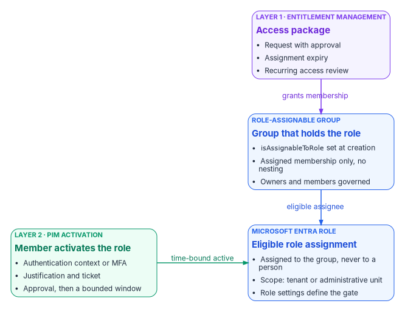

# Chapter 04 — Privileged Roles and Tiers

*A privileged role is a policy decision about what someone can take over, so it gets a tier, a group, a gate and an expiry before it gets a holder.*

::: {.callout-note}
## In this chapter
Which Microsoft Entra built-in roles are privileged and how to pick the least-privileged one for a task. The program's privilege tiers, built on Microsoft's enterprise access model, and how they differ from the other "tiers" in this workbook. How a role reaches a person through a role-assignable group and Privileged Identity Management (PIM), including PIM for Groups. Azure RBAC and the native IAM of AWS and VMware, privileged access workstations, and emergency access accounts.
:::

[Chapter 02](02-why-standing-privilege-fails.md) argued that standing privilege fails and that just-enough and just-in-time access replace it. This chapter supplies the nouns those ideas act on: the roles, the tiers they sit in, and the objects that carry them. [Chapter 08](08-pim-self-request-with-approval.md) then builds the activation gate, and [Appendix B](appendix-b-pim-role-settings.md) lists every role's settings.

The organizing idea is simple. Each role is placed in a tier according to what its holder could take over. The higher the tier, the stricter the gate a holder passes before the role is active, and the fewer people hold it at all. Only two classes of principal sit outside the tiers with standing access, and both are documented exceptions.

{#fig-ch04-tier-model fig-alt="A top-to-bottom stack of four cards. Tier 0, control plane, tenant-wide control: Global, Privileged Role, Privileged Authentication, Security and Conditional Access Administrator; gate of a Tier 0 approver group, a phishing-resistant authentication context, and 4 hours. A red arrow labeled can take over leads to Tier 1, management plane, service-wide administration: Exchange, SharePoint, Intune, Teams, Application, Cloud Application and Hybrid Identity Administrator; gate of a Tier 1 approver group, the authentication context, and 8 hours. Another red arrow labeled can take over leads to Tier 2, scoped operations, administration inside an administrative unit: User, Groups, Helpdesk, Password and Authentication Administrator scoped to an AU; gate of the authentication context and justification, approval optional with a risk acceptance, 8 hours. A dashed line leads to a slate read-only card: Global Reader, Security Reader, Reports Reader; the authentication context and justification, no approval, 8 hours. Beside Tier 0, an amber card, outside the tiers, standing active by exception: two emergency access accounts with permanent Global Administrator, and service principals that can't perform an activation; a dashed amber arrow labeled bypasses the gate points to Tier 0. Beside Tier 1, a violet card, approver groups: one group per tier, members outside the tier they approve, membership reviewed like a privileged object; a dashed violet arrow labeled approve activation points to Tier 1."}

## Roles are bundles of permissions

### Built-in roles and the privileged label

A Microsoft Entra role is a named set of permissions, assigned to a principal at a scope: the whole tenant, an administrative unit, or a single object. Microsoft publishes every built-in role with its permissions and an immutable template ID, and marks some roles **PRIVILEGED**.[^c04-roles-ref] A permission counts as privileged when it can be used to delegate management of directory resources to other users, modify credentials, authentication or authorization policies, or access restricted data; a role is privileged if it holds at least one such permission.[^c04-privileged] The label is still described as a preview, and listing privileged roles programmatically uses the Microsoft Graph beta endpoint (`roleDefinitions?$filter=isPrivileged eq true`), so the program treats the label as an input to tiering, not as the tier itself.[^c04-privileged]

The label surprises people in both directions. Global Reader and Security Reader carry it, because reading security configuration and restricted data is itself sensitive. Exchange Administrator, SharePoint Administrator, Teams Administrator, Groups Administrator, Reports Reader and Compliance Administrator don't carry it, even though Exchange Administrator can reach every mailbox.[^c04-roles-ref] The label describes directory permissions; it says nothing about what a role can do inside the workload it administers. That is why the program places Exchange and SharePoint Administrator in Tier 1 regardless of the label.

Microsoft's numeric guidance is short: keep Global Administrators to fewer than five, and privileged role assignments to fewer than ten.[^c04-privileged] [Chapter 02](02-why-standing-privilege-fails.md) uses the same targets.

### Least-privileged choices

Most requests for Global Administrator are requests for one task. Microsoft maintains a "least privileged roles by task" reference that names, for each task in each feature area, the least-privileged role and the other roles that can also do it, and recommends narrowing further with a smaller scope or a custom role.[^c04-by-task] The program uses it as the first step of every role request: name the task, look it up, assign that role. A few entries that change common habits:

| Task | Least-privileged role | Common over-assignment |
|---|---|---|
| Reset the password of a non-administrator | Password Administrator | User Administrator, Global Administrator |
| Reset the password or update the UPN of a privileged administrator | Privileged Authentication Administrator | Global Administrator |
| Update a user's authentication methods | Authentication Administrator | Privileged Authentication Administrator |
| Create or edit Conditional Access policies and named locations | Conditional Access Administrator | Security Administrator, Global Administrator |
| Read Conditional Access configuration | Security Reader | Global Reader, Security Administrator |
| Read audit and sign-in logs | Reports Reader | Security Administrator, Global Reader |
| Assign roles and configure PIM role settings | Privileged Role Administrator | Global Administrator |
| View PIM audit activity and role memberships | Security Reader | Privileged Role Administrator |
| Grant tenant-wide admin consent (delegated permissions) | Cloud Application Administrator | Global Administrator |

The table is drawn from Microsoft's task reference and its admin consent procedure.[^c04-by-task][^c04-admin-consent] Admin consent for Microsoft Graph application permissions needs more than Cloud Application Administrator; [Chapter 05](05-applications-and-workload-identities.md#admin-consent) and [Chapter 06](06-who-decides-access.md#who-approves-admin-consent) cover that case and who approves it.

Scope comes after role. Several Tier 2 roles can be scoped to an administrative unit, which is a materially smaller grant than a tenant-wide assignment; [Book 02, Chapter 05](../b02-identity/05-delegation-without-ous.md) lists which roles accept AU scope and builds the scoped matrix. Scoping is the cheaper control, so the program scopes first and gates what remains.

## Tiers: the enterprise access model and the program's tiers

### What Microsoft's model says

Microsoft's enterprise access model *builds on* the Active Directory tier model rather than discarding it. The old Tier 0 expands into the **control plane**; Tier 1 splits into the **management plane** and the **data and workload plane**; Tier 2 splits into **user access** and **app access**; and a privileged access pathway runs across all of them. The rule that carries over is hierarchy: prevent anything in a lower plane from controlling a higher one.[^c04-eam] Microsoft also treats privileged intermediaries, such as PAM tools, jump hosts, automation runbooks and highly privileged service principals, as control-plane assets, because whoever controls them controls what they reach.[^c04-privileged]

Alongside the planes, Microsoft defines three security levels for accounts, devices and intermediaries: **enterprise** (every user, the starting point), **specialized** (elevated business impact, such as developers of business-critical systems, executives and sensitive IT administrators), and **privileged** (Microsoft Entra administrative roles, other identity-system administrators, and privileged on-premises AD groups).[^c04-levels]

### The program's privilege tiers

The program applies the model to Microsoft Entra roles as four privilege tiers. The tier is set by what a holder could take over, and it decides the activation gate in [Chapter 08](08-pim-self-request-with-approval.md). The tier boundaries are the program's design; the hour counts are a starting posture an agency adapts to its own role inventory.

| Tier | Plane | Roles (examples) | Why they're here | Gate in PIM |
|---|---|---|---|---|
| Tier 0 | Control plane | Global Administrator, Privileged Role Administrator, Privileged Authentication Administrator, Security Administrator, Conditional Access Administrator | Can grant any role, reset any administrator's credentials, or change the policies that protect every sign-in | Approval by a Tier 0 approver group, phishing-resistant authentication context, 4 hours |
| Tier 1 | Management plane | Exchange, SharePoint, Intune, Teams, Application, Cloud Application and Hybrid Identity Administrator | Control a whole service, every managed device, application credentials, or the synchronization bridge to AD | Approval by a Tier 1 approver group, authentication context, 8 hours |
| Tier 2 | Scoped operations | User, Groups, Helpdesk, Password and Authentication Administrator, scoped to administrative units | Act on users and groups inside a bounded population | Authentication context and justification; approval optional with a documented risk acceptance, 8 hours |
| Read-only | Visibility | Global Reader, Security Reader, Reports Reader | Read configuration, security posture and logs across the tenant | Authentication context and justification, no approval, 8 hours |

Three placements need explaining.

- **Conditional Access Administrator is Tier 0.** Once PIM's activation gate points at a Conditional Access authentication context, whoever can edit Conditional Access can weaken the gate, remove it, or block eligible users from activating. Microsoft warns that Conditional Access and Security Administrators can change these requirements and should be treated as highly privileged.[^c04-pim-settings] The role that edits the policy protecting elevation sits in the tier the policy protects.
- **Hybrid Identity Administrator is Tier 1, but its servers are Tier 0.** The role configures synchronization; the sync servers themselves hold credentials that can write to the directory, so they're privileged intermediaries in Microsoft's sense and are run as control-plane assets.[^c04-privileged]
- **Readers are tiered at all.** Global Reader and Security Reader carry Microsoft's privileged label.[^c04-roles-ref] Read access to the whole security configuration is reconnaissance for an attacker, so the roles are eligible-only with justification, even without approval.

### Three different "tiers" in this workbook

The word tier appears in three places in this workbook with three meanings. They don't conflict, but they must not be mixed up in a request or a review.

| Term | Where | Meaning | Numbering |
|---|---|---|---|
| Delegation tier | [Book 02, Chapter 05](../b02-identity/05-delegation-without-ous.md#the-three-tier-model) | Scope of an administrative assignment: enterprise read-only, department, sub-team | Tier 1 (widest) to Tier 3 (narrowest) |
| Application risk tier | [Chapter 06](06-who-decides-access.md#risk-tiers-set-the-approval-chain) | Risk of an enterprise application, which sets its approval chain and review cadence | Tier 1 (high risk) to Tier 3 (low risk) |
| Privilege tier | This chapter | What a role's holder could take over, which sets its PIM gate | Tier 0 (control plane) to Tier 2, plus read-only |

The crosswalk is direct. Book 02's delegation Tier 1 (enterprise readers) are this chapter's read-only tier; its delegation Tiers 2 and 3 (AU-scoped administrators) are privilege Tier 2. Privilege Tiers 0 and 1 have no AU scope at all; they're tenant-wide by nature. Where a document needs to be unambiguous, the program writes privilege tiers as `T0`, `T1` and `T2`.

## How a role reaches a person

The program never assigns a privileged role directly to a person as an active assignment. A role is assigned to a role-assignable group as an **eligible** assignment; people become members of that group through an approved request; and a member uses the role only by activating it in PIM. That gives two separately governed layers: who may ever hold the role, and who may use it now.

{#fig-ch04-role-group-pim fig-alt="A left-to-right flow of three cards with a fourth below. A violet card, layer 1, entitlement management, access package: request with approval, assignment expiry, recurring access review. An arrow labeled grants membership leads to a blue card, role-assignable group, the group that holds the role: isAssignableToRole set at creation, assigned membership only with no nesting, owners and members governed. An arrow labeled eligible assignee leads to a blue card, Microsoft Entra role, eligible role assignment: assigned to the group and never to a person, scope tenant or administrative unit, role settings define the gate. Below, a green card, layer 2, PIM activation, member activates the role: authentication context or MFA, justification and ticket, approval and then a bounded window; an arrow labeled time-bound active points to the role assignment card."}

### Role-assignable groups

Only a group created with `isAssignableToRole` set to true can hold a Microsoft Entra role, and the property can be set only at creation; an existing group can't be converted. Role-assignable groups carry restrictions designed to stop privilege escalation through group management:[^c04-rag]

- Membership must be **assigned**. A dynamic group can't hold a role, because an automated rule could add an unwanted account and thereby assign it the role.
- **Nesting isn't supported.** A group can't be an active member of a role-assignable group.
- Creating one needs at least **Privileged Role Administrator**. Privileged Role Administrators manage membership by default; ownership can be delegated to named owners.
- Changing a member's or owner's credentials, resetting their MFA or editing their sensitive attributes needs at least **Privileged Authentication Administrator**, so a help desk can't take over a group member's account and inherit the role.
- Through Microsoft Graph, membership changes need `RoleManagement.ReadWrite.Directory`; `Group.ReadWrite.All` isn't enough.
- A tenant can have at most **500** role-assignable groups. The feature needs Microsoft Entra ID P1; just-in-time activation through PIM needs P2.

These are the same constraints [Book 02, Chapter 05](../b02-identity/05-delegation-without-ous.md#role-assignment-matrix) applies to its `*-Admins` groups. The program names privileged groups `PRV-<tier>-<role>-<scope>`, for example `PRV-T0-PrivRoleAdmin`, `PRV-T1-ExchangeAdmin` and `PRV-T2-UserAdmin-AU-Finance`, so that the tier is visible in every review, alert and audit record.

### Two ways to model eligibility through a group

Microsoft documents two patterns, and they behave differently.[^c04-graph-tutorial][^c04-pim-groups]

1. **Eligible group-to-role assignment, active members.** The group holds an eligible assignment; members are permanent members of the group and activate the role itself.
2. **Active group-to-role assignment, eligible members.** The group holds an active assignment; people are eligible members and activate their membership through PIM for Groups.

The program uses the first pattern for Microsoft Entra roles. Microsoft notes that roles with permissions in SharePoint, Exchange or the Microsoft Purview portal can take significant time to become usable under the second pattern, and recommends the first pattern or direct PIM for Microsoft Entra roles in those cases.[^c04-pim-groups] The first pattern also keeps the activation on the role, where its role settings, alerts and reviews live.

Whichever pattern applies, Microsoft recommends requiring approval for eligible assignments in groups used to elevate into Microsoft Entra roles. Without approval, a less-privileged administrator who can reset an eligible user's credentials could activate the assignment on that user's behalf.[^c04-rag]

### PIM for Groups

PIM for Groups (called privileged access groups until January 2023) gives just-in-time membership or ownership of a security group or Microsoft 365 group, with policies like those for roles: approval, MFA, justification and a maximum activation time. Each group has two policies, one for membership and one for ownership. A group doesn't need to be role-assignable to be managed by PIM, and more than 500 groups can be in PIM even though only 500 can be role-assignable; dynamic groups and groups synchronized from on-premises AD can't be enabled.[^c04-pim-groups] Licensing is Microsoft Entra ID P2 or Microsoft Entra ID Governance for eligible and time-bound users and for approvers.[^c04-licensing]

The program uses PIM for Groups where the privilege isn't an Entra role: groups that grant Azure roles, Intune scope, access to sensitive applications, or Conditional Access exclusions such as Chapter 07's governed travel exception ([Chapter 07](07-the-conditional-access-policy-library.md#wave-3-everyone)). Microsoft recommends creating even those groups as role-assignable when they guard sensitive resources, for the extra management protection.[^c04-pim-groups]

When an eligible group itself holds an eligible Azure role, the user activates twice: first the group membership, then the role.[^c04-azure-activate]

### Layer 1: who may ever hold the role

Layer 1 is entitlement management. The program publishes membership of each role-assignable group as an access package with an approval policy, an expiry and a recurring review ([Chapter 09](09-access-governance.md)). Entitlement management can also place Microsoft Entra roles directly in an access package, but that capability is in preview, and Microsoft is restricting it to roles without privileged permissions; privileged roles belong in PIM.[^c04-em-roles] The program therefore never puts a role in a package directly. Packages grant membership of the group that holds the eligible assignment, and [Chapter 09](09-access-governance.md) adds the rule that no package grants an active privileged role.

## Azure RBAC and native cloud IAM

Microsoft Entra roles govern the directory. Azure resources, AWS accounts and VMware estates each have their own authorization system, and each needs the same discipline: least privilege, a tier, time-bound use and review. The Federal Compliance books hold the operational depth; this section places each system in the tier model.

### Azure RBAC

Azure role-based access control assigns Azure roles at management group, subscription, resource group or resource scope. Microsoft classifies five built-in roles as **privileged administrator roles**: Owner, Contributor, Reservations Administrator, Role Based Access Control Administrator and User Access Administrator.[^c04-azure-steps] Microsoft's best practices are to remove unnecessary privileged assignments, prefer job-function roles, use the narrowest scope, add conditions when delegating role assignment, and keep a maximum of three subscription owners.[^c04-azure-best]

PIM covers Azure roles too: eligible assignments at management group, subscription, resource group and resource scope, activated from PIM or the resource's Access control (IAM) page, with Microsoft Entra ID P2 or Microsoft Entra ID Governance.[^c04-azure-activate] The program's placements:

| Azure assignment | Tier | Reason |
|---|---|---|
| Owner, User Access Administrator or Role Based Access Control Administrator at root or a top management group | T0 | Can grant any Azure role anywhere below, including over the identity and logging infrastructure |
| Any privileged administrator role on subscriptions that host identity infrastructure, PIM evidence or the log workspace | T0 | Control of the evidence and the identity servers is control of the control plane |
| Owner or Contributor on a workload subscription | T1 | Full management of one workload's resources |
| Job-function roles (for example Virtual Machine Contributor) scoped to a resource group | T2 | Bounded operational change |
| Reader at any scope | Read-only | Visibility |

One Azure capability crosses tiers by design. A Global Administrator can **elevate access**, which assigns User Access Administrator at root scope (`/`) over every subscription and management group; Microsoft's guidance is to remove the elevation as soon as the task is done.[^c04-azure-elevate] The program treats every elevation as a Tier 0 event: alerted, justified in a ticket, and removed the same day.

Signing in to a virtual machine is a separate permission. Owner and Contributor don't by themselves grant Microsoft Entra sign-in to a VM; the Virtual Machine Administrator Login or Virtual Machine User Login role does, and Microsoft describes the split between people who control VMs and people who can sign in to them as intentional and audited. Microsoft recommends assigning the sign-in roles at resource group or broader scope rather than per VM, to stay within assignment limits.[^c04-vm-signin] The program holds Virtual Machine Administrator Login as an eligible assignment on the resource groups an administrator manages. Arc-enabled server just-in-time access, and the CA026 policy that governs the Azure management plane for server administrators ([Chapter 07](07-the-conditional-access-policy-library.md#wave-2-administrators)), are covered in the [Privileged Access Management book](https://github.com/WhalerMike/modernization-workbook/blob/main/docs/compliance/Vol_III_Book_01_Privileged_Access_Management.md).

### AWS

In AWS IAM Identity Center, a **permission set** is a template of IAM policies; assigning it to a user or group in an account creates an Identity Center-controlled IAM role there. The session duration for a permission set defaults to one hour and can be set up to 12 hours; the access portal session defaults to eight hours and can be set up to 90 days.[^c04-aws-permsets] AWS's IAM best practices start with least-privilege permissions and federation with temporary credentials for people, and include using IAM Access Analyzer to generate policies and remove unused access.[^c04-aws-iam-best] Access Analyzer's unused-access findings report unused roles, unused access keys and passwords, and unused service- and action-level permissions; they're priced per IAM role or user analyzed each month.[^c04-aws-analyzer]

Identity Center has no PIM equivalent of its own. AWS's guidance on temporary elevated access points to partner solutions validated in its Security Competency program.[^c04-aws-tea] TEAM (Temporary Elevated Access Management) is an open-source sample in the `aws-samples` organization, not an AWS service, and the customer is responsible for operating and securing it.[^c04-aws-team] The program's tiering applies unchanged: permission sets that can change IAM, Identity Center or the organization are T0; administrator permission sets on a workload account are T1; and every privileged permission set is requested and approved outside AWS, with assignments granted for a bounded period.

### VMware vSphere

vSphere authorizes through fine-grained **privileges**, grouped into **roles**, which a **permission** grants to a user or group on an inventory object; global permissions span all inventory hierarchies, and system roles such as Administrator are predefined and can't be changed.[^c04-vsphere-authz] vCenter can federate sign-in with Microsoft Entra ID over OpenID Connect, with SCIM provisioning of users and groups, from vSphere 8.0 Update 2.[^c04-vsphere-entra] Federation brings vCenter sign-ins under Conditional Access, but the vCenter roles themselves stay outside PIM: a group's membership can be made just-in-time with PIM for Groups, and the vCenter permission granted to that group then follows the activation.

The [native cloud IAM book](https://github.com/WhalerMike/modernization-workbook/blob/main/docs/compliance/Vol_VII_Book_08_Native_IAM_RBAC_Access_Governance.md) reports that its cross-cloud entitlement engine covers Azure RBAC and AWS IAM but that no evidence was found of equivalent coverage for vCenter permissions, so vSphere privilege drift is detected by the program's own exports rather than by that engine. That book, and the [Privileged Access Management book](https://github.com/WhalerMike/modernization-workbook/blob/main/docs/compliance/Vol_III_Book_01_Privileged_Access_Management.md) for vaulting and recorded sessions on standing accounts, hold the operational detail.

## Privileged access workstations

A privileged access workstation (PAW) is a device at Microsoft's privileged security level, used only for administration. At that level Microsoft's device controls deny personal-device enrollment, block URLs by default, remove local administrator rights, enforce application control, and allow only Intune-installed applications.[^c04-paw-devices] Microsoft's deployment guidance builds PAWs with Intune and Windows Autopilot, tags them into a dynamic device group, holds them at the Enrollment Status Page until setup completes, and enforces their use with Conditional Access.[^c04-paw-deploy] Both pages are dated: they target Windows 10 and use retired product names. The program uses them as Microsoft's published reference design, not as a current procedure, and builds PAWs on the agency's supported Windows release and current Intune baselines.

The program's PAW rule is Book 02's: administration of privileged roles happens only from a PAW ([Book 02, Chapter 10](../b02-identity/10-migrating-and-governing.md#privileged-access-workstations)). Enforcement is two Conditional Access policies in [Chapter 07](07-the-conditional-access-policy-library.md#wave-2-administrators): **CA004** requires a compliant device for the administrator persona, and **CA025** blocks the Microsoft admin portals and Azure management from any device not labeled as a PAW. The PAW condition lives in its own block policy because a grant policy scoped by a device filter simply doesn't apply on other devices. [Chapter 08](08-pim-self-request-with-approval.md) adds a compliant-device requirement to the PIM activation context, so the role can't be activated off a managed device either. The hardware, operating system and application-control baseline is in the [Privileged Access Management book](https://github.com/WhalerMike/modernization-workbook/blob/main/docs/compliance/Vol_III_Book_01_Privileged_Access_Management.md).

## Emergency access accounts

Emergency access ("break-glass") accounts are the documented exception to everything above. They restore access when normal administrator sign-in, MFA, Conditional Access or PIM fails, so they can't depend on any of them. [Book 02, Chapter 09](../b02-identity/09-building-the-entra-target.md#emergency-access-accounts) sets the program's standard, and this book keeps it, with Microsoft's current wording applied:[^c04-emergency]

- **Two or more** cloud-only accounts on the tenant's `*.onmicrosoft.com` domain, neither synchronized nor federated, and not tied to an individual or an employee's phone.
- **Permanent active Global Administrator**, assigned in PIM. These and service principals that can't perform an activation are the only standing active assignments in the tenant.
- **Phishing-resistant authentication**, a passkey (FIDO2) security key or certificate-based authentication, with methods different from those of the normal administrator accounts and credentials that don't expire.
- **Excluded from Conditional Access policies that block or restrict sign-in**, through one dedicated exclusion group. Report-only policies need no exclusion, which is why [Chapter 07](07-the-conditional-access-policy-library.md)'s report-only CA090 still records their sign-ins.
- **Alerted** on every sign-in and audit event, with any use treated as an incident until a post-use review closes it.
- **Validated** at least every 90 days, by signing in and performing an administrative task against the current Conditional Access set, from a PAW or designated secure workstation.

Two notes keep this current. Microsoft's mandatory MFA for the Azure portal, the Microsoft Entra admin center and the Intune admin center (from October 2024), and for Azure CLI, Azure PowerShell and infrastructure-as-code operations (from October 1, 2025), applies to emergency accounts too; Microsoft enforces it only in the public Azure cloud, not in Azure for US Government or other sovereign clouds.[^c04-mandatory-mfa] The program requires phishing-resistant MFA on these accounts in every cloud, so the difference doesn't change the design. And the older pattern of a password in two sealed envelopes as the only credential, still described in parts of the compliance series, is superseded: a password alone can no longer sign in to the admin portals where mandatory MFA applies.

The accounts must exist and be tested **before** any role is converted to eligible or any approval requirement is switched on. [Chapter 08](08-pim-self-request-with-approval.md#step-0-establish-emergency-access-accounts-first) explains the lockout that ordering prevents.

## What the tiers answer in federal requirements

The tier model is the program's answer to the least-privilege and account-management family of NIST SP 800-53 Revision 5.[^c04-nist]

- **AC-6** requires least privilege: only the accesses necessary for assigned tasks. The task-to-role lookup, AU scoping and the tiers implement it.
- **AC-6(1)** requires authorizing access to defined security functions for defined individuals or roles, and **AC-6(5)** restricts privileged accounts to defined personnel or roles. The eligible-assignment inventory of the `PRV-*` groups is that definition, with the two standing-access exceptions listed by name.
- **AC-6(2)** requires non-privileged accounts or roles for nonsecurity functions. Eligible-only roles and a separate administrator account make the administrator a standard user between activations.
- **AC-6(7)** requires reviewing privileges at a defined frequency and removing them when not needed; **AC-6(9)** requires logging privileged functions; **AC-6(10)** requires preventing non-privileged users from executing them. [Chapter 08](08-pim-self-request-with-approval.md) builds the reviews, logging and gate.
- **AC-2** requires defined account types, prerequisites for role membership, approval, monitoring and periodic review, and **AC-2(1)** automated account management. Group-based assignment through approved packages and automatic PIM expiry provide both.

All of these controls are in the NIST SP 800-53B Moderate baseline, which FedRAMP Moderate builds on.[^c04-nist-moderate] **AC-2(7)**, which asks for privileged accounts administered under a role-based or attribute-based scheme with monitoring and revocation, isn't selected in the Moderate baseline; the tier model meets its intent anyway, which matters to agencies that tailor it in.[^c04-nist][^c04-nist-moderate] [Chapter 08](08-pim-self-request-with-approval.md#control-mapping-fedramp-moderate) carries the full control mapping for the activation gate.

::: {.callout-tip}
## Continue the book
[← Previous: Chapter 03 — The Conditional Access Model](03-the-conditional-access-model.md) · [Book index](index.md) · [Next: Chapter 05 — Applications and Workload Identities →](05-applications-and-workload-identities.md)
:::

[^c04-roles-ref]: Microsoft Learn, "Microsoft Entra built-in roles," <https://learn.microsoft.com/entra/identity/role-based-access-control/permissions-reference> (accessed Oct 20, 2026).
[^c04-privileged]: Microsoft Learn, "Privileged roles and permissions in Microsoft Entra ID (preview)," <https://learn.microsoft.com/entra/identity/role-based-access-control/privileged-roles-permissions> (accessed Oct 20, 2026).
[^c04-by-task]: Microsoft Learn, "Least privileged roles by task in Microsoft Entra ID," <https://learn.microsoft.com/entra/identity/role-based-access-control/delegate-by-task> (accessed Oct 20, 2026).
[^c04-admin-consent]: Microsoft Learn, "Grant tenant-wide admin consent to an application," <https://learn.microsoft.com/entra/identity/enterprise-apps/grant-admin-consent> (accessed Oct 20, 2026).
[^c04-eam]: Microsoft Learn, "Enterprise access model," <https://learn.microsoft.com/security/privileged-access-workstations/privileged-access-access-model> (accessed Oct 20, 2026).
[^c04-levels]: Microsoft Learn, "Privileged access security levels," <https://learn.microsoft.com/security/privileged-access-workstations/privileged-access-security-levels> (accessed Oct 20, 2026).
[^c04-pim-settings]: Microsoft Learn, "Configure Microsoft Entra role settings in Privileged Identity Management," <https://learn.microsoft.com/entra/id-governance/privileged-identity-management/pim-how-to-change-default-settings> (accessed Oct 20, 2026).
[^c04-rag]: Microsoft Learn, "Use Microsoft Entra groups to manage role assignments," <https://learn.microsoft.com/entra/identity/role-based-access-control/groups-concept> (accessed Oct 20, 2026).
[^c04-graph-tutorial]: Microsoft Learn, "Assign privileged roles using PIM for Microsoft Entra roles APIs," <https://learn.microsoft.com/graph/tutorial-assign-azureadroles> (accessed Oct 20, 2026).
[^c04-pim-groups]: Microsoft Learn, "Privileged Identity Management (PIM) for Groups," <https://learn.microsoft.com/entra/id-governance/privileged-identity-management/concept-pim-for-groups> (accessed Oct 20, 2026).
[^c04-licensing]: Microsoft Learn, "Microsoft Entra ID Governance licensing fundamentals," <https://learn.microsoft.com/entra/id-governance/licensing-fundamentals> (accessed Oct 20, 2026).
[^c04-azure-activate]: Microsoft Learn, "Activate eligible Azure role assignments," <https://learn.microsoft.com/azure/role-based-access-control/role-assignments-eligible-activate> (accessed Oct 20, 2026).
[^c04-em-roles]: Microsoft Learn, "Assign Microsoft Entra roles (Preview)" (entitlement management), <https://learn.microsoft.com/entra/id-governance/entitlement-management-roles> (accessed Oct 20, 2026).
[^c04-azure-steps]: Microsoft Learn, "Steps to assign an Azure role," <https://learn.microsoft.com/azure/role-based-access-control/role-assignments-steps> (accessed Oct 20, 2026).
[^c04-azure-best]: Microsoft Learn, "Best practices for Azure RBAC," <https://learn.microsoft.com/azure/role-based-access-control/best-practices> (accessed Oct 20, 2026).
[^c04-vm-signin]: Microsoft Learn, "Sign in to a Linux virtual machine in Azure by using Microsoft Entra ID and OpenSSH," section "Configure role assignments for the VM," <https://learn.microsoft.com/entra/identity/devices/howto-vm-sign-in-azure-ad-linux> (accessed Oct 20, 2026).
[^c04-azure-elevate]: Microsoft Learn, "Elevate access to manage all Azure subscriptions and management groups," <https://learn.microsoft.com/azure/role-based-access-control/elevate-access-global-admin> (accessed Oct 20, 2026).
[^c04-aws-permsets]: Amazon Web Services, "Manage AWS accounts with permission sets," *AWS IAM Identity Center User Guide*, <https://docs.aws.amazon.com/singlesignon/latest/userguide/permissionsetsconcept.html> (accessed Oct 20, 2026).
[^c04-aws-iam-best]: Amazon Web Services, "Security best practices in IAM," *AWS Identity and Access Management User Guide*, <https://docs.aws.amazon.com/IAM/latest/UserGuide/best-practices.html> (accessed Oct 20, 2026).
[^c04-aws-analyzer]: Amazon Web Services, "IAM Access Analyzer findings," *AWS Identity and Access Management User Guide*, <https://docs.aws.amazon.com/IAM/latest/UserGuide/access-analyzer-findings.html> (accessed Oct 20, 2026).
[^c04-aws-tea]: Amazon Web Services, "Temporary elevated access for AWS accounts," *AWS IAM Identity Center User Guide*, <https://docs.aws.amazon.com/singlesignon/latest/userguide/temporary-elevated-access.html> (accessed Oct 20, 2026).
[^c04-aws-team]: Amazon Web Services, "iam-identity-center-team" (aws-samples repository), <https://github.com/aws-samples/iam-identity-center-team> (accessed Oct 20, 2026).
[^c04-vsphere-authz]: Broadcom, "Understanding Authorization in vSphere," *vSphere Security* (vSphere 9.0), <https://techdocs.broadcom.com/us/en/vmware-cis/vsphere/vsphere/9-0/vsphere-security/vsphere-permissions-and-user-management-tasks/understanding-authorization-in-vsphere.html> (accessed Oct 20, 2026).
[^c04-vsphere-entra]: Broadcom, "Configure vCenter Identity Provider Federation for Microsoft Entra ID," *vSphere Authentication* (vSphere 9.0), <https://techdocs.broadcom.com/us/en/vmware-cis/vsphere/vsphere/9-0/vsphere-authentication/vsphere-authentication-with-vcenter-single-sign-on/configuring-vcenter-server-identity-provider-federation/configure-vcenter-server-identity-provider-federation-for-azure-ad.html> (accessed Oct 20, 2026).
[^c04-paw-devices]: Microsoft Learn, "Securing devices as part of the privileged access story," <https://learn.microsoft.com/security/privileged-access-workstations/privileged-access-devices> (accessed Oct 20, 2026).
[^c04-paw-deploy]: Microsoft Learn, "Privileged access deployment," <https://learn.microsoft.com/security/privileged-access-workstations/privileged-access-deployment> (accessed Oct 20, 2026).
[^c04-emergency]: Microsoft Learn, "Manage emergency access accounts in Microsoft Entra ID," <https://learn.microsoft.com/entra/identity/role-based-access-control/security-emergency-access> (accessed Oct 20, 2026).
[^c04-mandatory-mfa]: Microsoft Learn, "Mandatory multifactor authentication for Azure and admin portals," <https://learn.microsoft.com/entra/identity/authentication/concept-mandatory-multifactor-authentication> (accessed Oct 20, 2026).
[^c04-nist]: National Institute of Standards and Technology, SP 800-53 Rev. 5, *Security and Privacy Controls for Information Systems and Organizations*, September 2020 (updated December 10, 2020; current release 5.2.0), <https://csrc.nist.gov/pubs/sp/800/53/r5/upd1/final> (accessed Oct 20, 2026).
[^c04-nist-moderate]: National Institute of Standards and Technology, SP 800-53B Moderate baseline, OSCAL profile, release 5.2.0, <https://github.com/usnistgov/oscal-content/blob/main/nist.gov/SP800-53/rev5/json/NIST_SP-800-53_rev5_MODERATE-baseline_profile.json> (accessed Oct 20, 2026).
