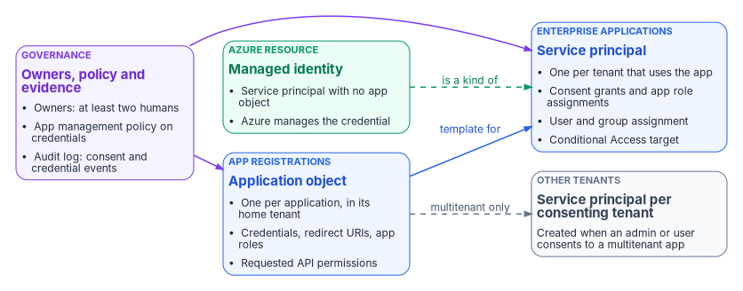
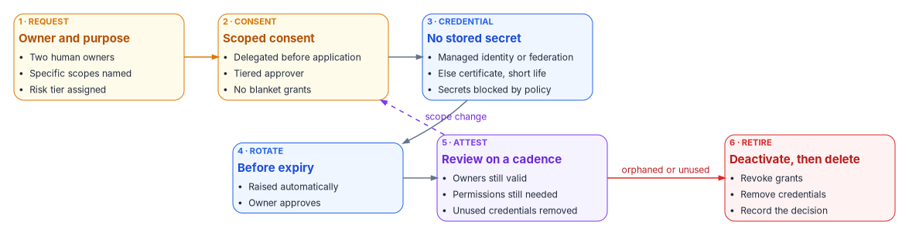
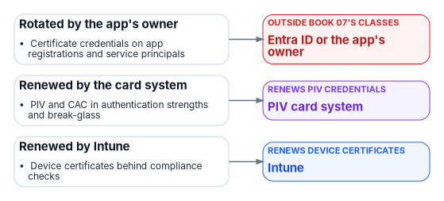

# Chapter 05 — Applications and Workload Identities

*An application is a principal like any user, except that nobody reviews its access unless someone is told to, and its credentials don't leave when its author does.*

::: {.callout-note}
## In this chapter
How Entra ID represents an application (the app registration and the service principal behind each enterprise application), what delegated and application permissions grant, and how user consent, admin consent, the consent policy and permission classifications decide who can grant them. Then ownership, credentials and the order of preference among them, managed identities and workload identity federation, Conditional Access for workload identities, app instance property lock, and the governed lifecycle the program puts every app registration through.
:::

Most access decisions in this book are made about people: who can sign in, from where, with what strength of authentication, and with what standing privilege. Applications get the same kind of access through a different door. An application acquires a token, presents it to an API, and acts on data, either for a signed-in user or entirely on its own. The decisions that grant that access are consent grants and app role assignments. They're made once, often by whoever was holding an administrator role when a vendor asked for them, and they stay in force until someone removes them. A client secret pasted into a pipeline variable, a consent to `Mail.ReadWrite` granted "to make it work," and an app whose only owner left two years ago are each a standing access decision that no policy is re-evaluating.

That's the reason this book treats application access as policy. Conditional Access ([Chapter 03](03-the-conditional-access-model.md)) evaluates sign-ins; it says almost nothing about what an application's consented permissions let it do once it holds a token. Privileged roles ([Chapter 04](04-privileged-roles-and-tiers.md)) govern administrators; the roles that manage applications turn out to be some of the most powerful in the tenant. This chapter describes the objects and controls. [Chapter 06](06-who-decides-access.md) says who decides each of them, and [Chapter 09](09-access-governance.md) covers the reviews that keep them current.

{#fig-ch05-app-object-model fig-alt="A left-to-right diagram. On the left, a violet governance card lists owners with at least two humans, an app management policy on credentials, and audit-log consent and credential events; arrows go from it to two blue cards. The first blue card, labeled App registrations, is the application object: one per application in its home tenant, holding credentials, redirect URIs, app roles and requested API permissions. An arrow labeled template for leads to the second blue card, labeled Enterprise applications: the service principal, one per tenant that uses the app, holding consent grants, app role assignments, user and group assignment, and acting as the Conditional Access target. A dashed arrow labeled multitenant only leads from the application object to a slate card for service principals created in other tenants when an admin or user consents. A green card for a managed identity, a service principal with no application object whose credential Azure manages, has a dashed arrow labeled is a kind of pointing to the service principal card."}

## Two objects for one application

Entra ID splits every application into two directory objects, and most governance confusion comes from treating them as one.

| | App registration | Enterprise application |
|---|---|---|
| Directory object | Application object | Service principal |
| How many | Exactly one, in the app's home tenant | One in every tenant where the app is used |
| What it defines | How tokens are issued to the app, which resources it may request, and what actions it can take: redirect URIs, credentials, app roles, requested permissions | What the app can actually do in this tenant: granted permissions, user and group assignments, local Conditional Access targeting, provisioning settings |
| Where you manage it | **App registrations** in the Microsoft Entra admin center | **Enterprise applications** |
| Analogy | A class | An instance |

Microsoft describes the application object as the global representation of an app, used as a template for the service principal, and the service principal as its local representation in a specific tenant.[^c05-app-sp] Registering an app in the admin center creates both objects in the home tenant; creating an app through Microsoft Graph makes creating the service principal a separate step. A multitenant app also gets a service principal in each tenant where a user or administrator consents to it. Changes to the application object reach only the home tenant's service principal, and deleting the application object deletes that service principal too. For an app that needs to stop working while it's investigated, Entra ID can deactivate it instead, which stops new tokens from being issued while keeping both objects intact.[^c05-app-sp]

There are three types of service principal.[^c05-app-sp]

- **Application.** The instance of an application object in one tenant. This is what nearly every enterprise application is.
- **Managed identity.** A service principal that represents an Azure managed identity. It has no application object, and it can be granted access but can't be modified directly.
- **Legacy.** An app created before app registrations existed, or through a legacy experience. It can carry credentials and reply URLs but has no app registration, and it works only in the tenant where it was created.

Service principals also appear without anyone registering anything. The first user who consents to a third-party app creates its service principal, and Microsoft services provision their own service principals just in time, sometimes with a directory role such as Directory Readers.[^c05-how-added] An inventory of enterprise applications is therefore always larger than the list of apps anyone asked for, which is why the program classifies an unclassified service principal as high risk until someone proves otherwise ([Chapter 06](06-who-decides-access.md#risk-tiers-set-the-approval-chain)).

### Who can create applications

By default every member user can register applications and manage the ones they create, and can consent to apps accessing company data on their behalf. Microsoft documents how to turn both off: set **Users can register applications** to **No**, set user consent to **Do not allow user consent**, and give the Application Developer role to the people who should still register apps.[^c05-delegate-app] The Application Developer role can create up to 250 application objects; a custom role can lift that limit.[^c05-app-dev-limit]

The program sets **Users can register applications** to **No** and routes every new registration through the request in [Chapter 06](06-who-decides-access.md#request). Developers who build apps get Application Developer, scoped to the work, and the registrations they create still enter the governed lifecycle at the end of this chapter.

## Permissions: what an application can be granted

An application asks for access to an API as permissions, and the two kinds carry very different risk.

| | Delegated permission | Application permission (app role) |
|---|---|---|
| Who the app acts as | A signed-in user | Itself, with no user present |
| Effective access | The intersection of the user's own rights and the granted scope | Everything the scope allows, across the tenant |
| Who can grant it | The user, if the consent policy allows it for that permission; otherwise an administrator | An administrator only |
| Typical use | Interactive apps, single sign-on, add-ins | Daemons, integrations, connectors, background jobs |

Microsoft's guidance is to request the least permissive permission that works, to prefer delegated access over app-only access wherever possible, and to remove permissions the app no longer uses.[^c05-best-practice] Removing a permission from the app registration doesn't revoke a grant that already exists; an administrator has to revoke it on the enterprise application too.[^c05-update-perms]

The program assigns every commonly requested Microsoft Graph permission a risk level, and that level sets who approves it ([Chapter 06](06-who-decides-access.md#who-approves-admin-consent)). The table is the program's classification, used in security review; it isn't a Microsoft rating.

| Permission | Type | Program risk level | What it allows |
|---|---|---|---|
| `Mail.ReadWrite`, `Mail.Send` | Application | Critical | Read and write mail in every mailbox, or send mail as any user |
| `Files.ReadWrite.All` | Application | Critical | Read and write every OneDrive and SharePoint file |
| `User.ReadWrite.All`, `Directory.ReadWrite.All` | Application | Critical | Change any user or directory object |
| `RoleManagement.ReadWrite.Directory` | Application | Critical | Read and write role assignments, including assigning admin roles |
| `User.Read.All`, `Group.ReadWrite.All`, `Calendars.ReadWrite`, `Mail.Read` | Application | High | Read every profile, change any group's membership, write every calendar, or read every mailbox |
| `Mail.ReadWrite`, `Files.ReadWrite`, `Calendars.ReadWrite` | Delegated | Moderate | Read and write the signed-in user's mail, files or calendar |
| `User.Read`, `openid`, `profile`, `email`, `offline_access` | Delegated | Low | Sign the user in and read their basic profile |

Application permission names don't reliably end in `.All`: the application permission that reads and writes mail in all mailboxes is `Mail.ReadWrite`, and the one that sends mail as any user is `Mail.Send`, the same names as their delegated counterparts.[^c05-graph-perms] Review the permission type, not the suffix. For mail, Exchange Online can narrow an app with those permissions to specific mailboxes through an application access policy, which the program requires for any mail application permission it approves.[^c05-graph-perms]

The low row is deliberately the minimum for sign-in: Microsoft lists `openid`, `profile`, `email` and `offline_access` as the delegated Graph permissions needed for basic sign-in, which also let an app keep access while the user isn't using it.[^c05-classify]

## Consent

Consent is the act that turns a requested permission into a granted one. Microsoft defines it as the process where users grant an application permission to access a protected resource, and splits it into user consent (delegated permissions, for the user's own data) and admin consent (on behalf of the organization, and the only route to application permissions).[^c05-consent-overview]

### User consent and the consent policy

User consent settings apply to every user in the tenant and offer three built-in choices:[^c05-consent-overview]

- **Do not allow user consent.** Users keep using apps they already consented to, and apps an administrator consented to for them, but can't grant new permissions.
- **Allow user consent for apps from verified publishers or apps registered in your organization, for permissions you select.** Users can consent only to permissions classified as low impact, and only for those apps. The policy behind this option is `microsoft-user-default-low`.[^c05-user-consent]
- **Allow user consent for apps.** Any user can consent to any permission that doesn't need admin consent, for any app (`microsoft-user-default-legacy`).[^c05-user-consent]

Microsoft says that by default all users can consent to permissions that don't require administrator consent, and recommends allowing user consent only for apps from verified publishers.[^c05-user-consent] Changing the setting affects only future consent; existing grants stay until they're revoked. Configuring it takes Privileged Role Administrator through Microsoft Graph, or Global Administrator in the admin center.[^c05-user-consent]

Every tenant also has built-in app consent policies that can't be edited. Two of them, `microsoft-user-default-recommended` and `microsoft-user-default-allow-consent-apps`, are Microsoft-managed: Microsoft updates their conditions as its recommendations change. Organizations that need finer control can write custom app consent policies.[^c05-consent-policies]

The program's setting is the middle option: user consent only for verified-publisher and in-tenant apps, only for permissions classified as low. Everything else goes to the admin consent workflow. One interaction makes this safer than it looks: an app configured to require user assignment always needs admin consent, even when the user consent policy would otherwise allow a user to consent for themselves.[^c05-user-consent] The program requires assignment on every enterprise application ([Chapter 06](06-who-decides-access.md#assignment)), so user consent in practice covers only a narrow set of sign-in permissions. This setting is one of the two ways CISA's Microsoft Entra ID baseline allows an agency to meet MS.AAD.5.2v1, "User consent to applications SHALL be restricted": the baseline's more flexible option lets users consent to applications from Microsoft-verified publishers that use permissions an administrator has classified as low risk, and its stricter option allows no user consent at all.[^c05-scuba-consent]

### Permission classifications

Permission classifications are how a tenant tells the consent policy which permissions are low impact. Entra ID supports Low, plus Medium and High in preview, and only delegated permissions that don't already require admin consent can be classified. Classifying takes Application Administrator or Cloud Application Administrator.[^c05-classify] The program classifies exactly the low row of the table above as Low and leaves everything else unclassified, which keeps it out of user consent.

### Admin consent

Admin consent grants an app access for the whole organization, and for application permissions it's the only route. Microsoft calls it a sensitive operation that can give an app's publisher access to significant portions of an organization's data, or to highly privileged operations such as role management, all mailboxes or full user impersonation, and tells administrators not to grant it unless they understand who controls the app and why it needs the permissions.[^c05-consent-overview]

Which role can grant it depends on what's being granted:[^c05-grant-admin]

| Role | Can grant admin consent for |
|---|---|
| Privileged Role Administrator | Any permission, for any API |
| Cloud Application Administrator, Application Administrator, AI Administrator | Any permission for any API, except Microsoft Graph app roles (application permissions) |
| Custom role with the permission to grant permissions to applications | The permissions the custom role allows |

The exception is narrower than it sounds. Application Administrator and Cloud Application Administrator can still consent to application permissions for every API other than Microsoft Graph and Azure AD Graph, including other Microsoft APIs and third-party APIs.[^c05-roles] [Chapter 06](06-who-decides-access.md#what-each-entra-role-can-actually-do) explains why this matters for help desk role design.

Four behaviors of consent grants shape the governance around them:

- **Grants don't expire.** A delegated permission grant carries start and end times, but Microsoft Graph ignores both today.[^c05-oauth-grant] A grant stays until someone deletes it.
- **Granting can also revoke.** Granting tenant-wide admin consent can revoke permissions already granted tenant-wide for that app; permissions users granted for themselves aren't affected.[^c05-grant-admin]
- **Revoking isn't instant.** When a delegated grant is deleted, access tokens already issued stay valid for their lifetime; only new tokens are refused.[^c05-oauth-delete]
- **Revoking isn't permanent.** Revoking a permission doesn't stop users from consenting to it again; the app has to stop requesting it, or user consent has to be blocked.[^c05-review-perms]

Grants made programmatically through Microsoft Graph take effect immediately, with no confirmation prompt.[^c05-grant-admin] That's another reason the program treats Graph write access to `oauth2PermissionGrants` and `appRoleAssignedTo` as critical.

### The admin consent workflow

The admin consent workflow gives users a route when they can't consent: they see **Approval required**, enter a justification, and submit a request that goes to designated reviewers by email. Only a user's first request for an app goes to the reviewers, and the user is told when it's approved, denied or blocked.[^c05-consent-overview]

Configuration details matter for the approval model in [Chapter 06](06-who-decides-access.md):[^c05-workflow]

- Turning the workflow on requires Global Administrator. Changes can take up to an hour to apply.
- Reviewers can be users, groups or roles. Being a reviewer doesn't grant any privilege: to approve, a reviewer must already hold a role that can grant the consent requested.
- Reviewers can view, block or deny any request, but only Global Administrators can approve requests for apps asking for Microsoft Graph app roles.
- Requests expire after a configured number of days, with reminder emails. Reviewers added later don't see requests made before they were added, and reviewers removed later keep the requests they already had.

The program enables the workflow, names the identity governance office as reviewers, and treats the workflow as the intake for the admin consent approval chain, not as the approval itself. The tier decision and security review happen in the ticket; the workflow request is where the grant is finally executed by a holder of the right role. Requests for Microsoft Graph application permissions that arrive through the workflow need a Global Administrator to approve them there, so the program grants those through the Enterprise applications pane, as Privileged Role Administrator activated through PIM ([Chapter 08](08-pim-self-request-with-approval.md)), once the ticket is approved.

## Ownership

Owners are the most misunderstood control on an application. They aren't a contact field.

- An owner of an enterprise application can manage its organization-specific configuration, including single sign-on, provisioning and user assignment, and can add or remove other owners. Microsoft describes owners as having the same permissions as application administrators, scoped to the app.[^c05-owners]
- The app may hold more permissions than its owner does. An owner can add a credential and act as the app, which Microsoft calls an elevation of privilege over the owner's own access.[^c05-owners] Application Administrator and Cloud Application Administrator carry the same risk across every app in the tenant.[^c05-delegate-app]
- The user who registers an application becomes the app registration's owner automatically. That user becomes owner of the enterprise application only when they hold no administrator role, and Application Administrators and Cloud Application Administrators aren't added as owners of apps they create.[^c05-owners][^c05-roles]
- Groups can't own enterprise applications.[^c05-owners]

Microsoft's recommendations are to keep ownership to a minimal set of people, review owners every few months, monitor so that every app has at least two owners where possible, and use the application's `serviceManagementReference` property to point at a team record in the service or asset management system, so a contact survives any one person leaving. Ownerless apps can be found through Microsoft Graph.[^c05-owners][^c05-best-practice]

The program follows those recommendations and adds one rule. The Owners list holds two named people who are expected to manage the app's configuration in Entra ID, and nobody else. The business owner who approves access is recorded in the application registry and in `serviceManagementReference`, not added to Owners, unless that person also needs to configure the app. Putting every business approver in Owners hands each of them the app's credentials.

## Credentials

An application that isn't a public client needs a credential to prove its identity. Microsoft's guidance gives a clear order of preference:[^c05-best-practice]

1. **A managed identity**, used directly or configured as the credential on an app registration. It's the most secure option and needs no credential management, but it's available only when the workload runs on Azure.
2. **A federated identity credential** that trusts the workload's own platform, such as a GitHub Actions workflow or a Kubernetes service account. Microsoft warns that an app is only as secure as the identity platform it trusts.
3. **A certificate**, kept in a key vault and issued by a trusted certificate authority rather than self-signed, though a self-signed certificate is still better than a password.
4. **Never a client secret.** Microsoft's guidance is not to use password credentials, because they're often mismanaged and easily compromised.

The same guidance says to keep no credentials on public clients, to remove unused credentials, to roll credentials over often, not to share them across apps or pile many onto one app, and to scan pipelines so credentials never reach a code repository.[^c05-best-practice]

### Enforcing the order with app management policies

Application management policies turn credential rules into tenant policy. A tenant-wide default policy, plus optional policies applied to individual apps, can restrict:[^c05-app-mgmt-policy][^c05-graph-amp]

| Restriction | Effect |
|---|---|
| `passwordAddition`, `customPasswordAddition` | Block new client secrets, or new custom (not Entra-generated) secrets |
| `passwordLifetime` | Cap the lifetime of new secrets |
| `symmetricKeyAddition`, `symmetricKeyLifetime` | Block or cap symmetric keys, which are effectively passwords |
| `asymmetricKeyLifetime` | Cap the lifetime of new certificates |
| `nonDefaultUriAddition` | Block identifier URIs other than `api://{appId}` or `api://{tenantId}/{appId}` |

Each restriction can apply only to apps created after a chosen date, which lets a tenant enforce the rule for new registrations while it remediates old ones. Microsoft's recommended settings are to block client secrets and symmetric keys outright and to cap certificate lifetime at 180 days.[^c05-secret-tutorial] Application management policies are a free capability of Microsoft Entra Workload ID, not a Premium feature.[^c05-wid-faq]

The program adopts Microsoft's recommended policy for every app created after its effective date. That is stricter than the rotation standard in [Book 02, Chapter 09](../b02-identity/09-building-the-entra-target.md#governing-service-principals), which allows certificates rotated annually for service accounts being migrated. The two fit together: an existing workload moves onto a certificate and is rotated at least annually while it's remediated, and every new registration starts under the 180-day cap with secrets blocked. Where an app genuinely can't use a certificate, the exception is a documented, time-limited policy exception ([Chapter 06](06-who-decides-access.md#exceptions)), with the shortest secret lifetime the app tolerates and automated rotation. The program governs the workflow for issuing and rotating certificates; the choice of certificate authority belongs to the cryptographic architecture in [Vol I Book 03](https://github.com/WhalerMike/modernization-workbook/blob/main/docs/compliance/Vol_I_Book_03_Certificates_Tokens_Cryptographic_Identity.md).

## Managed identities and workload identity federation

Workload identity is Microsoft's term for any identity assigned to software: applications, service principals and managed identities.[^c05-wid-faq] [Book 02, Chapter 09](../b02-identity/09-building-the-entra-target.md#modernizing-service-accounts) maps each Active Directory service account type to one of them and covers the mechanics of federated identity credentials (issuer, subject, audience, and the 20-credential limit). This section adds what matters for access policy.

### Managed identities

A managed identity is a service principal whose credential Azure manages. A system-assigned identity is created with an Azure resource, can be used only by that resource, and is deleted with it. A user-assigned identity is a standalone Azure resource that several resources can share and that must be deleted explicitly.[^c05-mi] Microsoft recommends user-assigned identities for most scenarios, partly because they let identity creation and role assignment be approved separately from resource deployment, and recommends system-assigned identities where audit logs must name the specific resource or where permissions must disappear with the resource.[^c05-mi-best]

Microsoft suggests a managed identity instead of an app registration when the service runs in Azure, doesn't sign users in, isn't a web API that receives tokens, and doesn't operate across tenants.[^c05-best-practice] When those conditions hold, the program uses one.

The access-policy consequence is that managed identities fall outside two controls this book relies on. Conditional Access for workload identities doesn't cover them, and Microsoft points to access reviews instead.[^c05-ca-wid] A managed identity's access therefore has to be governed through its role assignments and permission grants, reviewed on the same cadence as the app registrations they replace.

### Workload identity federation

Workload identity federation lets an app registration or a user-assigned managed identity trust tokens from an external identity provider, and exchange them for Microsoft Entra access tokens, so the workload holds no secret that could leak or expire. Microsoft supports it for Kubernetes clusters (in Azure, other clouds or on premises), GitHub Actions, Google Cloud, and Azure compute that uses an app identity through a user-assigned managed identity.[^c05-wif] Both managed identities and workload identity federation are free features.[^c05-wid-faq]

Federation moves the trust decision rather than removing it. Approving a federated credential is approving every workload the external issuer will vouch for under that subject, so the program treats a new federated credential as a change of credential that needs the owner's and the governance office's approval, and records the issuer and subject in the application registry.

## Conditional Access for workload identities

Conditional Access can target service principals directly. Microsoft notes why workload identities need it: they can't perform multifactor authentication, often have no formal lifecycle, and have to store their credentials somewhere.[^c05-ca-wid] A workload identity policy can block a service principal:[^c05-ca-wid]

- From outside known public IP ranges.
- When Microsoft Entra ID Protection detects risk on it.
- In combination with authentication contexts.

Block is the only grant control. Policies can run in report-only mode first, and results appear in the service principal sign-in logs.[^c05-ca-wid] The limits decide where the control can be used at all:[^c05-ca-wid]

- Creating or modifying these policies requires Workload Identities Premium licenses. Without them, existing policies keep working but can't be changed.
- Policies apply only to single-tenant service principals registered in the tenant. Microsoft and third-party SaaS apps, multitenant apps and managed identities aren't covered.
- A policy assigned to a group that contains a service principal isn't enforced for it; the service principal has to be assigned to the policy directly.

[Book 02, Chapter 09](../b02-identity/09-building-the-entra-target.md#conditional-access-for-workload-identities) states the same limits. In this book, location policies for workload identities are part of the policy library in [Chapter 07](07-the-conditional-access-policy-library.md).

### What Workload ID Premium adds

Workload ID Premium is a standalone product, not part of other premium plans. One license in a tenant unlocks the Premium features without per-identity assignment, though Microsoft licenses by the number of eligible workload identities.[^c05-wid-faq]

| Capability | Free | Premium |
|---|---|---|
| Create and manage workload identities; sign-in and audit logs | Yes | Yes |
| Managed identities; workload identity federation | Yes | Yes |
| Application management policies | Yes | Yes |
| Access reviews for service principals in privileged directory roles | | Yes |
| App health recommendations for unused or inactive workload identities | | Yes |
| Conditional Access for workload identities | | Yes |
| ID Protection for workload identities | | Yes |

Source: Microsoft's Workload ID FAQ.[^c05-wid-faq] Access reviews of service principals in privileged roles also need Entra ID P2 for the reviewers.[^c05-wid-faq] Microsoft says Workload ID Premium is available in Azure Government clouds through the account manager, and that the free trial isn't.[^c05-wid-faq]

The program licenses Workload ID Premium for the single-tenant service principals classified Tier 1 in [Chapter 06](06-who-decides-access.md#risk-tiers-set-the-approval-chain), because those are where a location-restricted block policy and risk detection earn their cost.

## App instance property lock

A service principal can be customized by an administrator in whatever tenant it lives in, and that includes adding credentials to it, even though credentials normally belong to the app's developer and owner.[^c05-best-practice] App instance property lock lets the app's owner lock the sensitive properties of its service principals against change: credentials used for verification (the client credentials flow), credentials used for signing tokens (SAML), and the token encryption key ID.[^c05-lock] It applies to single-tenant and multitenant apps, is configured on the app registration's **Authentication** page or through the `servicePrincipalLockConfiguration` property, and since June 2026 is enabled by default for new applications.[^c05-lock] Microsoft's advice is to lock every sensitive property available, and it calls this especially critical for multitenant apps.[^c05-best-practice]

The program locks all sensitive properties on every app registration it owns, and records the lock state in the application registry. A lock blocks the attack in which someone with Application Administrator or ownership of the service principal adds a credential and acts as the app.

## Governing app registrations

An app registration is a workload identity: a service principal with credentials and consented permissions. The program governs its whole lifecycle the same way [Book 03](../b03-hr-identity/index.md) governs a person's joiner, mover and leaver events. Each stage produces a record, and the last stage, retirement, is the one most often skipped.

{#fig-ch05-app-lifecycle fig-alt="Six cards in two rows of three. Top row, left to right: amber card 1, Request, owner and purpose, with two human owners, specific scopes named and risk tier assigned; amber card 2, Consent, scoped consent, delegated before application, tiered approver, no blanket grants; blue card 3, Credential, no stored secret, managed identity or federation, otherwise a short-lived certificate, secrets blocked by policy. Bottom row: blue card 4, Rotate, before expiry, raised automatically and approved by the owner; violet card 5, Attest, review on a cadence, owners still valid, permissions still needed, unused credentials removed; red card 6, Retire, deactivate then delete, revoke grants, remove credentials, record the decision. Arrows connect the stages in order. A red arrow labeled orphaned or unused runs from Attest to Retire, and a dashed violet arrow labeled scope change runs from Attest back to Consent."}

| Stage | What happens | Control the program maps it to |
|---|---|---|
| 1. Request | A ticket names two human owners, the purpose, and the specific scopes needed, and the registration gets a risk tier before any credential exists | AC-2 |
| 2. Consent | Scoped consent only; delegated permissions before application permissions; privileged or write scopes approved by the tier's approver after security review | AC-6 |
| 3. Credential | Managed identity or federated credential where possible; otherwise a certificate under the 180-day cap; secrets only by exception | IA-5(2), SC-17 |
| 4. Rotate | Rotation is raised automatically before expiry and approved by the owner, so the app never depends on someone remembering | IA-5(2) |
| 5. Attest | Owners, permissions and credentials re-attested on the tier's cadence; ownerless, unused or expired registrations flagged | AC-6, CA-7 |
| 6. Retire | Deactivate first so nothing breaks silently, then revoke grants, remove credentials and delete | AC-2 |

The control mappings are the program's; the compliance book [Vol IX Book 03](https://github.com/WhalerMike/modernization-workbook/blob/main/docs/compliance/Vol_IX_Book_03_App_Registration_Governance.md) holds the authority table and closure argument, and [Vol VI Book 02](https://github.com/WhalerMike/modernization-workbook/blob/main/docs/compliance/Vol_VI_Book_02_Identity_Access_as_Code.md) expresses the same rules as versioned policy. NIST SP 800-53 frames the principle behind stages 2 and 5: least privilege applies to processes acting on behalf of users, not only to users.[^c05-nist]

Three limits are worth stating plainly.

- Not every application supports certificates or federation. Where a secret is unavoidable, its lifetime is short, its rotation is automated, and the exception is on file.
- Consent governance covers new grants. Existing over-consented apps need a one-time sweep; the attestation cadence then keeps the estate from drifting back.
- Rotation depends on the certificate authority and key store chosen for the program. This chapter governs the workflow, not the authority.

### A read-only inventory to start from

The sweep starts with knowing what exists. The script below reads tenant consent settings and, for every app registration, its owner count, credentials, and the delegated and application permissions granted to its service principal. It changes nothing.

::: {.callout-warning}
## Illustrative code
This script is illustrative and hasn't been tested against a production tenant. Review it before running, run it with read-only permissions, and treat its output as sensitive: it's a map of which apps can do what.
:::

```powershell
#Requires -Modules Microsoft.Graph.Applications, Microsoft.Graph.Identity.SignIns
# Federal Modernization Program: read-only inventory of app registrations,
# their owners and credentials, and the permissions granted to their service principals.
Connect-MgGraph -Scopes 'Application.Read.All', 'Directory.Read.All', 'Policy.Read.All' -NoWelcome

# Tenant settings: can users register apps, and which policies govern user consent?
$authz = Get-MgPolicyAuthorizationPolicy
[pscustomobject]@{
    UsersCanRegisterApps = $authz.DefaultUserRolePermissions.AllowedToCreateApps
    UserConsentPolicies  = $authz.DefaultUserRolePermissions.PermissionGrantPoliciesAssigned -join '; '
}

$apps = Get-MgApplication -All -Property 'id,appId,displayName,passwordCredentials,keyCredentials,serviceManagementReference'

$report = foreach ($app in $apps) {
    $owners = Get-MgApplicationOwner -ApplicationId $app.Id -All
    $sp = Get-MgServicePrincipal -Filter "appId eq '$($app.AppId)'"

    $delegated = @()
    $appRoles  = @()
    if ($sp) {
        $delegated = Get-MgOauth2PermissionGrant -Filter "clientId eq '$($sp.Id)'" -All
        $appRoles  = Get-MgServicePrincipalAppRoleAssignment -ServicePrincipalId $sp.Id -All
    }

    $secretCount = ($app.PasswordCredentials | Measure-Object).Count
    $certCount   = ($app.KeyCredentials | Measure-Object).Count

    [pscustomobject]@{
        DisplayName          = $app.DisplayName
        AppId                = $app.AppId
        OwnerCount           = ($owners | Measure-Object).Count
        ServiceReference     = $app.ServiceManagementReference
        Secrets              = $secretCount
        Certificates         = $certCount
        DelegatedScopes      = ($delegated.Scope | Where-Object { $_ }) -join ' '
        TenantWideDelegated  = [bool]($delegated | Where-Object ConsentType -eq 'AllPrincipals')
        AppPermissionCount   = ($appRoles | Measure-Object).Count
        AppPermissionTargets = ($appRoles.ResourceDisplayName | Sort-Object -Unique) -join '; '
        NeedsAttention       = (($owners | Measure-Object).Count -lt 2) -or ($secretCount -gt 0) -or (($appRoles | Measure-Object).Count -gt 0)
    }
}

$report | Sort-Object NeedsAttention, AppPermissionCount -Descending |
    Export-Csv -Path ".\FMP-AppRegistrationInventory-$(Get-Date -Format 'yyyyMMdd').csv" -NoTypeInformation
```

Rows flagged `NeedsAttention` have fewer than two owners, hold a client secret, or hold application permissions. Each is a candidate for Tier 1 handling until classified. Service principals with no app registration in the tenant, such as third-party SaaS apps and managed identities, need a second pass over `Get-MgServicePrincipal` with the same permission queries.

## Certificates in this book and the CLM platform {#certificates-and-the-clm-platform}

[Book 07](../b07-pki/index.md) gives each class of certificate one issuer and one renewal engine, and makes CyberArk Certificate Manager, Self-Hosted the system of record for every certificate that Intune and the PIV system don't manage ([Chapter 04](../b07-pki/04-the-target-pki.md), [Chapter 05](../b07-pki/05-who-owns-the-certificate-estate.md)). The certificates this book's systems depend on map to it as follows; [Book 07, Appendix C](../b07-pki/appendix-c-anatomy-of-the-clm-platform.md) describes the platform itself.

| Certificate | Book 07 class | Issued by | Renewed by | What the CLM platform does |
|---|---|---|---|---|
| Certificate credentials on app registrations and service principals | Not a Book 07 class | A trusted CA, kept in a key vault | Entra ID or the app's owner | Can place the certificate in Azure Key Vault; documents no driver that uploads it to the app registration |
| PIV and CAC in authentication strengths and break-glass | PIV | Federal PKI | PIV card system | Nothing |
| Device certificates behind compliance checks | Device and user auth (Intune) | Cloud PKI | Intune | Nothing |

{fig-alt="Certificate credentials on app registrations and service principals go to Entra ID or the app's owner (outside book 07's classes); PIV and CAC in authentication strengths and break-glass go to PIV card system (renews piv credentials); Device certificates behind compliance checks go to Intune (renews device certificates)."}

None of this book's certificates is renewed by the CLM platform. App-registration certificates are not one of Book 07's certificate classes; their lifetime is this book's 180-day policy, and their rotation belongs to the app's owner. Where they come from a CA, Book 07 is the authority for which one ([Chapter 04](../b07-pki/04-the-target-pki.md)), and the platform can at most provision them into Key Vault (inference).[^clm-drivers]


::: {.callout-tip}
## Continue the book
[← Previous: Chapter 04 — Privileged Roles and Tiers](04-privileged-roles-and-tiers.md) · [Book index](index.md) · [Next: Chapter 06 — Who Decides Access →](06-who-decides-access.md)
:::

[^c05-app-sp]: Microsoft Learn, "Application and service principal objects in Microsoft Entra ID," <https://learn.microsoft.com/entra/identity-platform/app-objects-and-service-principals> (accessed Oct 20, 2026).
[^c05-how-added]: Microsoft Learn, "How and why applications are added to Microsoft Entra ID," <https://learn.microsoft.com/entra/identity-platform/how-applications-are-added> (accessed Oct 20, 2026).
[^c05-delegate-app]: Microsoft Learn, "Delegate app registration permissions in Microsoft Entra ID," <https://learn.microsoft.com/entra/identity/role-based-access-control/delegate-app-roles> (accessed Oct 20, 2026).
[^c05-app-dev-limit]: Microsoft Learn, "Create a custom role with permissions to create unlimited app registrations," <https://learn.microsoft.com/entra/identity/role-based-access-control/quickstart-app-registration-limits> (accessed Oct 20, 2026).
[^c05-best-practice]: Microsoft Learn, "Security best practices for application properties in Microsoft Entra ID," <https://learn.microsoft.com/entra/identity-platform/security-best-practices-for-app-registration> (accessed Oct 20, 2026).
[^c05-update-perms]: Microsoft Learn, "Update an app's requested permissions in Microsoft Entra ID," <https://learn.microsoft.com/entra/identity-platform/howto-update-permissions> (accessed Oct 20, 2026).
[^c05-graph-perms]: Microsoft Learn, "Microsoft Graph permissions reference," entries for `Mail.ReadWrite`, `Mail.Read` and `Mail.Send`, <https://learn.microsoft.com/graph/permissions-reference> (accessed Oct 20, 2026).
[^c05-classify]: Microsoft Learn, "Configure permission classifications," <https://learn.microsoft.com/entra/identity/enterprise-apps/configure-permission-classifications> (accessed Oct 20, 2026).
[^c05-consent-overview]: Microsoft Learn, "Overview of user and admin consent," <https://learn.microsoft.com/entra/identity/enterprise-apps/user-admin-consent-overview> (accessed Oct 20, 2026).
[^c05-user-consent]: Microsoft Learn, "Configure how users consent to applications," <https://learn.microsoft.com/entra/identity/enterprise-apps/configure-user-consent> (accessed Oct 20, 2026).

[^c05-scuba-consent]: Cybersecurity and Infrastructure Security Agency, ScubaGear Microsoft Entra ID secure configuration baseline, policy MS.AAD.5.2v1 and its implementation options, <https://github.com/cisagov/ScubaGear/blob/main/PowerShell/ScubaGear/baselines/aad.md> (accessed Oct 21, 2026).
[^c05-consent-policies]: Microsoft Learn, "Manage app consent policies," section "Built-in consent policies," <https://learn.microsoft.com/entra/identity/enterprise-apps/manage-app-consent-policies> (accessed Oct 20, 2026).
[^c05-grant-admin]: Microsoft Learn, "Grant tenant-wide admin consent to an application," <https://learn.microsoft.com/entra/identity/enterprise-apps/grant-admin-consent> (accessed Oct 20, 2026).
[^c05-roles]: Microsoft Learn, "Microsoft Entra built-in roles," sections "Application Administrator" and "Cloud Application Administrator," <https://learn.microsoft.com/entra/identity/role-based-access-control/permissions-reference> (accessed Oct 20, 2026).
[^c05-oauth-grant]: Microsoft Learn, "New-MgBetaOauth2PermissionGrant," parameter notes for `ExpiryTime` and `StartTime`, <https://learn.microsoft.com/powershell/module/microsoft.graph.beta.identity.signins/new-mgbetaoauth2permissiongrant?view=graph-powershell-beta> (accessed Oct 20, 2026).
[^c05-oauth-delete]: Microsoft Learn, "Delete oAuth2PermissionGrant (a delegated permission grant)," <https://learn.microsoft.com/graph/api/oauth2permissiongrant-delete?view=graph-rest-1.0> (accessed Oct 20, 2026).
[^c05-review-perms]: Microsoft Learn, "Review permissions granted to enterprise applications," <https://learn.microsoft.com/entra/identity/enterprise-apps/manage-application-permissions> (accessed Oct 20, 2026).
[^c05-workflow]: Microsoft Learn, "Configure the admin consent workflow," <https://learn.microsoft.com/entra/identity/enterprise-apps/configure-admin-consent-workflow> (accessed Oct 20, 2026).
[^c05-owners]: Microsoft Learn, "Overview of enterprise application ownership in Microsoft Entra ID," <https://learn.microsoft.com/entra/identity/enterprise-apps/overview-assign-app-owners> (accessed Oct 20, 2026).
[^c05-app-mgmt-policy]: Microsoft Learn, "Configure restrictions on how applications can be configured," <https://learn.microsoft.com/entra/identity/enterprise-apps/configure-app-management-policies> (accessed Oct 20, 2026).
[^c05-graph-amp]: Microsoft Learn, "Microsoft Entra application management policies API overview," <https://learn.microsoft.com/graph/api/resources/applicationauthenticationmethodpolicy?view=graph-rest-1.0> (accessed Oct 20, 2026).
[^c05-secret-tutorial]: Microsoft Learn, "Tutorial: Enforce secret and certificate standards using application management policies," <https://learn.microsoft.com/entra/identity/enterprise-apps/tutorial-enforce-secret-standards> (accessed Oct 20, 2026).
[^c05-wid-faq]: Microsoft Learn, "Frequently asked questions about Microsoft Entra Workload ID," <https://learn.microsoft.com/entra/workload-id/workload-identities-faqs> (accessed Oct 20, 2026).
[^c05-mi]: Microsoft Learn, "What are managed identities for Azure resources?," <https://learn.microsoft.com/entra/identity/managed-identities-azure-resources/overview> (accessed Oct 20, 2026).
[^c05-mi-best]: Microsoft Learn, "Managed identity best practice recommendations," <https://learn.microsoft.com/entra/identity/managed-identities-azure-resources/managed-identity-best-practice-recommendations> (accessed Oct 20, 2026).
[^c05-wif]: Microsoft Learn, "Workload identity federation concepts," <https://learn.microsoft.com/entra/workload-id/workload-identity-federation> (accessed Oct 20, 2026).
[^c05-ca-wid]: Microsoft Learn, "Conditional Access for workload identities," <https://learn.microsoft.com/entra/identity/conditional-access/workload-identity> (accessed Oct 20, 2026).
[^c05-lock]: Microsoft Learn, "How to configure app instance property lock for your applications," <https://learn.microsoft.com/entra/identity-platform/howto-configure-app-instance-property-locks> (accessed Oct 20, 2026).
[^c05-nist]: National Institute of Standards and Technology, SP 800-53 Rev. 5, *Security and Privacy Controls for Information Systems and Organizations*, control AC-6, September 2020 (updated December 10, 2020), <https://csrc.nist.gov/pubs/sp/800/53/r5/upd1/final> (accessed Oct 20, 2026).
[^clm-drivers]: CyberArk, 26.1, "System requirements," supported applications (F5 BIG-IP LTM Advanced, NetScaler, Palo Alto NGFW, Apache/PEM, Java keystores, PKCS#12, Azure Key Vault, AWS and others) and the Server Agent, <https://docs.venafi.com/Docs/current/TopNav/Content/Install/r-install-SysReq-ALLVenProducts.php> (accessed Oct 23, 2026).
