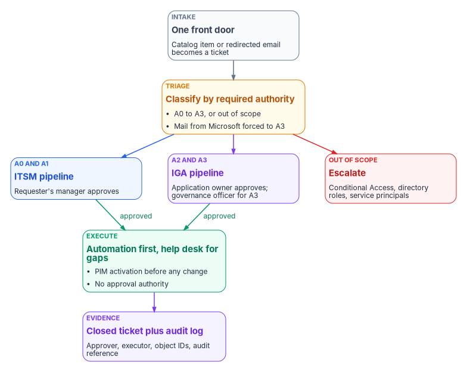
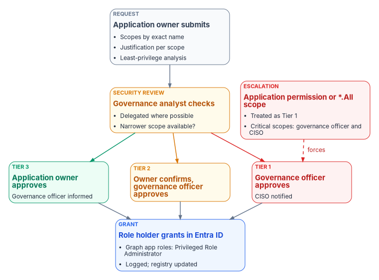

# Chapter 06 — Who Decides Access

*The person whose role lets them make an access change is almost never the person who should decide it, and the program is built so the two are never the same by accident.*

::: {.callout-note}
## In this chapter
The roles that decide access and the roles that carry it out, and what each Microsoft Entra role actually lets its holder do. Then the risk tiers that set every approval chain, the enterprise-application approval model from request through approval, assignment and review, the help desk and cloud services authority split that decides which pipeline a request takes, ownership transfers and orphaned apps, exceptions, emergency access, and a responsibility matrix.
:::

[Book 02, Chapter 06](../b02-identity/06-who-owns-the-migration.md) assigns the roles for moving a directory from Active Directory to Entra ID: the sponsor, the CISO, the authorizing official, the ISSO, identity engineering, AD administrators, application owners, the help desk, HR and users. That assignment holds here and isn't repeated. This chapter covers what happens after the migration, every day, when someone asks for access to an application, an application asks for permission to an API, or an owner leaves. Those are policy decisions in the sense of [Chapter 01](01-access-is-a-policy-decision.md). Each one has to be made by someone with the authority to make it and carried out by someone with the rights to carry it out, and in a well-run tenant those are different people.

{#fig-ch06-authority-split fig-alt="A top-to-bottom flow. A slate intake card, one front door, turns a catalog item or redirected email into a ticket. It leads to an amber triage card that classifies by required authority, A0 to A3 or out of scope, with mail from Microsoft forced to A3. Triage branches three ways: a blue card for A0 and A1, the ITSM pipeline, where the requester's manager approves; a violet card for A2 and A3, the IGA pipeline, where the application owner approves and the governance officer approves A3; and a red card for out of scope, escalate, covering Conditional Access, directory roles and service principals. The ITSM and IGA cards each have a green arrow labeled approved into a green execute card: automation first, help desk for gaps, PIM activation before any change, no approval authority. That leads to a violet evidence card: closed ticket plus audit log, with approver, executor, object IDs and the audit reference."}

## Deciding isn't doing

NIST SP 800-53 asks organizations to identify the duties that must be separated and to define system access authorizations that support that separation. Its discussion calls out dividing business functions from support functions among different people, and keeping those who administer access control from also administering audit.[^c06-sp80053] The program applies that control to application access in three rules.

1. **Approvers don't execute.** An application owner or governance officer who approves a change never makes it in the console.
2. **Executors don't approve.** The help desk, cloud services and automation make changes only against an approved, assigned ticket, and have no approval authority of their own.
3. **Nobody approves their own access.** A request from an approver for access to their own application goes to the next level up.

The rules matter because Entra ID doesn't enforce them. As the next section shows, the roles that execute application changes can also grant consent and act as applications, so separation of duties has to be designed into the role assignments and the ticket flow, not assumed from the role names.

## The roles

The program's model has seven human roles and one system actor. The names are the program's; adapt them to the agency's organization chart, but keep the split between deciding and doing.

| Role | Decides | Does | Entra role or group (program design) |
|---|---|---|---|
| Identity governance officer (IGO) | Risk tier of every app; Tier 1 access and all admin consent outside Tier 3; exceptions; ownership assignments | Maintains the application registry and consent inventory; runs the annual governance review | Privileged Role Administrator and Global Reader, eligible through PIM; member of the reviewer group for the admin consent workflow |
| Application owner | Who gets access to the app, within its tier's chain; submits and justifies consent requests | Reviews access on the tier's cadence; keeps registry metadata current | None by default. Named in the registry; added to the app's Owners list only if they also configure it ([Chapter 05](05-applications-and-workload-identities.md#ownership)) |
| Business approver (departmental owner) | Whether the requester has a business need; Tier 3 access | Confirms staffing changes; reviews department-level group membership | None |
| Identity engineering | Technical design: app registration configuration, credential type, provisioning, group design | Builds registrations, service principals and directory-role assignments; handles escalations the help desk can't | Application Administrator or Cloud Application Administrator, eligible through PIM |
| Help desk and cloud services | Nothing. Triage classifies a request; it doesn't approve it | Executes approved assignment and group changes; triages notifications and escalates | A privileged access group activated through PIM, holding the narrowest role that does the job (see below) |
| Security operations | Whether an alert is an incident; emergency revocation | Monitors consent, credential and assignment events; leads incident response | Security Reader or Security Operator for investigation[^c06-roles] |
| ISSO | Nothing alone; advises on any change that affects a control | Assembles evidence; tracks findings and exceptions to closure | Global Reader |
| Authorizing official (AO) | Residual risk: exceptions that leave a control unmet, renewed exceptions, critical-scope consent without a compensating control | Nothing in the console | None |
| Workflow automation (system actor) | Nothing | Routes tickets by tier, enforces SLAs, records approvals, executes connector actions | A workload identity with only the permissions its actions need |

The CISO sits above the IGO, as the authority the IGO acts under, and is the dual reviewer for critical scopes. The AO's place in the model follows [Book 02, Chapter 06](../b02-identity/06-who-owns-the-migration.md#the-roles): any decision that amounts to accepting risk the controls don't cover reaches the AO, not just the IGO.

Global Administrator isn't on the list. In the program's design it's held permanently only by the emergency access accounts described in [Book 02, Chapter 09](../b02-identity/09-building-the-entra-target.md#emergency-access-accounts), and used by nobody for routine work.

### Application owners and business approvers

The application owner is the first line of accountability. The program's list of owner duties is short and concrete:

1. Keep the app's registry entry accurate: purpose, data classification, user population, and owners.
2. Approve or deny access requests for the app within the SLA.
3. Run the app's access review on its tier's cadence and certify or remove each member.
4. Submit every admin consent request with a business justification and a least-privilege analysis for each scope.
5. Tell the IGO within five business days of any material change to the app's data, scopes or operator.
6. Keep a named backup owner current. Tier 1 apps must have one; Tier 2 apps should.
7. Complete owner training when the IGO requires it.

The business approver answers a different question: does this person need this access for their job? The approver is usually the requester's manager or department head. Keeping the two questions separate is what lets Tier 3 access be approved by the business approver alone, and Tier 1 access require both plus governance notice.

### Help desk and cloud services

The help desk executes; it never decides. The program's authority boundary is explicit in both directions.

| The help desk may | The help desk may not |
|---|---|
| Assign an approved group to an enterprise application, or remove one, against an assigned ticket | Approve, grant or execute admin consent, under any circumstances or from any source |
| Add or remove members of application access groups against an assigned ticket | Create, modify or delete app registrations or service principals |
| Reset authentication methods and passwords within its scoped roles | Assign or remove directory roles |
| Read sign-in and audit logs for triage | Create or change Conditional Access policies or sync configuration |
| Triage consent and security notifications, verify them in the audit log, and escalate | Act on a notification email, or on any request without an assigned ticket |
| Activate its roles through PIM with a written justification | Hold any standing active privileged role |

Cloud services is the escalation tier above the help desk, not a second intake queue. It handles what the help desk and automation can't, under the same rule: it executes approved work and doesn't approve its own.

## What each Entra role can actually do

Decision rights live in the ticket; capability lives in the role. The two diverge in ways a policy has to account for.

| Role or relationship | What Microsoft documents it can do | Consequence for the model |
|---|---|---|
| Application Administrator | Create and manage all enterprise applications, app registrations and application proxy settings; consent to delegated permissions and to application permissions for every API except Microsoft Graph and Azure AD Graph; add credentials to any app and use them to act as it[^c06-roles] | A help desk PAG that activates this role can technically grant most consents and impersonate any app. "The help desk never approves consent" is a procedural rule unless the role is narrowed |
| Cloud Application Administrator | The same, without application proxy[^c06-roles] | Same consequence |
| Privileged Role Administrator | Grant consent for any permission to any API, including Microsoft Graph application permissions[^c06-grant-admin] | The role the IGO activates to execute an approved Graph application-permission grant |
| Global Administrator | Everything; the only role that can turn on the admin consent workflow in the admin center, and the only one that can approve workflow requests for Microsoft Graph app roles[^c06-workflow] | Emergency use only; Graph application-permission grants are executed as Privileged Role Administrator from the Enterprise applications pane instead |
| Owner of an app | Manage that app's configuration, including single sign-on, provisioning and user assignment; add owners; add a credential and act as the app[^c06-owners] | Ownership is a privilege, not a label. Keep Owners to two technical people |
| Custom role with `microsoft.directory/servicePrincipals/appRoleAssignedTo/update` | Manage user and group assignments to enterprise apps, scoped to one app or the whole tenant; requires Entra ID P1[^c06-custom-apps] | The narrowest role for the help desk's assignment work |

Microsoft's own warning about Application Administrator is direct: assigning a user to it gives that user the ability to impersonate an application's identity, which can be an elevation of privilege over what their role assignments allow.[^c06-roles] An app with `RoleManagement.ReadWrite.Directory` makes Application Administrator a path to any role in the tenant.

The program therefore narrows the help desk PAG. The PAG holds a custom role with the `appRoleAssignedTo/update` permission for group-to-app assignment, plus the least-privileged group and authentication roles its other tasks need, scoped to administrative units as [Book 02, Chapter 05](../b02-identity/05-delegation-without-ous.md) describes. Application Administrator stays with identity engineering, eligible only, behind PIM approval ([Chapter 08](08-pim-self-request-with-approval.md)). Two technical controls back the procedural rule. App instance property lock ([Chapter 05](05-applications-and-workload-identities.md#app-instance-property-lock)) blocks credentials being added to locked service principals, and an alert on every consent and credential event ([Evidence](#evidence-and-monitoring)) catches what the lock doesn't cover. [Chapter 04](04-privileged-roles-and-tiers.md) places these roles in the privileged tier model.

## Risk tiers set the approval chain

Every enterprise application gets a risk tier from the IGO before anyone is given access to it. An app discovered without a tier is treated as Tier 1 until the IGO classifies it, with no exceptions. That rule covers the service principals that appear on their own through user consent and Microsoft just-in-time provisioning ([Chapter 05](05-applications-and-workload-identities.md#two-objects-for-one-application)).

| Criterion | Tier 1, high risk | Tier 2, moderate risk | Tier 3, low risk |
|---|---|---|---|
| Permission type | Any application permission | Broad delegated permissions | Minimal delegated permissions only |
| Data | PII, health, financial, HR or payroll, or tenant-wide data | Business-sensitive, department-level | Non-sensitive; user profile only |
| Operator | External party or vendor-managed, or no owner | Internal team with named ownership | Internal team with named ownership |
| Population | All users, or not yet determined | A department | A team or small group |
| Exposure | Internet-facing | Internal, with some federation | Fully internal |
| Example permissions | `Mail.ReadWrite` (application), `User.ReadWrite.All` (application), `Files.ReadWrite.All` (application), `Directory.ReadWrite.All` (application) | `Files.ReadWrite`, `Calendars.ReadWrite`, `Mail.Read` (delegated) | `User.Read`, `openid`, `profile`, `email`, `offline_access` |
| Example apps | Payroll and HR systems, SIEM connectors, partner portals | Project tools, department reporting, SharePoint integrations | Productivity tools, sign-in-only apps, read-only dashboards |
| Access request approver | Application owner, with IGO notice and a hold window | Application owner | Business approver |
| Admin consent approver | IGO; CISO notified | Application owner confirms, IGO approves | Application owner; IGO informed |
| Access review cadence | Quarterly | Semi-annual | Annual |
| Owners | Named owner and named backup, both mandatory | Named owner mandatory; backup recommended | Named owner |
| Initial provisioning sign-off | CISO or deputy CISO | None beyond the chain | None beyond the chain |
| Alerting | Every permission change | Consent grants | Standard audit log |

An app qualifies for Tier 1 if it meets any one Tier 1 criterion, and for Tier 3 only if it meets all the Tier 3 criteria. Reclassification happens whenever the app's scopes, data, operator or owner change, or after a security incident involving it. Moving an app down a tier needs the IGO's documented approval. The tiers and every value in the table are the program's design; the permission names are Microsoft Graph's.

## The enterprise-application approval model

The model has four stages: request, approval, assignment and review. Every stage runs through a ticket, and no change in Entra ID counts as governed without an open, approved ticket behind it and a closed one after it.

### Request

Requests enter through the ITSM catalog, never through email to a person. Every request carries the same core fields, and an incomplete request goes back to the requester before it reaches an approver:

| Field | Required for |
|---|---|
| Requester name, user principal name, and manager | Every request |
| Application display name and application (client) ID | Every request; client ID for consent and registration requests |
| Current risk tier, from the registry | Every request |
| Business justification | Every request |
| Requested access group, named to the convention below | Access requests |
| Exact permission names, and a least-privilege analysis for each | Consent requests |
| Approval chain with approver names, decisions and timestamps | Auto-populated |
| Execution log: executor, action, object IDs, timestamp, audit log reference | Completed by the executor |

The catalog carries one item per request type, each with its own chain and SLA:

| Request type | Approval chain | SLA (program design) |
|---|---|---|
| Application access | Business approver, then application owner, then execution; Tier 1 adds IGO notice | 3 business days |
| Admin consent | Owner submits, security review, tier approver, then execution ([below](#who-approves-admin-consent)) | 5 business days (3 for Tier 3) |
| Consent revocation | Owner notified, IGO authorizes, then execution | 1 business day; 2 hours when incident-driven |
| New application registration | Owner, IGO classification, CISO sign-off for Tier 1, then identity engineering | 5 business days for Tier 1, 3 otherwise |
| Owner assignment or transfer | Business approver nominates, IGO approves, then execution | 3 business days |
| Risk tier reclassification | Owner requests, IGO decides | 5 business days |
| Access group creation | Owner requests, IGO notified, then execution | 2 business days |
| Decommissioning | Owner, business approver, IGO, then execution | 5 business days |
| Policy exception | Owner or business approver, then IGO (and AO where [Exceptions](#exceptions) says so) | 5 business days |

A breached SLA escalates automatically to the next level, and breaches are reported to the IGO monthly.

### Approval

For application access, the chain runs from the business approver (one business day) to the application owner (two business days) and then to execution. For Tier 1 apps, the IGO is notified before execution and has a four-business-hour window to place a hold. End to end, the standard access request has a three-business-day SLA for every tier.

#### Who approves admin consent

Admin consent is the highest-risk request in the catalog, because a grant applies to the whole tenant immediately and stays until revoked ([Chapter 05](05-applications-and-workload-identities.md#admin-consent)). Every request gets a security review by the IGO office before the tier's approver sees it. The review checks that only necessary permissions are requested, that delegated permissions are used where application permissions aren't required, and that every critical permission has documented necessity.

{#fig-ch06-approval-chain-by-tier fig-alt="A top-to-bottom flow. A slate request card, application owner submits, lists scopes by exact name, justification per scope, and a least-privilege analysis. It leads to an amber security review card, governance analyst checks, asking whether delegated permissions can be used and whether a narrower scope is available. The review branches to three cards in a row: green Tier 3, application owner approves with the governance officer informed; amber Tier 2, owner confirms and governance officer approves; red Tier 1, governance officer approves with the CISO notified. A separate red escalation card, application permission or critical scope, treated as Tier 1, with critical scopes needing the governance officer and the CISO, has a dashed arrow labeled forces into the Tier 1 card. All three tier cards lead to a blue grant card: a role holder grants in Entra ID, with Microsoft Graph application permissions granted by a Privileged Role Administrator, logged, and the registry updated."}

| Situation | Chain | Minimum approvers |
|---|---|---|
| Tier 1 app | Owner submits, security review, IGO approves, CISO notified | IGO |
| Tier 2 app | Owner submits, security review, owner confirms, IGO approves | Owner and IGO |
| Tier 3 app | Owner submits, security review, owner approves, IGO informed | Owner |
| Any application permission, any tier | Handled as Tier 1 | IGO; CISO notified |
| Any permission the program rates Critical ([Chapter 05](05-applications-and-workload-identities.md#permissions-what-an-application-can-be-granted)), any tier | Dual review | IGO and CISO |

Don't define the critical-scope trigger as any permission ending in `.All` at application level. That rule misses the most dangerous mail permissions: the Microsoft Graph application permissions to read and write every mailbox and to send as any user are `Mail.ReadWrite` and `Mail.Send`, with no `.All` suffix.[^c06-graph-perms] The program's trigger is the risk level in the permission table, not the name.

Approval and execution stay separate even here. After approval, the grant is executed by whoever holds the role that can grant it: Privileged Role Administrator for Microsoft Graph application permissions, Cloud Application Administrator for delegated permissions and other APIs.[^c06-grant-admin] In the program's design that person is in the IGO office, activates the role through PIM against the ticket, and isn't the person who approved the request. The help desk records the outcome but never performs the grant. Requests that arrive through the admin consent workflow are intake for this chain, not a shortcut around it.

Revocation runs the other way. The owner, the IGO, the CISO or a security alert can start it. The owner gets 24 hours' notice unless the revocation is incident-driven. Execution removes the grant from the enterprise application's **Permissions** page, the registry is updated, and the owner and IGO are told. Two facts belong in every revocation ticket: tokens already issued stay valid until they expire, and users can consent again unless the app stops requesting the permission or user consent is blocked.[^c06-review-perms]

### Assignment

Access to an enterprise application is granted through security groups, never by assigning an individual. Three Entra facts shape the design:

- Group-based assignment requires Entra ID P1 or P2, and only security groups can be assigned.[^c06-assign][^c06-groups-saas]
- Assignment doesn't cascade to nested groups. Only direct members of an assigned group get access.[^c06-assign]
- An app can be set to require assignment, so only assigned users and groups can sign in, and an app that requires assignment always needs admin consent for its permissions.[^c06-assign]

The program sets **Assignment required** on every enterprise application, assigns only groups with direct members, and treats any nested group found in review as a finding to fix immediately.

Access groups follow one naming convention so that reviews, alerts and the registry line up: `APP-<AppShortName>-<AccessRole>-<RiskTier>`, for example `APP-PAYROLL-USERS-T1`, `APP-PAYROLL-ADMINS-T1`, `APP-HRPORTAL-READONLY-T2` and `APP-PROJMGR-USERS-T3`. The short name matches the registry entry. Non-compliant names are flagged in review and renamed.

| Group type | Allowed for | Owner | Review cadence | Changes need |
|---|---|---|---|---|
| Assigned membership | Mandatory for Tier 1; required for Tier 2; acceptable for Tier 3 | Application owner | The app's tier cadence | An approved ticket and PIM activation |
| Dynamic membership | Tier 3 by default; Tier 2 only with IGO approval; never Tier 1 | Application owner, who validates the rule each review | Annual rule validation | An approved ticket for any rule change |
| Privileged access group (for example the help desk PAG) | Elevated role access through PIM | IGO and Privileged Role Administrator | Quarterly | PIM activation |

Dynamic groups only work when the attributes behind them are reliable, which is the subject of [Book 03](../b03-hr-identity/index.md). The program keeps them away from high-risk apps because a wrong attribute grants access nobody approved.

Groups also get a three-party separation of duties: the person who creates an access group in Entra ID can't own it, and the help desk operator executing a change can't be the owner of the application it affects.

| Role | May also be | May not be |
|---|---|---|
| Group owner | The application owner | The group's creator, or the operator executing changes to it |
| Group creator | A help desk operator, for other apps' groups | Owner of the groups they create, or owner of the associated application |
| Application owner | Owner of the app's access groups | The operator executing changes to the app's groups |

Groups are created, populated and removed only through tickets: creation by the help desk after owner approval, members added only through approved access requests, and every member removed before a group is deleted when its app or role is retired.

### Review

Access to each application is reviewed on its tier's cadence: quarterly for Tier 1, twice a year (January and July) for Tier 2, and annually (January) for Tier 3. The owner certifies each member as approved, removed or escalated to the business approver; certifications are due ten business days after the review opens, and removals are executed within five business days of certification. Separately, the IGO reviews every active admin consent grant once a year and revokes any no longer needed within 30 days. [Chapter 09](09-access-governance.md) covers how those reviews run in Entra ID Governance.

## The help desk and cloud services authority split

Everything above describes who approves. The authority split decides which pipeline a request takes, so the right approver sees it. The program's operating rule is simple: nothing is handled as an email to the cloud services team. Every request is triaged in the ITSM tool first and then routed by the authority the task requires.

| Authority | Meaning in the program's model | Pipeline and approver |
|---|---|---|
| A0 | Low-impact support with no access change, such as a cloud-only password reset or retrieving a sign-in log | ITSM pipeline |
| A1 | Changes to the requester's own account and entitlements, such as an MFA method reset, license change or profile update | ITSM pipeline; the requester's manager approves |
| A2 | Access changes governed by an owner, such as application access, group creation and owner management, or a certification revocation | IGA pipeline; the application owner approves |
| A3 | Governance actions, such as admin consent or an ImmutableID hard-match repair | IGA pipeline; the application owner and IGO approve; never automated |
| Out of scope | Conditional Access, directory roles, service principals | Escalated to security or identity engineering |

| Task | Authority | Who approves | Who executes |
|---|---|---|---|
| Password reset, cloud-only user | A0 | Identity verification procedure | Automation |
| Password reset, synced or federated user | A0 | Identity verification procedure | Help desk, on premises or through self-service password reset with writeback |
| Sign-in or audit log retrieval | A0 | None | Automation, read-only |
| MFA or authentication method reset | A1 | Manager, after identity verification | Automation or help desk |
| License assignment or removal | A1 | Manager | Automation |
| Add a user to a security group | A1 or A2, by the group's tier | Manager or application owner | Automation |
| Create a group, manage group owners | A2 | Application owner | Automation |
| Enterprise application access (group to app role) | A2 | Business approver and application owner | Automation for membership; help desk for the one-time group-to-app binding |
| Certification revocation | A2 | Application owner (through the review) | Automation |
| User create or disable (joiner or leaver) | A2 | The lifecycle workflow ([Book 03](../b03-hr-identity/index.md)) | Automation |
| ImmutableID hard-match repair | A3 | Identity engineering lead and IGO | Help desk or identity engineering, manually through Microsoft Graph |
| Admin consent | A3 | Per [the consent chain](#who-approves-admin-consent) | IGO office role holder; never the help desk |
| Conditional Access change | Out of scope | Security, through change control | Security administrator |
| Directory role or service principal change | Out of scope | Identity engineering and IGO | Identity engineering |

Two routing rules sit above the table. Any message that appears to come from Microsoft, including security notifications about consent or new service principals, is forced to A3 and escalate-only: the help desk verifies the event in the audit log within four business hours, checks it against an approved ticket, and escalates to the IGO within an hour if it can't match it. Nobody approves or denies anything on the strength of an email. And a request that lands directly on cloud services goes back to triage, because cloud services is the escalation tier, not the front door.

Execution prefers automation. Most A0 to A2 tasks can run as connector actions in the ITSM tool's identity integration, so the help desk does only the residual manual work. [Help Desk Flow](../b15-day2-operations/03-intake-triage-and-routing.md) holds the intake mechanisms and the task-by-task automation crosswalk, and the [Enterprise Application Access Governance](https://github.com/WhalerMike/modernization-workbook/blob/main/docs/operational-guides/helpdesk-entra-operations/enterprise-application-access-governance.md) guide holds the full runbook, catalog definitions and notification templates.

Before acting, an executor checks three things and puts the ticket on hold if any is missing: every stage of the approval chain shows approved; the task is in the executor's queue in an assigned state; and the ticket carries the approvers, requester, application, tier and the specific action. The executor then activates the needed role through PIM, makes the change, records the object IDs and audit log reference, and closes the ticket within an hour of the change.

## Ownership changes and orphaned apps

An owner who leaves or changes roles starts a transfer at least ten business days before the change. The business approver nominates a successor, the IGO approves, the help desk updates the registry and, if the successor is a technical owner, the Owners list, and pending reviews and consent requests move to the successor, who completes an owner briefing within five business days.

An application is orphaned when it has no named owner in the registry or the Owners list. Microsoft recommends monitoring so that every app has at least two owners, and using the app's `serviceManagementReference` to point at a team so ownership survives one person leaving.[^c06-owners] The program's orphan policy is:

1. The app is reclassified as Tier 1 until it has an owner.
2. The IGO takes interim ownership, and a ticket opens automatically.
3. The IGO has 30 calendar days to assign an owner or start decommissioning.
4. At day 31, access to the app is suspended, preferably by deactivating it so that it stops getting tokens but keeps its configuration ([Chapter 05](05-applications-and-workload-identities.md#two-objects-for-one-application)), and the business approver and CISO are told.

A weekly automated check for apps with fewer than two owners feeds this policy; the inventory script at the end of [Chapter 05](05-applications-and-workload-identities.md#a-read-only-inventory-to-start-from) is one way to start it.

## Exceptions

The model is mandatory for every application in scope. An exception authorizes one specific deviation, with compensating controls, for a fixed time; it doesn't relax anything else.

A request names the requirement being waived, why it can't be met, the compensating controls, the duration, and a risk acceptance signed by the business approver. The IGO decides within five business days: approved as submitted, approved with conditions, denied, or returned for more information. Approved exceptions go into an exception register reviewed quarterly, and into the app's registry entry.

| Exception | Minimum approval | Also notified |
|---|---|---|
| Access review schedule, Tier 3 | IGO | — |
| Group naming convention | IGO | — |
| SLA change | IGO | Help desk management |
| Access review schedule, Tier 1 or 2 | IGO with CISO concurrence | CISO |
| Group-based assignment mandate | IGO and CISO | CISO |
| Admin consent chain change | IGO and CISO | CISO; counsel where relevant |
| Client secret instead of certificate ([Chapter 05](05-applications-and-workload-identities.md#credentials)) | IGO and CISO | ISSO |
| Audit log retention below the minimum | IGO, CISO and CIO, with AO risk acceptance | ISSO; the inspector general where policy requires |
| Any exception that leaves a control unmet with no compensating control | AO risk acceptance after IGO and CISO | ISSO |

No exception lasts more than six months. At the end, the owner either complies or applies again with fresh justification, and renewals are never automatic. An expired, unrenewed exception moves the app up one risk tier until it complies. A requirement excepted and renewed more than twice goes to the CISO, and to the AO, as a sign that the requirement or the system needs to change. The AO rows exist because an exception that accepts risk is a risk acceptance, and [Book 02, Chapter 06](../b02-identity/06-who-owns-the-migration.md#decision-rights-and-work-are-different-things) puts those with the AO.

## Emergency access

Break-glass access is the one place where the normal chain is suspended, so the conditions for invoking it are strict. All three must hold: normal privileged access through PIM isn't available; there is an active incident, critical outage or regulatory obligation that can't wait; and at least two senior administrators at IGO level or above know about the invocation.

| Step | What happens | Who |
|---|---|---|
| 1 | Confirm the conditions and open a priority 1 incident ticket recording the trigger | Two senior administrators |
| 2 | Retrieve the emergency credential under dual custody | Both administrators together |
| 3 | Perform only the action the emergency requires | The acting administrator |
| 4 | End the session as soon as the emergency is resolved, within four hours; longer only with CISO approval | The acting administrator |
| 5 | Alert the IGO, CISO and security operations automatically on sign-in | Monitoring |
| 6 | Review every action within 24 hours | IGO |
| 7 | Replace or re-secure the credential after every use | Privileged Role Administrator |

Using break-glass for convenience or to beat an SLA is a policy violation. How the emergency accounts themselves are built, authenticated, excluded from Conditional Access and tested is in [Book 02, Chapter 09](../b02-identity/09-building-the-entra-target.md#emergency-access-accounts).

## The responsibility matrix

The matrix is the program's recommended model. Adapt it to the agency's structure, but keep one decider per row.

D = decides (accountable) · R = does the work · C = consulted · I = informed · blank = not involved.

| Decision or work item | IGO | App owner | Business approver | Identity eng. | Help desk | Security ops | ISSO | AO | Requester |
|---|---|---|---|---|---|---|---|---|---|
| Register a new application | D | R | C | R | | I | C | | |
| Assign or change an app's risk tier | D | C | C | C | | C | C | | |
| User consent setting and permission classifications | C | | | R | | C | C | | |
| Admin consent, Tier 1 or any application permission | D | R | | C | I | I | I | | |
| Admin consent, Tier 2 | D | R | C | C | I | | | | |
| Admin consent, Tier 3 | I | D | C | C | I | | | | |
| Admin consent, Critical-rated permission | D (CISO concurs) | R | | C | I | C | C | I | |
| Execute an approved consent grant | R | I | | | I | I | | | |
| Consent revocation, incident-driven | C | I | | R | | D | I | | |
| Application access request, Tier 1 | C | D | R | | R | | | | R |
| Application access request, Tier 2 | I | D | R | | R | | | | R |
| Application access request, Tier 3 | | C | D | | R | | | | R |
| Group-to-app assignment and access group creation | I | D | | C | R | | | | |
| Credential type and rotation for an app | C | D | | R | | C | I | | |
| Federated credential added to an app | D | R | | R | | C | I | | |
| Access review of an app | D | R | C | | R | | I | | |
| Annual admin consent review | D | C | | R | | C | I | | |
| Owner transfer | D | R | R | | R | | | | |
| Orphaned application remediation | D | | C | C | R | I | I | | |
| Help desk PAG membership and role scope | D | | | R | I | C | C | | |
| Policy exception within IGO authority | D | R | R | | | | C | | |
| Exception that accepts uncompensated risk | C | R | R | | | C | C | D | |
| Break-glass invocation | I | | | R | | C | I | | |
| Post-break-glass review | D | | | C | | R | I | I | |
| Audit log review and alert triage | C | | | | R | D | I | | |

Four rows need comment. A Critical-rated permission still has one decider, the IGO, but the IGO can't approve it without the CISO's concurrence. Execution of an approved consent grant sits with the IGO office because only Privileged Role Administrator can grant Microsoft Graph application permissions without a Global Administrator, and the IGO office holds that role eligibly; the person executing is never the person who approved. Incident-driven revocation sits with security operations because speed matters more than the chain, and the IGO is consulted after the fact. Break-glass invocation has no single decider in the matrix because the procedure requires two senior administrators acting together; the IGO decides afterward whether it was justified.

## Evidence and monitoring

Each decision in this chapter has to leave evidence an assessor can read without asking anyone. The closed ticket is the record of the decision; the Entra audit log is the record of the change; the application registry and consent inventory are the record of current state. Microsoft Entra keeps audit and sign-in logs for seven days on the Free tier and 30 days on P1 or P2.[^c06-retention] Those windows are shorter than many plans assume, which makes forwarding to the SIEM mandatory, not optional. The program keeps audit, sign-in and PIM logs for at least a year, consent and break-glass events for at least three, and tickets for at least three years active and seven archived. A gap in log forwarding is an incident reported to the CISO within 24 hours.

The alerts that make the authority split enforceable:

| Alert | Trigger | Priority |
|---|---|---|
| Admin consent granted | Any consent to an application | P1 |
| Application permission added or removed | App role assignment added to or removed from a service principal | P1 |
| New service principal | Service principal created | P1 |
| Credential added to an app or service principal | Certificate or secret added | P1 |
| Global Administrator assigned, or break-glass sign-in | Role assignment, or sign-in by an emergency account | P1, immediate page |
| User consent setting changed | Change to the tenant's user consent policy | P1 |
| Delegated permission grant by an admin | Tenant-wide delegated grant created | P2 |
| Conditional Access policy changed | Any create, update or delete | P2 |
| PIM activation outside business hours | Activation outside the agency's defined hours or on holidays | P2 |
| Orphaned application | Weekly check finds fewer than two owners | P2 |

The credential alert matters most, because adding a credential is how an Application Administrator or owner becomes the app. [Chapter 10](10-access-as-code-and-evidence.md) turns these records into the evidence package, and [Vol IX Book 06](https://github.com/WhalerMike/modernization-workbook/blob/main/docs/compliance/Vol_IX_Book_06_Identity_Access_Governance.md) maps them to controls.

::: {.callout-tip}
## Continue the book
[← Previous: Chapter 05 — Applications and Workload Identities](05-applications-and-workload-identities.md) · [Book index](index.md) · [Next: Chapter 07 — The Conditional Access Policy Library →](07-the-conditional-access-policy-library.md)
:::

[^c06-sp80053]: National Institute of Standards and Technology, SP 800-53 Rev. 5, *Security and Privacy Controls for Information Systems and Organizations*, control AC-5, September 2020 (updated December 10, 2020), <https://csrc.nist.gov/pubs/sp/800/53/r5/upd1/final> (accessed Oct 20, 2026).
[^c06-roles]: Microsoft Learn, "Microsoft Entra built-in roles," sections "Application Administrator" and "Cloud Application Administrator," <https://learn.microsoft.com/entra/identity/role-based-access-control/permissions-reference> (accessed Oct 20, 2026).
[^c06-grant-admin]: Microsoft Learn, "Grant tenant-wide admin consent to an application," section "Prerequisites," <https://learn.microsoft.com/entra/identity/enterprise-apps/grant-admin-consent> (accessed Oct 20, 2026).
[^c06-workflow]: Microsoft Learn, "Configure the admin consent workflow," <https://learn.microsoft.com/entra/identity/enterprise-apps/configure-admin-consent-workflow> (accessed Oct 20, 2026).
[^c06-owners]: Microsoft Learn, "Overview of enterprise application ownership in Microsoft Entra ID," <https://learn.microsoft.com/entra/identity/enterprise-apps/overview-assign-app-owners> (accessed Oct 20, 2026).
[^c06-custom-apps]: Microsoft Learn, "Create custom roles to manage enterprise apps in Microsoft Entra ID," <https://learn.microsoft.com/entra/identity/role-based-access-control/custom-enterprise-apps> (accessed Oct 20, 2026).
[^c06-graph-perms]: Microsoft Learn, "Microsoft Graph permissions reference," entries for `Mail.ReadWrite` and `Mail.Send`, <https://learn.microsoft.com/graph/permissions-reference> (accessed Oct 20, 2026).
[^c06-review-perms]: Microsoft Learn, "Review permissions granted to enterprise applications," <https://learn.microsoft.com/entra/identity/enterprise-apps/manage-application-permissions> (accessed Oct 20, 2026).
[^c06-assign]: Microsoft Learn, "Manage users and groups assignment to an application," <https://learn.microsoft.com/entra/identity/enterprise-apps/assign-user-or-group-access-portal> (accessed Oct 20, 2026).
[^c06-groups-saas]: Microsoft Learn, "Use a group to manage access to SaaS applications," <https://learn.microsoft.com/entra/identity/users/groups-saasapps> (accessed Oct 20, 2026).
[^c06-retention]: Microsoft Learn, "Microsoft Entra data retention," <https://learn.microsoft.com/entra/identity/monitoring-health/reference-reports-data-retention> (accessed Oct 20, 2026).
