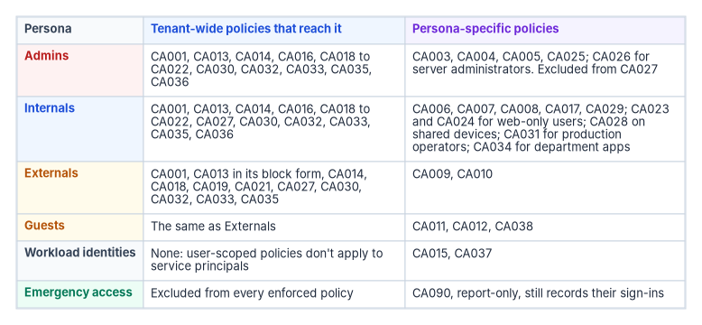
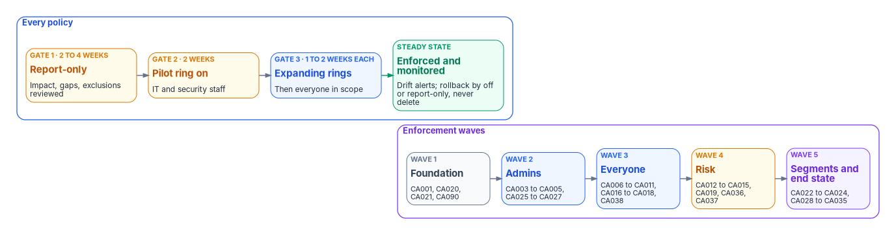

# Chapter 07 — The Conditional Access Policy Library

*A policy library is finished when every sign-in in the tenant meets a policy that someone owns, and nothing in it depends on a policy running first.*

::: {.callout-note}
## In this chapter
The program's complete Conditional Access policy set: the sixteen baseline policies defined in [Book 02, Chapter 09](../b02-identity/09-building-the-entra-target.md#the-policy-set), refined where current guidance requires it, and twenty-two more, including a report-only probe, for risk, privileged workstations, segmented applications and workload identities. For each policy: intent, targeting, controls, exclusions, licensing and the enforcement wave it belongs to. Then the rollout method, the monitoring queries, and the mapping to CISA's BOD 25-01 required configurations. The model behind the policies is in [Chapter 03](03-the-conditional-access-model.md); deployable JSON is in [Appendix A](appendix-a-conditional-access-templates.md).
:::

The library is one policy set, numbered once. Policies CA001 to CA017 are the baseline that [Book 02](../b02-identity/index.md) builds during the migration, and they keep their identifiers here; CA002 stays retired. Book 04 adds CA018 to CA038 and the report-only instrument CA090. Earlier versions of this library used a different scheme (`CA-001` to `CA-064`, grouped by baseline, device tier, environment, region, application and governance); the [mapping table](#mapping-the-earlier-ca-0nn-numbering) shows where each of those went.

{#fig-ch07-persona-policy-map fig-alt="A three-column table. Admins, in red: tenant-wide policies CA001, CA013, CA014, CA016, CA018 to CA022, CA030, CA032, CA033, CA035 and CA036; persona-specific CA003, CA004, CA005 and CA025, plus CA026 for server administrators; excluded from CA027. Internals, in blue: the same tenant-wide set plus CA027; persona-specific CA006, CA007, CA008, CA017 and CA029, plus CA023 and CA024 for web-only users, CA028 on shared devices, CA031 for production operators and CA034 for department apps. Externals, in amber: CA001, CA013 in its block form, CA014, CA018, CA019, CA021, CA027, CA030, CA032, CA033 and CA035; persona-specific CA009 and CA010. Guests, in amber: the same tenant-wide set as Externals; persona-specific CA011, CA012 and CA038. Workload identities, in slate: no user-scoped policies; CA015 and CA037. Emergency access, in green: excluded from every enforced policy; CA090, report-only, still records their sign-ins."}

## Conventions used in every policy

- **The emergency access exclusion is implicit.** Every enforced policy excludes `CA-Exclude-EmergencyAccess`. The tables list only exclusions beyond it. CA090 is report-only and excludes nobody.
- **"All users" means all users minus that group;** "Members" means all users minus every guest and external user type. Persona and access groups are defined in [Chapter 03](03-the-conditional-access-model.md#personas).
- **Licensing.** Every policy needs Microsoft Entra ID P1. Policies marked P2 use ID Protection risk or insider risk; WID marks Workload ID Premium.[^c07-overview][^c07-workload]
- **Every policy is created in report-only state.** The column "Wave" says when it's enforced (see [Rollout](#rollout-from-report-only-to-enforcement)).
- **Approved client app isn't used.** Microsoft moved the "require approved client app" grant, and every policy using it, to read-only on June 30, 2026. New policies require an app protection policy instead.[^c07-approved-app]

## Prerequisites

The library assumes these objects exist before the first policy is created. Missing prerequisites are the most common reason a report-only policy shows failures that aren't real.

| Object | What the program creates | Used by |
|---|---|---|
| Emergency access group | `CA-Exclude-EmergencyAccess`, assigned, holding the two emergency accounts ([Book 02, Chapter 09](../b02-identity/09-building-the-entra-target.md#emergency-access-accounts)) | Every enforced policy |
| Persona groups | `CA-Persona-Internals` and `CA-Persona-Admins` (dynamic, from `extensionAttribute11` and `extensionAttribute7` in the [program attribute map](../b03-hr-identity/06-canonical-attribute-schema.md#program-attribute-map)); `CA-Persona-WebOnly` and `CA-Persona-SharedDevice` (assigned, governed) | Persona policies |
| Access groups | `CA-Access-ServerAdmins`, `CA-Access-AzureOperators`, `CA-Access-ProdOperators`, `CA-Access-PowerPlatformMakers`, and one per restricted application | CA026, CA027, CA030, CA031, CA033 to CA035 |
| Governed exclusion groups | `CA-Exclude-ApprovedTravel` (PIM for Groups, maximum 14 days), `CA-Exclude-DeviceCodeFlow` (Teams Rooms and similar accounts), `CA-Exclude-RegistrationOnboarding` and `CA-Exclude-PhishResistantNotReady` (both time-bound, every member with an expiry) | CA008, CA021, CA020, CA022 |
| Named locations | `NL-TrustedNetworks` (agency egress and VPN ranges, marked trusted), `NL-TrustedCountries` (United States), `NL-WorkloadEgress` (ranges workloads call from) | CA005, CA008, CA015, CA029, CA032 |
| Authentication strengths | Built-in MFA and phishing-resistant MFA; custom `FMP-Privileged-SeparateDevice` (FIDO2 keys from an approved AAGUID list, or certificate-based authentication as multifactor) | CA003, CA006, CA009, CA022, CA026, CA031 |
| Device labels | Device `extensionAttribute12` (device role) = `PAW`, `Kiosk` or `SharedDevice`, set through Microsoft Graph at provisioning | CA025, CA028 |
| Application attributes | Custom security attribute set `FMPAccess` with string attribute `Environment` (`Production`, `Staging`, `Development`) on service principals | CA030 to CA032 |
| Terms of use | Employee, guest and privileged documents ([Book 02, Chapter 10](../b02-identity/10-migrating-and-governing.md#terms-of-use)) | CA010, CA011 |
| Intune | Compliance policies for every platform, and app protection policies for iOS and Android | CA004, CA007, CA016, CA017, CA028 |

The custom strength excludes Windows Hello for Business on purpose. The program doesn't count a credential held in the device gaining access as a separate device for privileged accounts ([Book 02, Chapter 10](../b02-identity/10-migrating-and-governing.md#multifactor-authentication-and-separate-devices-ia-2)). A custom strength can restrict FIDO2 to specific key models by AAGUID through a combination configuration.[^c07-auth-strength-cmdlet]

Two readiness gates apply before enforcement. **Authentication**: at least 95 percent of in-scope users have a method registered that satisfies the policy's strength. **Devices**: at least 90 percent of in-scope devices are enrolled and compliant, and the attributes the policy depends on are populated for every in-scope object. These thresholds are the program's; the point is that each wave starts with a measured number, not an estimate.

## Wave 1: foundation

These policies have no user-visible effect for anyone already on modern clients, and they close the paths attackers use first.

| Policy | Intent | Targeting | Controls | License |
|---|---|---|---|---|
| CA001-AllUsers-BlockLegacyAuth | Remove protocols that can't do MFA | All users; all resources; client apps Exchange ActiveSync and other clients | Block | P1 |
| CA020-Members-SecurityInfoRegistration-RequireManagedDevice | Stop an attacker with a password from registering their own MFA method | Members; user action *Register security information*. Exclude `CA-Exclude-RegistrationOnboarding` | Compliant device or hybrid joined device | P1 |
| CA021-AllUsers-BlockDeviceCodeFlowAndAuthTransfer | Remove the flows used in device-code phishing | All users; all resources; authentication flows device code and authentication transfer. Exclude `CA-Exclude-DeviceCodeFlow` and the Device Registration Service if devices register by device code | Block | P1 |
| CA090-AllUsers-ReportOnly-CoverageProbe | Permanent measuring instrument | All users, no exclusions; all resources | Require phishing-resistant MFA, **never enforced** | P1 |

**CA001.** Legacy clients can't satisfy MFA or present device state, so any other policy would block them anyway; CA001 makes the block explicit and visible.[^c07-conditions] Before enforcement, run the legacy-authentication query below for at least two weeks and move every remaining client, including service accounts and multifunction devices that send mail, to modern authentication. Microsoft's own guidance excludes at least one account that must keep legacy access during transition; the program's equivalent is a time-bound exclusion group, not a permanent one.[^c07-legacy] This policy meets MS.AAD.1.1, which CISA lists as mandatory under BOD 25-01.[^c07-bod-configs]

**CA020.** CISA's Entra ID baseline recommends that managed devices be required to register MFA (MS.AAD.3.8, a SHOULD).[^c07-scuba-aad] Remote new hires who have no managed device yet are put in the onboarding exclusion group for a few days, with a Temporary Access Pass issued through the pre-hire workflow ([Book 02, Chapter 10](../b02-identity/10-migrating-and-governing.md)). Guests are left out because the user action behaves differently for them: guests from a Microsoft account are made to register with the tenant, and guests from other providers are blocked.[^c07-resources]

**CA021.** Microsoft recommends blocking device code flow wherever possible. Protocol tracking means a session that used device code flow stays marked, so later requests in that session can be blocked too.[^c07-auth-flows] Teams Rooms and other devices that genuinely need device code flow go in the exclusion group, ideally narrowed by a device filter or location in a companion policy.

**CA090.** The audit policy, kept as a permanent report-only instrument. It shows, for every sign-in, whether the user could have met the end-state requirement, and it is the only policy that sees the emergency accounts, because report-only policies don't need their exclusion. It never moves to On.

## Wave 2: administrators

| Policy | Intent | Targeting | Controls | License |
|---|---|---|---|---|
| CA003-Admins-RequirePhishResistantMFA | Phishing-resistant, separate-device MFA for every privileged sign-in | `CA-Persona-Admins` **and** the highly privileged built-in roles; all resources | Authentication strength `FMP-Privileged-SeparateDevice`; sign-in frequency 4 hours | P1 |
| CA004-Admins-RequireCompliantDevice | Administration only from managed devices | `CA-Persona-Admins`; all resources | Compliant device; persistent browser never | P1 |
| CA005-Admins-BlockUntrustedLocations | Administrators sign in only from agency networks | `CA-Persona-Admins`; all resources; any location except `NL-TrustedNetworks` | Block | P1 |
| CA025-Admins-BlockNonPAW | Privileged administration only from a privileged access workstation | `CA-Persona-Admins`; Microsoft Admin Portals and Windows Azure Service Management API; device filter **exclude** `device.extensionAttribute12 -eq "PAW"` | Block | P1 |
| CA026-ServerAdmins-AzureManagement-RequirePhishResistantCompliant | Server and Arc administration with the same assurance as tenant administration | `CA-Access-ServerAdmins`; Windows Azure Service Management API and Azure Virtual Desktop | Compliant device **and** `FMP-Privileged-SeparateDevice`; sign-in frequency 4 hours | P1 |
| CA027-AllUsers-AzureManagement-BlockNonOperators | No Azure management plane for people who don't manage Azure | All users; Windows Azure Service Management API. Exclude `CA-Persona-Admins` and `CA-Access-AzureOperators` | Block | P1 |

**CA003** keeps Book 02's identifier and purpose, with two refinements. It adds the highly privileged directory roles to the group assignment, because CISA's MS.AAD.3.6 requires phishing-resistant MFA for those roles and its implementation targets the roles themselves; role targeting also catches an active assignment made outside the persona process.[^c07-bod-configs][^c07-scuba-aad] And it uses the program's custom strength rather than the built-in phishing-resistant strength. Every method in the custom strength is also in the built-in one, so the policy still meets MS.AAD.3.6. Role targeting supports built-in roles only, which is why the group stays.[^c07-users] Microsoft's managed policy "Multifactor authentication for admins accessing Microsoft Admin portals" is superseded by CA003 and set to Off, with the decision recorded ([Chapter 03](03-the-conditional-access-model.md#microsoft-managed-policies)).[^c07-managed]

**CA004 and CA025** together implement Book 02's rule that administrators work only from PAWs ([Book 02, Chapter 10](../b02-identity/10-migrating-and-governing.md#privileged-access-workstations)). CA004 requires a compliant device; CA025 blocks the admin portals and Azure management from any device that isn't labeled as a PAW. The block is written as an exclusion of PAWs with a positive operator because a positive-operator filter never matches an unregistered device, so an unregistered device isn't excluded and is blocked, and the extension attribute is readable only on managed, compliant or hybrid-joined devices.[^c07-device-filter] This is the pattern Microsoft documents for secure admin workstations.[^c07-device-filter] Book 02 describes the device filter as part of CA004; it lives in a separate block policy here, because a grant policy scoped by a filter would simply not apply on other devices.

**CA026** is the Tier 1 server policy. Conditional Access can't target users through a group built from a *device* attribute (policies target users, and device filters scope devices), and Azure Arc-enabled servers aren't a cloud app. The program targets the server administrators' access group and the Azure management plane they use. Server tiers themselves are [Chapter 04](04-privileged-roles-and-tiers.md)'s subject.

**CA027** limits the Azure portal to privileged access. The Windows Azure Service Management API covers the Azure portal and the Microsoft Entra admin center, and indirectly the Azure CLI, Azure PowerShell and the Microsoft 365 admin center, so the exclusion must include every administrator, not only Azure operators.[^c07-resources] Test it against developers who use the Azure CLI before enforcement.

**Rollout and monitoring.** Admin policies are piloted on the identity team first, with an emergency account sign-in tested before and after each policy is enforced. The policy-hit query below, filtered to these policy names, should show no *not applied* results for members of the Admins group.

## Wave 3: everyone

| Policy | Intent | Targeting | Controls | License |
|---|---|---|---|---|
| CA006-Internals-RequireMFA | MFA for the workforce during the transition | `CA-Persona-Internals`; all resources | Authentication strength MFA; sign-in frequency 12 hours | P1 |
| CA007-Internals-RequireCompliantOrHybridDevice | Workforce access only from managed devices | `CA-Persona-Internals`; all resources. Exclude `CA-Persona-WebOnly` | Compliant **or** hybrid joined device | P1 |
| CA008-Internals-BlockNonUSLocations | No access from countries the agency doesn't operate in | `CA-Persona-Internals`; any location except `NL-TrustedCountries`. Exclude `CA-Exclude-ApprovedTravel` | Block | P1 |
| CA009-Externals-RequireMFA | MFA for partner users | Guest or external user types from partner tenants; all resources | Authentication strength MFA; sign-in frequency 8 hours | P1 |
| CA010-Externals-RequireTermsOfUse | Partner acceptance of data-handling terms | As CA009 | Terms of use | P1 |
| CA011-Guests-LimitedAppAccess | Ad hoc guests see collaboration content only | Guest types from other tenants and providers; SharePoint and Teams | Require MFA **and** terms of use; app-enforced restrictions; sign-in frequency 1 hour | P1 |
| CA016-AllUsers-RequireCompliantDevice-OfficeApps | Desktop Office access only from compliant devices | Members; Office 365; platforms Windows and macOS | Compliant device | P1 |
| CA017-Internals-AppProtection-Mobile | Mobile access only through protected apps | `CA-Persona-Internals`; Office 365; platforms iOS and Android | App protection policy | P1 |
| CA018-AllUsers-RequireMFA | Catch-all MFA for anyone no persona policy reaches | All users; all resources, no resource exclusions | Require MFA | P1 |
| CA038-Guests-BlockNonApprovedApps | Make CA011's "limited" true | Guest types from other tenants and providers; all resources except Office 365 and apps approved for guests | Block | P1 |

Most of these are Book 02's policies unchanged. The refinements:

- **CA018 is new and deliberately redundant.** CA006, CA009 and CA011 reach users through persona membership. A user whose attributes are empty falls outside every persona group, so the library adds Microsoft's recommended baseline: MFA for all users and all resources with no resource exclusions.[^c07-resources] It uses the "require MFA" control rather than a strength so that guests who sign in with email one-time passcodes can satisfy it; those guests can't satisfy any authentication strength.[^c07-auth-strengths] It also supersedes the Microsoft-managed "Multifactor authentication for all users" policy.[^c07-managed]
- **CA016 targets Members, not all users.** A guest's device is managed by another tenant, if at all; requiring compliance in this tenant would block partner collaboration unless cross-tenant settings trust the partner's device claims ([Book 02, Chapter 10](../b02-identity/10-migrating-and-governing.md)). The name keeps Book 02's `AllUsers` for continuity; the scope is Members.
- **CA017 requires an app protection policy only.** Book 02 lists "approved client app or app protection policy." After June 30, 2026, a policy can't be created or edited with the approved-app grant, so the program's CA017 uses app protection alone.[^c07-approved-app] Apps that don't support app protection are blocked by it.[^c07-grant]
- **CA007 has one governed exception.** Web-only users (CA023 and CA024 in wave 5) are excluded and get a browser-only, no-download experience instead.
- **CA008 has a governed travel exception.** A traveler is added to `CA-Exclude-ApprovedTravel` through PIM for Groups after an approved request, for at most 14 days, and must still meet CA006 and CA018. Book 02 limits the country block to Internals; the program keeps that scope, because partner users legitimately sign in from other countries.
- **CA011 needs CA038.** A grant policy scoped to SharePoint and Teams doesn't stop a guest from reaching other apps; without a block, they'd get tokens with no controls ([Chapter 03](03-the-conditional-access-model.md#policies-come-in-pairs)).[^c07-plan] CA038 excludes the whole Office 365 suite rather than the two apps, because Teams and SharePoint depend on other Microsoft 365 services.[^c07-resources]

**Rollout and monitoring.** Wave 3 is the one users notice. Enforce in rings (IT and security, then headquarters staff, then field and remote staff, then everyone) behind the monitoring gate in the [rollout section](#rollout-from-report-only-to-enforcement). Watch the help desk queue and the CA-block query by application; a spike on a single application usually means a client that can't do modern authentication or app protection.

## Wave 4: risk and workload identities

| Policy | Intent | Targeting | Controls | License |
|---|---|---|---|---|
| CA012-Guests-BlockHighRisk | Stop high-risk guest sign-ins | Guest types; sign-in risk high | Block | P2 |
| CA013-AllUsers-HighUserRisk-RequireRemediation | Respond to likely account compromise | All users; all resources; user risk high | **Block** where BOD 25-01 applies; otherwise require risk remediation (Members only) | P2 |
| CA014-AllUsers-MediumSigninRisk-RequireMFA | Step up a suspicious sign-in | All users; all resources; sign-in risk medium or high | Authentication strength MFA; sign-in frequency every time | P2 |
| CA015-ServiceAccounts-LocationRestriction | Workloads call only from where they run | Workload identities, assigned directly; all resources; any location except `NL-WorkloadEgress` | Block | WID |
| CA019-AllUsers-HighSigninRisk-Block | Stop high-risk sign-ins for everyone | All users; all resources; sign-in risk high | Block | P2 |
| CA036-Members-ElevatedInsiderRisk-Block | Contain users with elevated insider risk | Members; Office 365; insider risk elevated | Block | P2 + Purview |
| CA037-WorkloadIdentities-HighRisk-Block | Contain a compromised workload | Workload identities, assigned directly; all resources; service principal risk high | Block | WID |

**CA013 has two forms, and federal civilian tenants use the block.** Book 02 adopted Microsoft's current recommendation, "require risk remediation," which handles password and passwordless users and adds an authentication strength and "every time" sign-in frequency automatically.[^c07-grant] CISA's BOD 25-01 lists MS.AAD.2.1, "Users detected as high risk SHALL be blocked," as a mandatory configuration.[^c07-bod-configs] The two can't both win: when several risk policies apply, block overrides remediation.[^c07-managed] The program therefore sets CA013's grant to **Block** in any tenant within BOD 25-01's scope, includes all users (unlike remediation, the block isn't limited to members), and handles recovery through the help desk: an administrator confirms the account, resets credentials and dismisses the risk. Where BOD 25-01 doesn't apply, CA013 uses remediation for Members, as Book 02 describes. Microsoft's managed policies "Block access for high-risk users" and "Require remediation for high-risk users" are both superseded by CA013.[^c07-managed]

**CA019 is new.** MS.AAD.2.3 requires high-risk *sign-ins* to be blocked.[^c07-bod-configs] Book 02's CA014 steps those sign-ins up to MFA, and CA012 blocks them only for guests. CA019 blocks high sign-in risk for everyone; because block wins, CA014 then effectively acts on medium risk. Once CA019 is enforced, CA012 is redundant and is retired (the number isn't reused). Microsoft's managed policy for risky sign-ins is superseded by CA014 and CA019.[^c07-managed]

**CA036** is the insider-risk policy. The Insider risk condition takes levels from Purview Insider Risk Management through Adaptive Protection and requires Entra ID P2.[^c07-insider] Microsoft's own quick setup creates a report-only policy that blocks Office 365 for users at the elevated level, excluding some external user types, and the program follows that shape.[^c07-adaptive] Microsoft labels the Conditional Access integration with Adaptive Protection as preview, so the program enforces CA036 only after its privacy and legal review, and treats a block as a referral to the insider-risk process, not a verdict. Defender for Cloud Apps monitoring with a one-hour sign-in frequency remains an option for the moderate level where a block is too strong.

**CA015 and CA037** are the only policies that reach service principals. They need Workload ID Premium, apply to single-tenant service principals assigned directly (not through groups), and can only block.[^c07-workload] [Chapter 05](05-applications-and-workload-identities.md) covers which workloads go in scope.

**Rollout and monitoring.** Risk policies need calibrated risk data. Run them in report-only for at least two weeks with ID Protection reports reviewed, and confirm that leaked-credential detection is working, which needs password hash sync ([Book 02, Chapter 09](../b02-identity/09-building-the-entra-target.md)). After enforcement, every CA013 or CA019 block is a security event: the risk event analysis view and the help desk procedure must be ready the day the policy goes on.

## Wave 5: segments and the end state

| Policy | Intent | Targeting | Controls | License |
|---|---|---|---|---|
| CA022-Members-RequirePhishResistantMFA | The end state: phishing-resistant MFA for every member | Members; all resources. Exclude `CA-Exclude-PhishResistantNotReady` (shrinking, time-bound) | Authentication strength phishing-resistant MFA | P1 |
| CA023-WebOnly-BlockDesktopAndMobileClients | Web-only users get no synced or cached data | `CA-Persona-WebOnly`; all resources; client apps mobile and desktop | Block | P1 |
| CA024-WebOnly-LimitedWebSession | Browser access without download or persistence | `CA-Persona-WebOnly`; all resources; client apps browser | Authentication strength MFA; app-enforced restrictions; persistent browser never | P1 |
| CA028-SharedDevice-KioskApps-RequireCompliant | Shared devices reach only their app set | `CA-Persona-SharedDevice`; the kiosk app set; device filter include `device.extensionAttribute12 -in ["Kiosk","SharedDevice"]` | Compliant device; sign-in frequency 8 hours | P1 |
| CA029-Internals-OffNetwork-SessionLimits | Shorter, non-persistent sessions away from agency networks | `CA-Persona-Internals`; all resources; any location except `NL-TrustedNetworks` | Authentication strength MFA; sign-in frequency 4 hours; persistent browser never | P1 |
| CA030-AllUsers-ProductionApps-BlockUnassigned | Only production operators reach production applications | All users; applications with `FMPAccess.Environment` = `Production`. Exclude `CA-Access-ProdOperators` | Block | P1 |
| CA031-ProdOperators-ProductionApps-RequirePhishResistantCompliant | Production access with full assurance | `CA-Access-ProdOperators`; the same application filter | Compliant device **and** phishing-resistant MFA; sign-in frequency 4 hours | P1 |
| CA032-AllUsers-StagingApps-BlockOffNetwork | Staging reachable only from agency networks | All users; applications with `Environment` = `Staging`; any location except `NL-TrustedNetworks` | Block | P1 |
| CA033-AllUsers-PowerPlatform-BlockNonMakers | Power Apps and Power Automate only for approved makers | All users; Power Apps and Power Automate. Exclude `CA-Access-PowerPlatformMakers` | Block | P1 |
| CA034-{Dept}-{App}-RequireCompliantMFA | Template: a department application with assurance | `CA-Access-{App}` (built from department attributes); the application | Compliant device **and** authentication strength MFA; sign-in frequency 8 hours | P1 |
| CA035-AllUsers-{App}-BlockUnassigned | Template: everyone else is blocked | All users; the application. Exclude `CA-Access-{App}` | Block | P1 |

**CA022** is where the library ends up. CISA's MS.AAD.3.1 makes phishing-resistant MFA for all users mandatory, and MS.AAD.3.2 allows another MFA method only until it's enforced.[^c07-bod-configs] CA022 is created in report-only on the first day of the program, before any enrollment campaign, so the sign-in logs build a history of who would have been blocked; that is Microsoft's own deployment advice.[^c07-pr-deploy] Microsoft's guide then enforces per platform, using groups of users whose devices are ready.[^c07-pr-deploy] The program does the equivalent by shrinking the not-ready exclusion group as users enroll, and every member of that group has an expiry. When the group is empty, CA006 and CA009's MFA strength requirements are superseded, and the agency's system security plan stops describing an interim state.

**CA023 and CA024** govern unmanaged devices and downloads. App-enforced restrictions work only in Exchange Online and SharePoint Online, where they give an unmanaged device a limited, web-only experience.[^c07-session] Persistent browser control works correctly only when the policy targets all resources, which is why CA024 is scoped that way.[^c07-graph-session] Where Defender for Cloud Apps is licensed, CA024 can add Conditional Access App Control with a block-download session policy for applications other than Exchange and SharePoint.[^c07-session]

**CA028** is the kiosk policy. The device filter includes only labeled shared devices, and because the label is readable only on compliant or managed devices, an unlabeled or unregistered device isn't matched and the shared-device users fall back to the Internals policies.[^c07-device-filter] App-enforced restrictions aren't added for kiosks: they affect only Exchange and SharePoint, so they are left to the app set.

**CA029** covers non-corporate networks and remote work. The device requirement is already enforced everywhere by CA007, so what's left off-network is a shorter, non-persistent session. There is no policy that *lengthens* sessions on trusted sites: CA006 already sets 12 hours, and the program doesn't use location to relax controls ([Chapter 03](03-the-conditional-access-model.md#the-programs-baseline-principles)).

**CA030 to CA032** isolate environments. The program targets *applications* with a filter on a custom security attribute, which is evaluated at token issuance, accepts string attributes only, and is managed by the attribute roles rather than Global Administrators.[^c07-app-filter] Users are targeted by access groups granted through access packages ([Chapter 09](09-access-governance.md)), so no user attribute is consumed; the program's user extension attributes are already assigned ([program attribute map](../b03-hr-identity/06-canonical-attribute-schema.md#program-attribute-map)). Development applications need no policy of their own: CA006, CA007 and CA018 already apply. There is no policy blocking production users from development; production operators are also developers in most agencies, and the risk it addressed is handled by separate administrative accounts.

**CA033** restricts Power Platform but leaves Power BI out of its scope, because blocking Power BI blocks everyone who reads a published report, not just makers. Agencies that need to restrict Power BI write that as its own pair.

**CA034 and CA035** are the template for any department or line-of-business application, such as GitHub Enterprise or a finance, HR or engineering system. Instances add a suffix: `CA034-FIN-ERP` and `CA035-AllUsers-ERP-BlockUnassigned`. For most applications the first gate is enterprise-application assignment with **Assignment required** set, so that only assigned users can get a token; Global Administrators bypass that setting, which is one reason the block policy stays for sensitive applications.[^c07-assignment]

**Rollout and monitoring.** Segment policies go in one application at a time. Before CA030 to CA032 are enforced, query service principals for the `FMPAccess` attribute: an untagged production application is simply outside the policy.

## Mapping the earlier CA-0nn numbering

Earlier workbook pages published a policy library numbered CA-001 to CA-064. A tenant that deployed it maps to this library as follows; the old numbers aren't reused.

| Earlier policy | Now | Note |
|---|---|---|
| CA-001 MFA for all users | CA018, with CA006, CA009, CA022 | Restored as the catch-all |
| CA-002 Block legacy authentication | CA001 | LAN Manager authentication level isn't a Group Policy equivalent: it governs NTLM on the network, not cloud protocols |
| CA-003 Compliant device for corporate apps | CA007, CA016 | |
| CA-004 Managed device for admin portals | CA003, CA004, CA025 | Passwordless strength raised to the privileged custom strength |
| CA-005 Terms of use for guests | CA010, CA011 | |
| CA-010 Tier 0 PAW | CA025 | Device-attribute "user groups" replaced by a device filter block |
| CA-011 Tier 1 servers | CA026 | |
| CA-012 Tier 2 workstations | CA007 | |
| CA-013 Kiosk devices | CA028 | |
| CA-014 Unmanaged devices, browser only | CA023, CA024 | |
| CA-015 Non-corporate networks | CA029 | |
| CA-020 to CA-023 Environment isolation | CA030 to CA032 | Application filters replace tags; CA-023a not carried |
| CA-030 Geographic restrictions | CA008 | Travel exception kept; scope stays Internals as in Book 02 |
| CA-031 Site-based trust | Not carried | Lengthened sessions on location |
| CA-032 Remote work | CA029, CA007 | |
| CA-040 Exchange Online | CA016, CA017 | Split so no policy combines AND and OR; the approved-client-app grant is retired |
| CA-041 SharePoint download restrictions | CA024 | |
| CA-042 Teams | CA016, CA017 | |
| CA-043 Azure portal, privileged only | CA027, CA025 | |
| CA-044 Power Platform | CA033 | Power BI removed from scope |
| CA-045 GitHub Enterprise, CA-046 LOB apps | CA034, CA035 | |
| CA-060 Audit mode | CA090 | |
| CA-061 High sign-in risk block | CA019 | |
| CA-062 Medium risk: MFA and password change | CA014 | Password change can't be used with sign-in risk; it requires a user-risk condition |
| CA-063 User risk: password change | CA013 | Remediation or block, not password change |
| CA-064 Insider risk | CA036 | |

## Rollout: from report-only to enforcement

Every policy, in every wave, passes the same gates. Book 02 set the durations ([Book 02, Chapter 09](../b02-identity/09-building-the-entra-target.md#testing-and-rollout)); Microsoft recommends at least a week in report-only before enforcement; it gives this as a deployment tip, not a product requirement.[^c07-plan-tip]

{#fig-ch07-rollout-sequence fig-alt="Two rows. The top row, labeled every policy, is a chain of four boxes: gate 1, two to four weeks, report-only, in amber, where impact, gaps and exclusions are reviewed; gate 2, two weeks, pilot ring on, in amber, for IT and security staff; gate 3, one to two weeks each, expanding rings, in blue, then everyone in scope; steady state, enforced and monitored, in green, with drift alerts and rollback by off or report-only, never delete. The bottom row, labeled enforcement waves, is a chain of five boxes: wave 1 foundation, CA001, CA020, CA021 and CA090; wave 2 admins, CA003 to CA005 and CA025 to CA027; wave 3 everyone, CA006 to CA011, CA016 to CA018 and CA038; wave 4 risk, CA012 to CA015, CA019, CA036 and CA037; wave 5 segments and end state, CA022 to CA024 and CA028 to CA035."}

The cycle for each policy:

1. **Pre-deployment check.** Prerequisites exist, readiness gates are met, the emergency access exclusion is present, and the policy JSON is reviewed in source control.
2. **Create in report-only.** Templates from Microsoft and from [Appendix A](appendix-a-conditional-access-templates.md) default to report-only. For a policy that requires a compliant device, exclude macOS, iOS and Android from the report-only version to avoid certificate prompts.[^c07-report-only]
3. **Measure for at least seven days**, with two to four weeks preferred, using the policy impact view and the insights workbook.[^c07-report-only]
4. **Analyze and remediate.** Who would be blocked or prompted, and why: missing registrations, noncompliant devices, untagged applications, empty attributes. Fix the cause; add an exclusion only as a governed object.
5. **Review.** Security and business owners approve the impact analysis. The approval and the analysis are kept as change evidence ([Chapter 10](10-access-as-code-and-evidence.md)).
6. **Enforce for the pilot ring,** then expand ring by ring. Turning a policy that targets all users straight from off to on is never allowed.
7. **Watch for 48 hours** after each ring: help desk volume, CA blocks by application, and failures on service and kiosk accounts.

A wave starts only after the previous one has been enforced for at least a week without an incident attributable to it.

### Rollback

| Action | When | How |
|---|---|---|
| Revert to report-only | Need data while investigating | Set state to report-only; monitoring continues without enforcement |
| Scope reduction | A specific population is blocked | Add a time-bound exclusion group, fix the cause, then remove it |
| Policy off | One policy causing widespread blocks | Set state to Off; investigate |
| Wave rollback | Several policies in a wave interacting badly | Set the wave's policies to report-only; open an incident |

Never delete a policy during a rollback. Microsoft does allow a deleted policy or named location to be restored within 30 days,[^c07-plan] but a deletion breaks the policy's change history in source control and the drift record has to explain it. If the tenant is locked out entirely, an emergency account signs in to reverse the change; if no administrator can, Microsoft support can update the blocking policy after verification.[^c07-troubleshoot]

## Monitoring

### Sign-in log queries

The queries run against the `SigninLogs` table in a Log Analytics workspace that receives Entra sign-in logs. `ResultType` is a string column, and the per-policy result values come from Microsoft Graph's `appliedConditionalAccessPolicy` type.[^c07-signinlogs][^c07-applied-graph]

::: {.callout-warning}
These queries are illustrative and haven't been tested against a production workspace. Review them, and confirm column values against your own data, before using them for alerting or evidence.
:::

Policy results by policy, including report-only outcomes:

```kusto
SigninLogs
| where TimeGenerated > ago(7d)
| mv-expand ConditionalAccessPolicies
| extend PolicyName = tostring(ConditionalAccessPolicies.displayName),
         PolicyResult = tostring(ConditionalAccessPolicies.result)
| summarize Total = count(),
            Success = countif(PolicyResult == "success"),
            Failure = countif(PolicyResult == "failure"),
            NotApplied = countif(PolicyResult == "notApplied"),
            ReportOnlyFailure = countif(PolicyResult == "reportOnlyFailure"),
            ReportOnlyActionRequired = countif(PolicyResult == "reportOnlyInterrupted")
    by PolicyName
| sort by Total desc
```

Sign-ins blocked by Conditional Access in the last day. Error 53003 is `BlockedByConditionalAccess`:[^c07-troubleshoot]

```kusto
SigninLogs
| where TimeGenerated > ago(24h)
| where ResultType == "53003"
| project TimeGenerated, UserPrincipalName, AppDisplayName, IPAddress,
          Location = strcat(tostring(LocationDetails.city), ", ", tostring(LocationDetails.countryOrRegion)),
          OS = tostring(DeviceDetail.operatingSystem), ConditionalAccessStatus
| sort by TimeGenerated desc
```

Users who would fail the end-state policy (CA022) while it's in report-only, the list that drives enrollment:

```kusto
SigninLogs
| where TimeGenerated > ago(7d)
| mv-expand ConditionalAccessPolicies
| where tostring(ConditionalAccessPolicies.displayName) startswith "CA022-"
| where tostring(ConditionalAccessPolicies.result) in ("reportOnlyFailure", "reportOnlyInterrupted")
| summarize LastSeen = max(TimeGenerated), Apps = make_set(AppDisplayName, 10) by UserPrincipalName
| sort by UserPrincipalName asc
```

Legacy authentication still in use, to clear before CA001 is enforced. Microsoft documents `ClientAppUsed` with examples such as Exchange ActiveSync, IMAP, MAPI, SMTP and POP;[^c07-signinlogs] the list below adds other names seen in practice. Check your own workspace for others before relying on it:

```kusto
SigninLogs
| where TimeGenerated > ago(14d)
| where ClientAppUsed in ("Exchange ActiveSync", "IMAP", "IMAP4", "MAPI", "MAPI Over HTTP",
                          "POP", "POP3", "SMTP", "Authenticated SMTP", "Autodiscover",
                          "Offline Address Book", "Outlook Anywhere (RPC over HTTP)",
                          "Reporting Web Services", "Other clients")
| summarize Attempts = count() by UserPrincipalName, ClientAppUsed, AppDisplayName
| sort by Attempts desc
```

Coverage gaps: successful sign-ins that no policy applied to. With CA018 enforced this should be empty for interactive user sign-ins:

```kusto
SigninLogs
| where TimeGenerated > ago(7d)
| where ResultType == "0" and ConditionalAccessStatus == "notApplied"
| summarize SignIns = count(), Users = dcount(UserPrincipalName) by AppDisplayName
| sort by SignIns desc
```

Emergency account use, matched on object IDs because the accounts' names don't reveal their purpose:

```kusto
let EmergencyIds = dynamic(["{emergency-account-1-object-id}", "{emergency-account-2-object-id}"]);
SigninLogs
| where TimeGenerated > ago(1h)
| where UserId in (EmergencyIds)
| project TimeGenerated, UserPrincipalName, AppDisplayName, IPAddress, ResultType
```

Alert on the emergency accounts' object IDs, not on user names containing "BreakGlass": a name match stops working once the accounts follow Book 02's naming rule. Every match is a critical incident until a post-use review closes it; the storage, alerting and validation procedure is in [Book 02, Chapter 09](../b02-identity/09-building-the-entra-target.md#emergency-access-accounts) and [Vol III Book 01](https://github.com/WhalerMike/modernization-workbook/blob/main/docs/compliance/Vol_III_Book_01_Privileged_Access_Management.md).

### Workbooks and views

| View | Purpose | Key measures |
|---|---|---|
| Conditional Access insights and reporting workbook | Policy impact, report-only analysis, failure reasons by policy | Report-only failure rate per policy; enforced vs. report-only counts. Needs P1 and Log Analytics[^c07-report-only] |
| Policy impact (in each policy) | Snapshot of impact over 24 hours, 7 days or a month | Readable with Security Reader[^c07-report-only] |
| Authentication methods activity | Registration completeness | Percent of members with a phishing-resistant method, by persona |
| Device compliance (Intune) | Compliance by platform and by device label | Noncompliant PAWs and shared devices are an incident, not a trend |
| Risk event analysis (ID Protection) | Risk detections and the policies that acted on them | CA013, CA014 and CA019 hits; time to remediate |
| Emergency access | Any use of the emergency accounts | Sign-ins should be zero outside scheduled validation |

### Drift

The policy set in the tenant must equal the policy set in source control. The program's drift check, described in [Chapter 10](10-access-as-code-and-evidence.md), compares them and alerts on:

- a policy whose state changed (On to Off or report-only) without an approved change;
- a change to any exclusion group's membership, especially `CA-Exclude-EmergencyAccess`;
- a change to conditions, named locations, authentication strengths, or grant and session controls;
- a policy created or deleted outside the pipeline, including a Microsoft-managed policy that Microsoft added or enabled;
- users or devices whose persona or device attributes are missing, which puts them outside attribute-scoped policies.

Protected actions require fresh strong authentication to change Conditional Access policies and named locations, which narrows who can cause drift in the first place ([Book 02, Chapter 09](../b02-identity/09-building-the-entra-target.md#protected-actions)).[^c07-plan]

## What the library answers in federal requirements

### CISA BOD 25-01

BOD 25-01 requires federal civilian agencies to implement CISA's mandatory SCuBA configurations for in-scope cloud tenants; the deadline for the configurations effective at issuance was June 20, 2025.[^c07-bod2501] The Microsoft Entra ID items in the required list that Conditional Access answers:

| Required configuration | Text | Library policy |
|---|---|---|
| MS.AAD.1.1v1 | Legacy authentication shall be blocked | CA001 |
| MS.AAD.2.1v1 | Users detected as high risk shall be blocked | CA013 in its block form |
| MS.AAD.2.3v1 | Sign-ins detected as high risk shall be blocked | CA019 (and CA012 until retired) |
| MS.AAD.3.1v1 | Phishing-resistant MFA shall be enforced for all users | CA022, with CA003 for administrators |
| MS.AAD.3.2v1 | If phishing-resistant MFA isn't enforced yet, an alternative MFA method shall be enforced for all users | CA006, CA009, CA018 (interim) |
| MS.AAD.3.6v1 | Phishing-resistant MFA shall be required for highly privileged roles | CA003 |

Source: CISA's required-configurations list.[^c07-bod-configs] The other mandatory Entra items (authentication methods settings, application consent, password expiry, and the privileged-role rules in MS.AAD.7) aren't Conditional Access settings; they're in [Book 02, Chapter 10](../b02-identity/10-migrating-and-governing.md), [Chapter 05](05-applications-and-workload-identities.md) and [Chapter 08](08-pim-self-request-with-approval.md). Two SHOULD items from the SCuBA Entra baseline are met by CA007 (MS.AAD.3.7, managed devices for authentication) and CA020 (MS.AAD.3.8, managed devices to register MFA).[^c07-scuba-aad]

### NIST SP 800-53 and FedRAMP 20x

| Control | What it asks | Library policies |
|---|---|---|
| AC-3 Access Enforcement | Enforce approved authorizations for logical access | The library as a whole; CA030 to CA035 for application segmentation |
| AC-12 Session Termination | Terminate sessions after defined conditions | Sign-in frequency in CA003, CA026, CA029, CA031; CAE on critical events |
| AC-17 Remote Access | Usage restrictions and authorization for each type of remote access | CA005, CA008, CA023, CA024, CA029 |
| AC-19 Access Control for Mobile Devices | Configuration and connection requirements for mobile devices | CA017, CA007 |
| IA-2(1), IA-2(2) | MFA for privileged and non-privileged accounts; FedRAMP's guidance requires it to be phishing-resistant | CA003, CA022; CA006 and CA018 in the interim |
| IA-8 | Identify and authenticate non-organizational users | CA009 to CA012, CA038 |
| IA-11 Re-authentication | Re-authenticate under defined circumstances | CA014 (every time on risk), sign-in frequency settings |

Control text is from FedRAMP's Rev. 5 catalog.[^c07-fedramp-ac][^c07-fedramp-ia] Sign-in frequency maps to AC-12 and IA-11, not to AC-11, Device Lock, which is about locking the device after inactivity and is configured in Intune. Risk policies don't meet AC-7, Unsuccessful Logon Attempts: AC-7 is a lockout threshold on failed logons, and Conditional Access runs only after a successful first factor, so risk policies complement AC-7 rather than meet it.

Among FedRAMP 20x's identity indicators, the library is evidence for KSI-IAM-APM (passwordless and phishing-resistant methods: CA003, CA022), KSI-IAM-ELP (least privilege: CA027, CA030, CA033, CA035), KSI-IAM-SNU (non-user authentication: CA015, CA037) and part of KSI-IAM-SUS (securing accounts on suspicious activity: CA013, CA019, CA036).[^c07-ksi-iam] Just-in-time authorization (KSI-IAM-JIT) is PIM's job ([Chapter 08](08-pim-self-request-with-approval.md)), and automated account management (KSI-IAM-AAM) is [Book 03](../b03-hr-identity/index.md)'s. Citing this library for indicators outside identity, such as recovery planning or incident response, would overclaim. How the evidence is produced is [Chapter 10](10-access-as-code-and-evidence.md)'s subject, and [Book 02, Appendix A](../b02-identity/appendix-a-federal-requirements-crosswalk.md) has the full crosswalk.

### Government cloud notes

The workbook's reference environment is Microsoft 365 GCC on the commercial Entra ID service. GCC tenants use the worldwide endpoints, `graph.microsoft.com` and `portal.azure.com`; GCC High uses `graph.microsoft.us`.[^c07-graph-clouds] In Azure Government, policies that target Azure management use the Azure Government Cloud Management API application instead of the Windows Azure Service Management API.[^c07-resources] Feature availability can lag in government clouds; confirm each preview-dependent policy (CA036, agent targets) against the service description before relying on it. The program also procures FIDO2 security keys validated under FIPS 140, as a program standard for authenticators used by privileged accounts.

## Retiring Group Policy with the library

The access-related Group Policy settings an assessment finds ([Book 02, Chapter 08](../b02-identity/08-assessing-the-forest.md)) can be retired once the library policy that replaces them is enforced. The rest move to Intune, not Conditional Access. [Chapter 01](01-access-is-a-policy-decision.md) gives the principle; this is the working list.

| Group Policy setting | Replaced by | Notes |
|---|---|---|
| Account lockout policy | Microsoft Entra smart lockout, plus CA013, CA014, CA019 | Smart lockout is always on; its default threshold is three failed attempts in Azure US Government tenants and ten elsewhere, and customizing it needs P1.[^c07-smart-lockout] Risk policies respond to compromise; they don't replace a lockout threshold |
| Password policy | Authentication methods policy and CA022 | The target is passwordless ([Book 02, Chapter 10](../b02-identity/10-migrating-and-governing.md)) |
| Interactive logon: require smart card | CA003, CA022 with certificate-based authentication | |
| Allow log on locally, Deny log on through Remote Desktop | CA025, CA026 for cloud administration; Intune account protection for the device itself | Conditional Access controls the sign-in to cloud resources, not who can log on to the console |
| Software restriction policies, AppLocker | CA017, CA034, CA035 for which apps a user can reach; Intune and App Control for Business for what runs | |
| Security filtering, WMI filtering | Group assignments and device filters | Attribute-driven, evaluated at sign-in |
| Audit policy | Sign-in logs and CA090 for identity events; Intune for device auditing | |
| Drive maps, printers | No Conditional Access equivalent | SharePoint and OneDrive; Universal Print |
| Firewall, BitLocker, update, antivirus settings | No Conditional Access equivalent | Intune configuration and compliance policies, which CA007 and CA016 then require |

::: {.callout-tip}
## Continue the book
[← Previous: Chapter 06 — Who Decides Access](06-who-decides-access.md) · [Book index](index.md) · [Next: Chapter 08 — PIM Self-Request with Approval →](08-pim-self-request-with-approval.md)
:::

[^c07-overview]: Microsoft Learn, "What is Conditional Access?: License requirements," <https://learn.microsoft.com/entra/identity/conditional-access/overview#license-requirements> (accessed Oct 20, 2026).
[^c07-workload]: Microsoft Learn, "Microsoft Entra Conditional Access for workload identities," <https://learn.microsoft.com/entra/identity/conditional-access/workload-identity> (accessed Oct 20, 2026).
[^c07-approved-app]: Microsoft Learn, "Migrate approved client app to application protection policy in Conditional Access," <https://learn.microsoft.com/entra/identity/conditional-access/migrate-approved-client-app> (accessed Oct 20, 2026).
[^c07-auth-strength-cmdlet]: Microsoft Learn, "New-MgPolicyAuthenticationStrengthPolicy" (Microsoft Graph PowerShell), <https://learn.microsoft.com/powershell/module/microsoft.graph.identity.signins/new-mgpolicyauthenticationstrengthpolicy?view=graph-powershell-1.0> (accessed Oct 20, 2026).
[^c07-conditions]: Microsoft Learn, "Conditional Access: Conditions," <https://learn.microsoft.com/entra/identity/conditional-access/concept-conditional-access-conditions> (accessed Oct 20, 2026).
[^c07-legacy]: Microsoft Learn, "Block legacy authentication with Conditional Access," <https://learn.microsoft.com/entra/identity/conditional-access/policy-block-legacy-authentication> (accessed Oct 20, 2026).
[^c07-bod-configs]: Cybersecurity and Infrastructure Security Agency, "BOD 25-01: Implementing Secure Practices for Cloud Services, Required Configurations," <https://www.cisa.gov/resources-tools/services/bod-25-01-implementing-secure-practices-cloud-services-required-configurations> (accessed Oct 20, 2026).
[^c07-scuba-aad]: Cybersecurity and Infrastructure Security Agency, *CISA M365 Secure Configuration Baseline for Microsoft Entra ID* (ScubaGear repository), <https://github.com/cisagov/ScubaGear/blob/main/PowerShell/ScubaGear/baselines/aad.md> (accessed Oct 20, 2026).
[^c07-resources]: Microsoft Learn, "Targeting resources in Conditional Access policies," <https://learn.microsoft.com/entra/identity/conditional-access/concept-conditional-access-cloud-apps> (accessed Oct 20, 2026).
[^c07-auth-flows]: Microsoft Learn, "Authentication flows as a condition in Conditional Access policy," <https://learn.microsoft.com/entra/identity/conditional-access/concept-authentication-flows> (accessed Oct 20, 2026).
[^c07-users]: Microsoft Learn, "Conditional Access setup: Users, groups, agents, and workload identities," <https://learn.microsoft.com/entra/identity/conditional-access/concept-conditional-access-users-groups> (accessed Oct 20, 2026).
[^c07-managed]: Microsoft Learn, "Microsoft-managed Conditional Access policies," <https://learn.microsoft.com/entra/identity/conditional-access/managed-policies> (accessed Oct 20, 2026).
[^c07-device-filter]: Microsoft Learn, "Filter for devices as a condition in Conditional Access policy," <https://learn.microsoft.com/entra/identity/conditional-access/concept-condition-filters-for-devices> (accessed Oct 20, 2026).
[^c07-auth-strengths]: Microsoft Learn, "Overview of Conditional Access authentication strengths," <https://learn.microsoft.com/entra/identity/authentication/concept-authentication-strengths> (accessed Oct 20, 2026).
[^c07-grant]: Microsoft Learn, "Conditional Access: Grant," <https://learn.microsoft.com/entra/identity/conditional-access/concept-conditional-access-grant> (accessed Oct 20, 2026).
[^c07-plan]: Microsoft Learn, "Plan a Conditional Access deployment," <https://learn.microsoft.com/entra/identity/conditional-access/plan-conditional-access> (accessed Oct 21, 2026).
[^c07-plan-tip]: Microsoft Learn, "Plan a Conditional Access deployment," section "Deploy Conditional Access policies," tip on report-only mode, <https://learn.microsoft.com/entra/identity/conditional-access/plan-conditional-access#deploy-conditional-access-policies> (accessed Oct 21, 2026).
[^c07-insider]: Microsoft Learn, "Microsoft Entra recommendation: Protect your tenant with Insider Risk condition in Conditional Access policy," <https://learn.microsoft.com/entra/identity/monitoring-health/recommendation-insider-risk-condition> (accessed Oct 20, 2026).
[^c07-adaptive]: Microsoft Learn, "Help dynamically mitigate risks with Adaptive Protection," <https://learn.microsoft.com/purview/insider-risk-management-adaptive-protection> (accessed Oct 20, 2026).
[^c07-pr-deploy]: Microsoft Learn, "Plan a phishing-resistant passwordless authentication deployment in Microsoft Entra ID," <https://learn.microsoft.com/entra/identity/authentication/how-to-deploy-phishing-resistant-passwordless-authentication> (accessed Oct 20, 2026).
[^c07-session]: Microsoft Learn, "Conditional Access: Session," <https://learn.microsoft.com/entra/identity/conditional-access/concept-conditional-access-session> (accessed Oct 20, 2026).
[^c07-graph-session]: Microsoft Learn, "conditionalAccessSessionControls resource type" (Microsoft Graph v1.0), <https://learn.microsoft.com/graph/api/resources/conditionalaccesssessioncontrols?view=graph-rest-1.0> (accessed Oct 20, 2026).
[^c07-app-filter]: Microsoft Learn, "Filter for applications in Conditional Access policy," <https://learn.microsoft.com/entra/identity/conditional-access/concept-filter-for-applications> (accessed Oct 20, 2026).
[^c07-assignment]: Microsoft Learn, "Properties of an enterprise application: Assignment required," <https://learn.microsoft.com/entra/identity/enterprise-apps/application-properties> (accessed Oct 20, 2026).
[^c07-report-only]: Microsoft Learn, "Conditional Access policy insights: Monitoring and evaluation," <https://learn.microsoft.com/entra/identity/conditional-access/concept-conditional-access-report-only> (accessed Oct 20, 2026).
[^c07-troubleshoot]: Microsoft Learn, "Troubleshoot sign-in problems with Conditional Access," <https://learn.microsoft.com/entra/identity/conditional-access/troubleshoot-conditional-access> (accessed Oct 20, 2026).
[^c07-signinlogs]: Microsoft Learn, "Azure Monitor Logs reference: SigninLogs," <https://learn.microsoft.com/azure/azure-monitor/reference/tables/signinlogs> (accessed Oct 20, 2026).
[^c07-applied-graph]: Microsoft Learn, "appliedConditionalAccessPolicy resource type" (Microsoft Graph v1.0), <https://learn.microsoft.com/graph/api/resources/appliedconditionalaccesspolicy?view=graph-rest-1.0> (accessed Oct 20, 2026).
[^c07-bod2501]: Cybersecurity and Infrastructure Security Agency, BOD 25-01, *Implementing Secure Practices for Cloud Services*, December 17, 2024, <https://www.cisa.gov/news-events/directives/bod-25-01-implementing-secure-practices-cloud-services> (accessed Oct 20, 2026).
[^c07-fedramp-ac]: FedRAMP, "Access Control" (NIST SP 800-53 Rev. 5 controls), <https://fedramp.gov/2026/reference/controls/access-control/> (accessed Oct 20, 2026).
[^c07-fedramp-ia]: FedRAMP, "Identification and Authentication" (NIST SP 800-53 Rev. 5 controls), <https://fedramp.gov/2026/reference/controls/identification-and-authentication/> (accessed Oct 20, 2026).
[^c07-ksi-iam]: FedRAMP, "Identity and Access Management" (FedRAMP 20x Key Security Indicators), <https://fedramp.gov/2026/providers/20x/key-security-indicators/identity-and-access-management/> (accessed Oct 20, 2026).
[^c07-smart-lockout]: Microsoft Learn, "Protect user accounts from attacks with Microsoft Entra smart lockout," <https://learn.microsoft.com/entra/identity/authentication/howto-password-smart-lockout> (accessed Oct 20, 2026).
[^c07-graph-clouds]: Microsoft Learn, "Microsoft Graph national cloud deployments," <https://learn.microsoft.com/graph/deployments> (accessed Oct 20, 2026).
