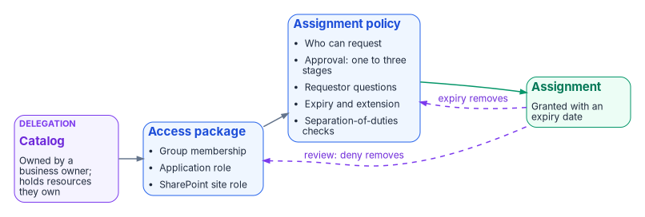
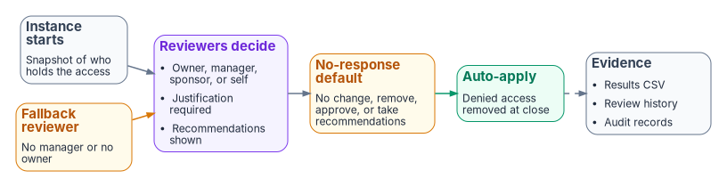

# Chapter 09 — Access Governance: Packages, Reviews and Lifecycle

*A grant that nobody ever re-confirms is a decision made once and trusted forever; governance is what makes every grant expire, get re-decided, or get removed.*

::: {.callout-note}
## In this chapter
How access is requested and granted through entitlement management (catalogs, access packages, policies, approval stages, separation of duties, and expiration), how it is re-confirmed through access reviews (scope, reviewers, cadence, auto-apply, and fallback reviewers), how Lifecycle Workflows act on access when a person's job changes, how guest access is governed from invitation to removal, and what evidence each of these leaves for an assessor.
:::

A well-configured tenant can still fail an account-management audit. Conditional Access ([Chapter 07](07-the-conditional-access-policy-library.md)) decides whether a session may proceed, and PIM ([Chapter 08](08-pim-self-request-with-approval.md)) decides whether a privileged role may be active. Neither decides whether a person should still hold the access they were given last year. NIST SP 800-53 keeps those questions in separate requirements: AC-2 requires the organization to review accounts for compliance with account-management requirements at a defined frequency and to align account management with personnel termination and transfer processes, and AC-6(7) requires a periodic review of the privileges assigned to roles and classes of users, with reassignment or removal where needed.[^c09-fedramp-ac] A tenant with perfect policies and no reviews has automated its grants and abandoned the reviews.

The program closes that gap with three mechanisms that run without anyone opening a ticket:

1. **Requests through access packages.** People ask for a bundle of access, named approvers decide, and the assignment carries an expiry from the moment it is granted.
2. **Reviews on a calendar.** Owners, managers, or sponsors re-confirm each grant at a cadence set by its risk, and denied access is removed automatically.
3. **Lifecycle events.** When the HR record says someone moved or left, Lifecycle Workflows remove the old access and request the new. The HR-driven lifecycle itself, from attributes to joiner, mover, and leaver design, belongs to [Book 03](../b03-hr-identity/index.md); this chapter covers only the access tasks.

The seam with the request queue is simple. Tickets govern things people ask for. This chapter governs grants that expire, decisions that recur, and changes that follow an event. [Book 02, Chapter 10](../b02-identity/10-migrating-and-governing.md#identity-governance-and-lifecycle) introduced the loop during the migration; this chapter is the operating detail.

{#fig-ch09-access-package-anatomy fig-alt="Left to right. A violet box, catalog, owned by a catalog owner, contains resources the owner added. It feeds a blue box, access package, which bundles resource roles: group membership, application role, SharePoint site role. The package feeds a blue box, assignment policy, listing who can request, approval stages one to three, requestor questions, expiration and extension, and separation-of-duties checks. The policy feeds a green box, assignment, with an expiry date. Two dashed violet arrows return from the assignment: one labeled access review, deny removes; one labeled expiry removes."}

## Licensing: what needs Entra ID Governance

Book 02 sets out the license tiers ([Chapter 09](../b02-identity/09-building-the-entra-target.md#licensing-for-governance-features)); the access-governance specifics are below. As of October 2026, Microsoft licenses entitlement management and access reviews by Microsoft Entra ID Governance for the member users involved, including everyone who reviews access or has their access reviewed, while some capabilities that were generally available in P2 still operate under P2.[^c09-licensing] Microsoft has also said it will add no new identity governance features to the P2 SKU, so anything newer than the original P2 feature set is a Governance feature.[^c09-licensing]

| Capability | P2 | Entra ID Governance |
|---|---|---|
| Access packages with groups, applications, and SharePoint sites; self-request; admin direct assignment | Yes | Yes |
| Multi-stage approval with alternate approvers; manager, sponsor, and specific approvers | Yes | Yes |
| Assignment expiration; separation-of-duties checks | Yes | Yes |
| Automatic assignment policies; custom extensions; managers requesting on behalf of reports | | Yes |
| PIM for Groups eligibility and Entra roles (preview) as access package resources | | Yes |
| Marking existing guests as governed | | Yes |
| Access reviews of groups, applications, and roles (the original P2 set) | Yes | Yes |
| Reviews scoped only to inactive users; machine-learning recommendations; reviews of PIM for Groups (preview) | | Yes |
| Lifecycle Workflows, including custom task extensions | | Yes |
| Inactive guest account insights | | Yes |

The table summarizes Microsoft's feature-by-license reference.[^c09-licensing] Three licensing facts shape the design:

- Users don't need a Governance license assigned to them, but the tenant needs enough licenses to cover every member user in scope of, or configuring, the governance features.[^c09-licensing]
- Guests are billed differently: Governance uses monthly-active-user billing for guests, which requires an Azure subscription linked for guest billing.[^c09-licensing]
- Microsoft Entra ID Governance for Government, and a Governance add-on for P2 for Government, are available in GCC, GCC High, and DoD.[^c09-licensing]

Plan on Governance licensing for the whole workforce. Partial licensing produces a governance program that covers some people and leaves the rest ungoverned.

## The group-based substrate

Access packages and reviews work best when the thing being granted is a group. The program's rule is that user access to enterprise applications is assigned through security groups, never to individual users directly. That rule is a design position, and it does three jobs: reviews run against group membership instead of scattered assignments, onboarding and offboarding become membership changes, and the policy (who is in the group) stays separate from the enforcement (the group's assignment to the application).

Two platform facts back the rule. Group-based assignment to applications requires Entra ID P1 or P2, and nested group memberships aren't supported for it: when a group is assigned to an application, only its direct members get access.[^c09-group-assign] An access review of a group, on the other hand, flattens nested groups and shows their users individually, but a denied user is removed only from direct membership, not from the nested group that gave them access.[^c09-create-review] Nesting therefore creates access that reviews can see but can't remove. The program prohibits nested groups in application access assignments, and any nesting found during a review is remediated as a finding.

### Naming and membership type

Every application access group follows one naming convention, `APP-<AppShortName>-<AccessRole>-<RiskTier>`, so that the group's purpose and the application's risk tier can be read from the name:

| Token | Meaning | Example |
|---|---|---|
| `APP` | Fixed prefix for application access groups | `APP` |
| `<AppShortName>` | The application's short name in the application registry (no spaces) | `PAYROLL`, `HRPORTAL` |
| `<AccessRole>` | The role the group grants in the application | `USERS`, `ADMINS`, `READONLY` |
| `<RiskTier>` | The application's risk tier ([Chapter 06](06-who-decides-access.md#risk-tiers-set-the-approval-chain)) | `T1`, `T2`, `T3` |

So `APP-PAYROLL-ADMINS-T1` is the administrators of a Tier 1 payroll application. Names that don't follow the convention are flagged during reviews and corrected.

Membership type follows the tier:

| Membership type | Appropriate when | Not appropriate when | Tier rule |
|---|---|---|---|
| Dynamic (rule on user attributes) | Broad role-based access that matches attributes the HR feed keeps accurate | Each member needs individual approval, or the attributes aren't reliably maintained | Tier 3 preferred; Tier 2 only with governance-office approval; never Tier 1 |
| Assigned (members added through approved requests or access packages) | Individual approval of each grant; small or specialized populations | Very large populations with reliable attributes | Required for Tier 1 and Tier 2; acceptable for Tier 3 |

A dynamic group is only as good as the attributes behind it. The attribute standard and the HR feed that maintains it are [Book 03](../b03-hr-identity/index.md)'s subject; here the rule is that the application owner validates the membership rule at every review, and a change to a rule is an access change that goes through change control ([Chapter 10](10-access-as-code-and-evidence.md)).

### Three parties, three duties

To keep any one person from both deciding and doing, each access group has three distinct roles:

| Role | Duty | May also be | May not be |
|---|---|---|---|
| Group owner | Accountable for membership accuracy; reviews membership | The application owner | The person who created the group or executes changes to it |
| Group creator | Creates the group in Entra ID from an approved request | A help desk operator (for other groups) | Owner of a group they created, or owner of its application |
| Application owner | Authorizes grants and the group's assignment to the application | Owner of the application's access groups | The operator who executes changes to their own application's groups |

Who holds these roles, and how the decision rights are allocated, is [Chapter 06](06-who-decides-access.md)'s subject. The NIST hook is AC-5, which requires the organization to identify and document duties of individuals and define access authorizations to support separation of duties.[^c09-fedramp-ac]

| Group class | Owner | Review cadence | Nesting | Changes need PIM |
|---|---|---|---|---|
| Assigned, Tier 1 application access | Application owner | Quarterly | No | Yes |
| Assigned, Tier 2 application access | Application owner | Semiannual | No | Yes |
| Assigned, Tier 3 application access | Application owner or department owner | Annual | No | Yes |
| Dynamic, Tier 3 only | Application owner | Annual (rule validation) | No | Yes, for rule changes |
| PIM-governed privileged access group | Governance office or Privileged Role Administrator | Quarterly | No | Activation required |

## Entitlement management

Entitlement management automates access requests, assignments, reviews, and expiration for groups, applications, and SharePoint Online sites, for both internal users and people outside the organization.[^c09-em-overview] Its three building blocks are catalogs, access packages, and policies.

### Catalogs and delegation

A catalog is a container of resources and the access packages built from them. Catalogs are how the program delegates: an administrator can add any resource to any catalog, but a non-administrator catalog owner can add only resources they own, and a catalog owner can make others co-owners or access package managers.[^c09-em-overview] Access package managers can create packages and policies inside the catalog but can't add resources; catalog readers have view-only access; access package assignment managers can change assignments but not packages or policies.[^c09-delegate] An access package can't be moved to a different catalog after it is created, so choose the catalog first.[^c09-ap-create]

The program creates one catalog per business domain that owns resources (for example, finance applications, HR applications, collaboration sites), with the domain's business owner as catalog owner and application owners as access package managers. Tier 1 resources go into catalogs whose owners are approved by the governance office. The `General` catalog, which entitlement management creates automatically, is not used for program resources.[^c09-catalog-resource]

### Access packages

An access package bundles resource roles: membership or ownership of security groups and Microsoft 365 groups (including Teams), assignment to enterprise applications and their app roles, and membership of SharePoint Online sites.[^c09-em-overview] With Entra ID Governance, a package can also grant eligible PIM for Groups membership, and Entra roles in preview.[^c09-licensing] Anything that keys on a security group comes along too: a group in a package can carry group-based licensing or an Azure role assignment.[^c09-em-overview]

The program uses the four package categories Book 02 defines (onboarding, department, project, and cross-tenant; see [Book 02, Chapter 10](../b02-identity/10-migrating-and-governing.md#entitlement-management-and-access-packages)), plus one rule from this book: privileged access arrives through PIM eligibility, never through a package that grants an active role ([Chapter 04](04-privileged-roles-and-tiers.md)).

### Policies: who may request, who approves, how long

Every package needs at least one assignment policy before anyone can be assigned.[^c09-approval] A policy states who may request (users in the directory, specific connected organizations, or administrator direct assignment only), who approves, and when the assignment ends.[^c09-em-overview] A package can carry several policies, for example one for employees and a second for partner users with a stricter approval chain.[^c09-sod]

Approval works like this as of October 2026:[^c09-approval]

- A policy can require one, two, or three approval stages. In each stage, one approver's decision is enough; a denial in any stage, or no decision, ends the request.
- Approvers can be specific users or groups, the requestor's manager, or an internal or external sponsor. If the manager is the first-stage approver, add a fallback approver for requestors with no manager in the directory.
- Approvers can't approve their own requests.
- Each stage has a decision deadline in days. A request that isn't decided in time is denied, and the user has to request again.
- Alternate approvers receive a pending request on a forwarding schedule. Forwarding can start only a day after the request, and the request timeout must be at least four days to use it.
- The policy can require justification from the requestor and from approvers, and can ask the requestor custom questions whose answers approvers see.

The program's approval chains follow the application's risk tier, which [Chapter 06](06-who-decides-access.md#risk-tiers-set-the-approval-chain) defines along with the people behind each role. The chains below are design positions:

| Tier | Stage 1 | Stage 2 | Decision deadline per stage | Justification |
|---|---|---|---|---|
| Tier 3 | Department owner (the requestor's manager, with a fallback approver) | | 7 days | Requestor |
| Tier 2 | Application owner (alternate: backup application owner) | | 5 days | Requestor and approver |
| Tier 1 | Application owner (alternate: backup application owner) | Identity governance office | 5 days | Requestor and approvers |

The program's earlier request procedure only notified the governance office of Tier 1 grants. Making the office a second approval stage costs a few hours and leaves an approval record instead of an email. For resources more sensitive still, Microsoft describes a three-stage pattern: the manager confirms the business need, the resource owner confirms the access, and a security reviewer can reject on risk criteria the owner doesn't see.[^c09-approval]

### Expiration and extension

On the policy's lifecycle tab, assignments expire on a fixed date, after a number of days (0 to 3660), after a number of hours, or never.[^c09-lifecycle] If the policy allows extension, the user gets an email 14 days and again one day before expiry, must still be in the policy's scope to extend, and can be required to get approval for the extension through the same approval settings.[^c09-lifecycle] Changing a policy's expiration doesn't change the expiry of requests already pending or approved.[^c09-lifecycle]

The program never uses "never." Its defaults, as design positions:

| Package type | Expiry | Extension |
|---|---|---|
| Tier 1 application access | 90 days | Allowed, with approval |
| Tier 2 application access | 180 days | Allowed, with approval |
| Tier 3 application access and department packages | 365 days | Allowed without approval while in scope |
| Project packages | On the project end date | Allowed, with approval, up to the end date |
| Packages for external users | No more than 365 days | Allowed, with sponsor approval |

Microsoft recommends that external users' packages expire within 365 days unless the project runs longer, and that any package without expiration get regular access reviews.[^c09-ext-arch]

### Separation of duties

A package can list other access packages, and security groups, as incompatible. A user who already holds an incompatible assignment or membership can't request the package, and an access package manager can't assign it to them either.[^c09-sod] The relationship is one-way: to keep users from holding both the "western territory" and "eastern territory" packages, each package must list the other.[^c09-sod] Incompatible groups can be on-premises AD groups synchronized to Entra ID, which lets the check respect access granted in systems outside the cloud.[^c09-sod] The check works with P2.[^c09-sod]

When the business needs an exception, Microsoft's pattern is to create a separate combined package for the people who legitimately need both, with a shorter expiry and more frequent reviews, so that the exception is visible to approvers, reviewers, and assessors.[^c09-sod] The program uses that pattern and records each combined package in the exception register. When incompatibility is added to a package that already has assignments, the portal can download the list of users who already hold both, and Microsoft Graph can list that "additional access" too; resolve those before relying on the check.[^c09-sod]

The *Application role assignment activity* workbook, with entitlement activity omitted, shows app role assignments made outside entitlement management, for example a direct assignment by an administrator.[^c09-sod] The program runs it monthly as a detective check on the group-based rule.

### Automatic assignment

With Entra ID Governance, an automatic assignment policy assigns a package to everyone who matches a rule on user attributes (such as department or cost center) and removes the assignment when they stop matching.[^c09-em-overview][^c09-licensing] This is the mechanism for department packages, and it depends on the attributes the HR feed maintains ([Book 03](../b03-hr-identity/index.md)). Book 02 notes one time-sensitive caution: don't build automatic assignment rules on the preview `memberOf` operator ([Book 02, Chapter 10](../b02-identity/10-migrating-and-governing.md#entitlement-management-and-access-packages)).

### The request portal is covered by Section 508

The people who request access, approve it and review it are federal employees, and Section 508 requires that the technology agencies use give employees with disabilities access to information and data "comparable to the access to and use of the information and data by Federal employees who are not individuals with disabilities."[^c09-794d] The Revised 508 Standards apply to "ICT that is procured, developed, maintained, or used by agencies," and require user interfaces and content to conform to WCAG 2.0 Level A and AA.[^c09-1194] As the workbook's practice, the program tests the whole request, approval and review flow with assistive technology, not just its first page, and records the vendor's Accessibility Conformance Report for the portal it uses. OMB asks agencies to validate vendor conformance documentation before purchase and after a product changes.[^c09-m2408] Where a conforming product isn't commercially available, the agency buys what best meets the standard and documents the market research in writing.[^c09-1194]

## Access reviews

Access reviews are recurring attestation that each person still needs what they hold. A review captures a snapshot of access when each instance starts; changes made during a review show up in the next cycle.[^c09-create-review]

{#fig-ch09-review-instance fig-alt="Left to right. A slate box, instance starts, takes a snapshot of who holds the access. It feeds a violet box, reviewers decide, listing owner, manager, sponsor or self, with justification and recommendations. An amber box, fallback reviewer, receives items where there is no manager or owner, and feeds back into the reviewers box. The reviewers box feeds an amber box, no-response default, listing no change, remove, approve, or take recommendations. That feeds a green box, auto-apply, which removes denied access at the end of the instance. A dashed arrow from auto-apply leads to a slate box, evidence: results CSV, review history, audit records."}

### What can be reviewed

| Review target | Where it's configured | License note |
|---|---|---|
| Group and Teams membership | Access reviews | P2 set; inactive-only scope needs Governance |
| Application assignments | Access reviews | P2 set |
| Access package assignments | The package's policy (lifecycle tab) or access reviews | P2 set |
| Entra roles and Azure resource roles | PIM | P2 or Governance |
| PIM for Groups membership | Access reviews (preview) | Governance |
| Guests across all Microsoft 365 groups | Access reviews, "All Microsoft 365 groups with guest users" | Guest billing applies |

The table draws on Microsoft's review-creation guidance and licensing reference.[^c09-create-review][^c09-licensing] Note two scoping details. A review of all Microsoft 365 groups with guests covers guests only and excludes dynamic and role-assignable groups.[^c09-create-review] A group membership review can be scoped to users inactive for up to 730 days, and users created more recently than the inactivity window are left out so that a new user gets a chance to sign in.[^c09-create-review]

Because the program assigns application access through groups, it reviews the groups, not the applications. Microsoft notes that a review of an application that uses group assignment doesn't remove the members of those groups, so they keep their access through the group.[^c09-ar-faq]

Reviews of privileged roles happen in PIM; the role settings that pair with them are in [Chapter 08](08-pim-self-request-with-approval.md) and [Appendix B](appendix-b-pim-role-settings.md).

### Reviewers and fallback reviewers

Reviewers can be group owners (for group reviews), selected users or groups, the users themselves (self-review), or the users' managers.[^c09-create-review] When the reviewer is a manager or a group owner, add a fallback reviewer: fallback reviewers are asked when a user has no manager in the directory or the group has no owner.[^c09-create-review] For reviews of PIM for Groups with owners as reviewers, a fallback reviewer is mandatory, and only active (not eligible) owners count as reviewers.[^c09-create-review] Owners are fixed when an instance starts; ownership changes take effect at the next recurrence.[^c09-create-review]

A multi-stage review runs two or three sets of reviewers in sequence, each in its own stage duration, and you choose which reviewees go on to the next stage (approved, denied, not reviewed, marked "don't know," or all) and whether later stages see earlier decisions.[^c09-create-review] The program uses two stages for Tier 1 applications: the manager first, then the application owner for everyone the manager approved or marked "don't know." That replaces the manual "escalate to department owner" step in the program's older review procedure.

### Cadence

A review's recurrence sets how often it runs, and its duration sets how long reviewers have; the recurrence must be at least as long as the duration.[^c09-create-review] Recurrences run from weekly (where the duration can be at most seven days) to monthly, quarterly, semiannual, and annual, and Microsoft recommends quarterly or more frequent reviews of packages that grant external access.[^c09-create-review][^c09-ext-arch]

The program's schedule, by target. It refines the review schedule in [Book 02, Chapter 10](../b02-identity/10-migrating-and-governing.md#access-reviews) by application tier; the cadences, reviewers, and no-response defaults are design positions. SP 800-53 leaves the frequency to the organization (AC-2(j) and AC-6(7) each take an organization-defined frequency).[^c09-fedramp-ac] Reviewers of privileged roles are never the assignees alone: with Microsoft's **Members (self)** reviewer option, role-assignable groups aren't part of a review of Microsoft Entra roles.[^c09-pim-review]

| Review target | Cadence | Duration | Reviewers | Fallback | If reviewers don't respond | Auto-apply |
|---|---|---|---|---|---|---|
| PIM-eligible Tier 0 roles | Monthly | 14 days | `PIM-Approvers-T0` | Governance office | Remove access | Yes |
| PIM-eligible Tier 1, Tier 2 and read-only roles, and Azure roles | Quarterly | 14 days | Role owner and the tier's approver group, or the security office ([Appendix B](appendix-b-pim-role-settings.md#review-cadence-by-tier)) | Governance office | Remove access | Yes |
| `PRV-T0-*` privileged access groups | Monthly | 14 days | Governance office | Privileged Role Administrator | Remove access | Yes |
| Other PIM-governed privileged access groups | Quarterly | 14 days | Governance office | Privileged Role Administrator | Remove access | Yes |
| Tier 1 application access groups | Quarterly | 14 days (two stages of 7) | Manager, then application owner | Backup application owner | No change; escalate to the governance office | Yes |
| Tier 2 application access groups | Semiannual (January and July) | 14 days | Application owner | Backup application owner | No change; escalate | Yes |
| Tier 3 application access groups | Annual (January) | 21 days | Application or department owner | Department owner | No change | Yes |
| Packages and groups with guests | Quarterly | 14 days | Sponsors | Governance office | Remove access | Yes |
| Microsoft 365 group membership | Semiannual | 21 days | Group owners | Governance office | No change | No (recommendations only) |

### Upon completion: auto-apply and the no-response default

When a review ends, *auto apply results to resource* removes denied users automatically; without it, someone has to apply the results by hand.[^c09-create-review] The *if reviewers don't respond* setting decides what happens to users nobody reviewed: no change, remove access, approve access, or take the system's recommendations.[^c09-create-review] Microsoft warns that combining "remove access" or "take recommendations" with auto-apply can revoke all access to a resource if reviewers don't respond.[^c09-create-review] That is why the program sets "remove access" only where an unreviewed grant is riskier than a lost one (privileged roles and guests), and "no change, escalate" for business applications, where a mass removal would stop work.

For guest-only reviews, a denied guest can either lose only the reviewed membership, or be blocked from signing in for 30 days and then deleted from the tenant; within those 30 days an administrator can re-enable the account.[^c09-create-review] The program blocks and removes denied guests.

Two review-quality settings matter as much as the cadence:

- **Decision helpers.** "No sign-in within 30 days" recommends denial for users who haven't signed in during the previous 30 days (for application reviews, sign-in to the application), and "user-to-group affiliation" recommends denial for users far from the rest of the group in the reporting structure.[^c09-create-review] The machine-learning affiliation recommendation needs Governance.[^c09-licensing]
- **Justification and reminders.** "Justification required" makes reviewers state a reason for each decision; reminders go to all reviewers halfway through the review.[^c09-create-review]

Bulk approval is the efficient and dangerous part of any review. The program requires justification on every review, and for privileged-role reviews it requires a decision per assignment: reviewers don't accept recommendations in bulk. The service can't prevent a bulk action, so the review history (below) is checked for privileged reviews where one reviewer recorded many identical decisions within minutes.

### From a manual procedure to the service

The program's earlier review procedure was a distributed spreadsheet: the governance office sent each owner a membership report on the first business day of the quarter, owners certified approve, remove, or escalate within 10 business days, and the help desk executed removals through tickets within 5 business days. The service replaces each step:

| Manual step | In Entra ID |
|---|---|
| Distribute the membership report | The review instance starts on schedule and emails reviewers |
| Owner certifies each member | Reviewers decide in My Access, with recommendations |
| "Escalate" when unsure | "Don't know" decisions go to a second stage |
| Help desk removes within 5 business days | Auto-apply removes denied users when the instance ends |
| Owner confirms removals; office archives | Review history and audit records are exported (below) |

The service-level targets survive as measures. A review is complete when every decision is recorded and applied before the instance closes; denied access still present five business days after close is a finding.

## Lifecycle Workflows at the access level

The HR-driven lifecycle (inbound provisioning, joiner, mover, and leaver design, and the attributes that trigger them) is [Book 03](../b03-hr-identity/index.md)'s. What this chapter needs is the set of Lifecycle Workflows tasks that change access, because those tasks are where the mover and leaver problems turn into access decisions.

Lifecycle Workflows run on a schedule when a user meets a workflow's execution conditions, a trigger plus a scope, or on demand. The scheduled triggers are a time-based attribute, an attribute change, a group membership change, and sign-in inactivity.[^c09-lcw-conditions] The access-related built-in tasks as of October 2026:[^c09-lcw-tasks]

| Task | Category |
|---|---|
| Request user access package assignment | Joiner, mover |
| Remove access package assignment for user | Leaver, mover |
| Remove all access package assignments for user | Leaver, mover |
| Cancel all pending access package assignment requests for user | Leaver |
| Add user to groups; add user to teams | Joiner, mover, leaver |
| Remove user from selected groups; remove user from all groups | Joiner, mover, leaver; leaver |
| Remove user from selected teams; remove user from all teams | Leaver |
| Revoke all refresh tokens for user | Leaver, mover |
| Assign licenses; remove selected or all license assignments | Joiner, mover; leaver, mover; leaver |
| Run a custom task extension | Joiner, mover, leaver |

The program's access rules for each event, as design positions:

- **Joiner.** Request the onboarding package and the department package. Never add a new hire directly to an application group.
- **Mover.** A move is a re-derivation, not an additional grant. Remove the previous department's package assignments, request the new department's package, and send everything the person still holds outside packages to a review. Microsoft's built-in *Employee job profile change* template does the first two steps, and its *remove all access package assignments* task defaults to a scheduled removal 15 days after the trigger, a grace period for handover.[^c09-lcw-templates] The program keeps the grace period for standard access and sets it to zero for Tier 1 and privileged access.
- **Leaver.** Cancel pending requests, remove all package assignments, remove the user from all groups and teams, and revoke refresh tokens. The account disable and deletion steps are Book 03's.
- **Inactivity.** The *Offboard inactive users* template keys on `lastSuccessfulSignInDateTime`; Microsoft's inactive-user templates default to 90 days of inactivity for the pre-offboarding workflow and 120 days for offboarding.[^c09-lcw-templates] The program uses it as a backstop for accounts whose HR record didn't produce a leaver event.

A tenant can have up to 50 workflows and up to 100 custom task extensions.[^c09-licensing] Spend workflows on events, not on individual applications; per-application cleanup belongs in the packages that a single "remove all assignments" task clears.

## Guest access governance

Guests are where unreviewed access accumulates fastest, because nobody's HR record ends when a partner project does. Book 02 covers the collaboration model, cross-tenant access settings, and B2B direct connect ([Book 02, Chapter 10](../b02-identity/10-migrating-and-governing.md#cross-tenant-and-b2b-collaboration)). Governance of the guest's access works in four layers.

- **Invite through a package.** When a policy allows users from a connected organization to request a package, an approved request creates the guest account automatically and assigns the access; the B2B allow and block lists still apply.[^c09-ext-users] Inviting through a package means every guest arrives with an approver, a sponsor, and an expiry.
- **End the account with the last assignment.** By default, when a guest who was invited through entitlement management loses their last package assignment (by expiry or by giving it up), they are blocked from signing in and their account is removed after 30 days; the block, the removal, and the number of days are configurable, and setting the days to zero removes the account immediately.[^c09-ext-users] This applies only to guests entitlement management invited, or to existing guests an administrator has marked as governed; ungoverned guests stay in the tenant indefinitely after losing their last assignment.[^c09-guest-lifecycle] Blocked guests can't request access again, so don't block guests who will return.[^c09-ext-users] Marking guests as governed needs Entra ID Governance.[^c09-licensing] The program marks every existing guest who holds a package assignment as governed, and keeps the default 30-day block before removal.
- **Review on a quarterly cadence.** Packages and groups with guests are reviewed quarterly by sponsors, with denied guests blocked and removed (see the schedule above). Where guests review their own access, remember that a guest who hasn't accepted their invitation receives no review email, so unredeemed guests fall to the no-response default.[^c09-create-review]
- **Policy for the guest population.** Guest lifecycle policies in Lifecycle Workflows, in preview as of October 2026, add tenant-wide rules: sponsor attestation (default 90 days, configurable 30 to 365), an activity requirement (default 90 days, 30 to 730), a minimum number of sponsors (1 to 5), and deletion of invitations not redeemed within a set number of days (default 30, 1 to 30).[^c09-guest-policies] The program will adopt them when they reach general availability; until then the quarterly sponsor review and the inactive-guest insights (a Governance feature) do the same job.[^c09-licensing]

## How the program evidences reviews

An assessor reads governance as records, not as settings. For each mechanism, the program keeps four kinds of evidence: the definition (what was configured), the instance records (what happened), the applied results (what changed), and the exceptions (what was allowed and why). The control mapping that ties these to SP 800-53 is in [Chapter 10](10-access-as-code-and-evidence.md#what-the-assessor-reads).

### The records Entra ID produces

- **Review results.** Results of any review, in progress or completed, can be downloaded as a CSV, and recurring reviews keep a history of completed instances.[^c09-complete-review] Microsoft Graph lists the decisions of each instance (one decision per reviewed identity) through the access reviews API, and the Microsoft Graph PowerShell cmdlet `Get-MgIdentityGovernanceAccessReviewDefinitionInstanceDecision` does the same; the default page size is 100 decisions.[^c09-complete-review]
- **Review history reports.** A review history report pulls the decisions across reviews for a date range, filtered by review type and result, and records per user the reviewer, decision, justification, recommendation, who applied the result, and when.[^c09-review-history] Reports stay downloadable for 30 days, so the program downloads each one into the evidence store when it is generated.[^c09-review-history]
- **Audit log entries.** Access review activity is recorded in the Entra audit log, including creating and ending a review and approving, denying, resetting, and applying decisions.[^c09-deploy-reviews] Entitlement management writes audit records in the `EntitlementManagement` category for each step of a request, from "User requests access package assignment" through approval to "Fulfill access package assignment."[^c09-em-reports]
- **Assignment reports.** Each package's current assignments can be downloaded, and historical analysis of objects and assignments over time needs an export to Azure Data Explorer or a log workspace, because the reports show current state.[^c09-em-reports]

### Retention: the logs don't keep themselves

Native retention is shorter than is often assumed: as of October 2026, Entra ID keeps audit and sign-in logs for 7 days on Free and 30 days on P1 and P2, and upgrading doesn't recover older data.[^c09-retention] Evidence that has to outlast a 30-day window has to leave the service first: Book 02's monitoring design streams every log category to a Log Analytics workspace with 365-day retention ([Book 02, Chapter 10](../b02-identity/10-migrating-and-governing.md#monitoring-audit-and-compliance)).

The program's retention requirements, as design positions:

| Record | Retention | Where |
|---|---|---|
| Entra audit and sign-in logs, including PIM activations and access review activity | At least 1 year | Log Analytics workspace and the SIEM |
| Admin consent grants and emergency access account activity | At least 3 years | SIEM plus long-term archive |
| Review history reports and per-instance results | 3 years | Evidence store |
| Access request tickets (where a ticket exists alongside the package request) | 3 years active, 7 years archived | ITSM system and archive |
| Application registry snapshots | Annual snapshot, kept 3 years | Evidence store |

A gap in log forwarding is a gap in evidence. The governance office confirms forwarding health quarterly, and a forwarding gap is reported to the CISO as a security incident within 24 hours of discovery.

### Governance alerts

Detections that guard the governance process itself run in the SIEM; the detection queries for privileged activity and sign-in coverage are in [Book 02, Chapter 10](../b02-identity/10-migrating-and-governing.md#detection-rules) and the consent and application alerts are [Chapter 05](05-applications-and-workload-identities.md)'s. Three are specific to this chapter:

| Alert | Trigger | Priority |
|---|---|---|
| Access granted outside entitlement management | An app role assignment to a Tier 1 or Tier 2 application not made by entitlement management | High |
| Review closed with unapplied denials | A review instance ended with "Deny" decisions not applied | High |
| Bulk privileged decisions | One reviewer records many identical decisions in a privileged-role review within minutes | Medium |

### Exceptions

Every deviation (a combined package that overrides separation of duties, a review schedule moved, a package without expiry) is recorded in the exception register with its approver, its justification, and an end date. Deviations from the Tier 3 review schedule need the governance office's approval; deviations for Tier 1 or Tier 2 also need the CISO's concurrence. The register is reviewed quarterly and is part of the evidence for each cycle.

::: {.callout-tip}
## Continue the book
[← Previous: Chapter 08 — PIM Self-Request with Approval](08-pim-self-request-with-approval.md) · [Book index](index.md) · [Next: Chapter 10 — Access as Code, and the Evidence It Produces →](10-access-as-code-and-evidence.md)
:::

[^c09-fedramp-ac]: FedRAMP, "Access Control" (NIST SP 800-53 Rev. 5 controls, catalog release 5.2.0), <https://fedramp.gov/2026/reference/controls/access-control/> (accessed Oct 21, 2026).
[^c09-pim-review]: Microsoft Learn, "Create an access review of Azure resource and Microsoft Entra roles in PIM," section "Create access reviews," <https://learn.microsoft.com/entra/id-governance/privileged-identity-management/pim-create-roles-and-resource-roles-review#create-access-reviews> (accessed Oct 21, 2026).
[^c09-licensing]: Microsoft Learn, "Microsoft Entra ID Governance licensing fundamentals," <https://learn.microsoft.com/entra/id-governance/licensing-fundamentals> (accessed Oct 20, 2026).
[^c09-group-assign]: Microsoft Learn, "Manage users and groups assignment to an application," <https://learn.microsoft.com/entra/identity/enterprise-apps/assign-user-or-group-access-portal> (accessed Oct 20, 2026).
[^c09-create-review]: Microsoft Learn, "Create an access review of groups and applications in Microsoft Entra ID," <https://learn.microsoft.com/entra/id-governance/create-access-review> (accessed Oct 20, 2026).
[^c09-em-overview]: Microsoft Learn, "What is entitlement management?," <https://learn.microsoft.com/entra/id-governance/entitlement-management-overview> (accessed Oct 20, 2026).
[^c09-delegate]: Microsoft Learn, "Delegate access governance to access package managers in entitlement management," <https://learn.microsoft.com/entra/id-governance/entitlement-management-delegate-managers> (accessed Oct 20, 2026).
[^c09-ap-create]: Microsoft Learn, "Create an access package in entitlement management," <https://learn.microsoft.com/entra/id-governance/entitlement-management-access-package-create> (accessed Oct 20, 2026).
[^c09-catalog-resource]: Microsoft Learn, "accessPackageCatalog resource type," <https://learn.microsoft.com/graph/api/resources/accesspackagecatalog?view=graph-rest-1.0> (accessed Oct 20, 2026).
[^c09-approval]: Microsoft Learn, "Change approval and requestor information settings for an access package in entitlement management," <https://learn.microsoft.com/entra/id-governance/entitlement-management-access-package-approval-policy> (accessed Oct 20, 2026).
[^c09-lifecycle]: Microsoft Learn, "Change lifecycle settings for an access package in entitlement management," <https://learn.microsoft.com/entra/id-governance/entitlement-management-access-package-lifecycle-policy> (accessed Oct 20, 2026).
[^c09-ext-arch]: Microsoft Learn, "Manage external access with Microsoft Entra entitlement management," <https://learn.microsoft.com/entra/architecture/6-secure-access-entitlement-managment> (accessed Oct 20, 2026).
[^c09-sod]: Microsoft Learn, "Configure separation of duties checks for an access package in entitlement management," <https://learn.microsoft.com/entra/id-governance/entitlement-management-access-package-incompatible> (accessed Oct 20, 2026).
[^c09-lcw-conditions]: Microsoft Learn, "Lifecycle workflows execution conditions and scheduling," <https://learn.microsoft.com/entra/id-governance/lifecycle-workflow-execution-conditions> (accessed Oct 20, 2026).
[^c09-lcw-tasks]: Microsoft Learn, "Lifecycle Workflow built-in tasks," <https://learn.microsoft.com/entra/id-governance/lifecycle-workflow-tasks> (accessed Oct 20, 2026).
[^c09-lcw-templates]: Microsoft Learn, "Lifecycle Workflows templates and categories," <https://learn.microsoft.com/entra/id-governance/lifecycle-workflow-templates> (accessed Oct 20, 2026).
[^c09-ext-users]: Microsoft Learn, "Govern access for external users in entitlement management," <https://learn.microsoft.com/entra/id-governance/entitlement-management-external-users> (accessed Oct 20, 2026).
[^c09-guest-lifecycle]: Microsoft Learn, "Manage guest user lifecycle," <https://learn.microsoft.com/entra/id-governance/entitlement-management-access-package-manage-lifecycle> (accessed Oct 20, 2026).
[^c09-guest-policies]: Microsoft Learn, "Guest lifecycle policies in Lifecycle Workflows (preview)," <https://learn.microsoft.com/entra/id-governance/guest-lifecycle-policies> (accessed Oct 20, 2026).
[^c09-complete-review]: Microsoft Learn, "Complete an access review of groups and applications in access reviews," <https://learn.microsoft.com/entra/id-governance/complete-access-review> (accessed Oct 20, 2026).
[^c09-review-history]: Microsoft Learn, "Create and manage downloadable access review history report in Microsoft Entra access reviews," <https://learn.microsoft.com/entra/id-governance/access-reviews-downloadable-review-history> (accessed Oct 20, 2026).
[^c09-ar-faq]: Microsoft Learn, "Access reviews - FAQs," <https://learn.microsoft.com/entra/id-governance/access-reviews-faqs> (accessed Oct 20, 2026).
[^c09-deploy-reviews]: Microsoft Learn, "Plan a Microsoft Entra access reviews deployment," <https://learn.microsoft.com/entra/id-governance/deploy-access-reviews> (accessed Oct 20, 2026).
[^c09-em-reports]: Microsoft Learn, "View reports and logs in entitlement management," <https://learn.microsoft.com/entra/id-governance/entitlement-management-reports> (accessed Oct 20, 2026).
[^c09-retention]: Microsoft Learn, "Microsoft Entra data retention," <https://learn.microsoft.com/entra/identity/monitoring-health/reference-reports-data-retention> (accessed Oct 20, 2026).
[^c09-794d]: 29 U.S.C. §794d(a)(1)(A)(i) (2023 edition), <https://www.govinfo.gov/content/pkg/USCODE-2023-title29/html/USCODE-2023-title29-chap16-subchapV-sec794d.htm> (accessed Oct 23, 2026).
[^c09-1194]: U.S. Access Board, Revised 508 Standards, 36 CFR part 1194, Appendix A, E201.1, E202.7 and E202.7.1 (best meets), and E207.2, <https://www.ecfr.gov/current/title-36/chapter-XI/part-1194> (accessed Oct 23, 2026).
[^c09-m2408]: Office of Management and Budget, M-24-08, *Strengthening Digital Accessibility and the Management of Section 508 of the Rehabilitation Act*, December 21, 2023, §III.B, <https://www.whitehouse.gov/wp-content/uploads/2023/12/M-24-08-Strengthening-Digital-Accessibility-and-the-Management-of-Section-508-of-the-Rehabilitation-Act.pdf> (accessed Oct 23, 2026).
