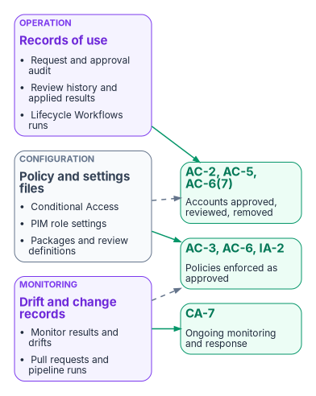

# Chapter 10 — Access as Code, and the Evidence It Produces

*An access policy that exists only as portal clicks can't be diffed, reviewed, or replayed, so it can't be assessed; held as code, every access decision has a source, a history, and an approver.*

::: {.callout-note}
## In this chapter
Which access objects the program keeps in a repository, and the tools that apply them (Microsoft Graph, the Terraform `azuread` provider, Microsoft365DSC, and Microsoft Entra Tenant Governance configuration management), with each tool's status as of October 2026. Then the change-control rules that make the repository the only normal path to production, how drift is detected and closed, and the evidence an assessor reads, mapped to NIST SP 800-53 AC-2, AC-3, AC-6, IA-2 and CA-7.
:::

The earlier chapters decided what the access policies are: the Conditional Access library ([Chapter 07](07-the-conditional-access-policy-library.md)), PIM role settings ([Chapter 08](08-pim-self-request-with-approval.md) and [Appendix B](appendix-b-pim-role-settings.md)), and the governance machinery ([Chapter 09](09-access-governance.md)). This chapter is about how those decisions are held. A Conditional Access estate that nobody can diff is a control that no assessor can trace: IA-2 and AC-6 become assertions, and drift stays invisible until it becomes a finding.

The invariant this chapter enforces is that every access decision has a reviewable source of truth, that a pipeline applies that source, and that a monitor checks the tenant against it. Three consequences follow. A change is a pull request with an author and a reviewer, not an edit someone remembers making. The tenant can be compared with intent at any time. And the evidence (who approved what, when it was deployed, whether it is still true) is produced by doing the work, not reconstructed for the assessment.

{#fig-ch10-access-as-code-loop fig-alt="Left to right. A slate box, repository, holds Conditional Access, PIM settings, groups, access packages and reviews as files. It feeds an amber box, pull request, with author and a different reviewer and automated checks such as the emergency-access exclusion. That feeds a blue box, pipeline, which applies through Microsoft Graph with a federated workload identity, report-only first. That feeds a blue box, Entra ID tenant. A violet box, drift monitor, compares the tenant with the baseline every six hours. A dashed red arrow labeled drift goes from the monitor back to the repository as an issue. A slate box, evidence store, receives commits, pipeline runs, audit records and drift results."}

## What goes in the repository

Every access object the program governs has a file in the repository, one file per object, named for the object's display name. The safety rules travel with the files and are checked before merge.

| Object class | Held as | Safety rule checked before merge |
|---|---|---|
| Conditional Access policies, named locations, authentication strengths | One JSON or HCL file per object | Every blocking or grant policy excludes the emergency access group ([Chapter 07](07-the-conditional-access-policy-library.md)); new and changed policies deploy as report-only |
| PIM role settings for Entra roles and PIM for Groups | One file per role policy (the role's rules) | Activation requires the authentication context `c1` and justification for every role, and approval by the tier's approver group for Tier 0 and Tier 1 roles; a Tier 2 role without approval cites its documented risk acceptance; no rule permits a permanent active assignment except the documented emergency accounts ([Chapter 08](08-pim-self-request-with-approval.md)) |
| Eligible role assignments | One file per role, listing eligible groups | Eligibility goes to role-assignable groups, not individuals ([Chapter 04](04-privileged-roles-and-tiers.md)) |
| Groups used for access | One file per group | Names follow the `APP-` convention; no nested members; dynamic rules only where the tier allows ([Chapter 09](09-access-governance.md#naming-and-membership-type)) |
| Catalogs, access packages, assignment policies | One file per package with its policies | Expiry set (never "never"); approval chain matches the tier; incompatible packages listed both ways |
| Access review definitions | One file per review series | Fallback reviewer present whenever reviewers are managers or owners; auto-apply on; no-response default matches the schedule |
| Lifecycle Workflows | One file per workflow | Leaver workflows include "remove all access package assignments" and "revoke all refresh tokens" |

Port authentication (802.1X) and certificate lifecycle automation are the other half of the identity-as-code work in the program's compliance series; they are network and PKI subjects and stay there ([Vol VI Book 02](https://github.com/WhalerMike/modernization-workbook/blob/main/docs/compliance/Vol_VI_Book_02_Identity_Access_as_Code.md), with [Vol I Book 02](https://github.com/WhalerMike/modernization-workbook/blob/main/docs/compliance/Vol_I_Book_02_Network_Access_Control_802_1X.md) and [Vol I Book 03](https://github.com/WhalerMike/modernization-workbook/blob/main/docs/compliance/Vol_I_Book_03_Certificates_Tokens_Cryptographic_Identity.md)).

## The tools, and where each one stands

Every tool below ends in Microsoft Graph, which is the only programmatic interface to these objects. The differences are in how much they cover, whether they hold state, and who maintains them.

### Microsoft Graph and Microsoft Graph PowerShell

Graph exposes every object class in the table: Conditional Access policies, authentication strength policies, PIM role management policies and their rules, access packages and assignment policies, access review schedule definitions, and Lifecycle Workflows. Creating a Conditional Access policy needs `Policy.Read.All` and `Policy.ReadWrite.ConditionalAccess`, and Microsoft notes a known issue where the call can require consent to additional permissions.[^c10-ca-create] PIM role settings are `unifiedRoleManagementPolicy` objects whose rules (approval, enablement, expiration, notification, and authentication context) are updated individually; managing the rules for Entra roles needs `RoleManagementPolicy.ReadWrite.Directory`, and Privileged Role Administrator is the least-privileged role for the task.[^c10-pim-rules] Access packages and policies need `EntitlementManagement.ReadWrite.All`, and access review definitions need `AccessReview.ReadWrite.All`.[^c10-ap-policy][^c10-create-review]

Graph is the right tool for objects nothing else covers well, and for the read side of every check. It holds no state of its own, so "desired state" has to live in the repository and comparison has to be written.

### The Terraform `azuread` provider

HashiCorp's `azuread` provider was at v3.10.0 (September 24, 2026) as of October 2026.[^c10-tf-release] Its documented resources cover Conditional Access policies, named locations, authentication strength policies, groups and group members, administrative units, app role assignments, directory role eligibility schedule requests, PIM for Groups eligibility and assignment schedules, PIM for Groups role management policies, and catalogs, access packages, assignment policies, and their resource associations.[^c10-tf-resources] The resource list has no access review definitions, no Lifecycle Workflows, and no role management policy for Entra directory roles (only for groups), so Entra role PIM settings, reviews, and workflows need another tool.[^c10-tf-resources] The Conditional Access resource needs `Policy.ReadWrite.ConditionalAccess` and `Policy.Read.All` for a service principal, or the Conditional Access Administrator role for a user.[^c10-tf-ca]

Terraform holds state, which is its strength for drift: `terraform plan -detailed-exitcode` returns 0 when nothing differs and 2 when the plan has changes, and `-refresh-only` updates the state to match objects changed outside Terraform without changing them.[^c10-tf-plan]

### Microsoft365DSC

Microsoft365DSC is an open-source PowerShell Desired State Configuration module for configuring, exporting, and monitoring Microsoft 365 tenants. As of October 2026 its repository lives in the `Microsoft365DSC` GitHub organization, is active, and released version 2.26.1015.1 on October 14, 2026.[^c10-m365dsc-repo][^c10-m365dsc-release] Its Entra resources include Conditional Access policies, authentication strength policies, role settings (PIM rules) for Entra roles and for PIM for Groups, role and group eligibility schedules, entitlement management catalogs, packages, assignment policies and connected organizations, access review definitions, and Lifecycle Workflows.[^c10-m365dsc-resources] That makes it the one tool here that covers every object class in the table. The 2.x module expects PowerShell 7.6 or later for everything except compiling and applying configurations from Windows PowerShell.[^c10-m365dsc-pwsh] Treat it as a community project: check its release notes before every upgrade, and pin the version in the pipeline.

### Microsoft Entra Tenant Governance configuration management

Configuration management in Microsoft Entra Tenant Governance is built on the Tenant Configuration Management APIs in Microsoft Graph, which are generally available.[^c10-tcm-concepts] You write a baseline (a JSON list of resources and their desired property values, up to 200 resource instances each), a monitor checks the tenant against it, and every detected difference is reported as a drift object that lists each property whose value differs.[^c10-tcm-concepts][^c10-tcm-deploy] Its Entra resource types include Conditional Access policies, named locations, authentication strength and authentication method policies, groups, role definitions, role settings, role eligibility schedule requests, and entitlement management catalogs, packages, and assignment policies; access review definitions and Lifecycle Workflows aren't among them as of October 2026.[^c10-tcm-entra]

The limits shape how it is used:[^c10-tcm-api][^c10-tcm-licensing]

| Limit | Value |
|---|---|
| Monitors per tenant | 30 |
| Run interval | Every six hours, fixed |
| Resources monitored per day, per tenant | 800 with P1 or P2; Entra ID Governance adds 10 a day per license |
| Snapshot extraction | 20,000 resources a month (Governance adds 35 a month per license); 12 visible snapshot jobs |
| Snapshot retention | 7 days |
| Fixed drift retention | Deleted 30 days after it is resolved |
| Baseline update | Deletes that monitor's earlier results and drifts |

Two of those rows are evidence rules in disguise. Snapshots and resolved drifts expire, and editing a baseline erases its history, so the pipeline exports every monitoring result and drift to the evidence store before it changes a baseline. Monitors report drift; correcting it is done with whatever tool owns the object, and the next run marks the drift fixed.[^c10-tcm-faq]

### Microsoft Entra Exporter

Microsoft's recoverability guidance recommends keeping known-good tenant states in a versioned repository, using the Tenant Configuration Management snapshot APIs for the resources they cover and Graph exports, for example with the open-source Microsoft Entra Exporter, for the rest. It also advises against merging extracts from different mechanisms, because a snapshot covers only the resources and properties its schema supports.[^c10-recoverability] The Exporter's latest release was v3.0.1 (November 2025) as of October 2026.[^c10-exporter]

### Coverage, and the program's choice

| Object class | Graph | Terraform `azuread` | Microsoft365DSC | Tenant configuration monitoring |
|---|---|---|---|---|
| Conditional Access policies, named locations, authentication strengths | Yes | Yes | Yes | Yes |
| PIM role settings, Entra roles | Yes | No | Yes | Yes |
| PIM role settings, PIM for Groups | Yes | Yes | Yes | Not listed |
| Role eligibility | Yes | Yes | Yes | Yes |
| Groups | Yes | Yes | Yes | Yes |
| Catalogs, access packages, assignment policies | Yes | Yes | Yes | Yes |
| Access review definitions | Yes | No | Yes | No |
| Lifecycle Workflows | Yes | No | Yes | No |

The table summarizes the tool references cited above. The program's reference choice is a design position, made to minimize the number of write paths while keeping drift detection native:

- **Write path:** Microsoft365DSC, because it is the only declarative tool that covers every object class, so each object has exactly one tool that writes it. A team already invested in Terraform can use the `azuread` provider for the classes it covers and Microsoft Graph PowerShell scripts for PIM role settings, access reviews, and Lifecycle Workflows; the rule that matters is one writer per object class, recorded in the repository.
- **Drift detection:** Tenant configuration monitoring for every class it covers, because it runs inside the service and needs no pipeline to stay healthy; a scheduled read-only comparison (Terraform plan or a Microsoft365DSC export compared with the repository) for access reviews and Lifecycle Workflows.
- **Backup export:** Entra Exporter weekly, stored separately from the baselines, as Microsoft advises.

## Illustrative code

::: {.callout-warning}
The code in this chapter is illustrative. It hasn't been tested against a production tenant. Review it, replace every placeholder, and run it against a test tenant before you use it.
:::

### A Conditional Access policy as Graph JSON

The compliance series' illustrative policy needed three corrections. Graph identifies groups and authentication strengths by ID, not by name: the built-in phishing-resistant MFA strength is `00000000-0000-0000-0000-000000000004`, and the excluded emergency access group must be its object ID.[^c10-authstrength] And a new policy should first deploy as report-only (`enabledForReportingButNotEnforced`), not `enabled`. The example is the library's own end-state policy, CA022 ([Chapter 07](07-the-conditional-access-policy-library.md#wave-5-segments-and-the-end-state)), so it keeps CA022's name and Members scope: every guest and external user type is excluded through `excludeGuestsOrExternalUsers` with all external tenants, and the time-bound `CA-Exclude-PhishResistantNotReady` group is excluded alongside the emergency access group.[^c10-ca-guests][^c10-ca-alltenants]

```json
{
  "displayName": "CA022-Members-RequirePhishResistantMFA",
  "state": "enabledForReportingButNotEnforced",
  "conditions": {
    "users": {
      "includeUsers": ["All"],
      "excludeGroups": [
        "<emergency-access-group-object-id>",
        "<phish-resistant-not-ready-group-object-id>"
      ],
      "excludeGuestsOrExternalUsers": {
        "guestOrExternalUserTypes": "internalGuest,b2bCollaborationGuest,b2bCollaborationMember,b2bDirectConnectUser,otherExternalUser,serviceProvider",
        "externalTenants": {
          "@odata.type": "#microsoft.graph.conditionalAccessAllExternalTenants",
          "membershipKind": "all"
        }
      }
    },
    "applications": {
      "includeApplications": ["All"]
    },
    "clientAppTypes": ["all"]
  },
  "grantControls": {
    "operator": "OR",
    "authenticationStrength": {
      "id": "00000000-0000-0000-0000-000000000004"
    }
  }
}
```

Held as a file, the exclusion is visible in the pull request, where a reviewer (or the check below) can confirm it is present and points at the right group. A portal screenshot can't prove that over time. The production templates for the full policy library are in [Appendix A](appendix-a-conditional-access-templates.md).

### The same policy in Terraform

In the `azuread` provider, a hard-coded authentication strength ID takes the `/policies/authenticationStrengthPolicies/` prefix.[^c10-tf-ca] The Members scope is an `excluded_guests_or_external_users` block, which takes a list of guest or external user types and an `external_tenants` block with `membership_kind` set to `all`.[^c10-tf-guests]

```hcl
variable "emergency_access_group_id" {
  type        = string
  description = "Object ID of the emergency access (break-glass) group"
}

variable "phish_resistant_not_ready_group_id" {
  type        = string
  description = "Object ID of CA-Exclude-PhishResistantNotReady (time-bound members)"
}

resource "azuread_conditional_access_policy" "ca022" {
  display_name = "CA022-Members-RequirePhishResistantMFA"
  state        = "enabledForReportingButNotEnforced"

  conditions {
    client_app_types = ["all"]

    applications {
      included_applications = ["All"]
    }

    users {
      included_users  = ["All"]
      excluded_groups = [
        var.emergency_access_group_id,
        var.phish_resistant_not_ready_group_id,
      ]

      excluded_guests_or_external_users {
        guest_or_external_user_types = ["internalGuest", "b2bCollaborationGuest", "b2bCollaborationMember", "b2bDirectConnectUser", "otherExternalUser", "serviceProvider"]

        external_tenants {
          membership_kind = "all"
        }
      }
    }
  }

  grant_controls {
    operator                          = "OR"
    authentication_strength_policy_id = "/policies/authenticationStrengthPolicies/00000000-0000-0000-0000-000000000004"
  }
}
```

### A pre-merge check for the emergency access exclusion

This check runs in the pull request pipeline against the JSON files in the repository. It reads files only and changes nothing.

```powershell
#Requires -Version 7.0
# Federal Modernization Program: fail the build if any enabled or report-only
# Conditional Access policy in the repository doesn't exclude the emergency access group.
param(
    [Parameter(Mandatory)] [string] $PolicyPath,
    [Parameter(Mandatory)] [string] $EmergencyGroupId
)

$failures = foreach ($file in Get-ChildItem -Path $PolicyPath -Filter '*.json') {
    $policy = Get-Content -Path $file.FullName -Raw | ConvertFrom-Json
    if ($policy.state -eq 'disabled') { continue }

    $excluded = @($policy.conditions.users.excludeGroups)
    if ($excluded -notcontains $EmergencyGroupId) {
        [pscustomobject]@{
            File   = $file.Name
            Policy = $policy.displayName
            Reason = 'Emergency access group is not excluded'
        }
    }
}

if ($failures) {
    $failures | Format-Table -AutoSize
    throw "$(@($failures).Count) policy file(s) fail the emergency access exclusion check."
}
Write-Output 'All Conditional Access policy files exclude the emergency access group.'
```

### An access review definition in Microsoft Graph PowerShell

A quarterly review of a Tier 1 application access group, reviewed by the group's owners with a fallback reviewer, that removes denied members and, as the [Chapter 09](09-access-governance.md#cadence) schedule specifies for business applications, leaves unreviewed members unchanged. The shape follows Microsoft's examples for `New-MgIdentityGovernanceAccessReviewDefinition`, and the scope and reviewer queries follow Microsoft's security group tutorial and reviewer reference.[^c10-ar-cmdlet][^c10-ar-tutorial][^c10-ar-reviewers]

```powershell
#Requires -Modules Microsoft.Graph.Identity.Governance
Connect-MgGraph -Scopes 'AccessReview.ReadWrite.All'

$groupId    = '<application-access-group-object-id>'
$fallbackId = '<backup-application-owner-object-id>'

$params = @{
    displayName          = 'Quarterly review - APP-PAYROLL-USERS-T1'
    descriptionForAdmins = 'Tier 1 application access; schedule in Book 04, Chapter 09'
    scope = @{
        '@odata.type' = '#microsoft.graph.accessReviewQueryScope'
        query         = "/groups/$groupId/transitiveMembers"
        queryType     = 'MicrosoftGraph'
    }
    reviewers = @(
        @{
            query     = "/groups/$groupId/owners"
            queryType = 'MicrosoftGraph'
        }
    )
    fallbackReviewers = @(
        @{
            query     = "/users/$fallbackId"
            queryType = 'MicrosoftGraph'
        }
    )
    settings = @{
        mailNotificationsEnabled        = $true
        reminderNotificationsEnabled    = $true
        justificationRequiredOnApproval = $true
        defaultDecisionEnabled          = $false
        instanceDurationInDays          = 14
        autoApplyDecisionsEnabled       = $true
        recommendationsEnabled          = $true
        recurrence = @{
            pattern = @{
                type       = 'absoluteMonthly'
                interval   = 3
                dayOfMonth = 1
            }
            range = @{
                type      = 'noEnd'
                startDate = '2027-01-01'
            }
        }
        applyActions = @(
            @{ '@odata.type' = '#microsoft.graph.removeAccessApplyAction' }
        )
    }
}

New-MgIdentityGovernanceAccessReviewDefinition -BodyParameter $params
```

With `defaultDecisionEnabled` set to `$false`, members nobody reviewed keep their access, and the escalation to the governance office is a follow-up on the review's "not reviewed" results. For privileged-role and guest reviews, set `defaultDecisionEnabled = $true` and `defaultDecision = 'Deny'`.

## Change control

The repository is the only normal path to production. The rules below are design positions; together they are how the program meets CM-3 and CM-5 for the identity plane and the FedRAMP 20x change-management indicators, which ask that changes be logged and monitored, that machine-based resources be changed by redeploying version-controlled definitions rather than by editing in place where reasonable, and that testing and validation during deployment be automated.[^c10-ksi-cmt]

1. **Two people per change.** The author of a pull request can't approve it. Changes to Tier 0 objects (emergency access exclusions, PIM settings for Tier 0 roles, the pipeline's own permissions) need a second approver from the security team.
2. **Checks before merge.** Schema validation, the emergency access exclusion check, the safety rules in the object table, and a plan or dry run whose output is attached to the pull request.
3. **Report-only first.** New and changed Conditional Access policies deploy as report-only, run at least a week against the sign-in logs (the Conditional Access insights workbook in [Book 02, Chapter 10](../b02-identity/10-migrating-and-governing.md#workbooks)), and are switched to enabled in a second pull request that cites the impact review.
4. **A pipeline identity with no secret.** The pipeline signs in as a service principal with workload identity federation ([Chapter 05](05-applications-and-workload-identities.md#workload-identity-federation)) and holds only the Graph permissions its object classes need. That service principal can change every access policy in the tenant, so it is a Tier 0 asset: it has two owners, its permissions are reviewed monthly like every other Tier 0 asset, and a Conditional Access policy for workload identities restricts where it can sign in from.
5. **Emergency changes.** During an incident, an administrator may change a policy in the portal under a PIM activation with a ticket number as justification. The change is back-ported to the repository within one business day. Until then the drift monitor reports it, which is the point: an emergency change that never reaches the repository stays visible.
6. **Rollback is a revert.** Undoing a change means reverting its commit and redeploying, so the rollback has the same record as the change.

## Drift detection and closure

Code governs the policy, but a Global Administrator can still change the tenant directly. Drift detection is the control that catches those changes, and the design rule is the one [Book 03, Chapter 11](../b03-hr-identity/11-drift-metrics-and-evidence.md) uses: close each finding at the source, never by editing the copy.

| Object classes | Detector | Cadence | Output |
|---|---|---|---|
| Conditional Access, authentication strengths, named locations, role settings, role eligibility, groups, access packages and policies | Tenant configuration monitor against the repository's baseline | Every six hours (fixed) | Drift objects with the differing properties, exported to the evidence store |
| Access review definitions, Lifecycle Workflows | Scheduled read-only comparison (Microsoft365DSC export, or `terraform plan -detailed-exitcode` where Terraform owns the object) | Daily | Diff attached to an issue when anything differs |
| Directory objects outside both | Identity assessment baseline in Git ([Book 02, Chapter 10](../b02-identity/10-migrating-and-governing.md#git-based-drift-detection)) | Weekly | Drift report and an issue |
| Whole tenant, for recovery | Entra Exporter | Weekly | Export kept separately from baselines |

Every drift is one of two things, and the issue records which:

- **Unauthorized or accidental.** Redeploy the repository's version, which closes the drift on the next monitor run, and investigate who made the change from the audit log.
- **Intended but not yet in code.** Usually an emergency change. Back-port it through a pull request, which updates the baseline. Export the monitor's results first, because a baseline update deletes them.

A drift open for more than one business day is reported to the governance office. A drift on a Tier 0 object (an emergency access exclusion removed, a PIM approval rule relaxed) is a security incident.

## What the assessor reads

Configuration evidence proves a setting existed. Operational evidence proves the setting did its job. An assessor needs both, and needs them for the whole assessment period, not just the day of the visit.

{#fig-ch10-control-evidence-map fig-alt="Three boxes on the left feed three green boxes on the right. A slate box, configuration: policy and settings files for Conditional Access, PIM role settings, packages and review definitions, feeds AC-3, AC-6 and IA-2, policies enforced as approved, and by a dashed line AC-2, AC-5 and AC-6(7). A violet box, operation: request and approval audit, review history and applied results, Lifecycle Workflows runs, feeds AC-2, AC-5 and AC-6(7), accounts approved, reviewed and removed. A violet box, monitoring: monitor results and drifts, pull requests and pipeline runs, feeds CA-7, ongoing monitoring and response, and by a dashed line AC-3, AC-6 and IA-2."}

### Control mapping

The control statements are summarized from the NIST SP 800-53 Rev. 5 catalog (release 5.2.0) as FedRAMP publishes it.[^c10-sp80053][^c10-fedramp-ac][^c10-fedramp-ia][^c10-fedramp-ca] FedRAMP doesn't set the AC-2 account-review frequency or the AC-6(7) privilege-review frequency; both stay organization-defined, so the system security plan states the program's schedule from [Chapter 09](09-access-governance.md#cadence).[^c10-fedramp-ac] The mechanisms and evidence are the program's.

| Control | What it requires (summary) | How the program meets it | Evidence the assessor reads |
|---|---|---|---|
| AC-2 Account Management | Define account types, require approvals for account and group membership, create, modify, disable, and remove accounts per policy, monitor use, review accounts at a defined frequency, and align account management with personnel termination and transfer | HR-driven provisioning and Lifecycle Workflows ([Book 03](../b03-hr-identity/index.md)); access packages with approval and expiry; scheduled access reviews | Package policies in the repository; entitlement management audit records per request; review history reports; Lifecycle Workflows run history |
| AC-2(4) Automated Audit Actions | Automatically audit account creation, modification, enabling, disabling, and removal | Entra audit log streamed to the workspace with one-year retention | Workspace retention setting; sample audit queries for each action |
| AC-3 Access Enforcement | Enforce approved authorizations for logical access | Conditional Access policies and group-based application assignment | Policy files and their deployment history; tenant configuration monitor results showing no unresolved drift; sign-in logs showing policies applied |
| AC-5 Separation of Duties | Document duties and define access authorizations that support separating them | Three-party group model; incompatible access packages; two-person pull requests | Incompatibility settings in package files; pull request approvals showing author and approver differ |
| AC-6 Least Privilege | Allow only the access users need for assigned tasks | PIM eligibility instead of standing roles; tiered packages with expiry | PIM role settings files; eligible and active assignment reports; package expiry settings |
| AC-6(7) Review of User Privileges | Review privileges assigned to roles and classes of users at a defined frequency; reassign or remove as needed | PIM role reviews with auto-apply: monthly for Tier 0 roles, quarterly for the rest; the frequency is the program's choice, since the control leaves it organization-defined[^c10-fedramp-ac] | PIM review results and applied removals for each review cycle |
| IA-2, IA-2(1), IA-2(2) Identification and Authentication | Uniquely identify and authenticate users; MFA for privileged and non-privileged accounts, which FedRAMP's guidance says must be phishing-resistant per current CISA guidance | Conditional Access with the phishing-resistant authentication strength ([Chapter 07](07-the-conditional-access-policy-library.md)) | Policy files; sign-in logs showing the authentication strength satisfied; the authentication methods registration report |
| CA-7 Continuous Monitoring | A system-level continuous monitoring strategy: defined metrics, monitoring and assessment frequencies, ongoing assessment and monitoring, correlation and analysis, response actions, and status reporting | Six-hourly configuration monitoring; daily comparisons for the rest; drift issues with resolution records; review completion metrics | Exported monitoring results and drift objects; issue history; the monthly governance metrics below |

### FedRAMP 20x indicators

Under FedRAMP 20x the same records support Key Security Indicators. The indicator IDs, titles, and statements are from FedRAMP's published pages; which records support which indicator is the program's mapping.[^c10-ksi-iam][^c10-ksi-cmt]

| Indicator | What it asks | Records from this book |
|---|---|---|
| `KSI-IAM-AAM` Automating Account Management | Account, role, and group lifecycles and privileges are managed through automation | Lifecycle Workflows runs; package assignment and expiry records; review auto-apply results |
| `KSI-IAM-ELP` Ensuring Least Privilege | Access is limited to what each user or device needs, and continuously reviewed | Tiered packages; review history; separation-of-duties settings |
| `KSI-IAM-JIT` Authorizing Just-in-Time | A least-privilege, just-in-time authorization model, continuously reviewed | PIM settings files; activation audit records; monthly (Tier 0) and quarterly PIM reviews |
| `KSI-IAM-APM` Adopting Passwordless Methods | Passwordless where feasible, otherwise phishing-resistant MFA | Conditional Access authentication strength policies and sign-in evidence |
| `KSI-CMT-LMC` Logging Changes | Changes to the offering are logged and monitored | Pull requests, pipeline runs, Entra audit records, drift monitoring |
| `KSI-CMT-RMV` Redeploying vs Modifying | Changes go through redeploying version-controlled resources where reasonable | The repository as the only normal path; emergency changes back-ported |
| `KSI-CMT-VTD` Validating Throughout Deployment | Testing and validation of changes during deployment is automated | Pre-merge checks; report-only stage; plan output attached to each pull request |

The compliance series takes these records further, into the evidence contract and the attestation loop ([Vol VI Book 07](../b15-day2-operations/11-attestation-and-the-compliance-app.md), [Vol VII Book 04](../b15-day2-operations/11-attestation-and-the-compliance-app.md)), and its governance book carries the program's control contract for lifecycle automation and certification campaigns ([Vol IX Book 06](https://github.com/WhalerMike/modernization-workbook/blob/main/docs/compliance/Vol_IX_Book_06_Identity_Access_Governance.md)).

### The evidence package for a period

For each month, the pipeline assembles the period's records in the evidence store, and the governance office signs off the monthly metrics:

| Item | Source |
|---|---|
| The repository's state at period end, and every merged pull request with its approvals | Git host |
| Pipeline runs, with plan or dry-run output | Pipeline logs |
| Monitoring results and drift objects, with each drift's resolution | Tenant configuration monitoring, exported |
| Review history reports and per-instance results for reviews that closed in the period | Access reviews, exported ([Chapter 09](09-access-governance.md#how-the-program-evidences-reviews)) |
| Entitlement management and PIM audit records | Log Analytics workspace |
| The exception register, with changes in the period | Governance office |
| Metrics: reviews completed on time; denials applied within five business days; packages without expiry (target zero); drift open more than one business day; emergency changes back-ported within one business day | Computed from the records above |

### Honest limits

- Code governs the definition, not the use. A correct policy file says nothing about whether reviewers read what they approved; the review history and the bulk-decision check in [Chapter 09](09-access-governance.md#upon-completion-auto-apply-and-the-no-response-default) carry that part.
- The emergency access exclusion is a deliberate hole in every policy. Its use is a critical detection ([Book 02, Chapter 10](../b02-identity/10-migrating-and-governing.md#detection-rules)), and its accounts are documented in the system security plan ([Chapter 02](02-why-standing-privilege-fails.md)).
- Tool coverage moves. Each tool's resource list changes with its releases; re-check the coverage table at every upgrade and whenever Microsoft adds an object class.
- Native retention is short. Everything in the evidence package that comes from Entra ID has to be exported before Microsoft's retention window closes, or it is gone.

## Where to go next

- **[Book 02 — Identity & Directory](../b02-identity/index.md)** builds the tenant this book governs: the Conditional Access framework and PIM baseline ([Chapter 09](../b02-identity/09-building-the-entra-target.md)), and monitoring, log retention, and Git-based drift detection ([Chapter 10](../b02-identity/10-migrating-and-governing.md)).
- **[Book 03 — HR-Driven Identity](../b03-hr-identity/index.md)** owns the attributes and the joiner, mover, and leaver lifecycle that access packages, automatic assignment, and Lifecycle Workflows depend on.

::: {.callout-tip}
## Continue the book
[← Previous: Chapter 09 — Access Governance: Packages, Reviews and Lifecycle](09-access-governance.md) · [Book index](index.md) · [Next: Appendix A — Conditional Access Policy Templates →](appendix-a-conditional-access-templates.md)
:::

[^c10-ca-guests]: Microsoft Learn, "conditionalAccessGuestsOrExternalUsers resource type" (Microsoft Graph v1.0), <https://learn.microsoft.com/graph/api/resources/conditionalaccessguestsorexternalusers?view=graph-rest-1.0> (accessed Oct 21, 2026).
[^c10-ca-alltenants]: Microsoft Learn, "conditionalAccessAllExternalTenants resource type" (Microsoft Graph v1.0), <https://learn.microsoft.com/graph/api/resources/conditionalaccessallexternaltenants?view=graph-rest-1.0> (accessed Oct 21, 2026).
[^c10-ca-create]: Microsoft Learn, "Create conditionalAccessPolicy," <https://learn.microsoft.com/graph/api/conditionalaccessroot-post-policies?view=graph-rest-1.0> (accessed Oct 20, 2026).
[^c10-pim-rules]: Microsoft Learn, "Update rules in PIM by using Microsoft Graph," <https://learn.microsoft.com/graph/how-to-pim-update-rules> (accessed Oct 20, 2026).
[^c10-ap-policy]: Microsoft Learn, "Change request settings for an access package in entitlement management," <https://learn.microsoft.com/entra/id-governance/entitlement-management-access-package-request-policy> (accessed Oct 20, 2026).
[^c10-create-review]: Microsoft Learn, "Create an access review of groups and applications in Microsoft Entra ID," <https://learn.microsoft.com/entra/id-governance/create-access-review> (accessed Oct 20, 2026).
[^c10-tf-release]: HashiCorp, terraform-provider-azuread releases (v3.10.0), <https://github.com/hashicorp/terraform-provider-azuread/releases> (accessed Oct 20, 2026).
[^c10-tf-resources]: HashiCorp, terraform-provider-azuread resource documentation index, <https://github.com/hashicorp/terraform-provider-azuread/tree/main/docs/resources> (accessed Oct 20, 2026).
[^c10-tf-ca]: HashiCorp, "azuread_conditional_access_policy" resource documentation, <https://github.com/hashicorp/terraform-provider-azuread/blob/main/docs/resources/conditional_access_policy.md> (accessed Oct 20, 2026).
[^c10-tf-guests]: HashiCorp, "azuread_conditional_access_policy" resource documentation, `guests_or_external_users` and `external_tenants` blocks, <https://github.com/hashicorp/terraform-provider-azuread/blob/main/docs/resources/conditional_access_policy.md> (accessed Oct 21, 2026).
[^c10-tf-plan]: HashiCorp, "terraform plan command reference," <https://developer.hashicorp.com/terraform/cli/commands/plan> (accessed Oct 20, 2026).
[^c10-m365dsc-repo]: Microsoft365DSC, repository README, <https://github.com/Microsoft365DSC/Microsoft365DSC> (accessed Oct 20, 2026).
[^c10-m365dsc-release]: Microsoft365DSC, release 2.26.1015.1, <https://github.com/Microsoft365DSC/Microsoft365DSC/releases> (accessed Oct 20, 2026).
[^c10-m365dsc-resources]: Microsoft365DSC, DSC resource modules, <https://github.com/Microsoft365DSC/Microsoft365DSC/tree/Dev/Modules/Microsoft365DSC/DscResources> (accessed Oct 21, 2026; the default branch was renamed from `dev` to `Dev`).
[^c10-m365dsc-pwsh]: Microsoft365DSC, `Show-PwshWarning.ps1` (PowerShell version requirement), <https://github.com/Microsoft365DSC/Microsoft365DSC/blob/Dev/Modules/Microsoft365DSC/Show-PwshWarning.ps1> (accessed Oct 21, 2026).
[^c10-tcm-concepts]: Microsoft Learn, "Configuration management" (Microsoft Entra Tenant Governance), <https://learn.microsoft.com/entra/id-governance/tenant-governance/configuration-management> (accessed Oct 20, 2026).
[^c10-tcm-deploy]: Microsoft Learn, "Deploy Microsoft Entra Tenant Governance end to end," <https://learn.microsoft.com/entra/id-governance/tenant-governance/deployment-guide> (accessed Oct 20, 2026).
[^c10-tcm-entra]: Microsoft Learn, "Supported Microsoft Entra resources for Tenant Configuration Management," <https://learn.microsoft.com/graph/utcm-entra-resources> (accessed Oct 20, 2026).
[^c10-tcm-api]: Microsoft Learn, "Use the Tenant Configuration Management APIs in Microsoft Graph," <https://learn.microsoft.com/graph/api/resources/unified-tenant-configuration-management-api-overview?view=graph-rest-1.0> (accessed Oct 20, 2026).
[^c10-tcm-licensing]: Microsoft Learn, "Licensing for Microsoft Entra Tenant Governance," <https://learn.microsoft.com/entra/id-governance/tenant-governance/licensing> (accessed Oct 20, 2026).
[^c10-tcm-faq]: Microsoft Learn, "Frequently asked questions for Microsoft Entra Tenant Governance," <https://learn.microsoft.com/entra/id-governance/tenant-governance/faq> (accessed Oct 20, 2026).
[^c10-recoverability]: Microsoft Learn, "Recoverability best practices," <https://learn.microsoft.com/entra/architecture/recoverability-overview> (accessed Oct 20, 2026).
[^c10-exporter]: Microsoft, Microsoft Entra Exporter repository and releases, <https://github.com/microsoft/EntraExporter> (accessed Oct 20, 2026).
[^c10-authstrength]: Microsoft Learn, "List authenticationStrengthPolicies," <https://learn.microsoft.com/graph/api/authenticationstrengthroot-list-policies?view=graph-rest-1.0> (accessed Oct 20, 2026).
[^c10-ar-cmdlet]: Microsoft Learn, "New-MgIdentityGovernanceAccessReviewDefinition," <https://learn.microsoft.com/powershell/module/microsoft.graph.identity.governance/new-mgidentitygovernanceaccessreviewdefinition?view=graph-powershell-1.0> (accessed Oct 20, 2026).
[^c10-ar-tutorial]: Microsoft Learn, "Review access to security groups using access reviews APIs," <https://learn.microsoft.com/graph/tutorial-accessreviews-securitygroup> (accessed Oct 20, 2026).
[^c10-ar-reviewers]: Microsoft Learn, "Configure access reviewers using access reviews APIs," <https://learn.microsoft.com/graph/accessreviews-reviewers-concept> (accessed Oct 20, 2026).
[^c10-ksi-cmt]: FedRAMP, "Change Management" (FedRAMP 20x Key Security Indicators, Consolidated Rules for 2026), <https://fedramp.gov/2026/providers/20x/key-security-indicators/change-management/> (accessed Oct 20, 2026).
[^c10-ksi-iam]: FedRAMP, "Identity and Access Management" (FedRAMP 20x Key Security Indicators, Consolidated Rules for 2026), <https://fedramp.gov/2026/providers/20x/key-security-indicators/identity-and-access-management/> (accessed Oct 20, 2026).
[^c10-sp80053]: National Institute of Standards and Technology, SP 800-53 Rev. 5, *Security and Privacy Controls for Information Systems and Organizations*, September 2020 (with release 5.2.0, August 27, 2025), <https://csrc.nist.gov/pubs/sp/800/53/r5/upd1/final> (accessed Oct 20, 2026).
[^c10-fedramp-ac]: FedRAMP, "Access Control" (NIST SP 800-53 Rev. 5 controls, catalog release 5.2.0), <https://fedramp.gov/2026/reference/controls/access-control/> (accessed Oct 21, 2026).
[^c10-fedramp-ia]: FedRAMP, "Identification and Authentication" (NIST SP 800-53 Rev. 5 controls, catalog release 5.2.0), <https://fedramp.gov/2026/reference/controls/identification-and-authentication/> (accessed Oct 20, 2026).
[^c10-fedramp-ca]: FedRAMP, "Assessment, Authorization, and Monitoring" (NIST SP 800-53 Rev. 5 controls, catalog release 5.2.0), <https://fedramp.gov/2026/reference/controls/assessment-authorization-and-monitoring/> (accessed Oct 20, 2026).
