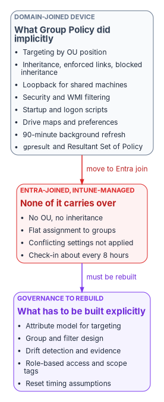
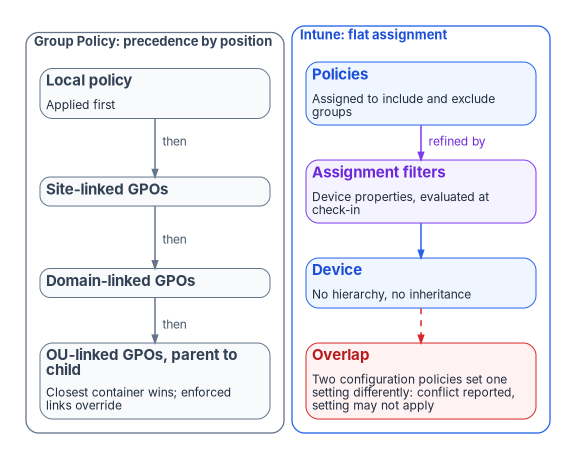

# Chapter 01 — Why Group Policy Can't Come to the Cloud

*Group Policy governed devices by where they sat in the directory, and a device that isn't in the directory has nowhere to sit.*

::: {.callout-note}
## In this chapter
What Group Policy did for a domain-joined fleet without anyone having to ask: placement-based targeting, inheritance, loopback, filtering, scripts, drive maps and preferences, refresh and troubleshooting. Why none of that machinery exists on a device that is joined to Microsoft Entra ID and managed by Intune, and what Intune offers in its place. The governance gaps the move opens, and why they have to be rebuilt deliberately rather than migrated.
:::

## Governance that came free with the domain

For more than two decades, a Windows device joined to an Active Directory domain received its configuration from Group Policy. Nobody had to design the governance model for that configuration. It came with the directory. A computer object sat in an organizational unit (OU), Group Policy Objects (GPOs) were linked to that OU and its parents, and the device applied them in a fixed order every time it started and every 90 minutes after that. Ask "why does this machine have this setting?" and the answer was its position in the tree.

That model doesn't survive the move to cloud-native endpoints. Microsoft's own planning guidance says it plainly: traditional policy enforcement using Group Policy isn't possible with cloud-native endpoints, which are joined to Microsoft Entra ID and not to an on-premises domain.[^c01-planning] An Entra-joined device has no computer object in an OU, no domain controller to read GPOs from, and no SYSVOL share. Intune can deliver most of the same settings, but it delivers them through a different targeting model, on a different schedule, with different conflict rules and different evidence.

The settings are the easy part. The hard part is everything Group Policy did implicitly around them.

{#fig-ch01-implicit-policy-machinery fig-alt="Three cards left to right. A grey card, domain-joined device, headed What Group Policy did implicitly, lists: targeting by OU position, inheritance with enforced links and blocked inheritance, loopback for shared machines, security and WMI filtering, startup and logon scripts, drive maps and preferences, a 90-minute refresh, and gpresult and Resultant Set of Policy. An arrow labelled move to Entra join leads to a red card, Entra-joined, Intune-managed device, headed None of it carries over, listing: no OU and no inheritance, flat assignment to groups, conflicting settings not applied, check-in about every eight hours. An arrow labelled must be rebuilt leads to a violet card, What has to be built explicitly, listing: an attribute model for targeting, group and filter design, drift detection and evidence, role-based access and scope tags, and reset timing assumptions."}

## What Group Policy did implicitly

Each of the mechanisms below did a governance job. Most organizations never wrote those jobs down, because the directory did them.

| Mechanism | What it did | The governance job it did silently |
|---|---|---|
| OU linking and processing order | GPOs apply in order: local, site, domain, then OUs from parent to child; each later policy can override an earlier one, and the container closest to the object wins[^c01-gp-processing] | The directory tree was the targeting model, and the answer to "why does this device have this setting?" |
| Inheritance, enforced links, block inheritance | Settings are inherited and cumulative down the tree. A link marked enforced can't be overridden by lower OUs, and blocking inheritance on an OU stops higher policy except enforced links[^c01-gp-processing] | Mandatory baselines at the top, local exceptions lower down, with precedence that could be reasoned about |
| Link order | When several GPOs link to one container, the link with the lowest link order wins by default[^c01-gp-processing] | Deterministic tie-breaking without a conflict report |
| Loopback processing | Applies user settings based on the computer a person signs in to, in merge or replace mode; intended for kiosks, classrooms, labs and Remote Desktop servers[^c01-gp-processing] | Shared and special-purpose machines behaved the same for everyone |
| Security filtering | A GPO applies only to principals granted both Read and Apply Group Policy[^c01-gp-scope] | Targeting by group membership on top of placement |
| WMI filters | A query evaluated on the computer at processing time; the GPO applies only if it returns true. One filter per GPO[^c01-gp-processing] | Targeting by hardware, OS version or local state |
| Startup, shutdown, logon and logoff scripts | Scripts run at startup and shutdown and at user logon and logoff[^c01-gp-processing] | Recurring, event-driven local enforcement and remediation |
| Group Policy Preferences, including drive maps | Preference extensions process items top to bottom, with item-level targeting; one GPO can hold many drive map items[^c01-gp-processing] | User environment, mapped drives, printers, registry and file items, each with its own targeting |
| Refresh | Computer policy at startup, user policy at logon, then a background refresh every 90 minutes plus a random offset of up to 30 minutes[^c01-gp-processing] | A known, short bound on how stale a device could be |
| Modeling and Results (RSoP, `gpresult`) | Simulates or reports the winning GPO for each setting, with precedence detail[^c01-gp-modeling] | An auditable explanation of the effective configuration |
| GPMC delegation | Linking a GPO, changing link order and blocking inheritance require modify rights on the site, domain or OU; by default only Domain Admins and Enterprise Admins have them[^c01-gpmc] | Change authority scoped to the same tree that scoped the policy |

Read down the right-hand column and a pattern appears. Group Policy wasn't only a settings engine. It was a targeting model, a precedence model, a delegation model, a timing guarantee and an evidence source, all derived from one structure: the OU tree. Book 02 makes the same argument for identity as a whole, that Active Directory governs by placement and Entra ID governs by attributes ([Chapter 02 of Book 02](../b02-identity/02-the-structural-problem.md)). For devices the consequence is concrete, because every device setting in the fleet was routed through that placement.

## Why none of it carries over

### There is no tree to sit in

Intune doesn't apply policy in local-site-domain-OU order. Policies are assigned to users and groups, and Microsoft describes the change as a shift in thinking that requires the users and groups to be in order first.[^c01-known-issues] There is no hierarchy, so there is no inheritance, no enforced link and no blocked inheritance. Precedence by position is gone, and nothing replaces it automatically.

The conflict rules change with it. When two Intune configuration policies set the same setting to different values, the conflict is shown in Intune and must be resolved manually; the setting can fail to apply.[^c01-conflicts] In Microsoft's GPO-to-settings-catalog walkthrough, the rule is stated directly: if two configuration profiles conflict, the setting isn't applied.[^c01-walkthrough] Compliance policies follow a different rule, where the most restrictive value applies, and compliance settings take precedence over the same setting in a configuration policy.[^c01-conflicts] Endpoint security policies, security baselines and settings catalog policies have equal priority; none outranks the others.[^c01-endpoint-security]

That is a different failure mode from Group Policy. A GPO conflict resolved silently in favor of the closer container. An Intune conflict surfaces as a status, and the device may end up with neither value until someone fixes the assignment.

{#fig-ch01-precedence-vs-assignment fig-alt="Two columns. Left column, grey, Group Policy: precedence by position. Four stacked boxes connected by arrows labelled then: local policy, site-linked GPOs, domain-linked GPOs, and OU-linked GPOs from parent to child. The last box notes that the closest container wins and enforced links override. Right column, blue, Intune: flat assignment. A box of policies assigned to include and exclude groups leads to a violet box, assignment filters evaluated at check-in, which leads to the device. A red box below the device reads: two configuration policies set one setting differently, so the conflict is reported and the setting may not apply."}

### The nearest equivalents, and what is different about them

| Group Policy mechanism | Nearest Intune mechanism | What is different |
|---|---|---|
| OU linking and inheritance | Assignment to included and excluded Entra groups | Flat; no precedence by position. Microsoft advises using the smallest group scope and refining with filters[^c01-assign] |
| Security filtering | Group include and exclude | Close in intent. Dynamic device groups need processing time before members appear[^c01-assign] |
| WMI filters | Assignment filters | Evaluated against device properties at enrollment and check-in, not by an arbitrary local query. Up to 200 filters per tenant, each up to 3,072 characters[^c01-filters] |
| Loopback | Assigning user-scope settings to device groups | Settings assigned to a device group apply to any user who signs in to that device;[^c01-admx-import] there is no merge or replace mode to choose |
| ADMX-backed Administrative Templates | Settings catalog; custom ADMX import | Built-in templates are in the settings catalog. Custom ADMX import is in public preview and doesn't support the combo box setting type[^c01-admx-import] |
| Startup and logon scripts | Platform scripts; Remediations | A platform script runs once and doesn't run again unless the script or policy changes; scripts time out after 30 minutes.[^c01-scripts] Remediations rerun on a schedule, every 24 hours by default[^c01-remediations] |
| Drive maps | None built in | Microsoft states cloud-native scenarios have no built-in solution for mapped network drives and recommends moving users to Teams, SharePoint and OneDrive, with scripts as a fallback[^c01-tutorial] |
| Background refresh every 90 to 120 minutes | Change-based notifications plus maintenance sync | Maintenance check-in is about every 8 hours, and a device gets at most one maintenance sync every 6.5 hours; change notifications can arrive immediately or take a few hours[^c01-conflicts] |
| RSoP and `gpresult` | Per-setting status reports; MDM diagnostic report | Reported from the service after check-in. Reports can lag the device's actual state[^c01-conflicts] |
| GPMC delegation per OU | Intune role-based access control and scope tags | Scope is a tag attached to objects, not a position in a tree. Imported GPOs themselves are visible only to admins who share the scope tag chosen at import[^c01-gpa] |

None of these is a bad replacement. Several are better: assignment filters don't depend on group membership processing, and a conflict that is reported is easier to fix than one that resolves invisibly. But every row moves a decision that Group Policy made from structure into a decision someone now has to make, document and keep current.

### Group Policy analytics measures the gap; it doesn't close it

Microsoft's on-ramp is Group Policy analytics in Intune. It imports GPO exports as XML, shows which settings have an MDM equivalent as an "MDM Support" percentage, flags deprecated and unsupported settings, and can migrate supported settings into a settings catalog policy.[^c01-gpa] It parses the Policy, PassportForWork, BitLocker, Firewall and AppLocker CSPs and Group Policy Preferences. Each XML file must be under 4 MB, and the tool supports non-ADMX settings only in English, so a non-English GPO produces an inaccurate MDM Support percentage.[^c01-gpa]

The Migrate step is, in Microsoft's words, best effort. AppLocker and firewall rule settings can't be migrated this way and belong in endpoint security policy. Some settings map to a different setting with a similar effect, some fail, and conflicting values across GPOs must be resolved before the policy can be created.[^c01-gpa-migrate]

Figures such as "30 to 60 percent of settings have a direct Intune equivalent" circulate, but Microsoft publishes no such figure, and the percentage depends entirely on what is in a given estate's GPOs. The Federal Modernization Program doesn't quote a number: run Group Policy analytics against the estate's own exports and read the result. The program's GPO triage script (`Invoke-GpoMigrationTriage.ps1`, used in [Chapter 07](07-the-gpo-sunset-program.md)) classifies every live GPO onto a target plane, Intune for workstations and Azure Arc for servers, so the unmappable surface is named early rather than discovered late.

Microsoft's guidance also argues against translating at all. Migrating existing Group Policy settings to MDM isn't the preferred approach; the intent shouldn't be to lift and shift. Identify the mandatory settings, compare those against MDM, and treat the gaps as blockers to resolve.[^c01-tutorial] The program's name for this is *regenerate, not copy*: the GPO-to-Intune mapping is a semantic translation reference that answers "what is the closest equivalent of this setting?", and the replacement policy is written for the modern control plane rather than copied setting by setting. [Chapter 08](08-gpo-to-intune-policy-migration.md) and [Appendix A](appendix-a-gpo-to-intune-crosswalk.md) carry the mapping.

### Running both is not a safe middle ground

A hybrid-joined device can take policy from GPOs, from Intune, or from both. Microsoft notes the combination is possible but adds administrative overhead and complexity.[^c01-join-types] It also adds precedence rules that nobody sees. Since Windows 10 version 1709, when the same policy is configured through Group Policy and MDM, Group Policy takes precedence.[^c01-gp-enroll] The `MDMWinsOverGP` setting reverses that, but only for policies in the Policy CSP. For equivalent settings defined in other CSPs, such as Defender, Microsoft warns there is a race condition and no guarantee which one wins.[^c01-mdmwins] Windows Hello for Business is one of those exceptions: it is configured through the PassportForWork CSP, and mixing GPO and CSP settings for it leaves the CSP settings unapplied until the Group Policy settings are cleared.[^c01-whfb]

The coexistence period is often described as "last writer wins." For a GPO and an MDM policy on the same hybrid device, the reality is worse than that: Group Policy wins by default, MDM wins where `MDMWinsOverGP` applies, and outside the Policy CSP the result is a race. For two Intune policies the description is simply wrong; the conflict is reported and the setting may not apply. The practical rule is the same in every case: document each overlapping setting before Intune policy reaches production, and retire the GPO copy as soon as Intune owns the setting.

Configuration Manager estates have one more layer. Co-management moves seven workloads, individually or together, from Configuration Manager to Intune: compliance policies, Windows Update policies, resource access policies, Endpoint Protection, device configuration, Office Click-to-Run apps and client apps. Switching device configuration also moves resource access and Endpoint Protection.[^c01-comanage] The workload slider decides which authority owns each area, and it is a second place where "who controls this setting?" has to be answered explicitly.

## The governance gaps this opens

None of the gaps below is a reason to stay on Group Policy. They are the governance surface that has to be re-created intentionally on the cloud side rather than assumed. The analysis is the program's own.

| Gap | Under Group Policy | Under Intune and Entra ID by default | What has to be built |
|---|---|---|---|
| Targeting rationale | OU position, GPO links and inheritance explained every setting | Many groups, filters and assignments; the "why" is spread across rules | A canonical attribute model that groups and filters derive from, so targeting is reproducible |
| One source of truth for applicability | OU membership | Group membership and filter rules, often maintained by hand | Groups generated from authoritative attributes, not spreadsheets |
| Coverage of legacy and complex settings | The full ADMX and Preferences surface | The supported subset, plus scripts and custom profiles | A per-setting decision: regenerate, replace with a modern control, accept the loss, or hold a temporary GPO island |
| Visibility and drift | RSoP and `gpresult`, near-immediate | Per-setting status after check-in; no native cross-plane comparison | Continuous comparison of declared against observed state, with drift raised as findings |
| Delegation and audit | OU-scoped rights to create, edit and link GPOs | Intune roles and scope tags, a different shape | A delegation model mapped from the old OU boundaries, so scope is canonical rather than rebuilt admin by admin |
| Enforcement timing | 90 to 120 minute refresh, cached, offline-capable | Check-in about every 8 hours plus change notifications | Operations and incident runbooks reset to the new timing |
| Portability | Governance lived in the on-premises structure | Groups and filters are tenant-specific | Governance held as declared state that can be re-applied, not only as portal configuration |

The organizations that feel these gaps first and hardest are the ones trying to keep or improve deterministic, auditable governance through the transition, which describes most regulated environments. They tend to discover the cost after the targeting model has already changed underneath them. Delegation without OUs is covered for identity in [Chapter 05 of Book 02](../b02-identity/05-delegation-without-ous.md); the same structure carries device administration, and [Chapter 06](06-who-owns-the-endpoint.md) assigns who owns it. Device compliance as an access signal, the point where device governance meets Conditional Access, belongs to [Book 04](../b04-access/index.md).

## How the move actually goes

In the program's experience, progress is real but slow and uneven, especially for large and regulated estates. The pattern it plans for is this:

- **Phased and multi-year.** Estates with hundreds or thousands of GPOs, legacy applications and intricate OU structures move in waves, with recurring weekly or monthly migration work rather than a cutover. GPO rationalization and cleanup usually come before migration, not after.
- **A long co-management or hybrid period.** Many organizations stay there longer than planned, because unmapped settings, application dependencies and testing load accumulate.
- **Predictable blockers.** Testing burden, conflicts during coexistence, the skills shift from GPO administration to endpoint management, and the targeting-model change described above.
- **Slower still in federal environments.** Compliance validation, government-cloud considerations and the need for auditable governance throughout the transition push many agencies to build a governance layer on top of the Microsoft surfaces rather than rely on the native defaults alone.

The migration is rarely a lift-and-shift. It changes the nature of policy governance from hierarchical and on-premises to attribute-driven and cloud-native. Organizations that plan only for licenses and tools tend to find they also need governance architecture to keep control and visibility. The rest of this book is that architecture: where device data lives ([Chapter 03](03-where-device-and-server-data-lives.md)), how new devices are onboarded under governance from day one ([Chapter 04](04-intune-first-onboarding.md)), and how the existing fleet's GPOs are retired ([Chapter 07](07-the-gpo-sunset-program.md)). The policy view of the same transition is also in the Client-Server to Hybrid-Cloud series, [Book 01, Chapter 05 — Policy Transformation](../b01-transformation-arc/05-policy-transformation.md).

::: {.callout-important}
## The Why in five sentences
Group Policy governed devices by their position in the OU tree, and that position quietly supplied targeting, precedence, delegation, timing and evidence. An Entra-joined, Intune-managed device has no position: policy is assigned flatly to groups, overlapping settings become conflicts, and devices check in about every eight hours. Intune can deliver most settings, but Microsoft itself advises against copying GPOs and offers no built-in answer for some of them, such as mapped drives. Every governance job the tree did implicitly has to be rebuilt explicitly, starting with an attribute model that targeting can derive from. Organizations that treat the move as a settings migration discover the governance loss after the targeting model has already changed.
:::

## What this chapter establishes

1. Group Policy's value was never only its settings. It was a governance model derived from OU placement.
2. Cloud-native endpoints can't use Group Policy, and Intune replaces placement with flat assignment, reported conflicts and a slower check-in cycle.
3. Group Policy analytics measures how many settings have an MDM equivalent in a given estate; it doesn't close the governance gap, and Microsoft recommends rebuilding from requirements rather than migrating GPOs.
4. Running GPO and MDM on the same setting is a race, so coexistence needs a written list of overlaps and a retirement date for each.
5. The gaps in targeting, coverage, drift visibility, delegation, timing and portability must be rebuilt on purpose. [Chapter 02](02-the-hybrid-join-trap.md) shows what happens when the fleet's device identity is changed without doing so.

::: {.callout-tip}
## Continue the book
[Book index](index.md) · [Next: Chapter 02 — The Hybrid Join Trap →](02-the-hybrid-join-trap.md)
:::

[^c01-planning]: Microsoft Learn, "High level planning guide to move to cloud-native endpoints," section "Review your endpoint and user workloads," <https://learn.microsoft.com/intune/solutions/cloud-native-endpoints/planning-guide> (accessed Oct 20, 2026).
[^c01-gp-processing]: Microsoft Learn, "Group Policy processing," <https://learn.microsoft.com/en-us/windows-server/identity/ad-ds/manage/group-policy/group-policy-processing> (accessed Oct 20, 2026).
[^c01-gp-scope]: Microsoft Learn, "Group Policy scope," section "GPO filtering," <https://learn.microsoft.com/windows-server/identity/ad-ds/manage/group-policy/group-policy-scope> (accessed Oct 20, 2026).
[^c01-gp-modeling]: Microsoft Learn, "Group Policy Modeling and Group Policy Results," <https://learn.microsoft.com/windows-server/identity/ad-ds/manage/group-policy/group-policy-modeling-results> (accessed Oct 20, 2026).
[^c01-gpmc]: Microsoft Learn, "Group Policy Management Console," section "Prerequisites," <https://learn.microsoft.com/windows-server/identity/ad-ds/manage/group-policy/group-policy-management-console> (accessed Oct 20, 2026).
[^c01-known-issues]: Microsoft Learn, "Known issues and limitations with cloud-native endpoints," section "Group Policy Objects might not apply," <https://learn.microsoft.com/intune/solutions/cloud-native-endpoints/troubleshoot> (accessed Oct 20, 2026).
[^c01-conflicts]: Microsoft Learn, "Common questions, answers, and scenarios with policies and profiles in Microsoft Intune," sections "Policy refresh intervals" and "Conflicts," <https://learn.microsoft.com/intune/device-configuration/troubleshoot-device-profiles> (accessed Oct 20, 2026).
[^c01-walkthrough]: Microsoft Learn, "Walkthrough - Create an Intune settings catalog policy and compare with on-premises ADMX," section "Create groups, and add users," <https://learn.microsoft.com/intune/device-configuration/settings-catalog/tutorial-group-policy-migration> (accessed Oct 20, 2026).
[^c01-endpoint-security]: Microsoft Learn, "Manage device security with endpoint security policies in Microsoft Intune," section "Manage policy conflicts," <https://learn.microsoft.com/intune/device-configuration/endpoint-security/manage-policies> (accessed Oct 20, 2026).
[^c01-assign]: Microsoft Learn, "Assign policies in Microsoft Intune," section "Exclude groups from a policy assignment," <https://learn.microsoft.com/intune/device-configuration/assign-device-profile> (accessed Oct 20, 2026).
[^c01-filters]: Microsoft Learn, "Use assignment filters to assign your apps, policies, and profiles in Microsoft Intune," <https://learn.microsoft.com/intune/fundamentals/filters/overview> (accessed Oct 20, 2026).
[^c01-admx-import]: Microsoft Learn, "Import custom ADMX and ADML administrative templates into Microsoft Intune (public preview)," <https://learn.microsoft.com/intune/device-configuration/settings-catalog/import-custom-admx-templates> (accessed Oct 20, 2026).
[^c01-scripts]: Microsoft Learn, "Use PowerShell scripts on Windows devices in Intune," section "Before you begin," <https://learn.microsoft.com/intune/device-management/tools/run-powershell-scripts-windows> (accessed Oct 20, 2026).
[^c01-remediations]: Microsoft Learn, "Remediations," section "Create and deploy custom script packages," <https://learn.microsoft.com/intune/device-management/tools/deploy-remediations> (accessed Oct 20, 2026).
[^c01-tutorial]: Microsoft Learn, "Tutorial: Set up cloud-native Windows endpoints with Microsoft Intune," Phase 4, sections "Apply customizations and review your on-premises configuration" and "Mapping Network Drives and Printers," <https://learn.microsoft.com/intune/solutions/cloud-native-endpoints/tutorial-cloud-native-setup> (accessed Oct 20, 2026).
[^c01-gpa]: Microsoft Learn, "Import and analyze your on-premises GPOs using Group Policy analytics in Microsoft Intune," <https://learn.microsoft.com/intune/device-configuration/import-group-policy-analytics> (accessed Oct 20, 2026).
[^c01-gpa-migrate]: Microsoft Learn, "Create a Settings Catalog policy using your imported GPOs in Microsoft Intune," section "What you need to know," <https://learn.microsoft.com/intune/device-configuration/migrate-group-policy> (accessed Oct 20, 2026).
[^c01-join-types]: Microsoft Learn, "Microsoft Entra joined vs. Hybrid Microsoft Entra joined in cloud-native endpoints," section "Common questions, answers, and scenarios," <https://learn.microsoft.com/intune/solutions/cloud-native-endpoints/entra-join-types> (accessed Oct 20, 2026).
[^c01-mdmwins]: Microsoft Learn, "Policy CSP - ControlPolicyConflict," section "MDMWinsOverGP," <https://learn.microsoft.com/windows/client-management/mdm/policy-csp-controlpolicyconflict> (accessed Oct 20, 2026).
[^c01-gp-enroll]: Microsoft Learn, "Enroll a Windows device automatically using Group Policy," <https://learn.microsoft.com/windows/client-management/enroll-a-windows-10-device-automatically-using-group-policy> (accessed Oct 20, 2026).
[^c01-whfb]: Microsoft Learn, "Configure Windows Hello for Business," section "Policy conflicts from multiple policy sources," <https://learn.microsoft.com/windows/security/identity-protection/hello-for-business/configure> (accessed Oct 20, 2026).
[^c01-comanage]: Microsoft Learn, "Co-management workloads," <https://learn.microsoft.com/intune/configmgr/comanage/workloads> (accessed Oct 20, 2026).
