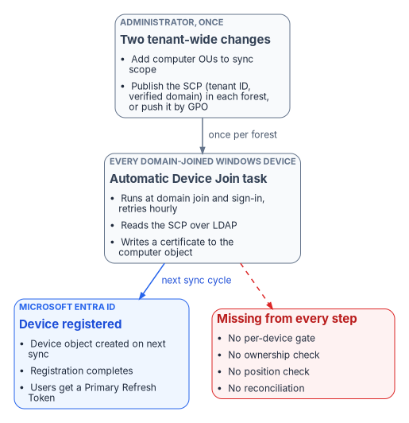
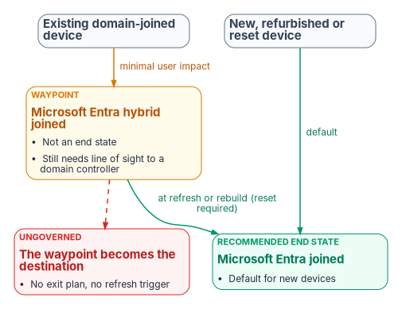

# Chapter 02 — The Hybrid Join Trap

*The mechanism that converts a whole fleet to hybrid join needs almost no governance, which is exactly why the governance gets skipped.*

::: {.callout-note}
## In this chapter
Why a control scored as a multi-quarter program, "all sign-in activity comes from managed devices," can be satisfied on paper by a near-effortless tenant switch. How the switch works, step by step. What Microsoft now recommends for new and existing devices, and why hybrid join is a waypoint rather than an end state. The loss ledger an ungoverned flip runs up, what hybrid join never covers, and the governed path that reaches the same end state with every change owned and evidenced.
:::

## A program that turns out to be a switch

A common Zero Trust baseline control reads, in full, "All sign-in activity comes from managed devices." In practice it is satisfied by Conditional Access policy that grants access only from a device that is marked compliant by Intune or is Microsoft Entra hybrid joined. Microsoft publishes exactly that policy as a template, with the grant controls "Require device to be marked as compliant" and "Require Microsoft Entra hybrid joined device" and the instruction to create it in report-only mode first.[^c02-ca-policy]

Assessments usually score the control as a multi-quarter program, gated on device inventory, device management and join maturity. What makes it a program isn't the toggle. It is the twenty years of Active Directory entanglement the toggle sits on. Converting the domain-joined Windows fleet to hybrid join, the step that makes the Conditional Access control satisfiable for that fleet, is at the mechanism level close to a single tenant-wide switch. The trap is treating the switch as if it were the program.

The illustration used in this chapter is a fleet of 50,000 domain-joined Windows devices. The number is a framing device, not a real engagement; the mechanism is the same at 5,000 or 500,000.

## How the fleet converts itself

Microsoft's configuration path for hybrid join has few steps, and none of them is per device.[^c02-configure]

1. **Synchronize the computer objects.** The synchronization service is almost certainly already syncing users. Extend its scope to the OUs that hold the computer objects, and don't exclude the default device attributes. Microsoft Entra Connect (version 1.1.819.0 or later) has a wizard for the whole configuration.[^c02-configure] Microsoft Entra Cloud Sync can also synchronize computer objects for hybrid join, though it doesn't configure federation.[^c02-concept-hj]
2. **Publish the service connection point (SCP).** The SCP is an object in each forest's configuration naming context that carries two keywords: the tenant ID and a verified domain name. It must exist in every forest that contains domain-joined computers.[^c02-manual] Entra Connect writes it for each forest, using enterprise administrator credentials for that forest.[^c02-configure] The alternative, which Microsoft documents for targeted rollouts, is a GPO that writes the same two values (`TenantId` and `TenantName`) into each computer's registry under `HKLM\SOFTWARE\Microsoft\Windows\CurrentVersion\CDJ\AAD`, linked to the OUs in the rollout population.[^c02-control]
3. **Let the devices register themselves.** On every Windows 10 or later domain-joined computer, the built-in Automatic Device Join task runs on domain join and at user sign-in and retries every hour. It reads the SCP over LDAP, and in a managed (non-federated) domain it writes a self-signed certificate to the computer object's `userCertificate` attribute. On the next sync cycle the sync service carries that certificate to Microsoft Entra ID, a device object is created, and the task completes registration and installs a device certificate.[^c02-reg-how] Until registration completes, the synced object shows as Pending.[^c02-control]
4. **Users get cloud single sign-on.** At the next Windows sign-in on a hybrid-joined device, the user receives a Primary Refresh Token (PRT), the token behind single sign-on to Entra-protected resources.[^c02-prt]

That is the whole mechanism. One synchronization scope change, one SCP per forest or one GPO, and the estate starts changing state on its own schedule. There is no per-device approval, no ownership check, no check of where the device sits in the organization and no reconciliation step anywhere in the path. The program's design position is that this effortlessness is the hazard. The control's intent, that every sign-in comes from a known, owned and managed device, gets turned into 50,000 state changes that nobody can later attribute.

{#fig-ch02-the-flip fig-alt="Left to right. A grey card, administrator, two tenant-wide changes: add computer OUs to the sync scope, and publish the SCP with tenant ID and verified domain in each forest, or push it by GPO. An arrow labelled once per forest leads to a grey card, every domain-joined Windows device: the Automatic Device Join task runs at domain join and sign-in and retries hourly, reads the SCP, and writes a certificate to the computer object. An arrow labelled next sync cycle leads to a blue card, Microsoft Entra ID: device object created, registration completes, users get a Primary Refresh Token. A dashed red line from the device card leads to a red card, missing from every step: no per-device gate, no ownership check, no position check, no reconciliation."}

Microsoft doesn't recommend flipping the whole estate at once. Its own guidance is a targeted deployment first, with a pilot group drawn from varying roles and profiles, so that issues the plan didn't anticipate surface before the whole organization is enabled.[^c02-plan] The ungoverned path is what happens when that advice is skipped, or when the SCP is published for one reason and every device in the forest starts registering as a side effect.

## What Microsoft recommends now

Microsoft's guidance on join type is explicit and has two halves.[^c02-join-types]

| Device situation | Microsoft's recommendation | Why |
|---|---|---|
| New, refurbished, refreshed or reset Windows devices | Microsoft Entra join, as the default | Modern management and authentication are built into Windows; hybrid join for new devices is typically not recommended and may not get the modern features |
| Existing devices already joined to an on-premises domain | Microsoft Entra hybrid join | Gives the device a cloud identity with minimal impact on the user |
| Long-term or end-state device identity | Not hybrid join | Hybrid join shouldn't be long term or the end goal; organizations not otherwise restricted should be moving, or planning to move, to Entra join |

The same direction appears elsewhere. Windows Autopilot documentation says Microsoft recommends deploying new devices as cloud-native with Entra join, and that deploying new devices as hybrid joined, including through Autopilot, isn't recommended.[^c02-autopilot-hybrid] Entra ID's device planning guidance calls Entra join the first choice for new devices and notes that Entra-joined devices can still single sign-on to on-premises file, print and application servers when they are on the organization's network.[^c02-plan-devices]

Two facts make hybrid join sticky once it is in place. There is no Microsoft-supported path to convert an existing domain-joined or hybrid-joined device to Entra join without resetting Windows, and Autopilot Reset doesn't support hybrid-joined devices, so the reset is a full wipe. Microsoft therefore recommends moving at a complementary event, such as a hardware refresh, an OS upgrade or a troubleshooting rebuild.[^c02-join-types] Hybrid join also inherits the domain's dependencies. Hybrid-joined devices need periodic line of sight to a domain controller; without it, device and user password changes and TPM resets break, and Microsoft warns the devices become unusable.[^c02-plan] If the organization is moving away from an on-premises domain, it has to move away from hybrid join too.[^c02-join-types]

That is the trap in full. Hybrid join is Microsoft's recommended waypoint for devices that already exist. Done as an ungoverned switch, it becomes the destination by default: the fleet keeps every on-premises dependency, adds a second and third system of record, and has no plan for the refresh events that would carry it to Entra join.

{#fig-ch02-join-paths fig-alt="Left to right. A grey box, existing domain-joined device, leads by an arrow labelled minimal user impact to an amber card tagged waypoint, Microsoft Entra hybrid joined: not an end state, still needs line of sight to a domain controller. From the amber card an arrow labelled at refresh or rebuild, reset required, leads to a green card tagged recommended end state, Microsoft Entra joined, the default for new devices. A separate grey box, new, refurbished or reset device, leads directly to the green card by an arrow labelled default. A dashed red line from the amber card leads to a red card tagged ungoverned: the waypoint becomes the destination, with no exit plan and no refresh trigger."}

## The loss ledger

Classic Active Directory was a creaky governance system, but it was one. A computer object lived in an OU, had a delegated administration lineage, and was visible in the same console that governed everything else. An ungoverned hybrid-join flip keeps the connectivity benefit, cloud single sign-on and Conditional Access eligibility, and quietly discards the governance underneath. It also splits one machine's truth across three systems of record: Active Directory holds the computer object, Entra ID holds the device object and its tokens, and Intune holds compliance state. Nothing reconciles them by default.

| What classic Active Directory provided | What an ungoverned flip loses | What governed reconciliation restores |
|---|---|---|
| Ownership: each computer object sat in an OU with a delegated admin lineage | New cloud device objects appear with no mapping to an owner or an organizational position; "who owns this device, and in which part of the organization?" is unanswerable at scale | Every governed device carries organizational attributes, and ownership and scope are derived from them |
| One object per machine | Duplicate and phantom records. A domain-joined device whose user once added a work account is also Entra registered, and the dual state can produce nondeterministic Conditional Access evaluation on older Windows builds.[^c02-faq] Moving a computer object out of sync scope deletes its Entra device; moving it back creates a new Pending object that won't complete registration until the device re-registers[^c02-pending] | Divergence between the three records is detected and resolved against the authoritative source |
| Scoped, gradual rollout: Group Policy applied per OU, in waves | Enforcing "require compliant or hybrid joined device" before registration has finished fleet-wide locks users out. Microsoft's own template is created in report-only mode and excludes emergency-access accounts for this reason[^c02-ca-policy] | Device-state change is treated as a high-blast-radius operation: report-only baking, then gated enforcement with a human approver |
| Provenance: changes were at least logged in one directory | Each of 50,000 state changes happens with no signed, attributable record of why and under whose authority | Each plan, apply and reconcile step emits signed evidence; an unattributable state is itself a finding |
| Lifecycle: a join and leave process, however imperfect | Hybrid-joined devices are supposed to follow the on-premises stale-device policy, and deleting one only in Entra ID resynchronizes it as a new Pending object.[^c02-stale] Without a policy, retired machines linger and inflate the "managed" count | Lifecycle reconciled against the authoritative source; stale objects surface for review rather than accumulating |
| A single console of record | Three planes, three consoles, no reconciliation. Deleting a device object also deletes the BitLocker recovery keys stored on it[^c02-stale] | The control plane reconciles all three; Entra ID and Intune remain the planes that authenticate and enforce |
| An explicit line-of-sight assumption | The dependency on reaching a domain controller is left implicit; remote and VPN-only users fail on password change and TPM reset until devices become unusable[^c02-plan] | The dependency is recorded as a known limit and drives the target state, Entra join, instead of being discovered as an outage |

The pattern across every row is the same. The ungoverned flip keeps the runtime benefit and spends the truth-and-accountability layer. The ownership, provenance and reconciliation rows are the program's analysis; the duplicate, lockout, lifecycle and line-of-sight rows are documented Microsoft behavior.

## What hybrid join never covers

Even a flawless hybrid-join rollout doesn't by itself satisfy "all sign-in activity comes from managed devices." Hybrid join applies to domain-joined Windows: Windows 11 and Windows 10 (except Home editions) and Windows Server 2016, 2019 and 2022.[^c02-concept-hj] Domain controllers can't be hybrid joined, and Server Core supports no device registration at all.[^c02-plan] The control's denominator is much larger:

- **macOS, iOS, Android and Linux** need Entra join (supported for macOS 13 or newer and for current Ubuntu and Red Hat Enterprise Linux LTS releases), registration, or Intune enrollment with a compliance policy, not hybrid join.[^c02-entra-join]
- **Personal devices, contractors and guests** are never hybrid joinable.
- **Servers, virtual desktops, shared kiosks and service accounts** each need their own posture decision; servers are the subject of [Chapter 09](09-servers-under-azure-arc.md).

The population an assessment is really probing is the slice that a Windows-only flip makes invisible behind a green checkmark. The program's answer is to make endpoint onboarding a governed, Intune-first discipline across every platform ([Chapter 04](04-intune-first-onboarding.md)), so the uncovered surface shows up as a gap. The Conditional Access side of the control, including compliance as an access signal, is in [Book 04](../b04-access/index.md), and Windows Hello for Business on the device is in [Chapter 10 of Book 02](../b02-identity/10-migrating-and-governing.md).

## The governed path

The governed path reaches the identical technical outcome: devices hybrid joined, Conditional Access enforcing managed-device sign-in. The difference is that the bulk state change runs through an active reconciliation control plane instead of being left to the provider to apply unattended. The control plane holds desired state, observes actual state, classifies drift and reconciles toward intent; Entra ID and Intune remain the planes that authenticate and enforce at runtime. This is the program's design, described in full in [Chapter 05](05-the-governed-manual-and-retrofit-paths.md).

1. **Address before you actuate.** Every device to be converted carries organizational attributes that express its position, so the rollout can be scoped, sequenced and audited in the same terms as every other plane, not by guessing from OU names.
2. **Cap the blast radius by class.** "Tenant-wide device-state change" and "Conditional Access enforcement change" are high-blast-radius operation classes that stay gated on human approval. One wrong Conditional Access toggle touching 50,000 devices is the case the ceiling exists for.

   | Rung | Name | Behavior for this operation class |
   |---|---|---|
   | L0 | Record | Desired state (hybrid-join target, Conditional Access intent) recorded in the authoritative source |
   | L1 | Observe | Actual join state collected per device and drift detected; read-only |
   | L2 | Advise | Wave plan and report-only Conditional Access change set generated and surfaced; no writes |
   | L3 | Gated actuation | A human approves each wave, and the control plane executes it through the provider API. The default ceiling for high-blast-radius classes |
   | L4 | Autonomous | Not permitted for this class; permanently capped |

3. **Run each wave through plan and apply, not ad hoc scripts.** The plan step compares declared target state with observed state and returns a list of operations without making a single API call. Apply in dry-run mode evaluates every operation and records it as would-send; nothing reaches the provider. Promotion out of dry-run is a separate, explicit call that an operator makes per wave after review, and certain operation classes always require human sign-off.
4. **Bake the enforcement.** Conditional Access runs in report-only mode first. Report-only policies are evaluated at sign-in but not enforced, and their results are logged in the sign-in logs,[^c02-report-only] which gives the coverage data: before any wave moves to enforcement, "registered and compliant" coverage is reconciled against the attribute-scoped target population, so the lockout failure mode can't happen silently.
5. **Reconcile duplicates and lifecycle.** Phantom, dual-state and stale device objects are classified as drift and resolved against the authoritative source rather than left to inflate the managed-device count.
6. **Produce evidence an authorizing official can sign.** Every wave produces signed plan, apply and reconcile evidence. The accreditation sentence isn't "it enforces managed-device sign-in" but "this operation class is gated, with a dry-run record and a rollback." [Chapter 10](10-operating-and-evidencing-the-fleet.md) covers the evidence.
7. **Cover the whole denominator.** Non-Windows, personal and guest surfaces go through Intune-first onboarding, so the control is satisfied for its real population and not only for the Windows slice.
8. **Plan the exit from the waypoint.** Each hybrid-joined device carries a target of Entra join and a trigger event, such as its refresh date, so the waypoint doesn't become the destination.

The end state matches the ungoverned flip. The difference is that each of the 50,000 changes is owned, addressable, attributable, reversible and accredited. The loss ledger is paid down instead of run up.

## What to do first

1. Find out whether the ungoverned path is already live: whether an SCP exists in any forest's configuration partition or is pushed by GPO, whether computer OUs are in sync scope, and since when.
2. Run the fleet against the loss ledger, duplicates, stale objects, unowned devices and line-of-sight users, before any Conditional Access policy enforces managed-device sign-in.
3. Name the wave owner who holds the plan, the approvals and the rollback. [Chapter 06](06-who-owns-the-endpoint.md) sets out who that is.
4. Run the first wave in report-only mode, scoped by organizational attributes, and gate the move to enforcement on coverage data.

## What this chapter establishes

1. Hybrid join of an existing domain-joined fleet is close to a tenant-wide switch: a sync-scope change and an SCP, after which devices register themselves with no per-device gate.
2. Microsoft recommends Entra join for new and reset devices and hybrid join only as a low-impact step for existing domain-joined devices, never as the end state; converting a hybrid-joined device later requires a reset.
3. Taken ungoverned, the flip keeps the runtime benefit and spends ownership, single-record integrity, staged rollout, provenance, lifecycle and the explicit domain-controller dependency.
4. Hybrid join covers only domain-joined Windows, so a managed-device control needs Intune-first onboarding for everything else.
5. The governed path reaches the same end state with every change owned, gated and evidenced. The What part of this book starts with where that evidence and the device data live, in [Chapter 03](03-where-device-and-server-data-lives.md).

::: {.callout-tip}
## Continue the book
[← Previous: Chapter 01 — Why Group Policy Can't Come to the Cloud](01-why-group-policy-cant-come-to-the-cloud.md) · [Book index](index.md) · [Next: Chapter 03 — Where Device and Server Data Lives →](03-where-device-and-server-data-lives.md)
:::

[^c02-ca-policy]: Microsoft Learn, "Require a compliant device, Microsoft Entra hybrid joined device, or multifactor authentication for all users," <https://learn.microsoft.com/entra/identity/conditional-access/policy-alt-all-users-compliant-hybrid-or-mfa> (accessed Oct 20, 2026).
[^c02-configure]: Microsoft Learn, "Configure Microsoft Entra hybrid join," <https://learn.microsoft.com/en-us/entra/identity/devices/how-to-hybrid-join> (accessed Oct 20, 2026).
[^c02-concept-hj]: Microsoft Learn, "Microsoft Entra hybrid joined devices," <https://learn.microsoft.com/entra/identity/devices/concept-hybrid-join> (accessed Oct 20, 2026).
[^c02-manual]: Microsoft Learn, "Configure Microsoft Entra hybrid join manually," section "Configure a service connection point," <https://learn.microsoft.com/entra/identity/devices/hybrid-join-manual> (accessed Oct 20, 2026).
[^c02-control]: Microsoft Learn, "Microsoft Entra hybrid join targeted deployment," <https://learn.microsoft.com/en-us/entra/identity/devices/hybrid-join-control> (accessed Oct 20, 2026).
[^c02-reg-how]: Microsoft Learn, "How it works: Device registration," section "Microsoft Entra hybrid joined in Managed environments," <https://learn.microsoft.com/entra/identity/devices/device-registration-how-it-works> (accessed Oct 20, 2026).
[^c02-prt]: Microsoft Learn, "Understanding Primary Refresh Token (PRT)," section "How is a PRT issued?," <https://learn.microsoft.com/entra/identity/devices/concept-primary-refresh-token> (accessed Oct 20, 2026).
[^c02-plan]: Microsoft Learn, "Plan your Microsoft Entra hybrid join implementation," <https://learn.microsoft.com/en-us/entra/identity/devices/hybrid-join-plan> (accessed Oct 20, 2026).
[^c02-join-types]: Microsoft Learn, "Microsoft Entra joined vs. Hybrid Microsoft Entra joined in cloud-native endpoints," section "Which option is right for your organization," <https://learn.microsoft.com/intune/solutions/cloud-native-endpoints/entra-join-types> (accessed Oct 20, 2026).
[^c02-autopilot-hybrid]: Microsoft Learn, "Deploy Microsoft Entra hybrid joined devices by using Intune and Windows Autopilot," <https://learn.microsoft.com/autopilot/windows-autopilot-hybrid> (accessed Oct 20, 2026).
[^c02-plan-devices]: Microsoft Learn, "Plan your Microsoft Entra device deployment," section "Microsoft Entra join," <https://learn.microsoft.com/entra/identity/devices/plan-device-deployment> (accessed Oct 20, 2026).
[^c02-faq]: Microsoft Learn, "Microsoft Entra device management FAQ," section "Microsoft Entra hybrid join FAQ," <https://learn.microsoft.com/entra/identity/devices/faq> (accessed Oct 20, 2026).
[^c02-pending]: Microsoft Learn, "Pending devices in Microsoft Entra ID," <https://learn.microsoft.com/troubleshoot/entra/entra-id/dir-dmns-obj/pending-devices> (accessed Oct 20, 2026).
[^c02-stale]: Microsoft Learn, "How To: Manage stale devices in Microsoft Entra ID," <https://learn.microsoft.com/entra/identity/devices/manage-stale-devices> (accessed Oct 20, 2026).
[^c02-entra-join]: Microsoft Learn, "Microsoft Entra joined devices," <https://learn.microsoft.com/entra/identity/devices/concept-directory-join> (accessed Oct 20, 2026).
[^c02-report-only]: Microsoft Learn, "Analyze Conditional Access policy impact," section "Overview," <https://learn.microsoft.com/entra/identity/conditional-access/concept-conditional-access-report-only> (accessed Oct 20, 2026).
