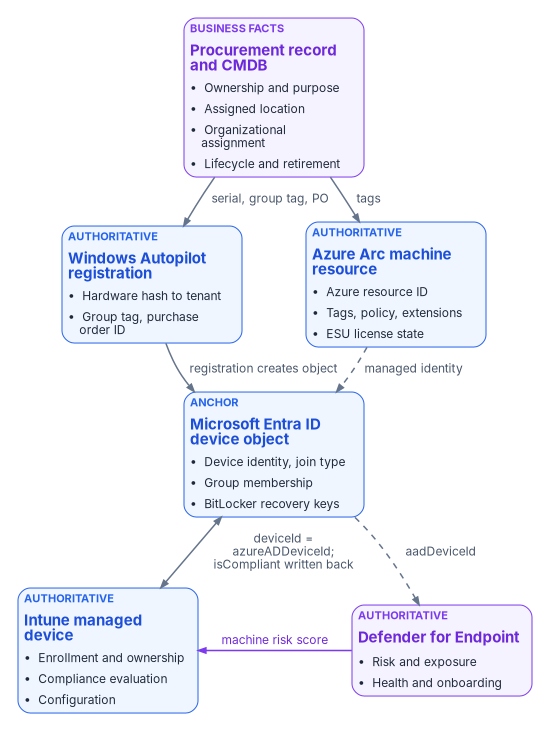
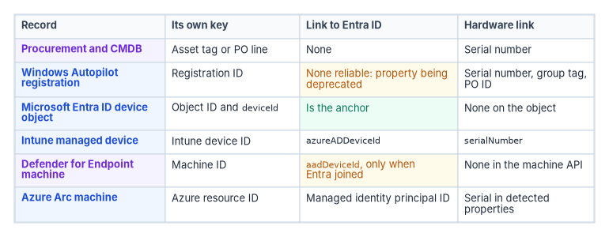

# Chapter 03 — Where Device and Server Data Lives

*A device in the cloud isn't one record but six, and governance holds only when each fact has exactly one place where it's true.*

::: {.callout-note}
## In this chapter
The authority map for devices and servers: which system owns each fact, which systems hold only derived copies, and which must never be treated as a source of truth. What each Microsoft record (Entra ID device object, Intune managed device, Windows Autopilot registration, Azure Arc machine resource, Defender for Endpoint machine) is actually authoritative for. The keys that tie the records together, the places they break, and a read-only script that correlates them.
:::

In an Active Directory estate a computer had one record that mattered. The computer object sat in an OU, the OU decided which Group Policy Objects applied, and the domain controller was both the directory and the enforcer ([Chapter 01](01-why-group-policy-cant-come-to-the-cloud.md)). After modernization the same laptop is described by a procurement record, a Windows Autopilot registration, a Microsoft Entra ID device object, an Intune managed-device record and a Defender for Endpoint machine entry. A server adds an Azure Arc resource in Azure Resource Manager. Each record is maintained by a different service on a different schedule, and most of them can be edited by someone.

That's manageable only if the program decides, fact by fact, where the truth lives. This chapter extends the identity data-location model in Book 02 ([Chapter 03 of Book 02](../b02-identity/03-ad-and-entra-side-by-side.md)) to devices and Azure resources. For each kind of fact it names the authoritative origin, the derived pointers that copy it, and the systems that must not be treated as the source.

{#fig-ch03-authority-map fig-alt="A top-to-bottom map of six records. At the top, a violet card for the procurement record and CMDB, authoritative for ownership and purpose, assigned location, organizational assignment and lifecycle. An arrow labeled serial, group tag, PO runs down to a blue card for the Windows Autopilot registration, authoritative for the hardware hash to tenant binding, group tag and purchase order ID; an arrow labeled tags runs to a blue card for the Azure Arc machine resource, authoritative for the Azure resource ID, tags, policy, extensions and ESU license state. The Autopilot card points down to a blue card tagged anchor, the Microsoft Entra ID device object, holding device identity, join type, group membership and BitLocker recovery keys, with the label registration creates object; a dashed arrow labeled managed identity runs from the Arc card to the same card. Below it, a two-way arrow labeled deviceId equals azureADDeviceId, isCompliant written back links the Entra card to a blue card for the Intune managed device, authoritative for enrollment and ownership, compliance evaluation and configuration. A dashed arrow labeled aadDeviceId runs from the Entra card to a violet card for Defender for Endpoint, authoritative for risk, exposure, health and onboarding, which sends a violet arrow labeled machine risk score to the Intune card."}

## The rule

Two sentences carry the whole model, and both are the program's design position.

- No device or Azure resource carries an empty governance attribute once it's enrolled or created on the governed path. If no source can supply a value, the attribute carries an explicit "unpositioned" marker ([Chapter 04](04-intune-first-onboarding.md)).
- Every derived value (a tag, a group membership, a policy assignment, a device category) must be explainable from its authoritative origin. If a derived value can't be traced back, it's drift, and it's corrected at the origin, not at the copy.

The second rule is the one that breaks most often. An Intune administrator renames a device category to fix a report. A server owner edits a tag in the portal. An analyst moves a device into a static group "for now." Each edit makes a derived pointer disagree with the record it was supposed to reflect, and nothing in the platform flags it. Detecting that disagreement is the job of the drift loop described in [Chapter 10](10-operating-and-evidencing-the-fleet.md).

## Which system owns which fact

The authority map below covers devices. Procurement and the asset record are authoritative for business facts, the decisions the organization made when it bought the device. Microsoft's services are authoritative for technical state, what the device actually is and does.

| Claim | Authoritative origin | Derived pointers | Not a source of truth |
|---|---|---|---|
| Ownership and purpose | Procurement or asset record | Intune device category; ownership type; dynamic group membership | Whoever enrolled the device |
| Assigned location or site | Procurement or assignment record | Named location; dynamic group; Autopilot group tag | The IP address the device last reported |
| Organizational assignment | Procurement record, validated against the organizational registry | Autopilot group tag; Entra ID extension attribute; Arc tag | The primary user's department |
| Device identity and join type | Microsoft Entra ID device object | Intune `azureADDeviceId`; Defender `aadDeviceId` | The device's host name |
| Management authority (endpoints) | Intune enrollment | Entra ID `isManaged`, `managementType` | Configuration Manager collections |
| Management authority (servers) | Azure Arc onboarding into Azure Resource Manager | Arc machine tags; policy assignments | Active Directory OU placement |
| Compliance state | Intune compliance policy evaluation | Entra ID `isCompliant`, read by Conditional Access | A spreadsheet or a manual attestation |
| Threat and exposure state | Defender for Endpoint | Intune compliance (through the machine risk score) | The antivirus console's last scan date |

Azure Arc isn't a derived pointer of Intune enrollment: Arc is the management authority for servers in its own right. Intune's supported platforms don't include Windows Server,[^c03-intune-platforms] and an Arc server is a resource in Azure Resource Manager, not an Intune record. The one overlap is Defender security settings management, which lets Intune endpoint security policies reach servers onboarded to Defender for Endpoint without Intune enrollment ([Chapter 09](09-servers-under-azure-arc.md)).[^c03-mde-ssm]

Azure resources follow the same pattern. The governance record, not the portal, is authoritative.

| Claim | Authoritative origin | Derived pointers |
|---|---|---|
| Subscription or resource group purpose | Governance assignment | Tags; policy assignment |
| Owner | Governance record | Owner tag; role assignment |
| Environment (production or non-production) | Governance assignment | Environment tag; policy; Conditional Access named location |
| Compliance scope | Governance boundary | Azure Policy assignment; regulatory tags |

## What each Microsoft record is authoritative for

### The Microsoft Entra ID device object

A device identity is a directory object, like a user or a group. There are three ways to get one: Microsoft Entra registration (personal and mobile devices), Microsoft Entra join (organization-owned Windows devices) and Microsoft Entra hybrid join. Microsoft describes hybrid join as an interim step on the road to Entra join.[^c03-device-identity] Device identities are what device-based Conditional Access and Intune management build on.

The object is authoritative for identity and trust, and it holds a few things nothing else holds.[^c03-graph-device]

- `deviceId` is set by the Device Registration Service when the device registers. It's the key every other Microsoft record uses to point at the device.
- `trustType` records the join type: `Workplace` for registered, `AzureAd` for Entra joined, `ServerAd` for hybrid joined.
- `isCompliant` and `isManaged` can be written only by Intune (or, for Windows, an approved MDM app). Conditional Access reads compliance from here, but this object doesn't evaluate it. It reports what Intune decided.
- `extensionAttributes` 1 to 15 are mastered in the cloud for devices and can be set when the object is created or updated. They're the natural place for a cloud-native organizational attribute.
- `approximateLastSignInDateTime` is the activity timestamp used to find stale devices.

The object also holds the device's BitLocker recovery keys. Deleting a device object deletes its keys, and a deleted device can't be recovered. Microsoft's cleanup guidance is to retire the device in Intune first, disable the object for a grace period, back up any keys you might need, and only then delete. It also says not to delete system-managed devices such as Autopilot objects, because a deleted Autopilot device can't be reprovisioned the same way.[^c03-stale] Read the deletion order as a governance rule: the Entra ID object is the last record to go, not the first.

### The Intune managed-device record

Intune is authoritative for management state: whether the device is enrolled, how (`deviceEnrollmentType`), whether it's corporate or personal (`managedDeviceOwnerType`), its primary user, the configuration it has received and its compliance state (`complianceState`). Each record carries its own Intune ID, the Entra ID device's identifier in `azureADDeviceId`, and the hardware `serialNumber`.[^c03-graph-managed]

Compliance is evaluated here and projected to Entra ID. Two tenant-wide settings decide whether that projection can be trusted. By default, a device with no compliance policy assigned is marked *compliant*; Microsoft recommends changing **Mark devices with no compliance policy assigned as** to *Not compliant* when you use Conditional Access. And a device that doesn't report within the compliance status validity period (30 days by default) is treated as noncompliant.[^c03-compliance-settings] The first setting is a governance decision, not a technical default. Leave it at *Compliant* and an unmanaged gap reads as a green checkmark.

### The Windows Autopilot registration

An Autopilot registration binds a device's hardware hash to a tenant. The hash identifies the device by manufacturer, model, serial number, drive serial number and other attributes. Registration is ideally done by the OEM, reseller or distributor at purchase. When a device is registered, Autopilot automatically creates a Microsoft Entra object for it, which the deployment process needs to identify the device before anyone signs in.[^c03-ap-registration]

Registration isn't enrollment. A registered device may not exist in Intune at all until it runs through Autopilot the first time and a licensed user signs in.[^c03-ap-registration] The registration record carries the fields procurement cares about: `serialNumber`, `groupTag`, `purchaseOrderIdentifier`, `manufacturer` and `model`, plus `managedDeviceId` once the device enrolls. Its `azureActiveDirectoryDeviceId` property is marked in the Microsoft Graph PowerShell reference as "to be deprecated," so don't build a new correlation on it.[^c03-ap-identity]

The registration is the first place a procurement decision becomes machine-readable. The group tag Intune stores on the registration appears on the Entra ID device object as an `[OrderID]` physical ID, which a dynamic group rule can match.[^c03-dynamic-rules] [Chapter 04](04-intune-first-onboarding.md) builds the onboarding process around that chain.

Windows Autopilot device preparation, the re-architected version, doesn't require registration at all.[^c03-ap-compare] Devices onboarded that way have no registration record, so the procurement link has to be carried another way (corporate identifiers, device association or the procurement mapping table). [Chapter 04](04-intune-first-onboarding.md) covers the choice.

### The Azure Arc machine resource

When a server connects to Azure Arc, it becomes a resource of type `Microsoft.HybridCompute/machines` with an Azure resource ID, inside a resource group alongside native Azure resources.[^c03-arc-overview] Azure Resource Manager is authoritative for that resource: its tags, role assignments, policy assignments, extensions and ESU license state.

The Connected Machine agent reports instance metadata to the resource, including the operating system, computer name, FQDN, the Active Directory domain name if the server is joined, BIOS UUID, manufacturer, model, serial number, SMBIOS asset tag, IP addresses and Windows licensing and Extended Security Update eligibility. From Azure it receives the resource's region, virtual machine ID, tags, managed identity certificate, machine configuration assignments and extension requests.[^c03-arc-agent] Azure is the source of truth for the agent: the only way to tell it to do something is to act on the server's Azure representation.[^c03-arc-security]

Each Arc server is also associated with a Microsoft Entra object, its system-assigned managed identity, and that object counts against the directory's object quota.[^c03-arc-plan] The agent sends a heartbeat every five minutes. The resource shows **Disconnected** within 15 to 30 minutes of missed heartbeats, and a server disconnected for 45 days can become **Expired**, at which point it can't be managed until an administrator disconnects and reconnects it.[^c03-arc-overview] So an Arc resource's status is evidence of management, and an expired resource is a finding.

### The Defender for Endpoint machine

Defender for Endpoint is authoritative for threat and exposure: risk score, exposure level, health status, onboarding status, device value and machine tags. Its machine record has its own ID and carries the Entra ID device ID in `aadDeviceId`, but only when the machine is Entra joined.[^c03-mde-machine] Hybrid-joined, workgroup and unmanaged machines need another join key.

Defender's view reaches access decisions through Intune. A Windows compliance policy can require the device to be at or under a machine risk score of *Clear*, *Low*, *Medium* or *High*, and a device above the threshold is marked noncompliant.[^c03-mde-risk] The chain is Defender (risk), then Intune (compliance), then Entra ID (`isCompliant`), then Conditional Access. The access policy side of that chain is in [Book 04](../b04-access/index.md).

### The procurement record and the CMDB

No Microsoft service is authoritative for why the organization bought a device, who it's assigned to, where it's meant to be, or when it should be retired. Those facts come from procurement, and the program treats the procurement record, and the configuration management database it feeds, as their origin. Procurement is the first governance step ([Chapter 04](04-intune-first-onboarding.md)): the organizational assignment is captured on the purchase order, not inferred later from whoever powered the device on.

The CMDB is a source of truth for business facts and a consumer for technical ones. It shouldn't be where anyone decides a device is compliant or managed; it should import those states from Intune, Arc and Defender and flag the records where they disagree with its own.

## Three stores that policy reads

The authority map says where each fact is true. Policy reads copies of those facts from three different stores, and each store has different readers. Device attributes in all three come from device provisioning and the procurement or asset record, not from HR. HR never describes a device.

- **Entra ID device object properties.** These include `deviceOSType`, `deviceOwnership`, `deviceTrustType`, `enrollmentProfileName`, `devicePhysicalIds` (the Autopilot `[ZTDId]` and the `[OrderID]` group tag) and `extensionAttribute1` to `15`. Dynamic device groups read them. A device rule reads only device attributes, so it can't use the attributes of the device's owner.[^c03-dynamic-rules] Conditional Access device filters can read the extension attributes too, but only when the device is Intune managed, compliant or Microsoft Entra hybrid joined.[^c03-ca-device-filter]
- **Intune inventory.** This holds manufacturer, model, OS SKU and version, ownership, category and enrollment profile. Assignment filters evaluate these properties at check-in, and they can't read extension attributes ([Chapter 08](08-gpo-to-intune-policy-migration.md#assignment-strategy)).
- **Azure resource tags on Arc machines.** They're set at onboarding with `azcmagent connect --tags` or afterward. Azure Policy and Update Manager's dynamic scoping read them. Tags are plain text ([Chapter 09](09-servers-under-azure-arc.md#resource-groups-and-tags)).

The companion guide sets out every attribute store and which consumer reads which ([Attribute stores](../guides/attribute-driven-migration.md#attributes)).

## How the records correlate

Correlation is where most device inventories fail. The same physical device can appear in every system with a different primary key. The table shows the keys and how far you can trust each one.

{#fig-ch03-correlation-keys fig-alt="A table with four columns: record, its own key, link to Entra ID, and hardware link. Procurement and CMDB: asset tag or purchase order line; no Entra link; serial number. Windows Autopilot registration: registration ID; no reliable link, because the Entra device ID property is being deprecated; serial number plus group tag and purchase order ID. Microsoft Entra ID device object: object ID and deviceId; is the anchor; no serial number on the object. Intune managed device: Intune device ID; azureADDeviceId; serialNumber. Defender for Endpoint machine: machine ID; aadDeviceId, only when Entra joined; no serial in the machine API. Azure Arc machine: Azure resource ID; managed identity principal ID; serial number in detected properties."}

| Record | Its own key | Link to Entra ID | Hardware link |
|---|---|---|---|
| Procurement and CMDB | Asset tag or purchase order line | None | Serial number |
| Windows Autopilot registration | Registration ID | None reliable; the Entra device ID property is being deprecated | `serialNumber`, plus `groupTag` and `purchaseOrderIdentifier`[^c03-ap-identity] |
| Microsoft Entra ID device object | Object `id`; `deviceId` | Is the anchor | None on the object |
| Intune managed device | Intune device `id` | `azureADDeviceId`[^c03-graph-managed] | `serialNumber` |
| Defender for Endpoint machine | Machine `id` | `aadDeviceId`, only when Entra joined[^c03-mde-machine] | None in the machine resource |
| Azure Arc machine | Azure resource ID | Managed identity principal ID | Serial number in the agent's detected properties[^c03-arc-agent] |

Three rules follow from the table, and they're the program's correlation design.

1. **Join Microsoft records on the Entra ID device ID.** It's set once at registration and every Microsoft record that knows about Entra ID points at it.
2. **Join to procurement on the serial number.** It's the only key that exists before the device is powered on, and it's what an OEM or reseller registration carries.
3. **Expect identifiers to change at lifecycle events.** A reimage, an OS reinstall or a broken hybrid join can leave duplicate device objects or objects in the **Pending** state.[^c03-stale] When Linux devices update to version 2.0.2 or later of the Microsoft Identity Broker, Intune re-registers and re-enrolls them with new Intune and Entra ID device IDs, and Microsoft tells administrators to review assignments and group memberships that depend on device IDs.[^c03-linux-ids] The serial number survives these events; the device ID doesn't.

Arc servers are the exception to rule 1. A workgroup Arc server has no Entra ID device object unless you enable Entra ID sign-in, which Entra-joins it through an extension ([Chapter 09](09-servers-under-azure-arc.md)). Join Arc servers on the Azure resource ID and the serial number. Defender security settings management also creates an Entra ID device object for a server that doesn't already have one, so a server can acquire a device object without being Entra joined in the usual sense.[^c03-mde-ssm] Account for that in any stale-device rule.

## A read-only correlation pass

The script below pulls the Entra ID, Intune and Autopilot records and an Arc inventory, joins them on the keys above, and reports the records that don't line up. It writes nothing back to any service.

::: {.callout-warning}
## Illustrative, not tested against a production tenant
These commands are examples. They haven't been run against a production tenant or subscription. Read each one, run it in a test scope first, and review the output before acting on it. The script only reads. It needs the read-only Microsoft Graph scopes shown and Reader on the Arc resource groups.
:::

```powershell
# Read-only. Requires Microsoft.Graph and Az.ConnectedMachine modules.
Connect-MgGraph -Scopes 'Device.Read.All',
                        'DeviceManagementManagedDevices.Read.All',
                        'DeviceManagementServiceConfig.Read.All'

$entra     = Get-MgDevice -All
$intune    = Get-MgDeviceManagementManagedDevice -All
$autopilot = Get-MgDeviceManagementWindowsAutopilotDeviceIdentity -All

# Index the Entra ID objects by deviceId, the anchor key
$entraById = @{}
foreach ($d in $entra) { $entraById[$d.DeviceId] = $d }

# Index the Autopilot registrations by serial number, the procurement key
$apBySerial = @{}
foreach ($a in $autopilot) { $apBySerial[$a.SerialNumber] = $a }

# 1. Intune records whose Entra ID object is missing
$orphanIntune = $intune | Where-Object {
    -not $_.AzureAdDeviceId -or -not $entraById.ContainsKey($_.AzureAdDeviceId)
}

# 2. Corporate Windows devices enrolled without an Autopilot registration
$noRegistration = $intune | Where-Object {
    $_.OperatingSystem -eq 'Windows' -and
    $_.ManagedDeviceOwnerType -eq 'company' -and
    -not $apBySerial.ContainsKey($_.SerialNumber)
}

# 3. Registrations with no group tag (no procurement attribute carried)
$untagged = $autopilot | Where-Object { [string]::IsNullOrWhiteSpace($_.GroupTag) }

# 4. Arc servers that aren't connected, with their tags for owner follow-up
Connect-AzAccount
$arc = Get-AzConnectedMachine
$arcNotConnected = $arc | Where-Object { $_.Status -ne 'Connected' } |
    Select-Object Name, ResourceGroupName, Status, LastStatusChange, DomainName, Tags

$orphanIntune    | Select-Object DeviceName, Id, AzureAdDeviceId, SerialNumber |
    Export-Csv .\intune-without-entra.csv -NoTypeInformation
$noRegistration  | Select-Object DeviceName, SerialNumber, EnrolledDateTime, DeviceEnrollmentType |
    Export-Csv .\enrolled-without-registration.csv -NoTypeInformation
$untagged        | Select-Object SerialNumber, Model, PurchaseOrderIdentifier |
    Export-Csv .\registration-without-grouptag.csv -NoTypeInformation
$arcNotConnected | Export-Csv .\arc-not-connected.csv -NoTypeInformation
```

Each output file maps to a governance finding. Enrolled-without-registration is the vector the program calls `DRIFT-ENROLLMENT-VECTOR`, and registration-without-group-tag is `DRIFT-VENDOR-PROGRAM-CARRIER` ([Chapter 04](04-intune-first-onboarding.md)). Compare the serial numbers against a CMDB export to find the fifth class, `DRIFT-PROCUREMENT-RECORD-ABSENT`. A disconnected or expired Arc server is a management gap on the server side. Don't delete anything this script reports until the owner has confirmed it; deletion order matters, as described above.

## Which end-user devices Intune covers

Intune isn't only for Microsoft platforms. It manages Apple, Android and Linux devices as well as Windows, within the limits below. The table summarizes what Microsoft documents as of October 29, 2026. Servers are covered in [Chapter 09](09-servers-under-azure-arc.md#which-servers-arc-reaches), and the full matrix is in the companion guide's [Intune track](../guides/attribute-driven-migration.md#intune-track).

| Platform | Intune coverage | How it enrolls |
|---|---|---|
| Windows 11 and Windows 10/11 LTSC editions, Windows 365 Cloud PCs | Managed.[^c03-intune-platforms] Cloud PCs are joined and enrolled automatically when they're provisioned[^c03-w365] | Autopilot or Autopilot device preparation ([Chapter 04](04-intune-first-onboarding.md)), Entra join with automatic enrollment, provisioning package, co-management |
| Windows 10 (not LTSC) | Limited. It's out of support, so Intune treats it as an *allowed* version: it can enroll, but functionality isn't guaranteed[^c03-intune-platforms] | As Windows 11 |
| Azure Virtual Desktop, including Windows Enterprise multi-session | Managed, with limits: settings catalog plus certificate and device-tunnel VPN templates only, and no Autopilot or Enrollment Status Page. Supported in GCC[^c03-intune-avd] | Entra join with **Enroll the VM with Intune**, or hybrid join with device-credential enrollment |
| macOS, iOS and iPadOS | Managed | Automated Device Enrollment through Apple Business Manager or Apple School Manager; device enrollment or account-driven user enrollment for personal devices; Apple Configurator for devices with no user[^c03-intune-apple] |
| Android Enterprise: personally owned work profile, corporate-owned work profile, fully managed, dedicated | Managed | Work profile through the Company Portal; corporate modes by QR code, zero-touch, Knox Mobile Enrollment, NFC or token[^c03-intune-android] |
| Android device administrator; AOSP | Device administrator isn't supported on devices with Google Mobile Services since December 2024, except Teams Android devices.[^c03-intune-platforms] AOSP covers a listed set of devices without Google Mobile Services, mostly AR/VR headsets[^c03-aosp] | AOSP corporate enrollment |
| Linux desktop | Limited: Ubuntu 24.04 and 26.04 LTS and Red Hat Enterprise Linux 9 and 10. Management is compliance, including custom Bash checks, plus Conditional Access in Edge[^c03-intune-platforms][^c03-linux-ids] | Microsoft Intune app |
| ChromeOS | Limited. The Chrome Enterprise connector shows inventory and allows remote actions (deprovision, lost mode, restart, wipe). Enrollment and policy stay in the Google Admin console, compliance shows **Not evaluated**, and app protection isn't supported[^c03-intune-chromeos][^c03-intune-platforms] | Google Admin console |
| HoloLens, Surface Hub, Teams Rooms, AR/VR headsets; shared and frontline devices | Managed. Specialty devices need extra licensing.[^c03-intune-specialty] Shared use runs through Windows shared PC and kiosk profiles, or Entra shared device mode on iOS, iPadOS and Android[^c03-intune-flw] | Per platform |
| Windows Server; printers, network gear, IoT and OT | Not Intune platforms. Servers go to Azure Arc ([Chapter 09](09-servers-under-azure-arc.md)). Defender for Endpoint can discover the rest[^c03-mde-discovery] | See the tiers below |

### What Intune and Arc don't reach *(design guidance)*

Every device and server needs exactly one source of truth for its attributes, whichever tool manages it. Outside Intune and Arc, that source is the CMDB or asset inventory: the same record that owns the business facts for managed devices ([Which system owns which fact](#which-system-owns-which-fact)). The program puts every class of device in one of four tiers.

1. **Managed by Intune or Arc.** This is the default. Attributes are written at enrollment or onboarding from the procurement record, and policy reads them ([Chapter 04](04-intune-first-onboarding.md), [Chapter 09](09-servers-under-azure-arc.md)).
2. **Managed by the platform's own tool, with an evidence feed.** The tool stays, but the attributes are mastered in the CMDB. Each tool sends its inventory and configuration state to the CMDB on a schedule. Examples:
   - ChromeOS in the Google Admin console;
   - network devices under their controllers and managers ([Book 09, Chapter 09](../b09-network/09-who-owns-the-network.md#roles-in-each-system));
   - the mainframe under its own security system ([Book 01, Chapter 04](../b01-transformation-arc/04-identity-transformation.md#at-the-mainframe-boundary));
   - ESXi hosts under vCenter ([Chapter 09](09-servers-under-azure-arc.md#which-servers-arc-reaches)).
3. **Discovered and monitored only.** This covers printers, cameras, badge readers, OT equipment and anything else that can't take an agent. Three sources find them:
   - Defender for Endpoint device discovery, which finds unmanaged endpoints, network devices and IoT devices, and OT devices once Defender for IoT is onboarded;[^c03-mde-discovery]
   - network access control, which records each connection ([Book 09, Chapter 07](../b09-network/07-network-access-control.md#inventory-profiling-and-logs));
   - CISA's CDM asset feeds under BOD 23-01 ([Book 12, Chapter 01](../b12-security-operations/01-you-cant-defend-what-you-cant-see.md#bod-23-01-and-cdm-the-asset-denominator)).

   The CMDB record exists even though no tool manages the device.
4. **Segmented and isolated, or retired.** Out-of-support systems, and anything that can't be inventoried with confidence, go behind segmentation with a recorded risk acceptance and a retirement date. [Chapter 09](09-servers-under-azure-arc.md#extended-security-updates) requires this for Windows Server 2012.

The tiers are how the inventory meets CM-8: it includes every component and counts none twice ([Chapter 10](10-operating-and-evidencing-the-fleet.md#reporting-and-the-evidence-an-assessor-reads)). A device that belongs to no tier is a finding.

## What this chapter establishes

1. Every fact about a device has one authoritative origin. Procurement owns the business facts; Entra ID, Intune, Autopilot, Arc and Defender each own a slice of the technical state.
2. Derived pointers (tags, groups, categories, compliance flags) must be explainable from their origin, and drift is fixed at the origin.
3. The Entra ID device ID ties the Microsoft records together, the serial number ties them to procurement, and Arc servers join on the Azure resource ID.
4. Identifiers change at lifecycle events, and the Entra ID object, which holds the BitLocker keys, is the last record to delete.

[Chapter 04](04-intune-first-onboarding.md) uses this map to stamp governance attributes on net-new devices before a user ever signs in.

::: {.callout-tip}
## Continue the book
[← Previous: Chapter 02 — The Hybrid Join Trap](02-the-hybrid-join-trap.md) · [Book index](index.md) · [Next: Chapter 04 — Intune-First Onboarding →](04-intune-first-onboarding.md)
:::

[^c03-device-identity]: Microsoft Learn, "What is a device identity?," <https://learn.microsoft.com/entra/identity/devices/overview> (accessed Oct 20, 2026).
[^c03-graph-device]: Microsoft Learn, "device resource type" (Microsoft Graph v1.0), <https://learn.microsoft.com/graph/api/resources/device?view=graph-rest-1.0> (accessed Oct 20, 2026).
[^c03-stale]: Microsoft Learn, "How To: Manage stale devices in Microsoft Entra ID," <https://learn.microsoft.com/entra/identity/devices/manage-stale-devices> (accessed Oct 20, 2026).
[^c03-graph-managed]: Microsoft Learn, "managedDevice resource type" (Microsoft Graph v1.0), <https://learn.microsoft.com/graph/api/resources/intune-devices-manageddevice?view=graph-rest-1.0> (accessed Oct 20, 2026).
[^c03-compliance-settings]: Microsoft Learn, "Use compliance policies to set rules for devices you manage with Intune," compliance policy settings, <https://learn.microsoft.com/intune/device-security/compliance/overview#compliance-policy-settings> (accessed Oct 20, 2026).
[^c03-ap-registration]: Microsoft Learn, "Windows Autopilot registration overview," <https://learn.microsoft.com/autopilot/registration-overview> (accessed Oct 20, 2026).
[^c03-ap-identity]: Microsoft Learn, "New-MgDeviceManagementWindowsAutopilotDeviceIdentity" (windowsAutopilotDeviceIdentity properties), <https://learn.microsoft.com/powershell/module/microsoft.graph.devicemanagement.enrollment/new-mgdevicemanagementwindowsautopilotdeviceidentity?view=graph-powershell-1.0> (accessed Oct 20, 2026).
[^c03-dynamic-rules]: Microsoft Learn, "Manage rules for dynamic membership groups in Microsoft Entra ID," sections "Rules for devices" and "Considerations for dynamic membership groups," <https://learn.microsoft.com/entra/identity/users/groups-dynamic-membership#rules-for-devices> (accessed Oct 20, 2026; re-checked Oct 29, 2026).
[^c03-ap-compare]: Microsoft Learn, "Compare Windows Autopilot device preparation and Windows Autopilot," <https://learn.microsoft.com/autopilot/device-preparation/compare> (accessed Oct 20, 2026).
[^c03-arc-overview]: Microsoft Learn, "What is Azure Arc-enabled servers?," <https://learn.microsoft.com/azure/azure-arc/servers/overview> (accessed Oct 20, 2026).
[^c03-arc-agent]: Microsoft Learn, "Overview of Azure Connected Machine agent," instance metadata, <https://learn.microsoft.com/azure/azure-arc/servers/agent-overview#instance-metadata> (accessed Oct 20, 2026).
[^c03-arc-security]: Microsoft Learn, "Security overview for Azure Arc-enabled servers," <https://learn.microsoft.com/azure/azure-arc/servers/security-overview> (accessed Oct 20, 2026).
[^c03-arc-plan]: Microsoft Learn, "Plan and deploy Azure Arc-enabled servers," prerequisites and service limits, <https://learn.microsoft.com/azure/azure-arc/servers/plan-at-scale-deployment#prerequisites> (accessed Oct 20, 2026).
[^c03-mde-machine]: Microsoft Learn, "Machine resource type" (Defender for Endpoint API), <https://learn.microsoft.com/defender-endpoint/api/machine> (accessed Oct 20, 2026).
[^c03-mde-risk]: Microsoft Learn, "Device compliance settings for Windows in Intune," Microsoft Defender for Endpoint rules, <https://learn.microsoft.com/intune/device-security/compliance/ref-windows-settings#microsoft-defender-for-endpoint> (accessed Oct 20, 2026).
[^c03-mde-ssm]: Microsoft Learn, "Learn how to use Intune endpoint security policies to manage Microsoft Defender for Endpoint on devices that are not enrolled with Intune," <https://learn.microsoft.com/intune/device-security/microsoft-defender/security-settings-management> (accessed Oct 20, 2026).
[^c03-intune-platforms]: Microsoft Learn, "Supported operating systems and browsers in Intune," sections "Android," "Linux" and "Microsoft," <https://learn.microsoft.com/intune/fundamentals/ref-supported-platforms> (accessed Oct 20, 2026; re-checked Oct 29, 2026).
[^c03-ca-device-filter]: Microsoft Learn, "Conditional Access: Filter for devices," section "Supported operators and device properties for filters," <https://learn.microsoft.com/entra/identity/conditional-access/concept-condition-filters-for-devices> (accessed Oct 29, 2026).
[^c03-w365]: Microsoft Learn, "What is Windows 365 Enterprise?," <https://learn.microsoft.com/windows-365/enterprise/overview> (accessed Oct 29, 2026).
[^c03-intune-avd]: Microsoft Learn, "Windows Enterprise multi-session remote desktops," sections "Prerequisites," "Create the configuration profile" and "Additional configurations that aren't supported on Windows Enterprise multi-session VMs," <https://learn.microsoft.com/intune/solutions/azure-virtual-desktop-multi-session> (accessed Oct 29, 2026).
[^c03-intune-apple]: Microsoft Learn, "Enrollment guide: Enroll Apple mobile devices in Microsoft Intune," <https://learn.microsoft.com/intune/device-enrollment/apple/guide-ios-ipados>, and "Enrollment guide: Enroll macOS devices in Microsoft Intune," <https://learn.microsoft.com/intune/device-enrollment/apple/guide-macos> (both accessed Oct 29, 2026).
[^c03-intune-android]: Microsoft Learn, "Enrollment guide: Enroll Android devices in Microsoft Intune," <https://learn.microsoft.com/intune/device-enrollment/android/guide>, and "Enroll your Android Enterprise dedicated, fully managed, or corporate-owned with work profile devices," <https://learn.microsoft.com/intune/device-enrollment/android/ref-corporate-methods> (both accessed Oct 29, 2026).
[^c03-aosp]: Microsoft Learn, "Android Open Source Project Supported Devices," <https://learn.microsoft.com/intune/fundamentals/aosp-supported-devices> (accessed Oct 29, 2026).
[^c03-intune-chromeos]: Microsoft Learn, "Configure Chrome Enterprise connector," <https://learn.microsoft.com/intune/device-enrollment/configure-chrome-enterprise-connector>, and "View ChromeOS device information in Intune," section "View ChromeOS devices," <https://learn.microsoft.com/intune/device-management/inventory-and-status/chrome-enterprise-details> (both accessed Oct 29, 2026).
[^c03-intune-specialty]: Microsoft Learn, "Specialty device management," section "Licensing considerations," <https://learn.microsoft.com/intune/device-management/specialty-devices> (accessed Oct 29, 2026).
[^c03-intune-flw]: Microsoft Learn, "Frontline worker device management overview in Microsoft Intune," section "Microsoft Entra shared device mode for FLW," <https://learn.microsoft.com/intune/solutions/frontline-worker/>, and "Frontline worker for Windows devices in Microsoft Intune," section "Step 2 - Shared device or user associated device," <https://learn.microsoft.com/intune/solutions/frontline-worker/windows> (both accessed Oct 29, 2026).
[^c03-mde-discovery]: Microsoft Learn, "Microsoft Defender for Endpoint device discovery overview," sections "Discovered assets" and "Discovery modes and scans," <https://learn.microsoft.com/defender-endpoint/device-discovery> (accessed Oct 29, 2026).
[^c03-linux-ids]: Microsoft Learn, "Deployment guide: Manage Linux devices in Microsoft Intune," step 4, <https://learn.microsoft.com/intune/fundamentals/platform-guide-linux#step-4-enroll-devices> (accessed Oct 20, 2026).
