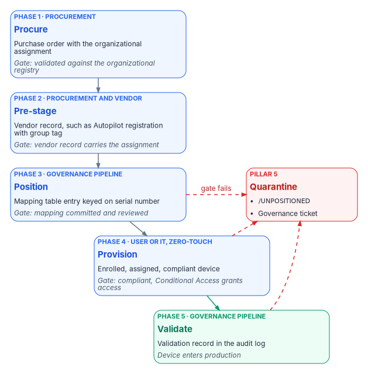
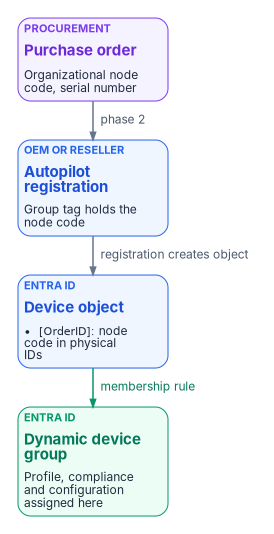

# Chapter 04 — Intune-First Onboarding

*Migration brings an existing device under governance; Intune-first refuses to let an ungoverned device exist in the first place.*

::: {.callout-note}
## In this chapter
The doctrine for devices that have never been on the network: what Intune-first means, its five pillars and four exception paths, and the five-phase process that carries an organizational assignment from the purchase order to a validated, compliant device. The Windows mechanics in detail (Windows Autopilot versus Autopilot device preparation, registration and group tags, enrollment restrictions, naming, the Enrollment Status Page, and the compliance and configuration baseline), then the other platforms, and the drift classes that catch a device that slipped through.
:::

::: {.callout-important}
## Scope: net-new devices only
This chapter covers devices the organization buys after the modernization decision. Replacing Group Policy on the existing fleet is a different program, with different stakeholders and a different timeline: the GPO Sunset Program in [Chapter 07](07-the-gpo-sunset-program.md) and [Chapter 08](08-gpo-to-intune-policy-migration.md). The program reserves the phrase "Intune-first" for this net-new doctrine and doesn't use it for the GPO replacement work. Servers follow the same doctrine through Azure Arc, and their mechanics are in [Chapter 09](09-servers-under-azure-arc.md).
:::

## What Intune-first means

A net-new asset (a laptop just unboxed, a phone just issued, a server just racked) is governed from the moment it first powers on: by Intune for endpoints, and by Azure Arc into the same governance plane for servers. There is no intermediate state where the device:

- joins on-premises Active Directory and waits for a future migration;
- is provisioned by Configuration Manager and co-managed later;
- runs without an organizational assignment;
- enters production without a compliance evaluation; or
- skips the procurement-side step that records its organizational position.

That's the inverse of the directory migration path in Book 02 ([Chapter 04 of Book 02](../b02-identity/04-the-hidden-migration-surface.md)). Migration takes a device that already exists and brings it under governance. Intune-first refuses the existence of an ungoverned device.

It's also where Microsoft points new hardware. Microsoft describes hybrid join as an interim step on the road to Entra join,[^c04-device-identity] and its join guidance makes Entra join the default for new, refurbished or reset Windows devices ([Chapter 02](02-the-hybrid-join-trap.md)).

## Why the doctrine exists

The program already had a mature canon for migrating AD-joined endpoints into Entra ID and Intune. It had no operating doctrine for devices bought new. Without one, net-new acquisition followed an implicit pattern with three failure modes:

1. **Organizational assignment was missed at procurement.** Devices ended up wherever a runtime script that derived position from the user placed them, not where procurement intended.
2. **Platforms were handled inconsistently.** Windows had Autopilot; macOS, iOS, Android and servers each had bespoke handling.
3. **Co-management crept in.** Net-new Windows endpoints sometimes went into Configuration Manager co-management because it was convenient. Each one was a future migration ticket and a present compliance gap.

## The five pillars

These are the program's doctrine, not Microsoft requirements.

| # | Pillar | What it asserts |
|---|---|---|
| 1 | No ungoverned device, ever | Every asset is governance-enrolled before it moves to production use. Quarantine (`/UNPOSITIONED`) is the safety valve, not the steady state. |
| 2 | Procurement is the first governance step | The organizational assignment is set when the purchase order is issued, not when the device arrives. Procurement systems feed the governance pipeline the way HR systems feed user provisioning. |
| 3 | Zero-touch only | Manual enrollment is a controlled exception that needs written justification, compensating controls, a finite duration and an audit entry. |
| 4 | One management plane per asset; no co-management for new assets | Intune for endpoints. Azure Arc with Azure Policy machine configuration for servers. No greenfield Configuration Manager, no greenfield Group Policy, no greenfield hybrid join. |
| 5 | Quarantine on failure; never silently degrade | An onboarding failure produces a quarantine entry and a governance ticket, never a production device running in a degraded state. |

Pillar 4 keeps servers out of the Intune Settings Catalog. Intune's supported platforms don't include Windows Server,[^c04-platforms] so the Settings Catalog doesn't reach a server. Server configuration is set by Azure Policy machine configuration, and Intune endpoint security policies reach servers only through Defender for Endpoint security settings management ([Chapter 09](09-servers-under-azure-arc.md)).[^c04-mde-ssm]

## Where the organizational assignment comes from

Every enrolled device carries a governance attribute. The program fills it from the first source that can supply one, in this order:

1. **The procurement record.** The organization decided to buy the asset for a specific purpose and place.
2. **The vendor or program carrier.** The supplier or enrollment program carries the intended attributes, such as an Autopilot group tag or an Apple Business Manager assignment.
3. **User derivation.** The fallback when no procurement record exists, such as personally owned devices or historical inventory.
4. **Unpositioned.** An explicit marker when nothing can supply a value. No enrolled device carries an empty governance attribute.

Procurement-first ordering gives three properties. It's deterministic: the attribute reflects the purchase decision, not the technician who powered the device on. It's auditable: there's a chain of custody from purchase order to production. And it covers devices with no user: shared and self-deploying devices are stamped correctly before anyone signs in. The unpositioned marker keeps dynamic group membership and drift detection deterministic from day zero, because a known "nowhere" is still a value a rule can match.

## The five-phase process

Every net-new asset follows the same five phases, whatever the platform. What changes per platform is the vendor program used in phase 2 and the enrollment vector used in phase 4.

{#fig-ch04-five-phases fig-alt="A top-to-bottom flow of five cards. Phase 1, Procure, owned by procurement: approved purchase order with the organizational assignment, gated on validation against the organizational registry. Phase 2, Pre-stage, owned by procurement and the vendor: vendor program record such as an Autopilot registration with group tag or an Apple Business Manager assignment, gated on the record carrying the assignment. Phase 3, Position, owned by the governance pipeline: mapping committed to the governance repository and reviewed. Phase 4, Provision, by the end user or IT with zero-touch: enrolled, assigned, compliant device, gated on compliance returning Compliant and Conditional Access granting access. Phase 5, Validate, owned by the governance pipeline: validation record in the audit log. Phases 1 to 4 are blue and phase 5 is green. A red card on the right labeled Quarantine, UNPOSITIONED plus a governance ticket, receives dashed red arrows labeled gate fails from phase 3, phase 4 and phase 5."}

| Phase | Owner | Trigger | Output | Gate to the next phase |
|---|---|---|---|---|
| 1. Procure | Procurement | Business request for an asset | Approved purchase order with the organizational assignment | Assignment validated against the organizational registry |
| 2. Pre-stage | Procurement and vendor | Purchase order sent to the vendor | Vendor program record (Autopilot registration, Apple Business Manager assignment and so on) | The vendor record carries the organizational assignment |
| 3. Position | Governance pipeline | Vendor confirms registration | Procurement-side mapping table entry, keyed on serial number | Mapping committed to the governance repository and reviewed |
| 4. Provision | End user (zero-touch) or IT (assisted zero-touch) | Asset arrives at the recipient's location | Enrolled, assigned, compliant device | Compliance policy returns *Compliant*; Conditional Access grants access |
| 5. Validate | Governance pipeline | The device's first compliance evaluation completes | Validation record in the governance audit log | All phase 5 checks pass; device leaves quarantine if it was in it |

The program's latency target is 14 calendar days from purchase order to production-governed for standard hardware, and 5 calendar days for expedited orders. The short twin of this page named the phases Procure, Carrier, Validate, Enroll and Verify; the table above is the fuller version, and the two describe the same flow.

Phase 3 doesn't pre-stage an Entra ID device object. For classic Autopilot that object isn't something the pipeline creates: Autopilot creates it automatically when the device is registered.[^c04-ap-registration] Phase 3's job is to confirm that the registration exists, carries the right group tag, and matches the procurement record.

### Procurement intake fields

Phase 1 is where the doctrine departs most from past practice. The organizational assignment is captured at purchase order time in structured fields:

- `recipient_upn` and `recipient_org_attributes`, resolved from Entra ID;
- `asset_class` (Windows endpoint, macOS endpoint, iOS tablet and so on);
- `asset_assignment_type` (personal, shared, kiosk, lab or service);
- `asset_org_attributes` and `asset_orgnodeid`, validated against the organizational registry; and
- `vendor` and `vendor_program` (Autopilot through the OEM or reseller, Apple Business Manager, Android zero-touch, Samsung Knox Mobile Enrollment, or Arc for servers).

The procurement system commits the order as a structured record in the governance repository and writes the organizational assignment to the vendor program in phase 2.

## Windows: Autopilot or Autopilot device preparation

Microsoft now ships two Windows provisioning solutions. Windows Autopilot device preparation is a re-architecture of Windows Autopilot with a simpler configuration and near real-time reporting. Classic Windows Autopilot remains more feature-rich.[^c04-ap-faq] The differences that matter for this doctrine:[^c04-ap-compare]

| Requirement | Autopilot device preparation | Windows Autopilot |
|---|---|---|
| Device registration required | No | Yes |
| Bind devices to the tenant before enrollment | Yes, through device association | Yes, through registration |
| Group tag on the registration | Not applicable (no registration) | Yes |
| Microsoft Entra join | Yes | Yes |
| Microsoft Entra hybrid join | No | Yes |
| User-driven | Yes | Yes |
| Pre-provisioned and self-deploying | No | Yes |
| Windows 10 | No | Yes |
| More than 10 apps or 10 PowerShell scripts during setup | No | Yes |
| Block the desktop until user-based configuration is applied | No | Yes |
| What admins configure | Device preparation policy, plus a device security group owned by the Intune Provisioning Client | Deployment profile, plus the Enrollment Status Page |
| GCC High and DoD | Yes | No |

### Which one, in a GCC tenant

The workbook assumes a Microsoft 365 GCC tenant. Intune doesn't have a separate GCC instance; GCC uses the commercial Intune service, so both solutions are available. GCC High and DoD use a separate government instance in which classic Windows Autopilot isn't available.[^c04-intune-gov]

The program's recommendation for a GCC tenant is **classic Windows Autopilot, user-driven, with Microsoft Entra join, and OEM or reseller registration carrying a group tag**, as the default for standard hardware. The reason is pillar 2. Classic Autopilot's registration carries the procurement attribute (group tag and purchase order ID) from the vendor to the Entra ID device object before the device is powered on. Device preparation has no registration, so it has no carrier: devices are added to a device group at enrollment time,[^c04-ap-overview] and the organizational assignment has to come from the procurement mapping table after enrollment.

Use device preparation where its advantages matter (a simpler policy, faster provisioning, mixing Win32 and line-of-business apps in one deployment, or a tenant that might later move to GCC High), and carry the attribute from the serial-number mapping table in phase 3. Don't use either solution with hybrid join for new devices; that's what pillar 4 forbids.

Device preparation requires Windows 11 version 24H2 or later, or version 23H2 or 22H2 with KB5035942 or later. Installation media dated April 2024 or later includes that update. It needs Microsoft Entra automatic enrollment configured, and the first user who signs in must be allowed to join devices to Entra ID.[^c04-ap-dp-req] That last requirement is a governance point: on the device preparation path, the user's own join permission is what brings the device in.

### Registration and group tags

Registration binds the hardware hash to the tenant. The OEM, reseller or distributor should do it at purchase, which is also what makes it zero-touch. An OEM or reseller can register devices only after the organization's Global Administrator authorizes it. Microsoft calls out that this one feature needs the Global Administrator role and recommends least-privileged roles everywhere else.[^c04-ap-oem] Plan that consent as a one-time, recorded approval per supplier. Manual registration, harvesting the hash from a running device, is intended mainly for testing and evaluation.[^c04-ap-manual]

{#fig-ch04-assignment-carrier fig-alt="Four cards left to right. A violet card tagged procurement, purchase order, holding the organizational node code and serial number. An arrow labeled phase 2 leads to a blue card tagged OEM or reseller, Autopilot registration, whose group tag holds the node code. An arrow labeled registration creates object leads to a blue card tagged Entra ID, device object, with the node code as an OrderID entry in its physical IDs. A green arrow labeled membership rule leads to a green card tagged Entra ID, dynamic device group, where the Autopilot profile, compliance and configuration are assigned."}

The group tag Intune stores on the registration appears on the Entra ID device as an `[OrderID]` physical ID, and the purchase order ID appears as `[PurchaseOrderId]`.[^c04-ap-hololens] Dynamic groups match on them.

::: {.callout-warning}
## Illustrative, not tested against a production tenant
The rules and commands in this chapter are examples. Test each one in a non-production scope and check the resulting group membership before you assign policy to it.
:::

```text
All Windows Autopilot devices
(device.devicePhysicalIDs -any (_ -startsWith "[ZTDid]"))

Devices whose group tag is a given organizational node
(device.devicePhysicalIds -any _ -eq "[OrderID]:ORG-0420")

Devices bought on a given purchase order
(device.devicePhysicalIds -any _ -eq "[PurchaseOrderId]:76222342342")
```

The rule syntax is Microsoft's;[^c04-dynamic-rules] the `ORG-0420` value is an example of an organizational node code. The program's convention is that the group tag carries the organizational node identifier from the procurement record, never a free-text department name, so a reorganization changes the mapping table, not thousands of registrations. The Autopilot profile, compliance policies and configuration profiles are then assigned to those groups, which is how the procurement decision reaches the device's configuration without anyone touching it.

### Enrollment restrictions

Enrollment restrictions decide which devices may enroll at all. For Intune-first, the important one is the device platform restriction that blocks personally owned Windows devices. With it in place, Intune authorizes a Windows enrollment as corporate only through approved paths, and Windows Autopilot is one of them.[^c04-restrictions] Devices provisioned through device preparation are treated as corporate but blocked by a personal-device restriction unless they're defined by corporate identifiers (serial number, manufacturer and model uploaded in advance) or bound to the tenant by device association.[^c04-corp-ids]

That gives the doctrine its enforcement point. With personal Windows enrollment blocked, a device that wasn't registered or pre-identified by procurement can't enroll as corporate. It fails with an enrollment restriction error, which is exactly the pillar 5 behavior: quarantine, not silent degradation. Allow personal Windows enrollment only for the specific user groups that need it, which is also Microsoft's advice.[^c04-unblock]

### Naming

Classic Autopilot profiles can apply a device name template. Names must be 15 characters or fewer, use letters, numbers and hyphens, and can't be all numbers. The `%SERIAL%` macro inserts the hardware serial number and `%RAND:x%` inserts x random digits.[^c04-ap-profile] The program's convention is a short, fixed prefix for the asset class followed by `%SERIAL%`, truncated to fit 15 characters, because the serial number is the procurement join key ([Chapter 03](03-where-device-and-server-data-lives.md)). Organizational position doesn't go in the name. It goes in the group tag, where it can change without renaming the device.

In GCC High and DoD, renaming devices during device preparation based on organizational structure is still listed as a planned feature.[^c04-intune-gov] Check device preparation's current capabilities before you rely on it for naming.

### The Enrollment Status Page

The Enrollment Status Page (ESP) shows provisioning progress and can block the device until required policies and apps are installed. It runs in two phases: device setup during the out-of-box experience, then account setup for the first user. The default ESP assigned to all devices doesn't show app and profile progress; Microsoft recommends a custom ESP that does, because a user who signs in before the device is fully provisioned can cause problems.[^c04-ap-esp] A tenant can hold up to 51 ESP profiles (the default plus 50).[^c04-esp]

For Intune-first, configure the ESP to block device use until the security-critical items are installed: the compliance-relevant configuration, Defender, BitLocker and any agent the validation phase checks for. Use the **Selected** blocking-apps list rather than **All**, so that a non-critical app's failure doesn't strand a device, and don't let users bypass the ESP on an installation error for the security-critical list. The ESP list filters which assigned apps are tracked; it doesn't itself assign them.[^c04-esp]

Device preparation doesn't use the ESP. It applies only the apps and scripts selected in its policy during setup (up to 10 of each) and syncs policies assigned to the device group without tracking whether they've applied by the time the desktop appears.[^c04-ap-overview] On that path, the validation phase, not the setup screen, is what confirms the device reached its baseline.

## The compliance and configuration baseline

A net-new device should arrive at a known baseline before it's used. The baseline has two halves.

**Compliance**, which decides access. Set the tenant-wide **Mark devices with no compliance policy assigned as** to *Not compliant*, so an unassigned device can't pass Conditional Access by default; Microsoft recommends this whenever compliance feeds Conditional Access.[^c04-compliance] A Windows compliance policy for net-new devices typically requires BitLocker, Secure Boot and code integrity under device health; firewall, TPM, antivirus and antispyware under system security; Microsoft Defender Antimalware with current security intelligence and real-time protection; and a minimum OS version.[^c04-bp-compliance] With Defender for Endpoint connected, add **Require the device to be at or under the machine risk score**.[^c04-mde-risk] The access-policy side, Conditional Access requiring a compliant device, is in [Book 04](../b04-access/index.md).

**Configuration**, which sets the device up. Start from Microsoft's security baselines in Intune: the Security Baseline for Windows 10 and later (version 25H2 is the latest Windows baseline) and the Microsoft Defender for Endpoint baseline. Existing baseline profiles don't update to a new version automatically, and different baselines can set the same setting to different defaults, so review overlaps before you deploy more than one.[^c04-baselines] Then add BitLocker with recovery-key escrow to Entra ID, Windows Hello for Business ([Chapter 10 of Book 02](../b02-identity/10-migrating-and-governing.md)), firewall profiles and Windows LAPS. Because these devices never had Group Policy, there's no GPO conflict to resolve; that's the payoff of Intune-first, and [Chapter 08](08-gpo-to-intune-policy-migration.md) covers the existing fleet where there is one.

## Other platforms

The five-phase process is platform-neutral. Each platform has its own vendor program and its own carrier for the organizational assignment.

| Platform | Vendor program | Assignment carrier | Management state |
|---|---|---|---|
| Windows endpoint | Windows Autopilot (OEM or reseller registration) or Autopilot device preparation | Group tag; or the mapping table for device preparation | Microsoft Entra joined, Intune enrolled |
| Microsoft Surface | Surface registration through Microsoft or an authorized partner | Group tag; DFCI profile for firmware settings | Entra joined; firmware managed through DFCI |
| macOS | Apple Business Manager or Apple School Manager, Automated Device Enrollment | Assignment to the Intune enrollment profile | Supervised, ADE-enrolled |
| iOS and iPadOS | Apple Business Manager or Apple School Manager, Automated Device Enrollment | Assignment to the Intune enrollment profile | Supervised |
| Android | Android Enterprise zero-touch or Samsung Knox Mobile Enrollment | Enrollment profile or managed configuration | Fully managed (corporate-owned) |
| Linux workstation | Intune enrollment through the Microsoft Intune app | Mapping table | Intune managed |
| Server (Windows Server 2025, Linux) | Azure Arc onboarding | Azure resource tag on the Arc machine | Workgroup plus Arc; Entra ID sign-in on Windows Server 2025 ([Chapter 09](09-servers-under-azure-arc.md)) |

A few facts behind the table, current as of October 2026:

- Devices enrolled through an Apple device enrollment program, Windows Autopilot, Knox Mobile Enrollment, Android Enterprise corporate-owned methods and Google zero-touch are marked corporate-owned automatically.[^c04-corp-ids]
- Intune supports Linux on Ubuntu Desktop 24.04 and 26.04 LTS and Red Hat Enterprise Linux 9 and 10.[^c04-platforms]
- DFCI management for Surface works only with classic Autopilot; device preparation doesn't support it. DFCI is in the planned list for GCC High and DoD.[^c04-ap-compare][^c04-intune-gov]

## The four exception paths

Doctrine carve-outs for cases that can't follow the main path. Each needs written justification, a compensating control and an audit entry.

| Path | Applies to | Why it's permissible |
|---|---|---|
| A. User-driven enrollment for personal devices | Personally owned devices enrolled into a work profile or partition (iOS user enrollment, Android work profile, Windows registered) | Refusing to govern personal devices pushes users to unmanaged access through personal browsers. Governed at a lower assurance level is better than ungoverned. |
| B. Linux endpoint with an Arc fallback | Linux endpoints that can't use Intune's Linux management (developer workstations that need root, embedded Linux, air-gapped hosts) | Intune's Linux support covers a limited set of distributions and desktop configurations;[^c04-platforms] Arc with Azure Policy machine configuration is the substitute governance plane. |
| C. Pre-2025 Windows servers | Windows Server 2019 and 2022 hosts whose OS upgrade isn't yet feasible | Entra ID sign-in for Arc-enabled Windows servers requires Windows Server 2025 or later with Desktop Experience.[^c04-arc-login] Arc-managed without Entra ID sign-in is an acceptable interim state. |
| D. Windows endpoints that can't enroll | Instrument and laboratory PCs locked to a vendor's validated image, operational technology workstations, and hosts in disconnected enclaves | Some devices can't take MDM without breaking a vendor certification, and some can't reach the cloud at all. Recording them as governed exceptions is better than leaving them outside the inventory. |

Exception C rests on Microsoft's support boundary, footnoted above, not on a program decision.

### Path D under the compliant-device policies

A Windows device that isn't enrolled in Intune can't pass a Conditional Access policy that requires a compliant device. Microsoft's **Require device to be marked as compliant** control supports only devices registered with Microsoft Entra ID and enrolled in Intune (on Windows, a supported partner MDM can also report compliance).[^c04-ca-grant] So every path D device is blocked from the resources behind CA004, CA016 and the other compliant-device policies in [Book 04, Chapter 07](../b04-access/07-the-conditional-access-policy-library.md), and the program handles it in this order:

1. **Isolate it on the network first.** A disconnected or OT host stays on a segmented network with no route to cloud resources ([Book 09, Chapter 07](../b09-network/07-network-access-control.md)). With no sign-in to Microsoft Entra ID, Conditional Access isn't involved; the segment boundary is the control.
2. **Manage its Defender settings where it has connectivity.** Onboard the device to Microsoft Defender for Endpoint and apply Intune endpoint security policies through Defender for Endpoint security settings management, which is built for devices that can't enroll in Intune and registers the device in Microsoft Entra ID if it isn't already. It doesn't support non-persistent VDI or 32-bit Windows.[^c04-mde-ssm] It manages security settings; it doesn't make the device compliant for Conditional Access.[^c04-ca-grant]
3. **If its users must reach a protected cloud resource, record a named exclusion.** Put the accounts that use the device in an exclusion group such as `CA-Exclude-NonEnrollable-<device class>`, with a named owner, a written justification, a review date no more than 90 days out, and the authorizing official's risk acceptance ([Chapter 06](06-who-owns-the-endpoint.md)). Pair the exclusion with a policy that blocks that group from every device not on the approved list, using a device filter on `deviceId` with the `NotIn` operator. That is Microsoft's pattern for letting specific accounts work only from specific devices, and a negative operator also catches unregistered devices.[^c04-ca-filter] Microsoft advises using exclusions sparingly and removing them as soon as possible.[^c04-ca-plan]
4. **Keep the compensating controls on.** The exclusion lifts only the device requirement: the authentication-strength and MFA policies still apply to the group, local administrator rights stay removed, and the device is recorded in the CMDB as its authority record with its owner and review date.

The isolation-first order, the group name and the 90-day review are the program's design; the Conditional Access and Defender behavior is Microsoft's.

## Devices without a procurement record

Devices that predate the process, or arrive outside normal procurement, fall through to user derivation or the unpositioned marker. They surface as findings for governance review, with three possible outcomes: file a procurement record retroactively, reclassify the asset, or quarantine it for disposition.

## Validation, drift classes and evidence

Phase 5 runs platform-neutral and platform-specific checks. Failures quarantine the device under pillar 5. The doctrine adds five drift classes, which are the program's own taxonomy:

| Drift class | What it detects |
|---|---|
| `DRIFT-PROCUREMENT-MISMATCH` | The device's organizational assignment differs from the procurement record |
| `DRIFT-VENDOR-PROGRAM-CARRIER` | The assignment in the vendor program record (Autopilot group tag, Apple assignment and so on) differs from the procurement record, or is missing |
| `DRIFT-ENROLLMENT-VECTOR` | The device enrolled through a non-zero-touch path without an exception grant |
| `DRIFT-CO-MANAGEMENT-NEW` | A net-new Windows endpoint landed in Configuration Manager co-management instead of Intune-first |
| `DRIFT-PROCUREMENT-RECORD-ABSENT` | A device enrolled in Intune with no matching procurement record |

The keys these checks join on, and a read-only script that finds three of the five, are in [Chapter 03](03-where-device-and-server-data-lives.md). Each detection produces a signed evidence artifact in the governance repository. The program maps the evidence to the NIST SP 800-53 controls AC-2, AC-19, CM-2, CM-7, CM-8, IA-3, MA-2 and SC-15 for its FedRAMP Moderate boundary.[^c04-sp800-53] That mapping is the program's assertion for its own assessors, not a statement that these artifacts satisfy the controls by themselves. How the evidence is produced and presented is covered in [Chapter 10](10-operating-and-evidencing-the-fleet.md).

## What this chapter establishes

1. A net-new device is governed from first power-on. There's no domain join, co-management or unassigned state on the way.
2. The organizational assignment is set at the purchase order and carried by the vendor program, with an explicit unpositioned marker when nothing can supply it.
3. In a GCC tenant, classic Autopilot with Entra join and OEM or reseller registration is the default, because its registration carries the procurement attribute; device preparation needs the attribute carried by the mapping table.
4. Blocking personal Windows enrollment turns an unregistered device into an enrollment failure, which is the doctrine's quarantine in practice.
5. Five drift classes catch the devices that slipped through, and they join on the keys from [Chapter 03](03-where-device-and-server-data-lives.md).

[Chapter 05](05-the-governed-manual-and-retrofit-paths.md) takes up how the existing fleet reaches the same end state.

::: {.callout-tip}
## Continue the book
[← Previous: Chapter 03 — Where Device and Server Data Lives](03-where-device-and-server-data-lives.md) · [Book index](index.md) · [Next: Chapter 05 — The Governed, Manual and Retrofit Paths →](05-the-governed-manual-and-retrofit-paths.md)
:::

[^c04-device-identity]: Microsoft Learn, "What is a device identity?," <https://learn.microsoft.com/entra/identity/devices/overview> (accessed Oct 20, 2026).
[^c04-platforms]: Microsoft Learn, "Supported operating systems and browsers in Intune," <https://learn.microsoft.com/intune/fundamentals/ref-supported-platforms> (accessed Oct 20, 2026).
[^c04-mde-ssm]: Microsoft Learn, "Learn how to use Intune endpoint security policies to manage Microsoft Defender for Endpoint on devices that are not enrolled with Intune," <https://learn.microsoft.com/intune/device-security/microsoft-defender/security-settings-management> (accessed Oct 21, 2026).
[^c04-ap-registration]: Microsoft Learn, "Windows Autopilot registration overview," <https://learn.microsoft.com/autopilot/registration-overview> (accessed Oct 20, 2026).
[^c04-ap-faq]: Microsoft Learn, "Windows Autopilot device preparation FAQ," <https://learn.microsoft.com/autopilot/device-preparation/faq> (accessed Oct 20, 2026).
[^c04-ap-compare]: Microsoft Learn, "Compare Windows Autopilot device preparation and Windows Autopilot," <https://learn.microsoft.com/autopilot/device-preparation/compare> (accessed Oct 20, 2026).
[^c04-intune-gov]: Microsoft Learn, "Microsoft Intune Government Service overview," <https://learn.microsoft.com/intune/fundamentals/government-service> (accessed Oct 20, 2026).
[^c04-ap-overview]: Microsoft Learn, "Overview of Windows Autopilot device preparation," <https://learn.microsoft.com/autopilot/device-preparation/overview> (accessed Oct 20, 2026).
[^c04-ap-dp-req]: Microsoft Learn, "Windows Autopilot device preparation requirements," <https://learn.microsoft.com/autopilot/device-preparation/requirements> (accessed Oct 20, 2026).
[^c04-ap-oem]: Microsoft Learn, "OEM registration," <https://learn.microsoft.com/autopilot/oem-registration> (accessed Oct 20, 2026).
[^c04-ap-manual]: Microsoft Learn, "Manual registration overview," <https://learn.microsoft.com/autopilot/manual-registration> (accessed Oct 20, 2026).
[^c04-ap-hololens]: Microsoft Learn, "Windows Autopilot for HoloLens 2," create a device group (group tag maps to the OrderID attribute), <https://learn.microsoft.com/hololens/hololens2-autopilot#configuring-autopilot-for-hololens-2> (accessed Oct 20, 2026).
[^c04-dynamic-rules]: Microsoft Learn, "Manage rules for dynamic membership groups in Microsoft Entra ID," rules for devices, <https://learn.microsoft.com/entra/identity/users/groups-dynamic-membership#rules-for-devices> (accessed Oct 20, 2026).
[^c04-restrictions]: Microsoft Learn, "What are enrollment restrictions?," <https://learn.microsoft.com/intune/device-enrollment/restrictions> (accessed Oct 20, 2026).
[^c04-corp-ids]: Microsoft Learn, "Identify devices as corporate-owned," <https://learn.microsoft.com/intune/device-enrollment/add-corporate-identifiers> (accessed Oct 20, 2026).
[^c04-unblock]: Microsoft Learn, "Unblock Windows 'Set up for work or school' enrollment," <https://learn.microsoft.com/troubleshoot/mem/intune/device-enrollment/troubleshoot-windows-work-school> (accessed Oct 20, 2026).
[^c04-ap-profile]: Microsoft Learn, "User-driven Microsoft Entra join: Create and assign user-driven Microsoft Entra join Windows Autopilot profile," <https://learn.microsoft.com/autopilot/tutorial/user-driven/azure-ad-join-autopilot-profile> (accessed Oct 20, 2026).
[^c04-ap-esp]: Microsoft Learn, "User-driven Microsoft Entra join: Configure and assign the Enrollment Status Page (ESP)," <https://learn.microsoft.com/autopilot/tutorial/user-driven/azure-ad-join-esp> (accessed Oct 20, 2026).
[^c04-esp]: Microsoft Learn, "Set up the Enrollment Status Page," <https://learn.microsoft.com/intune/device-enrollment/windows/setup-status-page> (accessed Oct 20, 2026).
[^c04-compliance]: Microsoft Learn, "Use compliance policies to set rules for devices you manage with Intune," compliance policy settings, <https://learn.microsoft.com/intune/device-security/compliance/overview#compliance-policy-settings> (accessed Oct 20, 2026).
[^c04-bp-compliance]: Microsoft Learn, "Device management and application management in Microsoft 365 Business Premium," create device compliance policies, <https://learn.microsoft.com/microsoft-365/admin/security-and-compliance/m365bp-devices-enrollment?view=o365-worldwide> (accessed Oct 20, 2026).
[^c04-mde-risk]: Microsoft Learn, "Device compliance settings for Windows in Intune," Microsoft Defender for Endpoint rules, <https://learn.microsoft.com/intune/device-security/compliance/ref-windows-settings#microsoft-defender-for-endpoint> (accessed Oct 20, 2026).
[^c04-baselines]: Microsoft Learn, "Use security baselines to help secure Windows devices you manage with Microsoft Intune," <https://learn.microsoft.com/intune/device-security/security-baselines/overview> (accessed Oct 20, 2026).
[^c04-arc-login]: Microsoft Learn, "Sign in to an Azure Arc-enabled server using Microsoft Entra ID and Azure Roles Based Access Control," <https://learn.microsoft.com/entra/identity/devices/howto-arc-sign-in-windows> (accessed Oct 20, 2026).
[^c04-sp800-53]: National Institute of Standards and Technology, SP 800-53 Rev. 5, *Security and Privacy Controls for Information Systems and Organizations*, September 2020 (updated December 10, 2020), <https://csrc.nist.gov/pubs/sp/800/53/r5/upd1/final> (accessed Oct 20, 2026).
[^c04-ca-grant]: Microsoft Learn, "Conditional Access: Grant," section "Require device to be marked as compliant," <https://learn.microsoft.com/entra/identity/conditional-access/concept-conditional-access-grant#require-device-to-be-marked-as-compliant> (accessed Oct 21, 2026).
[^c04-ca-filter]: Microsoft Learn, "Conditional Access: Filter for devices," sections "Common scenarios" and "Policy behavior with filter for devices," <https://learn.microsoft.com/entra/identity/conditional-access/concept-condition-filters-for-devices> (accessed Oct 21, 2026).
[^c04-ca-plan]: Microsoft Learn, "Plan a Conditional Access deployment," section "Roll back policies," <https://learn.microsoft.com/entra/identity/conditional-access/plan-conditional-access#roll-back-policies> (accessed Oct 21, 2026).
