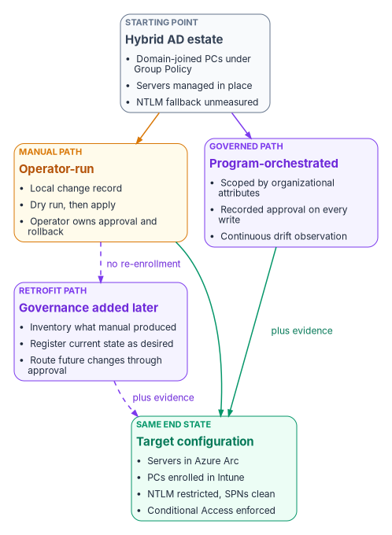
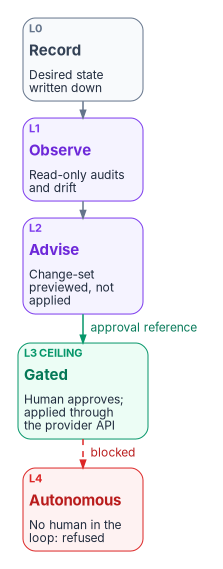

# Chapter 05 — The Governed, Manual and Retrofit Paths

*Every path ends at the same device configuration; what differs is who holds the decision record and whether anyone notices when the estate drifts back.*

::: {.callout-note}
## In this chapter
The three ways a workstation or server reaches the target state: the governed path, orchestrated by the program with evidence; the manual path, run by operators without an orchestration platform; and the retrofit path, which brings an estate that was already modernized by hand under governance. The chapter sets out the runbook all three share, what each path adds, what each one risks, and how to choose.
:::

[Chapter 04](04-intune-first-onboarding.md) described where a device should land: enrolled in Intune first, with Group Policy retired setting by setting rather than copied. This chapter is about how it gets there. The workbook's sources described the journey as three separate kits, each with its own runbook, and they repeated most of the same steps. The steps are the same because the destination is the same. Servers are onboarded to Azure Arc, workstations are enrolled in Intune, NTLM is restricted after it has been measured, service principal names are clean, SQL Server is hardened, and Conditional Access is enforced. What changes from path to path is the binding between an organizational decision and the technical change that carries it out: who approved it, where that approval is recorded, and how anyone finds out when a device stops matching it.

{#fig-ch05-three-paths fig-alt="A slate card on the left labeled Starting point, Hybrid AD estate: domain-joined PCs under Group Policy, servers managed in place, NTLM fallback unmeasured. Two arrows leave it. An amber arrow goes to an amber card, Manual path, operator-run: local change record, dry run then apply, operator owns approval and rollback. A violet arrow goes to a violet card, Governed path, program-orchestrated: scoped by organizational attributes, recorded approval on every write, continuous drift observation. Both cards send green arrows to a green card on the right, Same end state, target configuration: servers in Azure Arc, PCs enrolled in Intune, NTLM restricted and SPNs clean, Conditional Access enforced; the arrow from the governed path is labeled plus evidence. A dashed violet arrow labeled no re-enrollment runs from the manual path to a third violet card, Retrofit path, governance added later: inventory what manual produced, register current state as desired, route future changes through approval. A dashed violet arrow labeled plus evidence runs from the retrofit card to the end state."}

## One end state, three ways to reach it

The program is an active reconciliation control plane. It holds the desired state of each managed object, observes the actual state, classifies the difference as drift, and reconciles toward the desired state. It isn't an inline runtime component and doesn't replace any Microsoft service. That definition, which is the program's own design, explains why the three paths can share a runbook. Microsoft's services do the work in every path. The program only changes what happens around them.

### The rule all three obey: the control plane governs, the data plane executes

Active Directory merged two jobs. The directory held the truth about users and computers, and the domain controller enforced it in the authentication path. The target keeps those jobs apart, and the program sits on the truth side. It governs: it holds desired state, observes, classifies and reconciles. The provider executes: it authenticates, authorizes, enrolls, evaluates policy and stores. A program adapter may call a provider's management API to make a change. It must never sit inline in an authentication or request path. Onboarding a server calls the Azure management plane. Deploying a Conditional Access policy calls the Microsoft Graph policy API. Neither puts the program between a user and a sign-in.

The providers are incorporated, not replaced.

| Provider (data plane) | What it does at runtime | What the program governs |
|---|---|---|
| Microsoft Entra ID | Authenticates and enforces Conditional Access | Desired Conditional Access and identity state; drift against it |
| Microsoft Intune | Enrolls devices and enforces device policy | Desired profile and compliance state; observed posture |
| Azure Policy and Azure Arc | Evaluates machine configuration on servers | Desired server baseline; compliance reconciliation |
| Active Directory | Issues Kerberos tickets and holds SPNs | Desired NTLM and SPN state; audit and repair plan |

The program doesn't reimplement any of these functions. It compares their state against the desired state and emits evidence.

### Terms used in this chapter

The *control plane* is the reconciliation layer described above. *Organizational attributes* are the coded values every governed object carries, so that its state can be addressed in the same terms in Entra ID, Intune, Azure and Active Directory. [Book 02, Chapter 05](../b02-identity/05-delegation-without-ous.md) explains why attributes, not organizational units, carry that meaning once the directory is flat. An *actuation rung* is the level of change an operation is allowed to make, described under the governed path below.

## What every path shares

### Four phases, observe first

Every path runs the same four phases in the same order. Nothing is restricted until it has been measured.

| Phase | Kind of change | What runs | Why |
|---|---|---|---|
| 1 — Observe | Read-only | NTLM audit, SPN inventory, SQL Server audit, Intune enrollment and posture, Group Policy overlap | You can't safely restrict what you haven't measured |
| 2 — Onboard | State-changing | Arc onboarding and server baseline; Intune automatic enrollment | Attach the management planes |
| 3 — Harden | State-changing | SPN repair, NTLM restriction, Conditional Access baseline | Close the identity gaps, only after Phase 1 is signed off |
| 4 — Watch | Read-only | Conditional Access drift, compliance and cross-domain status | Keep the estate from drifting back |

The endpoint project plan follows the same sequence, with a Phase 0 for charter and alignment in front of it ([endpoint and device project plan](../../projects/endpoint-device-plan.md)).

### Rules that hold on every path

- **Observe before you change anything.** Budget at least two weeks for assessment before any production change. Starting Arc onboarding or Intune enrollment without the inventory and the NTLM audit is the program's most common cause of failed modernization: authentication failures, policy conflicts and application outages.
- **Treat every first run as a dry run.** Preview each state-changing step before you apply it. Microsoft's own cleanup script for stale Arc resources follows the same pattern, with a `-WhatIf` pass before the real one.[^c05-arc-uninstall]
- **Deploy Conditional Access in report-only mode first.** Report-only policies are evaluated at sign-in and their results logged, but they aren't enforced.[^c05-ca-report-only] Promote a policy to enforcement as a separate change.
- **Exclude emergency access accounts before enforcing.** Microsoft recommends at least two cloud-only emergency access accounts, excluded from Conditional Access policies that block or restrict sign-in. Report-only policies don't need the exclusion.[^c05-emergency]
- **Domain unjoin is a separate decision.** Onboarding attaches a management plane. It doesn't remove the domain join, and it shouldn't be allowed to imply that decision. [Chapter 02](02-the-hybrid-join-trap.md) explains what goes wrong when hybrid join is treated as the destination.
- **Document overlapping settings before Intune enforces them.** Group Policy and Intune targeting the same setting is the conflict described under the runbook below.
- **Cover the whole denominator.** Non-Windows, personally owned, guest, kiosk and server classes are in scope, even when a wave defers them.

### Prerequisites: licensing and roles

Confirm licensing against the agency's own agreements before starting. As of October 2026:

| Need | What provides it |
|---|---|
| Workstation management | Microsoft Intune Plan 1, the base service, usually obtained through a Microsoft 365 bundle such as E3 or E5[^c05-intune-license] |
| Enforcing compliance through Conditional Access | Intune plus Microsoft Entra ID P1 or P2[^c05-intune-plan] |
| Risk-based Conditional Access | Microsoft Entra ID P2, for sign-in risk conditions from ID Protection[^c05-risk-ca] |
| Endpoint detection on workstations | Microsoft Defender for Endpoint, included in Microsoft 365 E5[^c05-intune-plan] |
| Server management plane | Azure Arc's control-plane functions (tags, Resource Graph, Azure RBAC, templates and extensions) at no extra cost; services used on Arc servers are billed separately[^c05-arc-pricing] |
| Server configuration, update and change tracking | Included for Windows Server with active Software Assurance or pay-as-you-go licensing after attestation; otherwise purchased per server[^c05-wsm] |
| Server and SQL Server threat protection | Defender for Servers Plan 2 and Defender for SQL Servers on Machines; on-premises servers must be onboarded to Arc[^c05-defender-servers][^c05-defender-sql] |

The source runbooks put "Intune Administrator through PIM" on the endpoint line. Microsoft now advises against using the Intune Administrator role for day-to-day work, because it grants global read and write across Intune. Use a least-privileged built-in Intune role or a custom role instead.[^c05-intune-rbac] The least-privileged roles for each workstream are:

| Work | Role |
|---|---|
| Onboarding servers to Arc | Azure Connected Machine Onboarding, scoped to the target resource group, held by a dedicated service principal[^c05-arc-roles] |
| Managing Arc servers after onboarding | Azure Connected Machine Resource Administrator[^c05-arc-roles] |
| Intune policy and enrollment | Intune RBAC roles such as Policy and Profile Manager or Endpoint Security Manager[^c05-intune-rbac] |
| Conditional Access | Conditional Access Administrator[^c05-entra-roles] |
| Directory synchronization | Hybrid Identity Administrator[^c05-entra-roles] |
| SPN work | Delegated administration on the service-account OUs in Active Directory |

[Chapter 06](06-who-owns-the-endpoint.md) maps these roles to teams.

## The shared runbook

The steps below are the technical end state all three paths produce. The manual path runs them by hand. The governed path runs the same steps with an approval reference on every change. The retrofit path finds them already done. Later chapters go deeper: [Chapter 08](08-gpo-to-intune-policy-migration.md) on moving policy, [Chapter 09](09-servers-under-azure-arc.md) on servers, and [Chapter 10](10-operating-and-evidencing-the-fleet.md) on monitoring and evidence.

::: {.callout-warning}
## Illustrative, not tested against a production estate
The commands in this chapter are examples. They haven't been run against a production forest or tenant. Read each one, run it first in a test scope, and review the output before you apply anything that changes state.
:::

### Phase 1: baseline the estate

The baseline is read-only. It covers four inventories: NTLM use over the last 30 days, every SPN with duplicates and stale owners flagged, the SQL Server hardening posture, and Intune enrollment status. To find NTLMv1 use, Microsoft's method is to enable logon success auditing on domain controllers and read the NTLM version recorded in Event ID 4624.[^c05-ntlmv1-audit] The *Restrict NTLM* audit policies log the NTLM requests that a later deny setting would block, in the NTLM operational log.[^c05-csp-lsa] For SPNs, `setspn` lists and searches registrations:

```powershell
# SPNs registered on one service account
setspn -L CONTOSO\svc-app

# Which account owns a given SPN (single forest); use -X to search for duplicates
setspn -Q HTTP/app.contoso.com
setspn -X
```

Searching for duplicates across a forest can take a long time and a lot of memory.[^c05-spn-dup]

### Phase 2: onboard servers to Azure Arc

Azure Arc extends the Azure control plane to servers outside Azure. The Connected Machine agent communicates outbound to Azure Arc over TCP 443, and all its connections are outbound unless the documentation says otherwise.[^c05-arc-network] Each onboarded server becomes a `Microsoft.HybridCompute/machines` resource that Azure Policy machine configuration can target,[^c05-mc-prereq] and Azure RBAC, tags and extensions apply to it like any other resource.[^c05-arc-pricing] Each server also gets a system-assigned managed identity, which applications on the server can use to reach Azure resources without stored credentials.[^c05-arc-msi]

::: {.callout-note}
## Arc servers run non-domain-joined in the target
In the program's target architecture, Arc-enabled servers carry an Entra-backed machine identity and run without a domain join. Onboarding attaches the management plane. It doesn't remove the domain join for you. Plan the unjoin as a separately sequenced decision.
:::

At-scale onboarding uses a service principal that holds the Azure Connected Machine Onboarding role, scoped to the target landing zone.[^c05-arc-gpo] That role can create and read Arc server resources but can't manage extensions or delete servers, and Microsoft recommends assigning it only to the onboarding service principal.[^c05-arc-roles] The credential is needed only when `azcmagent connect` runs. If it expires afterward, the server stays connected.[^c05-arc-onboard-sec]

::: {.callout-warning}
## Never put an onboarding secret in plain text in a startup script
The source runbook warned that a service principal secret in a Group Policy startup script is readable by every domain-authenticated user through SYSVOL. Treat it that way. Microsoft's guidance for scripted onboarding is to prefer certificates over secrets, because certificates can be controlled with Conditional Access, to keep parameters in a configuration file instead of on the command line, and to clean the file up afterward. Microsoft's Group Policy onboarding method encrypts that configuration file so only computer accounts can decrypt it.[^c05-arc-onboard-sec] Rotate the credential regularly and keep it in the onboarding role only.
:::

The server baseline comes next. Azure machine configuration, formerly Azure Policy Guest Configuration, audits and can set operating-system settings on Arc servers.[^c05-mc-governance] Azure Policy includes a built-in definition that checks Windows machines against the Azure compute security baseline.[^c05-arc-policy-ref] With Defender for Servers Plan 2 enabled, Defender for Cloud assesses server configuration against the Windows and Linux compute baselines in the Microsoft cloud security benchmark.[^c05-mcsb]

Tag every server consistently, because tags drive policy scope, cost reporting and operational queries: `Environment`, `Workload`, `Criticality`, `Owner`, `CostCenter`, `PatchGroup` and an onboarding date. On the governed path the same taxonomy carries the organizational attributes. Tags are stored in plain text, so don't put sensitive information in them.[^c05-arc-onboard-sec]

### Phase 2: enroll the existing workstation fleet in Intune

For a fleet that is already domain-joined and synchronized to Entra ID, Group Policy–triggered automatic enrollment of Microsoft Entra hybrid joined devices is the lowest-friction route. It needs no reimage and no user interaction. Microsoft recommends it for hybrid joined fleets that aren't managed with Configuration Manager. For new hardware, Microsoft recommends Windows Autopilot with Microsoft Entra join rather than hybrid join.[^c05-enroll-methods] The enrollment policy is **Computer Configuration > Administrative Templates > Windows Components > MDM > Enable automatic MDM enrollment using default Microsoft Entra credentials**, linked to the workstation OU and filtered by a security group.[^c05-gpo-enroll] On a client, confirm hybrid join before you troubleshoot enrollment:

```powershell
dsregcmd /status
# Device State should show:
#   AzureAdJoined : YES
#   DomainJoined  : YES
```

Those two values mean the device is both domain-joined and Entra-joined, which is what Group Policy enrollment requires.[^c05-enroll-troubleshoot]

Deploy configuration in priority order: the security baseline, BitLocker with recovery-key escrow to Entra ID, Windows Hello for Business, Defender Antivirus, firewall profiles and Windows LAPS. Intune's LAPS policy can back the local administrator account up to Entra ID or to Active Directory, and can rotate the password on a schedule.[^c05-laps] [Book 02, Chapter 10](../b02-identity/10-migrating-and-governing.md) covers Windows Hello for Business as part of phishing-resistant sign-in. Then attach a compliance policy: minimum OS version, BitLocker, Secure Boot, code integrity, Defender real-time protection and current signatures, firewall, TPM and health attestation. A device that fails it can be blocked by Conditional Access. Every compliance policy includes a *Mark device noncompliant* action. You can schedule it from 0 to 365 days to give users a grace period before Conditional Access takes effect.[^c05-noncompliance] [Book 04](../b04-access/index.md) owns the Conditional Access side of that decision.

::: {.callout-important}
## Group Policy and Intune: Group Policy wins by default
The source runbook described a Group Policy and Intune overlap as "last writer wins." Microsoft documents something more specific, and more dangerous. When the same policy is set in both Group Policy and MDM, Group Policy takes precedence.[^c05-gpo-enroll] The *MDMWinsOverGP* setting reverses that, but only for settings in the Policy CSP. It doesn't cover settings defined in other CSPs, such as the Defender CSP. For those, configuring both channels creates a race condition with no guaranteed winner.[^c05-mdmwins] Windows Hello for Business policy lives in the PassportForWork CSP. If Group Policy and Intune both configure it, the conflicting Intune settings aren't applied until the Group Policy settings are cleared.[^c05-whfb-conflict] So document every overlapping setting before Intune enforces anything in production, and retire the Group Policy copy once Intune owns the setting. [Chapter 08](08-gpo-to-intune-policy-migration.md) sets out that retirement sequence.
:::

### Phase 3: restrict NTLM in stages

NTLM is deprecated in all its versions. Microsoft says calls to it should move to Negotiate, which tries Kerberos first. NTLMv1 is removed starting with Windows 11, version 24H2 and Windows Server 2025.[^c05-ntlm-deprecated] [Book 02, Chapter 03](../b02-identity/03-ad-and-entra-side-by-side.md) sets out the full deprecation schedule. The destination is Kerberos for everything that stays on premises, and token-based protocols for everything that moves.

Restricting NTLM too early breaks legacy web applications, file access by IP address or without an SPN, and some third-party products. Enforce restrictions only after a 14 to 30 day audit shows no remaining dependencies, and only after application owners sign off.

The source runbook's staging table was wrong in one important way. It treated LAN Manager authentication level 5 as "block all NTLM." Level 5 makes domain controllers refuse LM and NTLMv1, but they still accept NTLMv2. Level 4 refuses only LM.[^c05-lmlevel] NTLM is blocked by the *Restrict NTLM* policies. *Network security: Restrict NTLM: NTLM authentication in this domain* controls the domain controller, *Incoming NTLM traffic* controls servers, and *Outgoing NTLM traffic to remote servers* controls clients. Exception lists exist for the domain controller and the client roles.[^c05-ntlm-policies] The corrected staging is:

| Stage | LAN Manager authentication level | Restrict NTLM policies |
|---|---|---|
| 1 — Audit | 3 or higher on clients (send NTLMv2 only) | Audit NTLM authentication in this domain and audit incoming NTLM traffic: enabled for all accounts |
| 2 — Refuse legacy variants | 5 on domain controllers (refuse LM and NTLMv1; accept NTLMv2 only) | Deny for domain accounts, with the audited exceptions in the server exception list |
| 3 — Block NTLM | 5 | Deny all; remove the exceptions as each dependency is retired |

On Windows 11 24H2 and Windows Server 2025, NTLMv1 is already gone, so Stage 2 mostly matters for older systems in the estate.

::: {.callout-important}
## Conditional Access can't block on-premises NTLM
NTLM is controlled at the Local Security Authority and through these Windows policies, which Group Policy or Intune can deliver. The LAN Manager level and the Restrict NTLM settings are both in the Policy CSP.[^c05-csp-lsa] Conditional Access blocks legacy authentication to cloud applications. A Kerberos or NTLM exchange between a client and a domain controller never reaches it.
:::

### Phase 3: repair SPNs before enforcing Kerberos

Kerberos needs a correct, unique SPN for each service. A *missing* SPN is the silent failure. If the client's security layer can't find the SPN in Active Directory, Kerberos isn't attempted and the connection falls back to NTLM, which usually succeeds.[^c05-sspi] A *duplicate* SPN makes Kerberos fail outright. The KDC returns `KDC_ERR_PRINCIPAL_NOT_UNIQUE`, and each SPN must be unique in the forest.[^c05-spn-dup] An SPN left on the old account after a service-account change has to be moved, so that each SPN has exactly one owner.[^c05-gmsa] The source runbook said a duplicate falls back to NTLM silently. In fact, the missing SPN is the quiet case and the duplicate is the loud one. Both need fixing before NTLM is restricted, because stage 3 turns the quiet case into an outage.

Validate each repair. Purge the client's ticket cache, connect again, and confirm the session used Kerberos. For SQL Server, `sys.dm_exec_connections` reports the authentication scheme:[^c05-sql-spn]

```powershell
klist purge
```

```sql
SELECT auth_scheme, net_transport
FROM sys.dm_exec_connections
WHERE session_id = @@SPID;
-- KERBEROS is the expected result; NTLM means the SPN is still missing or misplaced
```

### Phase 3: harden SQL Server

The hardening audit reports the authentication mode (Windows authentication only is the goal), the server configuration options that should be off (`xp_cmdshell`, OLE Automation procedures, CLR, cross-database ownership chaining, Database Mail XPs and similar), and the status of the `sa` account. Then onboard the SQL Server hosts to Arc and enable Defender for SQL Servers on Machines.[^c05-defender-sql] Replacing Windows and SQL authentication with Entra ID for SQL Server 2022 and later is a separate engine-level transformation. The [SQL Server Identity Transformation narrative](../b06-data-platform/index.md) covers it.

### Phase 3: Conditional Access baseline

The baseline creates the core policies: block legacy authentication, require MFA, require a compliant device, and require MFA for administrators and for the Azure management plane. Create them in report-only mode, measure the impact in the sign-in logs and the insights workbook, and then enforce each one as a separate change.[^c05-ca-report-only] Before anything is enforced, exclude the emergency access group from every policy that blocks or restricts sign-in.

The source runbook described emergency accounts as protected by "long unique passwords." Microsoft's current guidance is different. Emergency access accounts should be cloud-only accounts in the `.onmicrosoft.com` domain. They should use phishing-resistant methods, such as FIDO2 passkeys or certificate-based authentication, that are different from normal admin accounts. They should be monitored with alerts on every sign-in and validated at least every 90 days.[^c05-emergency] [Book 04](../b04-access/index.md) designs the full policy set.

### Phase 4: watch

Send Arc heartbeat, Intune compliance, Active Directory audit and Defender alerts to a Log Analytics workspace with defined alert rules. Capture a Conditional Access baseline on the first run, then compare against it on a schedule. A cross-domain status report shows which domains have fresh evidence and the headline pass and attention counts. It is the weekly status page on the manual path and the evidence feed on the governed path. [Chapter 10](10-operating-and-evidencing-the-fleet.md) describes it.

### Rollback

Define rollback criteria before you begin. Each domain has a back-out:

- **Intune:** retire or unenroll the device and re-apply the Group Policy baseline.
- **Arc:** remove the extensions first, because uninstalling the agent doesn't remove them. Then run `azcmagent disconnect`, which deletes the Azure resource and resets the local agent, and uninstall the agent.[^c05-arc-uninstall]
- **Conditional Access:** keep policies in report-only until they're validated. The emergency access accounts are the recovery path.
- **NTLM:** if a missed dependency surfaces, relax the *Restrict NTLM* deny setting back to audit, or add a scoped exception, until the owner fixes it. That is the setting that blocks. Lower the LAN Manager level only if the dependency is on NTLMv1. This is why the audit gate exists.

### What you must configure

Every deployment has local values to set before anything runs: tenant ID, subscription ID, resource group, region and cloud environment (Azure commercial or Azure Government), the workstation OU distinguished name, the emergency access group ID and the SQL Server instance list. Run each step as a dry run before you remove the guards.

## The manual path

The manual path is for an agency that is modernizing without an orchestration platform. That can happen because of how the agency is organized, because it acquired the estate, because the timeline is compressed, or because it has no budget for one yet. Every step is self-contained and is meant to be run by qualified staff with no outside advisory dependency.

The manual path isn't the ungoverned path. Because no control plane checks each decision as it happens, the operator owns the change record, the approval and the rollback. Write the accepted risks into a change record before you start.

| | Manual path |
|---|---|
| Needs | The licensing and roles above, a local change-control process, operators who can read every script before running it |
| Produces | The full target configuration on the Microsoft surface; a change record per step; read-only drift and status reports run on a schedule |
| Doesn't produce | An approval reference bound to each change, or continuous drift classification. Evidence is assembled when an auditor asks for it |
| Main risks | Drift found by incident, not by observation; approvals that live in a ticket nobody links to the device; the NTLM and Conditional Access cutovers done on one operator's judgment |
| Best for | Small estates, pilots, and agencies that need to start before a control plane exists |

If you expect to add governance later, the manual path is designed for it. Don't re-image or re-enroll devices just so you can add governance later. The retrofit path below exists so that you never have to.

## The governed path

The governed path reaches the same end state as the manual path. The same steps run. What governance adds is the binding from organizational intent to each technical change.

- **Address before you actuate.** Organizational attributes must be present on every device before any policy targets it. Scope is derived from attributes, not from an OU or a hand-built group.
- **Cap the blast radius.** High-blast-radius classes, such as privileged access workstations, servers and kiosks, stay gated on human approval.
- **Plan, then apply with a dry run.** No change is applied without a preview of its impact.
- **Report-only first.** Enforcement is measured before it's switched on.
- **Reconcile duplicates and lifecycle.** One object per machine. Orphaned and phantom device objects are findings, not leftover state.
- **Emit evidence an authorizing official can sign.** Every bulk change produces a provenance record.
- **Cover the whole denominator.** No platform or ownership class is quietly left out.

### The actuation ladder

Every governed operation declares a rung. The rung is a property of the operation, not a global switch. The program's federal default write ceiling is L3: a human approves, and the program executes through the provider's API. Autonomous L4 actuation is refused inside the boundary. The ladder and the ceiling are the program's design. Raising the ceiling takes deliberate configuration outside the kit, and a tightened boundary can lower it, for example to L1 so that only observers run.

{#fig-ch05-actuation-ladder fig-alt="Five cards in a row, left to right. L0, Record, in slate: desired state written down. L1, Observe, in violet: read-only audits and drift. L2, Advise, in violet: change-set previewed, not applied. L3 ceiling, Gated, in green: human approves, applied through the provider API; the arrow into it is labeled approval reference. L4, Autonomous, in red: no human in the loop, refused; the dashed red arrow into it is labeled blocked."}

| Rung | Name | Meaning | In this book's runbook |
|---|---|---|---|
| L0 | Record | Desired state recorded, nothing observed yet | The modernization desired-state table |
| L1 | Observe | Actual state collected and drift detected, read-only | NTLM, SPN, SQL Server and Intune audits; the drift report |
| L2 | Advise | Corrective change-set generated and shown | The dry-run previews |
| L3 | Gated | A human approves; the program applies the change through the provider API | Every state-changing step, carrying an approval reference |
| L4 | Autonomous | The loop closes without a human | Above the ceiling; refused |

The approval check refuses any write above the ceiling, refuses a gated write that has no approval reference, and logs every decision. Microsoft provides a native second-approver gate for part of the endpoint surface. Intune Multi Admin Approval can require a second administrator to approve changes to app deployments, compliance policies, settings catalog policies, scripts, role assignments, and the wipe, retire and delete device actions. The person who requests a change can't approve it, not even a Global Administrator or Intune Administrator. The gate also applies to automation that calls Microsoft Graph.[^c05-maa] Where it covers a workload, the program records the Multi Admin Approval request as the L3 approval instead of building a parallel one.

### The reconciliation loop

The governed path runs the modernization domains through the program's drift-detection loop, not as one-shot scripts. The loop has six phases: snapshot, compare, classify, alert, remediate and verify. It runs as a dry run by default, and high-blast-radius operations are gated for governance review. The read-only audits from Phase 1 and Phase 4 are the snapshot, compare and classify steps for each domain. Remediate and verify are the gated L3 write: the same step, run again with an approval reference once a human approves the change-set. The kit's governed invocation looks like this:

```powershell
Import-Module .\lib\IntuneArcModernization.psm1

# Observe (L1): identical to the manual path
.\scripts\Get-NtlmAudit.ps1 -DaysBack 30 -OutputPath .\artifacts\ntlm-audit.csv

# Gated actuation (L3): an approval reference is required; a write without one is refused
.\scripts\Invoke-ArcOnboarding.ps1 -SubscriptionId $sub -ResourceGroup rg-arc-servers `
    -Location eastus -ApprovalRef 'CR0012345' -WhatIf
.\scripts\Set-NtlmRestriction.ps1 -Level 5 -ApprovalRef 'CR0012346' -WhatIf

# Verify (L1)
.\scripts\Get-ModernizationDriftReport.ps1 -ArtifactPath .\artifacts
```

These are the program's companion kit scripts, not Microsoft cmdlets, and the kit isn't published with this workbook. Read the block as the shape of a governed run: observe, preview, approve, apply, verify.

### Mapping the source's model to the program's terms

One source draft described the governed path as five products. The concepts exist, but as machinery the program already names. This book uses the program's terms.

| Source draft term | The program's term |
|---|---|
| Policy engine | Desired state plus plan, apply and reconcile adapters |
| Identity registry | The identity control-plane slot |
| Attestation service | The drift-detection loop, six phases, dry run by default |
| Audit ledger | The provenance-anchored evidence pipeline: every artifact cites the desired-state record and version it derives from |
| Access orchestrator | Enforcement adapters bound to a control-plane slot |

### What the governed path adds, and what it evidences

Over the manual end state, the governed path delivers:

- every modernized resource traceable to a recorded approval;
- no Conditional Access change outside a gated, logged workflow;
- continuous, exportable evidence, anchored to provenance instead of assembled at audit time;
- drift caught and classified by the loop instead of discovered by an incident.

FedRAMP's Consolidated Rules for 2026 express security outcomes as 46 Key Security Indicators in 10 themes.[^c05-ksi] Initial certification under the rules began on July 4, 2026, and ongoing certification follows them from January 1, 2027.[^c05-fedramp-cert] The indicators are written for cloud service offerings. The program uses them as a vocabulary for the evidence it produces. The mapping below is the program's own claim about a bounded slice of the catalog.

| Key Security Indicator | Evidenced on the governed path by |
|---|---|
| KSI-IAM-APM, Adopting Passwordless Methods | The Conditional Access baseline and phishing-resistant sign-in |
| KSI-IAM-ELP, Ensuring Least Privilege | Attribute-scoped assignment instead of tenant-wide assignment |
| KSI-SVC-ACM, Automating Configuration Management | Machine configuration baselines on Arc servers |
| KSI-CNA-EIS, Enforcing Intended State | Conditional Access drift comparison against the captured baseline |
| KSI-CMT-LMC, Logging Changes | The approval reference attached to every state-changing run |
| KSI-MLA-EVC, Evaluating Configurations | The cross-domain drift report against the baseline |

Don't cite this path for recovery planning (KSI-RPL), supply chain risk (KSI-SCR), cybersecurity education (KSI-CED) or incident response (KSI-INR). That evidence comes from contingency-plan reviews, software bill of materials and vulnerability disclosure tooling, training records and response playbooks, not from the endpoint surface. The manual path produces the same Microsoft configuration but no approval chain, so it doesn't evidence KSI-CMT-LMC. That gap is the reason the governed path exists.

The kit's scope is also deliberately bounded. It enforces MFA and compliant devices through Conditional Access at the Entra ID P1 level, and it includes Defender for Servers Plan 2 and Defender for SQL. Risk-based Conditional Access, PIV-only enforcement, FIPS-validated cryptography and extended log retention are handled through separate controls and other chapters, not by this path.

### Rolling back the governed path

Roll back in two layers. The operational back-outs are the same as the shared runbook's. The governance seam has its own:

- **Approval enforcement:** lower the approval check to record-only (an L1 ceiling). Gated writes stop, and the observers keep running.
- **Loop suspension:** stop the scheduled compare and drift-report runs. The provider state isn't affected.

Rolling back the seam never requires re-onboarding, re-enrollment, or undoing any Intune, Arc or Conditional Access work, because the provider always owns the operational state.

## The retrofit path

The retrofit path starts where the manual path finished. Servers are in Arc, workstations are in Intune, legacy protocols are restricted and Conditional Access is enforced, and now governance is required. The retrofit adopts that estate into the governed path without redoing any of the Intune or Arc work.

It works because the manual path already produced what the control plane needs: Arc tags, enrollment state, Conditional Access policies and the audit artifacts from each phase. The retrofit reads those artifacts, derives the governance attributes from structure that already exists, and attaches the observation and approval loop.

1. Inventory what the manual path produced: tags, enrollment status, policy assignments and audit files.
2. Derive governance attributes from the existing tags, OUs or groups.
3. Stamp the derived attributes onto the objects that already exist.
4. Register the current state as the desired state.
5. Turn on continuous observation and drift detection.
6. Route all future changes through the approval process.

| | Retrofit path |
|---|---|
| Needs | The manual path's artifacts, intact; owners who can confirm that the current state is the intended state before step 4 |
| Produces | The governed path's evidence from the day observation starts, with no re-imaging, re-onboarding or re-enrollment |
| Main risks | Step 4 blesses whatever is there, so drift accumulated before the retrofit becomes desired state unless someone reviews it; attributes derived from old OUs can carry old structure forward |
| Best for | Estates modernized by hand that now need an authorizing official's signature |

Adding governance after the fact isn't a migration. It turns on the observation and approval seam that the manual path left available.

### When the estate can't leave the domain yet

An earlier version of these guides also used "retrofit" for a different case: devices that can't be treated as new and can't be unjoined in the current wave. This book keeps the word for adding governance after the fact. The domain-bound case is a constraint that can apply on any of the three paths, and it has its own rules:

- Arc onboarding and Intune enrollment attach the management plane without a domain unjoin.
- Policy is applied through the management plane. Group Policy stays only where Intune or machine configuration can't yet own the setting.
- Group Policy and Intune conflicts are documented before they're hit, and the overlapping settings are retired in a later wave.
- NTLM and SPN work proceeds in parallel but is sequenced after the management plane is attached.
- Domain unjoin is scheduled on its own, as described in [Chapter 02](02-the-hybrid-join-trap.md).

## How to choose

The three paths aren't competing products. They're three answers to one question: who holds the decision record, and when does that start?

| If the estate… | Use | Because |
|---|---|---|
| Is small or a pilot, and no control plane exists yet | Manual | It starts now, and nothing in it forecloses governance later |
| Is larger than a few hundred devices, or an authorizing official must sign the change | Governed | The approval and drift evidence is what the signature rests on |
| Was already modernized by hand and now needs governance | Retrofit | It adds the evidence without touching the devices |
| Must stay domain-joined for this wave | Any of the three, with the domain-bound rules above | The constraint is about sequencing, not governance |

The paths share the observe-before-change rule and the evidence requirement. The manual path is where operators learn the runbook. The governed path is the production path for large estates. The retrofit path makes sure the first choice is never wasted.

## Key risks on every path

- Restricting NTLM before the audit window closes breaks legacy applications.
- Onboarding secrets left in plain text in startup scripts expose a credential that can register servers into your subscription.
- Enforcing Conditional Access without the emergency access exclusion locks out recovery.
- Treating domain unjoin as a side effect of onboarding instead of a sequenced decision.
- Incomplete attribute population lets devices fall outside policy scope, which the endpoint charter lists as a key risk ([endpoint and device project charter](../../projects/endpoint-device-charter.md)).

::: {.callout-tip}
## Continue the book
[← Previous: Chapter 04 — Intune-First Onboarding](04-intune-first-onboarding.md) · [Book index](index.md) · [Next: Chapter 06 — Who Owns the Endpoint →](06-who-owns-the-endpoint.md)
:::

[^c05-arc-uninstall]: Microsoft Learn, "Uninstall the Azure Connected Machine agent from Arc-enabled servers," <https://learn.microsoft.com/azure/azure-arc/servers/uninstall-agent> (accessed Oct 20, 2026).
[^c05-ca-report-only]: Microsoft Learn, "Analyze Conditional Access policy impact," <https://learn.microsoft.com/entra/identity/conditional-access/concept-conditional-access-report-only> (accessed Oct 20, 2026).
[^c05-emergency]: Microsoft Learn, "Manage emergency access accounts in Microsoft Entra ID," <https://learn.microsoft.com/entra/identity/role-based-access-control/security-emergency-access> (accessed Oct 20, 2026).
[^c05-intune-license]: Microsoft Learn, "Microsoft Intune licensing," <https://learn.microsoft.com/intune/fundamentals/licensing> (accessed Oct 20, 2026).
[^c05-intune-plan]: Microsoft Learn, "Microsoft Intune planning guide," Step 3, "Determine costs and licensing," <https://learn.microsoft.com/intune/fundamentals/planning-guide> (accessed Oct 20, 2026).
[^c05-risk-ca]: Microsoft Learn, "Require multifactor authentication for elevated sign-in risk," <https://learn.microsoft.com/entra/identity/conditional-access/policy-risk-based-sign-in> (accessed Oct 20, 2026).
[^c05-arc-pricing]: Microsoft Learn, "Azure Arc overview," section "Pricing," <https://learn.microsoft.com/azure/azure-arc/overview> (accessed Oct 20, 2026).
[^c05-wsm]: Microsoft Learn, "Windows Server Management enabled by Azure Arc," <https://learn.microsoft.com/azure/azure-arc/servers/windows-server-management-overview> (accessed Oct 20, 2026).
[^c05-defender-servers]: Microsoft Learn, "Protect your servers with Defender for Servers," <https://learn.microsoft.com/azure/defender-for-cloud/tutorial-enable-servers-plan> (accessed Oct 20, 2026).
[^c05-defender-sql]: Microsoft Learn, "Enable Defender for SQL Servers on Machines," <https://learn.microsoft.com/azure/defender-for-cloud/defender-for-sql-usage> (accessed Oct 20, 2026).
[^c05-intune-rbac]: Microsoft Learn, "Role-based access control (RBAC) with Microsoft Intune," <https://learn.microsoft.com/intune/fundamentals/role-based-access-control/overview> (accessed Oct 20, 2026).
[^c05-arc-roles]: Microsoft Learn, "Identity and authorization" (Azure Arc-enabled servers security), section "RBAC roles," <https://learn.microsoft.com/azure/azure-arc/servers/security-identity-authorization> (accessed Oct 20, 2026).
[^c05-entra-roles]: Microsoft Learn, "Microsoft Entra built-in roles," <https://learn.microsoft.com/entra/identity/role-based-access-control/permissions-reference> (accessed Oct 20, 2026).
[^c05-ntlmv1-audit]: Microsoft Learn, "Audit use of NTLMv1 on a Windows Server-based domain controller," <https://learn.microsoft.com/troubleshoot/windows-server/windows-security/audit-domain-controller-ntlmv1> (accessed Oct 20, 2026).
[^c05-csp-lsa]: Microsoft Learn, "Policy CSP - LocalPoliciesSecurityOptions," entries NetworkSecurity_LANManagerAuthenticationLevel and NetworkSecurity_RestrictNTLM_*, <https://learn.microsoft.com/windows/client-management/mdm/policy-csp-localpoliciessecurityoptions> (accessed Oct 20, 2026).
[^c05-spn-dup]: Microsoft Learn, "Kerberos generates KDC_ERR_S_PRINCIPAL_UNKNOWN or KDC_ERR_PRINCIPAL_NOT_UNIQUE error," <https://learn.microsoft.com/troubleshoot/windows-server/windows-security/kerberos-error-kdc-err-s-principal-unknown-or-not-unique> (accessed Oct 20, 2026).
[^c05-arc-network]: Microsoft Learn, "Connected Machine agent network requirements," <https://learn.microsoft.com/azure/azure-arc/servers/network-requirements> (accessed Oct 20, 2026).
[^c05-mc-prereq]: Microsoft Learn, "Azure Machine Configuration prerequisites," section "Assigning policies to machines outside of Azure," <https://learn.microsoft.com/azure/governance/machine-configuration/overview/02-setup-prerequisites> (accessed Oct 20, 2026).
[^c05-arc-msi]: Microsoft Learn, "Identity and access management with Azure Arc-enabled servers," <https://learn.microsoft.com/azure/azure-arc/servers/cloud-native/identity-access> (accessed Oct 20, 2026).
[^c05-arc-gpo]: Microsoft Learn, "Connect machines at scale using Group Policy," <https://learn.microsoft.com/azure/azure-arc/servers/onboard-group-policy-powershell> (accessed Oct 20, 2026).
[^c05-arc-onboard-sec]: Microsoft Learn, "Planning and deployment guidance" (Azure Arc-enabled servers security), sections "Onboarding credential" and "Protecting secrets in onboarding script," <https://learn.microsoft.com/azure/azure-arc/servers/security-onboarding> (accessed Oct 20, 2026).
[^c05-mc-governance]: Microsoft Learn, "Cloud-native governance and policy with Azure Arc-enabled servers," <https://learn.microsoft.com/azure/azure-arc/servers/cloud-native/governance-policy> (accessed Oct 20, 2026).
[^c05-arc-policy-ref]: Microsoft Learn, "Azure Policy built-in definitions for Azure Arc-enabled servers," <https://learn.microsoft.com/azure/azure-arc/servers/policy-reference> (accessed Oct 20, 2026).
[^c05-mcsb]: Microsoft Learn, "Install the Azure machine configuration extension" (Defender for Cloud), <https://learn.microsoft.com/azure/defender-for-cloud/security-baseline-guest-configuration> (accessed Oct 20, 2026).
[^c05-enroll-methods]: Microsoft Learn, "Step 5 – Enroll devices in Microsoft Intune," section "Enrollment for Windows," <https://learn.microsoft.com/intune/device-enrollment/enroll-devices> (accessed Oct 20, 2026).
[^c05-gpo-enroll]: Microsoft Learn, "Enroll a Windows device automatically using Group Policy," <https://learn.microsoft.com/windows/client-management/enroll-a-windows-10-device-automatically-using-group-policy> (accessed Oct 20, 2026).
[^c05-enroll-troubleshoot]: Microsoft Learn, "Troubleshooting Windows 10 Group Policy-based auto-enrollment in Intune," <https://learn.microsoft.com/troubleshoot/mem/intune/device-enrollment/troubleshoot-windows-auto-enrollment> (accessed Oct 20, 2026).
[^c05-laps]: Microsoft Learn, "Microsoft Intune support for Windows LAPS," <https://learn.microsoft.com/intune/device-security/laps/overview> (accessed Oct 20, 2026).
[^c05-noncompliance]: Microsoft Learn, "Configure actions for noncompliant devices in Intune," <https://learn.microsoft.com/intune/device-security/compliance/configure-noncompliance-actions> (accessed Oct 20, 2026).
[^c05-mdmwins]: Microsoft Learn, "Policy CSP - ControlPolicyConflict," entry MDMWinsOverGP, <https://learn.microsoft.com/windows/client-management/mdm/policy-csp-controlpolicyconflict> (accessed Oct 20, 2026).
[^c05-whfb-conflict]: Microsoft Learn, "Configure Windows Hello for Business," section "Policy conflicts from multiple policy sources," <https://learn.microsoft.com/windows/security/identity-protection/hello-for-business/configure> (accessed Oct 20, 2026).
[^c05-ntlm-deprecated]: Microsoft Learn, "Deprecated features for Windows client," entry NTLM (deprecation announced June 2024; NTLMv1 removed starting in Windows 11, version 24H2 and Windows Server 2025), <https://learn.microsoft.com/windows/whats-new/deprecated-features> (accessed Oct 20, 2026).
[^c05-lmlevel]: Microsoft Learn, "How to enable NTLM 2 authentication," section "More information" (LMCompatibilityLevel levels 0–5), <https://learn.microsoft.com/troubleshoot/windows-client/windows-security/enable-ntlm-2-authentication> (accessed Oct 20, 2026).
[^c05-ntlm-policies]: Microsoft Learn, "Status code 0x32 and you can't join a domain," section "More information" (the seven NTLM security policies), <https://learn.microsoft.com/troubleshoot/windows-server/active-directory/status-code-0x32-cannot-join-domain> (accessed Oct 20, 2026).
[^c05-sspi]: Microsoft Learn, "'Cannot generate SSPI context' error when using Windows authentication to connect to SQL Server," section "Frequently asked questions," <https://learn.microsoft.com/troubleshoot/sql/database-engine/connect/cannot-generate-sspi-context-error> (accessed Oct 20, 2026).
[^c05-gmsa]: Microsoft Learn, "Troubleshoot SQL Server Kerberos and authentication failures with gMSAs," <https://learn.microsoft.com/troubleshoot/sql/database-engine/startup-shutdown/gmsa-kerberos-authentication-failures> (accessed Oct 20, 2026).
[^c05-sql-spn]: Microsoft Learn, "Register a Service Principal Name for Kerberos connections," <https://learn.microsoft.com/sql/database-engine/configure-windows/register-a-service-principal-name-for-kerberos-connections> (accessed Oct 20, 2026).
[^c05-maa]: Microsoft Learn, "Use access policies to require multi admin approval," <https://learn.microsoft.com/intune/fundamentals/role-based-access-control/multi-admin-approval> (accessed Oct 20, 2026).
[^c05-ksi]: FedRAMP, "Key Security Indicators," *FedRAMP Consolidated Rules for 2026*, <https://www.fedramp.gov/2026/reference/20x/b/key-security-indicators/> (accessed Oct 20, 2026).
[^c05-fedramp-cert]: FedRAMP, "FedRAMP Certification," *FedRAMP Consolidated Rules for 2026*, section "Effective Date(s) & Overall Applicability for 20x," <https://www.fedramp.gov/2026/providers/20x/rules/fedramp-certification/> (accessed Oct 20, 2026).
