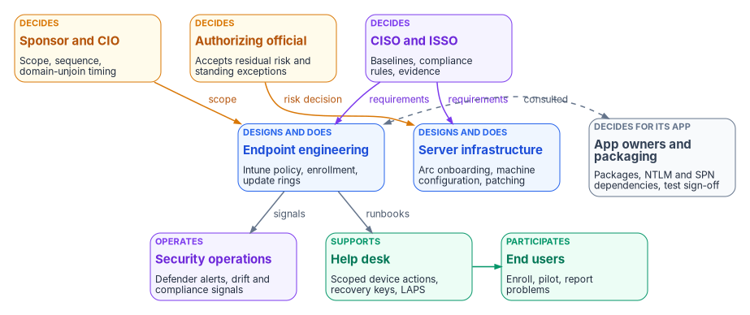
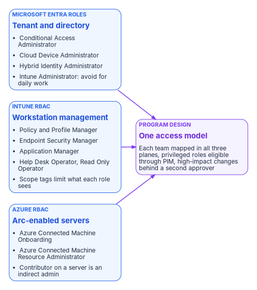

# Chapter 06 — Who Owns the Endpoint

*Group Policy let whoever could edit a GPO decide what every computer in an OU would do; Intune and Arc split that power across three role systems, so ownership has to be assigned on purpose or it will be assigned by accident.*

::: {.callout-note}
## In this chapter
The people who decide, do and advise on the endpoint: endpoint engineering, server infrastructure, security operations, the identity team, application owners and packaging, the help desk, end users, and the CISO, ISSO and authorizing official. A responsibility matrix covers baselines, compliance policy, application deployment, update rings, exceptions and retirement. A role map shows which Entra, Intune and Azure roles each team needs, and why there are three role systems instead of one.
:::

In an Active Directory estate, ownership of the endpoint was rarely written down. Whoever had edit rights on a Group Policy Object, and could link it to an OU, decided what every computer under that OU would do at its next refresh. Usually that was the same small team that ran the domain controllers. A security setting, a drive mapping and a software installation all travelled the same way, approved by the same people, often with no record beyond the GPO's version number. [Chapter 01](01-why-group-policy-cant-come-to-the-cloud.md) explains why that policy plane can't come to the cloud. This chapter deals with what replaces the people side of it.

The replacement isn't one console. Workstations are governed in Intune, servers in Azure through Arc and Azure Policy, and device identity and access in Microsoft Entra ID. Each has its own role system, its own audit log and its own idea of scope. The decisions that one GPO editor used to make now belong to several teams, and some of them carry risk that only the authorizing official can accept. [Book 02, Chapter 06](../b02-identity/06-who-owns-the-migration.md) covers ownership of the identity migration as a whole, including the Risk Management Framework definitions of the authorizing official, CISO, ISSO and system owner. This chapter applies the same model to devices and servers. The roles, the matrix and the role map below are the program's recommended model. Adapt them to the agency's governance, but keep one decider per row.

{#fig-ch06-endpoint-owners fig-alt="Three rows of cards. Top row, decision makers: the sponsor and CIO in amber, who own scope, sequence and domain-unjoin timing; the authorizing official in amber, who accepts residual risk and standing exceptions; and the CISO and ISSO in violet, who set baselines, compliance rules and evidence. Middle row: endpoint engineering in blue, which designs and does Intune policy, enrollment and update rings; server infrastructure in blue, which designs and does Arc onboarding, machine configuration and patching; and application owners and packaging in slate, who decide for their app on packages, NTLM and SPN dependencies and test sign-off. Bottom row: security operations in violet, which operates Defender alerts and drift and compliance signals; the help desk in green, which supports with scoped device actions, recovery keys and LAPS; and end users in green, who enroll, pilot and report problems. Arrows run from the sponsor to endpoint engineering labeled scope, from the authorizing official to server infrastructure labeled risk decision, and from the CISO and ISSO to both engineering teams labeled requirements. A dashed two-way arrow labeled consulted connects application owners and endpoint engineering. Endpoint engineering sends signals to security operations and runbooks to the help desk, which supports end users."}

## Where the roles come from

The endpoint project charter sets the starting point. It names a project sponsor and a project lead, both still to be appointed, and four domain leads: device identity, Group Policy sunset, Conditional Access and NTLM ([endpoint and device project charter](../../projects/endpoint-device-charter.md)). Those four domains are workstreams, not teams. Each one cuts across the teams below. Device identity needs the identity team and endpoint engineering. Group Policy sunset needs endpoint engineering, server infrastructure and the security office. Conditional Access is owned by the identity team under the CISO's requirements. NTLM restriction can't proceed without application owners. The program's model gives each domain lead the job of driving the workstream and keeping its evidence. The decisions inside the workstream go to the deciders named in the matrix.

[Chapter 05](05-the-governed-manual-and-retrofit-paths.md) supplies the other input: the path. On the manual path, the operator who runs a step also holds its change record. On the governed path, a recorded approval sits between the person who proposes a change and the change itself. The roles below are the same on both paths. What changes is whether the approval is recorded where the change happens.

## Decision rights and work are different things

The program separates three kinds of involvement, as Book 02 does. A role *decides* when it is accountable for the outcome and can say no. A role *does* the work when it builds, configures or runs the thing. A role is *consulted* when the decision can't be made well without its input, even though the decision isn't its to make.

The split matters more for devices than for almost anything else, because Group Policy trained a generation of administrators to treat the ability to change something as the right to decide it. In Intune that habit is how an endpoint engineer ends up setting the agency's risk posture by default. Setting a compliance grace period to 30 days is a risk decision. So is leaving a Group Policy setting in place alongside an Intune policy, or exempting a kiosk class from BitLocker. Each one is made in a console, by someone who may not know that a decision is being made.

## The roles

The **sponsor and CIO** set scope, funding and sequence. In the program's model they decide when the domain-unjoin waves happen, because unjoining ends the fallback every other team relies on, and they break ties between the endpoint and server teams. The charter treats domain unjoin as a separately sequenced decision outside the initial phase, and so does this book ([Chapter 02](02-the-hybrid-join-trap.md)).

The **CISO and ISSO** decide the control requirements the fleet has to meet. Those are the security baselines, the compliance rules a device must pass before Conditional Access trusts it, the update cadence for security patches, and the evidence an assessor will read. The ISSO assembles that evidence, tracks findings to closure, and is consulted on every change that alters a control.

The **authorizing official** accepts residual risk. For the endpoint, that means every standing exception: a device class excluded from a compliance rule, an application allowed to keep NTLM past the cutoff, a server that can't take the baseline, a deferral longer than the agency's policy allows. A temporary exception that nobody has reviewed in a year has become a risk acceptance. The program routes it to the authorizing official on a schedule, not just once.

**Endpoint engineering** designs and builds workstation management. It owns Intune configuration profiles and the settings catalog, compliance policies, enrollment (Group Policy–triggered for the existing fleet, Autopilot for new hardware), update rings, and the Group Policy retirement sequence in [Chapter 08](08-gpo-to-intune-policy-migration.md). Like identity engineering in Book 02, it's the team most likely to be over-trusted, because it holds the roles that can change every device at once. The program's answer is to give it least-privileged Intune roles and put a second approver in front of its high-impact changes, not to slow it down.

**Server infrastructure** owns the server side: Arc onboarding, tags, Azure machine configuration baselines, patching through Azure Update Manager or the agency's existing tooling, and the decision record for each server's eventual domain unjoin, which the sponsor schedules. It also owns the onboarding service principal. Microsoft makes the customer responsible for managing RBAC on Arc resources, rotating onboarding credentials and keeping the agent and extensions current.[^c06-arc-security]

**Security operations** receives what the fleet emits. That includes Defender for Endpoint alerts on workstations, Defender for Servers alerts on Arc servers, compliance state changes, and the drift findings from the program's loop. Defender for Servers Plan 1 and Plan 2 both provide the capabilities of Defender for Endpoint Plan 2, including endpoint detection and response.[^c06-mdfs] Security operations is consulted on the baselines and on exceptions, because it's the team that finds out when an exception gets used.

The **identity team** owns the Entra ID side of the device: device registration and hybrid join, Windows Hello for Business, Windows LAPS enablement in the tenant, and the Conditional Access policies that consume compliance state. [Book 02](../b02-identity/index.md) covers its migration-wide work, and [Book 04](../b04-access/index.md) covers the access policy design. In this book it's the team that turns a compliant device into an access decision.

**Application owners and packaging** decide for their applications. Packaging builds and tests the Intune app packages and the detection rules. Application owners know which of their applications still need NTLM, depend on an SPN, or depend on a Group Policy setting nobody else remembers. They're the only people who can sign off a test result or accept a cutover window for their own application. The charter puts redesign of application packaging and software distribution out of scope for the initial phase. Application owners are in scope from day one anyway, because the NTLM audit and the Group Policy overlap inventory both end at their door.

The **help desk** supports users through enrollment and carries out device actions on request: retire, wipe, sync, BitLocker key recovery and local administrator password recovery. Intune's built-in Help Desk Operator role can retire and wipe devices and run remote tasks,[^c06-intune-roles] and Entra's Helpdesk Administrator role can read LAPS metadata but not the password itself.[^c06-laps-entra] In the program's model, the help desk's identity verification procedure before a wipe or a key release is a CISO decision, not a help desk decision.

**End users** enroll their devices, join pilot waves and report what breaks. As in Book 02, the program treats enrollment completion rates and help desk ticket volume as go/no-go inputs for each wave.

## The responsibility matrix

D = decides (accountable) · R = does the work · C = consulted · blank = informed at most.

| Decision or work item | Sponsor / CIO | CISO / ISSO | AO | Endpoint eng. | Server infra. | SecOps | Identity | App owners / packaging | Help desk | Users |
|---|---|---|---|---|---|---|---|---|---|---|
| Path choice: manual, governed or retrofit (Chapter 05) | D | C | C | C | C | | | | | |
| Security baselines for workstations | | D | | R | | C | C | C | | |
| Security baselines for servers (machine configuration) | | D | | | R | C | | C | | |
| Compliance policy rules and grace period | | D | | R | | C | C | | C | |
| Conditional Access use of compliance state (Book 04) | | D | C | C | | C | R | | | |
| Application deployment: packaging, assignment, supersedence | | C | | R | | | | D, R | | C |
| Update rings and deferral periods | | D | | R | R | C | | C | | |
| Pausing a workstation ring after a bad update | | C | | D, R | | C | | C | C | |
| Pausing server patching after a bad update | | C | | | D, R | C | | C | | |
| Group Policy setting retirement, per setting class (Chapter 08) | | C | | D, R | R | | C | C | | |
| NTLM restriction stages, per application | | C | C | R | R | C | C | D | | |
| Exceptions: temporary, with an end date | | D | | R | R | C | | C | | |
| Exceptions: standing, or past the agency's limit | C | C | D | R | R | C | | C | | |
| Device retirement: retire, wipe, then directory cleanup | | C | | D, R | | | R | | R | C |
| Server retirement: extensions, Arc disconnect, stale resources | | C | | | D, R | | | C | | |
| Domain-unjoin wave timing (Chapter 02) | D | C | C | R | R | | C | C | C | |
| Help desk verification before wipe or key release | | D | | C | | C | C | | R | |
| Drift findings and compliance evidence (Chapter 10) | | D | C | R | R | R | | | | |
| Pilot and wave go/no-go | C | C | | D | C | C | C | C | C | C |

Three rows need comment. The update ring row splits deciding from doing, but the two pause rows don't. Pausing a quality update ring is an operational emergency stop, so the team that runs the ring decides it and tells the security office. That is the scenario Microsoft's update guidance describes: a problem shows up in the pilot ring and the administrator pauses the rollout.[^c06-wufb-pause] The application deployment row gives the decision to the application owner, not the endpoint team, because the endpoint team can push a package but can't judge whether it works. The exception rows split on time. A temporary exception with an end date is a control decision the CISO can make. One that has no end date, or has outlived the agency's limit, is a risk acceptance, and only the authorizing official can make it.

### Notes on the rows that Microsoft's tooling shapes

**Compliance and its grace period.** Every Intune compliance policy has a *Mark device noncompliant* action that defaults to zero days. The schedule can be set from 0 to 365 days, and Conditional Access acts on the device as soon as it's marked noncompliant. Optional actions can email the user, lock the device, or add it to a retire list. An administrator must still retire a device on that list explicitly.[^c06-noncompliance] The grace period is the security office's decision because it sets how long a device that fails policy keeps access.

**Update rings.** Update ring policies in Intune set deferral periods, deadlines, restart behavior and notifications, and are commonly used to stage test, pilot and production rings.[^c06-update-rings] If devices are managed by Windows Autopatch, the service may create and maintain the rings itself, and Microsoft says administrators typically shouldn't assign custom rings to those devices.[^c06-update-rings] Decide which model the agency uses before assigning ownership, because under Autopatch, endpoint engineering configures the Autopatch groups, not the rings.

**Retirement.** Device retirement is a sequence that spans three systems, and the order matters. Retire or wipe the device in Intune first. Retire removes company data and unenrolls the device but keeps personal content. Wipe resets the device to factory settings.[^c06-retire][^c06-wipe] Then clean up the Entra ID object. Microsoft's guidance is to disable it for a grace period before deleting it, because deletion can't be undone. Deleting the device also deletes its BitLocker recovery keys and its Entra-backed LAPS password, so back up any keys you may still need. For hybrid joined devices running Windows 10 or later, disable or delete the object in on-premises Active Directory and let sync carry the change. Deleting only the Entra object brings it back from sync as a new object in the Pending state.[^c06-stale][^c06-laps-entra] Retiring a server is a separate sequence. Remove the extensions, disconnect the agent, which deletes the Azure resource, and uninstall it. Servers decommissioned without that sequence leave stale Arc resources in the Disconnected state.[^c06-arc-uninstall]

## Three role systems, one access model

Decision rights don't change what a console lets someone do. Roles do, and for the endpoint there are three separate role systems.

{#fig-ch06-three-permission-planes fig-alt="Three blue cards on the left, each feeding a violet card on the right. The first blue card, Microsoft Entra roles for the tenant and directory, lists Conditional Access Administrator, Cloud Device Administrator, Hybrid Identity Administrator, and Intune Administrator marked avoid for daily work. The second, Intune RBAC for workstation management, lists Policy and Profile Manager, Endpoint Security Manager, Application Manager, Help Desk Operator and Read Only Operator, and notes that scope tags limit what each role sees. The third, Azure RBAC for Arc-enabled servers, lists Azure Connected Machine Onboarding and Azure Connected Machine Resource Administrator, and notes that Contributor on a server is an indirect admin. The violet card, labeled Program design, One access model, reads: each team mapped in all three planes, privileged roles eligible through PIM, high-impact changes behind a second approver."}

**Microsoft Entra roles** govern the tenant and the directory. The Intune Administrator role is a privileged Entra role with global read and write across Intune. Microsoft advises against using it, or Global Administrator, for routine Intune administration.[^c06-intune-rbac] Cloud Device Administrator can enable, disable and delete devices in Entra ID and read BitLocker keys, and nothing else on the device.[^c06-entra-roles] Conditional Access Administrator manages Conditional Access.[^c06-entra-roles]

**Intune RBAC** governs workstation management. Its built-in roles include Application Manager, Policy and Profile Manager, Endpoint Security Manager, Help Desk Operator, Read Only Operator and Intune Role Administrator. Intune Role Administrator is the only Intune role that can assign permissions to administrators.[^c06-intune-rbac] Scope tags limit which objects an administrator can see.[^c06-scope-tags] Intune has supported unlicensed administrators since June 2021, but accounts created before that change, and administrators in nested groups, still need a license.[^c06-intune-rbac]

**Azure RBAC** governs Arc-enabled servers. Azure Connected Machine Onboarding can create and read Arc server resources but can't manage extensions or delete servers. Azure Connected Machine Resource Administrator can read, modify, re-onboard and delete them. Microsoft warns that extensions can run arbitrary scripts in a privileged context, so anyone with Contributor on an Arc server resource should be treated as an indirect administrator of the server.[^c06-arc-roles] That warning changes who should hold Contributor on server resource groups. In AD terms it's the same as local administrator.

The program maps each team to the least-privileged role in each system it touches, makes privileged Entra roles eligible through Privileged Identity Management instead of permanent, and puts a second approver in front of high-impact changes.

| Team | Microsoft Entra | Intune RBAC | Azure RBAC (Arc) |
|---|---|---|---|
| Endpoint engineering | None routinely; Intune Administrator only through PIM for tenant-level tasks | Policy and Profile Manager; Application Manager for app work | None |
| Server infrastructure | None routinely | None | Azure Connected Machine Resource Administrator on server resource groups; Onboarding role held only by the onboarding service principal[^c06-arc-roles] |
| Security office and SecOps | Security Reader | Endpoint Security Manager for baselines and endpoint security policy;[^c06-intune-roles] Read Only Operator for review | Reader, plus Defender for Cloud roles |
| Identity team | Conditional Access Administrator; Cloud Device Administrator for device lifecycle; Hybrid Identity Administrator for sync[^c06-entra-roles] | Read Only Operator | None |
| Application packaging | None | Application Manager | None |
| Help desk | Helpdesk Administrator scoped to an administrative unit (LAPS metadata only) | Help Desk Operator, limited by scope tags | None |
| ISSO and assessors | Global Reader or Security Reader | Read Only Operator | Reader |

Access to the local administrator password needs its own decision. In Entra ID, Cloud Device Administrator and Intune Administrator can read backed-up LAPS passwords by default. Helpdesk Administrator, Security Administrator and Security Reader can read only the metadata. A custom role can grant password read on its own if the agency has Entra ID P1 or P2.[^c06-laps-entra] If the help desk needs to release local administrator passwords, give it a custom role with that one permission, not Cloud Device Administrator.

### The second approver

Intune Multi Admin Approval lets an agency require a second administrator to approve changes to protected resources before Intune applies them. Protected resources can include app deployments, compliance policies, settings catalog policies, scripts, role assignments, and the wipe, retire and delete device actions. The requester can't approve their own request. Changes submitted by a Global Administrator or Intune Administrator still need a different approver.[^c06-maa] Approvers must be in a security group that is directly assigned to an Intune role.[^c06-maa] In the program's model, the security office owns the approver groups and endpoint engineering submits the requests. On the governed path, the approval becomes the L3 approval reference described in [Chapter 05](05-the-governed-manual-and-retrofit-paths.md). On the manual path, it's the cheapest way to get a recorded second pair of eyes without an orchestration platform.

## What changes from Group Policy, in one table

| Group Policy habit | What replaces it |
|---|---|
| Whoever can edit and link a GPO decides for the whole OU | Deciders by row in the matrix; doers hold least-privileged roles in three systems |
| Domain Admins can change anything, including every computer | Intune Administrator and Global Administrator kept out of daily work; privileged roles eligible, not permanent |
| Local administrator on a server is the server's admin | Contributor on the Arc resource is also an admin, because extensions run with privilege |
| An exception is a GPO filtered away from one group | An exception is a record with an owner and an end date, reviewed by the CISO or accepted by the AO |
| Change history is the GPO version number | Intune and Azure audit logs, Multi Admin Approval records, and on the governed path the approval reference |
| Retirement is deleting the computer object | Retire or wipe, then disable, then delete, with key backup checked first |

::: {.callout-tip}
## Continue the book
[← Previous: Chapter 05 — The Governed, Manual and Retrofit Paths](05-the-governed-manual-and-retrofit-paths.md) · [Book index](index.md) · [Next: Chapter 07 — The GPO Sunset Program →](07-the-gpo-sunset-program.md)
:::

[^c06-arc-security]: Microsoft Learn, "Security overview for Azure Arc-enabled servers," section "Responsibilities," <https://learn.microsoft.com/azure/azure-arc/servers/security-overview> (accessed Oct 20, 2026).
[^c06-mdfs]: Microsoft Learn, "Common questions about Defender for Servers," section "Defender for Endpoint integration," <https://learn.microsoft.com/azure/defender-for-cloud/faq-defender-for-servers> (accessed Oct 20, 2026).
[^c06-intune-roles]: Microsoft Learn, "Built-in role permissions for Microsoft Intune," <https://learn.microsoft.com/intune/fundamentals/role-based-access-control/ref-built-in-roles> (accessed Oct 20, 2026).
[^c06-laps-entra]: Microsoft Learn, "Windows Local Administrator Password Solution in Microsoft Entra ID," <https://learn.microsoft.com/entra/identity/devices/howto-manage-local-admin-passwords> (accessed Oct 20, 2026).
[^c06-wufb-pause]: Microsoft Learn, "Walkthrough: Use CSPs and MDMs to configure Windows Update client policies," section "Manage Windows Update offerings," <https://learn.microsoft.com/windows/deployment/update/waas-wufb-csp-mdm> (accessed Oct 20, 2026).
[^c06-noncompliance]: Microsoft Learn, "Configure actions for noncompliant devices in Intune," <https://learn.microsoft.com/intune/device-security/compliance/configure-noncompliance-actions> (accessed Oct 20, 2026).
[^c06-update-rings]: Microsoft Learn, "Manage Windows Update ring policies," <https://learn.microsoft.com/intune/device-updates/windows/manage-update-rings> (accessed Oct 20, 2026).
[^c06-retire]: Microsoft Learn, "Device action: retire," <https://learn.microsoft.com/intune/device-management/actions/retire> (accessed Oct 20, 2026).
[^c06-wipe]: Microsoft Learn, "Wipe devices with Microsoft Intune," <https://learn.microsoft.com/intune/device-management/actions/wipe> (accessed Oct 20, 2026).
[^c06-stale]: Microsoft Learn, "How To: Manage stale devices in Microsoft Entra ID," <https://learn.microsoft.com/entra/identity/devices/manage-stale-devices> (accessed Oct 20, 2026).
[^c06-arc-uninstall]: Microsoft Learn, "Uninstall the Azure Connected Machine agent from Arc-enabled servers," <https://learn.microsoft.com/azure/azure-arc/servers/uninstall-agent> (accessed Oct 20, 2026).
[^c06-intune-rbac]: Microsoft Learn, "Role-based access control (RBAC) with Microsoft Intune," <https://learn.microsoft.com/intune/fundamentals/role-based-access-control/overview> (accessed Oct 20, 2026).
[^c06-entra-roles]: Microsoft Learn, "Microsoft Entra built-in roles," <https://learn.microsoft.com/entra/identity/role-based-access-control/permissions-reference> (accessed Oct 20, 2026).
[^c06-scope-tags]: Microsoft Learn, "Permissions, scope tags, and approvals for deployments in Microsoft Intune," section "Scope tags," <https://learn.microsoft.com/intune/device-management/deployments/rbac-scope-tags> (accessed Oct 20, 2026).
[^c06-arc-roles]: Microsoft Learn, "Identity and authorization" (Azure Arc-enabled servers security), section "RBAC roles," <https://learn.microsoft.com/azure/azure-arc/servers/security-identity-authorization> (accessed Oct 20, 2026).
[^c06-maa]: Microsoft Learn, "Use access policies to require multi admin approval," <https://learn.microsoft.com/intune/fundamentals/role-based-access-control/multi-admin-approval> (accessed Oct 20, 2026).
