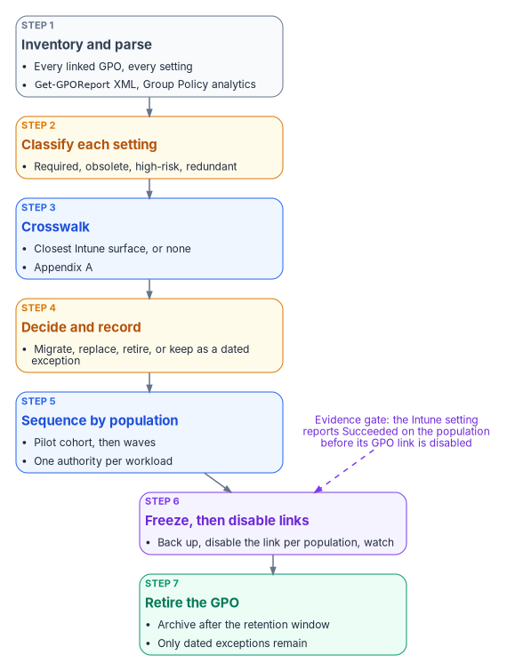
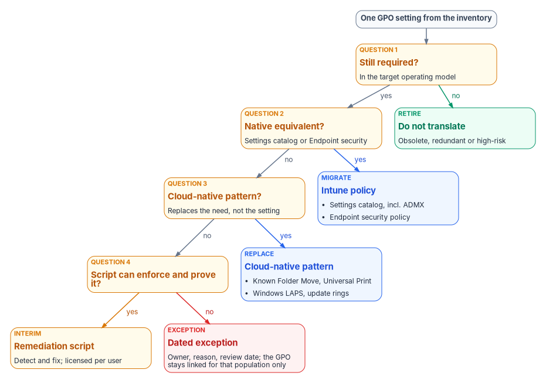

# Chapter 07 — The GPO Sunset Program

*The goal is to retire the legacy policy surface, not to reproduce it; the program is measured by GPOs retired with evidence, not by settings copied.*

::: {.callout-note}
## In this chapter
How the Federal Modernization Program runs the Group Policy sunset on the existing fleet: the seven steps from inventory to retirement, what Group Policy analytics can and can't tell you, how each setting is classified and given a disposition, and how the work is sequenced by population. The coexistence rules that decide which policy wins while GPOs and Intune both touch a device, how GPOs are frozen, unlinked and retired, what the end state looks like, and the principles behind every step. The setting-by-setting mechanics belong to [Chapter 08](08-gpo-to-intune-policy-migration.md); the crosswalk is [Appendix A](appendix-a-gpo-to-intune-crosswalk.md).
:::

Three related but distinct efforts touch Intune during modernization, and the program keeps them apart:

1. **Intune-first onboarding** gives net-new devices their governance at procurement time, so they never depend on Group Policy at all. [Chapter 04](04-intune-first-onboarding.md) covers it.
2. **The GPO sunset**, this chapter, is the existing-fleet program. It replaces Group Policy Objects on endpoints that are already deployed and ends when those GPOs are formally retired.
3. **Regenerate, not copy** is the philosophy that governs how replacement policies are authored. It isn't a separate program. The Client-Server to Hybrid-Cloud series sets it out in [Chapter 05, Policy Transformation](https://github.com/WhalerMike/modernization-workbook/blob/main/docs/client-server-to-hybrid-cloud/05-policy-transformation.md).

The sunset sits between the other two. It inherits devices that onboarding never touched and applies the regenerate-not-copy philosophy to them, one population at a time. [Chapter 01](01-why-group-policy-cant-come-to-the-cloud.md) explains why the work can't be a migration in the literal sense. Microsoft's own guidance for cloud-native Windows says the same: lifting and shifting existing Group Policy settings isn't the preferred approach, and trying to assess every GPO and every setting is time-consuming and likely impractical. The guidance is to identify the mandatory settings, compare them with the available MDM settings, and treat the gaps as blockers.[^c07-cloud-native] The program turns that advice into a repeatable sequence.

{#fig-ch07-sunset-pipeline fig-alt="A vertical chain of seven cards. Step 1, slate, inventory and parse: every linked GPO and every setting, using Get-GPOReport XML and Group Policy analytics. Step 2, amber, classify each setting as required, obsolete, high-risk or redundant. Step 3, blue, crosswalk to the closest Intune surface or none, referring to Appendix A. Step 4, amber, decide and record: migrate, replace, retire, or keep as a dated exception. Step 5, blue, sequence by population: a pilot cohort, then waves, with one authority per workload. Step 6, violet, freeze, then disable links: back up, disable the link per population, and watch. Step 7, green, retire the GPO: archive after the retention window, leaving only dated exceptions. A violet note with a dashed arrow into step 6 reads: evidence gate, the Intune setting reports Succeeded on the population before its GPO link is disabled."}

## The program at a glance

The program's reference sequence has seven phases. Each one ends on an exit condition, and the next phase doesn't start until that condition is met.

| Phase | Focus | Exit condition |
|---|---|---|
| 1 | Inventory and classify | Complete GPO and setting inventory; high-risk and obsolete settings identified |
| 2 | Coexistence planning | Authority for each workload (Configuration Manager or Intune) decided; conflict risks documented |
| 3 | Baseline policy authoring | Compliance, configuration and endpoint security baselines written for the target state, under regenerate-not-copy |
| 4 | Pilot | A representative cohort receives the Intune policies while its GPOs are still linked; conflicts measured |
| 5 | Workload cutover | Authority for each workload moves to Intune; the matching GPO links are disabled for that population |
| 6 | Verification and residual cleanup | Residual GPO settings confirmed absent or deliberately retained; evidence collected |
| 7 | Formal retirement | GPO objects retired, or retained only for documented exceptions; program closed |

An earlier, illustrative version of the same seven-phase shape is worth keeping in mind because it names the GPO-level decision explicitly: inventory and assess; classify each GPO as retire, regenerate or retain temporarily; author replacements under regenerate-not-copy; pilot on a controlled cohort; expand with continuous validation; run a monitored coexistence period; and retire each GPO once the device-management policy owns its settings. That version described coexistence as "last writer wins." It isn't, as the coexistence rules below show: for settings in the Policy CSP, Group Policy wins unless `MDMWinsOverGP` is set; outside the Policy CSP, the outcome is a race with no guaranteed winner. Neither is something to monitor and accept.

For a large fleet the program runs for months, not weeks. The timeline depends on the size of the inventory, the co-management state of the fleet, and the number of exceptions. [Chapter 08](08-gpo-to-intune-policy-migration.md) breaks the phases into their technical tasks and durations. This chapter stays at the program level: the steps every phase draws on, and the rules that keep them honest.

## Step 1: Inventory and parse

Nothing is translated or retired until it is inventoried. The parse extracts every setting from every linked GPO and records, at a minimum, the GPO name, the link path, the setting path, and the current value. Record the targeting as well, because it's the part that doesn't survive the move: security filtering, WMI filters, and whether the GPO is linked at all.

`Get-GPOReport` produces that raw material. It reports, for each GPO, its details, links, security filtering, WMI filtering, delegation, and computer and user configuration, in XML or HTML, for one GPO or for every GPO in the domain.[^c07-getgporeport]

::: {.callout-warning}
The PowerShell in this chapter is illustrative. It hasn't been tested against a production forest. Review it, and run it first against a lab domain, before using it in production.
:::

```powershell
# Read-only. One XML report per GPO, which is the shape Group Policy analytics imports.
Import-Module GroupPolicy

$exportPath = 'C:\GPOInventory'
New-Item -ItemType Directory -Path $exportPath -Force | Out-Null

Get-GPO -All | ForEach-Object {
    $file = Join-Path $exportPath ("{0}.xml" -f $_.Id)
    Get-GPOReport -Guid $_.Id -ReportType Xml -Path $file
}

# Flag any report too large for a single Group Policy analytics import (4 MB per GPO).
Get-ChildItem $exportPath -Filter *.xml |
    Where-Object Length -gt 4MB |
    Select-Object Name, @{ Name = 'SizeMB'; Expression = { [math]::Round($_.Length / 1MB, 2) } }
```

The program's GPO triage script, `Invoke-GpoMigrationTriage.ps1`, works on the same inventory. It sorts every live GPO onto a target plane, Intune for workstation-scope policy and Azure Arc for server-scope policy, using two classifiers run side by side (the operating systems predominant in the linked OUs, and the OU names), so that disagreements between them surface instead of hiding behind one guess. Server-scope GPOs leave this program for [Chapter 09](09-servers-under-azure-arc.md).

### What Group Policy analytics adds

Group Policy analytics in Intune imports those XML exports and shows, for each GPO, the share of its settings that have a matching setting available to MDM providers, any settings it can't analyze, whether the GPO is linked to an OU, and when it was last imported. Drilling into a GPO shows each setting with its category, value, user or device scope, minimum Windows build, the configuration service provider (CSP) behind it, and its OMA-URI path.[^c07-gpa] The migration readiness report sorts every setting into *Ready for migration*, *Not supported* or *Deprecated*.[^c07-gpa]

The tool has limits the program has to plan around:

- **Size and encoding.** A single GPO export can't be larger than 4 MB, and files without proper Unicode encoding fail to import.[^c07-gpa]
- **What it parses.** It reads the Policy, PassportForWork, BitLocker, Firewall and AppLocker CSPs and Group Policy preferences. Settings outside those appear as unknown settings.[^c07-gpa]
- **Language.** Only non-ADMX settings in English are supported. A GPO with settings in another language produces an inaccurate MDM support percentage.[^c07-gpa]
- **Visibility.** An imported GPO carries the scope tags chosen at import, or the Default tag. Administrators without one of those tags can't see the import or migrate it.[^c07-gpa]
- **Freshness.** Microsoft updates the mapping over time, and imported GPOs pick up the changes without being reimported. After you add or remove imports, the readiness report can take about 20 minutes to refresh.[^c07-gpa]

Group Policy analytics can also create a settings catalog policy directly from an imported GPO. Microsoft describes that migration as best effort. Some settings move to a different setting with a similar effect, some fail and are reported in notifications, and firewall rules and AppLocker settings can't be migrated this way at all; they belong in Endpoint security. When several imported GPOs set the same setting to different values, the migration stops and asks you to pick one.[^c07-gpa-migrate] The program treats that last behavior as a useful by-product: it surfaces the GPO-on-GPO conflicts that OU precedence used to hide.

The program uses the readiness report as evidence that an equivalent *exists*, never as evidence that a setting is *needed*. A high MDM support percentage on a GPO full of obsolete settings is still a GPO full of obsolete settings. Microsoft's own tip on the migrate feature is not to include all Group Policy settings without reviewing them.[^c07-gpa-migrate]

## Step 2: Classify each setting

Every setting in the inventory gets one tag.

| Tag | Meaning | Typical action |
|---|---|---|
| Required | Still needed in the target operating model | Translate to a modern control |
| Obsolete | No longer relevant: an old Windows version, a retired product, a network assumption that no longer holds | Retire |
| High-risk | Weakens security or creates an operational hazard | Retire, or replace with a stronger control |
| Redundant | Already enforced by another control, another GPO, or a Windows default | Retire |

A required setting then gets a disposition. The program asks four questions, in order, and the first "yes" decides where the setting lands:

1. **Is it still required in the target operating model?** If not, retire it. Group Policy accumulated settings that existed only because Group Policy could set them.
2. **Does a native Intune equivalent exist?** Most do, either in the settings catalog or in an Endpoint security policy.
3. **Does a cloud-native pattern remove the need for it?** Folder redirection becomes OneDrive Known Folder Move; mapped printers become Universal Print; WSUS targeting becomes update rings. The pattern replaces the need, not the setting.
4. **Can a script enforce it and prove it?** If so, it becomes a Remediation, and it is reviewed later for a native replacement.

A setting that fails all four becomes a dated exception, with an owner, a reason and a review date. Its GPO stays linked for that population and no other. For every disposition, also decide whether the control is a configuration (set it), a compliance requirement (evaluate it and feed Conditional Access), or both, and record what evidence will prove the control is in effect. Compliance policies evaluate the state that the configuration policies produce; they don't replace them.[^c07-es] Conditional Access and device-compliance-based access belong to [Book 04](../b04-access/index.md).

{#fig-ch07-setting-dispositions fig-alt="A decision tree that starts from a slate pill, one GPO setting from the inventory. Question 1, still required in the target operating model: if no, a green card, retire, do not translate, obsolete, redundant or high-risk. If yes, question 2, native equivalent in the settings catalog or Endpoint security: if yes, a blue card, migrate to an Intune policy, settings catalog including ADMX, or an Endpoint security policy. If no, question 3, a cloud-native pattern that replaces the need rather than the setting: if yes, a blue card, replace with a cloud-native pattern such as Known Folder Move, Universal Print, Windows LAPS or update rings. If no, question 4, can a script enforce and prove it: if yes, an amber interim card, remediation script, detect and fix, licensed per user. If no, a red card, dated exception with owner, reason and review date, where the GPO stays linked for that population only."}

### The landing zones

The four questions send a required setting to one of four Intune surfaces.

| Landing zone | What goes there | What to know |
|---|---|---|
| Settings catalog | Most Administrative Template (ADMX) and security settings | Lists thousands of Windows settings generated from the Windows CSPs, including built-in ADMX settings that need no OMA-URI.[^c07-settings-catalog][^c07-admx-catalog] The older *Administrative Templates* profile type has been deprecated and read-only since the 2412 release.[^c07-admx-catalog] |
| Imported ADMX | Third-party and custom templates not built in | Public preview. At most 20 ADMX files of 1 MB or less, one ADML file per ADMX, `en-us` only, dependencies imported first.[^c07-admx-import] |
| Endpoint security | Antivirus, disk encryption, firewall, attack surface reduction, account protection (including Windows LAPS), EDR | Purpose-built security policies. Microsoft's best practice is to manage a given setting through Endpoint security policies or security baselines, not both.[^c07-es] |
| Remediations and platform scripts | Logic no CSP exposes | Remediations need users licensed for Windows Enterprise E3 or E5, Windows Education A3 or A5, or Windows VDA, and the tenant allows up to 200 script packages.[^c07-remediations] Platform scripts run once per assignment, time out after 30 minutes, and rerun only when the script or policy changes.[^c07-scripts] |

[Appendix A](appendix-a-gpo-to-intune-crosswalk.md) maps each Group Policy area to its landing zone, with the limits that apply.

## Step 3: Crosswalk

The crosswalk answers one question per required setting: what is the closest Intune surface? It is a semantic translation reference, a lookup, not a prescription to reproduce every GPO setting one for one. It tells engineers where a control lands, not what value it should carry. The value comes from current policy intent: the compliance baseline, the persona model, the Conditional Access strategy and attribute-scoped targeting. Porting old values and OU-filter targeting into Intune reproduces old drift on a new surface.

Two crosswalk facts shape the plan more than any single row:

- **The targeting model changes.** On-premises policy is applied in local, site, domain and OU order, with later layers overwriting earlier ones. Intune has no hierarchy; policies apply to the groups they are assigned to.[^c07-tutorial-gp] Every GPO link becomes an assignment (see the assignment strategy under Step 5).
- **Some areas move to different CSPs.** A GPO setting and its Intune equivalent can sit in different CSPs, and that decides how they behave during coexistence (see below).

## Step 4: Decide and record

The output of the first three steps is a decision record per GPO and per setting. Each record holds the setting, its tag, its disposition (migrate, replace, retire, or exception), the target Intune policy and assignment, the evidence method, and an owner. The records feed the migration work in [Chapter 08](08-gpo-to-intune-policy-migration.md) and the access-policy work in [Book 04](../b04-access/index.md). They are also what a reviewer reads when a setting goes missing after cutover: the record shows whether it was retired on purpose.

Each replacement policy carries four things: its target population, expressed as dynamic groups or filters derived from the attribute model; a setting table with intended values; the GPO settings it replaces; and how it will be verified.

## Step 5: Sequence by population

The program moves populations, not settings. A pilot cohort, representative across tiers, regions and departments, receives the Intune policies while its GPOs are still linked. Then the program expands in waves. Within the work, high-risk and high-dependency settings are dealt with before broad rollout, so the riskiest changes are proven on the smallest population.

### Assignment strategy

Populations are defined by attributes, not by OU placement. Every replacement policy is assigned through three layers:

- **Include groups**: dynamic device groups that match the policy's intended tier, environment and role, built from the program's attribute model.
- **Exclude groups**: break-glass groups for emergency override, and staging groups during a phased rollout.
- **Assignment filters**: rules on device properties, applied on top of the group assignment in include or exclude mode, and evaluated when the device enrolls or checks in.[^c07-filters]

Two Microsoft details shape the choice between them. Dynamic device group membership takes processing time before devices appear in the group, so for time-sensitive targeting Microsoft suggests assignment filters, which evaluate at check-in without waiting for membership.[^c07-assign] And filters can't replace groups everywhere: Conditional Access and licensing need Entra group membership.[^c07-targeting] A tenant can hold up to 200 assignment filters.[^c07-filters]

### One authority per workload

Where Configuration Manager still manages the fleet, co-management is the mechanism for moving authority one workload at a time. Co-management supports seven workloads: compliance policies, Windows Update policies, resource access policies, Endpoint Protection, device configuration, Office Click-to-Run apps, and client apps. None has to move, and until a workload is switched, Configuration Manager keeps managing it.[^c07-comanage] Each workload's slider has three positions: Configuration Manager, Pilot Intune (only the devices in that workload's pilot collection), and Intune (every co-managed device).[^c07-switch]

| Workload | Starting point (GPO and Configuration Manager) | Pilot | End state |
|---|---|---|---|
| Compliance policies | Configuration Manager | Pilot Intune | Intune |
| Device configuration | Configuration Manager | Pilot Intune | Intune |
| Endpoint Protection | Configuration Manager | Pilot Intune | Intune |
| Windows Update policies | Configuration Manager | Pilot Intune | Intune |

Four co-management facts change how the program sequences this:

- **Device configuration carries two other workloads.** Switching it also moves resource access and Endpoint Protection. A settings catalog policy is controlled by the device configuration slider regardless of what it contains.[^c07-comanage]
- **Resource access is gone as a separate workload.** Configuration Manager stopped supporting its company resource access features and this workload in version 2203, and from version 2403 the slider is mandated to Intune.[^c07-comanage]
- **Pilot doesn't clean up.** With Pilot Intune selected for Endpoint Protection or device configuration, Intune deploys policies but doesn't remove them on unassignment; removal needs the workload switched fully to Intune.[^c07-switch] Plan rollback on that basis.
- **Exceptions can stay with Configuration Manager.** After device configuration moves to Intune, a Configuration Manager configuration baseline can still be deployed to co-managed devices for a setting Intune doesn't offer, if it is marked to apply even for co-managed clients.[^c07-comanage] That is a legitimate home for a dated exception.

## Coexistence: who wins

While a population has both GPOs and Intune policies, three conflict systems are in play. [Chapter 01](01-why-group-policy-cant-come-to-the-cloud.md) explains why running both isn't a safe middle ground; these are the rules the program plans against.

| Conflict | What happens | Program rule |
|---|---|---|
| Compliance policy vs. compliance policy | The most restrictive setting applies.[^c07-conflicts] | Acceptable; verify the intended value |
| Compliance policy vs. configuration policy | The compliance policy's setting takes precedence.[^c07-conflicts] | Keep compliance thresholds aligned with configured values |
| Configuration vs. configuration (settings catalog, Endpoint security, security baselines, templates) | All policy types have equal priority. The conflict is reported, and the setting might fail to apply until it is resolved manually.[^c07-es-manage][^c07-conflicts] | Each setting is owned by exactly one Intune policy |
| GPO vs. MDM, settings in the Policy CSP | Group Policy keeps winning unless `MDMWinsOverGP` is set to 1. With it set, an MDM policy that has a Group Policy equivalent blocks the GP setting.[^c07-mdmwins] | Set it where the population is in transition; remove the GPO copy as Intune takes the setting |
| GPO vs. MDM, settings in other CSPs | `MDMWinsOverGP` doesn't apply, for example to the Defender CSP; Microsoft warns of a race condition with no guarantee which one wins.[^c07-mdmwins] Windows Hello for Business, in the PassportForWork CSP, shouldn't be configured through both at all.[^c07-whfb] | Never configure these in both places; unlink first or exclude the population |
| GPO vs. MDM, Windows Update | Microsoft recommends `IgnoreWindowsUpdateGroupPolicies` over `MDMWinsOverGP` for update conflicts. It applies to Windows 11, version 24H2 with KB5101684 and later.[^c07-update-csp] | Use it on eligible builds; on older builds, unlink the update GPO when the workload moves |
| Configuration Manager vs. Intune | The co-management slider sets one authority per workload.[^c07-comanage] | Never deploy Intune policies for a workload still on Configuration Manager |

Two corrections to earlier program material are worth stating. Configuration profiles don't resolve conflicts by "last write wins," and Endpoint security policies don't automatically take precedence over configuration profiles. Both are equal sources, and a conflict is a fault to fix, not a rule to rely on.

## Freezing and unlinking GPOs

Disabling a GPO link is the moment the program changes production behavior, so it is gated.

1. **Freeze.** Once a GPO is inventoried, its settings are under change control. Nobody adds settings to a GPO that is scheduled for retirement; new requirements go to Intune.
2. **Back up.** `Backup-GPO` backs up one GPO or every GPO in a domain to an existing backup directory, and the GPMC restores from it.[^c07-backupgpo]
3. **Prove the replacement.** The Intune policy that owns each setting reports success on the target population, and the pilot showed no conflicts.
4. **Disable the link, not the GPO.** `Set-GPLink -LinkEnabled No` turns off one link while leaving the GPO and its other links in place, so the change is scoped to one population and reverses with one command.[^c07-setgplink]
5. **Watch, then retire.** After a retention window with no regressions, the GPO is archived and removed. The program's reference plan disables rather than deletes, keeps the GPO for 90 days as a rollback safety net, and only then archives and deletes it. That window is a program design choice, sized to the fleet's patch and refresh cycle.

```powershell
# Back up, then disable one GPO link for one population's OU. Reversible with -LinkEnabled Yes.
$gpoName = 'FMP-Legacy-Workstation-Baseline'
$target  = 'OU=Pilot-Workstations,DC=example,DC=gov'

Backup-GPO -Name $gpoName -Path '\\fileserver\GPOBackups' -Comment 'Pre-unlink, GPO sunset wave 1'
Set-GPLink -Name $gpoName -Target $target -LinkEnabled No
```

Unlinking doesn't always undo what a GPO did. Group Policy preferences don't remove their settings when a GPO stops applying, unless the item was configured with *Remove this item when it is no longer applied*.[^c07-gpp] Drive maps, registry items, local users and groups, and scheduled tasks delivered as preferences stay on the device after the link is gone. Co-management has a matching trap: Intune doesn't revert settings when policy is unassigned while the device configuration workload is still on Configuration Manager.[^c07-tattoo] So the decision record for every preference item states what clears it: an Intune policy that takes over the value, or a Remediation that removes it.

## The end state

The program is done when:

- No GPO in scope is linked to an OU containing migrated devices. Devices that are Entra joined and not domain joined receive no domain GPOs at all. Hybrid-joined devices still process whatever remains linked to their OU, which is one reason [Chapter 02](02-the-hybrid-join-trap.md) treats hybrid join as a trap rather than a destination.
- Every required setting has exactly one owner, an Intune policy, and that policy reports per-setting status.
- Every remaining GPO link is a dated exception in the register, with an owner and a review date.
- Every retired GPO has a backup and a decision record that explains its retirement.
- The workload sliders are at Intune, or Configuration Manager has been retired from the endpoint fleet.

Group Policy doesn't vanish from the estate on that day. Domain controllers and servers that stay domain joined keep their GPOs until the server program moves them; [Chapter 09](09-servers-under-azure-arc.md) covers servers under Azure Arc. [Chapter 10](10-operating-and-evidencing-the-fleet.md) covers how the fleet is evidenced once Intune is the authority.

## Methodology principles

These principles govern every step above.

1. **Regenerate, don't copy.** The crosswalk says where a control lands. Current policy intent says what it should be.
2. **Retire before you translate.** Obsolete, redundant and high-risk settings are retired, not carried forward. A smaller surface is the point of the program.
3. **One authority per setting.** At any moment, each setting on each device has exactly one owner: a GPO, a Configuration Manager workload, or one Intune policy. Overlap is a defect.
4. **Target by attribute, not by placement.** Assignments use dynamic groups and filters derived from the attribute model, never a reconstruction of the OU tree.
5. **Evidence before unlink.** A GPO link is disabled only after the replacement reports success on that population.
6. **Disable before delete.** Links are disabled, GPOs are backed up and retained, and deletion comes last.
7. **Exceptions expire.** A setting with no modern home is an exception with an owner and a review date, not a permanent GPO.
8. **Measure the retired surface.** Success is GPOs and links retired with evidence, not the number of settings migrated.

::: {.callout-tip}
## Continue the book
[← Previous: Chapter 06 — Who Owns the Endpoint](06-who-owns-the-endpoint.md) · [Book index](index.md) · [Next: Chapter 08 — GPO to Intune Policy Migration →](08-gpo-to-intune-policy-migration.md)
:::

[^c07-cloud-native]: Microsoft Learn, "Tutorial: Set up cloud-native Windows endpoints with Microsoft Intune," section "Phase 4 – Apply customizations and review your on-premises configuration," <https://learn.microsoft.com/intune/solutions/cloud-native-endpoints/tutorial-cloud-native-setup> (accessed Oct 20, 2026).
[^c07-getgporeport]: Microsoft Learn, "Get-GPOReport," GroupPolicy module, <https://learn.microsoft.com/powershell/module/grouppolicy/get-gporeport?view=windowsserver2025-ps> (accessed Oct 20, 2026).
[^c07-gpa]: Microsoft Learn, "Import and analyze your on-premises GPOs using Group Policy analytics in Microsoft Intune," <https://learn.microsoft.com/intune/device-configuration/import-group-policy-analytics> (accessed Oct 20, 2026).
[^c07-gpa-migrate]: Microsoft Learn, "Create a Settings Catalog policy using your imported GPOs in Microsoft Intune," sections "What you need to know" and "Conflicting settings are detected early," <https://learn.microsoft.com/intune/device-configuration/migrate-group-policy> (accessed Oct 20, 2026).
[^c07-es]: Microsoft Learn, "Manage endpoint security in Microsoft Intune," sections "Choose the right policy type" and "Avoid policy conflicts," <https://learn.microsoft.com/intune/device-security/endpoint-security-policies> (accessed Oct 20, 2026).
[^c07-settings-catalog]: Microsoft Learn, "Use the Intune settings catalog to configure settings," <https://learn.microsoft.com/intune/device-configuration/settings-catalog/> (accessed Oct 20, 2026).
[^c07-admx-catalog]: Microsoft Learn, "Configure ADMX settings using the settings catalog in Microsoft Intune," <https://learn.microsoft.com/intune/device-configuration/settings-catalog/configure-admx-templates-windows> (accessed Oct 20, 2026).
[^c07-admx-import]: Microsoft Learn, "Import custom ADMX and ADML administrative templates into Microsoft Intune (public preview)," section "What you need to know," <https://learn.microsoft.com/intune/device-configuration/settings-catalog/import-custom-admx-templates> (accessed Oct 20, 2026).
[^c07-remediations]: Microsoft Learn, "Remediations," section "Prerequisites," <https://learn.microsoft.com/intune/device-management/tools/deploy-remediations> (accessed Oct 20, 2026).
[^c07-scripts]: Microsoft Learn, "Use PowerShell Scripts on Windows Devices in Intune," section "Before you begin," <https://learn.microsoft.com/intune/device-management/tools/run-powershell-scripts-windows> (accessed Oct 20, 2026).
[^c07-tutorial-gp]: Microsoft Learn, "Walkthrough - Create an Intune settings catalog policy and compare with on-premises ADMX," section "Create groups, and add users," <https://learn.microsoft.com/intune/device-configuration/settings-catalog/tutorial-group-policy-migration> (accessed Oct 20, 2026).
[^c07-comanage]: Microsoft Learn, "Co-management workloads," <https://learn.microsoft.com/intune/configmgr/comanage/workloads> (accessed Oct 20, 2026).
[^c07-switch]: Microsoft Learn, "How to switch Configuration Manager workloads to Intune," section "Switch workloads," <https://learn.microsoft.com/intune/configmgr/comanage/how-to-switch-workloads> (accessed Oct 20, 2026).
[^c07-conflicts]: Microsoft Learn, "Common questions, answers, and scenarios with policies and profiles in Microsoft Intune," section "Conflicts," <https://learn.microsoft.com/intune/device-configuration/troubleshoot-device-profiles> (accessed Oct 20, 2026).
[^c07-es-manage]: Microsoft Learn, "Manage device security with endpoint security policies in Microsoft Intune," section "Manage policy conflicts," <https://learn.microsoft.com/intune/device-configuration/endpoint-security/manage-policies> (accessed Oct 20, 2026).
[^c07-mdmwins]: Microsoft Learn, "Policy CSP - ControlPolicyConflict," section "MDMWinsOverGP," <https://learn.microsoft.com/windows/client-management/mdm/policy-csp-controlpolicyconflict> (accessed Oct 20, 2026).
[^c07-whfb]: Microsoft Learn, "Configure Windows Hello for Business," section "Policy conflicts from multiple policy sources," <https://learn.microsoft.com/windows/security/identity-protection/hello-for-business/configure> (accessed Oct 20, 2026).
[^c07-update-csp]: Microsoft Learn, "Policy CSP - Update," section "IgnoreWindowsUpdateGroupPolicies," <https://learn.microsoft.com/windows/client-management/mdm/policy-csp-update> (accessed Oct 20, 2026).
[^c07-backupgpo]: Microsoft Learn, "Backup-GPO," GroupPolicy module, <https://learn.microsoft.com/powershell/module/grouppolicy/backup-gpo?view=windowsserver2025-ps> (accessed Oct 20, 2026).
[^c07-setgplink]: Microsoft Learn, "Set-GPLink," GroupPolicy module, <https://learn.microsoft.com/powershell/module/grouppolicy/set-gplink?view=windowsserver2025-ps> (accessed Oct 20, 2026).
[^c07-gpp]: Microsoft Learn, "Group Policy preferences," section "Common configurations," <https://learn.microsoft.com/windows-server/identity/ad-ds/manage/group-policy/group-policy-preferences> (accessed Oct 20, 2026).
[^c07-filters]: Microsoft Learn, "Use assignment filters to assign your apps, policies, and profiles in Microsoft Intune," sections "How assignment filters work" and "Restrictions," <https://learn.microsoft.com/intune/fundamentals/filters/overview> (accessed Oct 20, 2026).
[^c07-assign]: Microsoft Learn, "Assign policies in Microsoft Intune," section "Exclude groups from a policy assignment," <https://learn.microsoft.com/intune/device-configuration/assign-device-profile> (accessed Oct 20, 2026).
[^c07-targeting]: Microsoft Learn, "Choose the right targeting method in Microsoft Intune," section "Assignment filters," <https://learn.microsoft.com/intune/fundamentals/choose-targeting-method> (accessed Oct 20, 2026).
[^c07-tattoo]: Microsoft Learn, "Troubleshoot co-management workloads," section "Common issues," <https://learn.microsoft.com/troubleshoot/mem/intune/comanage-configmgr/troubleshoot-co-management-workloads> (accessed Oct 20, 2026).
