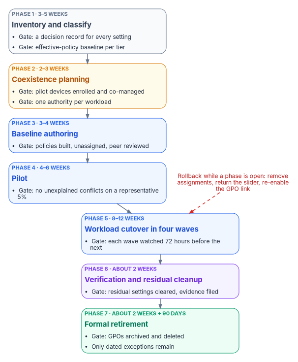
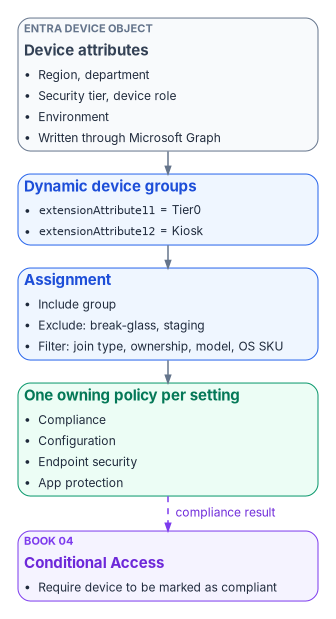

# Chapter 08 — GPO to Intune Policy Migration

*A policy template is a starting position for a decision, not a copy of the GPO it replaces; every setting in it has to earn its place, its owner and its evidence.*

::: {.callout-note}
## In this chapter
The working detail of the GPO sunset that [Chapter 07](07-the-gpo-sunset-program.md) runs as a program: the seven phases broken into tasks, durations, exit gates, rings, tests and rollback steps. Then the program's policy library for the existing Windows fleet: how policies are typed, targeted and tagged, the five compliance policies, six configuration profiles, six endpoint security policies and two app protection policies, with the GPO paths they replace. The chapter closes with dynamic group and filter templates and Microsoft Graph templates for creating the policies as code; the setting-level crosswalk and CSP paths are in [Appendix A](appendix-a-gpo-to-intune-crosswalk.md).
:::

[Chapter 07](07-the-gpo-sunset-program.md) sets the rules: inventory before anything moves, one authority per setting, evidence before a GPO link is disabled, and disable before delete. This chapter is what an endpoint engineer works from inside those rules. It assumes the decision records from Chapter 07 exist, because a template is only applied to a setting that has been classified as required.

This chapter is the [Intune track](../guides/attribute-driven-migration.md#intune-track). It moves the computer-configuration settings that reached workstations through OU links into Intune device policy. The user-configuration half of Group Policy moves with people instead, on the HR track ([Chapter 01](01-why-group-policy-cant-come-to-the-cloud.md)). Servers take the Arc track in [Chapter 09](09-servers-under-azure-arc.md).

Run as gated steps with validation checks: [Intune track implementation guide](../guides/intune-track-implementation.md).

The scope is the existing Windows fleet: corporate-owned workstations, privileged access workstations and kiosks, plus personal devices that reach organizational data through app protection only. Two scope facts shape it:

- **Windows 10 is out of support.** It reached end of support on October 14, 2025. Intune still treats it as an *allowed* version, so devices can enroll and use eligible features, but Microsoft no longer guarantees that functionality works.[^c08-win10-eos] The templates below set Windows 11 as the floor; any Windows 10 device left in the fleet is an exception with an upgrade date.
- **Windows Server doesn't enroll in Intune.** Intune manages Windows 11 client editions, not Windows Server; Microsoft describes Defender for Endpoint security settings management as the way to extend Intune endpoint security policy to devices that can't enroll, and lists Windows Server 2025 among them.[^c08-supported-os][^c08-ssm] Server compliance is therefore handled below as a server baseline that [Chapter 09](09-servers-under-azure-arc.md) carries through Azure Arc and Defender.

{#fig-ch08-migration-phases fig-alt="Seven cards in a chain, each with a phase number, focus, typical duration and the exit gate. Phase 1, slate, inventory and classify, 3 to 5 weeks, gate: a decision record for every setting and a captured baseline. Phase 2, amber, coexistence planning, 2 to 3 weeks, gate: pilot devices enrolled and co-managed, one authority per workload. Phase 3, blue, baseline authoring, 3 to 4 weeks, gate: policies built, unassigned and peer reviewed. Phase 4, blue, pilot, 4 to 6 weeks, gate: no unexplained conflicts on a representative five percent. Phase 5, blue, workload cutover in four waves, 8 to 12 weeks, gate: each wave watched 72 hours before the next. Phase 6, violet, verification and residual cleanup, about 2 weeks, gate: residual settings cleared and evidence collected. Phase 7, green, formal retirement, about 2 weeks plus a 90-day retention window, gate: GPOs archived and deleted, only dated exceptions remain. A red note under the chain reads: rollback while a phase is open, remove assignments, return the slider, re-enable the link."}

## The seven phases at working level

The phases are the program's seven from [Chapter 07](07-the-gpo-sunset-program.md#the-program-at-a-glance). The tasks, durations and gates come from the program's reference plan for a large fleet. Durations are planning estimates for a fleet with an existing Configuration Manager estate; a fleet without one skips most of Phase 2.

| Phase | Working tasks | Typical duration | Risk | Exit gate | Rollback while open |
|---|---|---|---|---|---|
| 1. Inventory and classify | Export every GPO, import into Group Policy analytics, classify settings, capture the effective-policy baseline per tier | 3–5 weeks | Low (read-only) | A decision record for every setting; a baseline per device tier | None needed; delete Group Policy analytics imports if wanted |
| 2. Coexistence planning | Enable co-management for the pilot collection, set workload sliders to Pilot Intune, decide `MDMWinsOverGP` per population | 2–3 weeks | Medium | Pilot devices enrolled, syncing, and still receiving the workloads not yet switched | Slider back to Configuration Manager; remove devices from the pilot collection |
| 3. Baseline authoring | Build the policies in this chapter unassigned, in audit mode where one exists; create groups and scope tags; peer review | 3–4 weeks | Low (nothing assigned) | Every required setting owned by exactly one policy; review signed off | Delete the unassigned policies |
| 4. Pilot | Assign to a representative cohort of about 5% with extended grace periods; GPOs stay linked | 4–6 weeks | Medium | No unexplained conflicts; application and user tests pass against the Phase 1 baseline | Remove the pilot assignments; GPOs keep applying |
| 5. Workload cutover | Four waves by workload, each watched for 72 hours before the next | 8–12 weeks | Medium to high | Each wave's settings report success on its population; GPO links for that workload disabled | Slider back for the affected workload; re-enable the GPO links |
| 6. Verification and residual cleanup | Disable remaining links for migrated populations, clear tattooed preference items, collect evidence | About 2 weeks | Low if Phases 4–5 held | No migrated device processes an in-scope GPO; evidence filed | Re-enable the link for the affected population |
| 7. Formal retirement | Disable GPOs, keep them 90 days, then back up, archive and delete; close the exception register | About 2 weeks of work, plus the 90-day window | Low | GPOs archived and deleted; only dated exceptions remain | Restore from backup and re-link |

On those estimates the program reaches Phase 7 in roughly 34 weeks, with the last deletions about three months later. Phases 2 and 3 can overlap, because authoring doesn't depend on co-management being live.

### Phase 1: inventory and classify

1. Export every GPO as XML and catalog its links, security filtering, WMI filters and settings. Chapter 07 gives the read-only export script; `Get-GPOReport -All -ReportType Xml` is the shape Group Policy analytics imports.[^c08-gpa]
2. Find GPO-on-GPO conflicts: the same setting written by more than one GPO at different OU levels. These are the conflicts OU precedence hid, and each needs a decision before Intune can own the setting.
3. Import the XML into **Devices** > **Group Policy analytics**. For each GPO the report shows how many settings have an MDM equivalent and, per setting, the CSP and OMA-URI behind it.[^c08-gpa] Use it to find the landing zone, never to decide whether a setting is still needed.
4. Classify each setting using the four tags from Chapter 07 (required, obsolete, high-risk, redundant), and record what kind of equivalent exists: a direct Intune setting, a partial one that needs adapting, none (a custom OMA-URI, a Remediation or an exception), or deprecated in the cloud-native model.
5. Capture the baseline: the effective policy per device tier, taken with `gpresult` on a sample of devices in each tier. Phases 4 and 5 test against it.

### Phase 2: coexistence planning

Where Configuration Manager manages the fleet, enable co-management for a pilot collection and set the workloads you plan to move first to **Pilot Intune**. Confirm each pilot device's join state and that it has synced with Intune recently, and confirm that the workloads still on Configuration Manager keep applying. Before switching any workload, the matching Intune policy must already be built, because a co-managed device synchronizes MDM policy as soon as the workload moves.[^c08-switch]

This is also where the program decides, per population, whether to set `MDMWinsOverGP` for the transition, and which settings must never be configured through both channels. [Chapter 07](07-the-gpo-sunset-program.md#coexistence-who-wins) has the full rule set; it isn't repeated here.

### Phase 3: baseline authoring

Build every policy in this chapter, but assign none of them.

- Create attack surface reduction rules and controlled folder access in audit mode.
- Apply scope tags so delegated administrators see only their policies.
- Create the dynamic groups and filters from [the templates later in this chapter](#dynamic-group-and-filter-templates).
- Peer review each policy against its decision records. The review checks two things: that every setting traces to a required setting in a decision record, and that no setting appears in two policies.

### Phase 4: pilot

The pilot cohort is about 5% of the fleet, chosen to be representative across tiers, regions and departments.

- Assign the compliance policies to the pilot groups with a longer grace period than production; the program uses 7 days instead of 1. The grace period is the schedule on the **Mark device noncompliant** action, set in days from 0 to 365.[^c08-noncompliance]
- Assign the configuration profiles and endpoint security policies to the same groups.
- Leave the GPOs linked. The pilot measures conflicts; it doesn't remove them.
- Compare each device's `gpresult` report with the Intune per-setting status for the same device. A setting that shows **Conflict** or **Error** in Intune, or a value in `gpresult` that differs from the Intune value, is a finding.
- Test the line-of-business applications and the user experience against the Phase 1 baseline, and log every issue and exception.

### Phase 5: workload cutover in waves

Each wave moves one workload for the whole population, in rings: the pilot cohort first (already done in Phase 4), then about a quarter of the population, then the rest. The ring sizes are a program design choice; what matters is that each ring is watched before the next starts.

**How these waves meet the program's rollout waves.** The program rolls out division by division ([Book 00, Chapter 09](../b00-orientation/09-design-pilot-and-rollout.md#waves-defined-by-attribute-values)): its waves decide *which devices* move. The waves here decide *which workload* Intune takes over on the devices that stay co-managed while they move. The two run together, not one after the other. Use the program's division waves as this phase's rings: each workload's pilot collection grows by the divisions in the current program wave, since each workload can have its own pilot collection,[^c08-switch] and the 72-hour watch runs per ring. Once every division is in, set the slider to **Intune**, which switches that workload for every co-managed device.[^c08-switch] Devices that are reset and re-enrolled without the Configuration Manager client aren't co-managed, so the sliders don't apply to them: they take Intune policy from their group assignments as soon as they enroll.

| Wave | Weeks | Workload | Work |
|---|---|---|---|
| 1 | 1–3 | Compliance policies | Move the compliance slider to Intune; assign CP-001 to CP-005 to production groups |
| 2 | 4–6 | Endpoint Protection | Move the Endpoint Protection slider; assign ES-001 to ES-006; disable the matching GPO links per population |
| 3 | 7–9 | Device configuration | Move the device configuration slider; assign SC-001, SC-003 to SC-005, SC-009 and SC-010; disable the matching GPO links per population |
| 4 | 10–12 | Windows Update policies | Move the Windows Update slider; assign the update rings ([Chapter 10](10-operating-and-evidencing-the-fleet.md#windows-updates)); stop WSUS for migrated devices |

Don't move device configuration before Endpoint Protection on co-managed devices: switching the device configuration workload also moves Endpoint Protection and resource access, so the two can't be separated once device configuration moves.[^c08-comanage] Endpoint Protection goes first, on its own slider, and device configuration follows. After each wave, validate, watch for 72 hours, and only then start the next.

### Phase 6: verification and residual cleanup

Disable the remaining GPO links for migrated populations, one population at a time, with the link procedure in [Chapter 07](07-the-gpo-sunset-program.md#freezing-and-unlinking-gpos). Then deal with what unlinking leaves behind: Group Policy preference items that weren't set to remove themselves stay on the device, so each one needs an Intune setting that takes over the value or a Remediation that clears it.

The program doesn't block inheritance on migrated OUs: blocking inheritance stops every higher-level GPO, including domain-level policy that hybrid-joined devices and exceptions still need, and it hides the remaining links rather than retiring them. Disabling specific links keeps the change scoped and reversible.

### Phase 7: formal retirement

Disable each GPO object rather than deleting it and keep it for 90 days as a rollback net. After 90 days without a regression, back it up, archive the backup, and delete the GPO from Active Directory. Update the program's documentation so Intune is recorded as the authority for every migrated setting, and close the exception register with an owner and review date on every entry that remains.

### Testing at each gate

| Gate | Test | Pass condition |
|---|---|---|
| Phase 1 | Group Policy analytics import and decision records | Every in-scope GPO imported; every setting tagged and given a disposition |
| Phase 3 | Peer review; a test ring of lab devices | No setting in two policies; lab devices report **Succeeded** for every setting |
| Phase 4 | `gpresult` against Intune per-setting status; application test scripts; user feedback | No unexplained **Conflict** or **Error**; no application regressions against the baseline |
| Phase 5, each wave | Per-setting status for the wave's policies; help desk ticket volume | Success on the ring's population; no rise in tickets attributable to the change during the 72-hour watch |
| Phase 6 | Device-side check that no in-scope GPO applies; preference-item inventory | No migrated device processes an in-scope GPO; every preference item cleared or owned |
| Phase 7 | Backup verification before deletion | Backup restores in a test domain or a GPMC restore test |

### Rollback

Rollback is defined for every phase before the phase starts. Three facts shape it:

- **Pilot doesn't clean up.** With **Pilot Intune** selected for Endpoint Protection or device configuration, Intune deploys policies but doesn't remove them when they are unassigned; removal needs the workload switched fully to Intune.[^c08-switch] Rolling a pilot back means reassigning a policy that sets the old value, not just removing the assignment.
- **Moving a workload back has side effects.** Microsoft notes that switching a workload back to Configuration Manager can leave some state behind; for example, Windows and Office stay at the later versions Intune installed.[^c08-comanage]
- **Disabled links come back with one command.** Because Phase 5 and Phase 6 disable links rather than delete GPOs, the GPO path is restored by re-enabling the link for the affected population.

## Policy architecture

### Policy types

| Policy type | Purpose | ID prefix | Where in the Intune admin center |
|---|---|---|---|
| Compliance policy | Defines the minimum security posture; Conditional Access consumes the result | CP-xxx | **Devices** > **Compliance** |
| Configuration profile (settings catalog) | Delivers device settings; replaces ADMX-backed GPO settings and many preferences | SC-xxx | **Devices** > **Configuration** |
| Endpoint security policy | Security-focused policy for antivirus, firewall, disk encryption, EDR, attack surface reduction and account protection | ES-xxx | **Endpoint security** > *category* |
| App protection policy | Protects organizational data inside managed apps, including on personal devices that aren't enrolled | AP-xxx | **Apps** > **App protection policies** |
| App configuration policy | Pushes app-specific key and value settings to managed apps | AC-xxx | **Apps** > **App configuration policies** |

Conflicts between these types follow Microsoft's rules. A compliance policy's setting takes precedence over the same setting in a configuration policy, and between compliance policies the most restrictive value applies. Between configuration policies of any kind (settings catalog, endpoint security, security baselines) there is no precedence: the conflict is reported and must be resolved by hand, and the setting may not apply until it is.[^c08-conflicts][^c08-es-conflicts] Two common beliefs, "last write wins" for profiles and "endpoint security wins over profiles," are both wrong. The program's rule is the one in Chapter 07: each setting has exactly one owning policy.

### The device attribute schema

By default each policy is assigned to dynamic device groups built from attributes, which replaces OU-linked GPO scoping; the exception for time-sensitive assignment is under [Assignment strategy](#assignment-strategy). Microsoft Entra dynamic membership rules for devices can use `extensionAttribute1` through `extensionAttribute15`, but those values must be written to the Entra device object first, through Microsoft Graph.[^c08-dynamic] They aren't the same attributes as the user extension attributes in the [program attribute map](../b03-hr-identity/06-canonical-attribute-schema.md#program-attribute-map); a device object has its own set.

The program uses one numbering for these attributes, which is the device half of the [program attribute map](../b03-hr-identity/06-canonical-attribute-schema.md#program-attribute-map):

| Device attribute | Meaning | Example values |
|---|---|---|
| `extensionAttribute1` | Region | `EAST`, `WEST`, `CENTRAL` |
| `extensionAttribute3` | Department or function | `Governance`, `Engineering`, `Finance` |
| `extensionAttribute11` | Security tier | `Tier0`, `Tier1`, `Tier2` |
| `extensionAttribute12` | Device role | `PAW`, `Kiosk`, `SharedDevice`, `Dedicated` |
| `extensionAttribute13` | Environment | `Production`, `Staging`, `Dev` |

The values are written by the program's provisioning process when a device is registered (see [Chapter 04](04-intune-first-onboarding.md)) and corrected by reconciliation in [Chapter 10](10-operating-and-evidencing-the-fleet.md#device-inventory-reconciliation). Their source is device provisioning and the procurement or asset record, not HR. A device rule can't read the attributes of the device's owner,[^c08-dynamic] so the device carries its own values ([Chapter 03](03-where-device-and-server-data-lives.md#three-stores-that-policy-reads)). Microsoft's own caution applies: a dynamic group is only as secure as the write permissions on the attributes its rule reads.[^c08-dynamic] The companion guide lists the other ways a dynamic device group can go wrong ([Dynamic group dangers](../guides/attribute-driven-migration.md#dynamic-group-dangers)). A device with no tier value falls into no tier group, which is why the tenant-wide compliance setting in Chapter 10 marks unassigned devices as noncompliant.

### Assignment strategy

- **Include groups.** Dynamic device groups that match the policy's tier, environment and role.
- **Exclude groups.** Break-glass exclusion groups for emergency override, and staging groups during a phased rollout.
- **Assignment filters.** A second layer applied at assignment time. Filters can't read device extension attributes. They work on Intune device properties such as `deviceName`, `deviceOwnership`, `deviceTrustType`, `enrollmentProfileName`, `manufacturer`, `model`, `operatingSystemSKU` and `operatingSystemVersion`.[^c08-filters] A filter on `extensionAttribute11` or `extensionAttribute13` doesn't evaluate; attribute targeting belongs in the group rule, and filters handle hardware, ownership, join type and OS.

Dynamic device groups take processing time before a new device appears in them. For time-sensitive assignment, such as a policy that has to land as a device enrolls, Microsoft's guidance is to assign to a user group, or to the **All devices** group for userless devices, with an assignment filter that selects the devices at check-in; it suggests a filter instead of a dynamic group wherever the rule reads only properties a filter can see, such as OS type, manufacturer, model, ownership or category; and it advises against dynamic device groups as exclusions, because a late membership calculation can let the policy reach the device first.[^c08-intune-assign] The program follows that guidance where a target depends only on Intune device properties. It keeps dynamic device groups where the rule has to read the device extension attributes (tier, role, environment, region and department), because filters can't.

{#fig-ch08-targeting-layers fig-alt="Top to bottom. A slate card, device attributes on the Entra device object, lists region, department, security tier, device role and environment, written through Microsoft Graph. It feeds a blue card, dynamic device groups, with example rules on extensionAttribute11 and extensionAttribute12. That feeds a blue card, assignment, listing include group, exclude groups for break-glass and staging, and an assignment filter on Intune properties such as join type, ownership, model or OS SKU. The assignment feeds a green card, one owning policy per setting, listing compliance, configuration, endpoint security and app protection. A dashed violet arrow from the compliance policy leads to a violet card, Conditional Access, require device to be marked as compliant, owned by Book 04."}

### Scope tags

Scope tags partition the admin center for delegated administration. Each policy carries one or more:

| Scope tag | Covers | Assigned to |
|---|---|---|
| `FMP-Global` | Baseline policies for every device | CP-001, SC-001, ES-001 to ES-004 |
| `FMP-Tier0` | Privileged access workstation policies | CP-002, SC-009, ES-005, ES-006 |
| `FMP-Region-East` | Region-specific variants | Region-scoped configuration profiles |
| `FMP-Kiosk` | Kiosk and shared devices | CP-005, SC-010 |

### Choosing the authority per workload

[Chapter 07](07-the-gpo-sunset-program.md#one-authority-per-workload) covers how the co-management sliders work. Which authority each workload should end with depends on the device and how it is used:

| Criterion | Keep with Configuration Manager for now | Move to Intune |
|---|---|---|
| Device type | Servers, legacy Windows, on-premises kiosks | Windows 11 workstations, remote devices |
| Management model | On-premises, domain joined, managed network | Cloud native, Entra joined, or hybrid joined in transition |
| Connectivity | Always on the corporate network or VPN | Internet connected on any network |
| User type | On-site, manufacturing, lab | Remote, hybrid and mobile workers |
| Application complexity | Complex task sequences and multi-step installs | Standard apps, Win32-wrapped apps, Microsoft Store and Winget |

The program's recommended end state per workload, and the reference timing over a 12-month program:

| Workload | Recommended authority | Months 1–3 | Months 4–6 | Months 7–9 | Months 10–12 |
|---|---|---|---|---|---|
| Office Click-to-Run apps | Intune; usually the first to move | Move | Complete | — | — |
| Compliance policies | Intune; native Conditional Access integration | Build and pilot | Move | Complete | — |
| Endpoint Protection | Intune; one security surface | Build | Pilot | Move | Complete |
| Device configuration | Intune; settings catalog and OMA-URI | Build | Pilot | Move | Complete |
| Windows Update policies | Intune; no WSUS infrastructure | — | Build and pilot | Move | Retire WSUS |
| Resource access (Wi-Fi, VPN, certificates) | Intune; needs the certificate connector | — | Build | Pilot | Move |
| Client apps | Phased; complex apps may stay in Configuration Manager at first | — | — | Pilot | Phased move |

Resource access is no longer a separate decision on current Configuration Manager versions, where its slider is fixed to Intune; Chapter 07 has the detail.

## Compliance policies

Compliance policies define the minimum posture a device must meet before Conditional Access grants it access. [Book 04](../b04-access/index.md) owns the Conditional Access policies that consume them. Three Microsoft facts shape every template in this section:

- **Schedules are in days.** Every noncompliance action is scheduled in days from 0 to 365, not hours.[^c08-noncompliance] A "24-hour" or "72-hour" action is set as 1 or 3 days.
- **Windows supports fewer actions.** On Windows, the actions are **Mark device noncompliant**, **Send email to end user** and **Add device to retire list**. Remote lock and push notifications aren't available for Windows. Adding a device to the retire list doesn't retire it; an administrator has to retire it from that list.[^c08-noncompliance] There is no separate "block access" action: blocking is what Conditional Access does with a noncompliant device.
- **Health attestation settings are measured at boot.** BitLocker, Secure Boot and code integrity are evaluated through Device Health Attestation, so a newly encrypted device needs a restart before it reports compliant.[^c08-win-compliance]

### CP-001: Windows workstation baseline

**Platform:** Windows 11 · **Target:** all corporate workstations · **Group:** devices where `extensionAttribute11` is `Tier0`, `Tier1` or `Tier2`.
**GPO equivalent:** an aggregate of Security Settings, BitLocker, Defender and system health GPOs.

| Category | Setting | Value | GPO equivalent |
|---|---|---|---|
| Device health | Require BitLocker | Require | Computer Configuration > Administrative Templates > Windows Components > BitLocker Drive Encryption |
| Device health | Require Secure Boot to be enabled | Require | None (UEFI firmware setting) |
| Device health | Require code integrity | Require | Computer Configuration > Administrative Templates > System > Device Guard |
| Device properties | Minimum OS version | 10.0.26100 (Windows 11, version 24H2) | None (WSUS or update policy decided the version) |
| System security | Firewall | Require | Computer Configuration > Windows Settings > Security Settings > Windows Defender Firewall |
| System security | Trusted Platform Module (TPM) | Require | None (hardware) |
| Defender | Antivirus | Require | Computer Configuration > Administrative Templates > Windows Components > Microsoft Defender Antivirus |
| Defender | Antispyware | Require | Same as antivirus |
| Defender | Real-time protection | Require | Microsoft Defender Antivirus > Real-time Protection |
| Defender | Microsoft Defender Antimalware security intelligence up to date | Require | Signature updates through WSUS or Configuration Manager |
| Password | Require a password to unlock | Require | Computer Configuration > Windows Settings > Security Settings > Account Policies > Password Policy |
| Password | Minimum password length | 14 | Account Policies > Password Policy |
| Password | Password type | Alphanumeric | Account Policies > Password Policy (complexity) |

The minimum OS version follows Microsoft's servicing dates. As of October 2026, Windows 11, version 23H2 Enterprise and Education receive updates only until November 10, 2026, and version 24H2 (build 26100) Enterprise and Education until October 12, 2027; version 25H2 is build 26200.[^c08-win11-release] The program sets 24H2 as the floor and raises it each year as versions leave servicing.

| Action | Schedule | Notes |
|---|---|---|
| Mark device noncompliant | 1 day | The grace period before Conditional Access blocks access |
| Send email to end user | 1 day | Remediation steps and help desk contact, from a message template |
| Add device to retire list | 30 days | An administrator reviews the list and retires devices from it |

### CP-002: Tier 0 privileged access workstation (strict)

**Platform:** Windows 11 · **Target:** privileged access workstations · **Group:** `extensionAttribute11` equals `Tier0`.
All CP-001 requirements apply, with no grace period and these additions:

| Category | Setting | Value | GPO equivalent |
|---|---|---|---|
| Device properties | Minimum OS version | 10.0.26200 (Windows 11, version 25H2) | None |
| Defender for Endpoint | Require the device to be at or under the machine risk score | Clear | None |
| Device health | Require BitLocker, Secure Boot and code integrity | Require (as CP-001) | As CP-001 |

Credential Guard, network inspection and cloud-delivered protection aren't compliance settings: Windows compliance policy doesn't evaluate them; they are configuration, set in ES-006 and ES-001, and checked by the drift comparison in Chapter 10. The machine risk score replaces them as the compliance signal from Defender, which Microsoft lists among the Windows compliance settings.[^c08-win-compliance]

| Action | Schedule |
|---|---|
| Mark device noncompliant | 0 days (immediate) |
| Send email to the user, with the security team as additional recipients | 0 days |
| Add device to retire list | 7 days |

### CP-003: Tier 2 standard workstation

**Platform:** Windows 11 · **Target:** standard end-user workstations · **Group:** `extensionAttribute11` equals `Tier2`.

| Category | Setting | Value | Notes |
|---|---|---|---|
| Device properties | Minimum OS version | 10.0.26100 (Windows 11, version 24H2) | No exception for older hardware: Windows 10 is out of support |
| Device health | Require BitLocker | Require | Personal devices don't receive this policy; they get AP-002 |
| Defender | Antivirus | Require | — |
| Password | Minimum password length | 12 | Reduced from 14 for usability; a program decision |
| Password | Password type | Alphanumeric | — |
| System security | Firewall | Require | — |
| System security | TPM | Require | — |

| Action | Schedule |
|---|---|
| Mark device noncompliant | 3 days |
| Send email to end user | 3 days |
| Add device to retire list | 30 days |

### CP-004: server baseline (moved to Chapter 09)

CP-004 is a server baseline, not an Intune compliance policy for Windows Server 2025 reached through Azure Arc, because that can't be built: Windows Server doesn't enroll in Intune, and Intune compliance policies apply only to enrolled devices.[^c08-supported-os] The intent survives as a server baseline, delivered and evaluated through the server toolchain in [Chapter 09](09-servers-under-azure-arc.md):

| Requirement | Value | Delivered through |
|---|---|---|
| OS version | Windows Server 2025 (build 26100) | Server inventory under Azure Arc |
| Defender | Microsoft Defender for Servers Plan 2 | Defender for Cloud; endpoint security policy through Defender for Endpoint security settings management[^c08-ssm] |
| Firewall | On, all profiles | Endpoint security firewall policy through security settings management |
| Secure Boot | On | Machine configuration baseline (Chapter 09) |
| Noncompliance | Server admin team notified after 1 day; no automatic retirement | Alerting in Chapter 10 |

Security settings management has a licensing catch for servers: if the tenant's only Defender for Endpoint entitlement comes through Defender for Servers, the feature isn't available; at least one Defender for Endpoint user license must be active.[^c08-ssm]

### CP-005: kiosk and shared devices

**Platform:** Windows 11 · **Target:** kiosk and shared devices · **Group:** `extensionAttribute12` is `Kiosk` or `SharedDevice`.

| Category | Setting | Value |
|---|---|---|
| Device properties | Minimum OS version | 10.0.26100 (Windows 11, version 24H2) |
| Defender | Antivirus | Require |
| Defender | Real-time protection | Require |
| System security | Firewall | Require |

"Shared device mode" isn't a Windows compliance setting; shared and kiosk behavior is configuration, set in a kiosk or shared multi-user device profile. A "block access" action doesn't exist either; marking the device noncompliant is what lets Conditional Access block it. Kiosks aren't added to the retire list, because they are managed assets that get repaired, not retired.

| Action | Schedule | Notes |
|---|---|---|
| Mark device noncompliant | 2 days | Grace for maintenance windows |
| Send email to the device owner group | 2 days | Kiosks have no individual user |

### Compliance summary

| Setting | CP-001 baseline | CP-002 Tier 0 | CP-003 Tier 2 | Server baseline (Ch 09) | CP-005 kiosk |
|---|---|---|---|---|---|
| Minimum OS | Windows 11 24H2 | Windows 11 25H2 | Windows 11 24H2 | Windows Server 2025 | Windows 11 24H2 |
| BitLocker | Require | Require | Require | Chapter 09 | — |
| Defender risk score | — | Clear | — | Defender for Servers | — |
| Password length | 14 | 14 | 12 | Chapter 09 | — |
| Grace period | 1 day | 0 days | 3 days | 1 day (alert) | 2 days |
| Retire list | 30 days | 7 days | 30 days | No | No |

## Configuration profiles (settings catalog)

Settings catalog profiles replace ADMX-backed Group Policy with cloud-delivered configuration. Each profile below maps the GPO paths to the settings that replace them. All are assigned to all corporate devices unless the profile says otherwise.

The IDs SC-002 (Defender Antivirus), SC-006 (BitLocker), SC-007 (Windows Firewall) and SC-008 (Windows LAPS) are retired. Each was a settings catalog profile that duplicated an Endpoint security policy configuring the same settings, and Microsoft's guidance is to manage a given setting through one method, because duplicates across policy types conflict.[^c08-es-conflicts] Their settings live in ES-001, ES-002, ES-003 and ES-006, and the four IDs aren't reused. [Appendix A](appendix-a-gpo-to-intune-crosswalk.md) maps the GPO settings to the Endpoint security IDs accordingly.

### SC-001: Windows security baseline

**Group:** devices where `extensionAttribute11` is `Tier0`, `Tier1` or `Tier2`.

#### Account lockout

| GPO path | GPO setting | Settings catalog | Value |
|---|---|---|---|
| Computer Configuration > Windows Settings > Security Settings > Account Policies > Account Lockout Policy | Account lockout threshold | Device Lock > Account Lockout Policy | 10 invalid attempts |
| Same | Account lockout duration | Device Lock > Account Lockout Policy | 15 minutes |
| Same | Reset account lockout counter after | Device Lock > Account Lockout Policy | 15 minutes |

The three values travel as one string in the DeviceLock `AccountLockoutPolicy` setting, for example `AccountLockoutDuration:15, AccountLockoutThreshold:10, ResetAccountLockoutCounterAfter:15`, and the setting needs Windows 11, version 22H2 with KB5053657 or version 24H2 and later.[^c08-devicelock] `DeviceLock/MaxDevicePasswordFailedAttempts` is a different control. On an Entra-joined device this policy governs local accounts; sign-in lockout for Entra accounts is governed in Entra ID, which [Book 02](../b02-identity/10-migrating-and-governing.md) covers.

#### Audit policy

| GPO path | GPO setting | Settings catalog | Value |
|---|---|---|---|
| Computer Configuration > Windows Settings > Security Settings > Advanced Audit Policy Configuration > Logon/Logoff | Audit Logon | Auditing > Account Logon Logoff Audit Logon | Success and Failure |
| Same > Object Access | Audit File System | Auditing > Object Access Audit File System | Success and Failure |
| Same > Policy Change | Audit Policy Change | Auditing > Policy Change Audit Policy Change | Success and Failure |
| Same > Privilege Use | Audit Sensitive Privilege Use | Auditing > Privilege Use Audit Sensitive Privilege Use | Success and Failure |

#### User rights assignment

| GPO path | GPO setting | Settings catalog | Value |
|---|---|---|---|
| Computer Configuration > Windows Settings > Security Settings > Local Policies > User Rights Assignment | Deny log on locally | User Rights > Deny Local Log On | Guests |
| Same | Deny log on through Remote Desktop Services | User Rights > Deny Remote Desktop Services Log On | Guests, local accounts |

#### Security options

| GPO path | GPO setting | Settings catalog | Value |
|---|---|---|---|
| Computer Configuration > Windows Settings > Security Settings > Local Policies > Security Options | Interactive logon: Don't display last signed-in | Local Policies Security Options > Interactive Logon Do Not Display Last Signed In | Enabled |
| Same | Interactive logon: Message text for users attempting to log on | Local Policies Security Options > Interactive Logon Message Text For Users Attempting To Log On | The organization's approved system use notice |
| Same | Interactive logon: Message title for users attempting to log on | Local Policies Security Options > Interactive Logon Message Title For Users Attempting To Log On | `NOTICE` |

The logon banner text is the organization's approved notice. Sample text is a placeholder, not approved wording.

### SC-003: Microsoft Edge

Replaces GPO-delivered Internet Explorer and legacy Edge settings. The Internet Explorer 11 desktop application isn't present on Windows 11; sites that still need it open in Edge's IE mode, which Microsoft supports through at least 2029.[^c08-ie]

| Settings catalog | Setting | Value | GPO equivalent |
|---|---|---|---|
| Microsoft Edge > Startup, home page and new tab page | Home page URL | The organization's portal URL | Computer Configuration > Administrative Templates > Microsoft Edge > Startup, home page and new tab page |
| Same | Action to take on startup | Open a list of URLs | Same |
| Microsoft Edge > SmartScreen settings | Configure Microsoft Defender SmartScreen | Enabled | Microsoft Edge > SmartScreen settings |
| Same | Prevent bypassing Microsoft Defender SmartScreen prompts for sites | Enabled | Same |
| Microsoft Edge > Password manager and protection | Enable saving passwords to the password manager | Disabled | Microsoft Edge > Password manager and protection |
| Microsoft Edge > Extensions | Control which extensions cannot be installed | `*` (block all not allowed) | Microsoft Edge > Extensions |
| Same | Allow specific extensions to be installed | Organization-approved extension IDs | Same |
| Microsoft Edge > Proxy server | Proxy settings | System proxy or PAC file URL | Microsoft Edge > Proxy server |
| Microsoft Edge | Allow download restrictions | Block dangerous downloads | Microsoft Edge |
| Microsoft Edge | Configure Internet Explorer integration | Internet Explorer mode, with the enterprise site list | Internet Explorer settings (retired) |

### SC-004: OneDrive

Replaces GPO Folder Redirection and logon-script drive maps with OneDrive Known Folder Move and Files On-Demand.

| Settings catalog | Setting | Value | GPO equivalent |
|---|---|---|---|
| OneDrive | Silently move Windows known folders to OneDrive | Enabled, with the tenant ID | Computer Configuration > Administrative Templates > OneDrive |
| OneDrive | Known folders: Desktop, Documents, Pictures | Move | User Configuration > Windows Settings > Folder Redirection |
| OneDrive | Prompt users to move Windows known folders to OneDrive | Enabled | None |
| OneDrive | Use OneDrive Files On-Demand | Enabled | None (new capability) |
| OneDrive | Limit the sync app upload rate to a percentage of throughput | 70% during the move, then off | None |
| OneDrive | Prevent users from syncing personal OneDrive accounts | Enabled | Computer Configuration > Administrative Templates > OneDrive |

::: {.callout-important}
## Folder Redirection to a file share doesn't move by itself
Known Folder Move doesn't carry redirected folders from a network share into OneDrive, though it is often expected to. Known Folder Move doesn't work while Windows Folder Redirection still points Documents, Pictures or Desktop somewhere other than OneDrive. Where the folders are redirected to a network share, Microsoft's sequence is: copy the share contents into each user's OneDrive with Migration Manager, disable the Folder Redirection policy while leaving the content on the share, then enable Known Folder Move, which merges with the copied folders. Microsoft also recommends moving no more than 1,000 existing devices a day, and 4,000 a week, with the silent policy.[^c08-kfm] Provision OneDrive storage before the move. Replace `net use` drive-map logon scripts with SharePoint libraries and OneDrive shortcuts.
:::

### SC-005: Windows updates

Replaces WSUS-targeting GPOs with Windows Update client policies (the current name for Windows Update for Business policies), delivered as an Intune update ring.

**GPO equivalent:** Computer Configuration > Administrative Templates > Windows Components > Windows Update.

| Setting | Value | Notes |
|---|---|---|
| Quality update deferral period (days) | 7 | Range 0–30[^c08-update-rings] |
| Feature update deferral period (days) | 0 | A feature update policy pins the version instead; a 30-day deferral applies only without one |
| Windows drivers | Allow | Driver approvals in Chapter 10 |
| Delivery Optimization download mode | 1 (HTTP blended with peering behind the same NAT) | [^c08-do-csp] |
| Active hours | 07:00 to 19:00 | — |
| Use deadline settings | Allow | — |
| Deadline for quality updates (days) | 7 | Range 2–30[^c08-update-rings] |
| Deadline for feature updates (days) | 14 | Range 2–30 |
| Grace period (days) | 2 | Range 0–7; replaces a separate 48-hour auto-restart setting |

[Chapter 10](10-operating-and-evidencing-the-fleet.md#windows-updates) sets these per ring and covers Windows Autopatch, which can create and maintain the rings itself.

### SC-009: Remote Desktop

**Group:** `extensionAttribute11` equals `Tier0` or `Tier1`.
**GPO equivalent:** Computer Configuration > Administrative Templates > Windows Components > Remote Desktop Services.

| Settings catalog | Setting | Value |
|---|---|---|
| Remote Desktop Services > Connections | Allow users to connect remotely | Enabled |
| Remote Desktop Services > Security | Require user authentication for remote connections by using Network Level Authentication | Enabled |
| Remote Desktop Services > Security | Set client connection encryption level | High |
| Remote Desktop Services > Session Time Limits | Set time limit for active but idle sessions | 15 minutes |
| Same | Set time limit for active sessions | 4 hours |
| Same | End session when time limits are reached | Enabled |
| User Rights | Allow log on through Remote Desktop Services | `FMP-RDP-Users` group |

### SC-010: user experience

Replaces GPO Start layout, wallpaper and lock screen policies.

| Settings catalog | Setting | Value | GPO equivalent |
|---|---|---|---|
| Start | Start layout | A layout pinning line-of-business apps, Microsoft 365 apps and Edge | Computer Configuration > Administrative Templates > Start Menu and Taskbar > Start Layout |
| Personalization | Desktop image | Organization wallpaper, staged by a Win32 app | User Configuration > Administrative Templates > Desktop > Desktop Wallpaper |
| Personalization | Lock screen image | Organization lock screen | Computer Configuration > Administrative Templates > Control Panel > Personalization |
| Start | Taskbar pinned apps | Edge, Outlook, Teams, File Explorer | Start Menu and Taskbar |
| Experience | Windows Spotlight | Disabled | User Configuration > Administrative Templates > Windows Components > Cloud Content |
| Experience | Allow Windows consumer features | Block | Computer Configuration > Administrative Templates > Windows Components > Cloud Content |

Windows 11 limits how much of Start and the taskbar MDM can customize, and Microsoft documents the supported CSPs separately for each; test the layout on the pilot ring.[^c08-supported-os]

## Endpoint security policies

Endpoint security policies live under **Endpoint security** in the Intune admin center. They are security-focused profiles, but they aren't a higher-priority source: they have the same standing as configuration profiles when the two conflict.[^c08-es-conflicts] In the program's library they own every Defender, BitLocker, firewall, account protection and LAPS setting.

### ES-001: antivirus

Replaces the Microsoft Defender Antivirus GPOs and the retired SC-002 profile.

| Setting | Value | GPO path | Notes |
|---|---|---|---|
| Real-time protection | On | Computer Configuration > Administrative Templates > Windows Components > Microsoft Defender Antivirus > Real-time Protection | Compliance (CP-001) checks it; ES-001 sets it |
| Cloud-delivered protection | On | Same > MAPS | — |
| Cloud block level | High | Same > MAPS | Values: Default, High, High plus, Zero tolerance[^c08-defender-csp] |
| Cloud extended timeout | 50 seconds | Same > MAPS | Adds up to 50 seconds to the normal 10-second check, so 50 is the maximum[^c08-defender-csp] |
| Submit samples consent | Send safe samples automatically | Same > MAPS | See below |
| PUA protection | On | Microsoft Defender Antivirus | — |
| Network protection | Enabled (block mode) | Microsoft Defender Exploit Guard > Network Protection | — |
| Controlled folder access | Audit mode, then enabled in phases | Microsoft Defender Exploit Guard > Controlled Folder Access | — |
| Tamper protection (Windows Security experience profile) | On | None | Needs devices onboarded to Defender for Endpoint (Plan 1 or 2)[^c08-tamper] |
| Full scan | Sunday, 02:00 | Microsoft Defender Antivirus > Scan | — |
| Quick scan | Daily, 12:00 | Same | — |
| Process exclusions | Line-of-business executables | Microsoft Defender Antivirus > Exclusions | Organization-specific; maintained list |
| Path exclusions | Line-of-business data directories | Same | Keep to a minimum |
| Extension exclusions | Only as required by line-of-business apps | Same | Justify each one |

The program sends safe samples automatically (value 1). Sending all samples (value 3) can upload documents that contain organizational data, so it is an explicit decision for the data owner.[^c08-defender-csp]

Tamper protection through Intune needs the device onboarded to Defender for Endpoint, and Microsoft doesn't support managing it this way on co-managed devices.[^c08-tamper] On a co-managed device it waits until the Endpoint Protection workload has moved.

::: {.callout-warning}
## Exclusion hygiene
Every antivirus exclusion widens the attack surface. Record the business reason for each exclusion, review the list quarterly, and remove exclusions for retired applications. Never exclude common executable and script types (`.exe`, `.dll`, `.ps1`, `.bat`, `.cmd`).
:::

### ES-002: disk encryption

Replaces the BitLocker Drive Encryption GPOs (Computer Configuration > Administrative Templates > Windows Components > BitLocker Drive Encryption) and the retired SC-006 profile.

| Setting | Value | Notes |
|---|---|---|
| Require device encryption | Required | — |
| Encryption method, operating system and fixed drives | XTS-AES 256-bit | — |
| Startup authentication | TPM only for standard and kiosk devices; TPM with PIN for Tier 0 | Two policies, one per group |
| Minimum startup PIN length | 6 digits (Tier 0 policy only) | — |
| Removable drives | Deny write access to drives not protected by BitLocker | — |
| Recovery key escrow | Microsoft Entra ID, required before encryption | Keys stored on the device object |
| Recovery password rotation | Refresh on Entra-joined devices | A new recovery password after each use |
| Silent encryption | On, standard and kiosk policy only | — |
| Reporting | **Devices** > **Monitor** > **Encryption report** | — |

Silent encryption and a required TPM and PIN can't apply to the same device: silent BitLocker requires that devices don't need a TPM startup PIN or startup key, because both need user interaction.[^c08-bitlocker] The program splits them. Standard and kiosk devices encrypt silently with TPM-only protectors; Tier 0 devices, which are provisioned by hand, use TPM plus PIN. The two groups get separate disk encryption policies, so the settings never conflict on one device.

With silent encryption, recovery keys go to Entra ID automatically, which needs the device to be Entra joined.[^c08-bitlocker] Chapter 10 covers the operational catch: deleting a device object in Entra ID deletes its recovery keys.

### ES-003: firewall

Replaces the Windows Defender Firewall with Advanced Security GPOs (Computer Configuration > Windows Settings > Security Settings), the retired SC-007 profile, and the firewall rows of the SC-001 baseline.

| Profile | State | Inbound default | Outbound default | Log dropped packets | Log successful connections |
|---|---|---|---|---|---|
| Domain | On | Block | Allow | Yes | Yes |
| Private | On | Block | Allow | Yes | No |
| Public | On | Block | Block | Yes | Yes |

With one owning policy, the public profile's outbound default has one answer; the program blocks outbound on public networks and allows the management and line-of-business rules it needs.

| Rule | Protocol | Port | Source | Action | Profile |
|---|---|---|---|---|---|
| WinRM (HTTP) | TCP | 5985 | Tier 0 management subnet | Allow | Domain |
| WinRM (HTTPS) | TCP | 5986 | Tier 0 management subnet | Allow | Domain |
| RDP | TCP | 3389 | Tier 0 privileged access workstation subnet only | Allow | Domain |
| ICMP echo request | ICMPv4 | — | Management subnet | Allow | Domain |
| Line-of-business applications | Per application | Per application | Per application | Allow | As required |

On an Entra-joined device that isn't domain joined, the domain profile doesn't apply, so the management rules need a private-profile equivalent scoped to the same source subnets. Group Policy analytics can't migrate firewall rules; they are built here by hand.[^c08-gpa-migrate]

### ES-004: endpoint detection and response

| Setting | Value | Notes |
|---|---|---|
| Microsoft Defender for Endpoint client configuration package type | Auto from connector | Needs the Intune–Defender for Endpoint connection |
| Sample sharing | All | The Defender for Endpoint setting that sends files for deep analysis, separate from the antivirus sample submission in ES-001; set None on devices the data owner considers too sensitive[^c08-edr-sample] |

Four settings sometimes listed for this policy don't belong in it. Telemetry reporting frequency is deprecated and has no effect on new devices.[^c08-edr] Automated investigation level, live response and web content filtering aren't EDR policy settings in Intune; they are configured in the Microsoft Defender portal, and [Chapter 10](10-operating-and-evidencing-the-fleet.md#microsoft-defender-for-endpoint) sets them there.

### ES-005: attack surface reduction

**Deployment:** all rules in audit mode for 30 days, then block after confirming no business-critical impact.

| Rule GUID | Rule | Phase 1 | Phase 2 |
|---|---|---|---|
| `56a863a9-875e-4185-98a7-b882c64b5ce5` | Block abuse of exploited vulnerable signed drivers | Audit | Block |
| `e6db77e5-3df2-4cf1-b95a-636979351e5b` | Block persistence through WMI event subscription | Audit | Block |
| `be9ba2d9-53ea-4cdc-84e5-9b1eeee46550` | Block executable content from email client and webmail | Audit | Block |
| `d4f940ab-401b-4efc-aadc-ad5f3c50688a` | Block all Office applications from creating child processes | Audit | Block |
| `d3e037e1-3eb8-44c8-a917-57927947596d` | Block JavaScript or VBScript from launching downloaded executable content | Audit | Block |
| `5beb7efe-fd9a-4556-801d-275e5ffc04cc` | Block execution of potentially obfuscated scripts | Audit | Block |
| `92e97fa1-2edf-4476-bdd6-9dd0b4dddc7b` | Block Win32 API calls from Office macros | Audit | Block |
| `9e6c4e1f-7d60-472f-ba1a-a39ef669e4b2` | Block credential stealing from the Windows local security authority subsystem | Audit, or straight to block | Block |
| `d1e49aac-8f56-4280-b9ba-993a6d77406c` | Block process creations originating from PSExec and WMI commands | Audit | Block, except where Configuration Manager manages the device |
| `b2b3f03d-6a65-4f7b-a9c7-1c7ef74a9ba4` | Block untrusted and unsigned processes that run from USB | Audit | Block |
| `3b576869-a4ec-4529-8536-b80a7769e899` | Block Office applications from creating executable content | Audit | Block |
| `75668c1f-73b5-4cf0-bb93-3ecf5cb7cc84` | Block Office applications from injecting code into other processes | Audit | Block |
| `7674ba52-37eb-4a4f-a9a1-f0f9a1619a2c` | Block Adobe Reader from creating child processes | Audit | Block |
| `c1db55ab-c21a-4637-bb3f-a12568109d35` | Use advanced protection against ransomware | Audit | Block |

The list includes the first two rules because Microsoft classes them as standard protection rules alongside the LSASS rule.[^c08-asr] Microsoft's rule reference adds four rollout notes: the PSExec and WMI rule shouldn't be enabled on devices Configuration Manager manages, because its client depends on WMI; the LSASS rule adds nothing where LSA protection and Credential Guard are on; the LSASS rule produces a large volume of audit events that are almost all safe to ignore, so you can skip audit for it and start blocking on a small set of devices; and the ransomware and obfuscated-script rules need cloud-delivered protection.[^c08-asr]

### ES-006: account protection

Replaces the retired SC-008 Windows LAPS profile.

| Setting | Value | Target |
|---|---|---|
| Credential Guard | Enabled with UEFI lock | Tier 0 (`extensionAttribute11` equals `Tier0`) |
| Credential Guard | Enabled without lock | Tier 1 and Tier 2 |
| Windows Hello for Business | Required | All devices |
| Windows Hello for Business minimum PIN length | 6 | All devices |
| Biometrics | Allowed | All devices |

Credential Guard needs Windows Enterprise or Education; it isn't available on Windows Pro.[^c08-win-licensing] From Windows 11, version 22H2 it is on by default, without UEFI lock, on devices that meet the license and hardware requirements and haven't been configured to disable it.[^c08-credguard] The Tier 0 policy adds the UEFI lock, which means it can't be turned off remotely afterward. Windows Hello for Business must be configured through Intune or Group Policy, never both; [Chapter 07](07-the-gpo-sunset-program.md#coexistence-who-wins) explains why. Book 02, [Chapter 10](../b02-identity/10-migrating-and-governing.md) covers Windows Hello for Business as part of phishing-resistant sign-in.

#### Windows LAPS (local admin password solution profile)

Replaces the LAPS GPO (Computer Configuration > Administrative Templates > System > LAPS).

| Setting | Value |
|---|---|
| Backup directory | Microsoft Entra ID (Entra-joined devices); Active Directory for hybrid-joined devices still in transition |
| Password complexity | Large letters, small letters, numbers and special characters |
| Password length | 24 characters |
| Password age (days) | 30 |
| Post-authentication actions | Reset the password and sign out the managed account |
| Post-authentication reset delay (hours) | 8 |
| Administrator account name | Default (built-in Administrator) |

The post-authentication delay can be 0 to 24 hours, where 0 turns the actions off; 24 is the default.[^c08-laps] The program sets 8 so a disclosed password doesn't outlive a working day. Intune manages Windows LAPS through endpoint security account protection policy and can back passwords up to Entra ID or Active Directory; on Windows 11, version 24H2 and later, automatic account management can also randomize the managed account's name.[^c08-laps-intune] Windows Server 2025 isn't a target; servers don't enroll, so server LAPS stays with the server toolchain in Chapter 09.

## App protection policies

### AP-001: Microsoft 365 apps on iOS and Android

**Type:** app protection policy · **Target:** Outlook, Teams, OneDrive, SharePoint, Word, Excel, PowerPoint and Edge on iOS and Android.

AP-001 has no Windows version for enrolled devices, because none can exist: on Windows, app protection applies to Microsoft Edge only, and only on devices that aren't MDM enrolled or Entra joined; if a device is managed, Windows MAM enrollment is blocked.[^c08-mam-win] Enrolled Windows devices get their data protection from the configuration and compliance policies above. AP-001 therefore targets the mobile Microsoft 365 apps.

| Category | Setting | Value |
|---|---|---|
| Data transfer | Send org data to other apps | Policy-managed apps |
| Data transfer | Receive data from other apps | Policy-managed apps |
| Data transfer | Save copies of org data | Block |
| Data transfer | Allow user to save copies to selected services | OneDrive for work or school, SharePoint |
| Data transfer | Restrict cut, copy and paste between other apps | Policy-managed apps with paste in |
| Data transfer | Screen capture and Google Assistant (Android) | Block |
| Encryption | Encrypt org data | Require |
| Conditional launch | Minimum OS version | The current major version minus one |

### AP-002: Edge on personal Windows devices, and BYOD mobile

**Type:** app protection policy without enrollment · **Target:** Microsoft Edge on personal Windows devices, and the AP-001 apps on personal iOS and Android devices.

| Category | Setting | Value |
|---|---|---|
| Access (mobile) | PIN for access | Require, 6 digits |
| Access (mobile) | Biometrics instead of PIN | Allow |
| Conditional launch | Offline grace period | 90 days, then wipe org data |
| Conditional launch | Jailbroken or rooted devices | Block access |
| Conditional launch | Maximum PIN attempts | 5, then wipe org data |
| Conditional launch | Minimum app version | The latest version minus one |
| Health checks (Windows) | Maximum allowed device threat level | Set from the Windows Security Center connector |
| Data transfer | Same as AP-001 | — |

A Conditional Access policy that requires an app protection policy makes these protections mandatory; [Book 04](../b04-access/index.md) owns it.

## The translation reference and CSP paths

The setting-level lookup card that accompanied this library (fifty common GPO settings, each with its closest Intune surface and the program policy that owns it) and the CSP paths behind the key settings are in [Appendix A](appendix-a-gpo-to-intune-crosswalk.md#setting-reference-50-common-gpo-settings), with the policy IDs used in this chapter. The appendix is a reference, not a prescription: it says where a required setting lands, and the regenerate-not-copy philosophy in [Book 01, Chapter 05](../b01-transformation-arc/05-policy-transformation.md) decides its value.

Three mappings carry through both documents. Account lockout maps to the DeviceLock `AccountLockoutPolicy` setting, not `MaxDevicePasswordFailedAttempts`.[^c08-devicelock] Logon auditing sits under `Audit/AccountLogonLogoff_AuditLogon`, not an `AccountLogon_` path.[^c08-audit-csp] And the Defender, BitLocker, firewall and LAPS rows map to the Endpoint security policies ES-001, ES-002, ES-003 and ES-006, not to settings catalog profiles. For a setting with no surface at all, a custom OMA-URI profile delivers it by CSP path; Intune doesn't validate a custom payload, so record its owner like any other policy.[^c08-conflicts]

## Dynamic group and filter templates

::: {.callout-warning}
## Illustrative, not tested against a production tenant
The scripts and payloads in this chapter are illustrative. They haven't been tested against a production tenant. Review every name, rule and value, and run them first against a test tenant.
:::

The groups below use the device attribute schema. GCC (Moderate) tenants use the worldwide Microsoft Graph endpoint, `https://graph.microsoft.com`; GCC High uses `https://graph.microsoft.us` and DoD `https://dod-graph.microsoft.us`.[^c08-graph-deploy] Intune in GCC is the same service instance as commercial Intune, so the admin center is `intune.microsoft.com`.[^c08-gov]

### Writing a device attribute

Dynamic rules can only match values that exist on the device object, so the provisioning process writes them first. The sample is a delegated call, like the other scripts in this chapter: the least-privileged delegated permission for updating a device is `Directory.AccessAsUser.All`, and the signed-in administrator needs at least the Intune Administrator role. `Device.ReadWrite.All` is the application permission, for an unattended provisioning service running app-only; app-only calls can update only `extensionAttributes`, which is all this sample writes.[^c08-device-update]

```powershell
# Delegated: sign in as at least Intune Administrator. $deviceObjectId is the Entra device object ID, not the device ID.
Connect-MgGraph -Scopes 'Directory.AccessAsUser.All'

$params = @{
    extensionAttributes = @{
        extensionAttribute11 = 'Tier0'
        extensionAttribute13 = 'Production'
    }
}
Update-MgDevice -DeviceId $deviceObjectId -BodyParameter $params
```

### Tier groups

```powershell
Connect-MgGraph -Scopes 'Group.ReadWrite.All'

$tiers = @(
    @{ Name = 'FMP-Devices-Tier0'; Value = 'Tier0'; Description = 'Tier 0 privileged access workstations' }
    @{ Name = 'FMP-Devices-Tier1'; Value = 'Tier1'; Description = 'Tier 1 devices' }
    @{ Name = 'FMP-Devices-Tier2'; Value = 'Tier2'; Description = 'Tier 2 standard end-user workstations' }
)

foreach ($tier in $tiers) {
    New-MgGroup -DisplayName $tier.Name `
        -Description $tier.Description `
        -MailEnabled:$false `
        -MailNickname ($tier.Name.ToLower()) `
        -SecurityEnabled:$true `
        -GroupTypes @('DynamicMembership') `
        -MembershipRule "(device.extensionAttribute11 -eq `"$($tier.Value)`")" `
        -MembershipRuleProcessingState 'On'
}
```

Servers don't appear in Intune device groups as enrolled devices; Tier 1 here means client devices in Tier 1, and Chapter 09 groups servers through Azure Arc.

### Environment, role, region and department groups

```powershell
$groups = @(
    @{ Name = 'FMP-Devices-Production';      Rule = '(device.extensionAttribute13 -eq "Production")'; Description = 'Production environment devices' }
    @{ Name = 'FMP-Devices-Staging';         Rule = '(device.extensionAttribute13 -eq "Staging")';    Description = 'Staging environment devices' }
    @{ Name = 'FMP-Devices-Dev';             Rule = '(device.extensionAttribute13 -eq "Dev")';        Description = 'Development environment devices' }
    @{ Name = 'FMP-Devices-Kiosk';           Rule = '(device.extensionAttribute12 -in ["Kiosk","SharedDevice"])'; Description = 'Kiosk and shared devices' }
    @{ Name = 'FMP-Devices-Region-East';     Rule = '(device.extensionAttribute1 -eq "EAST")';        Description = 'Devices in the East region' }
    @{ Name = 'FMP-Devices-Dept-Governance'; Rule = '(device.extensionAttribute3 -eq "Governance")';  Description = 'Devices assigned to the Governance department' }
)

foreach ($g in $groups) {
    New-MgGroup -DisplayName $g.Name `
        -Description $g.Description `
        -MailEnabled:$false `
        -MailNickname ($g.Name.ToLower()) `
        -SecurityEnabled:$true `
        -GroupTypes @('DynamicMembership') `
        -MembershipRule $g.Rule `
        -MembershipRuleProcessingState 'On'
}
```

A rule only works if it matches the value provisioning writes, so the program fixes one spelling per value in the schema and uses it everywhere.

### The same group through the Graph REST API

```http
POST https://graph.microsoft.com/v1.0/groups
Content-Type: application/json

{
  "displayName": "FMP-Devices-Tier0",
  "description": "Tier 0 privileged access workstations",
  "mailEnabled": false,
  "mailNickname": "fmp-devices-tier0",
  "securityEnabled": true,
  "groupTypes": ["DynamicMembership"],
  "membershipRule": "(device.extensionAttribute11 -eq \"Tier0\")",
  "membershipRuleProcessingState": "On"
}
```

### Assignment filter examples

Filters use Intune device properties, not extension attributes.[^c08-filters]

```text
// Only Entra-joined devices (excludes hybrid joined during transition)
(device.deviceTrustType -eq "Azure AD joined")

// Only corporate-owned devices
(device.deviceOwnership -eq "Corporate")

// Kiosks provisioned with the kiosk Autopilot profile
(device.enrollmentProfileName -startsWith "FMP-Kiosk")

// Enterprise editions only, for policies that need Windows Enterprise features
(device.operatingSystemSKU -in ["Enterprise", "EnterpriseN"])
```

The `deviceTrustType` values in an Intune filter are the Intune ones (`Azure AD joined`, `Hybrid Azure AD joined`, `Azure AD registered`), not the Entra dynamic-rule values (`AzureAD`, `ServerAD`, `Workplace`).[^c08-filters][^c08-dynamic]

## Microsoft Graph templates

These payloads create the policies as code.

- **Compliance policies are in v1.0, but most Windows settings aren't.** The v1.0 `windows10CompliancePolicy` resource carries password, OS version and health attestation settings (BitLocker, Secure Boot, code integrity, storage encryption).[^c08-graph-w10cp] The firewall, TPM, Defender, antivirus, antispyware, real-time protection and signature settings exist only on the beta resource.[^c08-graph-w10cp-beta] Posting them to v1.0 fails. The program uses beta for compliance policies and accepts that beta APIs change more often.
- **Every compliance policy needs a scheduled action.** `scheduledActionsForRule` is required when creating a per-platform compliance policy.[^c08-graph-w10cp] Each action's `actionType` is one of `noAction`, `notification`, `block`, `retire`, `wipe`, `removeResourceAccessProfiles` or `pushNotification`, with a grace period in hours.[^c08-graph-action] In Graph, `block` with a grace period is the API form of the portal's **Mark device noncompliant** schedule, which is why the API counts in hours while the portal counts in days.
- **Settings catalog and endpoint security policies are beta only.** `deviceManagement/configurationPolicies` is a beta API.[^c08-graph-configpolicy] Don't use `deviceManagement/intents`, the older template-based API, which is also beta only;[^c08-graph-intents] current endpoint security policies are settings catalog policies created through `configurationPolicies` with a template reference.

### CP-001 as a compliance policy

```http
POST https://graph.microsoft.com/beta/deviceManagement/deviceCompliancePolicies
Content-Type: application/json

{
  "@odata.type": "#microsoft.graph.windows10CompliancePolicy",
  "displayName": "FMP-CP-001-Workstation-Baseline",
  "description": "Windows workstation baseline compliance",
  "passwordRequired": true,
  "passwordMinimumLength": 14,
  "passwordRequiredType": "alphanumeric",
  "passwordMinutesOfInactivityBeforeLock": 15,
  "osMinimumVersion": "10.0.26100",
  "secureBootEnabled": true,
  "codeIntegrityEnabled": true,
  "bitLockerEnabled": true,
  "tpmRequired": true,
  "activeFirewallRequired": true,
  "defenderEnabled": true,
  "antivirusRequired": true,
  "antiSpywareRequired": true,
  "signatureOutOfDate": true,
  "rtpEnabled": true,
  "scheduledActionsForRule": [
    {
      "ruleName": "PasswordRequired",
      "scheduledActionConfigurations": [
        { "actionType": "block",        "gracePeriodHours": 24,  "notificationTemplateId": "", "notificationMessageCCList": [] },
        { "actionType": "notification", "gracePeriodHours": 24,  "notificationTemplateId": "<message template ID>" },
        { "actionType": "retire",       "gracePeriodHours": 720 }
      ]
    }
  ]
}
```

The minimum OS is `10.0.26100`. The `retire` action at 720 hours is the API form of adding the device to the retire list after 30 days. The `notification` action needs the ID of a notification message template created first.

### ES-001's Defender settings as a configuration policy

```http
POST https://graph.microsoft.com/beta/deviceManagement/configurationPolicies
Content-Type: application/json

{
  "name": "FMP-ES-001-Defender-Antivirus",
  "description": "Microsoft Defender Antivirus configuration",
  "platforms": "windows10",
  "technologies": "mdm",
  "settings": [
    {
      "settingInstance": {
        "@odata.type": "#microsoft.graph.deviceManagementConfigurationChoiceSettingInstance",
        "settingDefinitionId": "device_vendor_msft_policy_config_defender_allowrealtimemonitoring",
        "choiceSettingValue": { "value": "device_vendor_msft_policy_config_defender_allowrealtimemonitoring_1" }
      }
    },
    {
      "settingInstance": {
        "@odata.type": "#microsoft.graph.deviceManagementConfigurationChoiceSettingInstance",
        "settingDefinitionId": "device_vendor_msft_policy_config_defender_cloudblocklevel",
        "choiceSettingValue": { "value": "device_vendor_msft_policy_config_defender_cloudblocklevel_2" }
      }
    },
    {
      "settingInstance": {
        "@odata.type": "#microsoft.graph.deviceManagementConfigurationSimpleSettingInstance",
        "settingDefinitionId": "device_vendor_msft_policy_config_defender_cloudextendedtimeout",
        "simpleSettingValue": {
          "@odata.type": "#microsoft.graph.deviceManagementConfigurationIntegerSettingValue",
          "value": 50
        }
      }
    },
    {
      "settingInstance": {
        "@odata.type": "#microsoft.graph.deviceManagementConfigurationChoiceSettingInstance",
        "settingDefinitionId": "device_vendor_msft_policy_config_defender_submitsamplesconsent",
        "choiceSettingValue": { "value": "device_vendor_msft_policy_config_defender_submitsamplesconsent_1" }
      }
    },
    {
      "settingInstance": {
        "@odata.type": "#microsoft.graph.deviceManagementConfigurationChoiceSettingInstance",
        "settingDefinitionId": "device_vendor_msft_policy_config_defender_puaprotection",
        "choiceSettingValue": { "value": "device_vendor_msft_policy_config_defender_puaprotection_1" }
      }
    }
  ]
}
```

The suffixes follow the CSP values: cloud block level `2` is High, sample consent `1` is send safe samples, PUA protection `1` is on.[^c08-defender-csp] The same `configurationPolicies` API creates settings catalog profiles and Endpoint security policies; an Endpoint security antivirus policy also carries a `templateReference` naming the antivirus template, so ES-001 itself is easiest to build in the admin center and export.[^c08-graph-configpolicy] Export a policy built in the admin center and compare before relying on any setting definition ID; the IDs come from the settings catalog, not from documentation.

### Creating policies with the Graph PowerShell SDK

```powershell
# GCC (Moderate) uses the default global environment; GCC High would add -Environment USGov.
Connect-MgGraph -Scopes 'DeviceManagementConfiguration.ReadWrite.All'

$complianceBody = @{
    '@odata.type'          = '#microsoft.graph.windows10CompliancePolicy'
    displayName            = 'FMP-CP-001-Workstation-Baseline'
    description            = 'Windows workstation baseline compliance'
    passwordRequired       = $true
    passwordMinimumLength  = 14
    osMinimumVersion       = '10.0.26100'
    secureBootEnabled      = $true
    codeIntegrityEnabled   = $true
    bitLockerEnabled       = $true
    tpmRequired            = $true
    activeFirewallRequired = $true
    defenderEnabled        = $true
    scheduledActionsForRule = @(
        @{
            ruleName = 'PasswordRequired'
            scheduledActionConfigurations = @(
                @{ actionType = 'block'; gracePeriodHours = 24 }
            )
        }
    )
}

# Beta cmdlet, because tpmRequired, activeFirewallRequired and defenderEnabled are beta-only properties.
New-MgBetaDeviceManagementDeviceCompliancePolicy -BodyParameter $complianceBody
```

A compliance policy needs its scheduled action, and SC-001 isn't a `windows10GeneralConfiguration` profile: that profile type is the older device restrictions template; SC-001 is a settings catalog policy and is created through `configurationPolicies`, as in the ES-001 example.

::: {.callout-tip}
## Continue the book
[← Previous: Chapter 07 — The GPO Sunset Program](07-the-gpo-sunset-program.md) · [Book index](index.md) · [Next: Chapter 09 — Servers Under Azure Arc →](09-servers-under-azure-arc.md)
:::

[^c08-win10-eos]: Microsoft Learn, "App and device properties, operators, and rule editing when creating assignment filters in Microsoft Intune," note on Windows 10 end of support, <https://learn.microsoft.com/intune/fundamentals/filters/ref-device-properties> (accessed Oct 20, 2026).
[^c08-supported-os]: Microsoft Learn, "Supported operating systems and browsers in Intune," <https://learn.microsoft.com/intune/fundamentals/ref-supported-platforms> (accessed Oct 20, 2026).
[^c08-ssm]: Microsoft Learn, "Learn how to use Intune endpoint security policies to manage Microsoft Defender for Endpoint on devices that are not enrolled with Intune," sections "Prerequisites" and "Licensing and subscriptions," <https://learn.microsoft.com/intune/device-security/microsoft-defender/security-settings-management> (accessed Oct 20, 2026).
[^c08-gpa]: Microsoft Learn, "Import and analyze your on-premises GPOs using Group Policy analytics in Microsoft Intune," <https://learn.microsoft.com/intune/device-configuration/import-group-policy-analytics> (accessed Oct 20, 2026).
[^c08-switch]: Microsoft Learn, "How to switch Configuration Manager workloads to Intune," section "Switch workloads," <https://learn.microsoft.com/intune/configmgr/comanage/how-to-switch-workloads> (accessed Oct 20, 2026).
[^c08-noncompliance]: Microsoft Learn, "Configure actions for noncompliant devices in Intune," sections "Available actions for noncompliance" and "Add actions for noncompliance," <https://learn.microsoft.com/intune/device-security/compliance/configure-noncompliance-actions> (accessed Oct 20, 2026).
[^c08-comanage]: Microsoft Learn, "Co-management workloads," section "Device configuration," <https://learn.microsoft.com/intune/configmgr/comanage/workloads> (accessed Oct 20, 2026).
[^c08-conflicts]: Microsoft Learn, "Common questions, answers, and scenarios with policies and profiles in Microsoft Intune," section "Conflicts," <https://learn.microsoft.com/intune/device-configuration/troubleshoot-device-profiles> (accessed Oct 20, 2026).
[^c08-es-conflicts]: Microsoft Learn, "Manage endpoint security in Microsoft Intune," sections "Choose the right policy type" and "Avoid policy conflicts," <https://learn.microsoft.com/intune/device-security/endpoint-security-policies> (accessed Oct 20, 2026).
[^c08-dynamic]: Microsoft Learn, "Manage rules for dynamic membership groups in Microsoft Entra ID," sections "Rules for devices" and "Considerations for dynamic membership groups," <https://learn.microsoft.com/entra/identity/users/groups-dynamic-membership> (accessed Oct 20, 2026; re-checked Oct 29, 2026).
[^c08-filters]: Microsoft Learn, "App and device properties, operators, and rule editing when creating assignment filters in Microsoft Intune," section "Managed device properties," <https://learn.microsoft.com/intune/fundamentals/filters/ref-device-properties> (accessed Oct 20, 2026).
[^c08-intune-assign]: Microsoft Learn, "Assign policies in Microsoft Intune," section "Principles of including and excluding groups" (dynamic device group processing time; assignment filters on user groups or the All devices group for time-sensitive scenarios; filters instead of dynamic device groups for OS type, manufacturer, model, ownership or category; avoid dynamic device groups as exclusions), <https://learn.microsoft.com/intune/device-configuration/assign-device-profile> (accessed Oct 29, 2026).
[^c08-device-update]: Microsoft Learn, "Update device," Microsoft Graph v1.0, section "Permissions" (delegated least privilege `Directory.AccessAsUser.All`; application `Device.ReadWrite.All`; Intune Administrator the least-privileged supported role; app-only and non-Windows calls update only `extensionAttributes`), <https://learn.microsoft.com/graph/api/device-update?view=graph-rest-1.0> (accessed Oct 29, 2026).
[^c08-win-compliance]: Microsoft Learn, "Device compliance settings for Windows in Intune," sections "Device health," "System security" and "Microsoft Defender for Endpoint," <https://learn.microsoft.com/intune/device-security/compliance/ref-windows-settings> (accessed Oct 20, 2026).
[^c08-win11-release]: Microsoft Learn, "Windows 11 release information," section "Windows 11 current versions by servicing option," <https://learn.microsoft.com/windows/release-health/windows11-release-information> (accessed Oct 20, 2026).
[^c08-devicelock]: Microsoft Learn, "Policy CSP - DeviceLock," section "AccountLockoutPolicy," <https://learn.microsoft.com/windows/client-management/mdm/policy-csp-devicelock> (accessed Oct 20, 2026).
[^c08-audit-csp]: Microsoft Learn, "Policy CSP - Audit," <https://learn.microsoft.com/windows/client-management/mdm/policy-csp-audit> (accessed Oct 20, 2026).
[^c08-edr-sample]: Microsoft Learn, "Endpoint detection and response policy settings for endpoint security in Intune," Sample sharing for all files, <https://learn.microsoft.com/intune/device-configuration/endpoint-security/ref-edr-settings> (accessed Oct 22, 2026).
[^c08-defender-csp]: Microsoft Learn, "Policy CSP - Defender," sections "CloudBlockLevel," "CloudExtendedTimeout," "PUAProtection" and "SubmitSamplesConsent," <https://learn.microsoft.com/windows/client-management/mdm/policy-csp-defender> (accessed Oct 20, 2026).
[^c08-asr]: Microsoft Learn, "Attack surface reduction (ASR) rules reference," <https://learn.microsoft.com/defender-endpoint/attack-surface-reduction-rules-reference> (accessed Oct 20, 2026).
[^c08-ie]: Microsoft Learn, "Lifecycle FAQ - Internet Explorer and Microsoft Edge," <https://learn.microsoft.com/lifecycle/faq/internet-explorer-microsoft-edge>; and "Essential Eight user application hardening," section "Internet Explorer 11 is disabled or removed," <https://learn.microsoft.com/compliance/anz/e8-app-harden> (both accessed Oct 20, 2026).
[^c08-kfm]: Microsoft Learn, "Redirect and move Windows known folders to OneDrive," sections "About the Known Folder Move policies" and "Transition from the Windows Folder Redirection Group Policy objects," <https://learn.microsoft.com/sharepoint/redirect-known-folders> (accessed Oct 20, 2026).
[^c08-update-rings]: Microsoft Learn, "Update rings policy settings," <https://learn.microsoft.com/intune/device-updates/windows/ref-update-ring-settings> (accessed Oct 20, 2026).
[^c08-do-csp]: Microsoft Learn, "Policy CSP - DeliveryOptimization," section "DODownloadMode," <https://learn.microsoft.com/windows/client-management/mdm/policy-csp-deliveryoptimization> (accessed Oct 20, 2026).
[^c08-bitlocker]: Microsoft Learn, "Encrypt Windows devices with BitLocker using Intune," sections "Configure silent BitLocker encryption" and "Troubleshooting," <https://learn.microsoft.com/intune/device-configuration/endpoint-security/encrypt-bitlocker-windows> (accessed Oct 20, 2026).
[^c08-laps]: Microsoft Learn, "Configure policy settings for Windows LAPS," sections "PostAuthenticationResetDelay" and "PostAuthenticationActions," <https://learn.microsoft.com/windows-server/identity/laps/laps-management-policy-settings> (accessed Oct 20, 2026).
[^c08-laps-intune]: Microsoft Learn, "Microsoft Intune support for Windows LAPS," <https://learn.microsoft.com/intune/device-security/laps/overview> (accessed Oct 20, 2026).
[^c08-tamper]: Microsoft Learn, "Antivirus policy for endpoint security in Microsoft Intune," section "Prerequisites for antivirus policy," <https://learn.microsoft.com/intune/device-configuration/endpoint-security/antivirus>; and "Tamper protection overview," section "Requirements for tamper protection," <https://learn.microsoft.com/defender-endpoint/tamper-protection-overview> (both accessed Oct 20, 2026).
[^c08-edr]: Microsoft Learn, "Configure Microsoft Defender for Endpoint with Intune and onboard devices," section "Onboard devices," <https://learn.microsoft.com/intune/device-security/microsoft-defender/configure-integration> (accessed Oct 20, 2026).
[^c08-win-licensing]: Microsoft Learn, "Windows Commercial Licensing overview," section "Use a Windows Pro device with the Windows Enterprise user subscription license," <https://learn.microsoft.com/windows/whats-new/windows-licensing> (accessed Oct 20, 2026).
[^c08-credguard]: Microsoft Learn, "Credential Guard overview," section "Default enablement," <https://learn.microsoft.com/windows/security/identity-protection/credential-guard/> (accessed Oct 20, 2026).
[^c08-mam-win]: Microsoft Learn, "App protection policy settings for Windows," <https://learn.microsoft.com/intune/app-management/protection/ref-settings-windows> (accessed Oct 20, 2026).
[^c08-graph-deploy]: Microsoft Learn, "Microsoft Graph national cloud deployments," section "Microsoft Graph and Graph Explorer service root endpoints," <https://learn.microsoft.com/graph/deployments> (accessed Oct 20, 2026).
[^c08-gov]: Microsoft Learn, "Microsoft Intune for US Government GCC High and DoD service description," section "Intune commercial and government instances," <https://learn.microsoft.com/intune/fundamentals/government-service> (accessed Oct 20, 2026).
[^c08-graph-w10cp]: Microsoft Learn, "windows10CompliancePolicy resource type" (Microsoft Graph v1.0), <https://learn.microsoft.com/graph/api/resources/intune-deviceconfig-windows10compliancepolicy?view=graph-rest-1.0> (accessed Oct 20, 2026).
[^c08-graph-w10cp-beta]: Microsoft Learn, "windows10CompliancePolicy resource type" (Microsoft Graph beta), <https://learn.microsoft.com/graph/api/resources/intune-deviceconfig-windows10compliancepolicy?view=graph-rest-beta> (accessed Oct 20, 2026).
[^c08-graph-action]: Microsoft Learn, "deviceComplianceActionItem resource type" (Microsoft Graph v1.0), <https://learn.microsoft.com/graph/api/resources/intune-deviceconfig-devicecomplianceactionitem?view=graph-rest-1.0> (accessed Oct 20, 2026).
[^c08-graph-configpolicy]: Microsoft Learn, "Create deviceManagementConfigurationPolicy" (Microsoft Graph beta), <https://learn.microsoft.com/graph/api/intune-deviceconfigv2-devicemanagementconfigurationpolicy-create?view=graph-rest-beta> (accessed Oct 20, 2026).
[^c08-gpa-migrate]: Microsoft Learn, "Create a Settings Catalog policy using your imported GPOs in Microsoft Intune," <https://learn.microsoft.com/intune/device-configuration/migrate-group-policy> (accessed Oct 20, 2026).
[^c08-graph-intents]: Microsoft Learn, "deviceManagementIntent resource type" (Microsoft Graph beta; no v1.0 version), <https://learn.microsoft.com/graph/api/resources/intune-deviceintent-devicemanagementintent?view=graph-rest-beta> (accessed Oct 20, 2026).
