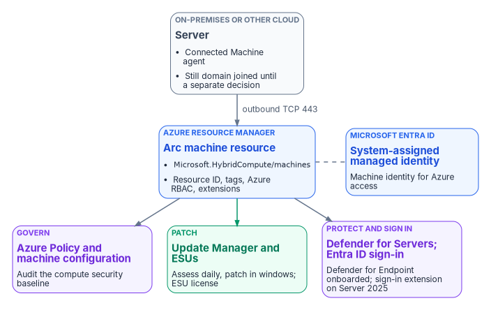
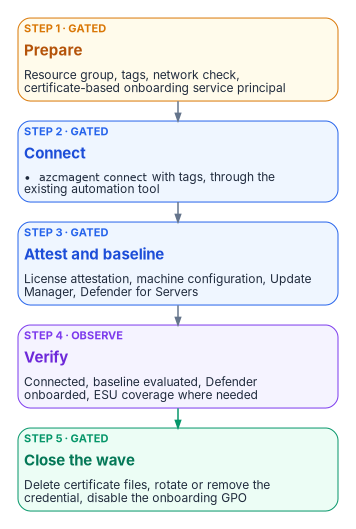
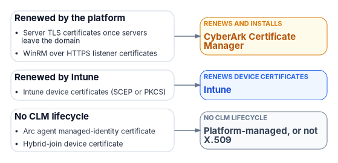

# Chapter 09 — Servers Under Azure Arc

*Azure Arc gives a server an address in the cloud control plane; everything that makes the server governed is what you then attach to that address, and the domain join stays until you decide to remove it.*

::: {.callout-note}
## In this chapter
The server how-to: what Azure Arc does and doesn't change, how to prepare the network, roles and tags, how to onboard with a least-privileged service principal, and the day-one baseline of Azure Policy machine configuration, Azure Update Manager and Defender for Servers. Extended Security Updates for Windows Server 2012 and 2016 and SQL Server, Microsoft Entra ID sign-in where it's supported, rollback, and how the manual and governed server paths differ. The three-path comparison is in [Chapter 05](05-the-governed-manual-and-retrofit-paths.md); this chapter goes deeper on the server half.
:::

Group Policy reached servers the same way it reached workstations: through OU placement in the domain ([Chapter 01](01-why-group-policy-cant-come-to-the-cloud.md)). Intune doesn't take over that job for servers, because Intune's supported platforms don't include Windows Server.[^c09-intune-platforms] The cloud equivalent is Azure Arc. A server outside Azure runs the Azure Connected Machine agent and appears in Azure as a resource with an Azure resource ID, in a resource group, managed the way native Azure virtual machines are.[^c09-arc-overview] Azure Policy, role-based access control, tags, extensions, update management and Defender for Cloud then apply to it.

That's the management plane. It isn't the identity plane, and onboarding doesn't change how the server authenticates users or whether it's joined to a domain. Keep the two separate in every plan.

{#fig-ch09-arc-management-plane fig-alt="Left to right. A slate card for the on-premises or other-cloud server running the Connected Machine agent, still domain joined until a separate decision. An arrow labeled outbound TCP 443 leads to a blue card for the Azure Arc machine resource, Microsoft.HybridCompute/machines, holding resource ID, tags, Azure RBAC and extensions. Below it, a blue card for the system-assigned managed identity in Microsoft Entra ID, connected by a dashed line. From the resource, three arrows lead to three cards on the right: a violet card, Govern, Azure Policy and machine configuration audit the security baseline; a green card, Patch, Azure Update Manager and Extended Security Updates; and a violet card, Protect and sign in, Defender for Servers onboards Defender for Endpoint, and the Entra ID sign-in extension on Windows Server 2025."}

## What Arc changes and what it doesn't

| Arc changes | Arc doesn't change |
|---|---|
| The server gets an Azure resource ID and can be placed in a resource group with other Azure resources[^c09-arc-overview] | The server's domain membership; onboarding doesn't unjoin it |
| Azure RBAC, tags and Azure Policy apply to it | How users and services authenticate to it, unless you enable Entra ID sign-in |
| The server gets a system-assigned managed identity in Microsoft Entra ID[^c09-arc-msi] | The workload; an Arc outage impairs management only, not the workload[^c09-arc-agent] |
| Extensions can be installed from Azure, and run with full privileges on the server[^c09-arc-roles] | Where the server runs; Arc isn't a migration to Azure |

Two properties shape the operating model.

- **Azure is the source of truth for the agent.** The only way to tell the agent to do something is to act on the server's Azure representation, which means RBAC and Azure Policy are evaluated before any change reaches the server.[^c09-arc-security]
- **Connection state is evidence.** The agent sends a heartbeat every five minutes. A server that stops sending shows **Disconnected** within 15 to 30 minutes. A server disconnected for 45 days can become **Expired**, and it can't be managed until an administrator disconnects and reconnects it. The managed identity's credential is valid for up to 90 days and renews every 45.[^c09-arc-overview]

::: {.callout-note}
## Arc servers run non-domain-joined in the target
In the program's target architecture, Arc-enabled servers carry an Entra-backed machine identity and run without a domain join. Onboarding attaches the management plane. It doesn't remove the domain join for you. Plan the unjoin as a separately sequenced decision for each workload, after its authentication dependencies are known; the Kerberos and NTLM work that precedes it is in [Chapter 05](05-the-governed-manual-and-retrofit-paths.md) and Book 02 ([Chapter 04 of Book 02](../b02-identity/04-the-hidden-migration-surface.md)).
:::

## Before you onboard

### Plan cost by service, not by connection

[Chapter 05](05-the-governed-manual-and-retrofit-paths.md) sets out what Arc's control plane costs and which services on Arc servers are billed separately. For servers, the decision that changes the bill most is whether the Windows Server licenses carry active Software Assurance or are subscription or pay-as-you-go licenses. If they do, Windows Server Management enabled by Azure Arc provides Azure Update Manager, Change Tracking and Inventory, and Azure Machine Configuration for Windows Server 2012 and later at no extra cost beyond networking, storage and log ingestion, plus Windows Admin Center in Azure and other services for Windows Server 2016 and later.[^c09-wsm]

The benefit isn't automatic. You have to attest each Arc server's licensing, or enroll it in Windows Server pay-as-you-go; Azure doesn't infer eligibility from the connection.[^c09-wsm] Make attestation a step in the onboarding runbook, and record who attested and on what license evidence.

### Roles

Use the narrowest built-in roles, and remember what extensions can do.

| Role | Holder | What it allows |
|---|---|---|
| Azure Connected Machine Onboarding | The onboarding service principal only | Read and create Arc server resources. Can't delete servers or manage extensions.[^c09-arc-roles] |
| Azure Connected Machine Resource Administrator | The server operations team | Read, modify, re-onboard and delete machines, extensions, licenses and private link scopes[^c09-arc-roles] |
| Virtual Machine Administrator Login and Virtual Machine User Login | People who sign in to servers with Entra ID | Administrator or standard sign-in; Owner and Contributor don't confer sign-in[^c09-arc-login] |

Extensions can run arbitrary scripts with full privileges on the server, so Microsoft says to treat any Contributor on the Arc resource as an indirect administrator of the server.[^c09-arc-roles] The Cloud Adoption Framework goes further and warns that Contributor, Owner and Azure Connected Machine Resource Administrator can effectively delegate root access through extension deployment.[^c09-caf-iam] Scope those roles to the resource groups a team owns, hold them through Privileged Identity Management where possible, and don't grant subscription-wide Contributor to anyone who doesn't administer every server in it. [Chapter 06](06-who-owns-the-endpoint.md) maps roles to teams.

### Network

The Connected Machine agent communicates outbound to Azure Arc over TCP 443. No inbound rule is needed. Allow the service tags `AzureActiveDirectory`, `AzureTrafficManager`, `AzureResourceManager`, `AzureArcInfrastructure`, `Storage` and, as of April 2026, `AzureFrontDoor.Frontend`. A proxy is supported but doesn't add security, because the traffic is already encrypted; an Azure Arc private link scope keeps the traffic off public networks instead.[^c09-arc-network] Before onboarding a site, run the agent's own check from a representative server.

::: {.callout-warning}
## Illustrative, not tested against a production estate
The commands in this chapter are examples. They haven't been run against a production estate or subscription. Read each one, run it first in a test scope, and review the output before you apply anything that changes state.
:::

```powershell
# Network readiness for the target region (add --cloud AzureUSGovernment for Azure Government)
azcmagent check --location "eastus"

# Include SQL Server enabled by Azure Arc endpoints if the server hosts SQL Server
azcmagent check --location "eastus" --extensions sql
```

The `--cloud` values are `AzureCloud`, `AzureUSGovernment` and `AzureChinaCloud`.[^c09-azcm-check] This workbook assumes a commercial Azure subscription in the same directory as the GCC tenant; if your servers are onboarded to Azure Government, use the US Government endpoints and service tags throughout.

### Resource groups and tags

Create a dedicated resource group for Arc-enabled servers, or one per owning team, so RBAC and policy can be scoped without touching other resources.[^c09-caf-automation] Apply one tag taxonomy at connection time: `Environment`, `Workload`, `Criticality`, `Owner`, `CostCenter`, `PatchGroup` and `ArcOnboardedDate`. Tags drive policy scope, Update Manager's dynamic scoping, cost reporting and operational queries. On the governed path the same taxonomy carries the organizational attributes from the procurement or asset record ([Chapter 03](03-where-device-and-server-data-lives.md)).

Two cautions. Tags are stored in plain text, so don't put sensitive information in them.[^c09-arc-onboard-sec] And a server with SQL Server installed connects its instances to Arc automatically, deploying an extension and applying new roles to SQL Server. To opt a server out, add the tag `ArcSQLServerExtensionDeployment` with the value `Disabled` when you connect it.[^c09-arc-deploy]

### Images and cloning

You can install the agent package into a golden image, but don't connect the image. A connected image gives every clone the same Azure resource ID, and the clones show up as disconnected or receive 429 errors. The fix for a clone is `azcmagent disconnect --force-local-only` followed by a fresh `azcmagent connect`.[^c09-arc-agent]

## Onboarding

Onboarding runs in waves. Each wave creates its credential, connects a defined set of servers, attaches the baseline on the same change, verifies, and closes by removing what onboarding needed.

{#fig-ch09-onboarding-wave fig-alt="Five cards from top to bottom. Step 1, gated, amber: Prepare, the resource group, tags, network check and a certificate-based onboarding service principal. Step 2, gated, blue: Connect, azcmagent connect with tags through the existing automation tool. Step 3, gated, blue: Attest and baseline, license attestation, machine configuration, Update Manager and Defender for Servers. Step 4, observe, violet: Verify, connected, baseline evaluated, Defender onboarded and ESU coverage where needed. Step 5, gated, green: Close the wave, delete certificate files, rotate or remove the credential and disable the onboarding GPO."}

### Choose a method

Microsoft supports these methods:[^c09-arc-deploy]

| Method | Operating systems | Scale |
|---|---|---|
| Script generated in the Azure portal | Windows and Linux | A few servers, interactively |
| PowerShell | Windows and Linux | Interactive or at scale |
| Service principal with the installation script | Windows and Linux | At scale, non-interactively |
| Ansible (Ansible Core or Ansible Automation Platform) | Windows and Linux | At scale |
| Azure Arc-enabled VMware vSphere | Windows and Linux VMs on vCenter | At scale; needs VMware Tools |
| Multicloud connector | Windows and Linux on AWS | At scale |
| Windows Admin Center; Azure Arc setup | Windows Server | Interactive |
| Configuration Manager scripts or custom task sequence | Windows Server | At scale |
| Group Policy | Domain-joined Windows Server | At scale |

The program's recommendation: onboard fleets with a dedicated service principal that authenticates with a certificate, deployed through the automation tool the server team already runs (Configuration Manager, Ansible or Group Policy). Use the interactive script only for a handful of servers or a pilot. Whichever tool you use, the same least-privilege rules apply.

### Create the onboarding service principal

The service principal exists only to connect machines. Microsoft describes it as used only during onboarding and for no other purpose,[^c09-arc-sp] and the credential is needed only when `azcmagent connect` runs. If it expires or is deleted afterward, the server stays connected.[^c09-arc-onboard-sec] So keep its lifetime short and its scope small.

```powershell
# Azure CLI. Scope the onboarding role to the target resource group, not the subscription,
# and create a certificate credential instead of a client secret.
az ad sp create-for-rbac `
    --name "sp-arc-onboarding-rg-arc-servers" `
    --role "Azure Connected Machine Onboarding" `
    --scopes "/subscriptions/<subscription-id>/resourceGroups/rg-arc-servers" `
    --create-cert
```

Microsoft recommends certificates over secrets for onboarding service principals, because a certificate credential can be controlled with Conditional Access.[^c09-arc-onboard-sec] If you must use a secret, note that the examples Microsoft publishes create one that's valid for a year;[^c09-arc-sp] set a shorter lifetime, rotate it after each onboarding wave and delete it when the wave closes. Creating the service principal needs permission to register applications (or the Application Administrator or Cloud Application Administrator role), and assigning the Arc role needs Owner or User Access Administrator on the scope.[^c09-arc-sp] Do that once, as a recorded change, then hand the credential to the automation tool.

A stolen onboarding credential lets an attacker connect servers outside your organization into your subscription. Private endpoints restrict Arc access to your network and close that path.[^c09-arc-onboard-sec]

### Protect the credential in the deployment

The onboarding script carries the credential. Microsoft's guidance is to use the automation tool's own secret protection if it has one, and otherwise to move the parameters into a dedicated configuration file so the secret isn't parsed or logged on the command line, and to delete the file afterward.[^c09-arc-onboard-sec]

::: {.callout-warning}
## Never put an onboarding secret in plain text in a startup script
A service principal secret in a hand-built Group Policy startup script is readable by every domain-authenticated user through SYSVOL. Don't build one. Microsoft's Group Policy onboarding method is different: it places the agent and configuration on a remote share and encrypts the configuration file so only computer accounts can decrypt it.[^c09-arc-onboard-sec] That still means any computer account in the domain can, so scope the GPO to the target OU, rotate the credential after the wave, and disable the GPO once the servers have connected, which Microsoft also tells you to do so the scheduled task doesn't run again.[^c09-arc-gpo]
:::

### Connect

On each server, the agent connects with the service principal and the resource's tags. With a certificate credential:

```powershell
# Run elevated on the server after installing the agent (or from the generated script)
azcmagent connect `
    --service-principal-id "<app-id>" `
    --service-principal-cert "C:\onboarding\sp-arc-onboarding.pem" `
    --tenant-id "<tenant-id>" `
    --subscription-id "<subscription-id>" `
    --resource-group "rg-arc-servers" `
    --location "eastus" `
    --cloud "AzureCloud" `
    --tags "Environment=Production,Workload=FileServices,Criticality=High,Owner=infra-team,CostCenter=CC1234,PatchGroup=Wave2,ArcOnboardedDate=2026-10-20"

# Confirm the connection and agent state
azcmagent show
```

The agent accepts PFX or PEM files that hold both keys, or on Windows a certificate in the machine store by thumbprint (`--service-principal-cert-thumbprint`). Password-protected certificate files aren't supported.[^c09-azcm-connect] Remove the certificate file from the server when the connect completes. The resource name defaults to the host name and can't be changed later without disconnecting and reconnecting, so settle naming conflicts before the wave.[^c09-azcm-connect]

### Lock down what the agent will accept

For sensitive servers, the agent has local controls that can't be changed from Azure, only on the server itself. You can restrict which extensions may install, disable remote connections, or disable machine configuration. Microsoft intends these for servers such as domain controllers, servers that handle payment data, and servers under strict change control. By default, scripts run through the Custom Script Extension or Run Command execute as Local System or root; if you don't plan to use them, block them.[^c09-arc-ext-sec]

```powershell
# Add the Azure Monitor agent extension to the allowlist (--add appends; without it the list is replaced)
azcmagent config set extensions.allowlist "Microsoft.Azure.Monitor/AzureMonitorWindowsAgent" --add

# Disable all remote access to the machine through Arc
azcmagent config set incomingconnections.enabled false
```

The example commands are Microsoft's.[^c09-azcm-config] Decide the allowlist per server class in advance and record it with the onboarding change; the local setting will override anything the cloud side tries later.

## The day-one baseline

A connected server is addressable, not yet governed. Attach three things on the same change.

### Azure Policy and machine configuration

Azure machine configuration, formerly Azure Policy Guest Configuration, extends Azure Policy inside the operating system. It uses Desired State Configuration to audit or set OS settings and reports compliance per machine. Unlike Group Policy, it's scoped by Azure resource scope (subscription, resource group or individual machine), not by OU.[^c09-mc-governance] The Connected Machine agent includes the machine configuration service natively, so there's no extension to deploy on Arc servers.[^c09-arc-agent]

The Windows and Linux audit baselines are built-in definitions: *Windows machines should meet requirements of the Azure compute security baseline* and *Linux machines should meet requirements for the Azure compute security baseline*. Both can be customized, and a CIS benchmark definition for Linux is in preview. Deploy the machine configuration prerequisite initiative to the scope first.[^c09-mc-baseline] Assign the baselines to the Arc resource groups as policy-as-code, version the customized baseline JSON in the governance repository, and treat noncompliance as a finding, not as a failed deployment.

If a server disconnects, its guest assignments are stored locally for 14 days and reapplied when it reconnects within that window. After 14 days they're deleted and not reassigned.[^c09-arc-agent] A long disconnection therefore removes the baseline evaluation, which is one more reason the connection state is monitored.

### Azure Update Manager

Update Manager assesses and deploys operating system updates for Windows and Linux servers across Azure, on-premises and other clouds. It assesses machines every 24 hours when periodic assessment is enabled, supports scheduled patching in maintenance windows, and can group machines by subscription, location, resource group or tags through dynamic scoping, which is where the `PatchGroup` tag earns its keep.[^c09-aum-faq]

Update Manager is charged per Arc server per month, prorated daily, on days the server is connected and has an update operation or schedule. It isn't charged when the server is enabled for Extended Security Updates through Arc, when Defender for Servers Plan 2 is enabled on the subscription (unless through a security connector), or when the Windows Server license has active Software Assurance, a subscription license or pay-as-you-go through Arc.[^c09-aum-faq] Windows Server 2025 hotpatching is also delivered through Arc and isn't subject to the Windows Server Management licensing rules.[^c09-wsm]

### Defender for Servers

Defender for Servers has two paid plans. Plan 1 centers on endpoint detection and response through the Defender for Endpoint integration. Plan 2 adds agentless scanning, regulatory compliance assessment, premium Defender Vulnerability Management, OS configuration assessment against the Microsoft cloud security benchmark, update assessment, file integrity monitoring and a data ingestion benefit.[^c09-dfs-plan] Defender for Cloud onboards the Defender for Endpoint extension automatically to supported Arc-enabled machines, and Microsoft recommends Plan 2 for most organizations.[^c09-mde-server] The program's FedRAMP Moderate scope uses Plan 2, plus Defender for SQL on Arc-connected SQL Server hosts.

Onboard on-premises servers as Arc machines rather than installing the Defender for Endpoint agent directly. With direct installation only Plan 1 functionality is available, plus the premium vulnerability management features under Plan 2.[^c09-dfs-enable] Two related limits matter to the endpoint team. If your only Defender for Endpoint entitlement comes through Defender for Servers, Defender for Endpoint security settings management isn't available; you need at least one Defender for Endpoint user license.[^c09-mde-ssm] And security settings management, which lets Intune endpoint security policies configure Defender on servers that aren't enrolled in Intune, supports Windows Server 2012 R2 and later but not Server Core 2016 and earlier.[^c09-mde-ssm]

## Extended Security Updates

Arc is also how many organizations keep end-of-support servers patched while they migrate. As of today, October 20, 2026, the dates are:

| Product | Status | Arc ESU detail |
|---|---|---|
| Windows Server 2012 and 2012 R2 | ESU period ended October 13, 2026 | That month's update was the last. Arc ESU licenses deactivated at midnight UTC on October 14, 2026.[^c09-esu] |
| Windows Server 2016 | End of support January 12, 2027 | ESUs for up to three years, through 2030. Configurable in the portal since August 3, 2026; billing begins January 13, 2027; agent 1.62 or later.[^c09-esu] |
| SQL Server 2014 | ESU year 3 | ESUs available until July 2027[^c09-sql-esu] |
| SQL Server 2016 | ESU year 1 (from July 14, 2026) | ESUs available until July 17, 2029[^c09-sql-esu] |

Any Windows Server 2012 or 2012 R2 host still running now receives no further security updates through any channel. Treat it as a red finding: migrate or upgrade it, or isolate it and record the risk acceptance. Windows Server 2016 hosts should be connected and enrolled before January 12, 2027 if they won't be upgraded in time.

ESUs through Arc are billed monthly through Azure, need no product keys on the server, and show coverage per server in the portal. Purchasing them needs Software Assurance through a volume licensing program, unless the servers are licensed through SPLA or a server subscription. Don't use Arc to deliver ESUs to VDI virtual machines; use Multiple Activation Keys instead.[^c09-esu] A server connected only for ESUs can run with a reduced endpoint list, and its extension allowlist can be set to `Allow/None` so the extension manager runs for billing without allowing any extension to install.[^c09-esu][^c09-agent-archive]

## Microsoft Entra ID sign-in

### Windows Server 2025

Arc-enabled Windows servers can use Microsoft Entra ID as their sign-in authority for Remote Desktop, with Azure RBAC deciding who may sign in. The requirements, all from Microsoft's documentation:[^c09-arc-login]

- Windows Server 2025 or later **with Desktop Experience**, or Windows 11 24H2 or later. Server 2019 and 2022 aren't supported, which is exception C in [Chapter 04](04-intune-first-onboarding.md).
- Available in Azure Global and Azure Government.
- A system-assigned managed identity on the Arc server, then the `AADLoginForWindows` extension (publisher `Microsoft.Azure.ActiveDirectory`). The extension's `settings` must include an `mdmId` property, which can be an empty string.
- Installing the extension **Microsoft Entra joins the server**. The scenario is for servers that won't be joined to Active Directory or Entra Domain Services; if a server must stay domain-joined, uninstall the extension and use hybrid join instead.
- Users need the Virtual Machine Administrator Login or Virtual Machine User Login role. Making a user a local administrator directly isn't supported. Only member users of the same tenant can sign in, not guests.
- The client device must be Entra joined, hybrid joined or Entra registered to the same directory.
- **Conditional Access isn't supported** with the Entra join extension on Arc-enabled servers.

The last point corrects a common assumption: Entra ID sign-in doesn't bring Arc servers under the same Conditional Access as workstations. The control you get is Azure RBAC on who may sign in, plus Entra ID's credential and authentication policies, plus Azure Policy to require the extension and flag unapproved local accounts.[^c09-arc-login] Hold the sign-in roles through Privileged Identity Management so that standing access isn't the default.

```powershell
# Install the Entra ID sign-in extension on an Arc-enabled Windows Server 2025 machine
az connectedmachine extension create `
    --machine-name "fs01" --resource-group "rg-arc-servers" --location "eastus" `
    --name "AADLogin" --publisher "Microsoft.Azure.ActiveDirectory" `
    --type "AADLoginForWindows" --settings '{\"mdmId\": \"\"}'

# Grant sign-in through a group, at resource-group scope
az role assignment create `
    --assignee "<server-admins-group-object-id>" `
    --role "Virtual Machine Administrator Login" `
    --scope "/subscriptions/<subscription-id>/resourceGroups/rg-arc-servers"

# On the server, confirm the join
dsregcmd /status   # expect AzureAdJoined : YES
```

The `az connectedmachine extension create` form with these publisher and type names follows Microsoft's examples;[^c09-ssh] check the quoting of the `--settings` JSON in your shell before running it. The Entra join itself is recorded in the *User Device Registration\Admin* event log, and the extension's log is under `C:\WindowsAzure\Logs\Plugins\Microsoft.Azure.ActiveDirectory.AADLoginForWindows`.[^c09-arc-login]

### Linux

For Linux, SSH through Arc lets you connect without a public IP address or open inbound ports. Install the `AADSSHLoginForLinux` extension (which installs the `aadsshlogin` packages) and assign the same two Virtual Machine login roles; Owner or Contributor alone doesn't grant Entra ID sign-in. Microsoft recommends assigning the login roles at management group, subscription or resource group scope rather than per machine, to stay under role-assignment limits, and holding them through Privileged Identity Management.[^c09-ssh] Supported distributions include recent releases of Red Hat Enterprise Linux, Ubuntu, Debian, SUSE Linux Enterprise Server, Oracle Linux, Rocky and AlmaLinux, in Azure Global and Azure Government.[^c09-linux-login]

## Rollback

Define rollback before the wave. For Arc, the order matters:

1. **Remove the extensions.** Uninstalling the agent doesn't remove extensions, and leftover extensions aren't recognized if the server reconnects.[^c09-uninstall]
2. **Disconnect.** `azcmagent disconnect` deletes the Arc resource in Azure and resets the local agent. It needs an account that can delete the resource, which the onboarding role can't do; use the Azure Connected Machine Resource Administrator role. If the resource is already gone, use `azcmagent disconnect --force-local-only` to clean up locally.[^c09-azcm-disconnect]
3. **Uninstall the agent.** Configuration, log and policy folders remain on the server afterward.[^c09-arc-agent]

If a server was Entra joined through the sign-in extension, uninstall that extension first; that's what disconnects it from Entra ID.[^c09-arc-login] Rolling back Arc doesn't touch the server's domain membership or its workload.

## The manual and governed server paths

Both paths produce the same server configuration. [Chapter 05](05-the-governed-manual-and-retrofit-paths.md) describes the paths in general and the actuation ladder (L0 record, L1 observe, L2 advise, L3 gated, L4 autonomous, refused). For servers, the operations land on the ladder like this:

| Rung | Server operations | Manual path | Governed path |
|---|---|---|---|
| L1 Observe | `azcmagent check`, `azcmagent show`, Arc inventory, policy compliance, Update Manager assessment, ESU coverage | Operator runs and files the output | Scheduled; results compared with the desired state in canon |
| L2 Advise | Proposed tags, policy assignments, extension allowlists, patch schedules | Reviewed in the change record | Generated change-set surfaced for approval |
| L3 Gated | Create the service principal, `azcmagent connect`, assign machine configuration, enable Defender for Servers, enroll ESUs, install the Entra ID sign-in extension, disconnect | Operator approves under local change control; first run is a dry run | Runs only with a recorded approval reference |
| L4 Autonomous | Any of the above with no human approval | Not applicable | Refused at the federal L3 ceiling |

On the manual path, the operator owns the change record, the approval and the rollback. The program's companion kit wraps the onboarding and baseline steps in two scripts, `Invoke-ArcOnboarding.ps1` (creates the least-privileged service principal, installs and connects the agent, and validates registration) and `Set-ArcPolicyBaseline.ps1` (assigns the Windows security-baseline machine configuration and enables Defender for Servers Plan 2). Both honor `-WhatIf`, and both must be configured for subscription, resource group, location and cloud before use. They're the program's tooling, not Microsoft cmdlets.

On the governed path, the same scripts run with `-ApprovalRef` on every state-changing call, and the approval check refuses a gated write that has no approval reference or that's declared above the L3 ceiling. Every Arc resource is then traceable to an approval, and the policy baseline is evidence of automated configuration management rather than a one-time setup. Rolling back the governance layer (lowering the ceiling to record-only, or stopping the scheduled observers) doesn't require re-onboarding any server, because the operational state is held by Azure, not by the program. The evidence this produces, and the FedRAMP 20x indicators it supports, are in [Chapter 10](10-operating-and-evidencing-the-fleet.md).

## Monitoring the server estate

- Alert on connection state. Set up Resource Health alerts for disconnection, and investigate any server that misses heartbeats for more than 15 minutes.[^c09-arc-agent]
- Keep the agent current. Microsoft supports only Connected Machine agent versions released within the last year; automatic agent upgrade is in preview.[^c09-arc-agent]
- Watch the three baselines together: machine configuration compliance, Update Manager compliance and Defender for Cloud recommendations. A server that's connected but failing all three is addressable, not governed.
- Track ESU coverage and end-of-support dates as a standing report until the last Windows Server 2016 and SQL Server 2014 host is gone.

[Chapter 10](10-operating-and-evidencing-the-fleet.md) brings the server and workstation signals together. The compute side of the same transition, from the application's point of view, is in the Client-Server to Hybrid-Cloud series, [Book 01, Chapter 07 — Compute Transformation](../b01-transformation-arc/07-compute-transformation.md).

## Certificates in this book and the CLM platform {#certificates-and-the-clm-platform}

[Book 07](../b07-pki/index.md) gives each class of certificate one issuer and one renewal engine, and makes CyberArk Certificate Manager, Self-Hosted the system of record for every certificate that Intune and the PIV system don't manage ([Chapter 04](../b07-pki/04-the-target-pki.md), [Chapter 05](../b07-pki/05-who-owns-the-certificate-estate.md)). The certificates this book's systems depend on map to it as follows; [Book 07, Appendix C](../b07-pki/appendix-c-anatomy-of-the-clm-platform.md) describes the platform itself.

| Certificate | Book 07 class | Issued by | Renewed by | What the CLM platform does |
|---|---|---|---|---|
| Server TLS certificates once servers leave the domain | Internal server TLS | Standalone AD CS under the same root | CyberArk Certificate Manager | Renews them; CAPI driver on Windows, Apache/PEM or the Server Agent on Linux |
| WinRM over HTTPS listener certificates | Internal server TLS | Retained AD CS | CyberArk Certificate Manager | Renews them (inference) |
| Intune device certificates (SCEP or PKCS) | Device and user auth (Intune) | Cloud PKI | Intune | Nothing |
| Arc agent managed-identity certificate | Not a Book 07 class | Azure | Platform-managed, or not X.509 | Nothing: the agent renews it |
| Hybrid-join device certificate | Not a Book 07 class | Self-signed or Entra | Platform-managed, or not X.509 | Nothing: platform-managed |

{fig-alt="Server TLS certificates once servers leave the domain, WinRM over HTTPS listener certificates go to CyberArk Certificate Manager (renews and installs); Intune device certificates (SCEP or PKCS) go to Intune (renews device certificates); Arc agent managed-identity certificate, Hybrid-join device certificate go to Platform-managed, or not X.509 (no clm lifecycle)."}

Servers aren't Intune-managed, so they can't get certificates from Cloud PKI. After AD, their certificates come from a standalone AD CS issuing CA under the existing root, still requested and renewed by the CLM platform ([Book 07, Chapter 04](../b07-pki/04-the-target-pki.md#the-issuer-decision-for-internal-server-certificates)).[^clm-capi][^clm-drivers]


## What this chapter establishes

1. Arc attaches the management plane: an Azure resource ID, RBAC, tags, policy and extensions. It doesn't change domain membership or authentication by itself.
2. Onboard with a dedicated, certificate-based service principal holding only the onboarding role on the target resource group, and remove the credential when the wave closes.
3. A connected server is governed only once machine configuration, Update Manager and Defender for Servers are attached and their results are watched.
4. Windows Server 2012 left ESU coverage on October 13, 2026; Windows Server 2016 needs Arc ESU enrollment before January 12, 2027 if it can't be upgraded.
5. Entra ID sign-in is available on Windows Server 2025 with Desktop Experience and on Linux. It Entra-joins the Windows server and doesn't bring Conditional Access with it.

::: {.callout-tip}
## Continue the book
[← Previous: Chapter 08 — GPO to Intune Policy Migration](08-gpo-to-intune-policy-migration.md) · [Book index](index.md) · [Next: Chapter 10 — Operating and Evidencing the Fleet →](10-operating-and-evidencing-the-fleet.md)
:::

[^c09-intune-platforms]: Microsoft Learn, "Supported operating systems and browsers in Intune," <https://learn.microsoft.com/intune/fundamentals/ref-supported-platforms> (accessed Oct 20, 2026).
[^c09-arc-overview]: Microsoft Learn, "What is Azure Arc-enabled servers?," <https://learn.microsoft.com/azure/azure-arc/servers/overview> (accessed Oct 20, 2026).
[^c09-arc-msi]: Microsoft Learn, "Identity and access management with Azure Arc-enabled servers," system-assigned managed identity, <https://learn.microsoft.com/azure/azure-arc/servers/cloud-native/identity-access#system-assigned-managed-identity> (accessed Oct 20, 2026).
[^c09-arc-agent]: Microsoft Learn, "Overview of Azure Connected Machine agent," <https://learn.microsoft.com/azure/azure-arc/servers/agent-overview> (accessed Oct 20, 2026).
[^c09-arc-roles]: Microsoft Learn, "Identity and authorization" (Azure Arc-enabled servers security), RBAC roles, <https://learn.microsoft.com/azure/azure-arc/servers/security-identity-authorization#rbac-roles> (accessed Oct 20, 2026).
[^c09-arc-security]: Microsoft Learn, "Security overview for Azure Arc-enabled servers," <https://learn.microsoft.com/azure/azure-arc/servers/security-overview> (accessed Oct 20, 2026).
[^c09-wsm]: Microsoft Learn, "Windows Server Management enabled by Azure Arc," <https://learn.microsoft.com/azure/azure-arc/servers/windows-server-management-overview> (accessed Oct 20, 2026).
[^c09-arc-login]: Microsoft Learn, "Sign in to an Azure Arc-enabled server using Microsoft Entra ID and Azure Roles Based Access Control," <https://learn.microsoft.com/entra/identity/devices/howto-arc-sign-in-windows> (accessed Oct 20, 2026).
[^c09-caf-iam]: Microsoft Learn, Cloud Adoption Framework, "Identity and access management for Azure Arc-enabled servers," <https://learn.microsoft.com/azure/cloud-adoption-framework/scenarios/hybrid/arc-enabled-servers/eslz-identity-and-access-management> (accessed Oct 20, 2026).
[^c09-arc-network]: Microsoft Learn, "Azure Arc network requirements," Azure Arc-enabled servers, <https://learn.microsoft.com/azure/azure-arc/network-requirements-consolidated#azure-arc-enabled-servers> (accessed Oct 20, 2026).
[^c09-azcm-check]: Microsoft Learn, "CLI reference for `azcmagent check`," <https://learn.microsoft.com/azure/azure-arc/servers/azcmagent-check> (accessed Oct 20, 2026).
[^c09-caf-automation]: Microsoft Learn, Cloud Adoption Framework, "Automation disciplines for Azure Arc-enabled servers," <https://learn.microsoft.com/azure/cloud-adoption-framework/scenarios/hybrid/arc-enabled-servers/eslz-automation-arc-server> (accessed Oct 20, 2026).
[^c09-arc-onboard-sec]: Microsoft Learn, "Planning and deployment guidance" (Azure Arc-enabled servers security), onboarding credential and protecting secrets, <https://learn.microsoft.com/azure/azure-arc/servers/security-onboarding> (accessed Oct 20, 2026).
[^c09-arc-deploy]: Microsoft Learn, "Azure Connected Machine agent deployment options," <https://learn.microsoft.com/azure/azure-arc/servers/deployment-options> (accessed Oct 20, 2026).
[^c09-arc-sp]: Microsoft Learn, "Connect hybrid machines to Azure at scale," <https://learn.microsoft.com/azure/azure-arc/servers/onboard-service-principal> (accessed Oct 20, 2026).
[^c09-arc-gpo]: Microsoft Learn, "Connect machines at scale using Group Policy," <https://learn.microsoft.com/azure/azure-arc/servers/onboard-group-policy-powershell> (accessed Oct 20, 2026).
[^c09-azcm-connect]: Microsoft Learn, "`azcmagent connect`," <https://learn.microsoft.com/azure/azure-arc/servers/azcmagent-connect> (accessed Oct 20, 2026).
[^c09-arc-ext-sec]: Microsoft Learn, "Extensions security for Azure Arc-enabled servers," <https://learn.microsoft.com/azure/azure-arc/servers/security-extensions> (accessed Oct 20, 2026).
[^c09-azcm-config]: Microsoft Learn, "`azcmagent config`," <https://learn.microsoft.com/azure/azure-arc/servers/azcmagent-config> (accessed Oct 20, 2026).
[^c09-mc-governance]: Microsoft Learn, "Cloud-native governance and policy with Azure Arc-enabled servers," Azure machine configuration, <https://learn.microsoft.com/azure/azure-arc/servers/cloud-native/governance-policy#azure-machine-configuration> (accessed Oct 20, 2026).
[^c09-mc-baseline]: Microsoft Learn, "Deploy a Security Baseline Policy Assignment" (Azure Machine Configuration), <https://learn.microsoft.com/azure/governance/machine-configuration/how-to/assign-security-baselines/deploy-a-baseline-policy-assignment> (accessed Oct 20, 2026).
[^c09-aum-faq]: Microsoft Learn, "Azure Update Manager frequently asked questions," <https://learn.microsoft.com/azure/update-manager/update-manager-faq> (accessed Oct 20, 2026).
[^c09-dfs-plan]: Microsoft Learn, "Select a Defender for Servers plan and deployment scope," <https://learn.microsoft.com/azure/defender-for-cloud/plan-defender-for-servers-select-plan> (accessed Oct 20, 2026).
[^c09-mde-server]: Microsoft Learn, "Onboard servers to Microsoft Defender," server plans, <https://learn.microsoft.com/defender-endpoint/onboard-server#server-plans> (accessed Oct 20, 2026).
[^c09-dfs-enable]: Microsoft Learn, "Protect your servers with Defender for Servers," prerequisites, <https://learn.microsoft.com/azure/defender-for-cloud/tutorial-enable-servers-plan#prerequisites> (accessed Oct 20, 2026).
[^c09-mde-ssm]: Microsoft Learn, "Learn how to use Intune endpoint security policies to manage Microsoft Defender for Endpoint on devices that are not enrolled with Intune," <https://learn.microsoft.com/intune/device-security/microsoft-defender/security-settings-management> (accessed Oct 20, 2026).
[^c09-esu]: Microsoft Learn, "Prepare to deliver Extended Security Updates for Windows Server," <https://learn.microsoft.com/azure/azure-arc/servers/prepare-extended-security-updates> (accessed Oct 20, 2026).
[^c09-sql-esu]: Microsoft Learn, "Extended Security Updates: Frequently asked questions" (SQL Server), <https://learn.microsoft.com/sql/sql-server/end-of-support/extended-security-updates-frequently-asked-questions> (accessed Oct 20, 2026).
[^c09-agent-archive]: Microsoft Learn, "Archive for What's new with Azure Connected Machine agent," version 1.35, <https://learn.microsoft.com/azure/azure-arc/servers/agent-release-notes-archive#version-135---october-2023> (accessed Oct 20, 2026).
[^c09-ssh]: Microsoft Learn, "SSH access to Azure Arc-enabled servers," <https://learn.microsoft.com/azure/azure-arc/servers/ssh-arc-overview> (accessed Oct 20, 2026).
[^c09-linux-login]: Microsoft Learn, "Sign in to a Linux virtual machine in Azure by using Microsoft Entra ID and OpenSSH," supported distributions, <https://learn.microsoft.com/entra/identity/devices/howto-vm-sign-in-azure-ad-linux#supported-linux-distributions-and-azure-regions> (accessed Oct 20, 2026).
[^c09-uninstall]: Microsoft Learn, "Uninstall the Azure Connected Machine agent from Arc-enabled servers," <https://learn.microsoft.com/azure/azure-arc/servers/uninstall-agent> (accessed Oct 20, 2026).
[^c09-azcm-disconnect]: Microsoft Learn, "`azcmagent disconnect`," <https://learn.microsoft.com/azure/azure-arc/servers/azcmagent-disconnect> (accessed Oct 20, 2026).
[^clm-capi]: CyberArk, Certificate Manager, Self-Hosted 26.1, "CAPI" application driver (installs certificates and keys into the Windows CAPI store over WinRM, optionally binds IIS, and can grant a named Windows identity read access to the private key), <https://docs.venafi.com/Docs/current/TopNav/Content/Drivers/cco-CAPI-AppDriverConfig-tpp.php> and <https://docs.venafi.com/Docs/current/TopNav/Content/Drivers/r-CAPI-AppObjSettings-tpp.php> (accessed Oct 23, 2026).
[^clm-drivers]: CyberArk, 26.1, "System requirements," supported applications (F5 BIG-IP LTM Advanced, NetScaler, Palo Alto NGFW, Apache/PEM, Java keystores, PKCS#12, Azure Key Vault, AWS and others) and the Server Agent, <https://docs.venafi.com/Docs/current/TopNav/Content/Install/r-install-SysReq-ALLVenProducts.php> (accessed Oct 23, 2026).
