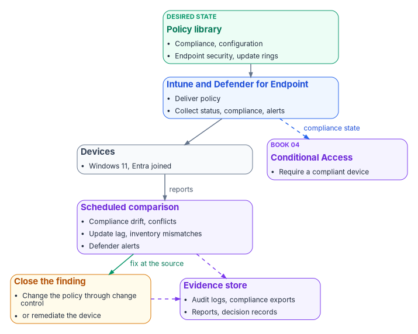
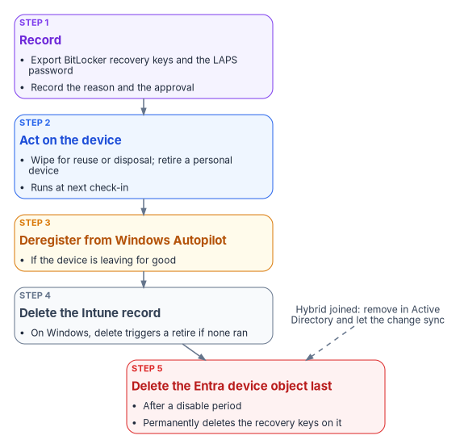

# Chapter 10 — Operating and Evidencing the Fleet

*Once the GPOs are gone, the fleet's state is no longer explained by where a device sits; it has to be proved, continuously, from records the services already keep.*

::: {.callout-note}
## In this chapter
How the Federal Modernization Program runs the fleet after the GPO sunset. Compliance and how its result reaches Conditional Access; Windows update rings, update policies and Windows Autopatch; Microsoft Defender for Endpoint; reconciling the device inventories that Intune, Entra ID and Defender each keep; retiring and wiping devices without losing recovery keys; drift detection and alerting; and the evidence an assessor reads for the configuration management and flaw remediation controls, with the boundary facts for a GCC (Moderate) tenant.
:::

Group Policy answered "why is this setting here?" with the device's position in the directory. [Chapter 01](01-why-group-policy-cant-come-to-the-cloud.md) explained why that answer doesn't survive the move to Intune. In the run state the program replaces it with three records that together say what each device should be, what it is, and who changed what: the policy library from [Chapter 08](08-gpo-to-intune-policy-migration.md), the status Intune and Defender report per device, and the audit log of every change. Operating the fleet means keeping those three records in agreement. Evidencing the fleet means handing an assessor the same records, not a document written for the audit.

{#fig-ch10-run-state-loop fig-alt="Top to bottom. A green card, desired state, lists the policy library: compliance, configuration, endpoint security and update rings. An arrow leads to a blue card, Intune and Defender for Endpoint, which deliver policy and collect per-device status, compliance state and alerts. An arrow leads to a slate card, devices, Windows 11 Entra joined. An arrow labelled reports leads to a violet card, scheduled comparison, listing compliance drift, configuration conflicts, update lag, inventory mismatches and Defender alerts. Two arrows leave it: a green one labelled fix at the source to an amber card, close the finding, either change the policy through change control or remediate the device; and a dashed violet one to a violet card, evidence store, holding audit logs, compliance exports, reports and decision records. A dashed violet arrow also runs from the amber card to the evidence store. A dashed blue arrow labelled compliance state runs from the Intune and Defender card to a violet card, Conditional Access, owned by Book 04."}

## Compliance and the Conditional Access hand-off

The compliance policies in Chapter 08 decide whether a device is compliant. Conditional Access decides what a noncompliant device can reach. [Book 04](../b04-access/index.md) owns that second decision: the policies that use the **Require device to be marked as compliant** grant control, their report-only rollout, and their exclusions. This book's side of the hand-off is making sure the compliance signal is accurate. The grant control works only for devices registered in Entra ID and enrolled in Intune.[^c10-ca-grant]

### Tenant-wide compliance settings

Two tenant settings sit above every compliance policy, under **Endpoint security** > **Device compliance** > **Compliance policy settings**:[^c10-compliance-settings]

| Setting | Default | Program value | Why |
|---|---|---|---|
| Mark devices with no compliance policy assigned as | Compliant | Not compliant | A device that falls outside every group (a missing tier attribute, for example) must not pass Conditional Access by default; Microsoft recommends this when compliance feeds Conditional Access |
| Compliance status validity period (days) | 30 | 14 | A device that hasn't reported within the period is treated as noncompliant; the range is 1 to 120 days |

The 14-day validity period is a program choice: short enough that a device left in a drawer loses access before its posture is stale by a whole patch cycle, long enough not to catch staff on leave.

### Reading compliance status

The device compliance dashboard groups devices as **Compliant**, **In grace period**, **Not evaluated** and **Not compliant**. *In grace period* means noncompliant, but inside the grace period set on the policy's **Mark device noncompliant** action. *Not evaluated* is the initial state of a newly enrolled device and also covers devices that haven't checked in since a policy changed.[^c10-monitor-compliance] A compliance setting that returns **Error** leaves the device's existing compliance status in place for up to seven days, after which the device becomes noncompliant, or enters its grace period.[^c10-monitor-compliance] The program reviews *Not evaluated* and *Error* weekly, because both hide devices from the noncompliant count.

### Defender risk as a compliance signal

The Windows compliance policy can require a device to be at or under a Defender for Endpoint machine risk score.[^c10-win-compliance] The program sets it on Tier 0 (CP-002 in Chapter 08), so a Defender detection on a privileged access workstation becomes a compliance failure and, through Conditional Access, a loss of access.

## Configuration status and conflicts

Each configuration profile and endpoint security policy reports per device and per setting. **Succeeded** means the setting on the device matches the policy; **Error** means it failed to apply; **Conflict** means another policy sets the same setting to a different value, or an update is still pending.[^c10-baseline-monitor] A device that hasn't checked in since assignment simply hasn't reported yet. A conflict is a defect in the library, not a state to live with: between configuration policies of any type there is no precedence, and the setting may not apply until the conflict is resolved.[^c10-conflicts]

| Conflict | How it shows | Resolution |
|---|---|---|
| Compliance vs. compliance | The device's compliance details name the policy that flagged it | The most restrictive value applies; confirm it is the intended one[^c10-conflicts] |
| Configuration vs. configuration | **Conflict** in the device configuration status | Move the setting into the one policy that owns it; adjust assignments |
| Endpoint security vs. configuration profile | **Conflict** or **Error** on both | Same as above; Endpoint security doesn't win, despite a common belief that it does |
| GPO vs. Intune (a population still in transition) | `gpresult` on the device differs from the Intune value | Remove the GPO copy; [Chapter 07](07-the-gpo-sunset-program.md#coexistence-who-wins) has the coexistence rules |

## Windows updates

### The update policy surfaces

Intune manages Windows updates through several policy types, all built on the Windows Update client policies (the current name for what was called Windows Update for Business):[^c10-update-overview]

| Policy | What it controls |
|---|---|
| Update ring | Deferral periods, deadlines, restart behavior and the user experience for a group of devices |
| Feature update policy | Pins devices to a Windows version, such as Windows 11, version 25H2, until the policy changes |
| Quality update policy | Targets monthly cumulative updates; supports expediting a critical update and hotpatch updates that install without a restart |
| Driver update policy | Approves driver and firmware updates from Windows Update, manually or automatically |

### The program's rings

Rings stage each month's quality update across the fleet. The ring names follow Windows Autopatch's (Test, First, Fast, Broad); the values are the program's design, built from the SC-005 template in Chapter 08:[^c10-e8-patch]

| Ring | Population | Quality deferral (days) | Quality deadline (days) | Grace period (days) |
|---|---|---|---|---|
| Test | Endpoint engineering lab devices | 0 | 2 | 1 |
| First | Pilot cohort, about 5% | 1 | 3 | 2 |
| Fast | About a quarter of the fleet | 3 | 5 | 2 |
| Broad | Everyone else | 7 | 7 | 2 |

Update rings allow a quality deferral of 0 to 30 days, deadlines of 2 to 30 days and a grace period of 0 to 7 days.[^c10-ring-settings] With these values a quality update reaches every online device within about 16 days of release, and an update that breaks the Test or First ring can be paused before it reaches Broad. The feature update deferral is 0 in every ring, because a feature update policy pins the version.

### Windows Autopatch

Windows Autopatch automates update ring management, sequencing and reporting for Windows, Microsoft 365 Apps, Edge and Teams. It is available with Windows Enterprise E3 or E5 (including through Microsoft 365 F3, E3 or E5), Education A3 or A5, Enterprise VDA, and Microsoft 365 Business Premium.[^c10-autopatch-prereq] For government tenants, it is included for GCC customers with Microsoft 365 G3 GCC or G5 GCC, and isn't supported in GCC High or DoD.[^c10-autopatch-faq] Devices must be Entra joined or hybrid joined, and co-managed devices need the Windows Update policies and device configuration workloads set to Intune or Pilot Intune.[^c10-autopatch-prereq] When Autopatch manages a device, it creates and maintains the update rings; administrators shouldn't assign their own rings to those devices.[^c10-update-rings]

The program's position: use Autopatch where the license allows, and keep the ring table above as the specification Autopatch's groups are configured to. Either way, the ring values are what the assessor reads for SI-2.

### Version currency

Feature update policies hold the fleet on a supported Windows version. As of October 2026, Windows 11 versions and their end of updates for Enterprise and Education editions are:[^c10-win11-release]

| Version | Build | End of updates (Enterprise, Education) |
|---|---|---|
| 26H2 | 26300 | 2029-10-09 |
| 25H2 | 26200 | 2028-10-10 |
| 24H2 | 26100 | 2027-10-12 |
| 23H2 | 22631 | 2026-11-10 |

Version 26H1 (build 28000) ships only on new devices that came to market in 2026 and isn't offered as an in-place update.[^c10-win11-release] Any 23H2 device left in the fleet loses updates on November 10, 2026, so the program's feature update policy targets 25H2 now and the compliance floor (24H2) rises each year.

## Microsoft Defender for Endpoint

Devices onboard to Defender for Endpoint through the EDR policy (ES-004 in Chapter 08), which uses the onboarding package Intune receives over the Intune–Defender connection. Intune's **EDR Onboarding Status** report shows which devices are onboarded and the health of their sensors; the Defender portal's device inventory confirms it.[^c10-edr]

In a GCC tenant, Defender for Endpoint for US Government customers runs in the Azure US Government environment with some feature differences from commercial; the GCC portal is `security.microsoft.com`, and desktop licensing comes from offers such as Microsoft 365 GCC G5, Microsoft 365 G5 Security GCC, or standalone Defender for Endpoint GCC.[^c10-mde-gov] Defender for Endpoint security settings management, which is how Intune endpoint security policy reaches servers, is supported in GCC.[^c10-intune-gov]

The settings that live in the Defender portal rather than the EDR policy are part of the program's Defender configuration:

| Setting | Program value | Where |
|---|---|---|
| Automated investigation and remediation | Full, automatic remediation, for workstation device groups | Defender portal device groups |
| Live response | On, with the role limited to Tier 0 analysts | Defender portal advanced features and roles |
| Web content filtering | On, with the organization's category policy | Defender portal |
| Tamper protection | On | Intune antivirus policy (ES-001); needs onboarding first[^c10-tamper] |

Attack surface reduction runs the audit-then-block cadence in ES-005. During the audit month, the program reviews each rule's audit events in Defender and records an exclusion or a decision before the rule moves to block.

Servers are in Defender too, but not in Intune: Intune doesn't manage Windows Server, so [Chapter 09](09-servers-under-azure-arc.md) covers how servers are configured through Azure Policy machine configuration and reached by Intune only through security settings management.

## Device inventory reconciliation

Three services keep their own device inventory, and they disagree in predictable ways:

| Inventory | What it holds | Key | Typical mismatch |
|---|---|---|---|
| Intune managed devices | Enrolled devices, compliance, OS version, encryption, last check-in | Intune device ID, with the Entra device ID as a reference | Devices that stopped checking in; cleanup rules hide them |
| Entra ID device objects | Joined and registered devices, extension attributes, BitLocker recovery keys | Entra device ID | Stale objects left by reimaging, broken hybrid trust, or devices never enrolled |
| Defender for Endpoint device inventory | Onboarded devices, sensor health, risk | Defender machine ID, with the Entra device ID | Devices onboarded but not enrolled, or enrolled but never onboarded |

The program reconciles them weekly on the Entra device ID. Every enrolled device must have an Entra object with its tier, role and environment attributes set, and a healthy Defender sensor. Every Entra object for a corporate Windows device must have an Intune enrollment. A device missing from any one is a finding. The same comparison is the program's evidence for CM-8's requirement that the inventory include every component and contain no duplicates.

### Stale records

- **Intune cleanup rules** hide devices that haven't checked in for a set number of days, from 30 to 270, per platform. They don't wipe or retire anything, and a hidden device reappears if it checks in before its device certificate expires. Hidden devices aren't removed from Entra ID.[^c10-cleanup] The program sets 90 days for Windows.
- **Entra ID stale devices** are found by `approximateLastSignInDateTime`, which isn't updated on every sign-in; Microsoft advises not treating anything newer than about 21 days as stale, and disabling a device for a grace period before deleting it.[^c10-stale] Hybrid-joined devices are disabled or deleted in Active Directory and the change syncs; deleting one only in Entra ID brings it back as a new pending object.[^c10-stale]
- **BitLocker keys go with the device object.** Deleting an Entra device deletes the recovery keys stored on it, with no way to recover them.[^c10-stale] The program exports keys for any device it deletes, into the key escrow record set, before the delete runs.

::: {.callout-warning}
## Illustrative, not tested against a production tenant
The scripts and queries in this chapter are illustrative and haven't been tested against a production tenant. Review them, and run them first against a test tenant. They read inventory; none of them changes a device.
:::

```powershell
# Read-only. Joins Intune managed devices to Entra device objects on the Entra device ID.
Connect-MgGraph -Scopes 'DeviceManagementManagedDevices.Read.All', 'Device.Read.All'

$intune = Get-MgDeviceManagementManagedDevice -All |
    Where-Object { $_.OperatingSystem -eq 'Windows' } |
    Select-Object DeviceName, AzureAdDeviceId, ComplianceState, OSVersion, LastSyncDateTime, SerialNumber

$entra = Get-MgDevice -All -Property Id, DeviceId, DisplayName, OperatingSystem, TrustType,
        ApproximateLastSignInDateTime, AccountEnabled, ExtensionAttributes |
    Where-Object { $_.OperatingSystem -eq 'Windows' }

$entraById = @{}
foreach ($d in $entra) { $entraById[$d.DeviceId] = $d }

$findings = foreach ($m in $intune) {
    $e = $entraById[$m.AzureAdDeviceId]
    if (-not $e) {
        [pscustomobject]@{ Device = $m.DeviceName; Finding = 'Enrolled, no Entra object' }
    }
    elseif (-not $e.ExtensionAttributes.ExtensionAttribute11) {
        [pscustomobject]@{ Device = $m.DeviceName; Finding = 'No security tier attribute' }
    }
}

$enrolledIds = $intune.AzureAdDeviceId
$findings += $entra | Where-Object { $_.DeviceId -notin $enrolledIds -and $_.AccountEnabled } |
    ForEach-Object { [pscustomobject]@{ Device = $_.DisplayName; Finding = 'Entra object, not enrolled' } }

$findings | Sort-Object Finding, Device | Export-Csv .\inventory-findings.csv -NoTypeInformation
```

## Retirement and wipe

A device leaves the fleet through a fixed sequence, because the order decides what can still be recovered.

{#fig-ch10-retirement-sequence fig-alt="Five cards top to bottom. A violet card, record: export the BitLocker recovery keys and the LAPS password, and record the reason and approval. A blue card, act on the device: wipe for reuse or disposal, or retire for a personal device; the action runs at next check-in. An amber card, deregister from Windows Autopilot if the device is leaving for good. A slate card, delete the Intune record; for Windows this triggers a retire if one hasn't run. A red card, delete the Entra device object last, after a disable period; this permanently deletes the recovery keys stored on it. A note beside the red card reads: hybrid joined devices are removed in Active Directory and the change syncs."}

| Action | What it does on Windows | When the program uses it |
|---|---|---|
| Retire | Removes company apps, settings, Wi-Fi, VPN and certificate profiles and Intune-provisioned mail; keeps personal data; unjoins an Entra-joined device and removes its Entra record unless it's registered in Autopilot[^c10-retire] | Personally owned devices; devices leaving one user for another outside a rebuild |
| Wipe | Factory reset; options keep the enrollment state and user account, or continue the wipe through power loss and overwrite free space[^c10-wipe] | Corporate devices being reused or disposed of; lost or stolen devices (the power-loss option) |
| Delete | Removes the device from Intune; on Windows it always triggers a retire[^c10-delete] | After the device action has completed, or for a device that will never check in again |
| Add to retire list (compliance action) | Queues a noncompliant device for an administrator to retire; retires nothing by itself | CP-001 to CP-003 after 7 or 30 days |

Four facts shape the sequence:

- **Retiring or deleting the Intune object of a BitLocker-protected Entra-joined device suspends BitLocker** by removing key protectors, as a safeguard against unrecoverable encryption. Back up the recovery key and the local administrator credentials first.[^c10-retire]
- **The power-loss wipe option can leave some devices unable to start**, so the program reserves it for corporate devices where data destruction outweighs reuse.[^c10-wipe]
- **Actions run at next check-in.** Until then the device still shows in the admin center; a retire or wipe that stays *Pending* on a device that has been reset can be cleared by deleting the record.[^c10-retire]
- **Daily limits apply.** A tenant can submit up to 1,000 retire actions and 1,000 delete actions a day, counting bulk and Graph requests.[^c10-retire][^c10-delete] A mass refresh is planned in daily batches.

The Entra device object is deleted last, after a disable period, and only after its recovery keys are exported (see [Stale records](#stale-records)). Windows Autopilot devices can't be deleted from Entra ID until they are deleted from Intune.[^c10-entra-delete]

## Drift detection and alerting

Drift is a difference between the policy library and a device's reported state that the policy should have prevented: BitLocker off, tamper protection off, an OS below the floor, a setting stuck in *Conflict*. The program detects it with the same loop [Chapter 05](05-the-governed-manual-and-retrofit-paths.md) describes for the governed path (snapshot, compare, classify, alert, remediate, verify), applied to the Intune and Defender records:

1. **Scheduled export.** A daily export of compliance, configuration and inventory status through Microsoft Graph and Intune diagnostic settings.
2. **Baseline comparison.** Current values against the template values in Chapter 08.
3. **Classification and alerting.** Each difference is classified (policy gap, device fault, conflict, inventory mismatch) and alerted by severity.
4. **Remediation.** A device sync or a Remediation script on the affected devices, or a policy change through change control when the library itself is wrong. On the governed path, every remediating write carries an approval reference.

### What Log Analytics receives, and when

Intune's diagnostic settings send four log categories to a Log Analytics workspace: audit logs, operational logs (enrollment and noncompliance), device compliance organizational logs, and the IntuneDevices inventory. Audit and operational logs are sent immediately. Compliance organizational logs and IntuneDevices are exported once every 24 hours and can take up to 48 hours to arrive; Microsoft says not to rely on a fixed delivery time.[^c10-diag] Two consequences: these tables are for trends and evidence, not for minute-level alerts; and per-setting configuration status isn't among them, so the configuration part of the comparison comes from Microsoft Graph reports, not from Log Analytics.

Three pitfalls shape these queries: don't hard-code compliance state strings, don't join on a `DeviceId` column, which `IntuneOperationalLogs` doesn't have, and don't look for configuration conflicts in that table, which records enrollment and noncompliance.[^c10-oplogs] The program uses these:

```kusto
// Compliance trend over 30 days, by state, from the daily organizational export.
IntuneDeviceComplianceOrg
| where TimeGenerated > ago(30d)
| summarize Devices = dcount(DeviceId) by ComplianceState, bin(TimeGenerated, 1d)
| order by TimeGenerated asc
```

```kusto
// Windows devices below the program's OS floor or not reporting encryption, from the latest inventory export.
IntuneDevices
| where TimeGenerated > ago(2d) and OS == "Windows"
| summarize arg_max(TimeGenerated, *) by DeviceId
| extend Build = toint(split(OSVersion, ".")[2])
| where Build < 26100 or EncryptionStatusString != "True"
| project DeviceName, OSVersion, EncryptionStatusString, LastContact, JoinType, ReferenceId
```

```kusto
// Every Intune change in the last 7 days, for the change record (CM-3, CM-6(d)).
IntuneAuditLogs
| where TimeGenerated > ago(7d)
| project TimeGenerated, OperationName, Identity, ResultType, Properties
| order by TimeGenerated desc
```

The table columns used are documented for `IntuneDeviceComplianceOrg`, `IntuneDevices` and `IntuneAuditLogs`.[^c10-tbl-compliance][^c10-tbl-devices][^c10-tbl-audit] Check the actual values of `EncryptionStatusString` in your workspace before relying on the second query; the schema documents the column, not its values.

### Alerts

| Alert | Threshold | Source | Action |
|---|---|---|---|
| Noncompliant devices | More than 10% of managed devices | Compliance export (daily) | Endpoint team; incident in the service management tool |
| Tier 0 noncompliance | Any device | Graph query of Tier 0 compliance state, hourly | Security team, immediately |
| Policy deployment failure | More than 5 devices failing the same policy | Graph configuration status, daily | Endpoint team |
| Tamper protection off, or a Defender tampering alert | Any device | Defender for Endpoint alerts | Security incident; investigate immediately |
| BitLocker not encrypted | Noncompliant for more than 2 days | Compliance export | Help desk ticket for the device's user |
| Inventory mismatch | Any finding from the weekly reconciliation | Reconciliation script | Endpoint team; device owner |

Don't alert on Tier 0 noncompliance from the daily compliance export: with up to 48 hours of export latency, the alert would arrive two days late. Tier 0 is polled from Graph instead, and Conditional Access blocks the device in the meantime because CP-002 has no grace period.

## Reporting and the evidence an assessor reads

The program's evidence is the records the services keep, exported on a schedule and retained. An assessor reading the configuration management and flaw remediation controls for the fleet sees these artifacts. Control wording below is from NIST SP 800-53 Revision 5, release 5.2.0, the release FedRAMP's 2026 control catalog uses; FedRAMP adds no parameter values of its own to CM-2, CM-6, CM-7, CM-8 or SI-2.[^c10-nist][^c10-fedramp-cm][^c10-fedramp-si]

| Control | What it asks | Evidence the program hands over | Produced by |
|---|---|---|---|
| CM-2 Baseline Configuration | Develop, document and maintain under configuration control a current baseline configuration, and review it on a schedule, when circumstances require, and when components are installed or upgraded | The policy library (Chapter 08) exported as JSON from Graph, under version control, with its review history; the Windows version and update policy | Graph export; repository history |
| CM-6 Configuration Settings | Establish settings in the most restrictive mode consistent with operations, implement them, approve deviations, and monitor and control changes | Per-setting status reports; the exception register with approvals; Intune audit logs of every policy change | Intune reports and Graph; `IntuneAuditLogs`; exception register |
| CM-7 Least Functionality | Provide only mission-essential capabilities and prohibit or restrict named functions, ports, protocols, software and services | Attack surface reduction rules in block, firewall policy with its rule set, Edge extension allow list, consumer features off; ASR audit-to-block decisions | ES-003, ES-005, SC-003, SC-010 status; Defender ASR reports |
| CM-8 System Component Inventory | Keep an inventory that reflects the system, includes every component, has no duplicates or components of other systems, and is reviewed on a schedule | The weekly reconciliation of Intune, Entra ID and Defender inventories, with findings and their closure | Reconciliation output; `IntuneDevices` export |
| SI-2 Flaw Remediation | Identify, report and correct flaws; test updates before installation; install security updates within a defined period of release; tie flaw remediation into configuration management | The ring table with its deferrals and deadlines; quality update compliance per ring; the Test and First ring results that gate Broad; expedite records | Update ring and quality update reports; Autopatch reports |

Two notes on the update evidence in a GCC tenant. Windows Update for Business reports, the Log Analytics–based update reporting service, doesn't meet US Government Community Cloud compliance requirements, so the program uses Intune's own Windows update reports and Autopatch reports for SI-2 evidence.[^c10-wufb-reports] And SI-2's "within a defined period" is the organization's parameter; the ring table above is what sets it, so the assessor reads the ring deadlines, not a separate statement.

The program maps the policy library to a wider set of controls, as its own claim of where each control is implemented on the endpoint surface:

| Control | Implemented by (Chapter 08 IDs) |
|---|---|
| AC-7 Unsuccessful Logon Attempts | SC-001 account lockout (local accounts) |
| AC-8 System Use Notification | SC-001 logon banner |
| AC-11 Device Lock | CP-001 password and inactivity requirements |
| AU-2 Event Logging | SC-001 audit policy |
| IA-2 Identification and Authentication | ES-006 Windows Hello for Business |
| IA-5 Authenticator Management | CP-001 password rules; ES-006 Windows LAPS rotation |
| SC-7 Boundary Protection | ES-003 firewall |
| SC-13 Cryptographic Protection | ES-002 BitLocker XTS-AES 256 |
| SC-28 Protection of Information at Rest | ES-002 BitLocker; AP-001 app data encryption |
| SI-3 Malicious Code Protection | ES-001 antivirus and tamper protection |
| SI-4 System Monitoring | ES-004 Defender for Endpoint |

Two further mappings, SI-16 (memory protection) to Credential Guard and code integrity, and AU-3 (content of audit records) to EDR telemetry, aren't claimed until its assessor agrees the features meet the control's parameters; they are recorded as candidates, not claims.

### FedRAMP 20x Key Security Indicators

FedRAMP's Consolidated Rules for 2026 express security outcomes as 46 Key Security Indicators in 10 themes.[^c10-ksi] Initial certification under the rules began on July 4, 2026, and ongoing certification follows them from January 1, 2027.[^c10-fedramp-cert] The indicators are written for cloud service offerings, not for an agency's endpoint fleet. The program uses them as a vocabulary for the evidence this chapter produces; the mapping below is the program's own claim, carried from the intune-arc governed-path material and checked against FedRAMP's indicator pages.[^c10-ksi-svc][^c10-ksi-cmt][^c10-ksi-mla][^c10-ksi-piy][^c10-ksi-cna][^c10-ksi-iam]

| Key Security Indicator | Evidenced on the endpoint surface by |
|---|---|
| KSI-IAM-APM, Adopting Passwordless Methods | Windows Hello for Business (ES-006) and the phishing-resistant sign-in in Book 02 |
| KSI-IAM-ELP, Ensuring Least Privilege | Attribute-scoped assignment instead of tenant-wide assignment; scope tags |
| KSI-SVC-ACM, Automating Configuration Management | The policy library assigned by dynamic group, with the drift comparison |
| KSI-CNA-EIS, Enforcing Intended State | The scheduled comparison and remediation loop |
| KSI-CMT-LMC, Logging Changes | `IntuneAuditLogs`, and the approval reference on governed-path changes |
| KSI-MLA-EVC, Evaluating Configurations | The drift report against the Chapter 08 baseline |
| KSI-PIY-GIV, Generating Inventories | The weekly inventory reconciliation |

KSI-CNA-EIS is optional for Class B and Class C.[^c10-ksi-cna] Don't cite this surface for recovery planning, supply chain risk, cybersecurity education or incident response; that evidence comes from elsewhere. [Chapter 05](05-the-governed-manual-and-retrofit-paths.md) explains why the manual path, which produces the same configuration without an approval chain, doesn't evidence KSI-CMT-LMC for changes the program makes.

## GCC (Moderate) boundary facts

Intune and Entra ID in a GCC (Moderate) tenant are often described as a separate government instance. For Intune that's wrong, and it changes where data and endpoints live:

| Topic | Fact for a GCC (Moderate) tenant | Program implementation |
|---|---|---|
| Intune service instance | GCC uses the same Intune instance as commercial; only GCC High and DoD use the separate government instance[^c10-intune-gov] | Admin center `intune.microsoft.com` |
| Microsoft Graph | GCC uses the worldwide endpoints, `graph.microsoft.com` and `portal.azure.com`; GCC High uses `graph.microsoft.us`[^c10-graph-deploy] | All Graph calls in Chapters 08 and 10 use `graph.microsoft.com` |
| Defender for Endpoint | Offered to GCC as Defender for Endpoint for US Government, built in Azure US Government; GCC portal `security.microsoft.com`[^c10-mde-gov] | ES-004 onboards to the tenant's GCC instance |
| Conditional Access | The compliance result feeds Entra ID Conditional Access in the same tenant | Book 04 |
| BitLocker keys and LAPS passwords | Stored on the device object in the tenant's Entra ID | Exported before any device delete |
| Update reporting | Windows Update for Business reports doesn't meet GCC compliance requirements[^c10-wufb-reports] | Intune and Autopatch update reports |
| Windows Autopatch | Included for GCC with Microsoft 365 G3 or G5 GCC; not supported in GCC High or DoD[^c10-autopatch-faq] | Used where licensed |
| Feature availability | Intune documents feature differences for GCC High and DoD; GCC follows commercial | Re-check the service description before relying on a new feature |

## Where to go next

- [Book 02 — Identity & Directory](../b02-identity/index.md), for the identities these devices authenticate: [Chapter 04](../b02-identity/04-the-hidden-migration-surface.md) treats devices as one of the migration's hidden adapters, and [Chapter 10](../b02-identity/10-migrating-and-governing.md) covers Windows Hello for Business and phishing-resistant sign-in.
- [Book 04 — Access & Privilege](../b04-access/index.md), for the Conditional Access policies that consume device compliance, and for the privileged access model that Tier 0 devices serve.
- The [Endpoint & Device Modernization project plan](https://github.com/WhalerMike/modernization-workbook/blob/main/docs/projects/endpoint-device-plan.md), which tracks this work as Observe, Onboard, Harden and Watch; this chapter is its Watch phase.
- [Gate 6 of the Intune track implementation guide](../guides/intune-track-implementation.md#gate-6-operating-it), which runs this chapter as a standing loop, and the read-only [validation kit](../../../downloads/validation-kit.zip) whose checks feed it.

::: {.callout-tip}
## Continue the book
[← Previous: Chapter 09 — Servers Under Azure Arc](09-servers-under-azure-arc.md) · [Book index](index.md) · [Next: Appendix A — GPO to Intune Crosswalk →](appendix-a-gpo-to-intune-crosswalk.md)
:::

[^c10-ca-grant]: Microsoft Learn, "Conditional Access: Grant," section "Require device to be marked as compliant," <https://learn.microsoft.com/entra/identity/conditional-access/concept-conditional-access-grant> (accessed Oct 20, 2026).
[^c10-compliance-settings]: Microsoft Learn, "Use compliance policies to set rules for devices you manage with Intune," section "Compliance policy settings," <https://learn.microsoft.com/intune/device-security/compliance/overview> (accessed Oct 20, 2026).
[^c10-monitor-compliance]: Microsoft Learn, "Monitor results of your Intune device compliance policies," sections "Device compliance dashboard" and "Device behavior with a compliance setting in Error state," <https://learn.microsoft.com/intune/device-security/compliance/monitor-policy> (accessed Oct 20, 2026).
[^c10-win-compliance]: Microsoft Learn, "Device compliance settings for Windows in Intune," section "Microsoft Defender for Endpoint," <https://learn.microsoft.com/intune/device-security/compliance/ref-windows-settings> (accessed Oct 20, 2026).
[^c10-baseline-monitor]: Microsoft Learn, "Monitor security baselines and profiles in Microsoft Intune," section "View settings from profiles that apply to a device," <https://learn.microsoft.com/intune/device-security/security-baselines/monitor-baselines> (accessed Oct 20, 2026).
[^c10-conflicts]: Microsoft Learn, "Common questions, answers, and scenarios with policies and profiles in Microsoft Intune," section "Conflicts," <https://learn.microsoft.com/intune/device-configuration/troubleshoot-device-profiles> (accessed Oct 20, 2026).
[^c10-update-overview]: Microsoft Learn, "Windows update management overview," section "Windows update management capabilities," <https://learn.microsoft.com/intune/device-updates/windows/> (accessed Oct 20, 2026).
[^c10-e8-patch]: Microsoft Learn, "Essential Eight patch operating systems," section "Windows Autopatch," <https://learn.microsoft.com/compliance/anz/e8-patch-os> (accessed Oct 20, 2026).
[^c10-ring-settings]: Microsoft Learn, "Update rings policy settings," <https://learn.microsoft.com/intune/device-updates/windows/ref-update-ring-settings> (accessed Oct 20, 2026).
[^c10-autopatch-prereq]: Microsoft Learn, "Prerequisites" (Windows Autopatch), sections "Licenses and entitlements" and "Configuration Manager co-management requirements," <https://learn.microsoft.com/windows/deployment/windows-autopatch/prepare/windows-autopatch-prerequisites> (accessed Oct 20, 2026).
[^c10-autopatch-faq]: Microsoft Learn, "Frequently Asked Questions about Windows Autopatch," section "General," <https://learn.microsoft.com/windows/deployment/windows-autopatch/overview/windows-autopatch-faq> (accessed Oct 20, 2026).
[^c10-update-rings]: Microsoft Learn, "Manage Windows Update ring policies," <https://learn.microsoft.com/intune/device-updates/windows/manage-update-rings> (accessed Oct 20, 2026).
[^c10-win11-release]: Microsoft Learn, "Windows 11 release information," section "Windows 11 current versions by servicing option," <https://learn.microsoft.com/windows/release-health/windows11-release-information> (accessed Oct 20, 2026).
[^c10-edr]: Microsoft Learn, "Deploy endpoint detection and response policy with Intune," sections "Deploy EDR policy" and "Monitor and validate EDR deployment," <https://learn.microsoft.com/intune/device-configuration/endpoint-security/deploy-edr> (accessed Oct 20, 2026).
[^c10-mde-gov]: Microsoft Learn, "Microsoft Defender for Endpoint for US Government customers," sections "Licensing requirements" and "Portal URLs," <https://learn.microsoft.com/defender-endpoint/gov> (accessed Oct 20, 2026).
[^c10-intune-gov]: Microsoft Learn, "Microsoft Intune for US Government GCC High and DoD service description," sections "Intune commercial and government instances" and "Feature differences in Intune GCC High and DoD," <https://learn.microsoft.com/intune/fundamentals/government-service> (accessed Oct 20, 2026).
[^c10-tamper]: Microsoft Learn, "Antivirus policy for endpoint security in Microsoft Intune," section "Prerequisites for antivirus policy," <https://learn.microsoft.com/intune/device-configuration/endpoint-security/antivirus> (accessed Oct 20, 2026).
[^c10-cleanup]: Microsoft Learn, "Device cleanup rules," <https://learn.microsoft.com/intune/governance/configure-cleanup-rules> (accessed Oct 20, 2026).
[^c10-stale]: Microsoft Learn, "How To: Manage stale devices in Microsoft Entra ID," <https://learn.microsoft.com/entra/identity/devices/manage-stale-devices> (accessed Oct 20, 2026).
[^c10-retire]: Microsoft Learn, "Device action: retire," sections "Before retiring or deleting a Microsoft Entra joined device" and "User experience," <https://learn.microsoft.com/intune/device-management/actions/retire> (accessed Oct 20, 2026).
[^c10-wipe]: Microsoft Learn, "Wipe devices with Microsoft Intune," section "How to wipe a device from the Intune admin center," <https://learn.microsoft.com/intune/device-management/actions/wipe> (accessed Oct 20, 2026).
[^c10-delete]: Microsoft Learn, "Device action: delete," section "Delete action behavior by platform," <https://learn.microsoft.com/intune/device-management/actions/delete> (accessed Oct 20, 2026).
[^c10-entra-delete]: Microsoft Learn, "Manage devices" (Microsoft Entra PowerShell), section "Delete a Microsoft Entra device," <https://learn.microsoft.com/powershell/entra-powershell/manage-devices?view=entra-powershell> (accessed Oct 20, 2026).
[^c10-diag]: Microsoft Learn, "Send Intune log data to Azure Storage, Event Hubs, or Log Analytics," sections "Send logs to Azure monitor" and "Frequently asked questions," <https://learn.microsoft.com/intune/governance/integrate-azure-monitor> (accessed Oct 20, 2026).
[^c10-oplogs]: Microsoft Learn, "IntuneOperationalLogs" (Azure Monitor table reference), <https://learn.microsoft.com/azure/azure-monitor/reference/tables/intuneoperationallogs> (accessed Oct 20, 2026).
[^c10-tbl-compliance]: Microsoft Learn, "IntuneDeviceComplianceOrg" (Azure Monitor table reference), <https://learn.microsoft.com/azure/azure-monitor/reference/tables/intunedevicecomplianceorg> (accessed Oct 20, 2026).
[^c10-tbl-devices]: Microsoft Learn, "IntuneDevices" (Azure Monitor table reference), <https://learn.microsoft.com/azure/azure-monitor/reference/tables/intunedevices> (accessed Oct 20, 2026).
[^c10-tbl-audit]: Microsoft Learn, "IntuneAuditLogs" (Azure Monitor table reference), <https://learn.microsoft.com/azure/azure-monitor/reference/tables/intuneauditlogs> (accessed Oct 20, 2026).
[^c10-nist]: National Institute of Standards and Technology, SP 800-53 Rev. 5, *Security and Privacy Controls for Information Systems and Organizations*, September 2020 (updated December 10, 2020; release 5.2.0, August 27, 2025), <https://csrc.nist.gov/pubs/sp/800/53/r5/upd1/final>; control text from the NIST OSCAL catalog, release 5.2.0, <https://github.com/usnistgov/oscal-content/tree/main/nist.gov/SP800-53/rev5> (both accessed Oct 20, 2026).
[^c10-fedramp-cm]: FedRAMP, "Configuration Management" (NIST SP 800-53 Rev. 5 controls, catalog release 5.2.0), *FedRAMP Consolidated Rules for 2026*, <https://fedramp.gov/2026/reference/controls/configuration-management/> (accessed Oct 20, 2026).
[^c10-fedramp-si]: FedRAMP, "System and Information Integrity" (NIST SP 800-53 Rev. 5 controls, catalog release 5.2.0), *FedRAMP Consolidated Rules for 2026*, <https://fedramp.gov/2026/reference/controls/system-and-information-integrity/> (accessed Oct 20, 2026).
[^c10-wufb-reports]: Microsoft Learn, "Windows Update for Business reports overview," section "Limitations," <https://learn.microsoft.com/windows/deployment/update/wufb-reports-overview> (accessed Oct 20, 2026).
[^c10-ksi]: FedRAMP, "Key Security Indicators," *FedRAMP Consolidated Rules for 2026*, <https://www.fedramp.gov/2026/reference/20x/b/key-security-indicators/> (accessed Oct 20, 2026).
[^c10-fedramp-cert]: FedRAMP, "FedRAMP Certification," *FedRAMP Consolidated Rules for 2026*, section "Effective Date(s) & Overall Applicability for 20x," <https://www.fedramp.gov/2026/providers/20x/rules/fedramp-certification/> (accessed Oct 20, 2026).
[^c10-ksi-svc]: FedRAMP, "Service Configuration" (Key Security Indicators), <https://fedramp.gov/2026/providers/20x/key-security-indicators/service-configuration/> (accessed Oct 20, 2026).
[^c10-ksi-cmt]: FedRAMP, "Change Management" (Key Security Indicators), <https://fedramp.gov/2026/providers/20x/key-security-indicators/change-management/> (accessed Oct 20, 2026).
[^c10-ksi-mla]: FedRAMP, "Monitoring, Logging, and Auditing" (Key Security Indicators), <https://fedramp.gov/2026/providers/20x/key-security-indicators/monitoring-logging-and-auditing/> (accessed Oct 20, 2026).
[^c10-ksi-piy]: FedRAMP, "Policy and Inventory" (Key Security Indicators), <https://fedramp.gov/2026/providers/20x/key-security-indicators/policy-and-inventory/> (accessed Oct 20, 2026).
[^c10-ksi-cna]: FedRAMP, "Cloud Native Architecture" (Key Security Indicators), <https://fedramp.gov/2026/providers/20x/key-security-indicators/cloud-native-architecture/> (accessed Oct 20, 2026).
[^c10-ksi-iam]: FedRAMP, "Identity and Access Management" (Key Security Indicators), <https://fedramp.gov/2026/providers/20x/key-security-indicators/identity-and-access-management/> (accessed Oct 20, 2026).
[^c10-graph-deploy]: Microsoft Learn, "Microsoft Graph national cloud deployments," section "Microsoft Graph and Graph Explorer service root endpoints," <https://learn.microsoft.com/graph/deployments> (accessed Oct 20, 2026).
