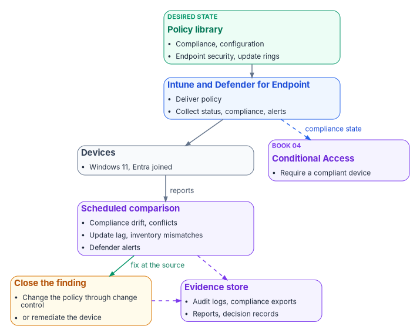
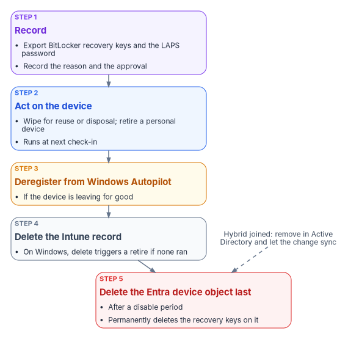

# Chapter 10 — Operating and Evidencing the Fleet

*Once the GPOs are gone, the fleet's state is no longer explained by where a device sits; it has to be proved, continuously, from records the services already keep.*

::: {.callout-note}
## In this chapter
How the Federal Modernization Program runs the fleet after the GPO sunset. Compliance and how its result reaches Conditional Access, and the compliance baselines for Windows, iOS and iPadOS and Android Enterprise, corporate and personally owned; Windows update rings, update policies, expedited updates and Windows Autopatch; Microsoft Defender for Endpoint; reconciling the device inventories that Intune, Entra ID and Defender each keep; retiring and wiping devices without losing recovery keys; drift detection and alerting; endpoint analytics for drift and delayed patching; and the evidence an assessor reads for the configuration management and flaw remediation controls, with the boundary facts for a GCC (Moderate) tenant.
:::

Group Policy answered "why is this setting here?" with the device's position in the directory. [Chapter 01](01-why-group-policy-cant-come-to-the-cloud.md) explained why that answer doesn't survive the move to Intune. In the run state the program replaces it with three records that together say what each device should be, what it is, and who changed what: the policy library from [Chapter 08](08-gpo-to-intune-policy-migration.md), the status Intune and Defender report per device, and the audit log of every change. Operating the fleet means keeping those three records in agreement. Evidencing the fleet means handing an assessor the same records, not a document written for the audit.

{#fig-ch10-run-state-loop fig-alt="Top to bottom. A green card, desired state, lists the policy library: compliance, configuration, endpoint security and update rings. An arrow leads to a blue card, Intune and Defender for Endpoint, which deliver policy and collect per-device status, compliance state and alerts. An arrow leads to a slate card, devices, Windows 11 Entra joined. An arrow labelled reports leads to a violet card, scheduled comparison, listing compliance drift, configuration conflicts, update lag, inventory mismatches and Defender alerts. Two arrows leave it: a green one labelled fix at the source to an amber card, close the finding, either change the policy through change control or remediate the device; and a dashed violet one to a violet card, evidence store, holding audit logs, compliance exports, reports and decision records. A dashed violet arrow also runs from the amber card to the evidence store. A dashed blue arrow labelled compliance state runs from the Intune and Defender card to a violet card, Conditional Access, owned by Book 04."}

## Compliance and the Conditional Access hand-off

The compliance policies in Chapter 08 decide whether a device is compliant. Conditional Access decides what a noncompliant device can reach. [Book 04](../b04-access/index.md) owns that second decision: the policies that use the **Require device to be marked as compliant** grant control, their report-only rollout, and their exclusions. This book's side of the hand-off is making sure the compliance signal is accurate. The grant control works only for devices registered in Entra ID and enrolled in Intune.[^c10-ca-grant]

### Tenant-wide compliance settings

Two tenant settings sit above every compliance policy, under **Endpoint security** > **Device compliance** > **Compliance policy settings**:[^c10-compliance-settings]

| Setting | Default | Program value | Why |
|---|---|---|---|
| Mark devices with no compliance policy assigned as | Compliant | Not compliant | A device that falls outside every group (a missing or UNPOSITIONED tier attribute, for example) must not pass Conditional Access by default; Microsoft recommends this when compliance feeds Conditional Access |
| Compliance status validity period (days) | 30 | 14 | A device that hasn't reported within the period is treated as noncompliant; the range is 1 to 120 days |

The 14-day validity period is a program choice: short enough that a device left in a drawer loses access before its posture is stale by a whole patch cycle, long enough not to catch staff on leave.

### Reading compliance status

The device compliance dashboard groups devices as **Compliant**, **In grace period**, **Not evaluated** and **Not compliant**. *In grace period* means noncompliant, but inside the grace period set on the policy's **Mark device noncompliant** action. *Not evaluated* is the initial state of a newly enrolled device and also covers devices that haven't checked in since a policy changed.[^c10-monitor-compliance] A compliance setting that returns **Error** leaves the device's existing compliance status in place for up to seven days, after which the device becomes noncompliant, or enters its grace period.[^c10-monitor-compliance] The program reviews *Not evaluated* and *Error* weekly, because both hide devices from the noncompliant count.

### Defender risk as a compliance signal

The Windows compliance policy can require a device to be at or under a Defender for Endpoint machine risk score.[^c10-win-compliance] The program sets it on Tier 0 (CP-002 in Chapter 08), so a Defender detection on a privileged access workstation becomes a compliance failure and, through Conditional Access, a loss of access.

## Compliance architecture by platform and ownership {#compliance-architecture}

Chapter 08's compliance policies cover the Windows fleet. An assessment that reads device compliance reads every platform that reaches organizational data, and it reads ownership too: a personally owned phone and a corporate one carry different risks and get different controls. This section completes the architecture for the platforms in the workbook's scope, Windows, iOS and iPadOS, and Android Enterprise, for corporate and personally owned devices, and sets the rule for when compliance starts to decide access. The conventions are in [Book 00, Appendix D](../b00-orientation/appendix-d-control-states-and-evidence.md).

::: {.callout-note appearance="simple"}
## Assessment mapping
- **Microsoft Zero Trust pillar:** Devices
- **CISA ZTMM pillar:** Devices (policy enforcement and compliance monitoring; asset risk management)
- **Depends on:** Identity: the device record is a Microsoft Entra object and Conditional Access reads its compliance ([Book 04, Chapter 07](../b04-access/07-the-conditional-access-policy-library.md)); enrollment and ownership from [Chapter 04](04-intune-first-onboarding.md#enrollment-controls)
- **Attack chain interrupted:** a stolen or phished credential used from an unmanaged, jailbroken, rooted or out-of-date device (Initial Access with valid accounts; Defense Evasion on a device the organization can't see)
:::

### Compliance is not configuration

Two policy families do two different jobs, and the program keeps them apart:

- **Configuration** sets the device: a configuration profile, settings catalog policy, endpoint security policy or security baseline pushes a setting. Each setting has exactly one owning policy ([Chapter 08](08-gpo-to-intune-policy-migration.md#choosing-the-authority-per-workload)).
- **Compliance** measures the device and reports a state that Conditional Access reads. A compliance policy defines the rules a device must meet, and the actions for noncompliance, such as marking the device noncompliant after a grace period, emailing the user or adding the device to the retire list.[^c10-z-noncompliance]

A compliance rule checks an outcome the device can report (encryption, OS version, jailbreak or root state, a Defender risk level), not a setting the program merely pushes. A setting that is pushed but can't be measured stays out of compliance and is checked by drift detection instead, as Chapter 08 does for Credential Guard. That separation is what lets the program change a configuration without changing who gets access, and lets an assessor see which controls decide access.

### Platform and ownership baselines

The program's baselines start from Microsoft's security configuration framework for mobile devices, which defines levels of device compliance and restriction settings for personally owned and organization-owned iOS/iPadOS and Android Enterprise devices. Microsoft describes level 2, enhanced security, as the recommended minimum for devices where users reach work data, and level 3, high security, for users or groups who are uniquely targeted; it asks organizations to adjust the examples to their own risk and then deploy in rings.[^c10-z-ios-compliance][^c10-z-android-personal][^c10-z-android-managed] Microsoft's Zero Trust identity and device access guidance uses the same levels.[^c10-z-zt-common]

| Platform and ownership | Enrollment path ([Chapter 04](04-intune-first-onboarding.md#enrollment-controls)) | Compliance policy | Configuration | Access path (owned by [Book 04](../b04-access/07-the-conditional-access-policy-library.md)) |
|---|---|---|---|---|
| Windows, corporate | Windows Autopilot or device preparation | CP-001, CP-002, CP-003, CP-005 ([Chapter 08](08-gpo-to-intune-policy-migration.md#compliance-policies)) | Chapter 08 library; hardening rollout in [Chapter 08](08-gpo-to-intune-policy-migration.md#windows-hardening-rollout) | Compliant device: CA004, CA007, CA016, CA028 |
| Windows, personally owned | Not enrolled; personal Windows enrollment is blocked | None (no enrolled device to evaluate) | AP-002 app protection for Edge | App protection for Edge, as Book 04's policies decide |
| iOS and iPadOS, corporate | Apple Automated Device Enrollment, supervised | CP-006 | Microsoft supervised level 2 restrictions | Compliant device |
| iOS and iPadOS, personally owned | Account-driven User Enrollment, or app protection only | CP-007, where enrolled | AP-002 and AP-001; User Enrollment's limited setting set | App protection: CA017 |
| Android Enterprise, corporate | Fully managed (zero-touch or Knox Mobile Enrollment) | CP-008 | Microsoft fully managed level 2 restrictions | Compliant device |
| Android Enterprise, personally owned | Personally owned work profile, or app protection only | CP-009, where enrolled | Microsoft work profile level 2 restrictions; AP-001 and AP-002 | App protection: CA017 |

Shared and kiosk mobile devices follow the corporate rows with no user affinity; the program has no mobile kiosk population today, so no separate ID is defined. Which Conditional Access policy reads which row, and its exclusions, are Book 04's decisions; this book's job is that each row's compliance signal is accurate and evidenced.

#### CP-006 and CP-007: iOS and iPadOS

**Authority:** Microsoft-recommended (the iOS/iPadOS compliance example at enhanced security, level 2).[^c10-z-ios-compliance] **Applies:** all enrolled iOS and iPadOS devices; level 3 settings (a stricter OS floor and a Defender for Endpoint or mobile threat defense risk level) are **license-dependent** and are the program's choice for Tier 0 users only.

| Section | Setting | Value | Source |
|---|---|---|---|
| Device health | Jailbroken devices | Block | Microsoft level 2 |
| Device properties | Minimum OS version | The current major version minus one (N-1), raised as Apple ships | Microsoft level 2: match the versions Microsoft apps support, N-1 |
| System security | Require a password to unlock mobile devices | Require | Microsoft level 2 |
| System security | Simple passwords | Block | Microsoft level 2 |
| System security | Minimum password length | 6 | Microsoft level 2 |
| System security | Required password type | Numeric | Microsoft level 2 |
| System security | Maximum minutes after screen lock before password is required | 5 | Microsoft level 2 |
| System security | Maximum minutes of inactivity until screen locks | 5 | Microsoft level 2 |
| Actions for noncompliance | Mark device noncompliant | 1 day | Program choice, matching CP-001; Microsoft's example marks it immediately |

CP-007 applies the same table to personally owned devices enrolled with account-driven User Enrollment. User Enrollment gives the organization a limited, separate managed volume and a subset of management options, and supervision isn't available,[^c10-z-user-enrollment] so check each setting against Microsoft's list of what User Enrollment supports before relying on it, and keep app protection (AP-001, AP-002) as the data control for personal devices. User Enrollment needs a Managed Apple Account per user; Apple Managed account federation with Microsoft Entra ID isn't available in GCC High or DoD, so there the accounts are created in Apple Business Manager instead.[^c10-z-user-enrollment][^c10-intune-gov]

#### CP-008 and CP-009: Android Enterprise

**Authority:** Microsoft-recommended (the fully managed and personally owned work profile examples at enhanced security, level 2).[^c10-z-android-managed][^c10-z-android-personal] **Applies:** all enrolled Android Enterprise devices; level 3 as for iOS.

| Section | Setting | CP-008 fully managed | CP-009 personally owned work profile |
|---|---|---|---|
| Device health | Play Integrity verdict | Check basic integrity and device integrity | Check basic integrity and device integrity |
| Device health | Check strong integrity using hardware-backed security features | Check strong integrity (devices that can't are marked noncompliant) | Same |
| Device health | Rooted devices | — | Block |
| Device health | Google Play Services is configured; up-to-date security provider | — | Require |
| Device properties | Minimum OS version | The program's Android floor, reviewed each release | Same |
| Device properties | Minimum security patch level | Not configured until the fleet's OEMs deliver monthly patches | Same |
| System security | Require a password; required type; minimum length | Require; numeric complex; 6 | Same |
| System security | Maximum minutes of inactivity before password is required | 5 | 5 |
| System security | Require encryption of data storage | Require | Require |
| System security | Block apps from unknown sources; block USB debugging | — | Block; block |
| System security | Intune or Company Portal app runtime integrity | Require | Require |
| System security | Number of days until password expires; passwords before reuse | Not configured (program choice) | Not configured |
| Actions for noncompliance | Mark device noncompliant | 1 day (program choice) | 1 day |

Microsoft's fully managed level 2 example sets a 365-day passcode expiry and a five-password reuse limit. The program leaves both unset, because it doesn't require periodic changes to memorized secrets anywhere else ([Book 16, Chapter 07](../b16-people/07-end-user-training.md#corrections-to-the-source-password-rules)); that departure from Microsoft's example is the program's risk-based position and is recorded in the exception register. Microsoft also notes that the strong integrity check isn't supported by every device, and such devices are marked noncompliant,[^c10-z-android-managed] so the procurement list should carry only devices that pass it.

### Prerequisites

- **Licenses:** Intune Plan 1. Level 3's device risk setting needs Defender for Endpoint on the device or a mobile threat defense connector (**license-dependent**).[^c10-z-ios-compliance]
- **Roles:** Intune Administrator, or a custom role with compliance policy permissions, scoped by scope tag.
- **Platform connections:** the Apple MDM push certificate for iOS and iPadOS enrollment;[^c10-z-apple-guide] Apple Business Manager for Automated Device Enrollment and Managed Apple Accounts; managed Google Play bound to the tenant for Android Enterprise.
- **In place first:** the tenant settings above (**Mark devices with no compliance policy assigned as** *Not compliant*), the enrollment controls in [Chapter 04](04-intune-first-onboarding.md#enrollment-controls), and Book 04's emergency access accounts excluded from every policy that requires a compliant device.
- **Government cloud availability** (Intune government service description, read Nov 11, 2026):[^c10-intune-gov] compliance policies and the platforms in this section are standard MDM features in GCC (the commercial Intune instance), GCC High and DoD; mobile threat defense connectors in GCC High are limited to vendors that also support it; Apple Managed account federation isn't available in GCC High or DoD.

### Pilot

Assign each new compliance policy to a pilot device group per row: the endpoint engineering team's own devices, then about 5% of the row's population chosen to cover every device model and OS version in the fleet. Success is that every pilot device reports *Compliant*, or *Not compliant* for a reason the team expected and can explain, within the 14-day validity period; and that the help desk sees no tickets it can't resolve with the user-facing fix in [Book 16, Chapter 07](../b16-people/07-end-user-training.md#what-not-compliant-means).

### Report-only or audit phase

Compliance policies have no report-only mode, so the program observes them in two ways before they can block anyone:

1. **Notify, don't block.** During the pilot, the Conditional Access policy that reads the row stays in report-only, and the compliance policy's only actions are **Mark device noncompliant** with a long grace period and an email to the user. The device compliance report and per-setting status show what would fail.[^c10-monitor-compliance]
2. **Read the report-only result.** A report-only Conditional Access policy is evaluated at sign-in and its result is written to the sign-in log, so the team can count the sign-ins that would have been blocked for noncompliance before turning it on ([Book 04, Chapter 07](../b04-access/07-the-conditional-access-policy-library.md#rollout-from-report-only-to-enforcement)).[^c10-z-ca-report-only]

Run both for at least two weeks per ring.

### Enforcement

Compliance is connected to Conditional Access **only after the pilot validates it**. That is a risk-based rule of the program, and it matches Microsoft's advice to deploy its example configurations in rings.[^c10-z-ios-compliance] The exit criteria for each ring, set before the change: every device in the ring has reported within the validity period; every *Not compliant* device has an explained reason and a fix; the report-only Conditional Access results show no sign-in that would be blocked for an unexplained reason; and help desk volume is inside the wave threshold from [Book 16, Chapter 10](../b16-people/10-measuring-readiness.md).

**Change safety**

| Ring | Scope | Exit criteria |
|---|---|---|
| 0 | Endpoint engineering team | All devices compliant or explained; report-only clean for one week |
| 1 | Pilot group, about 5% of the row | As above for two weeks; help desk tickets resolved |
| 2 | One division per row | As above; no rise in blocked sign-ins after the Conditional Access policy is turned on for the ring |
| 3 | Everyone in the row | Ring 2's criteria held for one week |

- **Emergency access:** excluded from every policy that requires a compliant device, with the exclusion tested each quarter ([Book 04](../b04-access/index.md))
- **Change window:** business hours, with the help desk briefed; the Conditional Access owner turns the policy on for the ring
- **Backout triggers:** a rise in blocked sign-ins with an unexplained compliance reason, or help desk volume above the wave threshold
- **Post-change validation:** a sign-in from one compliant and one deliberately noncompliant test device per platform in the ring, with the expected grant and block in the sign-in log

The enforcing step is in two places. In Intune, set the policy's grace period to its production value (1 day for CP-006 to CP-009) and assign it to the ring's group. In Entra ID, the Conditional Access owner moves the Book 04 policy from **Report-only** to **On** for the ring.

### Rollback

The Conditional Access owner sets the policy back to **Report-only**, which stops blocks within the policy's evaluation of the next sign-in; Book 04 keeps rollback as report-only or off, never delete. In Intune, lengthen the grace period or remove the ring's assignment. Changing the tenant setting **Mark devices with no compliance policy assigned as** back to *Compliant* is not a rollback step: it would let every unassigned device through.

### Exclusions

Emergency access accounts first, excluded in Book 04's policies and tested. Then devices that can't be evaluated: path D devices in [Chapter 04](04-intune-first-onboarding.md#path-d-under-the-compliant-device-policies), with their named exclusion group, owner and 90-day review. Each exclusion and the departure from Microsoft's passcode-expiry example are in the exception register with an approver and an expiry.

### Telemetry

- The device compliance dashboard and per-policy device status in Intune.[^c10-monitor-compliance]
- `IntuneDeviceComplianceOrg` in Log Analytics, daily, for the trend ([What Log Analytics receives, and when](#what-log-analytics-receives-and-when)).
- Sign-in logs with the Conditional Access and report-only results, which Book 04's queries read.
- The coverage report below, weekly.

### Evidence

The acceptance test is a **coverage report by platform and ownership**: how many devices in each row, how many are compliant, and whether every row has an assigned compliance policy.

::: {.callout-warning}
## Illustrative, not tested against a production tenant
Read-only and illustrative; run it first against a test tenant. In GCC High, connect with `-Environment USGov` and use `graph.microsoft.us`.
:::

```powershell
# Read-only. Compliance coverage by platform and ownership, and the policies behind each platform.
Connect-MgGraph -Scopes 'DeviceManagementManagedDevices.Read.All', 'DeviceManagementConfiguration.Read.All'
$stamp = Get-Date -Format 'yyyy-MM-dd'

$devices = Get-MgDeviceManagementManagedDevice -All -Property 'operatingSystem,managedDeviceOwnerType,complianceState,lastSyncDateTime'

# Rows: platform x ownership, with counts by compliance state
$devices | Group-Object OperatingSystem, ManagedDeviceOwnerType | ForEach-Object {
    $g = $_.Group
    [pscustomobject]@{
        Platform     = $g[0].OperatingSystem
        Ownership    = $g[0].ManagedDeviceOwnerType
        Devices      = $g.Count
        Compliant    = ($g | Where-Object ComplianceState -eq 'compliant').Count
        NotCompliant = ($g | Where-Object ComplianceState -eq 'noncompliant').Count
        GracePeriod  = ($g | Where-Object ComplianceState -eq 'inGracePeriod').Count
        Other        = ($g | Where-Object ComplianceState -notin 'compliant', 'noncompliant', 'inGracePeriod').Count
        StaleOver14d = ($g | Where-Object { $_.LastSyncDateTime -lt (Get-Date).AddDays(-14) }).Count
    }
} | Sort-Object Platform, Ownership | Export-Csv ".\compliance-coverage-$stamp.csv" -NoTypeInformation

# Policies: each compliance policy, its platform type and how many assignments it has
$uri = 'https://graph.microsoft.com/v1.0/deviceManagement/deviceCompliancePolicies?$expand=assignments'
$policies = @()
while ($uri) {
    $page = Invoke-MgGraphRequest -Method GET -Uri $uri -OutputType PSObject
    $policies += $page.value
    $uri = $page.'@odata.nextLink'
}
$policies | Select-Object displayName, '@odata.type', @{ n = 'Assignments'; e = { $_.assignments.Count } } |
    Export-Csv ".\compliance-policies-$stamp.csv" -NoTypeInformation
```

The `complianceState` values (`compliant`, `noncompliant`, `inGracePeriod`, `conflict`, `error`, `configManager`, `unknown`) are Graph's; `Other` collects the states the program reviews weekly, as above.[^c10-z-graph-device] The 14-day column matches the program's compliance validity period.

**Evidence checklist**

- [ ] **Configuration:** `compliance-policies-<date>.csv` and each policy exported as JSON under version control ([Chapter 08](08-gpo-to-intune-policy-migration.md#microsoft-graph-templates)), with the tenant compliance settings
- [ ] **Operational:** `IntuneDeviceComplianceOrg` trend and the sign-in log's Conditional Access results, retained with the workspace
- [ ] **Test:** per platform, one compliant and one deliberately noncompliant test device, with the expected and observed grant or block, date and tester
- [ ] **Exception:** the exception register: path D devices, the emergency access exclusion and its last test, the passcode-expiry departure
- [ ] **Assessor-ready artifact:** `compliance-coverage-<date>.csv` showing every row of the platform table with an assigned policy, filed with the CM-6 and AC-19 evidence below

**Control states.** <!-- Book 00, Appendix D: Designed, Configured, Enforced, Evidenced, Operated -->

| State | This section | Evidence |
|---|---|---|
| Designed | The platform and ownership table, CP-006 to CP-009 and the exception register | Decision record per row, approved by the endpoint owner and the CISO for the departures |
| Configured | Policies created and assigned to pilot groups; Conditional Access in report-only | `compliance-policies-<date>.csv` and the policy JSON |
| Enforced | Production grace periods; the Book 04 policy **On** for each ring | Policy assignments and Book 04's enforcing state, with the exclusion register |
| Evidenced | The per-platform test sign-ins | Test record and the sign-in log entries it produced |
| Operated | Weekly coverage report and compliance review; alerts in [Alerts](#alerts) | Report history, review notes and alert definitions |

A finding this section addresses is ready for closure when every applicable state has evidence; the authorizing official or assessor decides. [Book 11, Chapter 10](../b11-zero-trust/10-evidence-not-verdicts.md#the-closure-chain) carries those states into the finding's register entry.

### Day-two ownership

The endpoint engineering lead owns the compliance policies and the coverage report; the Conditional Access owner in Book 04 owns the access decision. The compliance review is weekly (the *Not evaluated* and *Error* review above), the platform floors are reviewed when Apple or Google ships a major release, and the levels are reviewed each year against Microsoft's framework. Drift looks like a platform row with no assigned policy, a rising *Not evaluated* count, or a stale-device column that grows. The help desk path for a user whose device is marked noncompliant is in [Book 15](../b15-day2-operations/index.md) and the user's own fix in [Book 16, Chapter 07](../b16-people/07-end-user-training.md#what-not-compliant-means).

## Configuration status and conflicts

Each configuration profile and endpoint security policy reports per device and per setting. **Succeeded** means the setting on the device matches the policy; **Error** means it failed to apply; **Conflict** means another policy sets the same setting to a different value, or an update is still pending.[^c10-baseline-monitor] A device that hasn't checked in since assignment simply hasn't reported yet. A conflict is a defect in the library, not a state to live with: between configuration policies of any type there is no precedence, and the setting may not apply until the conflict is resolved.[^c10-conflicts]

| Conflict | How it shows | Resolution |
|---|---|---|
| Compliance vs. compliance | The device's compliance details name the policy that flagged it | The most restrictive value applies; confirm it is the intended one[^c10-conflicts] |
| Configuration vs. configuration | **Conflict** in the device configuration status | Move the setting into the one policy that owns it; adjust assignments |
| Endpoint security vs. configuration profile | **Conflict** or **Error** on both | Same as above; Endpoint security doesn't win, despite a common belief that it does |
| GPO vs. Intune (a population still in transition) | `gpresult` on the device differs from the Intune value | Remove the GPO copy; [Chapter 07](07-the-gpo-sunset-program.md#coexistence-who-wins) has the coexistence rules |

## Windows updates

### The update policy surfaces

Intune manages Windows updates through several policy types, all built on the Windows Update client policies (the current name for what was called Windows Update for Business):[^c10-update-overview]

| Policy | What it controls |
|---|---|
| Update ring | Deferral periods, deadlines, restart behavior and the user experience for a group of devices |
| Feature update policy | Pins devices to a Windows version, such as Windows 11, version 25H2, until the policy changes |
| Quality update policy | Targets monthly cumulative updates; supports expediting a critical update and hotpatch updates that install without a restart |
| Driver update policy | Approves driver and firmware updates from Windows Update, manually or automatically |

### The program's rings

Rings stage each month's quality update across the fleet. The ring names follow Windows Autopatch's (Test, First, Fast, Broad); the values are the program's design, built from the SC-005 template in Chapter 08:[^c10-e8-patch]

| Ring | Population | Quality deferral (days) | Quality deadline (days) | Grace period (days) |
|---|---|---|---|---|
| Test | Endpoint engineering lab devices | 0 | 2 | 1 |
| First | Pilot cohort, about 5% | 1 | 3 | 2 |
| Fast | About a quarter of the fleet | 3 | 5 | 2 |
| Broad | Everyone else | 7 | 7 | 2 |

Update rings allow a quality deferral of 0 to 30 days, deadlines of 2 to 30 days and a grace period of 0 to 7 days.[^c10-ring-settings] With these values a quality update reaches every online device within about 16 days of release, and an update that breaks the Test or First ring can be paused before it reaches Broad. The feature update deferral is 0 in every ring, because a feature update policy pins the version.

### Windows Autopatch

Windows Autopatch automates update ring management, sequencing and reporting for Windows, Microsoft 365 Apps, Edge and Teams. It is available with Windows Enterprise E3 or E5 (including through Microsoft 365 F3, E3 or E5), Education A3 or A5, Enterprise VDA, and Microsoft 365 Business Premium.[^c10-autopatch-prereq] For government tenants, it is included for GCC customers with Microsoft 365 G3 GCC or G5 GCC, and isn't supported in GCC High or DoD.[^c10-autopatch-faq] Devices must be Entra joined or hybrid joined, and co-managed devices need the Windows Update policies and device configuration workloads set to Intune or Pilot Intune.[^c10-autopatch-prereq] When Autopatch manages a device, it creates and maintains the update rings; administrators shouldn't assign their own rings to those devices.[^c10-update-rings]

The program's position: use Autopatch where the license allows, and keep the ring table above as the specification Autopatch's groups are configured to. Either way, the ring values are what the assessor reads for SI-2.

### Expedited quality updates {#expedited-quality-updates}

The rings are for the monthly cadence. When a security update has to reach the fleet faster than the rings' deferrals allow, for example to address a vulnerability being exploited, the program uses an Intune **expedite policy**. An expedited update installs as soon as possible and bypasses the deferral settings, without pausing or editing the rings; it covers one update, is meant for targeted, time-bound use, and doesn't change how later quality updates are deployed. Only supported Windows security updates, and on Windows 11 the latest non-security update, can be expedited.[^c10-z-expedite]

**Authority:** risk-based recommended, as the program's emergency path for a critical vulnerability; any federal remediation deadline that applies to the vulnerability is the requirement, and the expedite policy is one way to act on it. **Applies:** **environment-dependent**: GCC uses the commercial Intune instance, where expedite policies are available; expedite policies, like quality and feature update policies and Windows Autopatch, are on the planned list for GCC High and DoD, not available yet.[^c10-intune-gov]

**Prerequisites.** The devices meet the Windows quality update prerequisites. The update rings follow Microsoft's recommended values so they don't block the expedited scan: **Enable pre-release builds** not configured, **Automatic update behavior** reset to default, and any **Change notification update level** other than turning off all notifications; and the Group Policy settings that point devices at WSUS or disable dual scan are back to Not configured on any device still receiving GPOs. On Windows versions earlier than 24H2 the Update Health Tools must be present; on 24H2 and later they shouldn't be.[^c10-z-expedite] The ring values in [The program's rings](#the-programs-rings) are compatible with these.

**Pilot, then the fleet.** An expedite policy is itself the emergency change, so its rings are compressed, not skipped: assign it to the Test ring, then, after the Test ring reports **UpdateInstalled** without a backout trigger (a failed restart or a broken line-of-business application on a test device), to everyone in scope the same day. The emergency change record names the vulnerability, the update and the approver.

1. In the Intune admin center, **Devices** > **Windows Updates** > **Quality updates** > **Create** > **Expedite policy**.
2. Select the update from **Select the quality update you would like to Expedite** (the list shows only updates that can be expedited; a B release is the Patch Tuesday release, OOB an out-of-band one).
3. Set **If a reboot is required, select the number of days before it's enforced** to **1** (0 to 2 is allowed; 0 notifies the user immediately and gives little time to save work).[^c10-z-expedite]
4. Assign to the Test ring's device group, then to all in-scope groups.

**Rollback.** Deleting the policy removes it from Intune but doesn't uninstall an update already installed; Windows Update attempts to cancel installations in progress, without a guarantee.[^c10-z-expedite] A bad update is backed out through the normal quality update process, which is why the Test ring goes first.

**Exclusions.** Devices the emergency change record excludes (for example a validated instrument image) stay in the exception register with their compensating control. Emergency access is not affected: updates don't touch sign-in policy.

**Telemetry and evidence.** **Reports** > **Windows Updates** > **Windows Expedited Update Report**, and **Devices** > **Monitor** > **Expedited quality update policies with alerts**, which show each device's state from *Pending* through *Installing* to *UpdateInstalled*.[^c10-z-expedite] The report export, filed with the emergency change record, is the "expedite record" in the SI-2 row of [the evidence table](#reporting-and-the-evidence-an-assessor-reads).

**Day-two ownership.** The endpoint engineering lead runs expedite policies on the security team's request, and deletes each one once the next monthly ring cycle carries the same or a later update.

### Version currency

Feature update policies hold the fleet on a supported Windows version. As of October 2026, Windows 11 versions and their end of updates for Enterprise and Education editions are:[^c10-win11-release]

| Version | Build | End of updates (Enterprise, Education) |
|---|---|---|
| 26H2 | 26300 | 2029-10-09 |
| 25H2 | 26200 | 2028-10-10 |
| 24H2 | 26100 | 2027-10-12 |
| 23H2 | 22631 | 2026-11-10 |

Version 26H1 (build 28000) ships only on new devices that came to market in 2026 and isn't offered as an in-place update.[^c10-win11-release] Any 23H2 device left in the fleet loses updates on November 10, 2026, so the program's feature update policy targets 25H2 now and the compliance floor (24H2) rises each year.

### Control states, change safety and evidence for updates {#b05-10-update-control-states}

The monthly ring cycle is an enforcement procedure: deadlines install updates and restart devices without the user's choice. It follows the conventions of [Book 00, Appendix D](../b00-orientation/appendix-d-control-states-and-evidence.md); the emergency path has its own blocks in [Expedited quality updates](#expedited-quality-updates).

**Authority:** risk-based recommended for the ring values and the feature update target, which are the program's; SI-2 asks the organization to install security updates within a period it defines, and the ring deadlines are how the program defines it ([the evidence table](#reporting-and-the-evidence-an-assessor-reads)).
**Applies:** Environment-dependent. Update rings are standard MDM features in GCC, GCC High and DoD; feature and quality update policies and Windows Autopatch are available in GCC and planned, not yet available, in GCC High and DoD, where the rings carry the whole cadence ([GCC boundary facts](#gcc-moderate-boundary-facts)).[^c10-intune-gov]

| Template part | Where this section carries it |
|---|---|
| Prerequisites | [The update policy surfaces](#the-update-policy-surfaces); co-managed devices with the Windows Update workload moved ([Chapter 08](08-gpo-to-intune-policy-migration.md#phase-5-workload-cutover-in-waves)) |
| Pilot | The Test and First rings |
| Report-only or audit phase | Not applicable: an update has no audit mode; the Test ring, with deferral 0, is the observation |
| Enforcement | The deadlines and grace periods in [The program's rings](#the-programs-rings) |
| Rollback | **Pause** the ring's quality or feature updates (up to 35 days, from the device's next check-in), or **Uninstall** the latest update, which starts at once, restarts without a delay option and pauses the ring; a feature update can be uninstalled only inside the ring's 2 to 60 day uninstall period[^c10-p4-update-rings] |
| Exclusions | Devices in the exception register with a compensating control and a review date, for example a validated instrument image |
| Telemetry | The quality update and feature update reports in Intune, or Autopatch's reports, per ring |
| Evidence | The checklist below |
| Day-two ownership | The endpoint engineering lead, each Patch Tuesday; the help desk path is in [Book 15](../b15-day2-operations/index.md) |

**Change safety**

| Ring | Scope | Exit criteria |
|---|---|---|
| 0 | Test: endpoint engineering lab devices | The update installed and restarted cleanly; line-of-business smoke tests pass |
| 1 | First: pilot cohort, about 5% | No failed restart or application regression before Fast's deferral ends |
| 2 | Fast: about a quarter of the fleet | As ring 1 before Broad's deferral ends |
| 3 | Broad: everyone else | Quality update compliance per ring at the program's target within the deadline |

- **Emergency access:** not affected: updates don't change sign-in policy; the Tier 0 privileged access workstations are in First, never Test
- **Change window:** the deferrals set it: Patch Tuesday for Test, then the ring offsets above, with deadlines and grace periods inside working days
- **Backout triggers:** set before release day: a failed restart, a broken line-of-business application or a rise in help desk calls in Test or First pauses the ring for the later rings
- **Post-change validation:** the quality update report per ring, and the Test ring's smoke tests after each release

**Evidence checklist**

- [ ] **Configuration:** the update ring and feature update policy exports, with their assignments
- [ ] **Operational:** quality update compliance per ring for each month, retained for the assessment period
- [ ] **Test:** the Test ring's result for each release, with date and tester
- [ ] **Exception:** devices excluded from rings, and any ring paused, with reason and approver
- [ ] **Assessor-ready artifact:** the SI-2 row of [the evidence table](#reporting-and-the-evidence-an-assessor-reads), linked to the above

**Control states.** <!-- Book 00, Appendix D: Designed, Configured, Enforced, Evidenced, Operated -->

| State | This section | Evidence |
|---|---|---|
| Designed | The ring table and the feature update target | The approved ring values |
| Configured | Ring and feature update policies created | Policy exports |
| Enforced | Rings assigned, deadlines on | Assignments and the exception register |
| Evidenced | The Test ring result for each release | Test record and the update report |
| Operated | Monthly ring cycle and version currency review | Report history and pause decisions |

A finding this section addresses is ready for closure when every applicable state has evidence; the authorizing official or assessor decides.

::: {.callout-note appearance="simple"}
## Assessment mapping
- **Microsoft Zero Trust pillar:** Devices
- **CISA ZTMM pillar:** Devices (device threat protection)
- **Depends on:** Devices: enrollment and the co-management Windows Update workload ([Chapter 08](08-gpo-to-intune-policy-migration.md)); SecOps: the vulnerability queue that decides when to expedite ([Book 12](../b12-security-operations/index.md))
- **Attack chain interrupted:** Initial Access and Privilege Escalation through exploitation of a known vulnerability
:::

## Microsoft Defender for Endpoint

Devices onboard to Defender for Endpoint through the EDR policy (ES-004 in Chapter 08), which uses the onboarding package Intune receives over the Intune–Defender connection. Intune's **EDR Onboarding Status** report shows which devices are onboarded and the health of their sensors; the Defender portal's device inventory confirms it.[^c10-edr]

In a GCC tenant, Defender for Endpoint for US Government customers runs in the Azure US Government environment with some feature differences from commercial; the GCC portal is `security.microsoft.com`, and desktop licensing comes from offers such as Microsoft 365 GCC G5, Microsoft 365 G5 Security GCC, or standalone Defender for Endpoint GCC.[^c10-mde-gov] Defender for Endpoint security settings management, which is how Intune endpoint security policy reaches servers, is supported in GCC.[^c10-intune-gov]

The settings that live in the Defender portal rather than the EDR policy are part of the program's Defender configuration:

| Setting | Program value | Where |
|---|---|---|
| Automated investigation and remediation | Full, automatic remediation, for workstation device groups | Defender portal device groups |
| Live response | On, with the role limited to Tier 0 analysts | Defender portal advanced features and roles |
| Web content filtering | On, with the organization's category policy | Defender portal |
| Tamper protection | On | Intune antivirus policy (ES-001); needs onboarding first[^c10-tamper] |

Attack surface reduction runs the audit, warn, block cadence in [ES-005](08-gpo-to-intune-policy-migration.md#es-005-attack-surface-reduction), the same as Gate 4 of the [Defender XDR implementation guide](../guides/defender-xdr-implementation.md#step-4-attack-surface-reduction). During the audit month, the program reviews each rule's audit events in Defender and records an exclusion or a decision before the rule moves to warn. During the two weeks in warn, it counts the unblock requests per rule: since Defender Antivirus platform version 4.18.26060 each **Unblock** needs administrator approval, so the requests reach the help desk, and Microsoft says a persistent need belongs in a per-rule exclusion rather than repeated unblocks.[^c10-p4-asr-warn] A repeated request becomes a per-rule exclusion, with an owner and an expiry, before the rule moves to block. The LSASS and Office code-injection rules don't support warn and go from audit to block.

Servers are in Defender too, but not in Intune: Intune doesn't manage Windows Server, so [Chapter 09](09-servers-under-azure-arc.md) covers how servers are configured through Azure Policy machine configuration and reached by Intune only through security settings management.

## Device inventory reconciliation

Three services keep their own device inventory, and they disagree in predictable ways:

| Inventory | What it holds | Key | Typical mismatch |
|---|---|---|---|
| Intune managed devices | Enrolled devices, compliance, OS version, encryption, last check-in | Intune device ID, with the Entra device ID as a reference | Devices that stopped checking in; cleanup rules hide them |
| Entra ID device objects | Joined and registered devices, extension attributes, BitLocker recovery keys | Entra device ID | Stale objects left by reimaging, broken hybrid trust, or devices never enrolled |
| Defender for Endpoint device inventory | Onboarded devices, sensor health, risk | Defender machine ID, with the Entra device ID | Devices onboarded but not enrolled, or enrolled but never onboarded |

The program reconciles them weekly on the Entra device ID. The Defender record carries that ID in `aadDeviceId` only when the machine is Entra joined, so hybrid-joined, workgroup and unmanaged machines need another join key to reach their Defender record ([Chapter 03](03-where-device-and-server-data-lives.md#what-each-microsoft-record-is-authoritative-for)); the program has to name that key before the Defender comparison is complete for them. Every enrolled device must have an Entra object with its tier, role and environment attributes set to real values (`UNPOSITIONED` is the explicit marker for a value no source could supply, and it is a finding), and a healthy Defender sensor. Every Entra object for a corporate Windows device must have an Intune enrollment. A device missing from any one is a finding. The same comparison is the program's evidence for CM-8's requirement that the inventory include every component and contain no duplicates.

### Stale records

- **Intune cleanup rules** hide devices that haven't checked in for a set number of days, from 30 to 270, per platform. They don't wipe or retire anything, and a hidden device reappears if it checks in before its device certificate expires. Hidden devices aren't removed from Entra ID.[^c10-cleanup] The program sets 90 days for Windows.
- **Entra ID stale devices** are found by `approximateLastSignInDateTime`, which isn't updated on every sign-in; Microsoft advises not treating anything newer than about 21 days as stale, and disabling a device for a grace period before deleting it.[^c10-stale] Hybrid-joined devices are disabled or deleted in Active Directory and the change syncs; deleting one only in Entra ID brings it back as a new pending object.[^c10-stale]
- **BitLocker keys go with the device object.** Deleting an Entra device deletes the recovery keys stored on it, with no way to recover them.[^c10-stale] The program exports keys for any device it deletes, into the key escrow record set, before the delete runs.

::: {.callout-warning}
## Illustrative, not tested against a production tenant
The scripts and queries in this chapter are illustrative and haven't been tested against a production tenant. Review them, and run them first against a test tenant. They read inventory; none of them changes a device.
:::

```powershell
# Read-only. Joins Intune managed devices to Entra device objects on the Entra device ID.
Connect-MgGraph -Scopes 'DeviceManagementManagedDevices.Read.All', 'Device.Read.All'

$intune = Get-MgDeviceManagementManagedDevice -All |
    Where-Object { $_.OperatingSystem -eq 'Windows' } |
    Select-Object DeviceName, AzureAdDeviceId, ComplianceState, OSVersion, LastSyncDateTime, SerialNumber

$entra = Get-MgDevice -All -Property Id, DeviceId, DisplayName, OperatingSystem, TrustType,
        ApproximateLastSignInDateTime, AccountEnabled, ExtensionAttributes |
    Where-Object { $_.OperatingSystem -eq 'Windows' }

$entraById = @{}
foreach ($d in $entra) { $entraById[$d.DeviceId] = $d }

$findings = foreach ($m in $intune) {
    $e = $entraById[$m.AzureAdDeviceId]
    if (-not $e) {
        [pscustomobject]@{ Device = $m.DeviceName; Finding = 'Enrolled, no Entra object' }
    }
    elseif (-not $e.ExtensionAttributes.ExtensionAttribute11 -or
            $e.ExtensionAttributes.ExtensionAttribute11 -eq 'UNPOSITIONED') {
        [pscustomobject]@{ Device = $m.DeviceName; Finding = 'No security tier attribute, or UNPOSITIONED' }
    }
}

$enrolledIds = $intune.AzureAdDeviceId
$findings += $entra | Where-Object { $_.DeviceId -notin $enrolledIds -and $_.AccountEnabled } |
    ForEach-Object { [pscustomobject]@{ Device = $_.DisplayName; Finding = 'Entra object, not enrolled' } }

$findings | Sort-Object Finding, Device | Export-Csv .\inventory-findings.csv -NoTypeInformation
```

## Retirement and wipe

A device leaves the fleet through a fixed sequence, because the order decides what can still be recovered.

{#fig-ch10-retirement-sequence fig-alt="Five cards top to bottom. A violet card, record: export the BitLocker recovery keys and the LAPS password, and record the reason and approval. A blue card, act on the device: wipe for reuse or disposal, or retire for a personal device; the action runs at next check-in. An amber card, deregister from Windows Autopilot if the device is leaving for good. A slate card, delete the Intune record; for Windows this triggers a retire if one hasn't run. A red card, delete the Entra device object last, after a disable period; this permanently deletes the recovery keys stored on it. A note beside the red card reads: hybrid joined devices are removed in Active Directory and the change syncs."}

| Action | What it does on Windows | When the program uses it |
|---|---|---|
| Retire | Removes company apps, settings, Wi-Fi, VPN and certificate profiles and Intune-provisioned mail; keeps personal data; unjoins an Entra-joined device and removes its Entra record unless it's registered in Autopilot[^c10-retire] | Personally owned devices; devices leaving one user for another outside a rebuild |
| Wipe | Factory reset; options keep the enrollment state and user account, or continue the wipe through power loss and overwrite free space[^c10-wipe] | Corporate devices being reused or disposed of; lost or stolen devices (the power-loss option) |
| Delete | Removes the device from Intune; on Windows it always triggers a retire[^c10-delete] | After the device action has completed, or for a device that will never check in again |
| Add to retire list (compliance action) | Queues a noncompliant device for an administrator to retire; retires nothing by itself | CP-001 to CP-003 after 7 or 30 days |

Four facts shape the sequence:

- **Retiring or deleting the Intune object of a BitLocker-protected Entra-joined device suspends BitLocker** by removing key protectors, as a safeguard against unrecoverable encryption. Back up the recovery key and the local administrator credentials first.[^c10-retire]
- **The power-loss wipe option can leave some devices unable to start**, so the program reserves it for corporate devices where data destruction outweighs reuse.[^c10-wipe]
- **Actions run at next check-in.** Until then the device still shows in the admin center; a retire or wipe that stays *Pending* on a device that has been reset can be cleared by deleting the record.[^c10-retire]
- **Daily limits apply.** A tenant can submit up to 1,000 retire actions and 1,000 delete actions a day, counting bulk and Graph requests.[^c10-retire][^c10-delete] A mass refresh is planned in daily batches.

The Entra device object is deleted last, after a disable period, and only after its recovery keys are exported (see [Stale records](#stale-records)). Windows Autopilot devices can't be deleted from Entra ID until they are deleted from Intune.[^c10-entra-delete]

### Change safety and evidence for cleanup and retirement {#b05-10-cleanup-control-states}

Stale-record cleanup and retirement are the fleet's destructive operations: a wipe can't be undone, and an Entra device delete takes the recovery keys with it. They follow [Book 00, Appendix D](../b00-orientation/appendix-d-control-states-and-evidence.md); the enrollment controls they close out, with their assessment mapping, are in [Chapter 04](04-intune-first-onboarding.md#enrollment-controls).

**Authority:** Microsoft-recommended for disabling a stale device before deleting it, backing up recovery keys and local administrator credentials first, and deleting hybrid-joined devices in Active Directory;[^c10-stale][^c10-retire] risk-based recommended for the 90-day cleanup rule and the order above, which are the program's.
**Applies:** all tenants. Environment-dependent: GCC uses the commercial Intune instance; GCC High and DoD support Intune's standard MDM features, and Windows Autopilot, which the sequence deregisters, isn't available there.[^c10-intune-gov]

- **Report-only phase:** the read-only reconciliation script above is the observation; nothing is disabled, retired or deleted that it hasn't listed as a finding with an owner.
- **Pilot:** the first cleanup run disables, and doesn't delete, a small batch of the oldest stale objects, and waits a full disable period for anyone who reports a device that stopped working.
- **Rollback:** a disabled Entra device is re-enabled; a hidden Intune device reappears when it checks in; a retire or wipe can't be reversed, so neither runs without an approved request.

**Change safety**

| Ring | Scope | Exit criteria |
|---|---|---|
| 0 | Lab and test device records | The sequence runs end to end; keys exported and readable |
| 1 | A small batch of the oldest stale records, disabled only | No report of a working device during the disable period |
| 2 | Weekly batches, disable then delete after the disable period | Each batch inside the daily action limits, with keys exported first |
| 3 | Steady state: the weekly reconciliation | Findings closed each week |

- **Emergency access:** not affected: device records don't control sign-in for the emergency access accounts; Tier 0 privileged access workstations are never in a bulk batch and are retired one at a time
- **Change window:** weekly, after the reconciliation run, approved in the change record; with Multi Admin Approval where the tenant uses it for wipe, retire and delete ([Chapter 05](05-the-governed-manual-and-retrofit-paths.md#the-actuation-ladder))
- **Backout triggers:** a user reporting a disabled device that is in use, or a key export that fails, stops the batch
- **Post-change validation:** the next reconciliation run shows the batch's findings closed and no new "enrolled, no Entra object" findings

**Evidence checklist**

- [ ] **Configuration:** the Intune cleanup rule and the program's disable period, as configured
- [ ] **Operational:** the weekly reconciliation output and the device action history
- [ ] **Test:** the ring 0 run of the full sequence, with the exported keys read back
- [ ] **Exception:** devices kept past the rule, with owner and reason
- [ ] **Assessor-ready artifact:** the CM-8 row of [the evidence table](#reporting-and-the-evidence-an-assessor-reads), with the key export records for every deleted device

**Control states.** <!-- Book 00, Appendix D: Designed, Configured, Enforced, Evidenced, Operated -->

| State | This section | Evidence |
|---|---|---|
| Designed | The retirement sequence and the stale-record rules | The approved sequence |
| Configured | Cleanup rule set; reconciliation scheduled | Rule setting and schedule |
| Enforced | Weekly batches | Change records and device action history |
| Evidenced | The ring 0 run and the weekly closed findings | Test record and reconciliation output |
| Operated | The weekly reconciliation | Run history |

A finding this section addresses is ready for closure when every applicable state has evidence; the authorizing official or assessor decides.

## Drift detection and alerting

Drift is a difference between the policy library and a device's reported state that the policy should have prevented: BitLocker off, tamper protection off, an OS below the floor, a setting stuck in *Conflict*. The program detects it with the same loop [Chapter 05](05-the-governed-manual-and-retrofit-paths.md) describes for the governed path (snapshot, compare, classify, alert, remediate, verify), applied to the Intune and Defender records:

1. **Scheduled export.** A daily export of compliance, configuration and inventory status through Microsoft Graph and Intune diagnostic settings.
2. **Baseline comparison.** Current values against the template values in Chapter 08.
3. **Classification and alerting.** Each difference is classified (policy gap, device fault, conflict, inventory mismatch) and alerted by severity.
4. **Remediation.** A device sync or a Remediation script on the affected devices, or a policy change through change control when the library itself is wrong. On the governed path, every remediating write carries an approval reference.

### What Log Analytics receives, and when

Intune's diagnostic settings send four log categories to a Log Analytics workspace: audit logs, operational logs (enrollment and noncompliance), device compliance organizational logs, and the IntuneDevices inventory. Audit and operational logs are sent immediately. Compliance organizational logs and IntuneDevices are exported once every 24 hours and can take up to 48 hours to arrive; Microsoft says not to rely on a fixed delivery time.[^c10-diag] Two consequences: these tables are for trends and evidence, not for minute-level alerts; and per-setting configuration status isn't among them, so the configuration part of the comparison comes from Microsoft Graph reports, not from Log Analytics.

Three pitfalls shape these queries: don't hard-code compliance state strings, don't join on a `DeviceId` column, which `IntuneOperationalLogs` doesn't have, and don't look for configuration conflicts in that table, which records enrollment and noncompliance.[^c10-oplogs] The program uses these:

```kusto
// Compliance trend over 30 days, by state, from the daily organizational export.
IntuneDeviceComplianceOrg
| where TimeGenerated > ago(30d)
| summarize Devices = dcount(DeviceId) by ComplianceState, bin(TimeGenerated, 1d)
| order by TimeGenerated asc
```

```kusto
// Windows devices below the program's OS floor or not reporting encryption, from the latest inventory export.
IntuneDevices
| where TimeGenerated > ago(2d) and OS == "Windows"
| summarize arg_max(TimeGenerated, *) by DeviceId
| extend Build = toint(split(OSVersion, ".")[2])
| where Build < 26100 or EncryptionStatusString != "True"
| project DeviceName, OSVersion, EncryptionStatusString, LastContact, JoinType, ReferenceId
```

```kusto
// Every Intune change in the last 7 days, for the change record (CM-3, CM-6(d)).
IntuneAuditLogs
| where TimeGenerated > ago(7d)
| project TimeGenerated, OperationName, Identity, ResultType, Properties
| order by TimeGenerated desc
```

The table columns used are documented for `IntuneDeviceComplianceOrg`, `IntuneDevices` and `IntuneAuditLogs`.[^c10-tbl-compliance][^c10-tbl-devices][^c10-tbl-audit] Check the actual values of `EncryptionStatusString` in your workspace before relying on the second query; the schema documents the column, not its values.

### Alerts

| Alert | Threshold | Source | Action |
|---|---|---|---|
| Noncompliant devices | More than 10% of managed devices | Compliance export (daily) | Endpoint team; incident in the service management tool |
| Tier 0 noncompliance | Any device | Graph query of Tier 0 compliance state, hourly | Security team, immediately |
| Policy deployment failure | More than 5 devices failing the same policy | Graph configuration status, daily | Endpoint team |
| Tamper protection off, or a Defender tampering alert | Any device | Defender for Endpoint alerts | Security incident; investigate immediately |
| BitLocker not encrypted | Noncompliant for more than 2 days | Compliance export | Help desk ticket for the device's user |
| Inventory mismatch | Any finding from the weekly reconciliation | Reconciliation script | Endpoint team; device owner |

Don't alert on Tier 0 noncompliance from the daily compliance export: with up to 48 hours of export latency, the alert would arrive two days late. Tier 0 is polled from Graph instead, and Conditional Access blocks the device in the meantime because CP-002 has no grace period.

## Endpoint analytics {#endpoint-analytics}

The drift comparison above answers "is the device configured as designed?" Endpoint analytics answers a different question that also matters to an assessor: is the fleet actually healthy, current and cloud-managed, and is that getting better or worse? It scores startup performance, application reliability and **work from anywhere** readiness, compares them with baselines, and offers insights and recommendations.[^c10-z-ea-config] Two of its signals feed the program's drift and patching work directly: the work from anywhere **Windows** metric, the percentage of devices on supported Windows versions, and its **cloud management**, **cloud identity** and **cloud provisioning** metrics, which show devices that have fallen back out of the target state.[^c10-z-ea-wfa]

Endpoint analytics doesn't replace the update reports: patch latency is still measured from Intune's Windows update reports and the ring deadlines ([Windows updates](#windows-updates)). Its role is to flag the population that update reports alone don't explain, such as devices stuck on an old version, devices that have stopped restarting, and models with poor reliability, and to show the trend.

::: {.callout-note appearance="simple"}
## Assessment mapping
- **Microsoft Zero Trust pillar:** Devices (with SecOps for the telemetry)
- **CISA ZTMM pillar:** Devices (visibility and analytics, a cross-cutting capability)
- **Depends on:** enrollment ([Chapter 04](04-intune-first-onboarding.md#enrollment-controls)); the update rings ([Windows updates](#windows-updates)); the privacy review in [Book 14, Chapter 08](../b14-compliance/08-privacy-pii-processing.md)
- **Attack chain interrupted:** exploitation of known vulnerabilities on devices that silently stopped updating (Initial Access and Execution through public exploits); management drift that leaves devices outside policy (Defense Evasion)
:::

**Authority:** Microsoft-recommended as a monitoring capability; the program uses it as risk-based recommended evidence of drift and delayed patching. **Applies:** Intune-managed, co-managed and Configuration Manager tenant-attached Windows devices on Pro, Pro Education, Enterprise or Education, Entra joined or hybrid joined, each with a valid Intune license.[^c10-z-ea-overview] **Environment-dependent:** endpoint analytics is available in all Intune locations in global Azure,[^c10-z-ea-data] which includes GCC (the commercial instance). Microsoft's endpoint analytics pages don't state availability in GCC High or DoD; the Intune Advanced Analytics add-on that builds on it lists GCC High and DoD (in DoD without device query or the resource performance report),[^c10-z-aa] so for base endpoint analytics in those clouds the program records **not yet specified** and confirms with Microsoft before relying on it. The Advanced Analytics add-on (anomaly detection, battery health, resource performance, device query, device timeline and the read-only STIG audit baseline) is **license-dependent**: it needs a subscription beyond Intune Plan 1 or Plan 2.[^c10-z-aa]

### Prerequisites

- **Licenses and roles:** an Intune license per device. To configure endpoint analytics, an Intune role with Endpoint Analytics read and create/update/delete, Organization and Managed Devices read, and Device configurations create, read and assign; to read the reports, Help Desk Operator, Read Only Operator or Endpoint Security Manager, or the Entra Reports Reader role.[^c10-z-ea-overview]
- **Device requirements:** the **Connected User Experiences and Telemetry** service (DiagTrack) enabled and running, and the devices able to reach `https://*.events.data.microsoft.com`.[^c10-z-ea-overview] Check that the configuration library doesn't disable that service; a device that can't send the data simply never appears.
- **Privacy review, before any data is collected.** Endpoint analytics data falls in Intune's optional data category and includes diagnostic, performance and usage data tied to a user or device, such as boot and sign-in timings and the processes loaded during startup, as well as identifiers such as the Entra device ID and the tenant ID.[^c10-z-ea-data] Data flows to the Microsoft Endpoint Management service in the Microsoft public cloud and is processed every 24 hours; Microsoft anonymizes and aggregates scores across enrolled organizations to keep the **All organizations (median)** baseline current, and the tenant can withdraw that consent.[^c10-z-ea-data][^c10-z-ea-config] The privacy officer decides whether the collection is covered by the agency's existing system privacy documentation, needs an update to it, or needs a privacy threshold analysis; that decision is recorded before the pilot ([Book 14, Chapter 08](../b14-compliance/08-privacy-pii-processing.md) covers the privacy controls).

### Pilot

Segment the pilot by ring, not by department, so the analytics compare like with like: assign the **Intune data collection policy** to the Test and First ring device groups only. In the Intune admin center, **Reports** > **Endpoint analytics**, choose **Selected devices** under **Collect device data from**, then select **Start**; the policy Intune creates is a Windows health monitoring profile named *Intune data collection policy*, and its assignment can be changed later under **Devices** > **Configuration**.[^c10-z-ea-config] Devices must restart once after the policy arrives, and data can take up to 24 hours after a restart to appear; end-to-end latency can reach 96 hours, and the startup score can take weeks to fill in.[^c10-z-ea-config][^c10-z-ea-data] At least five devices must report before a score is shown.[^c10-z-ea-config] Success for the pilot: every pilot device appears in the reports within a week, the work from anywhere Windows metric matches the update report for the same devices, and the privacy decision is filed.

### Report-only or audit phase

Endpoint analytics is observation only: it collects and reports, and changes nothing on a device. The audit phase is a month of reading the pilot's scores before anyone acts on them, and creating a first custom baseline from the pilot's figures (**Settings** > **Baseline** > **Create new**, with the date in the name; the default regression threshold is 10%, and a tenant can hold 20 baselines).[^c10-z-ea-config]

### Enforcement

Not applicable in the sense of blocking anything: endpoint analytics is a detective control. Its rollout widens the data collection policy through the rings (Test, First, Fast, Broad), each after the previous ring's devices are reporting, until the policy reaches every in-scope device. The privacy decision sets whether collection reaches every device or only a sample; if it allows only a sample, the sample must include devices from every ring and every model.

### Rollback

Unassign the Intune data collection policy, or clear the **Endpoint analytics** scope on it; optionally revoke consent to share anonymized metrics. Revoking consent disables the reports that rely on shared data, stops new data, and keeps historical data visible for up to 60 days before it is removed.[^c10-z-ea-data][^c10-z-ea-config]

### Exclusions

Devices the privacy decision excludes, and devices whose role makes the collection inappropriate (for example a device in a sensitive investigation), are excluded by group from the data collection policy and listed in the exception register. Emergency access accounts are not affected.

### Telemetry

| Signal | Where | What the program reads |
|---|---|---|
| Work from anywhere: **Windows** | Endpoint analytics, Work from anywhere | Percentage of devices on supported Windows versions, and the device list behind it: the delayed-patching population |
| Work from anywhere: cloud management, cloud identity, cloud provisioning | Same | Devices that left the target state: not Intune-managed, not Entra joined, not Autopilot-provisioned |
| Startup performance and application reliability | Endpoint analytics | Regressions after a ring's update or a configuration change, against the program's own baseline |
| Score versus baseline | Overview | A metric that regressed by more than the threshold shows red and flags the score as needing attention[^c10-z-ea-config] |
| Anomalies (Advanced Analytics only) | Anomalies report | Crash and stop-error clusters correlated with deployments and configuration changes[^c10-z-aa] |

A device appears in the work from anywhere report if it uploaded at least one event in the past 29 days; Microsoft notes that devices with an **Unknown** Windows 11 readiness are usually inactive, which points back to the [stale-record](#stale-records) rules.[^c10-z-ea-wfa]

### Evidence

```powershell
# Read-only. Work from anywhere metrics and the devices behind each one, for the monthly evidence file.
Connect-MgGraph -Scopes 'DeviceManagementManagedDevices.Read.All'
$stamp = Get-Date -Format 'yyyy-MM-dd'
$metrics = (Invoke-MgGraphRequest -Method GET -OutputType PSObject `
    -Uri 'https://graph.microsoft.com/v1.0/deviceManagement/userExperienceAnalyticsWorkFromAnywhereMetrics').value
foreach ($m in $metrics) {
    $uri = "https://graph.microsoft.com/v1.0/deviceManagement/userExperienceAnalyticsWorkFromAnywhereMetrics/$($m.id)/metricDevices"
    $rows = @()
    while ($uri) {
        $page = Invoke-MgGraphRequest -Method GET -Uri $uri -OutputType PSObject
        $rows += $page.value
        $uri = $page.'@odata.nextLink'
    }
    $rows | Export-Csv ".\wfa-$($m.id)-$stamp.csv" -NoTypeInformation
}
```

The work from anywhere metrics and their device lists are in Microsoft Graph v1.0, available in the global service and both US Government clouds, with `DeviceManagementManagedDevices.Read.All`.[^c10-z-graph-wfa] Compare the Windows metric's device list with the `IntuneDevices` OS-floor query in [What Log Analytics receives, and when](#what-log-analytics-receives-and-when): a device in one and not the other is a reporting gap to explain.

**Evidence checklist**

- [ ] **Configuration:** the Intune data collection policy's assignment export, and the privacy decision record
- [ ] **Operational:** the monthly `wfa-*.csv` files and an export of the Overview scores against the program's baseline, kept for the assessment period
- [ ] **Test:** telemetry populated for the pilot and production rings: for each ring, the count of devices reporting compared with the count enrolled, date and reviewer
- [ ] **Exception:** devices excluded from collection, with the privacy officer's approval and review date
- [ ] **Assessor-ready artifact:** the monthly analytics summary (score, regressions, the delayed-patching device count and its trend) linked to the SI-2 and CM-8 evidence below

**Control states.** <!-- Book 00, Appendix D: Designed, Configured, Enforced, Evidenced, Operated -->

| State | This section | Evidence |
|---|---|---|
| Designed | Ring segmentation and the privacy decision | Privacy decision record; the data collection design |
| Configured | Data collection policy assigned to Test and First | Assignment export |
| Enforced | Not applicable: a detective control blocks nothing; the policy reaches every in-scope ring instead | Assignment export showing all rings |
| Evidenced | Telemetry populated for pilot and production rings | Per-ring reporting counts |
| Operated | Monthly review and baseline refresh | Review notes; the summary history |

### Day-two ownership

The endpoint engineering lead owns endpoint analytics and the monthly review, with the privacy officer reviewing the collection each year and whenever Microsoft changes the data collected. The review reads the Windows metric against the update ring deadlines, opens a finding for each device past the ring's deadline that isn't explained by the [stale-record](#stale-records) rules, and records a new baseline after each feature update. Drift looks like a falling number of reporting devices (often a disabled DiagTrack service or a blocked endpoint), a Windows metric that falls while update reports look clean, or a cloud management metric below 100% for the corporate fleet.

## Reporting and the evidence an assessor reads

The program's evidence is the records the services keep, exported on a schedule and retained. An assessor reading the configuration management and flaw remediation controls for the fleet sees these artifacts. Control wording below is from NIST SP 800-53 Revision 5, release 5.2.0, the release FedRAMP's 2026 control catalog uses; FedRAMP adds no parameter values of its own to CM-2, CM-6, CM-7, CM-8 or SI-2.[^c10-nist][^c10-fedramp-cm][^c10-fedramp-si]

| Control | What it asks | Evidence the program hands over | Produced by |
|---|---|---|---|
| CM-2 Baseline Configuration | Develop, document and maintain under configuration control a current baseline configuration, and review it on a schedule, when circumstances require, and when components are installed or upgraded | The policy library (Chapter 08) exported as JSON from Graph, under version control, with its review history; the Windows version and update policy | Graph export; repository history |
| CM-6 Configuration Settings | Establish settings in the most restrictive mode consistent with operations, implement them, approve deviations, and monitor and control changes | Per-setting status reports; the exception register with approvals; Intune audit logs of every policy change | Intune reports and Graph; `IntuneAuditLogs`; exception register |
| CM-7 Least Functionality | Provide only mission-essential capabilities and prohibit or restrict named functions, ports, protocols, software and services | Attack surface reduction rules in block, firewall policy with its rule set, Edge extension allow list, consumer features off; ASR audit, warn and block decisions, with the unblock requests counted in warn | ES-003, ES-005, SC-003, SC-010 status; Defender ASR reports |
| CM-8 System Component Inventory | Keep an inventory that reflects the system, includes every component, has no duplicates or components of other systems, and is reviewed on a schedule | The weekly reconciliation of Intune, Entra ID and Defender inventories, with findings and their closure | Reconciliation output; `IntuneDevices` export |
| SI-2 Flaw Remediation | Identify, report and correct flaws; test updates before installation; install security updates within a defined period of release; tie flaw remediation into configuration management | The ring table with its deferrals and deadlines; quality update compliance per ring; the Test and First ring results that gate Broad; expedite records | Update ring and quality update reports; Autopatch reports |

Two notes on the update evidence in a GCC tenant. Windows Update for Business reports, the Log Analytics–based update reporting service, doesn't meet US Government Community Cloud compliance requirements, so the program uses Intune's own Windows update reports and Autopatch reports for SI-2 evidence.[^c10-wufb-reports] And SI-2's "within a defined period" is the organization's parameter; the ring table above is what sets it, so the assessor reads the ring deadlines, not a separate statement.

The program maps the policy library to a wider set of controls, as its own claim of where each control is implemented on the endpoint surface:

| Control | Implemented by (Chapter 08 IDs) |
|---|---|
| AC-7 Unsuccessful Logon Attempts | SC-001 account lockout (local accounts) |
| AC-8 System Use Notification | SC-001 logon banner |
| AC-11 Device Lock | CP-001 password and inactivity requirements |
| AU-2 Event Logging | SC-001 audit policy |
| IA-2 Identification and Authentication | ES-006 Windows Hello for Business |
| IA-5 Authenticator Management | CP-001 password rules; ES-006 Windows LAPS rotation |
| SC-7 Boundary Protection | ES-003 firewall |
| SC-13 Cryptographic Protection | ES-002 BitLocker XTS-AES 256 |
| SC-28 Protection of Information at Rest | ES-002 BitLocker; AP-001 app data encryption |
| SI-3 Malicious Code Protection | ES-001 antivirus and tamper protection |
| SI-4 System Monitoring | ES-004 Defender for Endpoint |

Two further mappings, SI-16 (memory protection) to Credential Guard and code integrity, and AU-3 (content of audit records) to EDR telemetry, aren't claimed until its assessor agrees the features meet the control's parameters; they are recorded as candidates, not claims.

### FedRAMP 20x Key Security Indicators

FedRAMP's Consolidated Rules for 2026 express security outcomes as 46 Key Security Indicators in 10 themes.[^c10-ksi] Early adoption of the rules has been optional since July 4, 2026, and they take mandatory effect for all stakeholders on January 1, 2027.[^c10-fedramp-cert] The indicators are written for cloud service offerings, not for an agency's endpoint fleet. The program uses them as a vocabulary for the evidence this chapter produces; the mapping below is the program's own claim, carried from the intune-arc governed-path material and checked against FedRAMP's indicator pages.[^c10-ksi-svc][^c10-ksi-cmt][^c10-ksi-mla][^c10-ksi-piy][^c10-ksi-cna][^c10-ksi-iam]

| Key Security Indicator | Evidenced on the endpoint surface by |
|---|---|
| KSI-IAM-APM, Adopting Passwordless Methods | Windows Hello for Business (ES-006) and the phishing-resistant sign-in in Book 02 |
| KSI-IAM-ELP, Ensuring Least Privilege | Attribute-scoped assignment instead of tenant-wide assignment; scope tags |
| KSI-SVC-ACM, Automating Configuration Management | The policy library assigned by dynamic group, with the drift comparison |
| KSI-CNA-EIS, Enforcing Intended State | The scheduled comparison and remediation loop |
| KSI-CMT-LMC, Logging Changes | `IntuneAuditLogs`, and the approval reference on governed-path changes |
| KSI-MLA-EVC, Evaluating Configurations | The drift report against the Chapter 08 baseline |
| KSI-PIY-GIV, Generating Inventories | The weekly inventory reconciliation |

KSI-CNA-EIS is optional for Class B and Class C.[^c10-ksi-cna] Don't cite this surface for recovery planning, supply chain risk, cybersecurity education or incident response; that evidence comes from elsewhere. [Chapter 05](05-the-governed-manual-and-retrofit-paths.md) explains why the manual path, which produces the same configuration without an approval chain, doesn't evidence KSI-CMT-LMC for changes the program makes.

## GCC (Moderate) boundary facts

Intune and Entra ID in a GCC (Moderate) tenant are often described as a separate government instance. For Intune that's wrong, and it changes where data and endpoints live:

| Topic | Fact for a GCC (Moderate) tenant | Program implementation |
|---|---|---|
| Intune service instance | GCC uses the same Intune instance as commercial; only GCC High and DoD use the separate government instance[^c10-intune-gov] | Admin center `intune.microsoft.com` |
| Microsoft Graph | GCC uses the worldwide endpoints, `graph.microsoft.com` and `portal.azure.com`; GCC High uses `graph.microsoft.us`[^c10-graph-deploy] | All Graph calls in Chapters 08 and 10 use `graph.microsoft.com` |
| Defender for Endpoint | Offered to GCC as Defender for Endpoint for US Government, built in Azure US Government; GCC portal `security.microsoft.com`[^c10-mde-gov] | ES-004 onboards to the tenant's GCC instance |
| Conditional Access | The compliance result feeds Entra ID Conditional Access in the same tenant | Book 04 |
| BitLocker keys and LAPS passwords | Stored on the device object in the tenant's Entra ID | Exported before any device delete |
| Update reporting | Windows Update for Business reports doesn't meet GCC compliance requirements[^c10-wufb-reports] | Intune and Autopatch update reports |
| Windows Autopatch | Included for GCC with Microsoft 365 G3 or G5 GCC; not supported in GCC High or DoD[^c10-autopatch-faq] | Used where licensed |
| Feature availability | Intune documents feature differences for GCC High and DoD; GCC follows commercial | Re-check the service description before relying on a new feature |

## Where to go next

- [Book 02 — Identity & Directory](../b02-identity/index.md), for the identities these devices authenticate: [Chapter 04](../b02-identity/04-the-hidden-migration-surface.md) treats devices as one of the migration's hidden adapters, and [Chapter 10](../b02-identity/10-migrating-and-governing.md) covers Windows Hello for Business and phishing-resistant sign-in.
- [Book 04 — Access & Privilege](../b04-access/index.md), for the Conditional Access policies that consume device compliance, and for the privileged access model that Tier 0 devices serve.
- The [Endpoint & Device Modernization project plan](https://github.com/WhalerMike/modernization-workbook/blob/main/docs/projects/endpoint-device-plan.md), which tracks this work as Observe, Onboard, Harden and Watch (with a Phase 0 for charter); this chapter is its Watch phase. The published schedule is the separate [Endpoint & Device plan](../../project-plans/endpoint-device.md), which numbers its phases differently.
- [Gate 6 of the Intune track implementation guide](../guides/intune-track-implementation.md#gate-6-operating-it), which runs this chapter as a standing loop, and the read-only [validation kit](../../../downloads/validation-kit.zip) whose checks feed it.

::: {.callout-tip}
## Continue the book
[← Previous: Chapter 09 — Servers Under Azure Arc](09-servers-under-azure-arc.md) · [Book index](index.md) · [Next: Appendix A — GPO to Intune Crosswalk →](appendix-a-gpo-to-intune-crosswalk.md)
:::

[^c10-ca-grant]: Microsoft Learn, "Conditional Access: Grant," section "Require device to be marked as compliant," <https://learn.microsoft.com/entra/identity/conditional-access/concept-conditional-access-grant> (accessed Oct 20, 2026).
[^c10-compliance-settings]: Microsoft Learn, "Use compliance policies to set rules for devices you manage with Intune," section "Compliance policy settings," <https://learn.microsoft.com/intune/device-security/compliance/overview> (accessed Oct 20, 2026).
[^c10-monitor-compliance]: Microsoft Learn, "Monitor results of your Intune device compliance policies," sections "Device compliance dashboard" and "Device behavior with a compliance setting in Error state," <https://learn.microsoft.com/intune/device-security/compliance/monitor-policy> (accessed Oct 20, 2026).
[^c10-win-compliance]: Microsoft Learn, "Device compliance settings for Windows in Intune," section "Microsoft Defender for Endpoint," <https://learn.microsoft.com/intune/device-security/compliance/ref-windows-settings> (accessed Oct 20, 2026).
[^c10-baseline-monitor]: Microsoft Learn, "Monitor security baselines and profiles in Microsoft Intune," section "View settings from profiles that apply to a device," <https://learn.microsoft.com/intune/device-security/security-baselines/monitor-baselines> (accessed Oct 20, 2026).
[^c10-conflicts]: Microsoft Learn, "Common questions, answers, and scenarios with policies and profiles in Microsoft Intune," section "Conflicts," <https://learn.microsoft.com/intune/device-configuration/troubleshoot-device-profiles> (accessed Oct 20, 2026).
[^c10-update-overview]: Microsoft Learn, "Windows update management overview," section "Windows update management capabilities," <https://learn.microsoft.com/intune/device-updates/windows/> (accessed Oct 20, 2026).
[^c10-e8-patch]: Microsoft Learn, "Essential Eight patch operating systems," section "Windows Autopatch," <https://learn.microsoft.com/compliance/anz/e8-patch-os> (accessed Oct 20, 2026).
[^c10-ring-settings]: Microsoft Learn, "Update rings policy settings," <https://learn.microsoft.com/intune/device-updates/windows/ref-update-ring-settings> (accessed Oct 20, 2026).
[^c10-autopatch-prereq]: Microsoft Learn, "Prerequisites" (Windows Autopatch), sections "Licenses and entitlements" and "Configuration Manager co-management requirements," <https://learn.microsoft.com/windows/deployment/windows-autopatch/prepare/windows-autopatch-prerequisites> (accessed Oct 20, 2026).
[^c10-autopatch-faq]: Microsoft Learn, "Frequently Asked Questions about Windows Autopatch," section "General," <https://learn.microsoft.com/windows/deployment/windows-autopatch/overview/windows-autopatch-faq> (accessed Oct 20, 2026).
[^c10-update-rings]: Microsoft Learn, "Manage Windows Update ring policies," <https://learn.microsoft.com/intune/device-updates/windows/manage-update-rings> (accessed Oct 20, 2026).
[^c10-win11-release]: Microsoft Learn, "Windows 11 release information," section "Windows 11 current versions by servicing option," <https://learn.microsoft.com/windows/release-health/windows11-release-information> (accessed Oct 20, 2026).
[^c10-edr]: Microsoft Learn, "Deploy endpoint detection and response policy with Intune," sections "Deploy EDR policy" and "Monitor and validate EDR deployment," <https://learn.microsoft.com/intune/device-configuration/endpoint-security/deploy-edr> (accessed Oct 20, 2026).
[^c10-mde-gov]: Microsoft Learn, "Microsoft Defender for Endpoint for US Government customers," sections "Licensing requirements" and "Portal URLs," <https://learn.microsoft.com/defender-endpoint/gov> (accessed Oct 20, 2026).
[^c10-p4-asr-warn]: Microsoft Learn, "Attack surface reduction (ASR) rules overview," section "Modes for ASR rules" (administrator approval required for **Unblock** on a rule in warn mode from platform version 4.18.26060; Unblock is temporary suppression, a persistent need is a per-rule exclusion; the two rules without warn), <https://learn.microsoft.com/defender-endpoint/attack-surface-reduction-rules-overview> (accessed Nov 11, 2026).
[^c10-p4-update-rings]: Microsoft Learn, "Manage Windows Update ring policies," section "Manage update rings" (**Pause** stops feature or quality updates for up to 35 days and takes effect at the device's next check-in; **Uninstall** rolls back the latest feature or quality update, starts at once and restarts without a delay option, and pauses the ring; feature updates can be uninstalled only within the configured 2 to 60 day period; deleting a ring leaves devices on their current settings), <https://learn.microsoft.com/intune/device-updates/windows/manage-update-rings> (accessed Nov 11, 2026).
[^c10-intune-gov]: Microsoft Learn, "Microsoft Intune for US Government GCC High and DoD service description," sections "Intune commercial and government instances" and "Feature differences in Intune GCC High and DoD," <https://learn.microsoft.com/intune/fundamentals/government-service> (accessed Oct 20, 2026; rechecked Nov 11, 2026, including "Intune features planned for GCC High and DoD" and "Intune features not available in GCC High and DoD").
[^c10-tamper]: Microsoft Learn, "Antivirus policy for endpoint security in Microsoft Intune," section "Prerequisites for antivirus policy," <https://learn.microsoft.com/intune/device-configuration/endpoint-security/antivirus> (accessed Oct 20, 2026).
[^c10-cleanup]: Microsoft Learn, "Device cleanup rules," <https://learn.microsoft.com/intune/governance/configure-cleanup-rules> (accessed Oct 20, 2026).
[^c10-stale]: Microsoft Learn, "How To: Manage stale devices in Microsoft Entra ID," <https://learn.microsoft.com/entra/identity/devices/manage-stale-devices> (accessed Oct 20, 2026).
[^c10-retire]: Microsoft Learn, "Device action: retire," sections "Before retiring or deleting a Microsoft Entra joined device" and "User experience," <https://learn.microsoft.com/intune/device-management/actions/retire> (accessed Oct 20, 2026).
[^c10-wipe]: Microsoft Learn, "Wipe devices with Microsoft Intune," section "How to wipe a device from the Intune admin center," <https://learn.microsoft.com/intune/device-management/actions/wipe> (accessed Oct 20, 2026).
[^c10-delete]: Microsoft Learn, "Device action: delete," section "Delete action behavior by platform," <https://learn.microsoft.com/intune/device-management/actions/delete> (accessed Oct 20, 2026).
[^c10-entra-delete]: Microsoft Learn, "Manage devices" (Microsoft Entra PowerShell), section "Delete a Microsoft Entra device," <https://learn.microsoft.com/powershell/entra-powershell/manage-devices?view=entra-powershell> (accessed Oct 20, 2026).
[^c10-diag]: Microsoft Learn, "Send Intune log data to Azure Storage, Event Hubs, or Log Analytics," sections "Send logs to Azure monitor" and "Frequently asked questions," <https://learn.microsoft.com/intune/governance/integrate-azure-monitor> (accessed Oct 20, 2026).
[^c10-oplogs]: Microsoft Learn, "IntuneOperationalLogs" (Azure Monitor table reference), <https://learn.microsoft.com/azure/azure-monitor/reference/tables/intuneoperationallogs> (accessed Oct 20, 2026).
[^c10-tbl-compliance]: Microsoft Learn, "IntuneDeviceComplianceOrg" (Azure Monitor table reference), <https://learn.microsoft.com/azure/azure-monitor/reference/tables/intunedevicecomplianceorg> (accessed Oct 20, 2026).
[^c10-tbl-devices]: Microsoft Learn, "IntuneDevices" (Azure Monitor table reference), <https://learn.microsoft.com/azure/azure-monitor/reference/tables/intunedevices> (accessed Oct 20, 2026).
[^c10-tbl-audit]: Microsoft Learn, "IntuneAuditLogs" (Azure Monitor table reference), <https://learn.microsoft.com/azure/azure-monitor/reference/tables/intuneauditlogs> (accessed Oct 20, 2026).
[^c10-nist]: National Institute of Standards and Technology, SP 800-53 Rev. 5, *Security and Privacy Controls for Information Systems and Organizations*, September 2020 (updated December 10, 2020; release 5.2.0, August 27, 2025), <https://csrc.nist.gov/pubs/sp/800/53/r5/upd1/final>; control text from the NIST OSCAL catalog, release 5.2.0, <https://github.com/usnistgov/oscal-content/tree/main/nist.gov/SP800-53/rev5> (both accessed Oct 20, 2026).
[^c10-fedramp-cm]: FedRAMP, "Configuration Management" (NIST SP 800-53 Rev. 5 controls, catalog release 5.2.0), *FedRAMP Consolidated Rules for 2026*, <https://fedramp.gov/2026/reference/controls/configuration-management/> (accessed Oct 20, 2026).
[^c10-fedramp-si]: FedRAMP, "System and Information Integrity" (NIST SP 800-53 Rev. 5 controls, catalog release 5.2.0), *FedRAMP Consolidated Rules for 2026*, <https://fedramp.gov/2026/reference/controls/system-and-information-integrity/> (accessed Oct 20, 2026).
[^c10-wufb-reports]: Microsoft Learn, "Windows Update for Business reports overview," section "Limitations," <https://learn.microsoft.com/windows/deployment/update/wufb-reports-overview> (accessed Oct 20, 2026).
[^c10-ksi]: FedRAMP, "Key Security Indicators," *FedRAMP Consolidated Rules for 2026*, <https://www.fedramp.gov/2026/reference/20x/b/key-security-indicators/> (accessed Oct 20, 2026).
[^c10-fedramp-cert]: FedRAMP, "FedRAMP Certification," *FedRAMP Consolidated Rules for 2026*, section "Effective Date(s) & Overall Applicability for 20x," <https://www.fedramp.gov/2026/providers/20x/rules/fedramp-certification/> (accessed Oct 20, 2026).
[^c10-ksi-svc]: FedRAMP, "Service Configuration" (Key Security Indicators), <https://fedramp.gov/2026/providers/20x/key-security-indicators/service-configuration/> (accessed Oct 20, 2026).
[^c10-ksi-cmt]: FedRAMP, "Change Management" (Key Security Indicators), <https://fedramp.gov/2026/providers/20x/key-security-indicators/change-management/> (accessed Oct 20, 2026).
[^c10-ksi-mla]: FedRAMP, "Monitoring, Logging, and Auditing" (Key Security Indicators), <https://fedramp.gov/2026/providers/20x/key-security-indicators/monitoring-logging-and-auditing/> (accessed Oct 20, 2026).
[^c10-ksi-piy]: FedRAMP, "Policy and Inventory" (Key Security Indicators), <https://fedramp.gov/2026/providers/20x/key-security-indicators/policy-and-inventory/> (accessed Oct 20, 2026).
[^c10-ksi-cna]: FedRAMP, "Cloud Native Architecture" (Key Security Indicators), <https://fedramp.gov/2026/providers/20x/key-security-indicators/cloud-native-architecture/> (accessed Oct 20, 2026).
[^c10-ksi-iam]: FedRAMP, "Identity and Access Management" (Key Security Indicators), <https://fedramp.gov/2026/providers/20x/key-security-indicators/identity-and-access-management/> (accessed Oct 20, 2026).
[^c10-graph-deploy]: Microsoft Learn, "Microsoft Graph national cloud deployments," section "Microsoft Graph and Graph Explorer service root endpoints," <https://learn.microsoft.com/graph/deployments> (accessed Oct 20, 2026).
[^c10-z-noncompliance]: Microsoft Learn, "Configure actions for noncompliant devices in Intune," sections "Overview" and "Available actions for noncompliance," <https://learn.microsoft.com/intune/device-security/compliance/configure-noncompliance-actions> (accessed Nov 11, 2026).
[^c10-z-ios-compliance]: Microsoft Learn, "iOS/iPadOS device compliance security configurations examples," sections "Enhanced security (level 2)" and "High security (level 3)" (no level 1 for compliance; ring deployment), <https://learn.microsoft.com/intune/device-security/security-configurations/ios-ipados-compliance> (accessed Nov 11, 2026).
[^c10-z-android-personal]: Microsoft Learn, "Android Enterprise personally-owned work profile security configuration examples," sections "Personally-owned work profile enhanced security (level 2)" and "high security (level 3)," <https://learn.microsoft.com/intune/device-security/security-configurations/android-personally-owned> (accessed Nov 11, 2026).
[^c10-z-android-managed]: Microsoft Learn, "Android Enterprise fully managed device security configuration examples," sections "Fully managed basic security (level 1)," "enhanced security (level 2)" and "high security (level 3)," <https://learn.microsoft.com/intune/device-security/security-configurations/android-fully-managed> (accessed Nov 11, 2026).
[^c10-z-zt-common]: Microsoft Learn, "Common security policies for Microsoft 365," section "Device compliance policies" (personal and supervised levels for iOS/iPadOS; Android enrollment scenarios), <https://learn.microsoft.com/security/zero-trust/zero-trust-identity-device-access-policies-common> (accessed Nov 11, 2026).
[^c10-z-user-enrollment]: Microsoft Learn, "Overview of Apple User Enrollment in Microsoft Intune" (separate volume, limited management options, no supervision); and "Set up account driven Apple User Enrollment," section "Step 2: Create enrollment profile," <https://learn.microsoft.com/intune/device-enrollment/apple/user-enrollment-methods-ios>, <https://learn.microsoft.com/intune/device-enrollment/apple/setup-account-driven-user> (both accessed Nov 11, 2026).
[^c10-z-apple-guide]: Microsoft Learn, "Enrollment guide: Enroll Apple mobile devices in Microsoft Intune," section "BYOD: User and Device enrollment" (Apple MDM push certificate; enrollment options), <https://learn.microsoft.com/intune/device-enrollment/apple/guide-ios-ipados> (accessed Nov 11, 2026).
[^c10-z-ca-report-only]: Microsoft Learn, "Analyze Conditional Access policy impact" (report-only policies are evaluated at sign-in but not enforced, with results in the sign-in log), <https://learn.microsoft.com/entra/identity/conditional-access/concept-conditional-access-report-only> (accessed Nov 11, 2026).
[^c10-z-graph-device]: Microsoft Graph v1.0 reference, "managedDevice resource type" (`complianceState`, `managedDeviceOwnerType`, `operatingSystem`, `lastSyncDateTime`), <https://learn.microsoft.com/graph/api/resources/intune-devices-manageddevice?view=graph-rest-1.0> (accessed Nov 11, 2026).
[^c10-z-expedite]: Microsoft Learn, "Expedite policies for Windows quality updates," sections "Before you begin," "Update Health Tools," "How expedited updates work," "Create and assign an expedited quality update," "Manage expedite policies" and "Monitoring and reporting," <https://learn.microsoft.com/intune/device-updates/windows/configure-expedite-policy> (accessed Nov 11, 2026).
[^c10-z-ea-overview]: Microsoft Learn, "Endpoint analytics overview," section "Prerequisites" (editions, device configuration, DiagTrack, network endpoint, licensing and roles), <https://learn.microsoft.com/intune/endpoint-analytics/> (accessed Nov 11, 2026).
[^c10-z-ea-config]: Microsoft Learn, "Configure endpoint analytics," sections "Enable endpoint analytics," "Change the assignment of the Intune data collection policy," "Consent to share data," "Configure baselines" and "Review collected data," <https://learn.microsoft.com/intune/endpoint-analytics/configure> (accessed Nov 11, 2026).
[^c10-z-ea-data]: Microsoft Learn, "Endpoint analytics data collection," sections "Data flow" (available in all Intune locations in global Azure; processed every 24 hours; maximum latency 96 hours), "Data collection" (optional data category) and "Stop gathering data," <https://learn.microsoft.com/intune/endpoint-analytics/ref-data-collection> (accessed Nov 11, 2026).
[^c10-z-ea-wfa]: Microsoft Learn, "Work from anywhere report," sections "Work from anywhere score" (Windows, cloud management, cloud identity and cloud provisioning; active devices in the past 29 days) and "Windows 11 hardware readiness," <https://learn.microsoft.com/intune/endpoint-analytics/work-from-anywhere> (accessed Nov 11, 2026).
[^c10-z-aa]: Microsoft Learn, "Advanced Analytics overview," sections "Prerequisites" (cloud requirements: public cloud, GCC High and DoD, with DoD excluding device query and resource performance; licensing) and "Advanced Analytics in the Intune admin center"; and "Use STIG audit baselines to assess Windows device compliance in Microsoft Intune," section "Prerequisites," <https://learn.microsoft.com/intune/advanced-analytics/>, <https://learn.microsoft.com/intune/device-security/security-baselines/stig-audit-baseline> (both accessed Nov 11, 2026).
[^c10-z-graph-wfa]: Microsoft Graph v1.0 reference, "List userExperienceAnalyticsWorkFromAnywhereMetrics" and "List userExperienceAnalyticsWorkFromAnywhereDevices," <https://learn.microsoft.com/graph/api/intune-devices-userexperienceanalyticsworkfromanywheremetric-list?view=graph-rest-1.0>, <https://learn.microsoft.com/graph/api/intune-devices-userexperienceanalyticsworkfromanywheredevice-list?view=graph-rest-1.0> (both accessed Nov 11, 2026).
