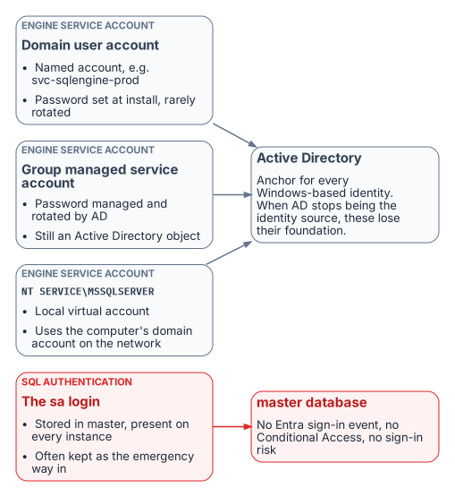

# Chapter 01 — What Windows Authentication Actually Is

*The inheritance, named precisely, before the case for replacing it.*

::: {.callout-note}
## In this chapter
Why the database is where legacy authentication hides, and what that inheritance is. How SQL Server hands authentication to the Windows security subsystem through Kerberos and SSPI, why a missing SPN silently drops a connection to NTLM, what the engine's service account and the `sa` login each contribute, and why this architecture was good engineering for the world it was designed for.
:::

## Why the database is where legacy authentication hides

Every identity program eventually reaches the database, and the database is where it finds the most Windows authentication still in use. A SQL Server instance doesn't check passwords for Windows logins; it trusts whatever the Windows security subsystem tells it, and Windows Authentication can't be turned off.[^c01-auth-mode-choice] The protocol a connection actually used, Kerberos or NTLM, is visible only from inside the engine, one session at a time.[^c01-spn] The dependencies sit in connection strings, service accounts, linked servers and the built-in `sa` login. None of them shows up on an identity dashboard, and none of them produces a sign-in that Microsoft Entra ID can evaluate. So when the Federal Modernization Program retires NTLM, puts Conditional Access in the authentication path and stops treating Active Directory as the identity source, the database is where those changes break things last and hardest. This book finds that inheritance, measures it, shrinks the estate that carries it, and moves what survives to Microsoft Entra ID.

::: {.callout-important}
## The case in one paragraph
SQL Server's Windows Authentication was good engineering, not negligence. The case for replacing it doesn't depend on calling what came before foolish. It depends on a precise account of what Windows Authentication is, why it worked, and why the world it was built for no longer exists. Today a connection reaches SQL Server in one of four ways, and only one of them, a Microsoft Entra token, is anchored in an identity plane that can enforce MFA, device compliance and sign-in risk.
:::

{#fig-c01-authentication-paths fig-alt="A client connection authenticates by Kerberos via SSPI, by NTLM fallback when there is no SPN, or by a SQL login and password, all anchored in Active Directory or the instance's master database; only a Microsoft Entra token is anchored in Entra ID."}

## The Kerberos foundation

{#fig-c01-kerberos-fallback fig-alt="Sequence diagram between client, domain controller and SQL Server: the client requests a service ticket for the SQL Server SPN and presents it to the engine; if the SPN is missing, Negotiate falls back to an NTLM challenge-response."}

When a user connects with a Windows account, SQL Server doesn't ask for the password or validate the identity itself. It relies on the Windows principal token, so the identity is confirmed by Windows.[^c01-auth-mode-choice] With `Integrated Security=True`, the driver hands off to the Security Support Provider Interface (SSPI). SSPI lets an application obtain an authenticated connection without knowing which protocol is underneath, and its Negotiate package picks Kerberos unless one of the systems involved can't use it.[^c01-sspi][^c01-negotiate] To use Kerberos, the client asks the Key Distribution Center (KDC) on a domain controller for a service ticket to the instance's Service Principal Name (SPN). The engine validates the ticket with the service account's key and maps the principal to a login. No password crosses the network, none sits in a configuration file, and Kerberos authenticates the server to the client as well as the client to the server.[^c01-kerberos][^c01-kerberos-mutual] This is good security architecture, and it deserves saying plainly before explaining why it has to be replaced.

The SPN for a TCP connection takes the form `MSSQLSvc/<FQDN>:<port>`, and once registered it maps to the Windows account that started the SQL Server service. If the SPN was never registered, or the registration failed, Windows can't work out which account the SPN belongs to, and Kerberos isn't used.[^c01-spn] When the client can't get a ticket, authentication uses NTLM instead. Microsoft's own table of authentication defaults shows the full picture. When the SPN maps to the correct account, remote connections use Kerberos and local connections use NTLM. When the SPN lookup fails, both local and remote connections use NTLM. When the SPN maps to the wrong account, authentication fails outright.[^c01-spn]

That silent fallback is the most consequential fault in the inheritance. The application gets a working connection either way. The engine logs a failed SPN registration at startup, but it doesn't log which protocol each connection negotiated. The only way to see that is to query the `auth_scheme` column of `sys.dm_exec_connections`, session by session.[^c01-spn] An environment confident that it runs Kerberos can be running NTLM on a large share of its connections, and only measurement shows how large. The authentication audit in [Chapter 07](07-the-authentication-audit.md) is the program's instrument for that measurement.

## The NTLM fallback

The NTLM family of protocols, which includes LAN Manager and NTLM versions 1 and 2, is Windows' older challenge-response authentication. Kerberos has been the default Windows authentication protocol since Windows 2000.[^c01-sspi] NTLM stayed on as the fallback for the cases Kerberos can't handle: workgroup machines, resources reached by IP address rather than host name, computers in untrusted domains, and clients that can't reach a KDC.[^c01-ntlm][^c01-passwords][^c01-kerberos-ssp] SQL Server inherited that order unchanged. On a perimeter-defended network where every machine was domain-joined, that was enough.

It isn't enough for zero trust, which the program's FedRAMP Moderate boundary requires. NTLM's challenge and response happen entirely inside the connection negotiation, between the client, the server and a domain controller.[^c01-ntlm-msdn] No token or assertion is issued that a third party can evaluate. Conditional Access is enforced in Microsoft Entra ID, outside that path, when a sign-in requests access, so it has nothing to observe, evaluate or deny.[^c01-ca] The same is true of Microsoft Entra ID Protection's sign-in risk, which is calculated during Entra sign-ins.[^c01-idp]

## The service account

{#fig-c01-engine-identity fig-alt="The engine runs as a domain user account, a group managed service account or the per-service virtual account (which uses the computer account on the network), all anchored in Active Directory; the sa login is anchored in the master database."}

The engine's service account is the identity the engine presents on the network: to file shares, to linked servers, to monitoring sinks. Federal estates typically use one of three forms:

- **A domain user account** such as `svc-sqlengine-prod`. Its password is set by an administrator and has to be rotated by hand, which in practice often means rarely.[^c01-sql-svc-accounts]
- **A group managed service account (gMSA).** The domain controller computes and manages its password and rotates it every 30 days by default, and no administrator needs to know it.[^c01-svc-accounts] That's better hygiene, but it's still an Active Directory object.
- **The virtual account `NT SERVICE\MSSQLSERVER`**, which setup uses by default. It's a managed local account that reaches network resources with the computer account's credentials, `<domain_name>\<computer_name>$`.[^c01-sql-svc-accounts]

In every case, Active Directory is the engine's identity authority. When the program stops treating AD as the authoritative source, the engine needs an identity in Microsoft Entra ID. On SQL Server 2025, that's the system-assigned managed identity Azure Arc creates for the host, which Microsoft recommends for Entra authentication on 2025.[^c01-mi-2025] On SQL Server 2022, it's an app registration whose certificate is kept in Azure Key Vault and downloaded to the host by the Arc agent.[^c01-appreg-2022] That Entra identity sits alongside the Windows account the service runs as; it doesn't replace it. [Chapters 09–10](09-what-arc-provides-to-sql-server.md) cover the transition.

## The sa account

SQL Server Authentication stores logins and passwords in SQL Server itself rather than in AD, and `sa` is its built-in system administrator on every instance.[^c01-auth-mode-choice] When setup chooses Windows Authentication mode, `sa` is created but disabled. Microsoft's guidance is not to enable it unless an application requires it, because it's well known and often targeted.[^c01-auth-mode-choice][^c01-auth-mode-change] A common pattern in long-lived estates is the opposite: `sa` stays enabled as an emergency way in if AD fails, sometimes with the password set at installation.

SQL Server Authentication is invisible to the Microsoft identity plane. The password is checked by the engine, not by a domain controller or by Entra ID, so there's no Entra sign-in event, no Conditional Access, no sign-in risk, and no domain controller traffic for Microsoft Defender for Identity to watch. An enabled `sa` is the most dangerous entry point on the instance. How it's handled is one of the questions the SQL Server engine-authentication decision settles ([Chapter 12](12-the-engine-authentication-decision.md)).

## Why this was correct

Taken together, SSPI-negotiated Kerberos, SPNs, NTLM fallback, AD service accounts and SQL Authentication as a local fallback form a coherent, defensible architecture. In a fully domain-joined world it was centrally managed, it authenticated both ends of the connection, it kept credentials off the wire, and it needed nothing beyond the domain controllers already in place. It wasn't a compromise. The problem is that its world, with every machine domain-joined, the perimeter as the boundary and no cloud identity plane, no longer exists.

::: {.callout-note title="What this chapter establishes"}
1. The database is where legacy authentication hides: its Windows Authentication is invisible to the Entra identity plane and can't be switched off.
2. SQL Server Windows Authentication delegates to the Windows security subsystem: Kerberos through SSPI when a correct SPN is registered, silent NTLM fallback when it isn't.
3. The engine's process identity and the `sa` login are anchored to authorities, Active Directory and the instance itself, that the program is retiring or that the Microsoft identity plane can't see.
4. None of this was a mistake. It was correct engineering for a fully domain-joined world that no longer exists.
:::

::: {.callout-tip}
## Continue the book
[← Previous: Book 06 index](index.md) · [Book index](index.md) · [Next: Chapter 02 — Why the Inheritance Must End →](02-why-the-inheritance-must-end.md)
:::

[^c01-auth-mode-choice]: Microsoft Learn, "Choose an authentication mode" (SQL Server), <https://learn.microsoft.com/en-us/sql/relational-databases/security/choose-an-authentication-mode?view=sql-server-ver17> (accessed Oct 20, 2026). Windows Authentication "is always available and can't be disabled"; SQL Server doesn't ask for the password or perform the identity validation; `sa` is created disabled under Windows Authentication mode.
[^c01-spn]: Microsoft Learn, "Register a Service Principal Name for Kerberos connections," <https://learn.microsoft.com/en-us/sql/database-engine/configure-windows/register-a-service-principal-name-for-kerberos-connections?view=sql-server-ver17> (accessed Oct 20, 2026). SPN formats; the SPN maps to the account that started the service; "If a security token can't be obtained, authentication uses NTLM"; authentication-defaults table; failed SPN registration is recorded in the error log; `auth_scheme` in `sys.dm_exec_connections`.
[^c01-sspi]: Microsoft Learn, "Security Support Provider Interface Architecture," <https://learn.microsoft.com/en-us/windows-server/security/windows-authentication/security-support-provider-interface-architecture> (accessed Oct 20, 2026). "The Kerberos protocol has been the default authentication protocol since Windows 2000."
[^c01-negotiate]: Microsoft Learn, "Microsoft NTLM" (Win32 security), <https://learn.microsoft.com/en-us/windows/win32/secauthn/microsoft-ntlm> (accessed Oct 20, 2026). Negotiate selects Kerberos unless it can't be used by one of the systems involved.
[^c01-kerberos]: Microsoft Learn, "Kerberos authentication overview in Windows Server," <https://learn.microsoft.com/en-us/windows-server/security/kerberos/kerberos-authentication-overview> (accessed Oct 20, 2026).
[^c01-kerberos-mutual]: Microsoft Learn, "Kerberos v5 Protocol" (COM security), <https://learn.microsoft.com/en-us/windows/win32/com/kerberos-v5-protocol> (accessed Oct 20, 2026). "The Kerberos protocol requires mutual authentication."
[^c01-ntlm]: Microsoft Learn, "NTLM overview," <https://learn.microsoft.com/en-us/windows-server/security/kerberos/ntlm-overview> (accessed Oct 20, 2026). The NTLM family includes LAN Manager v1 and v2 and NTLM v1 and v2; NTLM must be used for workgroup members; Kerberos is preferred in AD environments.
[^c01-passwords]: Microsoft Learn, "Passwords technical overview," <https://learn.microsoft.com/en-us/windows-server/security/kerberos/passwords-technical-overview> (accessed Oct 20, 2026). Situations in which Kerberos can't be used, including access by IP address and to computers in untrusted domains or outside the domain.
[^c01-kerberos-ssp]: Microsoft Learn, "Kerberos SSP/AP," <https://learn.microsoft.com/en-us/windows/win32/secauthn/kerberos-ssp-ap> (accessed Oct 20, 2026). "If a Kerberos KDC is not available, Windows uses MSV1_0 and pass-through authentication."
[^c01-ntlm-msdn]: Microsoft Learn, "Microsoft NTLM," noninteractive authentication steps (client, server and domain controller), <https://learn.microsoft.com/en-us/windows/win32/secauthn/microsoft-ntlm> (accessed Oct 20, 2026).
[^c01-ca]: Microsoft Learn, "What is Conditional Access?," <https://learn.microsoft.com/en-us/entra/identity/conditional-access/overview> (accessed Oct 20, 2026). Conditional Access is Microsoft's Zero Trust policy engine; policies are enforced after first-factor authentication completes.
[^c01-idp]: Microsoft Learn, "What is Microsoft Entra ID Protection?," <https://learn.microsoft.com/en-us/entra/id-protection/overview-identity-protection> (accessed Oct 20, 2026). "During each sign-in, ID Protection runs all real-time sign-in detections."
[^c01-sql-svc-accounts]: Microsoft Learn, "Configure Windows service accounts and permissions" (SQL Server), <https://learn.microsoft.com/en-us/sql/database-engine/configure-windows/configure-windows-service-accounts-and-permissions?view=sql-server-ver17> (accessed Oct 20, 2026). Virtual accounts `NT SERVICE\<SERVICENAME>` are the setup default and access the network with the computer account's credentials; domain accounts require manual password management.
[^c01-svc-accounts]: Microsoft Learn, "Service accounts" (Active Directory Domain Services), <https://learn.microsoft.com/en-us/windows-server/identity/ad-ds/manage/understand-service-accounts> (accessed Oct 20, 2026). The domain controller computes and manages the gMSA password; "The default interval is 30 days," settable only at creation.
[^c01-mi-2025]: Microsoft Learn, "Managed identity for SQL Server enabled by Azure Arc," <https://learn.microsoft.com/en-us/sql/sql-server/azure-arc/managed-identity?view=sql-server-ver17> (accessed Oct 20, 2026). Applies to SQL Server 2025; a system-assigned managed identity is created when the instance is connected to Arc; recommended for SQL Server 2025 and later.
[^c01-appreg-2022]: Microsoft Learn, "Tutorial: Set up Microsoft Entra authentication for SQL Server enabled by Azure Arc," <https://learn.microsoft.com/en-us/sql/sql-server/azure-arc/entra-authentication-setup-tutorial?view=sql-server-ver17> (accessed Oct 20, 2026). SQL Server 2022 uses a certificate stored in Azure Key Vault that the Arc agent downloads to the host, with an app registration.
[^c01-auth-mode-change]: Microsoft Learn, "Change server authentication mode," <https://learn.microsoft.com/en-us/sql/database-engine/configure-windows/change-server-authentication-mode?view=sql-server-ver17> (accessed Oct 20, 2026).
