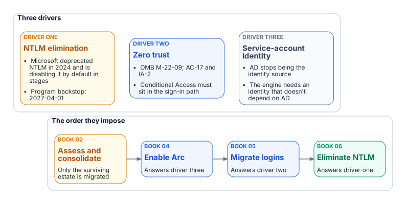
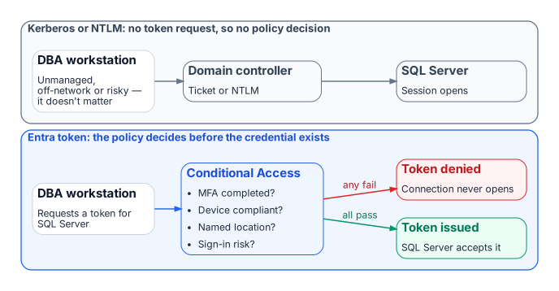

# Chapter 02 — Why the Inheritance Must End

*Three drivers, each as well-reasoned as the original design, and their dependency structure.*

::: {.callout-note}
## In this chapter
The three forces that now require replacing Windows Authentication for SQL Server: the NTLM elimination the program has committed to, with its 2027-04-01 backstop; the zero-trust requirement that puts the Microsoft Entra identity plane in the authentication path; and the service-account credential problem the broader directory modernization creates. What is and isn't externally due in 2027, and why the drivers' dependencies dictate the order of the whole book.
:::

{#fig-c02-three-drivers fig-alt="Three drivers, NTLM elimination, zero trust and service-account identity, impose an order: assess and consolidate, enable Arc, migrate logins, then eliminate NTLM."}

The reasons for replacement are as well-reasoned as the original design. NTLM elimination, Conditional Access in the authentication path for all human access, and the end of the domain-joined world aren't preferences.[^c02-ca] They follow from Microsoft's deprecation of NTLM, from the transformation inventory, and from OMB M-22-09, the Federal Zero Trust Strategy. M-22-09 requires phishing-resistant MFA for agency staff, contractors and partners, enforced at the application layer rather than the network layer, and at least one device-level signal alongside identity when authorizing access.[^c02-m2209] The program operationalizes that in its boundary through Conditional Access and phishing-resistant MFA, mapped to the NIST SP 800-53 controls AC-17 (remote access) and IA-2 (identification and authentication).[^c02-sp80053]

## Driver one: the NTLM elimination commitment

The first driver is a decision the program has made and recorded. The Kerberos/NTLM-elimination program, accepted 2026-05-13, commits the program to eliminating NTLM.

The external driver is real but gradual. Microsoft deprecated all versions of NTLM, including LANMAN, NTLMv1 and NTLMv2, in June 2024.[^c02-deprecated] NTLMv1 is already removed from Windows Server 2025 and Windows 11, version 24H2; NTLMv2 still works there but is deprecated and will be removed from Windows Server in a future release.[^c02-ntlm-removed] Microsoft's stated next step is to disable network NTLM by default, not remove it, in the next major release of Windows Server and client. That target is subject to change, and administrators will be able to re-enable NTLM by policy, at least at first. Interim milestones come first: enhanced NTLM auditing, already available on Windows Server 2025 and Windows 11, versions 24H2 and 25H2; IAKerb and the local KDC; and blocking policies. In-market versions of Windows and Windows Server keep supporting NTLM.[^c02-ntlm-faq] One related change arrives through Windows Update in October 2026: the internal default of the `BlockNTLMv1SSO` setting moves from Audit to Enforce. It applies to Windows 11, versions 24H2, 25H2, 26H1 and 26H2, and to Windows Server 2025, not to earlier Windows 11 versions, on devices that don't have Credential Guard enabled and haven't set the value.[^c02-ntlmv1-mc] It blocks only NTLMv1-derived credentials used for single sign-on, such as MS-CHAPv2 for Wi-Fi, Ethernet and VPN, and doesn't touch SQL Server's NTLM traffic.[^c02-blockntlmv1sso]

Microsoft hasn't published a calendar date for disabling NTLM by default. The program's 2027-04-01 backstop is its own planning anchor, set to finish ahead of that step. It isn't a vendor deadline.

Both NTLM variants are eliminated, on different timelines. NTLMv1 goes first. Hosts older than Windows Server 2025 can still negotiate it, so Phase B blocks it through the "Network security: LAN Manager authentication level" policy (the `LmCompatibilityLevel` setting) as soon as the Phase A assessment completes, a step the program targeted for 2026-Q3. At the strictest level, domain controllers refuse LM and NTLMv1 responses and accept only NTLMv2.[^c02-lmcompat] Any connection that still needs LM or NTLMv1 then fails before the engine evaluates the login. [Chapters 14–15](14-ntlm-and-the-patterns-that-generate-it.md) cover the detail.

NTLMv2 has a firm backstop: on 2027-04-01 the program's enforcement phase disables NTLM at the LSA layer across the estate. Any SQL Server connection still relying on it, whether through a missing SPN, a client that can't negotiate Kerberos, a trust boundary or an unjoined host, will fail inside the host's security subsystem before the engine sees it.[^c02-spn] 2027-04-01 isn't the migration's completion date. It's the date by which consolidation, Arc deployment, login migration and connection-string migration must already be complete.

::: {.callout-important}
## What is actually due in 2027
Nothing in Microsoft's NTLM roadmap or in M-22-09 falls due on 2027-04-01; that date is the program's. Three external lifecycle dates in 2027 do bear on the SQL Server estate, and they reinforce the order this book sets:

- **Windows Server 2016** leaves extended support on January 12, 2027.[^c02-ws2016]
- **SQL Server 2014** reaches the end of its third and final Extended Security Update year in July 2027; SQL Server 2016's first ESU year also ends then.[^c02-sql2014][^c02-sql2016]
- **SQL Server 2017** leaves extended support on October 12, 2027.[^c02-sql2017]

None of these versions can accept Microsoft Entra logins, which need SQL Server 2022 or later.[^c02-entra-sql] Hosts and engines on them are candidates for the consolidation in [Chapters 03–06](03-the-shape-of-twenty-years.md), not for in-place migration.
:::

## Driver two: the zero-trust requirement

{#fig-c02-ca-leverage fig-alt="Two paths from a DBA workstation: Kerberos or NTLM through a domain controller to SQL Server involves no token request and so no policy decision; an Entra token request passes Conditional Access, and the token is issued only if every check passes."}

The M-22-09 zero-trust posture for this FedRAMP Moderate boundary can't be implemented without the Microsoft Entra identity plane in the SQL Server authentication path. Conditional Access brings together signals such as user, location, device state and real-time sign-in risk, and enforces its decision when the sign-in asks for access: block, or grant only after MFA, a compliant device or another control is satisfied.[^c02-ca] Kerberos and NTLM involve no Entra sign-in at all, so a DBA on an unmanaged device, outside named locations or with elevated risk can't be blocked by policy.

With Microsoft Entra authentication, every token request is evaluated first. Missing MFA, a non-compliant device or elevated risk, such as a sign-in from an anonymous IP address that Microsoft Entra ID Protection flags, means no token or a remediation challenge, and no connection.[^c02-idp] Risk-based policies need Microsoft Entra ID P2.[^c02-risk-policies] The policy has real leverage because the token it controls is the credential SQL Server accepts.

## Driver three: the service account credential problem

The transformation inventory removes Active Directory as the authoritative identity source. The AD service accounts and gMSAs that authorize the engine on the network then lose their governance foundation,[^c02-svc-accounts] so the engine needs a new identity first. Microsoft's own cloud-first guidance makes the same point from the other direction: inventory every application that authenticates against AD with Kerberos, NTLM or LDAP before moving its users and groups, because those dependencies break when AD stops being the source.[^c02-soa]

On premises, that identity arrives through Azure Arc. SQL Server 2025 uses the Arc server's managed identity directly. SQL Server 2022 uses an app registration certificate that the Arc agent fetches from Key Vault with that identity.[^c02-arc-servers][^c02-mi-2025][^c02-appreg-2022] Microsoft also documents an Arc-free, certificate-only app-registration setup for SQL Server 2022 and later.[^c02-without-arc] Arc is therefore a prerequisite, not an enhancement. It doesn't change the Windows account the service runs as.

The order follows from these dependencies, preceded by the consolidation decision of [Chapters 03–06](03-the-shape-of-twenty-years.md): assess and consolidate, enable Arc, migrate logins, then eliminate NTLM. That order is the architecture of this book.

::: {.callout-note title="What this chapter establishes"}
1. Three independent drivers end the Windows Authentication inheritance: the Kerberos/NTLM-elimination program and its 2027-04-01 backstop, the M-22-09 zero-trust posture, and the engine's need for an identity that outlives AD.
2. 2027-04-01 is the program's date, not Microsoft's; Microsoft has set no date for disabling NTLM by default, while several SQL Server and Windows Server lifecycle dates do fall in 2027.
3. The zero-trust posture works only when the Entra identity plane is in the authentication path.
4. The drivers' dependencies set the order of the book: inventory and rationalize, audit, enable the identity substrate, move principals and applications, retire protocols, then demonstrate the posture.
:::

::: {.callout-tip}
## Continue the book
[← Previous: Chapter 01 — What Windows Authentication Actually Is](01-what-windows-authentication-actually-is.md) · [Book index](index.md) · [Next: Chapter 03 — The Shape of Twenty Years →](03-the-shape-of-twenty-years.md)
:::

[^c02-m2209]: Office of Management and Budget, M-22-09, *Moving the U.S. Government Toward Zero Trust Cybersecurity Principles*, January 26, 2022, <https://www.whitehouse.gov/wp-content/uploads/2022/01/M-22-09.pdf> (accessed Oct 20, 2026). §III.A, Identity, actions 2 and 3: "MFA must be enforced at the application layer, instead of the network layer"; phishing-resistant MFA required for agency staff, contractors and partners; at least one device-level signal alongside identity information.
[^c02-sp80053]: National Institute of Standards and Technology, SP 800-53 Rev. 5, *Security and Privacy Controls for Information Systems and Organizations*, AC-17 Remote Access and IA-2 Identification and Authentication (Organizational Users), <https://nvlpubs.nist.gov/nistpubs/SpecialPublications/NIST.SP.800-53r5.pdf> (accessed Oct 20, 2026). The mapping of the program's controls to these identifiers is the program's own.
[^c02-ca]: Microsoft Learn, "What is Conditional Access?," <https://learn.microsoft.com/en-us/entra/identity/conditional-access/overview> (accessed Oct 20, 2026). Common signals (user, IP location, device, application, real-time and calculated risk) and decisions (block, or grant with MFA, compliant device and other controls).
[^c02-deprecated]: Microsoft Learn, "Deprecated features for Windows client," NTLM entry, <https://learn.microsoft.com/en-us/windows/whats-new/deprecated-features> (accessed Oct 20, 2026). "All versions of NTLM, including LANMAN, NTLMv1, and NTLMv2, are no longer under active feature development and are deprecated"; deprecation announced June 2024.
[^c02-ntlm-removed]: Microsoft Learn, "Features removed or no longer developed in Windows Server," <https://learn.microsoft.com/en-us/windows-server/get-started/removed-deprecated-features-windows-server> (accessed Oct 20, 2026). Windows Server 2025: NTLMv1 removed; "NTLMv2 will continue to work but will be removed from Windows Server in a future release."
[^c02-ntlm-faq]: Microsoft Windows IT Pro Blog, "Retiring NTLM: Frequently asked questions," September 9, 2026, <https://techcommunity.microsoft.com/blog/windows-itpro-blog/retiring-ntlm-frequently-asked-questions/4550522> (accessed Oct 20, 2026). "Our current target for default disablement is the next major release of Server and Client (subject to change)"; NTLM is being disabled by default, not removed; in-market versions continue to support NTLM; enhanced NTLM auditing on Windows 11 24H2/25H2 and Windows Server 2025.
[^c02-blockntlmv1sso]: Microsoft Support, "Manage NTLMv1 changes and prevent network authentication issues in Windows" (KB5066470; applies to Windows 11 versions 24H2, 25H2, 26H1 and 26H2 and Windows Server 2025), <https://support.microsoft.com/help/5066470> (accessed Oct 21, 2026). Audit mode since the August 2025 updates; Enforce becomes the internal default in October 2026 where the value isn't set and Credential Guard is disabled; scope is NTLMv1-derived credentials for single sign-on (MS-CHAPv2).
[^c02-lmcompat]: Microsoft Learn, "How to enable NTLM 2 authentication," <https://learn.microsoft.com/en-us/troubleshoot/windows-client/windows-security/enable-ntlm-2-authentication> (accessed Oct 20, 2026). `LMCompatibilityLevel` level 5: domain controllers refuse LM and NTLM responses and accept only NTLMv2.
[^c02-spn]: Microsoft Learn, "Register a Service Principal Name for Kerberos connections," <https://learn.microsoft.com/en-us/sql/database-engine/configure-windows/register-a-service-principal-name-for-kerberos-connections?view=sql-server-ver17> (accessed Oct 20, 2026).
[^c02-ws2016]: Microsoft Learn, "Windows Server 2016" (Microsoft Lifecycle), <https://learn.microsoft.com/en-us/lifecycle/products/windows-server-2016> (accessed Oct 20, 2026). Extended support ends January 12, 2027 (listed as 1/13/2027 6:59:59 AM Pacific).
[^c02-sql2014]: Microsoft Learn, "SQL Server 2014" (Microsoft Lifecycle), <https://learn.microsoft.com/en-us/lifecycle/products/sql-server-2014> (accessed Oct 20, 2026). Extended support ended July 9, 2024; ESU Year 3 runs to July 2027.
[^c02-sql2016]: Microsoft Learn, "SQL Server 2016" (Microsoft Lifecycle), <https://learn.microsoft.com/en-us/lifecycle/products/sql-server-2016> (accessed Oct 20, 2026). Extended support ended July 14, 2026; ESU Year 1 runs to July 2027, Year 3 to July 2029.
[^c02-sql2017]: Microsoft Learn, "SQL Server 2017" (Microsoft Lifecycle), <https://learn.microsoft.com/en-us/lifecycle/products/sql-server-2017> (accessed Oct 20, 2026). Extended support ends October 12, 2027 (listed as 10/13/2027 6:59:59 AM Pacific).
[^c02-entra-sql]: Microsoft Learn, "Microsoft Entra authentication for SQL Server," <https://learn.microsoft.com/en-us/sql/relational-databases/security/authentication-access/azure-ad-authentication-sql-server-overview?view=sql-server-ver17> (accessed Oct 20, 2026). Applies to SQL Server 2022 and later; failover cluster instances aren't supported.
[^c02-idp]: Microsoft Learn, "What is Microsoft Entra ID Protection?," <https://learn.microsoft.com/en-us/entra/id-protection/overview-identity-protection> (accessed Oct 20, 2026). Detections include anonymous IP address usage; risk feeds Conditional Access.
[^c02-risk-policies]: Microsoft Learn, "Risk-based access policies," <https://learn.microsoft.com/en-us/entra/id-protection/concept-identity-protection-policies> (accessed Oct 20, 2026). "Microsoft Entra ID P2 is required to use risk-based access policies."
[^c02-svc-accounts]: Microsoft Learn, "Service accounts" (Active Directory Domain Services), <https://learn.microsoft.com/en-us/windows-server/identity/ad-ds/manage/understand-service-accounts> (accessed Oct 20, 2026).
[^c02-soa]: Microsoft Learn, "Microsoft Entra cloud-first identity guidance for IT architects," <https://learn.microsoft.com/en-us/entra/identity/hybrid/guidance-it-architects-source-of-authority> (accessed Oct 20, 2026). "Always begin with an application inventory before initiating SOA transfer"; inventory all on-premises apps that use AD for authentication (Kerberos/NTLM or LDAP).
[^c02-arc-servers]: Microsoft Learn, "Azure Arc-enabled servers overview," <https://learn.microsoft.com/en-us/azure/azure-arc/servers/overview> (accessed Oct 20, 2026).
[^c02-mi-2025]: Microsoft Learn, "Managed identity for SQL Server enabled by Azure Arc," <https://learn.microsoft.com/en-us/sql/sql-server/azure-arc/managed-identity?view=sql-server-ver17> (accessed Oct 20, 2026).
[^c02-appreg-2022]: Microsoft Learn, "Tutorial: Set up Microsoft Entra authentication for SQL Server enabled by Azure Arc," <https://learn.microsoft.com/en-us/sql/sql-server/azure-arc/entra-authentication-setup-tutorial?view=sql-server-ver17> (accessed Oct 20, 2026).
[^c02-without-arc]: Microsoft Learn, "Tutorial: Enable Microsoft Entra authentication for SQL Server on Windows without Azure Arc," <https://learn.microsoft.com/en-us/sql/relational-databases/security/authentication-access/microsoft-entra-authentication-sql-server-enable-without-arc?view=sql-server-ver17> (accessed Oct 20, 2026). Applies to SQL Server 2022 and later; certificate, app registration and registry configuration.
[^c02-ntlmv1-mc]: Microsoft Learn, "Windows message center," entry "Take action: NTLMv1 hardening changes might affect network connections on devices without Credential Guard," October 14, 2026 ("Windows 11, versions 26H2, 25H2, and 24H2, along with Windows Server 2025, enforce restrictions on generating NTLMv1-derived credentials for Single Sign-On by default"), <https://learn.microsoft.com/windows/release-health/windows-message-center> (accessed Oct 21, 2026).
