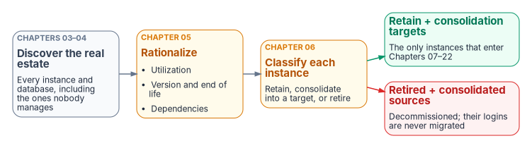
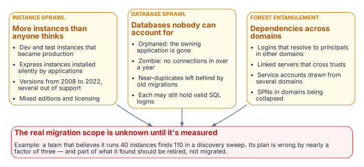

# Chapter 03 — The Shape of Twenty Years

*Why the estate you must transform is not the estate anyone remembers building.*

::: {.callout-note}
## In this chapter
The three forms of sprawl that accumulate in a SQL Server estate over two decades across an Active Directory forest: instance sprawl, database sprawl and forest entanglement. Why an authentication transformation that begins before this sprawl is assessed will migrate the authentication of servers that shouldn't survive the transformation at all.
:::

::: {.callout-important}
## You don't migrate the estate in the shape you discover it
After twenty years across an Active Directory forest, the SQL Server estate is larger and more tangled than any team's mental model of it, and a significant fraction of it shouldn't survive the transformation at all. Chapters 03 through 06 set out the consolidation assessment that classifies every instance **retain**, **consolidate** or **retire** before any login is touched: this chapter describes the sprawl, [Chapter 04](04-the-estate-inventory.md) finds it, [Chapter 05](05-rationalization.md) judges it, and [Chapter 06](06-retain-consolidate-retire.md) records the decision. That decision gates every chapter that follows.
:::

{#fig-c03-assess-before-migrating fig-alt="Discover the real estate, rationalize it and classify each instance; retained instances and consolidation targets go on to migration, while retired instances and consolidated sources do not."}

[Chapters 01–02](01-what-windows-authentication-actually-is.md) named the inheritance and the three drivers that require ending it. This chapter confronts a precondition that most authentication narratives skip entirely: you can't migrate the authentication of an estate you haven't first measured and rationalized. After twenty years across an Active Directory forest, the SQL Server estate is larger, older and more entangled than any single team's mental model of it, and a meaningful fraction of it shouldn't survive the transformation in its current shape.

The order matters because effort is finite and the program's 2027-04-01 backstop is fixed. Migrating the logins of an instance to Microsoft Entra ID, only to retire that instance three months later, is wasted work measured against a date the program has committed not to move. The SQL Server engine-authentication decision makes the sequencing normative: the consolidation assessment classifies every instance **retain**, **consolidate** or **retire** before any login is touched.

{#fig-c03-three-forms-of-sprawl fig-alt="More instances than anyone thinks, databases nobody can account for, and dependencies across domains: together they mean the real migration scope is unknown until it is measured."}

## Instance sprawl

A SQL Server estate doesn't grow by design. It grows by accretion. A development instance becomes a production instance because a project shipped and nobody rebuilt it on the production tier. A test instance set up for a vendor evaluation is never decommissioned. An application installer silently provisions a SQL Server Express instance on an application server, and that instance accumulates real data for years without ever appearing on a DBA team's inventory.

The result, in a mature federal environment, is a population of instances spanning the SQL Server versions released across two decades, 2008, 2012, 2014, 2016, 2017, 2019 and 2022, with SQL Server 2025 now arriving as well, in every edition from Express on a workstation to Enterprise on a clustered host. Several of those versions are out of support. SQL Server 2008 R2, 2012 and 2014 have left extended support, and SQL Server 2016 left it on July 14, 2026. Those engines now get security updates only through a paid Extended Security Update subscription, where one is still offered, and the subscription runs for at most three years past end of support. SQL Server 2017 follows on October 12, 2027.[^c03-eos][^c03-sql2016][^c03-sql2017] The licensing posture is equally mixed: Standard and Enterprise cores, some covered by Software Assurance and some not, with no single authority that can state how many cores the estate actually consumes.

Instance sprawl is the first thing the assessment must quantify, because the count of instances, and especially the count of *unknown* instances, sets the true scope of the transformation. In an illustrative example, an estate that the DBA team believes contains forty instances and the discovery sweep shows to contain a hundred and ten isn't forty instances behind schedule. It's working from a scope estimate that's wrong by a factor of nearly three.

## Database sprawl

Beneath the instances lies a second layer of accretion: the databases themselves. An instance that has run for fifteen years carries databases nobody can confidently account for. Some are *orphaned*: the application that created them has been decommissioned, but the database was never dropped because no one was certain it was safe to do so. Some are *zombies*: they've received no connection in 400 or more days, the program's zombie threshold, yet they consume storage, appear in backup jobs and lengthen every maintenance window. Some are near-duplicates, the residue of a migration that copied a database to a new name and never removed the original.

Database sprawl matters to the authentication transformation for a specific reason. Every database is a potential source of logins, and every login is a unit of migration work. A zombie database may map a long-forgotten SQL Authentication service account that still has a valid password and still appears, to a discovery script, as an active credential requiring migration. The fastest way to reduce the migration surface isn't to migrate faster. It's to retire the databases and instances that shouldn't be migrated at all.

Zombie detection is therefore not a housekeeping nicety; it's migration-scope reduction. To take an illustrative example, a database with no connections in four hundred days, no recent backups consumed for a restore, and an owning application that the application portfolio lists as retired is a database whose logins should never enter the migration pipeline.

## Forest entanglement

The third form of sprawl is the one that makes the SQL Server transformation genuinely harder than a single-domain migration: the estate is entangled with the Active Directory forest it grew up in. Instances are spread across multiple domains connected by trusts. Logins on one instance resolve to security principals in a different domain. Linked-server definitions form a web of cross-instance dependencies that crosses domain boundaries, and the service accounts running the engine processes are drawn from several domains with no consistent naming or governance.

This entanglement is precisely what the directory modernization removes the foundation for. When Active Directory stops being the authoritative identity source, every cross-domain login, every SPN registered in a domain that's being collapsed, and every shared service account becomes a dependency that must be resolved, not merely re-pointed. Consolidation is the moment when that resolution is cheapest, because collapsing many instances into fewer modern targets is also the moment to collapse the cross-domain identity sprawl into Entra-backed identity.

The shape of twenty years, then, is three overlapping problems: too many instances, too many databases, and too many forest-spanning dependencies between them. The chapters that follow describe how to measure each, and how to turn the measurement into the **retain / consolidate / retire** decision that gates everything in Chapters 07 through 22.

::: {.callout-note title="What this chapter establishes"}
1. A twenty-year estate has three overlapping forms of sprawl: instances, databases and forest entanglement.
2. Sprawl inflates the migration surface, because much of the estate should be retired or consolidated rather than migrated.
3. The authentication transformation doesn't begin until the sprawl is assessed.
:::

::: {.callout-tip}
## Continue the book
[← Previous: Chapter 02 — Why the Inheritance Must End](02-why-the-inheritance-must-end.md) · [Book index](index.md) · [Next: Chapter 04 — The Estate Inventory →](04-the-estate-inventory.md)
:::

[^c03-eos]: Microsoft Learn, "SQL Server end of support options," <https://learn.microsoft.com/en-us/sql/sql-server/end-of-support/sql-server-end-of-support-overview?view=sql-server-ver17> (accessed Oct 20, 2026). Lifecycle table; ESUs deliver Critical security updates for up to three years past end of support and require Software Assurance or subscription licenses. Earlier releases: Microsoft Learn, "Microsoft SQL Server 2008 R2," <https://learn.microsoft.com/en-us/lifecycle/products/microsoft-sql-server-2008-r2>, and "Microsoft SQL Server 2012," <https://learn.microsoft.com/en-us/lifecycle/products/microsoft-sql-server-2012> (both accessed Oct 20, 2026); extended support ended July 9, 2019 and July 12, 2022, and their last ESU years ended in 2023 and July 2025.
[^c03-sql2016]: Microsoft Learn, "SQL Server 2016" (Microsoft Lifecycle), <https://learn.microsoft.com/en-us/lifecycle/products/sql-server-2016> (accessed Oct 20, 2026). Extended support ended July 14, 2026; ESU years run to July 2029. SQL Server 2014's extended support ended July 9, 2024, and its ESU Year 3 runs to July 2027: "SQL Server 2014," <https://learn.microsoft.com/en-us/lifecycle/products/sql-server-2014> (accessed Oct 20, 2026).
[^c03-sql2017]: Microsoft Learn, "SQL Server 2017" (Microsoft Lifecycle), <https://learn.microsoft.com/en-us/lifecycle/products/sql-server-2017> (accessed Oct 20, 2026).
