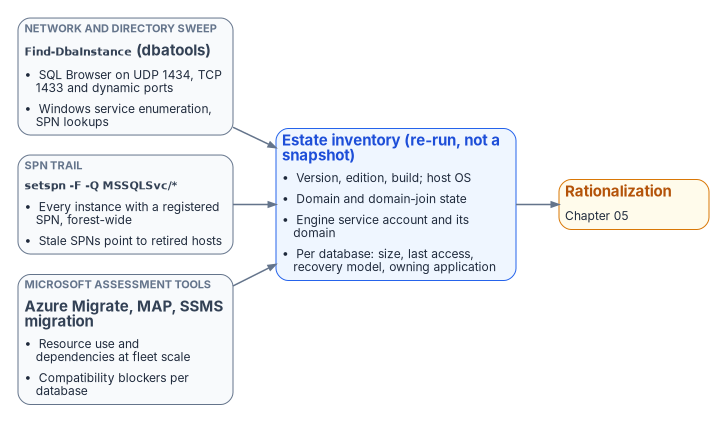

# Chapter 04 — The Estate Inventory

*Finding the instances and databases that no inventory already records.*

::: {.callout-note}
## In this chapter
What a complete estate inventory must capture before consolidation can begin. The discovery instruments that find the instances no one remembers: network and Active Directory sweeps, the SPN registration trail, and Microsoft's assessment tooling. Why estate discovery is a broader exercise than the authentication audit of [Chapters 07–08](07-the-authentication-audit.md), and how the program closed the gap its engine-authentication decision named.
:::

A consolidation assessment begins with an inventory, and the defining characteristic of a twenty-year estate is that the inventory doesn't already exist in complete form. The instances a DBA team manages deliberately are known. The instances that matter most to the assessment are the ones nobody is managing, and those must be discovered, not retrieved from a list. Microsoft's own guidance for moving identity off Active Directory starts the same way: begin with an inventory before changing anything.[^c04-soa]

This is the point at which estate discovery diverges from the authentication audit of [Chapters 07–08](07-the-authentication-audit.md). The authentication-audit script measures the *authentication posture* of instances that are already known: their login types, their authentication mode, their SPN status, their Arc eligibility. Estate discovery runs earlier and casts wider. Its job is to establish the denominator, the complete set of instances and databases that exist, so that the authentication audit has something complete to measure.

## What the inventory must capture

An estate inventory sufficient to drive a consolidation decision captures, for every instance it can find, a consistent set of facts. The version, edition and build number establish the support and licensing posture. The host operating system version establishes the Arc and upgrade envelope. The domain-join state and the owning domain establish the forest-entanglement picture. The service-account identity and its source domain establish the credential dependencies. And, for every database on the instance, the size, the last-access timestamp, the recovery model and the owning application establish the utilization and zombie picture that [Chapter 05](05-rationalization.md) turns into a rationalization decision.

The inventory isn't a point-in-time spreadsheet. Like the authentication audit it precedes, it's designed to be re-run, because instances appear and disappear across a multi-month assessment, and the consolidation plan must track a moving estate rather than a single snapshot.

## Discovery instruments

{#fig-c04-discovery-instruments fig-alt="Find-DbaInstance from dbatools, a forest-wide setspn MSSQLSvc query and Microsoft assessment tools (Azure Migrate, the MAP Toolkit and the SSMS migration component) feed one estate inventory that is re-run rather than kept as a snapshot, which then feeds rationalization."}

No single instrument finds every instance, because instances hide in different ways. A complete sweep combines several, each blind to what the others surface.

A network and directory sweep finds instances by listening for them. The default instance listens on TCP 1433; named instances, including SQL Server Express, use dynamic ports by default; and the SQL Server Browser service answers on UDP 1434 with the port for each named instance.[^c04-browser] Active Directory records instances indirectly, through their SPNs. The open-source PowerShell module `dbatools` provides `Find-DbaInstance`, which combines these signals in one discovery pass across a network range or an Active Directory domain. It can find candidate hosts from AD SPN records, Active Directory computer objects, the Browser broadcast or IP ranges, and then confirm each one with Browser queries, Windows service enumeration, SPN lookups, TCP port tests and, optionally, a SQL connection.[^c04-dbatools] It's the most direct way to surface instances that no inventory records. It's a community tool, not a Microsoft product, so it goes through the program's normal software approval before it runs.

The SPN registration trail is a second, independent signal. An instance that negotiates Kerberos has an `MSSQLSvc` service principal name registered for it, whether the engine registered it at startup or an administrator did it by hand.[^c04-spn] A forest-wide query for those SPNs, `setspn -T <forest-root-domain> -F -Q MSSQLSvc/*` or the equivalent directory query, enumerates every instance that was ever registered for Kerberos, including instances on hosts that are otherwise off the radar.[^c04-setspn] It doesn't find instances whose SPN registration failed, which is exactly why it complements the network sweep. The SPN trail also feeds directly into the authentication audit: a registered SPN that points at a decommissioned host, and an instance generating Kerberos traffic with no corresponding SPN, are both findings the later chapters act on.

Microsoft's assessment tooling is the third instrument, and it captures what the first two can't: workload and dependency data. Azure Migrate discovers SQL Server instances and databases across VMware, Hyper-V and physical servers, collects their configuration and performance data, and with agentless dependency analysis maps the TCP connections between servers so that interdependent servers can be grouped and moved together.[^c04-migrate-tools][^c04-dependency] The Microsoft Assessment and Planning (MAP) Toolkit, which Microsoft still lists for the discovery phase, inventories the wider infrastructure.[^c04-premigration] For per-database compatibility and feature blockers against a target version, the SQL Server migration component in SQL Server Management Studio now does the job the Data Migration Assistant (DMA) used to; DMA was retired on July 16, 2025.[^c04-dma][^c04-ssms-upgrade] SQL Server instances connected to Azure Arc also get a migration readiness assessment produced automatically.[^c04-mi-link] These instruments are useful here for what they reveal about the estate, independent of any decision to use Azure as a migration target. The dependency map and the version-compatibility findings are inputs to the consolidation decision wherever the consolidated estate ultimately lands.

## The Phase 0 discovery instrument

The discovery instruments named above are real and well understood, but on their own they aren't bound into a single discovery specification the way the authentication-audit script, the application-audit script and the certificate-audit script bind the authentication, application and certificate audits. The SQL Server engine-authentication decision named this as an explicit gap: the estate-consolidation inventory that produces the **retain / consolidate / retire** classification had no discovery instrument of its own. The implementation plan identified authoring one, with output that feeds the same compliance-monitoring pipeline as the authentication audit, as Phase 0, the prerequisite to everything the later chapters describe.

The program has since closed that gap. `New-FMPEstateInventory` fuses the instance enumeration from the authentication-audit family, the `MSSQLSvc` SPN trail and the broader sweep into one deduplicated inventory and applies the retain / consolidate / retire gate. [Runbook R02](r02-estate-discovery-and-consolidation-gate.md) documents how to run it. The general-purpose instruments above remain the sources it consumes, so an assessment can still be done with them alone; it's then recorded as a deliberate program artifact rather than a fused inventory. Naming the gap was itself part of the assessment's value. An estate transformation that proceeds on an incomplete inventory discovers its missing instances at the worst possible moment, which is exactly the failure this part of the book exists to prevent.

::: {.callout-note title="What this chapter establishes"}
1. Inventory comes first: the estate doesn't already know what it has.
2. Discovery combines a network and directory sweep, the `MSSQLSvc` SPN trail and Microsoft's assessment tooling, because each misses what the others find.
3. The engine-authentication decision named the missing discovery instrument as Phase 0; `New-FMPEstateInventory` ([Runbook R02](r02-estate-discovery-and-consolidation-gate.md)) now fills it.
:::

::: {.callout-tip}
## Continue the book
[← Previous: Chapter 03 — The Shape of Twenty Years](03-the-shape-of-twenty-years.md) · [Book index](index.md) · [Next: Chapter 05 — Rationalization: Utilization, Versions and Dependencies →](05-rationalization.md)
:::

[^c04-soa]: Microsoft Learn, "Microsoft Entra cloud-first identity guidance for IT architects," <https://learn.microsoft.com/en-us/entra/identity/hybrid/guidance-it-architects-source-of-authority> (accessed Oct 20, 2026). "Always begin with an application inventory before initiating SOA transfer."
[^c04-browser]: Microsoft Learn, "SQL Server Browser service (Database Engine and SSAS)," <https://learn.microsoft.com/en-us/sql/database-engine/configure-windows/sql-server-browser-service-database-engine-and-ssas?view=sql-server-ver17> (accessed Oct 20, 2026). TCP 1433 for the default instance; named instances and Express use dynamic ports by default; Browser claims UDP 1434. See also Microsoft Learn, "Configure the Windows Firewall to allow SQL Server access," <https://learn.microsoft.com/en-us/sql/sql-server/install/configure-the-windows-firewall-to-allow-sql-server-access?view=sql-server-ver17> (accessed Oct 20, 2026).
[^c04-dbatools]: dbatools, "Find-DbaInstance," <https://dbatools.io/Find-DbaInstance.html> (accessed Oct 20, 2026). Discovery types DomainSPN, Domain/DomainServer, DataSourceEnumeration and IPRange; scan types Browser, SQLService, SPN, TCPPort, DNSResolve, Ping and SqlConnect.
[^c04-spn]: Microsoft Learn, "Register a Service Principal Name for Kerberos connections," <https://learn.microsoft.com/en-us/sql/database-engine/configure-windows/register-a-service-principal-name-for-kerberos-connections?view=sql-server-ver17> (accessed Oct 20, 2026). Automatic registration at startup when the service account has permission; otherwise manual registration with `setspn`.
[^c04-setspn]: Microsoft Learn, "Setspn," <https://learn.microsoft.com/en-us/previous-versions/windows/it-pro/windows-server-2012-R2-and-2012/cc731241(v=ws.11)> (accessed Oct 20, 2026). `-Q` queries for SPNs; `-F` performs queries "at the forest, rather than domain level"; `-T` targets a domain or forest (example: `setspn -T contoso -F -Q */daserver`).
[^c04-migrate-tools]: Microsoft Learn, "Discover installed software inventory, web apps, and database instances" (Azure Migrate), <https://learn.microsoft.com/en-us/azure/migrate/how-to-discover-applications> (accessed Oct 20, 2026). SQL Server instance and database discovery across VMware, Hyper-V and physical servers; configuration data refreshed every 24 hours and performance data every 30 seconds.
[^c04-dependency]: Microsoft Learn, "Dependency analysis" (Azure Migrate), <https://learn.microsoft.com/en-us/azure/migrate/concepts-dependency-visualization> (accessed Oct 20, 2026). Agentless analysis captures TCP connection data; supported in Azure Public Cloud and Azure Government; agent-based analysis is classic-view only.
[^c04-premigration]: Microsoft Learn, "Migrate from SQL Server: Pre-migration," <https://learn.microsoft.com/en-us/data-migration/sql-server/pre-migration> (accessed Oct 20, 2026). Discover phase tools: Azure Migrate and the MAP Toolkit.
[^c04-dma]: Microsoft Learn, "Overview of Data Migration Assistant," <https://learn.microsoft.com/en-us/sql/dma/dma-overview?view=sql-server-ver17> (accessed Oct 20, 2026). "Data Migration Assistant (DMA) is retired from July 16, 2025."
[^c04-ssms-upgrade]: Microsoft Learn, "Upgrade SQL Server using the migration component in SSMS," <https://learn.microsoft.com/en-us/ssms/migrate/upgrade-sql-server> (accessed Oct 20, 2026). Finds compatibility issues (breaking changes, behavior changes, deprecated features) when upgrading to a later SQL Server version.
[^c04-mi-link]: Microsoft Learn, "Migrate with the link - Azure SQL Managed Instance," Assess and discover, <https://learn.microsoft.com/en-us/azure/azure-sql/managed-instance/managed-instance-link-migrate?view=azuresql> (accessed Oct 20, 2026). "SQL Server enabled by Azure Arc automatically produces an assessment for migration to Azure."
