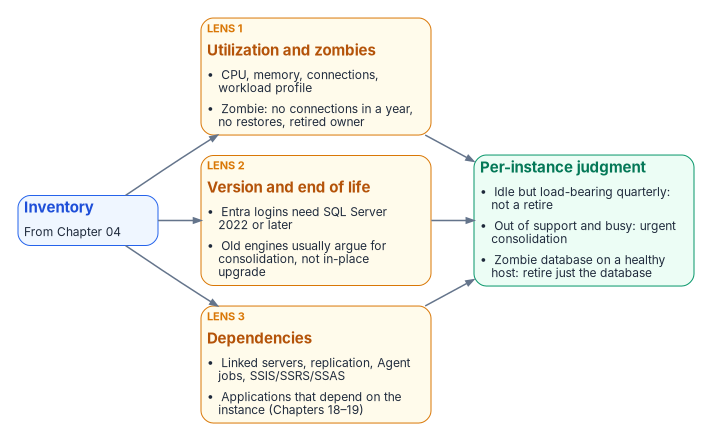

# Chapter 05 — Rationalization: Utilization, Versions and Dependencies

*Turning a complete inventory into a defensible judgment about what each instance is worth.*

::: {.callout-note}
## In this chapter
The three analytical lenses that convert a raw inventory into a rationalization judgment: utilization and zombie detection, version and end-of-life posture, and dependency mapping. Why the dependency map in particular decides which instances can be consolidated and which are load-bearing in ways that stay invisible until they're mapped.
:::

An inventory establishes what exists. Rationalization establishes what each item is worth keeping. The assessment applies three lenses to every instance and every database the inventory surfaced, and the combined picture drives the **retain / consolidate / retire** decision that [Chapter 06](06-retain-consolidate-retire.md) formalizes.

## Utilization and zombie detection

The first lens is utilization. An instance consumes CPU, memory, storage and a licensing entitlement whether or not anyone is using it, and a twenty-year estate contains instances that consume all four while serving no current workload.

Utilization analysis rightsizes the survivors and identifies the candidates for retirement. For each instance, the assessment captures sustained and peak resource consumption, connection counts and the workload profile: read-heavy reporting, transactional, batch or idle. For each database, it captures the last-access timestamp, the recent query workload and the backup-restore history. Azure Migrate collects much of this for discovered SQL Server instances and databases, refreshing configuration data daily and performance data every 30 seconds.[^c05-migrate]

A database with no connections in 400 or more days (the program's zombie threshold, the default of [Runbook R02](r02-estate-discovery-and-consolidation-gate.md)'s classifier), no restores consumed and a retired owning application is a zombie, and zombies are the cleanest retirement candidates in the estate. Retiring them is the single most effective way to reduce the authentication migration surface, because every login they carry, including long-forgotten SQL Authentication service accounts with still-valid passwords, is removed from the migration pipeline before it ever enters it.

Utilization data also rightsizes the consolidation targets. In an illustrative example, an instance running at four percent of a sixteen-core Enterprise license isn't a retain candidate at its current size. It's a consolidation source whose workload belongs on a shared modern target, freeing the license and the host.

## Version and end-of-life posture

The second lens is version posture, and it interacts directly with the authentication transformation. The `FROM EXTERNAL PROVIDER` login syntax that the whole transformation depends on, which maps a login to a Microsoft Entra principal, is available only on SQL Server 2022 and later.[^c05-create-login][^c05-entra-sql] An instance on any earlier version, whether 2019 or 2017, or the out-of-support 2016, 2014, 2012 and 2008 releases, can't accept Entra ID logins regardless of any other change.[^c05-eos] [Chapters 07–08](07-the-authentication-audit.md) formalize that constraint as the Category 3 classification.

This makes version posture a primary input to the consolidation decision rather than a secondary one. An out-of-support instance on SQL Server 2012 is at once a security-update liability, since its last Extended Security Update year ended in July 2025, a licensing question, and an instance that can't move to Entra ID authentication without an engine upgrade.[^c05-sql2012] The upgrade paths narrow the options further. SQL Server 2012 and later can be upgraded in place to SQL Server 2022, but SQL Server 2008 and 2008 R2 need a side-by-side upgrade or a migration. SQL Server 2025 accepts in-place upgrades only from SQL Server 2014 SP3 and later.[^c05-upgrade-2022][^c05-upgrade-2025] For most such instances, the right answer isn't "upgrade in place to 2022 or 2025 and then migrate." It's "consolidate the surviving workload onto a modern target and retire the old engine." The version lens and the utilization lens reach the same conclusion for most of the aged estate: collapse it onto fewer modern instances rather than carrying each old engine forward.

The licensing posture rides alongside the version posture. Consolidation that reduces the instance count also reduces core-license consumption, and an estate that can state its true core count before consolidation can quantify the licensing dividend consolidation produces.

## Dependency mapping

The third lens is the one that most often overturns a naive consolidation plan: dependency mapping. An instance that appears idle by connection count may be the silent target of a linked-server chain, a replication topology, an SSIS package, or a cross-database query that runs once a quarter and matters enormously when it runs.

Dependency mapping traces these relationships before any instance is moved. Linked-server definitions in `sys.servers` and the login mappings in `sys.linked_logins` reveal the cross-instance, and frequently cross-domain, web that forest entanglement produced.[^c05-linked-logins] Application-to-database mapping, drawn from connection telemetry and the application portfolio, shows which databases are load-bearing for which systems. The SQL Server Agent job inventory, the replication configuration and the SSIS, SSRS and SSAS footprint show the integration surface a consolidation must preserve. Azure Migrate's agentless dependency analysis adds server-to-server connection data, and the SSMS migration component adds compatibility and feature-blocker findings, supplementing the in-engine views.[^c05-dependency][^c05-ssms-upgrade]

The dependency map is also the bridge to [Chapters 18–19](18-the-four-class-pattern-for-applications.md). The upstream applications that consume SQL Server, many of them LDAP-bound, are precisely the systems whose dependencies the map records, and the application-chain migration of those chapters acts on the same relationships the rationalization lens surfaces here. An instance can't be classified **retire** if a load-bearing application still depends on it, and the dependency map is what makes that judgment defensible rather than hopeful.

## The combined picture

{#fig-c05-rationalization-lenses fig-alt="Three rationalization lenses, utilization, version and end-of-life posture, and dependency mapping, combining into one judgment for each instance and database."}

No single lens produces the rationalization decision. An instance that's lightly used but load-bearing for a quarterly process isn't a retirement candidate. An out-of-support instance with heavy utilization is an urgent consolidation target, not one to leave alone. A zombie database on an otherwise healthy instance is a local retirement that shrinks the migration surface without touching the host. Together, the three lenses produce a defensible judgment for each instance and each database, and that judgment is the input to the decision [Chapter 06](06-retain-consolidate-retire.md) records.

::: {.callout-note title="What this chapter establishes"}
1. Rationalization applies three lenses, utilization, version and end-of-life posture, and dependencies, to every inventoried instance.
2. Idle instances and zombie databases are retired, which shrinks the migration surface.
3. Entra logins need SQL Server 2022 or later, so version posture is a primary input, and old engines usually argue for consolidation over in-place upgrade.
4. The three lenses together produce the per-instance retain, consolidate or retire judgment.
:::

::: {.callout-tip}
## Continue the book
[← Previous: Chapter 04 — The Estate Inventory](04-the-estate-inventory.md) · [Book index](index.md) · [Next: Chapter 06 — The Retain, Consolidate, Retire Decision →](06-retain-consolidate-retire.md)
:::

[^c05-migrate]: Microsoft Learn, "Discover installed software inventory, web apps, and database instances" (Azure Migrate), <https://learn.microsoft.com/en-us/azure/migrate/how-to-discover-applications> (accessed Oct 20, 2026).
[^c05-create-login]: Microsoft Learn, "CREATE LOGIN (Transact-SQL)," `FROM EXTERNAL PROVIDER` argument, <https://learn.microsoft.com/en-us/sql/t-sql/statements/create-login-transact-sql?view=sql-server-ver17> (accessed Oct 20, 2026). "Specifies that the login is mapped to a Microsoft Entra principal. This option is available for Arc-enabled SQL Server 2022 and later versions."
[^c05-entra-sql]: Microsoft Learn, "Microsoft Entra authentication for SQL Server," <https://learn.microsoft.com/en-us/sql/relational-databases/security/authentication-access/azure-ad-authentication-sql-server-overview?view=sql-server-ver17> (accessed Oct 20, 2026). Applies to SQL Server 2022 and later; Microsoft also documents a setup without Arc.
[^c05-eos]: Microsoft Learn, "SQL Server end of support options," lifecycle dates, <https://learn.microsoft.com/en-us/sql/sql-server/end-of-support/sql-server-end-of-support-overview?view=sql-server-ver17> (accessed Oct 20, 2026). SQL Server 2016's extended support ended July 14, 2026: "SQL Server 2016," <https://learn.microsoft.com/en-us/lifecycle/products/sql-server-2016> (accessed Oct 20, 2026).
[^c05-sql2012]: Microsoft Learn, "Microsoft SQL Server 2012" (Microsoft Lifecycle), <https://learn.microsoft.com/en-us/lifecycle/products/microsoft-sql-server-2012> (accessed Oct 20, 2026). Extended support ended July 12, 2022; ESU Year 3 ended July 2025.
[^c05-upgrade-2022]: Microsoft Learn, "Upgrade SQL Server," <https://learn.microsoft.com/en-us/sql/database-engine/install-windows/upgrade-sql-server?view=sql-server-ver17> (accessed Oct 20, 2026). SQL Server 2012 through 2019 can be upgraded directly to SQL Server 2022; 2008 and 2008 R2 need a side-by-side upgrade or a migration.
[^c05-upgrade-2025]: Microsoft Learn, "Supported version and edition upgrades (SQL Server 2025)," <https://learn.microsoft.com/en-us/sql/database-engine/install-windows/supported-version-and-edition-upgrades-2025?view=sql-server-ver17> (accessed Oct 20, 2026). Upgrade from SQL Server 2014 SP3 or later, 2016 SP3 or later, 2017, 2019 and 2022.
[^c05-linked-logins]: Microsoft Learn, "sys.linked_logins (Transact-SQL)," <https://learn.microsoft.com/en-us/sql/relational-databases/system-catalog-views/sys-linked-logins-transact-sql?view=sql-server-ver17> (accessed Oct 20, 2026).
[^c05-dependency]: Microsoft Learn, "Dependency analysis" (Azure Migrate), <https://learn.microsoft.com/en-us/azure/migrate/concepts-dependency-visualization> (accessed Oct 20, 2026).
[^c05-ssms-upgrade]: Microsoft Learn, "Upgrade SQL Server using the migration component in SSMS," <https://learn.microsoft.com/en-us/ssms/migrate/upgrade-sql-server> (accessed Oct 20, 2026). The successor to the Data Migration Assistant, retired July 16, 2025 (Microsoft Learn, "Overview of Data Migration Assistant," <https://learn.microsoft.com/en-us/sql/dma/dma-overview?view=sql-server-ver17>, accessed Oct 20, 2026).
