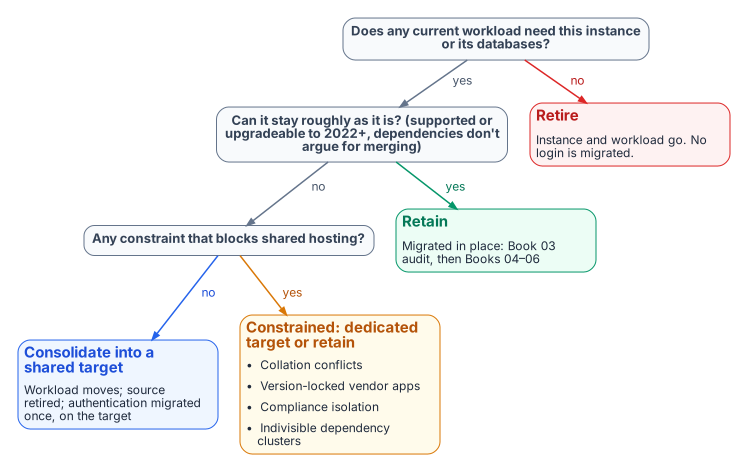
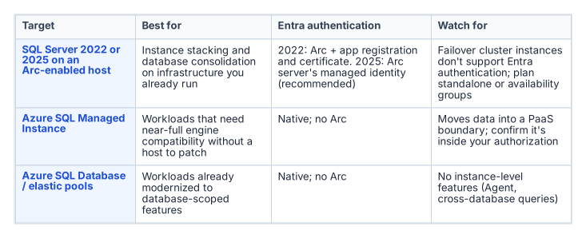

# Chapter 06 — The Retain, Consolidate, Retire Decision

*The gate that determines which instances enter the authentication migration at all.*

::: {.callout-note}
## In this chapter
How the three rationalization lenses resolve into a single per-instance classification: retain, consolidate-into-target or retire. The target-state options that absorb consolidated workloads, the constraints that prevent consolidation, and why this decision is the moment to collapse the forest-spanning identity sprawl into Entra-backed identity.
:::

The assessment now resolves to a decision. Every instance the inventory surfaced and the rationalization lenses evaluated is assigned one of three classifications, and that classification governs whether the instance enters the authentication migration that Chapters 07 through 22 describe. The SQL Server engine-authentication decision makes the classification a normative prerequisite: engine-layer authentication migration is performed only on instances classified **retain** or on the **consolidation targets** that absorb consolidated workloads. Instances classified **retire** or **consolidate-into-target (source)** aren't migrated; they're decommissioned or collapsed.

## The three classifications

{#fig-c06-retain-consolidate-retire fig-alt="Decision flow: if no current workload needs the instance, retire it; if it can stay roughly as it is, retain it; otherwise consolidate it into a shared target, or give it a dedicated target or retain it if a constraint blocks shared hosting."}

A **retain** instance survives the transformation roughly in place. It carries current, load-bearing workload; it's on a supported version or has a clear in-place upgrade path to SQL Server 2022 or later; and its dependencies don't argue for collapsing it into something larger. A retain instance goes straight into the authentication audit and Arc-eligibility classification of [Chapters 07–08](07-the-authentication-audit.md).

A **consolidate-into-target** instance doesn't survive as an instance, but its workload does. The databases it carries are migrated onto a modern consolidation target, and the source instance is then retired. This is the classification for the large middle of an aged estate: lightly used instances, out-of-support engines whose workload is still needed, and instances whose only real function is to host one or two databases that belong on a shared platform. The migration work for these instances happens at the database and workload level; the authentication migration is performed on the *target*, not the source.

A **retire** instance doesn't survive at all, and neither does its workload. Zombie instances, instances whose every database is a zombie, and instances whose owning applications are decommissioned are retired outright. No login on a retire instance ever enters the migration pipeline, which is the whole point of running this assessment before the migration rather than after it.

## Target-state options

{#fig-c06-target-state-options fig-alt="Three target-state options, SQL Server 2022 or 2025 on an Arc-enabled host, Azure SQL Managed Instance, and Azure SQL Database or elastic pools, compared for the authentication story."}

A consolidation target is the platform that absorbs consolidated workloads, and the assessment chooses among a small set of options based on the workload profile and the program's boundary posture.

- **Fewer, modern SQL Server 2022 or 2025 instances** on Arc-enabled hosts, through instance stacking or database consolidation onto a shared engine. This is the most direct path, and it keeps the workload on infrastructure the program already operates. Microsoft Entra authentication isn't supported on failover cluster instances, so consolidation targets that need Entra logins are standalone instances or Always On availability groups.[^c06-entra-sql]
- **Azure SQL Managed Instance**, a platform-as-a-service target that closely matches the features of an on-premises instance, including cross-database queries and SQL Server Agent jobs, and removes the host and most of the patching burden. It has documented T-SQL differences and a 32 TB combined storage limit.[^c06-eos-options]
- **Azure SQL Database and elastic pools**, for workloads already modernized to the database-scoped feature set. Applications that use cross-database queries, linked servers or SQL Server Agent jobs may need changes.[^c06-eos-options]

The target choice interacts with the rest of the book. A consolidation onto SQL Server 2022 on an Arc-enabled host is exactly the Category 1 starting position that [Chapters 07–08](07-the-authentication-audit.md) describe and [Chapters 11–12](11-three-principal-types.md) migrate. A consolidation onto Azure SQL Managed Instance changes the authentication story in detail but not in principle. Managed Instance supports Microsoft Entra authentication natively, and Microsoft Entra-only authentication can be enabled on it, which stops every SQL authentication login from connecting.[^c06-entra-only] The destination is still Entra ID-only authentication. The point of naming the target during the assessment is that the authentication migration is then performed once, on the target, in its final shape, rather than twice.

## What can't be consolidated

Not every instance that looks like a consolidation candidate can actually be consolidated, and the assessment must record the constraints honestly:

- **Collation conflicts** between databases that must coexist on a shared instance can block stacking.
- **Version-locked vendor applications** that are certified only against a specific SQL Server version can't move to a newer engine without losing vendor support.
- **Compliance isolation**: a database whose data classification mandates physical or logical separation can be barred from co-residency regardless of technical compatibility.
- **Indivisible dependencies**: cross-database or cross-instance dependencies that the dependency map surfaced can make two instances a single unit that must move together or not at all.

Each of these constraints converts an apparent consolidation candidate into either a constrained-consolidation case (move it, but onto a dedicated rather than shared target) or a retain case (leave it in place and migrate its authentication where it sits). Recording the constraint is what makes the consolidation plan executable rather than aspirational.

## The identity dividend

Consolidation and the authentication transformation reinforce each other, and the assessment is the moment to realize the connection. Collapsing many instances across multiple domains into fewer modern targets is also the moment to collapse the forest-spanning identity sprawl that [Chapter 03](03-the-shape-of-twenty-years.md) described. The cross-domain logins, the orphaned SPNs registered in domains being decommissioned, and the shared service accounts drawn from several domains don't need to be re-pointed instance by instance if the instances carrying them are being retired or consolidated. They're resolved once, at the target, into Entra-backed identity.

This is why the consolidation decision gates the authentication migration rather than running alongside it. The retain instances and the consolidation targets are the surface on which Chapters 07 through 22 operate. Everything classified retire or consolidate-source falls away before that work begins, and the forest entanglement falls away with it. The SQL Server engine-authentication decision records this ordering as the governing constraint: assess and consolidate first, so the authentication transformation is spent only on the estate that survives. [Runbook R02](r02-estate-discovery-and-consolidation-gate.md) is the procedure that applies the gate.

::: {.callout-note title="What this chapter establishes"}
1. Every instance is classified retain, consolidate-into-target or retire, and only retained instances and consolidation targets enter the migration.
2. Targets are chosen during the assessment, so authentication is migrated once, in its final shape.
3. Consolidation is the moment to collapse forest-spanning identity sprawl, which is why the assessment gates everything that follows.
:::

::: {.callout-tip}
## Continue the book
[← Previous: Chapter 05 — Rationalization: Utilization, Versions and Dependencies](05-rationalization.md) · [Book index](index.md) · [Next: Chapter 07 — The Authentication Audit →](07-the-authentication-audit.md)
:::

[^c06-entra-sql]: Microsoft Learn, "Microsoft Entra authentication for SQL Server," <https://learn.microsoft.com/en-us/sql/relational-databases/security/authentication-access/azure-ad-authentication-sql-server-overview?view=sql-server-ver17> (accessed Oct 20, 2026). Supported for standalone instances and Always On availability groups; "SQL Server failover cluster instances do not currently support Microsoft Entra authentication."
[^c06-eos-options]: Microsoft Learn, "SQL Server end of support options," <https://learn.microsoft.com/en-us/sql/sql-server/end-of-support/sql-server-end-of-support-overview?view=sql-server-ver17> (accessed Oct 20, 2026). SQL Managed Instance "closely matches the features of an on-premises instance of SQL Server, such as cross-database queries, transactional replication publishing and distribution, SQL job scheduling, and CLR support," with T-SQL differences and a 32 TB combined storage limit; Azure SQL Database applications using cross-database queries, linked servers or Agent jobs "might require changes."
[^c06-entra-only]: Microsoft Learn, "Microsoft Entra-only authentication with Azure SQL," <https://learn.microsoft.com/en-us/azure/azure-sql/database/authentication-azure-ad-only-authentication?view=azuresql> (accessed Oct 20, 2026). Supported for Azure SQL Database and Azure SQL Managed Instance; disables SQL authentication, including for server administrators.
