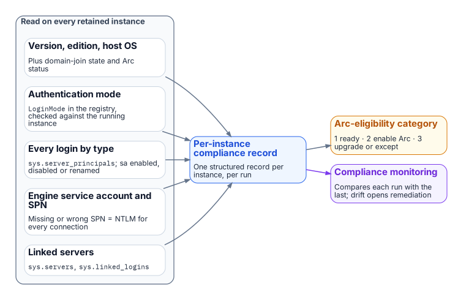
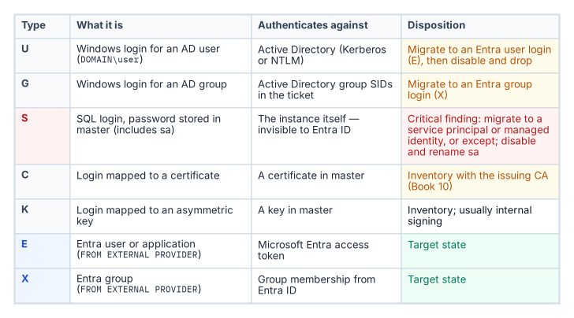
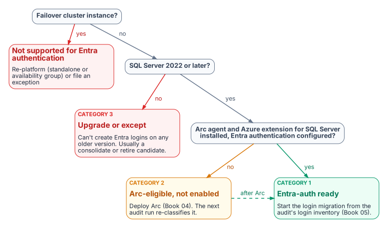

# Chapter 07 — The Authentication Audit

*No migration survives contact with an estate it hasn't measured, so the audit turns every surviving instance into a structured, drift-aware authentication record.*

::: {.callout-note}
## In this chapter
What the authentication-audit script enumerates across the surviving estate, how it reads the authentication-mode configuration and classifies every login by type, how it captures the engine service-account identity and SPN registration, the three-category Arc-eligibility classification that drives migration sequencing, and why the script's output feeds the compliance-monitoring pipeline rather than a spreadsheet.
:::

Chapters 03 through 06 measured the estate to decide what survives. This chapter and the next measure the **authentication posture** of what remains. The authentication-audit script is the instrument, the Arc-eligibility classification is its most consequential output, and the per-instance compliance record, not a spreadsheet, is its deliverable. In the program's dependency chain this is step 3: audit the survivors. The hands-on procedure is in [Runbook R03](r03-the-authentication-audit.md).

{fig-alt="On every retained instance the audit reads the version, edition and host OS, the authentication mode, every login by type, the engine service account and SPN, and linked servers; it produces a per-instance compliance record and an Arc-eligibility category, both sent to compliance monitoring."}

The audit runs only on the instances [Chapter 06](06-retain-consolidate-retire.md) classified as **retain** or **consolidation target**. The rationalization decision has already removed the zombies and retirees from scope before a single line of enumeration runs.

## Scope of the enumeration

The authentication-audit script performs a structured enumeration of the SQL Server estate across all hosts in the program's management scope. For each host it identifies every SQL Server instance, named instances and the default instance, along with the version, edition and build number.

The host operating system version is captured because it determines the Arc capability envelope. The Connected Machine agent runs on Windows Server 2012 through 2025, though new agent versions for 2012 and 2012 R2 end in November 2026.[^c07-arc-prereq] SQL Server enabled by Azure Arc needs Windows Server 2016 or later,[^c07-arc-sql-prereq] and Microsoft Entra authentication for the engine needs SQL Server 2022 or later, set up through an app registration on SQL Server 2022 or the server's managed identity on SQL Server 2025.[^c07-entra-sql][^c07-mi-2025] The program sets its own floor one step higher, at Windows Server 2019, because Windows Server 2016 reaches end of support on January 12, 2027.[^c07-ws2016-eos] None of those hosts supports the `AADLoginForWindows` OS-level Entra sign-in extension, which needs Windows Server 2025 with Desktop Experience; Windows Server 2025 supports both capabilities.[^c07-arc-login]

That distinction matters for migration sequencing, and the audit captures it explicitly. The domain-join status of the host is recorded alongside it: a host already migrated to a non-domain-joined state under the Arc non-domain-join requirement occupies a different starting position than a domain-joined host, and the per-instance output must reflect that.

Arc-enablement status (whether the Connected Machine agent is installed and the system-assigned managed identity is available) is the single most consequential classification output for migration prioritization.

## Authentication-mode configuration

For each instance the script reads the authentication-mode configuration. SQL Server supports two modes: Windows Authentication mode and mixed mode.[^c07-auth-mode] In Windows Authentication mode, SQL Authentication logins are rejected at the connection level: no SQL Authentication credential is accepted regardless of whether a matching login exists in `master`. In mixed mode, both Windows Authentication and SQL Authentication are accepted. Windows Authentication is always available and can't be disabled in either mode,[^c07-choose-mode] and Microsoft Entra authentication, once configured, works alongside both.[^c07-entra-sql]

The mode is stored in the Windows registry as the `LoginMode` value under the instance's key, `HKLM\SOFTWARE\Microsoft\Microsoft SQL Server\MSSQL<version>.<InstanceID>\MSSQLServer` (for example `MSSQL16.MSSQLSERVER` for a default SQL Server 2022 instance): a value of `1` indicates Windows Authentication mode, and `2` indicates mixed mode.[^c07-auth-mode][^c07-noarc]
The audit reads this value directly and cross-references it against the running instance with `SERVERPROPERTY('IsIntegratedSecurityOnly')`, which returns `1` in Windows Authentication mode. A change of mode takes effect only after the service restarts,[^c07-auth-mode] so the registry and the running configuration can disagree after a reconfiguration without a restart. Any discrepancy is flagged as an anomaly requiring resolution before the migration can proceed. On SQL Server 2025 enabled by Azure Arc the audit also reads `SERVERPROPERTY('IsExternalAuthenticationOnly')`, which returns `1` when the instance's Disable SQL Authentication setting is on.[^c07-disable-sql]

## Login type classification

{fig-alt="Table of sys.server_principals types: U Windows user, G Windows group, S SQL login, C certificate-mapped, K asymmetric-key-mapped, E Entra user or application, X Entra group, with the migration outcome for each."}

The script connects to each instance and queries the `sys.server_principals` system view to enumerate all logins.[^c07-principals] Each login is classified by type: Windows logins for individual AD user accounts (type `U`, whose SID matches the Windows SID); Windows logins for AD security groups (type `G`); SQL Authentication logins with credentials stored in `master` (type `S`); certificate-mapped logins (type `C`); and asymmetric key-mapped logins (type `K`). Entra logins already present appear as type `E` (a user or application) or `X` (a group).

The count and identity of each type is reported per instance. The presence of active SQL Authentication logins (type `S`) is a critical finding, because these logins are invisible to the Azure identity plane.

Such logins must be either migrated to Entra ID equivalents, the `FROM EXTERNAL PROVIDER` logins created in [Chapter 11](11-three-principal-types.md), or formally excepted with documented justification before the SQL Server authentication transformation can be declared closed.[^c07-create-login]

The `sa` account's status is separately flagged: enabled, disabled or renamed. An enabled `sa` account with a non-rotated password is the highest-priority remediation finding in the audit output.

## Service-account identity and SPN registration

The script captures the identity of the Windows service account running the SQL Server engine process, the `MSSQLSERVER` service or its named-instance equivalent, by querying the service configuration. This identifies whether the engine runs as a domain service account, a group managed service account (gMSA), the `NT SERVICE\MSSQLSERVER` virtual account, or another identity.[^c07-gmsa]

It then queries Active Directory, using `Get-ADServiceAccount` and `setspn` or their equivalents, to determine whether the correct SPN is registered for the service account and the instance endpoint.

The SPN check is one of the most operationally valuable outputs of the audit. When the client can't obtain a Kerberos ticket for the instance's SPN, authentication uses NTLM, and the misconfiguration isn't visible without deliberately querying AD for it.[^c07-spn]

Microsoft's own table of outcomes makes the two failure modes distinct. If the SPN is missing or its lookup fails, local and remote connections both use NTLM. If the SPN is registered on the wrong account, authentication fails outright. And even with a correct SPN, local connections use NTLM; only remote connections use Kerberos.[^c07-spn] An instance with a missing SPN is therefore generating NTLM traffic for every remote connection that expects Kerberos, and in most cases the application teams generating those connections don't know it. The audit can confirm the result per session, because `sys.dm_exec_connections` reports `auth_scheme` as `KERBEROS` or `NTLM`.[^c07-spn]

## The Arc-eligibility output

{fig-alt="Decision flow: a failover cluster instance is not supported for Entra authentication; an instance older than SQL Server 2022 must be upgraded or excepted; an instance without the Arc agent, the SQL extension and Entra authentication configured is Arc-eligible but not enabled; otherwise it is Entra-auth ready."}

The most consequential output of the audit is the Arc-eligibility classification it assigns to every instance. The program delivers Entra authentication through Azure Arc ([Chapter 09](09-what-arc-provides-to-sql-server.md) explains why, and the manual alternative Microsoft also documents), so the categories are framed around Arc. Every instance falls into one of three.

Category 1 is Arc-eligible and Entra-auth-ready today: the server is already running the Connected Machine agent, the Azure extension for SQL Server has been deployed, the system-assigned managed identity is available, Entra authentication is configured on the instance, and the SQL Server version is 2022 or later.[^c07-arc-sql] A Category 1 instance can have its Entra ID logins created and its login migration begun immediately. It requires no further infrastructure work before [Chapter 11](11-three-principal-types.md)'s migration pattern can be applied.

Category 2 is Arc-eligible but not yet enabled: the host meets all the prerequisites for Arc enablement (the program's Windows Server floor, network connectivity to the Azure Arc endpoints, SQL Server 2022 or later) but the Connected Machine agent hasn't been installed or Entra authentication hasn't been configured. A Category 2 instance requires Arc deployment as the prerequisite action before login migration can begin.

Category 3 is not yet Arc-eligible. Either the SQL Server version is pre-2022 (2019, 2017 or earlier), which means the engine can't accept `FROM EXTERNAL PROVIDER` logins regardless of Arc status,[^c07-entra-sql] or the host has a configuration that prevents enrollment. One configuration is a hard stop before the version question: Microsoft Entra authentication isn't supported on SQL Server failover cluster instances, so an FCI must be re-platformed as a standalone instance or an availability group, or carry an exception.[^c07-entra-sql]

A Category 3 instance requires a SQL Server version upgrade as the gate before any Entra-auth migration can occur, and that upgrade timeline must be factored into the overall program sequencing against the program's 2027-04-01 NTLM backstop. That date is the program's own planning anchor, not a Microsoft deadline ([Chapter 02](02-why-the-inheritance-must-end.md)).

## The compliance-monitoring telemetry sink

The audit script's output is not a standalone deliverable. It is the input to the compliance-monitoring pipeline, and that is the architectural characteristic that distinguishes the authentication-audit script from a conventional discovery script.

The continuous-compliance monitoring system is the program-level tracking system for SQL Server authentication state at the instance level. Each time the audit runs (and it is designed to run continuously, on a schedule, against the full estate) it produces a structured per-instance compliance record that the compliance-monitoring pipeline ingests.

That pipeline computes the current authentication posture of the instance, compares it to the previous record, and flags any drift: a new SQL Authentication login that appeared since the last scan, an instance that has reverted from Windows Authentication mode back to mixed mode, a new linked-server definition that relies on Windows passthrough rather than an Entra credential.[^c07-linked]

Drift events are not informational. They are compliance violations that trigger the program's remediation workflow. The required output is a per-instance compliance record, not a spreadsheet delivered to a program manager.

::: {.callout-note title="What this chapter establishes"}
1. The audit enumerates the surviving estate: version and OS, domain join, authentication mode, login types, and service-account and SPN posture.
2. Every instance gets an Arc-eligibility category: Entra-ready (1), Arc-eligible but not enabled (2), or upgrade required (3); failover cluster instances are outside Entra authentication altogether.
3. The output is a per-instance compliance record that re-runs as a drift-aware baseline, not a one-off spreadsheet.
:::

::: {.callout-tip}
## Continue the book
[← Previous: Chapter 06 — The Retain, Consolidate, Retire Decision](06-retain-consolidate-retire.md) · [Book index](index.md) · [Next: Chapter 08 — Reading the Audit: Classification and Triage →](08-reading-the-audit.md)
:::

[^c07-arc-prereq]: Microsoft Learn, "Connected Machine agent prerequisites," supported operating systems, <https://learn.microsoft.com/azure/azure-arc/servers/prerequisites#supported-operating-systems> (accessed Oct 20, 2026).
[^c07-arc-sql-prereq]: Microsoft Learn, "Prerequisites — SQL Server enabled by Azure Arc," supported configurations, <https://learn.microsoft.com/sql/sql-server/azure-arc/prerequisites> (accessed Oct 20, 2026).
[^c07-entra-sql]: Microsoft Learn, "Microsoft Entra authentication for SQL Server," <https://learn.microsoft.com/sql/relational-databases/security/authentication-access/azure-ad-authentication-sql-server-overview> (accessed Oct 20, 2026).
[^c07-mi-2025]: Microsoft Learn, "Managed identity for SQL Server enabled by Azure Arc," <https://learn.microsoft.com/sql/sql-server/azure-arc/managed-identity> (accessed Oct 20, 2026).
[^c07-ws2016-eos]: Microsoft Learn, "Ending Support in 2027," <https://learn.microsoft.com/lifecycle/end-of-support/end-of-support-2027> (accessed Oct 20, 2026).
[^c07-arc-login]: Microsoft Learn, "Sign in to an Azure Arc-enabled server using Microsoft Entra ID and Azure Roles Based Access Control," <https://learn.microsoft.com/entra/identity/devices/howto-arc-sign-in-windows> (accessed Oct 20, 2026).
[^c07-auth-mode]: Microsoft Learn, "Change server authentication mode," <https://learn.microsoft.com/sql/database-engine/configure-windows/change-server-authentication-mode> (accessed Oct 20, 2026).
[^c07-choose-mode]: Microsoft Learn, "Choose an authentication mode," <https://learn.microsoft.com/sql/relational-databases/security/choose-an-authentication-mode> (accessed Oct 20, 2026).
[^c07-noarc]: Microsoft Learn, "Tutorial: Enable Microsoft Entra authentication for SQL Server on Windows without Azure Arc," registry path format, <https://learn.microsoft.com/sql/relational-databases/security/authentication-access/microsoft-entra-authentication-sql-server-enable-without-arc> (accessed Oct 20, 2026).
[^c07-disable-sql]: Microsoft Learn, "Disable SQL authentication for SQL Server enabled by Azure Arc," <https://learn.microsoft.com/sql/sql-server/azure-arc/disable-sql-authentication> (accessed Oct 20, 2026).
[^c07-principals]: Microsoft Learn, "sys.server_principals (Transact-SQL)," <https://learn.microsoft.com/sql/relational-databases/system-catalog-views/sys-server-principals-transact-sql> (accessed Oct 20, 2026).
[^c07-create-login]: Microsoft Learn, "CREATE LOGIN (Transact-SQL)," <https://learn.microsoft.com/sql/t-sql/statements/create-login-transact-sql> (accessed Oct 20, 2026).
[^c07-gmsa]: Microsoft Learn, "Group Managed Service Accounts overview," <https://learn.microsoft.com/windows-server/identity/ad-ds/manage/group-managed-service-accounts/group-managed-service-accounts/group-managed-service-accounts-overview> (accessed Oct 20, 2026).
[^c07-spn]: Microsoft Learn, "Register a Service Principal Name for Kerberos connections," <https://learn.microsoft.com/sql/database-engine/configure-windows/register-a-service-principal-name-for-kerberos-connections> (accessed Oct 20, 2026).
[^c07-arc-sql]: Microsoft Learn, "SQL Server enabled by Azure Arc" (overview), <https://learn.microsoft.com/sql/sql-server/azure-arc/overview> (accessed Oct 20, 2026).
[^c07-linked]: Microsoft Learn, "Linked server for SQL Server with Microsoft Entra authentication," <https://learn.microsoft.com/sql/relational-databases/security/authentication-access/azure-ad-authentication-sql-server-linked-server> (accessed Oct 20, 2026).
