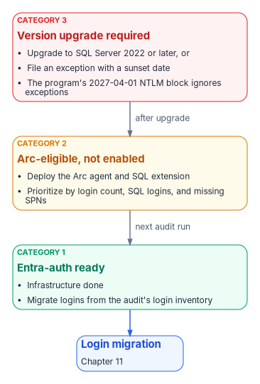
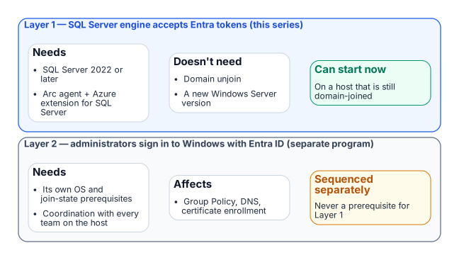

# Chapter 08 — Reading the Audit: Classification and Triage

*A per-instance category becomes a defensible migration order once one distinction is understood: the engine and the operating system move to Entra ID on separate tracks.*

::: {.callout-note}
## In this chapter
How to interpret each of the three Arc-eligibility categories the audit assigns, how the audit output should drive triage and prioritization within each category, and the architectural distinction between SQL Server engine Entra authentication and server OS Entra sign-in: the Layer 1 versus Layer 2 separation that lets engine migration proceed on a host that is still domain-joined.
:::

{fig-alt="Category 3 instances are upgraded, Category 2 instances are Arc-enabled and configured for Entra authentication, and both arrive at Category 1, Entra-auth-ready."}

## Interpreting Category 1: Entra-auth-ready

A Category 1 classification is the program's best starting position. It means the infrastructure prerequisites for Entra ID authentication are already in place: the Arc agent is running, the Azure extension for SQL Server is deployed, Entra authentication is configured on the instance, and the engine is running SQL Server 2022 or later.[^c08-arc-sql]

The managed identity for the server is available, and the extension has registered the instance as a SQL Server enabled by Azure Arc resource. Nothing in the infrastructure stack remains to be built.

The migration work for a Category 1 instance therefore begins with the login inventory from the audit: how many Windows logins exist, which AD groups are mapped to SQL Server roles, and whether any SQL Authentication logins need to be addressed before or alongside the Windows login migration. The specific migration steps are in [Chapter 11](11-three-principal-types.md).

The point here is that the audit has done its job for a Category 1 instance when it delivers a precise login inventory. The infrastructure work is already done, and the migration can proceed without any further prerequisites.

## Interpreting Category 2: Arc-eligible but not enabled

A Category 2 instance requires an Arc deployment action before login migration can begin. The audit output for such an instance should be used to prioritize that deployment.

Instances with a large number of Windows logins, active SQL Authentication logins, or missing SPN registrations, and therefore NTLM-generating connections, are higher priority for Arc deployment than instances with simple, well-configured Windows Authentication.[^c08-spn]

The Arc deployment itself is not a SQL Server change. It is a server-level action that installs the Connected Machine agent; when the agent connects a server that has SQL Server installed, Azure Arc installs the Azure extension for SQL Server automatically.[^c08-arc-servers][^c08-deploy] [Chapter 10](10-arc-deployment-sequencing.md) describes the deployment sequence in detail, including the separate step that turns on Entra authentication for the instance.

Once Arc deployment is complete and Entra authentication is configured on the instance, the instance re-classifies from Category 2 to Category 1 on the next audit run, and the login migration can begin.

## Interpreting Category 3: version upgrade required

A Category 3 instance is the most operationally complex. A pre-2022 instance can't accept `FROM EXTERNAL PROVIDER` logins regardless of any other configuration change.[^c08-create-login]

Microsoft Entra authentication for on-premises SQL Server was introduced in SQL Server 2022; earlier versions don't support it at all, with or without Arc.[^c08-entra-sql]

A Category 3 instance therefore has two possible paths: upgrade the SQL Server engine to 2022 or later and then proceed through the Category 2 pathway, or document a formal exception with a sunset date for the instance. Failover cluster instances belong with Category 3 even on a current version, because Microsoft Entra authentication isn't supported on them; the paths there are re-platforming to a standalone instance or availability group, or an exception.[^c08-entra-sql]

Given the program's 2027-04-01 NTLM backstop, a Category 3 instance that can't be upgraded before that date will face NTLM failure regardless of exception status. The program's block is applied in the operating system's security layer, not in the engine, so it doesn't distinguish between instances that are excepted from the transformation and instances that aren't. The date and the block are the program's own decision; Microsoft has deprecated NTLM and plans to disable it by default in a future Windows release, but hasn't published a date for that step ([Chapter 02](02-why-the-inheritance-must-end.md)).[^c08-ntlm-deprecated]

The version-upgrade timeline for Category 3 instances must be integrated into the SQL Server engine-authentication migration plan as an explicit dependency.

## The SQL engine versus OS Entra sign-in distinction

{fig-alt="Layer 1, the SQL Server engine accepting Entra tokens, can start now and doesn't depend on Layer 2, administrators signing in to Windows with Entra ID, which is a separate program sequenced on its own."}

One of the most important clarifications the audit output must carry, and that the teams reading it must internalize, is the architectural distinction between SQL Server engine Entra authentication and server OS Entra ID sign-in. These are two separate capabilities with separate prerequisites, and confusing them is the most common misunderstanding this program will encounter.

SQL Server engine Entra authentication, Layer 1 and the capability described in this book, requires SQL Server 2022 or later on an instance that isn't a failover cluster instance, plus (on the program's path) the Arc Connected Machine agent and the Azure extension for SQL Server. It doesn't require the server to be domain-unjoined, and it doesn't require Windows Server 2025.[^c08-entra-sql]

A domain-joined Windows Server 2019 host running SQL Server 2022 with Arc installed can have Entra ID-backed SQL Server logins today, while the server itself remains domain-joined and continues to authenticate OS-level users via Kerberos to the domain controller.

Server OS Entra ID sign-in, Layer 2 and the ability for administrators to sign in over Remote Desktop with Entra ID credentials instead of domain credentials, is a separate transformation governed by the Arc non-domain-join requirement. It needs Windows Server 2025 with Desktop Experience, and installing its extension Entra-joins the server, which Microsoft intends only for machines that aren't joined to another domain such as on-premises AD.[^c08-arc-login]

The two capabilities are related (both are part of the SQL Server authentication transformation) but they are sequenced independently, and the SQL Server engine migration can and should proceed first.

This sequencing point must be explicit in every instance of audit output that classifies a server as "not yet domain-unjoined." The correct interpretation is not "SQL Server migration blocked" but "OS-level Entra sign-in not yet available; SQL engine migration can proceed."

::: {.callout-note title="What this chapter establishes"}
1. Category 1 migrates now; Category 2 gets Arc and becomes Category 1; Category 3 upgrades or carries a dated exception, and failover cluster instances re-platform or carry one.
2. SQL-engine Entra authentication (Layer 1) needs SQL Server 2022 or later and, on the program's path, Arc and the SQL extension.
3. Layer 1 proceeds on domain-joined hosts and never waits for OS-level Entra sign-in (Layer 2).
:::

::: {.callout-tip}
## Continue the book
[← Previous: Chapter 07 — The Authentication Audit](07-the-authentication-audit.md) · [Book index](index.md) · [Next: Chapter 09 — What Arc Provides to SQL Server →](09-what-arc-provides-to-sql-server.md)
:::

[^c08-arc-sql]: Microsoft Learn, "SQL Server enabled by Azure Arc" (overview), <https://learn.microsoft.com/sql/sql-server/azure-arc/overview> (accessed Oct 20, 2026).
[^c08-spn]: Microsoft Learn, "Register a Service Principal Name for Kerberos connections," <https://learn.microsoft.com/sql/database-engine/configure-windows/register-a-service-principal-name-for-kerberos-connections> (accessed Oct 20, 2026).
[^c08-arc-servers]: Microsoft Learn, "What is Azure Arc-enabled servers?," <https://learn.microsoft.com/azure/azure-arc/servers/overview> (accessed Oct 20, 2026).
[^c08-deploy]: Microsoft Learn, "Deployment options for SQL Server enabled by Azure Arc," <https://learn.microsoft.com/sql/sql-server/azure-arc/deployment-options> (accessed Oct 20, 2026).
[^c08-create-login]: Microsoft Learn, "CREATE LOGIN (Transact-SQL)," `FROM EXTERNAL PROVIDER`, <https://learn.microsoft.com/sql/t-sql/statements/create-login-transact-sql> (accessed Oct 20, 2026).
[^c08-entra-sql]: Microsoft Learn, "Microsoft Entra authentication for SQL Server," <https://learn.microsoft.com/sql/relational-databases/security/authentication-access/azure-ad-authentication-sql-server-overview> (accessed Oct 20, 2026).
[^c08-ntlm-deprecated]: Microsoft Learn, "Features removed or no longer developed in Windows Server," NTLM, <https://learn.microsoft.com/windows-server/get-started/removed-deprecated-features-windows-server> (accessed Oct 20, 2026); Microsoft Windows IT Pro Blog, "Advancing Windows security: Disabling NTLM by default," January 29, 2026, <https://techcommunity.microsoft.com/blog/windows-itpro-blog/advancing-windows-security-disabling-ntlm-by-default/4489526> (accessed Oct 20, 2026).
[^c08-arc-login]: Microsoft Learn, "Sign in to an Azure Arc-enabled server using Microsoft Entra ID and Azure Roles Based Access Control," <https://learn.microsoft.com/entra/identity/devices/howto-arc-sign-in-windows> (accessed Oct 20, 2026).
