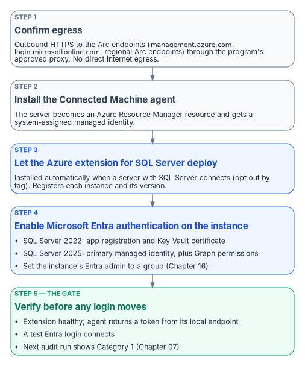

# Chapter 10 — Arc Deployment Sequencing for SQL Server Hosts

*Each step satisfies the next one's prerequisite, so a host becomes identity-ready only in order, and only after it proves it.*

::: {.callout-note}
## In this chapter
The connectivity prerequisites that Arc enrollment demands inside a GCC-Moderate boundary, how the Azure extension for SQL Server arrives and what it checks, the version-specific step that turns on Microsoft Entra authentication for the instance, and the checks (a token from the Arc agent's local endpoint and a test Entra login) that confirm the identity is genuinely available before any login migration begins. The hands-on procedure is in [Runbook R04](r04-arc-deployment-and-managed-identity.md).
:::

{fig-alt="Five steps in order: confirm egress, install the Connected Machine agent, let the Azure extension for SQL Server deploy, enable Microsoft Entra authentication on the instance, and verify before any login moves."}

Arc deployment is a sequence, not a single act. Each step has a prerequisite that the prior step satisfies, and skipping ahead produces failures that are easy to misdiagnose as migration problems when they're in fact enrollment problems. The order is connectivity first, then the Connected Machine agent, then the Azure extension for SQL Server, then Entra authentication on the instance, then a verification that the identity is actually present and answering.[^c10-arc-servers] The server-wide onboarding detail (least-privilege onboarding service principals, tags, extension allowlists, rollback) is in [Book 05, Chapter 09](../b05-devices/09-servers-under-azure-arc.md); this chapter covers what's specific to SQL Server hosts.

## Prerequisites for Arc enrollment

The Connected Machine agent communicates outbound to Azure over TCP 443; no inbound rule is needed.[^c10-arc-sql] On top of the agent's own endpoints and service tags (listed in Book 05), a SQL Server host needs four more groups of destinations:[^c10-arc-sql-prereq]

| Purpose | Destinations |
|---|---|
| Azure Arc data processing service (inventory and usage upload) | `*.<region>.arcdataservices.com`, or `*.<region>.arcdataservices.azure.us` in US Government Virginia |
| Extension installation | `aka.ms` and `*.web.core.windows.net` |
| Microsoft Entra authentication, if a firewall filters URLs | `login.microsoftonline.com`, `login.microsoft.com`, `enterpriseregistration.windows.net`, `graph.microsoft.com`, and the Key Vault (`<name>.vault.azure.net`) when certificates are used |
| Resource providers registered in the subscription | `Microsoft.HybridCompute` and `Microsoft.AzureArcData` |

In a GCC-Moderate boundary this connectivity must be routed through the program's approved network egress path; direct internet egress from a production SQL Server host isn't acceptable under the boundary's network posture. The Arc agent supports an HTTPS proxy, set with `azcmagent config set proxy.url`.[^c10-appreg-2022] Two proxy details catch SQL Server hosts specifically. The instance's own Entra authentication traffic doesn't use the Arc agent's proxy setting: SQL Server connects to Entra ID directly, so a host that needs a proxy also needs the machine-level WinHTTP proxy set with `netsh winhttp set proxy`.[^c10-appreg-2022] And if the machine has a system-level `HTTPS_PROXY` environment variable, `localhost` and `127.0.0.1` must be excluded with `NO_PROXY`, or requests to the local Arc identity endpoint go to the proxy.[^c10-arc-sql-prereq] An Azure Arc private link scope can keep agent traffic off public networks (Book 05), but Private Link isn't supported for the data processing service endpoint.[^c10-arc-sql-prereq]

Connectivity verification (confirming that the server can reach all required endpoints through the approved proxy) is the first prerequisite check before Arc deployment begins. The agent's own check covers the SQL Server endpoints when run as `azcmagent check --extensions sql` ([Book 05, Chapter 09](../b05-devices/09-servers-under-azure-arc.md)). An agent that can't reach its endpoints will fail to register its ARM resource, and without that resource there's no managed identity to verify later.

## The Azure extension for SQL Server

The Azure extension for SQL Server is a distinct component from the Connected Machine agent, but it usually doesn't need a separate installation: when a server connected to Azure Arc has SQL Server installed, Arc installs the extension automatically and creates the SQL Server instance resources in Azure.[^c10-deploy] Automatic connection can be managed at scale, and an individual server can be connected interactively if the extension didn't deploy.[^c10-deploy] To keep a server out (for example, a host that isn't in this wave), tag it `ArcSQLServerExtensionDeployment` with the value `Disabled` when you connect it ([Book 05, Chapter 09](../b05-devices/09-servers-under-azure-arc.md)). Only extension versions released within the last 12 months are supported, so enable the extension's automatic updates.[^c10-arc-sql-prereq][^c10-deploy]

The extension registers every instance of SQL Server 2014 or later, so it isn't what enforces the 2022 floor for Entra authentication; the audit's Arc-eligibility classification is.[^c10-arc-sql] The extension does have its own preconditions, which hardened SQL Server builds sometimes break:[^c10-arc-sql-prereq]

- The SQL Server service account must be a member of the `sysadmin` fixed server role, which it is by default.
- The extension's deployer connects as `NT AUTHORITY\SYSTEM` with Windows authentication, so that login must exist, be enabled and hold `CONNECT SQL`. Hardening baselines that remove it make the extension fail to provision.
- On Windows, the host needs .NET Framework 4.7.2 or later.

The authentication-audit script's Arc-eligibility classification (Category 1 versus Category 2 versus Category 3) is the primary input for prioritizing Arc deployment across the estate. Category 2 instances are the immediate deployment targets, and the audit's login inventory and NTLM risk signals within Category 2 are used to order those deployments by remediation urgency.

## Enabling Microsoft Entra authentication on the instance

Installing the extension doesn't by itself switch on Entra authentication; the setting is disabled by default and configured per instance.[^c10-arc-sql] That's a separate, version-specific step:

| | SQL Server 2022 | SQL Server 2025 (recommended path) |
|---|---|---|
| Instance's Entra identity | An Entra app registration with a certificate in Azure Key Vault[^c10-appreg-2022] | The Arc server's system-assigned managed identity, set as the instance's primary managed identity[^c10-mi-setup] |
| Microsoft Graph permissions | `Directory.Read.All`, or `Application.Read.All`, `Group.Read.All` and `User.Read.All`, with admin consent[^c10-appreg-2022] | `User.Read.All`, `GroupMember.Read.All` and `Application.Read.All` as app roles on the managed identity[^c10-mi-setup] |
| Who can grant them | Privileged Role Administrator or higher[^c10-appreg-2022] | Privileged Role Administrator or higher[^c10-mi-setup] |
| Credential to manage | The Key Vault certificate: unique common name, validity of at most 12 months, not rotated automatically[^c10-appreg-2022][^c10-automation] | None |
| Key Vault access | The Arc server's managed identity gets Key Vault Certificate User and Key Vault Secrets User, or Get and List access policies[^c10-appreg-2022] | Not needed for authentication |

For SQL Server 2022, the portal can also create the certificate and app registration for you ("service-managed" options) when you set the Entra admin; admin consent for the Graph permissions still has to be granted afterward, or creating Entra logins fails with error 37455.[^c10-automation] For SQL Server 2025, enable the primary managed identity from the portal rather than by editing the registry. Because the Graph permissions are app roles, they're assigned to each server's managed identity individually; Microsoft notes that adding identities to a role-assignable group holding Directory Readers is simpler at scale but grants far broader read access, and doesn't recommend it where least privilege is required.[^c10-mi-setup]

The Entra admin you set becomes a `sysadmin` on the instance. Changing the admin later doesn't remove the previous admin's login, so drop it deliberately.[^c10-appreg-2022] The program sets the instance's Entra admin to a group ([Chapter 16](16-groups-roles-and-membership.md)).

Three limits apply on both versions. Neither supports Entra authentication on failover cluster instances;[^c10-entra-sql] both need a network path to the Azure public cloud;[^c10-mi-2025] and connections authenticated by Entra ID are always encrypted, so the instance needs a TLS certificate its clients trust, or clients must be set to trust the server certificate.[^c10-appreg-2022] On SQL Server 2025, Microsoft also advises against disabling Entra authentication once it's enabled.[^c10-mi-2025]

## Verification of managed identity availability

After the Connected Machine agent is installed and the Azure extension for SQL Server is deployed, the program must verify that the system-assigned managed identity is available, and that Entra authentication works on the instance, before proceeding to the login migration. This verification isn't optional; it's the gate between enrollment and migration.

The first check calls the Arc agent's local identity endpoint (HIMDS) on the server, `http://localhost:40342/metadata/identity/oauth2/token?api-version=2020-06-01&resource=https://management.azure.com/`, not the Azure VM metadata address `169.254.169.254`. The endpoint first returns a challenge that only a local administrator or a member of the Hybrid Agent Extension Applications group can answer; the check confirms that the agent then returns a valid access token.[^c10-arc-mi-endpoint] The second check is a test Entra login that connects to the instance. The third is the next audit run, which should classify the instance as Category 1 ([Chapter 07](07-the-authentication-audit.md)).

A successful token response confirms three things at once: that the managed identity exists in Entra ID, that the Arc agent is functioning, and that the server's ARM resource is in a healthy state. A failed token response at this stage requires Arc troubleshooting before the SQL Server migration can proceed.

The authentication-audit script's Arc-eligibility classification is updated on each run to reflect the current managed-identity state, so the per-instance compliance record reflects this verification outcome in near real time.

::: {.callout-note title="What this chapter establishes"}
1. Enrollment runs in a strict order: egress connectivity, the Connected Machine agent, the SQL extension (deployed automatically), then Entra authentication configured per instance.
2. SQL Server 2022 and 2025 enable Entra authentication differently, and both need Graph permissions that only a Privileged Role Administrator can grant.
3. Verification (a token from the local endpoint, a test Entra login, and Category 1 on the next audit) is the gate for login migration; a failed verification is an enrollment problem, resolved before migration starts.
:::

::: {.callout-tip}
## Continue the book
[← Previous: Chapter 09 — What Arc Provides to SQL Server](09-what-arc-provides-to-sql-server.md) · [Book index](index.md) · [Next: Chapter 11 — Three Principal Types: User, Group, Service Principal →](11-three-principal-types.md)
:::

[^c10-arc-servers]: Microsoft Learn, "What is Azure Arc-enabled servers?," <https://learn.microsoft.com/azure/azure-arc/servers/overview> (accessed Oct 20, 2026).
[^c10-arc-sql]: Microsoft Learn, "SQL Server enabled by Azure Arc" (overview), architecture, supported versions and settings, <https://learn.microsoft.com/sql/sql-server/azure-arc/overview> (accessed Oct 20, 2026).
[^c10-arc-sql-prereq]: Microsoft Learn, "Prerequisites — SQL Server enabled by Azure Arc," <https://learn.microsoft.com/sql/sql-server/azure-arc/prerequisites> (accessed Oct 20, 2026).
[^c10-appreg-2022]: Microsoft Learn, "Tutorial: Set up Microsoft Entra authentication for SQL Server enabled by Azure Arc," <https://learn.microsoft.com/sql/sql-server/azure-arc/entra-authentication-setup-tutorial> (accessed Oct 20, 2026).
[^c10-deploy]: Microsoft Learn, "Deployment options for SQL Server enabled by Azure Arc," <https://learn.microsoft.com/sql/sql-server/azure-arc/deployment-options> (accessed Oct 20, 2026).
[^c10-mi-setup]: Microsoft Learn, "Set up managed identity and Microsoft Entra authentication for SQL Server enabled by Azure Arc," <https://learn.microsoft.com/sql/sql-server/azure-arc/microsoft-entra-authentication-with-managed-identity> (accessed Oct 20, 2026).
[^c10-automation]: Microsoft Learn, "Tutorial: Using automation to set up the Microsoft Entra admin for SQL Server," <https://learn.microsoft.com/sql/relational-databases/security/authentication-access/azure-ad-authentication-sql-server-automation-setup-tutorial> (accessed Oct 20, 2026).
[^c10-entra-sql]: Microsoft Learn, "Microsoft Entra authentication for SQL Server," <https://learn.microsoft.com/sql/relational-databases/security/authentication-access/azure-ad-authentication-sql-server-overview> (accessed Oct 20, 2026).
[^c10-mi-2025]: Microsoft Learn, "Managed identity for SQL Server enabled by Azure Arc," limitations, <https://learn.microsoft.com/sql/sql-server/azure-arc/managed-identity> (accessed Oct 20, 2026).
[^c10-arc-mi-endpoint]: Microsoft Learn, "Access Azure resources by using managed identity on Azure Arc-enabled servers," <https://learn.microsoft.com/azure/azure-arc/servers/managed-identity-authentication> (accessed Oct 20, 2026).
