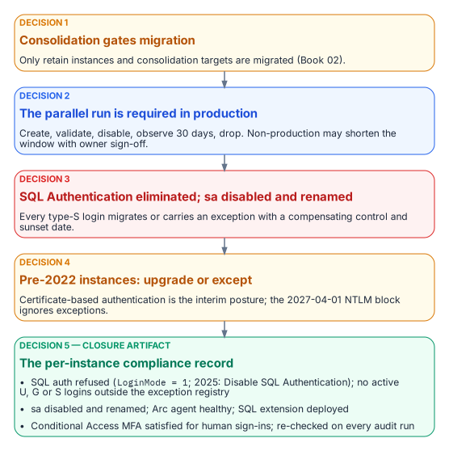

# Chapter 12 — What the Engine-Authentication Decision Settles

*Five governance positions turn the migration pattern into enforceable canon.*

::: {.callout-note}
## In this chapter
The five decisions the engine-authentication decision records: that consolidation gates authentication migration, that the parallel-run sequence is required, that SQL Authentication is eliminated and `sa` disabled and renamed, that pre-2022 instances are upgrade-or-except with a certificate-based authentication interim posture, and that the per-instance compliance record is the closure artifact.
:::

{fig-alt="Five decisions in order: consolidation gates migration, parallel run required, SQL authentication eliminated with sa disabled and renamed, pre-2022 instances upgraded or excepted, and the per-instance compliance record as the closure artifact."}

[Chapter 11](11-three-principal-types.md)'s pattern covers the engineering case, Windows logins migrated through `FROM EXTERNAL PROVIDER`,[^c12-create-login] but leaves governance positions that need a decision, not a narrative. The SQL Server engine-authentication decision (currently proposed) is the engine-layer companion to the Kerberos/NTLM-elimination program (protocol layer) and the Arc non-domain-join requirement (server and OS layer). It answers all five positions, in operational order.

## Decision 1: consolidation precedes and gates authentication migration

::: {.callout-tip title="Established in Chapter 06"}
Every instance is classified retain, consolidate-into-target or retire before any migration work; Arc-eligibility Categories 1–3 ([Chapter 07](07-the-authentication-audit.md)) are layered on top.
:::

The decision makes that assessment the normative prerequisite for this part of the book. Only retain instances and consolidation targets are migrated; migrating logins on instances about to be retired or collapsed is wasted effort. Consolidating into fewer SQL Server 2022 or later targets, Azure SQL Managed Instance, or Arc-enabled SQL Server is also the natural moment to retire cross-domain login sprawl, orphaned SPNs and shared service accounts.

## Decision 2: the parallel-run sequence is required

On every retain or target instance, Windows logins (type `U` users, type `G` groups) and SQL Authentication logins (type `S`) migrate to Entra external-provider logins through Chapter 11's parallel run, which is required for production. The letters are the values of `sys.server_principals.type`, not mnemonics: **S** SQL login, **U** Windows login, **G** Windows group, **E** external (Entra) login or application, **X** external (Entra) group.[^c12-principals] There's no type `W`: a discovery query written against one returns zero rows and reports a clean instance, which is how a typo becomes a false attestation of closure.

Non-production instances may compress the 30-day observation window only with documented owner sign-off. Disable-and-observe keeps every cutover reversible inside the window, so a wrong mapping locks no one out.

## Decision 3: SQL Authentication eliminated; sa disabled and renamed

Every active type-S login on a retain or target instance migrates to a service-principal or managed-identity login, or carries a documented exception with a named compensating control and a sunset date. Open-ended retention isn't an option. A SQL Authentication login is checked against a password in `master` and never reaches Microsoft Entra ID or a domain controller, so Conditional Access can't evaluate it[^c12-ca] and Microsoft Defender for Identity, whose sensors run on domain controllers and other identity servers, never sees it.[^c12-mdi]

`sa` is disabled and renamed on every production instance. Any retained emergency recovery is a documented, monitored break-glass procedure, not an active `sa`. An enabled `sa` with a non-rotated password is the authentication audit's highest-priority finding. On SQL Server 2025 enabled by Azure Arc, the Disable SQL Authentication setting closes the door for `sa` and every other SQL login together.[^c12-disable-sql]

## Decision 4: pre-2022 instances are upgrade-or-except

External-provider logins require SQL Server 2022 or later; on the program's path, that means the Azure extension for SQL Server on an Arc-enabled host. A pre-2022 Category 3 instance can't accept them regardless of Arc status, and neither can a failover cluster instance on any version.[^c12-entra-sql] A Category 3 retain instance either upgrades and follows the Category 2-to-1 pathway or files a sunset-dated exception, though most Category 3 instances should be retire or consolidation candidates. An exception records the reason, the compensating control (for example, an identity-protection product that applies MFA or block policies to NTLM authentication),[^c12-silverfort] the maximum duration, and acknowledgement that the program's 2027-04-01 NTLM block is applied in the operating system's security layer and ignores engine-layer exceptions. That date is the program's own backstop, not a Microsoft deadline ([Chapter 02](02-why-the-inheritance-must-end.md)).

Connections that can't reach Kerberos or Entra authentication by that date use certificate-based authentication, the authorized interim posture, which makes the AD CS-to-Cloud-PKI transformation (Not Yet Defined in the transformation inventory) a hard dependency for the exception long tail ([Chapter 09](09-what-arc-provides-to-sql-server.md), [Chapter 22](22-where-sql-server-touches-adcs.md)).

## Decision 5: the per-instance compliance record is the closure artifact

An instance is closed when its compliance record simultaneously shows:

- SQL authentication refused: `LoginMode = 1` (`SERVERPROPERTY('IsIntegratedSecurityOnly') = 1`), and on SQL Server 2025 the Disable SQL Authentication setting on (`SERVERPROPERTY('IsExternalAuthenticationOnly') = 1`)[^c12-auth-mode][^c12-disable-sql]
- zero active type-S logins outside the exception registry, and zero active type-U or type-G logins
- `sa` disabled and renamed
- the Arc Connected Machine agent connected and healthy, and the Azure extension for SQL Server deployed with Entra authentication configured[^c12-arc-servers]
- for human principals, Conditional Access MFA enforcement satisfied for SQL Server resource sign-ins over a defined validation period

"Done" becomes a queryable posture instead of a claim. Because Windows Authentication is always available and no engine setting disables it,[^c12-choose-mode] the record evidences the Entra-exclusive posture through the absence of Windows logins rather than by reading a mode switch ([Chapter 20](20-the-closure-condition.md)). Closure is continuously verified: the authentication audit runs on a schedule, and drift (`LoginMode` reverting, a new type-S, U or G login, the Arc agent going offline) is a violation that triggers remediation.

::: {.callout-note title="What this chapter establishes"}
1. Consolidation gates migration, and the parallel run is required in production.
2. SQL Authentication is eliminated and `sa` disabled and renamed; pre-2022 instances and failover cluster instances upgrade, re-platform or carry a sunset-dated exception.
3. The per-instance compliance record is the continuously re-verified closure artifact.
:::

::: {.callout-tip}
## Continue the book
[← Previous: Chapter 11 — Three Principal Types: User, Group, Service Principal](11-three-principal-types.md) · [Book index](index.md) · [Next: Chapter 13 — Who Owns the Data Platform →](13-who-owns-the-data-platform.md)
:::

[^c12-create-login]: Microsoft Learn, "CREATE LOGIN (Transact-SQL)," <https://learn.microsoft.com/sql/t-sql/statements/create-login-transact-sql> (accessed Oct 20, 2026).
[^c12-principals]: Microsoft Learn, "sys.server_principals (Transact-SQL)," <https://learn.microsoft.com/sql/relational-databases/system-catalog-views/sys-server-principals-transact-sql> (accessed Oct 20, 2026).
[^c12-ca]: Microsoft Learn, "What is Conditional Access?," <https://learn.microsoft.com/entra/identity/conditional-access/overview> (accessed Oct 20, 2026).
[^c12-mdi]: Microsoft Learn, "Microsoft Defender for Identity sensor v2.x prerequisites," server requirements, <https://learn.microsoft.com/defender-for-identity/deploy/prerequisites-sensor-version-2> (accessed Oct 20, 2026).
[^c12-disable-sql]: Microsoft Learn, "Disable SQL authentication for SQL Server enabled by Azure Arc," <https://learn.microsoft.com/sql/sql-server/azure-arc/disable-sql-authentication> (accessed Oct 20, 2026).
[^c12-entra-sql]: Microsoft Learn, "Microsoft Entra authentication for SQL Server," <https://learn.microsoft.com/sql/relational-databases/security/authentication-access/azure-ad-authentication-sql-server-overview> (accessed Oct 20, 2026).
[^c12-silverfort]: Third-party source (vendor case study), Silverfort, "Customer case study: preventing NTLM-based lateral movement with Silverfort," <https://www.silverfort.com/blog/customer-case-study-preventing-ntlm-based-lateral-movement-with-silverfort/> (accessed Oct 20, 2026). Cited as an example of the control category, not an endorsement.
[^c12-auth-mode]: Microsoft Learn, "Change server authentication mode," <https://learn.microsoft.com/sql/database-engine/configure-windows/change-server-authentication-mode> (accessed Oct 20, 2026).
[^c12-arc-servers]: Microsoft Learn, "What is Azure Arc-enabled servers?," agent status, <https://learn.microsoft.com/azure/azure-arc/servers/overview> (accessed Oct 20, 2026).
[^c12-choose-mode]: Microsoft Learn, "Choose an authentication mode," <https://learn.microsoft.com/sql/relational-databases/security/choose-an-authentication-mode> (accessed Oct 20, 2026).
