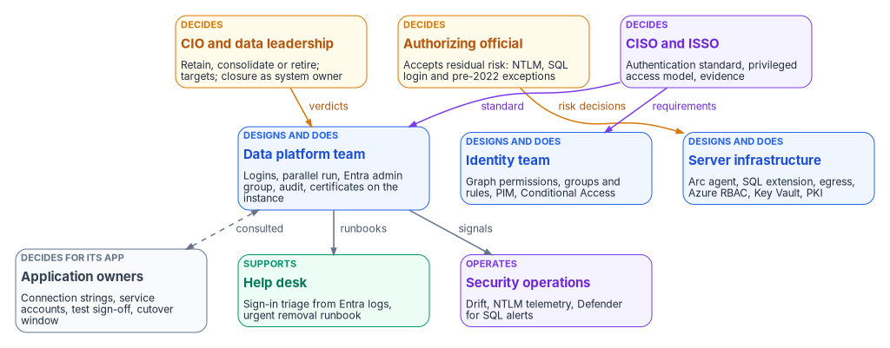
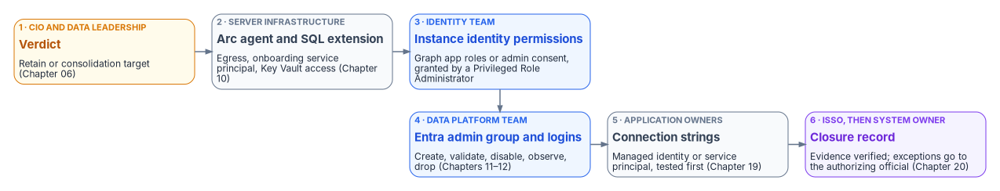

# Chapter 13 — Who Owns the Data Platform

*Under Windows authentication the DBA team owned database access almost by default; once the engine trusts Entra ID, access is decided in five places, so the program has to say who decides what.*

::: {.callout-note}
## In this chapter
The people behind the SQL Server identity transformation: the data platform team, application owners and their developers, the identity team, server infrastructure, the CISO, ISSO and authorizing official, the CIO and data leadership, and the help desk. Where the Data Platform project charter fits. A decide, do and consult matrix for the decisions this book asks for, from consolidation verdicts to closure sign-off. The SQL Server, Entra and Azure permissions each team needs, and why several of them sit outside the DBA team on purpose.
:::

For twenty years a SQL Server estate could run on an informal ownership model. The DBA team mapped Active Directory groups to logins, someone in the directory team decided who was in those groups, and the application team kept a service account password in a configuration file. Nobody had to write down who decided what, because the decisions were small and the people making them sat close together.

Chapters 01 to 12 take that model apart. The consolidation verdict in [Chapter 06](06-retain-consolidate-retire.md) decides which instances deserve to survive. The Arc deployment in [Chapter 10](10-arc-deployment-sequencing.md) puts a server-level agent and an Azure resource in front of the engine. The login migration in [Chapter 11](11-three-principal-types.md) moves the proof of membership from Kerberos tickets to Entra tokens. And the governance positions in [Chapter 12](12-the-engine-authentication-decision.md) turn SQL authentication, `sa` and the pre-2022 long tail into decisions that need a named owner. Each of those steps hands part of database access to a team that isn't the DBA team.

[Book 02, Chapter 06](../b02-identity/06-who-owns-the-migration.md) sets out the general model for the identity migration: the Risk Management Framework roles, the rule of one decider per decision, and the Entra roles for each team. [Book 05, Chapter 06](../b05-devices/06-who-owns-the-endpoint.md) applies it to workstations and Arc-enabled servers. This chapter applies the same model to the data platform and doesn't repeat what those chapters say. The roles, the matrix and the permission map below are the program's recommended model. Adapt them to the agency's governance, but keep one decider per row.

{#fig-b06-ch13-decide-and-do fig-alt="Three rows of cards. Top row, decision makers: CIO and data leadership in amber, who decide retain, consolidate or retire, the consolidation targets, and closure as system owner; the authorizing official in amber, who accepts residual risk such as NTLM, SQL login and pre-2022 exceptions; and the CISO and ISSO in violet, who set the authentication standard, the privileged access model and evidence. Middle row, in blue, the teams that design and do the work: the data platform team, which owns logins, the parallel run, the Entra admin group, the audit and certificates on the instance; the identity team, which owns Graph permissions, groups and rules, PIM and Conditional Access; and server infrastructure, which owns the Arc agent, the SQL extension, egress, Azure RBAC, Key Vault and PKI. Bottom row: application owners in slate, who decide for their application on connection strings, service accounts, test sign-off and cutover windows; the help desk in green, which supports with sign-in triage from Entra logs and the urgent removal runbook; and security operations in violet, which operates drift, NTLM telemetry and Defender for SQL alerts. Arrows run from data leadership to the data platform team labeled verdicts, from the authorizing official to server infrastructure labeled risk decisions, and from the CISO and ISSO to the data platform and identity teams. A dashed two-way arrow labeled consulted joins application owners and the data platform team. The data platform team sends runbooks to the help desk and signals to security operations."}

## Where the roles come from

The [Data Platform project charter](https://github.com/WhalerMike/modernization-workbook/blob/main/docs/projects/data-platform-charter.md) is the starting point. It names a project sponsor and a project lead, both still to be appointed, and four domain leads: Database Authentication, Application-Tier Identity, Secrets Lifecycle and Evidence. As in the endpoint project, those domains are workstreams, not teams, and each one cuts across the teams below. Database Authentication needs the data platform team, the identity team and server infrastructure. Application-Tier Identity can't move without application owners. Secrets Lifecycle spans Key Vault, the SQL Server 2022 app-registration certificate and the TLS certificates in [Chapter 22](22-where-sql-server-touches-adcs.md). Evidence belongs to the ISSO's package. The program's model gives each domain lead the job of driving the workstream and keeping its evidence. The decisions inside the workstream go to the deciders named in the matrix.

The charter also draws two boundaries that this book has to respect. Its initial phase excludes full database consolidation or platform replacement, and application code changes beyond authentication configuration. This book still asks for a retain, consolidate or retire verdict on every instance, because [Chapter 06](06-retain-consolidate-retire.md) makes that verdict the gate for everything else. The program reads the two together this way: the verdict is in scope, while executing a large consolidation, or re-platforming a data domain as [Chapter 23](23-epilogue-the-platform-question.md) describes, needs its own funding decision. Likewise, a connection-string change is in scope, but an application in the code-change column of [Chapter 18](18-the-four-class-pattern-for-applications.md) needs its owner to fund the change or carry a dated exception.

NIST's Risk Management Framework defines the accountable roles this chapter leans on. The authorizing official is the only organizational official who can accept security and privacy risk, and approves plans of action and milestones. The system owner is responsible for a system's procurement, development, integration, modification, operation, maintenance and disposal, and decides who has access to it in coordination with the information owner. The information owner or steward governs the information itself and gives the system owner its security requirements. The system security officer keeps the system's security posture in place day to day and advises on its controls.[^c13-sp80037] The same publication tells organizations to avoid conflicts of interest when one person holds several of these roles.[^c13-sp80037] That matters on a data platform, where the person who wants an exception and the person who can grant it are often a desk apart.

## The roles

### The data platform team

The DBAs and the wider data platform team own the engine and everything inside it. In this transformation they run the estate discovery and the authentication audit ([Chapters 04](04-the-estate-inventory.md) and [07](07-the-authentication-audit.md)), build the login mapping, create the external-provider logins, run the parallel run and the 30-day observation window, and disable and later drop the legacy logins ([Chapter 11](11-three-principal-types.md), [Runbook R05](r05-login-migration-and-parallel-run.md)). They repair SPNs and linked-server security contexts during NTLM restriction ([Chapters 14](14-ntlm-and-the-patterns-that-generate-it.md) and [15](15-the-three-phases-of-ntlm-elimination.md)), and they keep the scheduled audit running so the closure record stays current ([Chapter 20](20-the-closure-condition.md)).

What they no longer own outright is who gets in. The instance's Microsoft Entra administrator is granted `sysadmin` on the instance, and changing the administrator in the Azure portal doesn't remove the previous one, which stays a `sysadmin` until a DBA drops that login by hand.[^c13-entra-tutorial] The program's model makes the Entra administrator a group ([Chapter 17](17-dynamic-membership-delegation-and-privilege.md)) and gives the data platform team the duty to drop the old administrator login whenever it changes. Membership of that group is a privileged access decision under the CISO's model, not a DBA decision.

The engine also offers narrower tools than `sysadmin` for the team's own work. Any Entra principal with `ALTER ANY LOGIN` or `ALTER ANY USER` can create Entra logins or users.[^c13-entra-tutorial] SQL Server 2022 added fixed server roles built for least privilege: `##MS_LoginManager##` can create, delete and modify logins but can't grant permissions, and the reader roles such as `##MS_ServerSecurityStateReader##` and `##MS_DefinitionReader##` give read access to security state and metadata. Microsoft says to treat `securityadmin` as equivalent to `sysadmin`, and warns that `##MS_SecurityDefinitionReader##` can view password hashes for SQL logins.[^c13-server-roles] The program's model gives the people who run the parallel run `##MS_LoginManager##` and the reader roles they need, and keeps `sysadmin` in the PIM-governed group.

### Application owners and their developers

Application owners decide for their own applications. They know which service accounts, connection strings, linked servers and hard-coded group names an application depends on, and they're the only people who can accept a test result or a cutover window for it. In this book they own the application audit results and the two-axis placement in [Chapter 18](18-the-four-class-pattern-for-applications.md), and the connection-string change in [Chapter 19](19-connection-string-migration.md). Their developers make that change and prove it in a non-production environment whose Arc and SQL extension configuration matches production.

Two things are easy to miss. First, data owners are a separate role from application owners even when the same person holds both. A data owner decides who should be able to read a ledger. An application owner decides when the ledger application's connection string changes. [Chapter 17](17-dynamic-membership-delegation-and-privilege.md) gives the data owner the job of confirming that each dynamic rule still describes the intended population. Second, an application owner who can't move by the program's dates doesn't decide to stay on NTLM or SQL authentication. Staying is a risk acceptance, so it goes to the authorizing official as an exception.

### The identity team

The identity team owns the Entra side of the engine's identity, and several of its steps can't be done by anyone else. On SQL Server 2025, the Arc server's managed identity needs the Microsoft Graph application permissions `User.Read.All`, `GroupMember.Read.All` and `Application.Read.All`, assigned directly to each managed identity, and only a Privileged Role Administrator or higher can grant them.[^c13-mi-setup] On SQL Server 2022, the app registration's Graph permissions need admin consent, which also requires a Privileged Role Administrator or higher.[^c13-entra-tutorial] Privileged Role Administrator can manage assignments for every Entra role, including Global Administrator.[^c13-entra-roles] The program's model keeps it with a small, named group in the identity team, eligible through PIM, and never with the data platform team.

The identity team also builds the groups and dynamic rules of [Chapters 16](16-groups-roles-and-membership.md) and [17](17-dynamic-membership-delegation-and-privilege.md), the administrative units that scope DBA delegation, the PIM for Groups settings for privileged SQL access, and the Conditional Access policies that sit in front of every token. PIM for Groups lets an administrator require MFA, justification and approval to activate a membership, and limit how long it lasts.[^c13-pim-groups] Every user eligible for a PIM-managed group needs a Microsoft Entra ID P2 or Microsoft Entra ID Governance license. Managing membership of a role-assignable group in PIM needs a role such as Privileged Role Administrator, while Groups Administrator or Identity Governance Administrator is enough for groups that aren't role-assignable, and PIM doesn't support groups in restricted management administrative units.[^c13-pim-assign] In NIST terms the identity team is a common control provider: it implements, assesses and monitors controls that the database systems inherit, and documents them for the systems' security plans.[^c13-sp80037]

### Server infrastructure

Server infrastructure owns the host and the Azure resources around it. It confirms egress, installs the Connected Machine agent, deploys the Azure extension for SQL Server and owns the onboarding service principal ([Chapter 10](10-arc-deployment-sequencing.md), [Runbook R04](r04-arc-deployment-and-managed-identity.md)). [Book 05, Chapter 09](../b05-devices/09-servers-under-azure-arc.md) covers Arc for servers in general, and this book stays consistent with it.

Azure role assignments on these resources are now part of SQL Server security. Microsoft recommends giving the Azure Connected Machine Onboarding role only to the service principal that onboards machines, and warns that anyone with Contributor on an Arc server resource can deploy extensions that run arbitrary scripts with privilege, so should be treated as an indirect administrator of the server.[^c13-arc-rbac] Connecting SQL Server to Arc needs Onboarding or Contributor, Azure Connected Machine Resource Administrator and Reader on the resource group.[^c13-entra-overview] On SQL Server 2025, Owner and Contributor on the SQL Server resource can turn SQL authentication off or back on from the portal, with the same permissions that set the instance's Entra administrator. Microsoft points out that this Azure RBAC path is how you recover if you lose data-plane access.[^c13-disable-sql] In the program's model, whoever holds those Azure roles holds a SQL Server privilege, so the assignments go through the same review as `sysadmin`.

The host itself carries privilege too. The agent's token endpoint answers only local administrators and members of the Hybrid agent extension applications group.[^c13-arc-rbac] On SQL Server 2025, Microsoft says to treat the `ADMINISTER BULK OPERATIONS` and `ADMINISTER DATABASE BULK OPERATIONS` permissions as equivalent to `sysadmin`, because `OPENROWSET BULK` can read the agent's tokens folder.[^c13-mi-overview] For SQL Server 2022, infrastructure owns the Key Vault that holds the instance's certificate. The Arc machine needs the Key Vault Certificate User and Key Vault Secrets User roles on it, and Microsoft recommends a certificate validity of at most 12 months.[^c13-entra-tutorial] The program's model puts the renewal date for that certificate, the TLS certificates and any ADCS-issued certificate behind a type-C login on one calendar that infrastructure owns and the data platform team checks ([Chapter 22](22-where-sql-server-touches-adcs.md)).

### Security, the ISSO and the authorizing official

The CISO's organization decides the standard every instance has to meet: SQL authentication refused, `sa` disabled and renamed, the privileged access model for `sysadmin` and the Entra administrator, the Conditional Access requirements for SQL Server sign-ins, and the break-glass design in [Appendix B](appendix-b-ato-kit.md). Security operations receives the drift events, NTLM telemetry and Defender for SQL alerts of [Chapter 20](20-the-closure-condition.md).

The ISSO assembles the evidence and runs the exception registry. That includes the per-instance compliance records, the six artifact sets of [Chapter 21](21-what-done-looks-like.md), every SQL-login, NTLM and pre-2022 exception with its compensating control and sunset date, and the requirements mapping in [Appendix A](appendix-a-requirements-mapping.md). The ISSO is consulted on every design decision that changes a control.

The authorizing official accepts the risks the program can't remove yet. In this book that means each NTLM exception, each SQL authentication login kept past its migration, each pre-2022 instance on the certificate-based interim posture, and the leveraged cloud services described in [Appendix B](appendix-b-ato-kit.md). The 2027-04-01 date in [Chapter 15](15-the-three-phases-of-ntlm-elimination.md) is the program's own NTLM backstop, not a Microsoft deadline. The open question there, whether an instance without its interim posture gets a dated exception with network isolation, belongs to the Kerberos/NTLM-elimination program and its exception registry, and each exception it grants still reaches the authorizing official.

### The CIO and data leadership

The CIO and data leadership own the platform question. They decide each instance's retain, consolidate or retire verdict, the consolidation targets, whether a pre-2022 retain instance is upgraded or retired, and, later, the per-domain platform choice of [Chapter 23](23-epilogue-the-platform-question.md). In NIST's terms they usually hold the system owner role for the data platform, and so they're the ones who declare an instance or the estate closed, on the ISSO's evidence. A mission or business owner can also serve as the authorizing official,[^c13-sp80037] and in that case the program's model still records the two decisions separately.

### The help desk

The help desk sees the change first. A user whose token request is refused by Conditional Access gets a failed connection and calls the help desk, not the DBA team. The program's model gives help desk staff read access to Entra sign-in logs so they can see the Conditional Access result for a SQL Server sign-in. Reports Reader is the least-privileged Entra role that can read the audit and sign-in logs.[^c13-least-priv] The help desk also runs its part of the urgent removal path in [Chapter 16](16-groups-roles-and-membership.md): disabling the Entra account and revoking sessions while the data platform team ends the user's SQL Server sessions.

The help desk's own Entra roles need limits. Helpdesk Administrator can reset passwords for non-administrators, and Microsoft notes that changing a user's password can mean assuming that user's identity and permissions. It can't change the credentials of members or owners of a role-assignable group.[^c13-entra-roles] That's one more reason the program puts privileged SQL access in cloud-only, role-assignable groups ([Chapter 17](17-dynamic-membership-delegation-and-privilege.md)): it keeps help desk credential resets away from the people who hold `sysadmin`.

## The responsibility matrix

{#fig-b06-ch13-instance-handoffs fig-alt="Six cards in two rows, joined in order by arrows. Step 1, CIO and data leadership in amber: the verdict, retain or consolidation target, Chapter 06. Step 2, server infrastructure in slate: the Arc agent and SQL extension, with egress, the onboarding service principal and Key Vault access, Chapter 10. Step 3, the identity team in blue: instance identity permissions, Graph app roles or admin consent granted by a Privileged Role Administrator. Step 4, the data platform team in blue: the Entra admin group and logins, through create, validate, disable, observe and drop, Chapters 11 and 12. Step 5, application owners in slate: connection strings moved to a managed identity or service principal and tested first, Chapter 19. Step 6, the ISSO and then the system owner in violet: the closure record, with evidence verified and exceptions sent to the authorizing official, Chapter 20."}

No single team can take an instance from verdict to closure on its own, as the figure shows. The matrix assigns the decisions along that path.

D = decides (accountable) · R = does the work · C = consulted · blank = informed at most.

| Decision or work item | CIO / data leadership | AO | CISO | ISSO | Data platform | Identity | Infrastructure | App and data owners | Help desk |
|---|---|---|---|---|---|---|---|---|---|
| Retain, consolidate or retire verdict per instance ([Chapter 06](06-retain-consolidate-retire.md)) | D | | | C | R | | C | C | |
| Consolidation target for each consolidated workload ([Chapter 06](06-retain-consolidate-retire.md)) | D | | C | | R | C | R | C | |
| Upgrade or retire a pre-2022 retain instance ([Chapter 08](08-reading-the-audit.md)) | D | C | | C | R | | R | C | |
| Dated exception for a pre-2022 instance, with its interim posture ([Chapter 12](12-the-engine-authentication-decision.md)) | C | D | C | R | R | | C | C | |
| Arc onboarding order and the onboarding service principal ([Chapter 10](10-arc-deployment-sequencing.md)) | | | C | C | C | | D, R | | |
| Graph permissions or admin consent for the instance's Entra identity ([Chapter 10](10-arc-deployment-sequencing.md)) | | | C | | C | D, R | C | | |
| Authentication standard: SQL authentication refused, `sa` disabled and renamed ([Chapter 12](12-the-engine-authentication-decision.md)) | | C | D | C | R | | | C | |
| Authentication mode per instance, applied against the standard | | | | C | D, R | | R | C | |
| Keeping a SQL authentication login past migration ([Chapter 12](12-the-engine-authentication-decision.md)) | | D | C | R | C | | | C | |
| Privileged access model: Entra admin group, PIM for Groups settings, break-glass ([Chapter 17](17-dynamic-membership-delegation-and-privilege.md), [Appendix B](appendix-b-ato-kit.md)) | | C | D | C | R | R | C | | |
| Group design and dynamic rules for each database role ([Chapters 16](16-groups-roles-and-membership.md)–[17](17-dynamic-membership-delegation-and-privilege.md)) | | | C | C | C | R | | D | |
| Login migration window and legacy-login disable per instance ([Chapter 11](11-three-principal-types.md)) | | | | C | D, R | C | | C | C |
| Shortening the 30-day observation window in non-production ([Chapter 12](12-the-engine-authentication-decision.md)) | D | | | C | R | | | C | |
| Connection-string cutover per application ([Chapter 19](19-connection-string-migration.md)) | | | | | C | C | C | D, R | C |
| SPN and linked-server remediation ([Chapters 14](14-ntlm-and-the-patterns-that-generate-it.md)–[15](15-the-three-phases-of-ntlm-elimination.md)) | | | C | | D, R | | R | C | |
| NTLM exception for a connection that can't move in time ([Chapter 15](15-the-three-phases-of-ntlm-elimination.md)) | C | D | C | R | C | | C | C | |
| TLS and app-registration certificate renewal per instance ([Chapter 22](22-where-sql-server-touches-adcs.md)) | | | | C | R | | D, R | | |
| Replacement CA and the ADCS decommission date ([Chapter 22](22-where-sql-server-touches-adcs.md)) | D | C | C | C | C | C | R | | |
| Urgent access removal procedure ([Chapter 16](16-groups-roles-and-membership.md)) | | | D | C | R | R | | | R |
| Drift response and remediation ([Chapter 20](20-the-closure-condition.md)) | | | D | C | R | R | R | C | |
| Closure sign-off per instance and for the estate ([Chapters 20](20-the-closure-condition.md)–[21](21-what-done-looks-like.md)) | D | C | C | R | R | | | C | |

Four rows need comment.

The authentication standard and the per-instance mode are separate rows on purpose. The CISO decides the standard once, and the data platform team applies it instance by instance. An instance that can't meet the standard doesn't get a local decision to stay in Mixed Mode. It gets an exception row, decided by the authorizing official.

Group design sits with the app and data owners because, in NIST's model, the system owner decides who has access in coordination with the information owner.[^c13-sp80037] The identity team writes the rule. The data owner says whether it describes the right people. That split also follows the principle in [Chapter 17](17-dynamic-membership-delegation-and-privilege.md) that the attribute writer controls access, so neither team can change a SQL Server grant alone.

Shortening the observation window in non-production sits with data leadership as the system owner, because [Chapter 12](12-the-engine-authentication-decision.md) allows it only with documented owner sign-off. The data platform team proposes it and can't approve its own proposal.

Closure sign-off sits with data leadership, not the authorizing official, because closure is a claim about the system's state, made by the system owner on the ISSO's evidence. The authorizing official is consulted because the exception registry that comes with every closure claim is a list of risks the authorizing official has accepted. A closure claim that arrives with new exceptions needs those exceptions accepted first.

## Permissions for each team

Decision rights don't change what a console lets someone do. Permissions do, and on this platform they live in three places: SQL Server, Microsoft Entra ID and Azure RBAC. The program maps each team to the narrowest permission that does its work, makes the privileged ones eligible through PIM, and reviews the Azure and SQL Server assignments with the same cadence as the Entra ones.

| Team | SQL Server | Microsoft Entra ID | Azure RBAC |
|---|---|---|---|
| Data platform (daily work) | `##MS_LoginManager##` and reader roles such as `##MS_ServerSecurityStateReader##`[^c13-server-roles] | Reports Reader for sign-in evidence[^c13-least-priv] | Reader on SQL Server resources |
| Data platform (privileged) | Member of the instance's Entra admin group, which holds `sysadmin`, through PIM for Groups[^c13-entra-tutorial][^c13-pim-groups] | None routinely | Contributor on the SQL Server resource only where the team manages its Entra settings, and reviewed as a SQL privilege[^c13-disable-sql] |
| Identity team | None routinely | Groups Administrator scoped to an administrative unit; Privileged Role Administrator for a small named group, eligible only[^c13-pim-assign][^c13-entra-roles] | None |
| Server infrastructure | None routinely | None routinely | Azure Connected Machine Resource Administrator on server resource groups; Onboarding role held only by the onboarding service principal[^c13-arc-rbac] |
| ISSO, assessors | `##MS_ServerSecurityStateReader##` and `##MS_DefinitionReader##`, not `##MS_SecurityDefinitionReader##`[^c13-server-roles] | Reports Reader or Security Reader[^c13-least-priv] | Reader |
| Help desk | None | Reports Reader; Helpdesk Administrator scoped to an administrative unit[^c13-least-priv][^c13-entra-roles] | None |

Two consequences follow. First, Azure RBAC on Arc and SQL Server resources is a database control, because Contributor on the server can run privileged extensions and Contributor on the SQL Server resource can switch SQL authentication back on. Second, the narrowest SQL Server roles exist only on SQL Server 2022 and later. That's one more reason the pre-2022 long tail is an exception to retire, not a steady state.

## Ownership in practice

Under Windows authentication, a database grant had one owner because it had one plumbing. In the target, one connection depends on an Entra group the identity team built, a rule the data owner approved, a managed identity whose Graph permissions a Privileged Role Administrator granted, an Arc agent infrastructure keeps healthy, a login the DBAs created and a connection string the application team changed. If any of those owners is missing, the gap shows up as drift in the closure record, or as a help desk call nobody can resolve. That's why the program names the owner of each step before the first login moves, and why [Chapter 14](14-ntlm-and-the-patterns-that-generate-it.md) starts the How part with the NTLM patterns, whose fixes need almost every team in this chapter.

::: {.callout-tip}
## Continue the book
[← Previous: Chapter 12 — What the Engine-Authentication Decision Settles](12-the-engine-authentication-decision.md) · [Book index](index.md) · [Next: Chapter 14 — NTLMv1, NTLMv2 and the Patterns That Generate NTLM →](14-ntlm-and-the-patterns-that-generate-it.md)
:::

[^c13-sp80037]: National Institute of Standards and Technology, SP 800-37 Rev. 2, *Risk Management Framework for Information Systems and Organizations: A System Life Cycle Approach for Security and Privacy*, Appendix D, December 2018, <https://nvlpubs.nist.gov/nistpubs/SpecialPublications/NIST.SP.800-37r2.pdf> (accessed Oct 20, 2026).
[^c13-entra-tutorial]: Microsoft Learn, "Set up Microsoft Entra authentication with app registration — SQL Server enabled by Azure Arc," <https://learn.microsoft.com/sql/sql-server/azure-arc/entra-authentication-setup-tutorial> (accessed Oct 20, 2026).
[^c13-server-roles]: Microsoft Learn, "Server-level roles," <https://learn.microsoft.com/sql/relational-databases/security/authentication-access/server-level-roles> (accessed Oct 20, 2026).
[^c13-mi-setup]: Microsoft Learn, "Set up managed identity and Microsoft Entra authentication for SQL Server enabled by Azure Arc," <https://learn.microsoft.com/sql/sql-server/azure-arc/microsoft-entra-authentication-with-managed-identity> (accessed Oct 20, 2026).
[^c13-entra-roles]: Microsoft Learn, "Microsoft Entra built-in roles," sections "Privileged Role Administrator" and "Helpdesk Administrator," <https://learn.microsoft.com/entra/identity/role-based-access-control/permissions-reference> (accessed Oct 20, 2026).
[^c13-pim-groups]: Microsoft Learn, "Privileged Identity Management (PIM) for Groups," <https://learn.microsoft.com/entra/id-governance/privileged-identity-management/concept-pim-for-groups> (accessed Oct 20, 2026).
[^c13-pim-assign]: Microsoft Learn, "Assign eligibility for a group in Privileged Identity Management," <https://learn.microsoft.com/entra/id-governance/privileged-identity-management/groups-assign-member-owner> (accessed Oct 20, 2026).
[^c13-arc-rbac]: Microsoft Learn, "Identity and authorization — Azure Arc-enabled servers," <https://learn.microsoft.com/azure/azure-arc/servers/security-identity-authorization> (accessed Oct 20, 2026).
[^c13-entra-overview]: Microsoft Learn, "Microsoft Entra authentication for SQL Server," section "Remarks," <https://learn.microsoft.com/sql/relational-databases/security/authentication-access/azure-ad-authentication-sql-server-overview> (accessed Oct 20, 2026).
[^c13-disable-sql]: Microsoft Learn, "Disable SQL authentication — SQL Server enabled by Azure Arc," sections "Permissions" and "Prepare your environment," <https://learn.microsoft.com/sql/sql-server/azure-arc/disable-sql-authentication> (accessed Oct 20, 2026).
[^c13-mi-overview]: Microsoft Learn, "Managed identity for SQL Server enabled by Azure Arc," section "Limitations," <https://learn.microsoft.com/sql/sql-server/azure-arc/managed-identity> (accessed Oct 20, 2026).
[^c13-least-priv]: Microsoft Learn, "Least privileged roles by task in Microsoft Entra ID," section "Monitoring and health — Audit and sign-in logs," <https://learn.microsoft.com/entra/identity/role-based-access-control/delegate-by-task> (accessed Oct 20, 2026).
